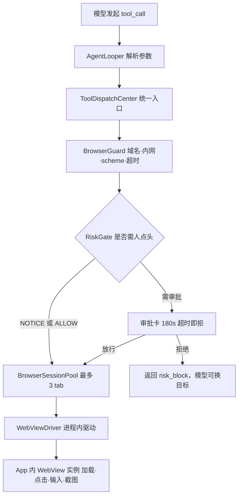
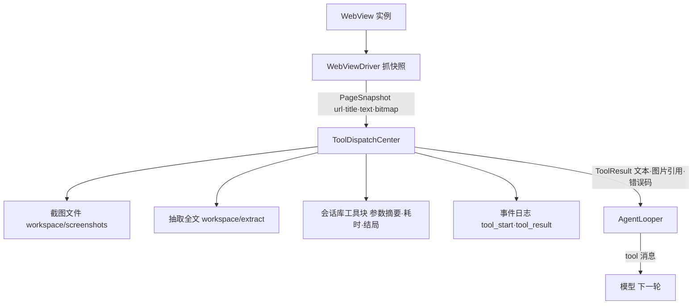
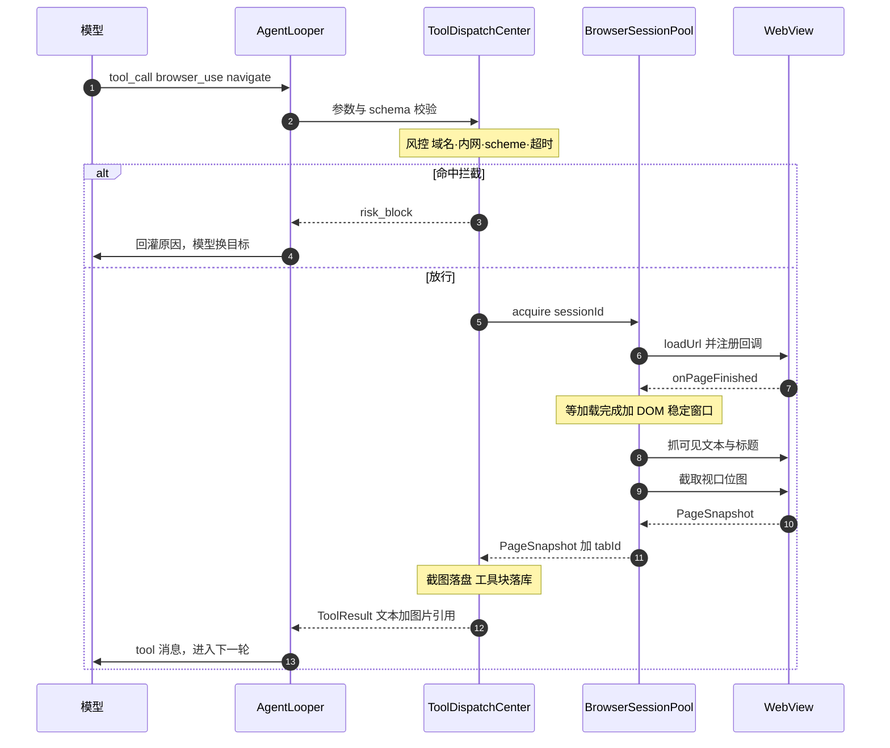
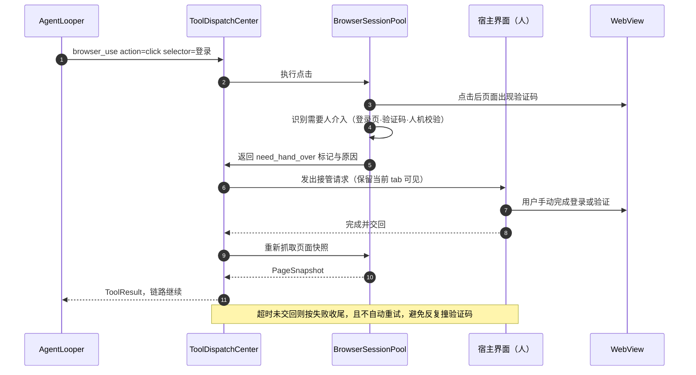
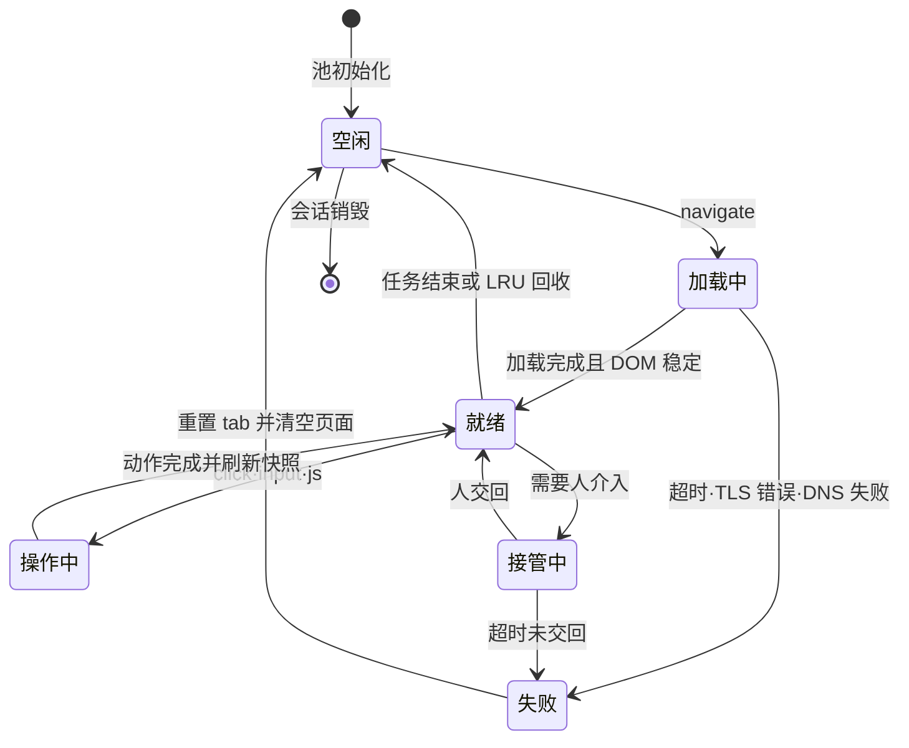
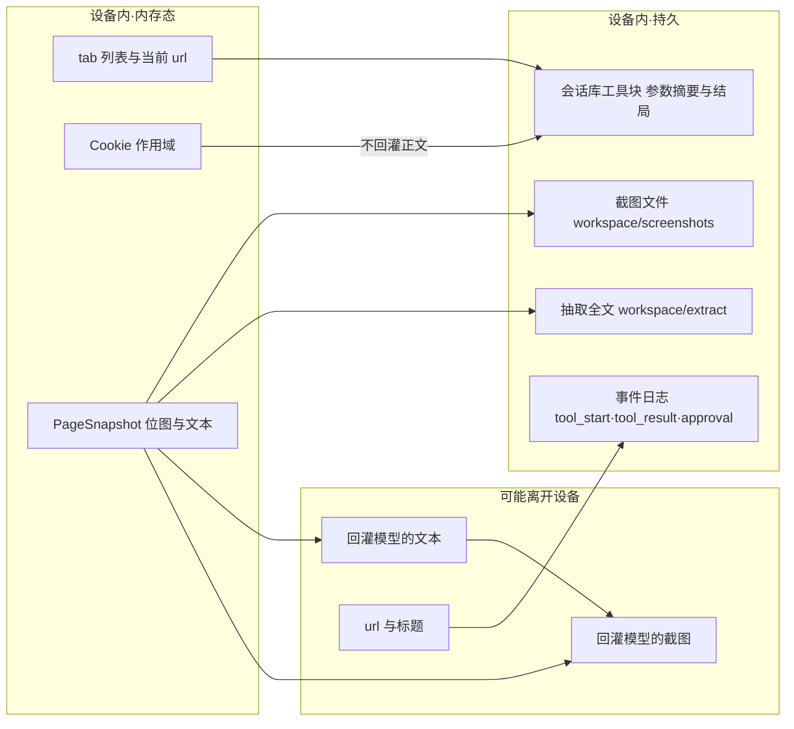

# browser_use 浏览器工具数据链路分析

> 分析对象：nanoMuse Android 端 `browser_use` 工具，从模型发起调用到截图回灌模型的完整数据链路。
> 本文与《方案设计文档 V1.1》第 7.6 节、`runtime/COVERAGE.md` 的口径对齐；凡属源码实证的结论标注「实证」，凡属本项目移植形态的设计取舍标注「设计」，凡属无法从现有材料确认的实现细节标注「待核」。

## 1 一条链路的位置：它为什么不能走云端

browser_use 是 10 个 P0 端侧独占工具之一。理由是物理性的，不是策略性的：浏览器会话长在 Android WebView 上，标签页、Cookie、渲染结果、截图都在这台设备的进程里。云端没有这双眼睛，也没有这双手。

由此得到三条硬约束（与 RootRouter 的决策规则一致）：

- 请求依赖 browser_use 时，Router 不得判定为纯 CLOUD；命中即降到 HYBRID 或 LOCAL。
- HYBRID 模式下，云端只能下发 `TOOL_CALL`，实际页面操作与截图必须回到端侧执行，结果以 `TOOL_RESULT` 回传。
- 工具结果里的截图是「设备侧产生的数据」，它是否离开设备，取决于模型端点在哪——这是本文第 8 节的数据边界问题。

## 2 组件架构：一次调用要穿过什么

模型看到的只有一行 schema，实际要穿过六层。拆成两张图看：一张是调用怎么下去，一张是结果怎么上来、落到哪里。

**下行：一次调用穿过五道关卡才到页面**



**上行：结果怎么回到模型，同时落到哪**



四条结构性事实：

- **三道闸里 browser_use 走的是专属闸。** 它不是 shell，所以不过 ShellGuard 的四问；它过的是 BrowserGuard（域名、内网、scheme、下载、Cookie 作用域）。若命中高风险档（如向外部表单提交凭证、访问被标记的资金类站点），再升级到 RiskGate 弹审批。
- **执行是进程内的，不进沙箱。** 报告里明确：文件、图片、浏览器、记忆属「进程内 Kotlin」这一路径，与 Alpine 命令、offload CLI 并列。这决定了它的延迟构成里没有 proot 启动开销，也决定了它不会被 shell 超时（900s）约束，而是走自己的动作级超时。
- **标签页是有上限的资源池。** 最多 3 个。「最多」不是产品限制的修辞，而是内存与渲染进程的预算：每个 WebView 实例都可能带来独立渲染进程与几十 MB 占用，端侧必须设上限并做 LRU 回收。
- **截图是唯一的视觉通道。** 模型对页面的认知有三种来源：`text`（提取的可见文本）、`url/title`（位置感）、`screenshot`（布局与视觉状态）。三者缺一都会让模型「盲操作」——只有 text 会点错位置，只有截图会读不出结构化内容。

> 说明：报告给出的是能力清单（导航、截图、点击、输入、JS、Cookie、hand_over，最多 3 个标签页），未给出内部类名与字段级实现。「进程内驱动 + WebView」为实证结论；`BrowserSessionPool`、`WebViewDriver`、`PageSnapshot` 是本项目为移植而抽象出的接口命名（设计）。

## 3 时序：一次 navigate → observe 的完整往返

下面这张图是链路的骨架。注意两个「等」：等页面静默、等模型决定下一步。前者是浏览器工具自己的事，后者属于回合循环。



关键时序约束（研发实现必须满足）：

| 环节 | 约束 | 违反后果 |
| --- | --- | --- |
| 参数校验 | action 必须落在枚举内；url 必须是绝对地址；selector 与 text 的必填关系按 action 分派 | 模型幻觉参数直接打到 WebView，可能触发非预期导航 |
| 风控位置 | 必须在 `loadUrl` 之前，不能在页面加载后再判断 | 恶意页面已经拿到请求，拦截失去意义 |
| 页面静默 | 加载完成事件 + 一个稳定窗口（建议 300–800 ms），二者都满足才截图 | 截到半渲染页面，模型据此点错按钮 |
| 截图时机 | 必须在文本提取之后、动作结束之前，保证二者描述同一页面状态 | 文本与截图来自不同时刻，模型判断自相矛盾 |
| 落库顺序 | 先落库与写产物，再回灌模型 | 崩溃后模型看到过、库里没有，无法重放 |
| 结果结构 | 成功标志、结果码、文本、截图引用、tabId、耗时、是否截断 | 缺 tabId 则多标签场景无法继续操作 |

## 4 六个动作各自的数据形态

browser_use 的能力清单在报告里是七个动作，方案文档 7.6 目前只写了四个（navigate / click / input / extract）。这是一处真实缺口：**协议枚举少于实现能力**。下表按实证能力补齐，并给出每个动作的入参、出参与落点。

| 动作 | 入参要点 | 出参要点 | 数据落点 | 风控要点 |
| --- | --- | --- | --- | --- |
| navigate | url（绝对地址）、可选 waitUntil | 最终 url、title、文本、截图 | 截图文件 + 工具块 | scheme 白名单、内网拦截、域名黑名单、跳转链重定向检查 |
| screenshot | 可选 tabId、全页或视口 | PNG 位图或文件路径 | 截图文件 | 页面含凭证字段时打码或整页拒绝 |
| click | selector 或坐标、tabId | 点击后页面状态与新截图 | 截图文件 + 工具块 | 命中「支付/提交/删除」语义的按钮升级审批 |
| input | selector、text、是否回车提交 | 提交后页面状态与新截图 | 工具块（text 只存摘要或哈希） | 输入框为密码类时拒绝写入并回灌原因 |
| js | 脚本片段、超时 | 求值结果（序列化后限长） | 工具块（结果截断） | 禁止读取 Cookie 与跨域请求；只读上下文 |
| cookie | 读或写、域名、键值 | 命中域的键值或写入结果 | 不落库，仅内存 | 限定同会话同域；值不回灌模型正文 |
| hand_over | 原因（登录/验证码/人机校验） | 人接管后的页面快照 | 截图 + 审批类事件 | 必须由人完成，模型不得代替输入凭证 |

补齐后的协议形状（与方案文档 6.3 的 ToolCall 结构一致，仅扩展 action 枚举）：

```json
{
  "tool_name": "browser_use",
  "session_id": "s-01",
  "timeout": 30000,
  "parameters": {
    "action": "navigate",
    "url": "https://example.com/list",
    "tab_id": "t1",
    "wait_until": "dom_stable"
  }
}
```

```json
{
  "success": true,
  "code": 0,
  "msg": "ok",
  "data": {
    "tab_id": "t1",
    "url": "https://example.com/list",
    "title": "列表页",
    "text": "前 2000 字符的可见文本……",
    "text_truncated": true,
    "text_full_path": "workspace/extract/s-01/t1-1731.txt",
    "screenshot_path": "workspace/screenshots/s-01/t1-1731.png",
    "elapsed_ms": 1840
  },
  "risk_block": false,
  "risk_msg": ""
}
```

两个设计取舍值得写明：

- **文本与截图都给，但都限长。** 文本截断保留头尾并落全文到 workspace；截图默认视口，全页截图需显式请求。理由是上下文预算：一张 1080×2400 的 PNG 转 base64 后很容易吃掉数万 token。
- **Cookie 是工具能力，不是模型上下文。** 读 Cookie 的结果不回灌正文，只允许用于同会话内的后续动作。凭证一旦进入模型上下文，就等于离开了设备边界。

## 5 hand_over：把「人」作为链路中的一个节点

这是 browser_use 与其它工具最不一样的地方：它的执行可以被合法地挂起，等人。登录、验证码、人机校验、支付确认，四种场景都不该由模型代劳。



三条规则：

- **接管期间 Loop 是挂起的，不是空转的。** 挂起有上限（沿用审批的 180 秒口径，或按任务类型放宽到 10 分钟），超时即失败，且该动作不自动重试。
- **接管不改变 tab 归属。** 人操作的是同一个 WebView 实例、同一个 Cookie 作用域，交回后模型看到的是人操作后的页面，而不是一个新会话。
- **接管事件必须留痕。** 谁在什么时候接管了哪个 tab、因为什么原因，写进事件流（类型可复用 `approval`，decision 记为 `HAND_OVER`）。这是审计链上唯一的「人做了动作」的记录点。

## 6 标签页状态机与资源回收

三个标签页是硬预算，必须有明确的生命周期，否则会退化成「跑到第三轮就 OOM」。



回收策略（设计）：

- 池满且需要新 tab 时，按「最久未操作」回收空闲 tab，正在接管中的 tab 不参与回收。
- WebView 渲染进程崩溃时，销毁该 tab 并按最后已知 url 重建一次；重建失败则本次调用失败，不无限重试。
- 会话结束或任务取消时，统一销毁全部 tab、清空内存态；Cookie 是否保留由会话配置决定（默认随会话结束清除）。

## 7 数据怎么流转、怎么存：四类数据、四个落点

把这条链路的数据按「是否离开设备」和「是否持久」两维切开，会得到一张很清晰的表。



逐项说明：

| 数据 | 载体 | 是否持久 | 是否可能离开设备 | 留存策略 |
| --- | --- | --- | --- | --- |
| tab 列表与当前 url | 进程内存 | 否 | 是（作为上下文的一部分） | 会话结束即释放 |
| Cookie | WebView CookieManager | 按会话配置 | **否** | 默认随会话清除；不写入工具结果正文 |
| 页面位图 | 内存 Bitmap → PNG 文件 | 是（文件） | 是（若模型在云端） | 随会话清理；可配置不落盘只回灌 |
| 可见文本 | 工具块 + 抽取全文文件 | 是 | 是 | 截断入上下文，全文落 workspace |
| 工具块 | 会话库 | 是 | 否 | 随会话删除 |
| 事件 | NDJSON 追加文件 | 是 | 否 | 按天滚动，导出后归档 |

三条必须守住的边界：

- **截图是隐私密度最高的产物。** 一张页面截图可能包含账号、余额、地址、聊天内容。默认应落在应用私有目录且不参与「共享目录」导出；跨端协同（HYBRID）时若要上送，必须先在端侧完成脱敏或只上送文本。
- **Cookie 不进模型上下文。** 这是硬线，不是建议。模型能「用」Cookie 的唯一方式是继续调用工具动作，而不是看到它的值。
- **URL 也要过脱敏。** 查询串里经常带 token、手机号、订单号；写事件流时应保留 host 与 path，对 query 做白名单或哈希。

## 8 失败模式与降级

浏览器是外部世界，失败是常态。每一种失败都要给出「模型能理解的原因」，否则模型会盲目重试，把 200 轮预算烧在一个 DNS 错误上。

| 情形 | 系统行为 | 回灌模型的内容 | 是否重试 |
| --- | --- | --- | --- |
| 域名不存在 / DNS 失败 | 立即失败，不重试 | `dns_error` + 目标 host | 否，提示换目标 |
| TLS 证书错误 | 失败；不得静默忽略证书 | `tls_error` | 否 |
| 页面 4xx / 5xx | 仍抓快照与文本（错误页也是信息） | 状态码 + 错误页文本 | 否 |
| 加载超时（默认 30s） | 中止加载，抓当时快照 | `timeout` + 部分快照 | 允许一次 |
| 命中黑名单 / 内网地址 | 在 `loadUrl` 前拦截 | `risk_block` + 类别 | 否 |
| 页面要求登录或验证码 | 进入 hand_over 挂起 | 挂起中；超时后 `hand_over_timeout` | 否 |
| WebView 渲染进程崩溃 | 重建 tab 一次 | 若重建失败则 `renderer_crash` | 一次 |
| 截图失败（页面空白或受保护） | 返回文本，标记无截图 | `screenshot_unavailable` | 否 |
| 下载被触发 | 拦截下载，不落盘 | `download_blocked` | 否 |
| 内存压力（tab 超预算） | LRU 释放空闲 tab | 正常返回，可能换 tabId | 不适用 |

## 9 移植形态：同一份数据链路，换一个驱动

browser_use 是报告里明确列为「搬不走」的三块之一——因为 WebView 的标签页、Cookie、截图都长在 Android 上。但**搬不走的是驱动，不是链路**。链路本身（参数校验 → 风控 → 会话池 → 驱动 → 快照 → 落库 → 回灌）与平台无关。

做法是把驱动抽成一个接口，Android 与后台形态各实现一份，接口之下不同、接口之上完全一致：

```kotlin
interface BrowserDriver {
    suspend fun navigate(tabId: String, url: String, waitUntil: String): PageSnapshot
    suspend fun click(tabId: String, selector: String): PageSnapshot
    suspend fun input(tabId: String, selector: String, text: String): PageSnapshot
    suspend fun evalJs(tabId: String, script: String, timeoutMs: Long): String
    suspend fun cookie(tabId: String, op: String, key: String?): Map<String, String>
    suspend fun screenshot(tabId: String, fullPage: Boolean): ByteArray
    suspend fun close(tabId: String)
}

data class PageSnapshot(
    val tabId: String,
    val url: String,
    val title: String,
    val text: String,
    val textTruncated: Boolean,
    val bitmap: ByteArray?,
    val statusCode: Int?
)
```

| 宿主 | 驱动实现 | 差异点 | 链路是否变化 |
| --- | --- | --- | --- |
| Android | `WebViewDriver`（App 内 WebView 实例 + 注入 JS） | 天然共享用户登录态；受 WebView 版本与渲染进程限制 | 不变 |
| 无界面后台 | `PlaywrightDriver`（本地 Chromium 子进程） | 独立 Cookie 库、无系统登录态；启动开销更大 | 不变 |
| 云端 | 不实现 | 云端无本地独占工具，Router 不允许纯 CLOUD | 不适用 |

移植时两个必须承认的语义差：

- **登录态不同源。** WebView 直接用用户的 App 会话与系统 Cookie；Playwright 是干净容器，需要自己登录或导入 Cookie。同一个任务在两种形态下成功率会不同，验收时应分别建基线。
- **静默判定不同。** WebView 只有 `onPageFinished` 与渲染回调；Playwright 有 `load` / `networkidle` / `domcontentloaded` 三种。稳定窗口的实现要按驱动定制，不能照搬。

## 10 与现有骨架的差距

`runtime/` 里的最小可运行骨架只覆盖 4 个工具（shell、读、写、改），browser_use 未实现。要让这条链路真正跑起来，最少需要补四件事：

1. `BrowserDriver` 接口与一个 `PlaywrightDriver` 实现（或宿主 WebView 实现），先把 navigate + screenshot 跑通。
2. `BrowserSessionPool`：tabId 分配、3 个上限、LRU 回收、单 tab 串行命令。
3. `BrowserGuard`：scheme 白名单、内网 CIDR、域名黑名单、动作级超时；接入现有风控链。
4. 截图产物的落盘与 ToolResult 的图片引用格式（base64 内联或路径 + `read_image` 二次读取）。

验收口径（对齐方案文档 14.3 的工具专项）：

| 编号 | 场景 | 通过条件 |
| --- | --- | --- |
| AC-B1 | 导航并回灌 | navigate 后返回 url/title/文本/截图四项；模型能在下一轮据此命名页面内容 |
| AC-B2 | 内网拦截 | 目标为 127.0.0.1 / 192.168.x / 169.254.x 时，`loadUrl` 未发生，返回 `risk_block` |
| AC-B3 | 黑名单拦截 | 命中恶意域名清单，返回类别，且无网络请求发出 |
| AC-B4 | 三 tab 上限 | 连续申请第 4 个 tab 时触发 LRU 回收，不崩溃、不无限增长内存 |
| AC-B5 | hand_over | 登录页触发接管；人完成后链路继续；超时则失败且不重试 |
| AC-B6 | 渲染崩溃恢复 | 杀掉渲染进程后重建一次并成功；连续两次失败则明确报错 |
| AC-B7 | Cookie 边界 | 读 Cookie 成功但结果正文不进入模型上下文；事件流无 Cookie 值 |
| AC-B8 | 驱动可替换 | 换 PlaywrightDriver 后上层代码零改动，仅基线成功率不同 |

## 11 结论

这条链路的本质是一次「有外部副作用、有隐私密度、可被人中途接管」的工具调用。它比 shell 更难，不是因为技术更复杂，而是因为它的输入输出横跨了三个边界：设备与网络的边界（风控要在这里拦住）、设备与模型的边界（截图与文本要在这里裁剪）、机器与人的边界（登录与支付要在这里交还）。

把这三条边界守好，browser_use 就可以像其它工具一样被统一调度；守不好，它就会成为整个框架里唯一一个「模型能看见用户账号」的缺口。
