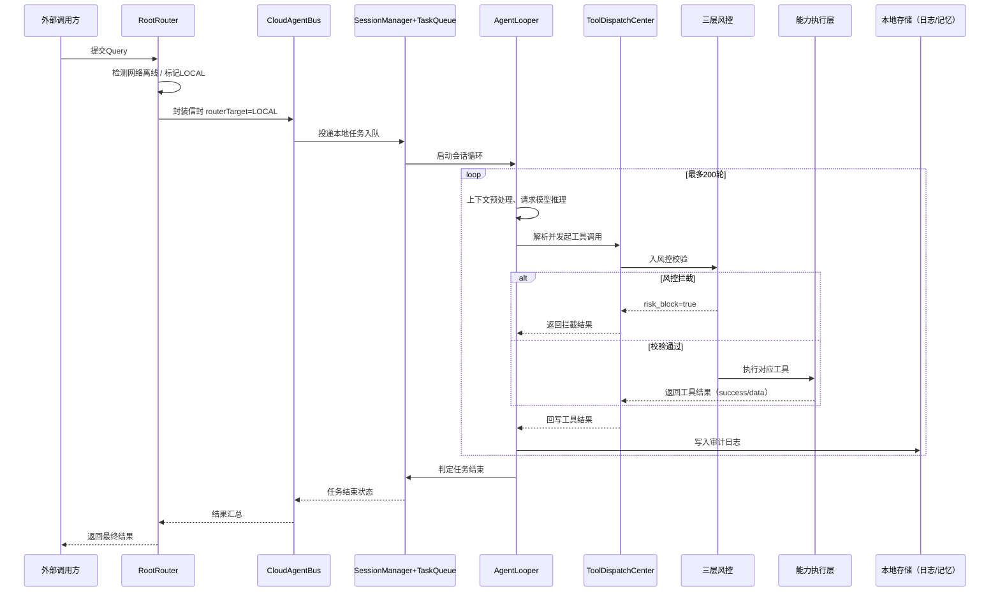
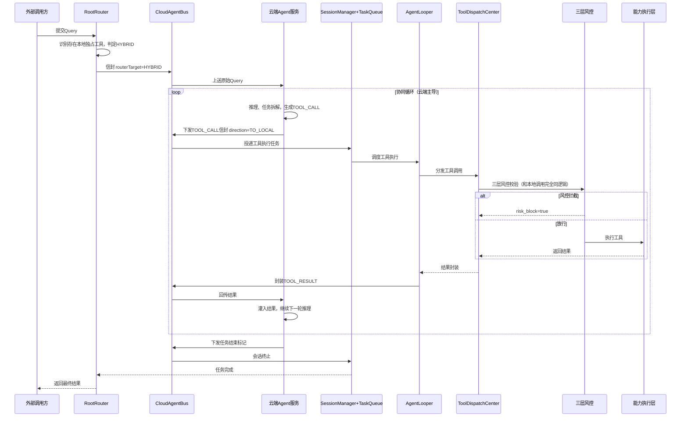
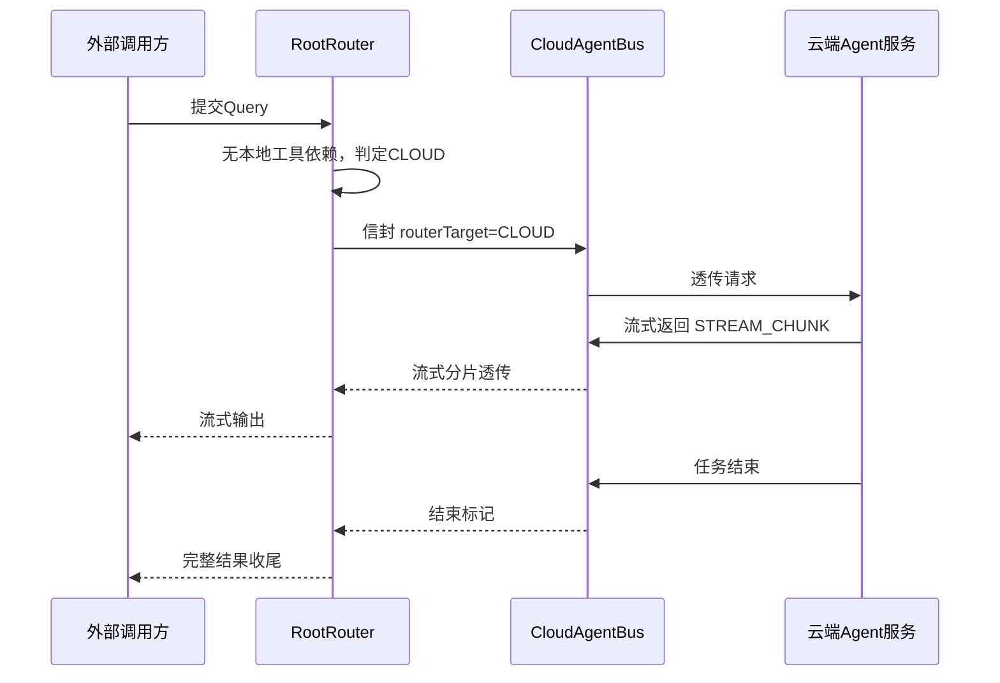
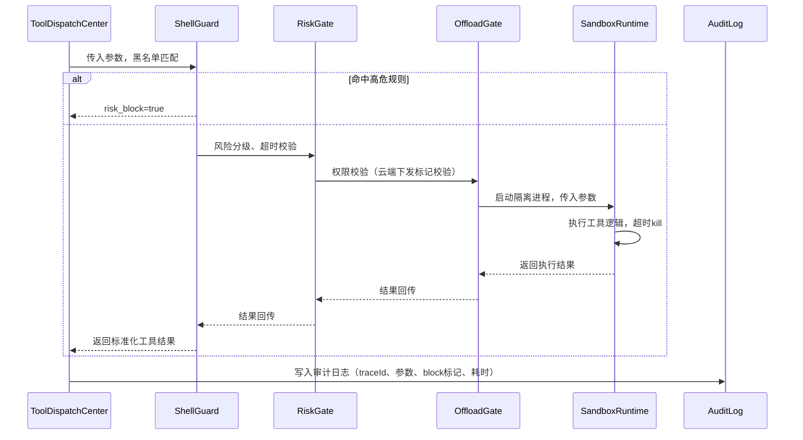
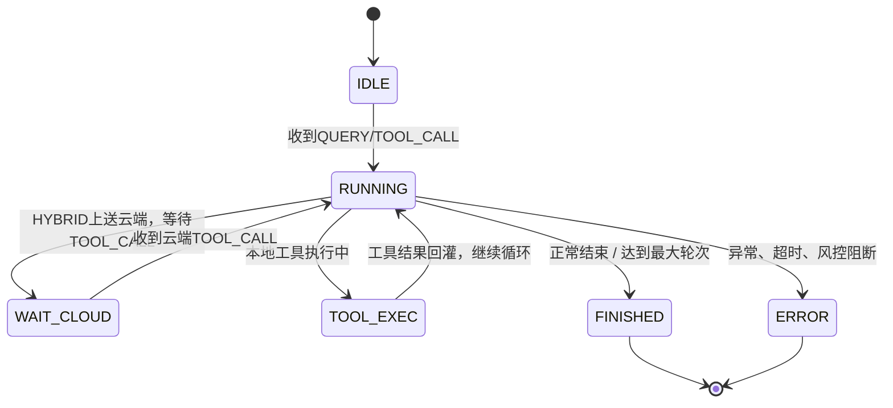

# nanoMuse 安卓端侧 Agent 框架 V1.1 Final-Dev 方案设计文档（开发可落地完整版）

> 文档说明：本版为开发基线文档，包含五层架构、Mermaid 架构图、3 条核心业务顺序图、工具子时序图、会话状态机、模块接口契约；完整保留工具定义、风控、验收、非功能需求。所有 Mermaid 代码可直接复制到 Typora / Obsidian / Mermaid LiveEditor 渲染图形。

## 修订记录

| 版本 | 日期 | 修订说明 |
| :--- | :--- | :--- |
| V1.0 | 2026-11-13 | 初始纯端侧 Headless 架构：Looper、沙箱、基础工具、MCP、A2A |
| V1.1 | 2026-11-13 | 架构升级：新增 RootRouter 端云决策、CloudAgentBus 通信总线、五层端云协同架构 |
| V1.1-Final | 2026-11-13 | 定稿：10 个 P0 核心工具全集，路由、风控、MCP、协同、验收对齐 |
| V1.1-Final-Dev | 2026-11-13 | 开发落地增强版：增加架构图、3 套核心顺序图、模块接口契约、状态机、调用边界 |

## 1 文档概述

### 1.1 文档目的

本文为 nanoMuse Android Headless Agent 端侧 Agent 框架**开发指导基线文档**。除能力、协议、工具定义外，补充：**组件依赖关系、消息时序、同步/异步边界、异常分支、模块间接口契约、状态流转**，SDK 开发、测试、云端联调同学可直接基于本文档编码、编写单元测试、编写联调用例。

### 1.2 适用范围

- 运行环境：Android 10+，纯后台 Service，无 UI 依赖
- 任务来源：用户 Query、三方 Agent 调用、定时任务、A2A 跨设备任务、云端协同子任务
- 调度模式：LOCAL / CLOUD / HYBRID
- 交付形态：可独立剥离的端侧 Agent Runtime SDK

### 1.3 P0 核心工具清单（端侧独占，Router 禁止纯 CLOUD 调度）

1. `shell_execute` 沙箱命令执行
2. `file_read` 文件读取
3. `file_write` 文件写入
4. `file_edit` 文件增量编辑/替换
5. `read_image` 图片解析读取
6. `browser_use` 浏览器自动化
7. `memory_write` 长期记忆写入
8. `memory_get` 长期记忆读取
9. `android_calendar` 系统日历操作（保留）
10. `android_notify` 本地通知推送（保留）

### 1.4 术语定义

| 术语 | 释义 |
|---|---|
| Agent Looper | 端侧核心任务循环机，迭代推理、工具调用、上下文回灌、终止判定 |
| Runtime 沙箱 | 无 Root Proot+Alpine 隔离环境，Shell 脚本隔离执行 |
| Root Router | 全局第一跳决策器，判定 LOCAL / CLOUD / HYBRID |
| Cloud-Agent Bus | 端云双向可靠通信总线，信封协议、ACK、重试、流式 |
| HYBRID 协同 | 云端负责规划推理，端侧执行独占工具，双向闭环 |
| Headless | 纯后台无界面 Service 运行 |
| A2A | 跨设备 Agent 任务转交通信 |
| ToolDispatchCenter | 工具调度中台，统一分发、参数校验、风控入口 |

### 1.5 设计总原则

1. 决策前置：所有请求**必须经过 RootRouter，禁止旁路直连 Looper**
2. 安全兜底：云端下发 TOOL_CALL 和本地触发工具调用，**完全同一条风控链路**
3. 能力独占：10 个工具仅 LOCAL/HYBRID，CLOUD 模式不允许下发这组工具
4. 异步优先：总线、任务队列、工具执行全部异步；会话内部串行，会话之间并行
5. 可观测：全链路 traceId / sessionId 贯穿所有模块、日志、消息、审计

## 2 整体架构设计（五层架构 + Mermaid 架构图）

### 2.1 五层分层职责

| 层级 | 模块 | 核心职责 |
|---|---|---|
| Layer1 协同调度层 | RootRouter | 入口统一收单、网络检测、工具依赖识别、路由决策、生成 trace/sessionId、离线降级 |
| Layer2 通信总线层 | CloudAgentBus | 信封编解码、ACK、重试、死信、流式分片、消息分发到本地队列/云端 |
| Layer3 任务接入层 | SessionManager + TaskQueue + ConcurrencyController | 会话隔离、任务排队、并发上限、会话状态持久化、任务启停控制 |
| Layer4 Agent 内核层 | AgentLooper + StateMachine + ContextManager | 推理循环、工具调用解析、上下文裁剪、轮次上限控制、终止条件判断 |
| Layer5 能力执行层 | ToolDispatchCenter + 三层风控 + SandboxRuntime + SystemCapability + MemoryStore | 工具路由分发、参数校验、ShellGuard/RiskGate/OffloadGate、沙箱、系统能力、记忆持久化 |

### 2.2 架构框图（Mermaid）

```mermaid
flowchart TD
    IN[外部请求入口<br/>用户Query / A2A / 定时 / 云端子任务] --> L1[Layer1 RootRouter<br/>路由决策、离线降级、traceId生成]
    L1 --> L2[Layer2 Cloud-Agent Bus<br/>信封协议、ACK、重试、流式]
    L2 --> L3[Layer3 SessionManager + TaskQueue<br/>会话隔离、并发管控]
    L3 --> L4[Layer4 AgentLooper<br/>循环引擎、状态机、上下文裁剪]
    L4 --> L5[Layer5 ToolDispatchCenter<br/>工具中台统一分发]
    L5 --> RISK[三层风控<br/>ShellGuard | RiskGate | OffloadGate]
    RISK --> EXEC[执行能力池<br/>SandboxRuntime / File / Image / Browser / Calendar / Notify / Memory]

    %% 云端分支
    L2 --> CLOUD[云端Agent服务<br/>推理规划、任务拆解]
    CLOUD -->|TOOL_CALL下发| L2
    EXEC -->|TOOL_RESULT回传| L2
    L4 -->|结束事件| L3
    L3 -->|状态上报| L2
```

> 数据流规则：
> - 上行：外部输入 → RootRouter → Bus → 本地队列 / 云端
> - 下行：云端 TOOL_CALL → Bus → 本地队列 → Looper → ToolCenter → 风控 → 执行
> - 结果回流：执行完成 → 封装 TOOL_RESULT → Bus → 云端

## 3 核心顺序图（3 条主链路）

> 绘图约定
> - 异步消息：`-->>`
> - 同步调用：`->>`
> - 返回：`-->>`
> - 异常分支标注：Error / Block / Timeout

### 3.1 链路 1：LOCAL 本地离线模式（无云端交互）

适用：断网、隐私任务、低延迟、携带 10 个独占工具



### 3.2 链路 2：HYBRID 端云协同模式（核心链路，云端规划，端侧执行工具）

适用：有大推理规划 + 包含本地独占工具，**禁止走 CLOUD**



### 3.3 链路 3：CLOUD 云端全权模式（无本地独占工具）

> 重要约束：**只要命中 10 个独占工具，Router 不允许进入这个分支**



## 4 工具内部子时序（通用范式，shell_execute 示例，所有工具复用该流程）

> 所有工具执行统一内部流程，开发实现每个工具都按这个顺序：



## 5 会话状态机（SessionState，状态持久化，支持断点续跑）



## 6 模块间接口契约（开发直接对齐入参、回调、异常）

> 所有跨模块调用统一携带：`traceId, sessionId`
> 异常统一返回结构：`code, msg, errorType(TIMEOUT / PERMISSION_DENIED / RISK_BLOCK / PARAM_INVALID)`

### 6.1 RootRouter 对外接口（全局唯一入口）

```kotlin
// 入参
data class AgentRequest(
    val rawQuery: String,
    val allowLocal: Boolean = true,
    val allowCloud: Boolean = true,
    val preferLocal: Boolean = false,
    val userSLA: String? = null
)
// 出参：Flow<AgentEnvelope> 流式返回
fun submit(request: AgentRequest): Flow<AgentEnvelope>
```

**Router 内部决策枚举：`LOCAL / CLOUD / HYBRID`**

```kotlin
// 10 个 P0 本地独占工具白名单
private val localExclusiveTools = setOf(
    "shell_execute",
    "file_read",
    "file_write",
    "file_edit",
    "read_image",
    "browser_use",
    "memory_write",
    "memory_get",
    "android_calendar",
    "android_notify"
)
```

### 6.2 CloudAgentBus 接口

```kotlin
// 发送信封，自动重试、ACK、死信
suspend fun send(envelope: AgentEnvelope): SendResult
// 订阅指定 sessionId 的信封流
fun subscribe(sessionId: String): Flow<AgentEnvelope>
```

信封 JSON 结构：

```json
{
  "envelopeId": "uuid",
  "traceId": "全局链路ID",
  "sessionId": "会话ID",
  "direction": "TO_LOCAL|TO_CLOUD",
  "msgType": "QUERY|STREAM_CHUNK|TOOL_CALL|TOOL_RESULT|STATUS|ERROR|ACK",
  "routerTarget": "LOCAL|CLOUD|HYBRID",
  "seq": 0,
  "isStream": false,
  "payload": {},
  "meta": {"timestamp": 1762967123000, "timeoutMs": 30000}
}
```

### 6.3 ToolDispatchCenter 工具统一入口

```kotlin
suspend fun invokeTool(toolCall: ToolCall): ToolResult
```

ToolCall / ToolResult 结构（和 MCP、云端 TOOL_CALL 完全对齐）

```json
// ToolCall
{
  "tool_name": "",
  "session_id": "",
  "timeout": 30000,
  "parameters": {}
}
// ToolResult
{
  "success": true,
  "code": 0,
  "msg": "ok",
  "data": {},
  "risk_block": false,
  "risk_msg": ""
}
```

### 6.4 AgentLooper 会话循环接口

```kotlin
suspend fun startSession(sessionId: String, input: EnvelopePayload): SessionFinishReason
enum class SessionFinishReason {
    NORMAL_COMPLETE,
    MAX_ROUND_LIMIT, // 200 轮上限保护
    USER_CANCEL,
    ERROR_EXCEPTION
}
```

## 7 10 个核心工具详细协议、能力、风控规范（最终定稿）

### 通用统一入参出参格式

#### 通用入参

```json
{
  "tool_name": "",
  "session_id": "",
  "timeout": 30000,
  "parameters": {}
}
```

#### 通用出参

```json
{
  "success": true,
  "code": 0,
  "msg": "ok",
  "data": {},
  "risk_block": false,
  "risk_msg": ""
}
```

### 7.1 shell_execute 沙箱命令执行

**能力**：Alpine 沙箱内执行 Linux 命令/脚本，完全隔离系统

**参数**

```json
{"cmd":"","work_dir":"/var/minis/tmp","timeout_ms":30000}
```

**风控**：拦截 rm -rf、mkfs、chmod777、curl、wget 等高风险指令

### 7.2 file_read 文件读取

**能力**：本地文本文件读取，支持范围读取、大小限制

**参数**

```json
{"file_path":"","offset":0,"max_size":4096}
```

**风控**：路径白名单、禁止系统敏感目录、单文件大小上限

### 7.3 file_write 文件写入

**能力**：新建/覆盖本地文本文件

**参数**

```json
{"file_path":"","content":"","overwrite":false}
```

**风控**：禁止覆盖核心配置、系统路径

### 7.4 file_edit 文件增量编辑

**能力**：安全差分替换文本，避免全量覆盖风险

**参数**

```json
{"file_path":"","old_string":"","new_string":"","replace_all":false}
```

**风控**：预校验原文本存在，匹配失败直接报错，防误改

### 7.5 read_image 图片读取解析

**能力**：读取本地图片、缩略图、元数据、Base64 输出

**参数**

```json
{"path":"","return_base64":true,"thumbnail_w":512}
```

**风控**：相册权限校验、大图限流、隐私文件拦截

### 7.6 browser_use 浏览器自动化

**能力**：页面打开、跳转、点击、输入、内容提取

**参数**

```json
{"action":"navigate/click/input/extract","url":"","selector":"","text":""}
```

**风控**：恶意域名黑名单、内网拦截、超时隔离

### 7.7 memory_write 长期记忆写入

**能力**：Agent 私有长期记忆持久化

**参数**

```json
{"key":"","tags":[],"content":"","expire_at":null}
```

**风控**：单条容量上限、总记忆配额限制

### 7.8 memory_get 长期记忆读取

**能力**：Key/标签检索 Agent 历史记忆

**参数**

```json
{"key":"","tags":[],"top_k":5}
```

**风控**：只读低风险，无高危拦截

### 7.9 android_calendar 系统日历（保留）

**能力**：查询/新增/修改/删除系统日程

**风控**：权限校验、批量操作风险评级

### 7.10 android_notify 系统通知（保留）

**能力**：推送本地系统通知

**风控**：频率限流、防刷屏

## 8 端云协同全链路时序（文字描述）

### 8.1 HYBRID 标准闭环时序（核心）

1. 外部 Query 进入框架
2. RootRouter 检测包含本地 10 大独占工具，判定 HYBRID
3. CloudAgentBus 封装信封，将原始请求上云
4. 云端 Agent 执行推理、任务拆解，生成**本地 TOOL_CALL**
5. 总线透传云端工具指令至端侧
6. 端侧三层风控强制校验
7. ToolDispatchCenter 匹配对应核心工具执行
8. 执行结果标准化封装，通过总线 `replyToolResult` 回传云端
9. 云端灌入结果，继续下一轮推理循环
10. 云端判定任务结束，下发终止状态
11. 端侧回收沙箱进程、持久化日志、释放资源

### 8.2 LOCAL / CLOUD 时序

- LOCAL：Router 直接本地队列投递，完整本地 Looper 闭环
- CLOUD：无本地工具依赖，全程云端执行，本地零内核启动

## 9 数据存储与链路设计

### 9.1 持久化数据

1. 会话历史消息、任务轮次状态
2. 10 工具执行审计日志、风控拦截日志
3. Router 决策日志（traceId、决策模式、原因）
4. 总线消息投递日志、死信记录
5. Agent 长期记忆库

### 9.2 完整数据流

Query → RootRouter 决策 → Bus 信封封装 →

LOCAL：本地队列 → Looper → 工具执行 → 落库

CLOUD：总线远程投递 → 云端执行 → 流式回流

HYBRID：端云双向往复闭环

## 10 模块依赖总图（文本）

```
RootRouter（入口决策）
    ↓
CloudAgentBus（消息分发）
    ↓
本地任务队列 + 会话管理器
    ↓
AgentLooper 核心循环引擎
    ↓
ToolDispatchCenter 10 工具统一中台
    ↓
三层安全风控校验
    ↓
沙箱 Runtime / 系统能力执行层
```

## 11 可移植组件清单（完整可剥离 SDK）

### 11.1 100% 可移植无 UI 核心模块

1. RootRouter 端云决策引擎
2. CloudAgentBus 通信总线全套
3. AgentLooper 任务循环内核
4. SessionState 会话状态机
5. ToolDispatchCenter 10 工具调度中台
6. 三层安全风控体系
7. SandboxRuntime 沙箱运行环境
8. Memory 长期记忆模块
9. MCP 协议适配层
10. A2A 跨 Agent 通信核心
11. 上下文裁剪、日志、持久化层

### 11.2 需剔除模块

- 所有 Activity/ViewModel/UI 组件
- 弹窗交互逻辑（全部静默后台化）
- WebView 界面渲染模块

## 12 非功能需求

1. **低延迟**：Router 规则决策 <10ms，总线投递 <50ms
2. **高可用**：断网自动降级本地，任务不丢失
3. **绝对安全**：云端指令本地兜底风控，无特权绕过
4. **流式实时**：端云流透传无卡顿
5. **全可观测**：全链路 Trace 追踪，决策/消息/执行全日志
6. **高扩展**：工具可热增、路由规则可配置、传输层可插拔

## 13 风险与解决方案

| 风险 | 解决方案 |
| :--- | :--- |
| 端云状态不一致 | 每次工具结果携带上下文摘要，云端一致性校验 |
| 总线消息丢失 | ACK 确认+重试+死信队列+断连降级 |
| 云端下发高危指令 | 本地三层风控强制拦截，零特权绕过 |
| 工具策略膨胀 | 工具清单、路由规则配置化，无需改内核代码 |
| 多会话冲突 | sessionId+traceId 双隔离，并行互不干扰 |

## 14 全量验收标准（最终定稿，含 10 工具专项）

### 14.1 框架基础验收

1. 所有请求强制经过 RootRouter，无法旁路
2. 离线自动降级 LOCAL，完全离线可用
3. 纯云端模式本地内核零启动、零资源占用
4. HYBRID 协同端云闭环正常
5. 多会话并行稳定无冲突
6. 总线消息幂等、重试、流式透传正常
7. 整套框架可独立编译、后台长期保活

### 14.2 路由规则专项验收

1. 携带任意 10 个核心工具，Router **禁止输出 CLOUD**
2. 有本地工具依赖时自动进入 LOCAL/HYBRID
3. 断网场景全部任务强制本地执行

### 14.3 10 个核心工具全覆盖验收（P0 必过）

每工具均需验收：**本地调用正常、云端下发调用正常、参数校验、风控拦截、异常兜底**

1. **shell_execute**：正常命令执行、高危命令拦截、超时强杀
2. **file_read**：合法读取、超限拦截、非法路径拦截
3. **file_write**：正常写入、禁止系统路径覆盖
4. **file_edit**：精准差分替换、不存在原文本报错保护
5. **read_image**：图片解析成功、权限拦截、大图限流
6. **browser_use**：页面自动化正常、恶意域名拦截
7. **memory_write**：记忆写入、容量限额保护
8. **memory_get**：精准检索记忆内容
9. **android_calendar**：日程增删改查、权限容错
10. **android_notify**：通知推送、频率限流保护

### 14.4 协同链路验收

1. 云端下发 10 类工具指令可正常被端侧接收执行
2. 端侧结果标准化回传云端，支撑云端继续循环
3. 所有云端指令经过本地完整风控校验，无安全绕过

## 15 开发交付物清单

1. RootRouter 路由决策模块 + 单元测试（覆盖 LOCAL/CLOUD/HYBRID、独占工具判定）
2. CloudAgentBus 信封编解码、重试、ACK、流式模块
3. SessionManager + TaskQueue 会话管理、并发控制、状态持久化
4. AgentLooper 循环引擎、上下文裁剪、轮次上限控制
5. ToolDispatchCenter 调度中台 + 三层风控（ShellGuard/RiskGate/OffloadGate）
6. 10 个工具实现，每个工具独立实现类、参数校验、单元测试
7. MCP Server 适配层，对外暴露工具 schema
8. A2A 跨设备通信适配层
9. 审计日志、trace 埋点、可观测模块
