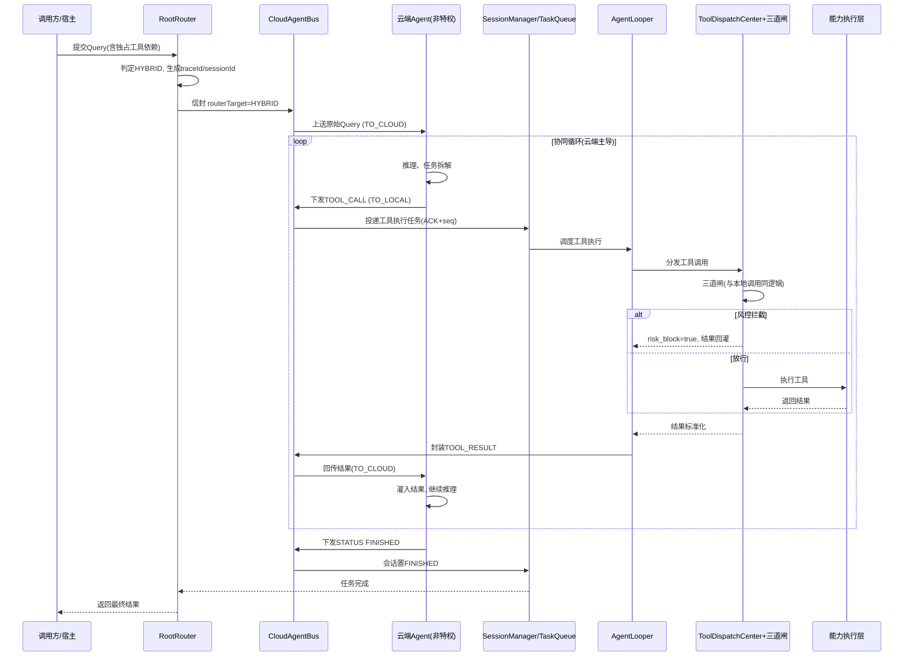
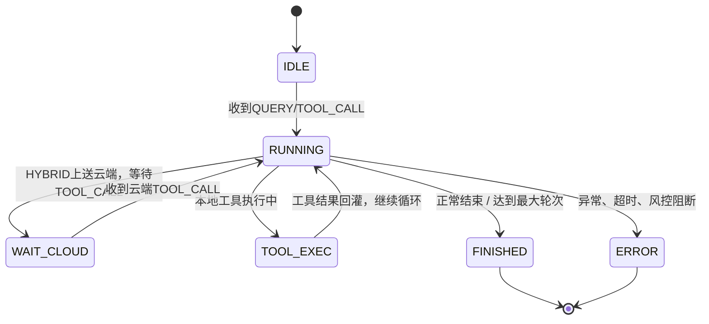

# nanoMuse 安卓端侧 Agent 框架 - 产品需求文档 (PRD)

**文档编号：** PRD-ANDROID-AGENT-001
**版本号：** V1.0（PRD 首版）
**最后更新：** 2026 年 11 月 13 日
**文档状态：** 待评审
**配套文档：** `REQUIREMENTS-SRS.docx`（工程规格，V1.0）、`DESIGN.md`（方案设计，V1.2-Runtime）、`runtime/COVERAGE.md`（落地对齐，V1.2）
**编写：** 资深产品经理 Agent（司南）

---

## 目录

1. [文档概述](#1-文档概述)
2. [产品定位](#2-产品定位)
3. [用户角色与权限](#3-用户角色与权限)
4. [功能架构](#4-功能架构)
5. [端侧交互面功能详述（前台用户端适配）](#5-端侧交互面功能详述前台用户端适配)
6. [运维与治理控制台功能详述（后台管理端适配）](#6-运维与治理控制台功能详述后台管理端适配)
7. [数据模型设计](#7-数据模型设计)
8. [业务流程图](#8-业务流程图)
9. [非功能性需求](#9-非功能性需求)
10. [开发优先级与排期建议](#10-开发优先级与排期建议)
11. [附录](#附录)

---

## 1. 文档概述

### 1.1 编写目的

本文档为 **nanoMuse 安卓端侧 Agent 框架**提供清晰、可执行、可验收的产品需求说明，指导后续的代码开发、测试验收与架构评审，并作为宿主 App 集成、云端联调、安全合规评估的共同基线。

本文档采用**反向设计（reverse requirement elicitation）**方法撰写，与常规 PRD 路径不同，原因如下：

> 常规路径是「用户问题 → 需求 → 方案 → 实现」。本项目的特殊性在于**方案已先行定稿**（`DESIGN.md` V1.1-Final-Dev，含五层架构、10 个 P0 工具、3 条主链路、会话状态机与模块接口契约），且**代码骨架已落地**（V1.2 Runtime，31 项自检 / 18 项冒烟全绿）。因此本 PRD 不重新做技术选型，而是把既定设计当作「已确认的产品约束」，反向推导出它所对应的用户问题、角色场景、成功标准与验收条件。

反向设计的五条执行规则：

| 规则 | 说明 |
|---|---|
| R1 设计即约束 | `DESIGN.md` 已定稿的架构、工具清单、接口契约、状态机一律视为已确认输入，本 PRD 不提出与之冲突的新方案 |
| R2 追问 Why/Who/When | 对每条设计决策追问「解决谁的什么问题、由哪类角色在哪个场景触发、做到什么程度算成功」，把答案写成需求 |
| R3 增量补齐而非改写 | 设计中缺失的产品层（定位、价值、角色权限、边界、优先级、AI 质量、隐私合规、排期）做增量补齐，不改动已定稿设计 |
| R4 不把实现复述成需求 | 凡属 nanoMuse **上游源码事实**（如 727 个 Kotlin 文件、13 个 A2A 动作、20 个 App 能力命令）一律不作为本产品需求，仅在 2.5 标注为「上游参考事实，不纳入验收」 |
| R5 四端锁死 | 用附录 E 需求追踪矩阵（RTM）与附录 F 反向设计映射表，把「需求 ↔ 设计 ↔ 代码 ↔ 验收」四端对齐，任一缺口可被检出 |

**本 PRD 要解决的既有文档缺陷：**

| 缺陷 | 表现 | 本文档的修复 |
|---|---|---|
| 需求与现状混淆 | 现有 SRS 大量描述源码实现事实，未回答「为什么需要」 | 每条需求标注「设计依据」与「角色/场景」，实现事实剥离到 2.5 |
| 口径互相冲突 | Android 版本、架构层数、工具数量、条目统计在两份文档中不一致 | 1.6 口径裁决表逐项裁决，并同步修订 `DESIGN.md` |
| 不可验收 | 需求多为陈述句，缺 Given/When/Then 判定条件 | 4.6 需求全集给出验收要点，附录 G 给出 18 个验收场景（AC-01~AC-18） |
| 产品层缺失 | 无产品定位、角色权限矩阵、优先级论证、排期与风险量化 | 第 2、3、10 章补齐 |
| Agent 特性缺失 | 模型输出不确定、幻觉、降级、人工接管、版本闭环均未定义 | 9.7 AI 功能质量专项（六模块）补齐 |
| 合规层薄弱 | 仅有一条 GPL 声明，缺个保法、最小必要、数据不出端、权限降级 | 9.3 数据安全与隐私合规补齐 |

### 1.2 适用范围

| 对象 | 关注章节 | 使用方式 |
|---|---|---|
| 产品经理 / 架构师 | 1、2、3、4、10 | 确认定位、边界、角色权限、优先级与里程碑出口条件 |
| 客户端研发（Android） | 3、4、5、7、8、9 | 按 7 个可替换接口做平台移植，按 4.6 需求全集实现 |
| 内核 / 后端研发（JVM） | 4、7、8、9 | 按接口契约与状态机实现，不改 `AgentLoop` |
| 云端 Agent 服务研发 | 4.3、4.5、7.6、8.2、8.7 | 对齐信封协议、TOOL_CALL / TOOL_RESULT、ACK 与重试 |
| 测试团队 | 4.6、8、9、附录 G | 直接把 AC 场景与 GWT 判定条件转为测试用例 |
| 安全 / 合规 / 法务 | 3.3、3.4、9.2、9.3、9.6、附录 H | 三道闸、PII、许可与权限最小化评审 |
| 运维 / 审计 | 6、7.5、7.6、9.6 | 会话治理、审计检索、死信重放 |

### 1.3 术语定义

> 本表统一 `DESIGN.md` 1.4 与 `REQUIREMENTS-SRS` 表 1 的术语，同名术语以本表为准。

| 术语 | 定义 | 来源 |
|---|---|---|
| 端侧 Agent | 在设备本地完成「决策—调用工具—观察结果」循环的智能体；模型可在远端，但循环与执行在设备上 | SRS 表 1 |
| Headless | 纯后台无界面 Service 运行，框架自身不渲染任何 UI | DESIGN 1.4 |
| 五层架构 | L1 RootRouter 协同调度 / L2 CloudAgentBus 通信总线 / L3 任务接入 / L4 Agent 内核 / L5 能力执行 | DESIGN 2.1（裁决 C-02） |
| RootRouter | 全局唯一入口与三模式决策器，生成 traceId / sessionId，负责离线降级 | DESIGN 1.4 / 6.1 |
| CloudAgentBus | 端云双向可靠通信总线，负责信封编解码、ACK、重试、死信、流式分片与按会话分发 | DESIGN 1.4 / 6.2 |
| AgentEnvelope（信封） | 端云往来的统一消息结构，含 envelopeId / traceId / sessionId / direction / msgType / routerTarget / seq / isStream / payload / meta | DESIGN 6.2 |
| 三调度模式 | LOCAL（本地闭环）/ CLOUD（云端全权）/ HYBRID（云端规划 + 端侧执行） | DESIGN 3 |
| 独占工具 | 10 个仅可在 LOCAL / HYBRID 执行的 P0 端侧工具；命中任一即禁止纯 CLOUD | DESIGN 1.3 / 1.5 |
| ToolDispatchCenter | Layer5 工具调度中台，统一按名路由、参数校验、风控入口与审计 | DESIGN 1.4 / 6.3 |
| 三道闸 | ShellGuard 静态判定 → RiskGate 风险分级与审批 → OffloadGate 卸载调用授权，串联在工具执行之前 | SRS 表 1 / DESIGN 4 |
| 审批五结局 | ALLOW_ONCE（本次）/ SESSION（本会话）/ ALWAYS（永久）/ DENY（拒绝）/ TIMEOUT（超时即拒绝） | SRS 4.4 |
| 回合（turn） | 一次模型请求及其工具调用；一轮可含多次工具调用 | SRS 表 1 |
| 会话状态机 | IDLE / RUNNING / WAIT_CLOUD / TOOL_EXEC / FINISHED / ERROR 六态，持久化支持断点续跑 | DESIGN 5 |
| 事件流 | 运行时唯一对外输出面，NDJSON 一行一个 JSON，按会话分流 | runtime README 五 |
| 宿主依赖接口 | Sandbox / ApprovalGate / SessionStore / EventSink / ModelProvider / MemoryStore / SystemCapability / Transport 等可替换抽象 | COVERAGE 八 |
| MCP | Model Context Protocol，工具与资源的标准化接入协议（JSON-RPC 2.0） | SRS 表 1 |
| A2A | 本项目指跨设备 / 跨 Agent 的任务信封交互（非上游 13 动作 RPC） | DESIGN 16.1（裁决 C-05） |
| traceId / sessionId | 全局链路标识 / 会话标识，贯穿全部模块、日志、消息与审计 | DESIGN 1.5 |
| 死信 | 超过重试上限仍投递失败的信封，落盘记录、不静默丢弃 | DESIGN 6.2 / COVERAGE 二 |
| P0 / P1 / P2 | 首个可交付版本必须满足 / 第二版应满足（首版可明确降级）/ 可选增强 | SRS 1.6 |

### 1.4 文档体系与定位

四份文档各司其职，**不互相替代**，冲突时按 1.6 裁决表执行：

| 文档 | 视角 | 回答的问题 | 状态 |
|---|---|---|---|
| `REQUIREMENTS-SRS.docx` | 工程规格（IEEE 830 风格） | 系统「有哪些功能条目、接口与数据」；大量描述 nanoMuse 源码现状 | V1.0 评审稿，保留为工程基线 |
| **`PRD.md`（本文）** | **产品需求** | **「为什么做、给谁做、做到什么程度、怎么验收、先做哪个」** | **V1.0 待评审** |
| `DESIGN.md` | 方案设计 | 「怎么实现」：五层架构、时序、接口契约、状态机、验收标准 | V1.2-Runtime |
| `runtime/COVERAGE.md` | 落地对齐 | 「设计里哪条已经写成代码、哪条还是缺口」 | V1.2 |

> 阅读顺序建议：本文第 2 章（为什么）→ 第 3 章（谁用）→ `DESIGN.md` 第 2/3 章（怎么做）→ 本文第 8/9 章与附录 G（怎么验）→ `COVERAGE.md`（现在到哪了）。

### 1.5 模板适配说明（重要）

上传的 PRD 模板面向**通用企业级 Web 管理系统**（PC 前台 + 后台管理端 + 关系型数据库 + Web 审批流）。本产品是**无界面、端侧、含 AI 不确定性的 Agent Runtime 框架**，直接套用会制造新的不合理。因此本 PRD **保留模板 10 章的编号骨架与严谨度，按下列映射做领域适配**：

| 模板章节 | 原假设 | 本产品适配 | 适配理由 |
|---|---|---|---|
| 3 用户角色与权限 | 普通用户 / 业务角色 / 系统管理员 | 终端用户、自动化调度、集成方、云端 Agent 服务（非特权主体）、运维审计、系统管理员 | 本产品无「注册用户」概念，调用方是人与系统 |
| 3.3 审批规则 | 业务单据审批 | **完整保留并强化**：映射三道闸、风险六类三档、审批五结局、云端下发同风控 | 恰是本产品安全模型的核心，契合度最高 |
| 4.1 系统架构图 | 前台 / 后台 / 服务层 / 数据层 | 五层架构 + 端侧交互面 + 运维控制台 + 云端 Agent 服务 | 以 `DESIGN.md` 2.2 为准，不虚构 Web 分层 |
| 5 前台用户端功能详述 | PC Web 页面布局、Banner、筛选栏 | **端侧交互面**：任务提交、会话与事件流、审批交互、结果状态；载体为宿主 App / CLI / 集成方 API | Headless 框架不自带界面，页面元素描述为「宿主应提供的交互契约」而非框架自绘 UI |
| 5.4 表单设计 | 业务申请表单 | 任务提交表单 + 10 个工具的参数 schema 与校验规则 | 工具参数才是本产品真正需要校验的表单 |
| 5.5 个人中心 | 我的申请记录 | 会话列表与断点续跑（状态样式、可继续 / 丢弃） | 对应会话状态机 |
| 6 后台管理端功能详述 | 已存在的管理后台 | **运维与治理控制台**，明确标注为「设计态，P1/后续版本」，不宣称已实现 | 避免把不存在的模块写成既成事实（合理性修复） |
| 7 数据模型设计 | MySQL 建表 | 「逻辑模型 + 当前载体（JSONL/JSON）+ Android 目标态（SQLite）」三栏，附存量迁移方案 | V1.2 用文件存储，目标态是 SQLite；直接写建表语句会与现状不符 |
| 8 业务流程图 | 单据审批流 | 三条主链路 + 路由决策 + 六态状态机 + 三道闸 + 总线重试死信 | 对应 `DESIGN.md` 3/4/5 章 |
| 9 非功能性需求 | 首屏 <2s、100 QPS、Chrome 90+ | 决策 <10ms、投递 <50ms、纯 JVM 可移植、端侧资源约束、AI 质量阈值、隐私合规 | Web 指标对本产品无意义，替换为端侧与 AI 指标 |
| 10 技术选型 | React / Spring Boot / MySQL | Kotlin / 纯 JVM / 零协程依赖 / 可插拔 Transport / 7 接口替换 | 保留「选型建议」这一结构，内容按实际技术栈填充 |

**明确不做的适配**：不虚构首页 Banner、筛选栏、分辨率适配、浏览器兼容矩阵、100 QPS 并发目标、PC 端分页器样式。凡模板中与本产品形态无关的占位内容，一律替换为真实约束，不以「暂不支持」敷衍了事。

### 1.6 口径冲突裁决表

两份既有文档存在 9 处硬冲突。本表为**单一裁决事实源**，`DESIGN.md` 第 17 章、`README.md` 与 `build_html.py` 已按此同步：

| # | 冲突项 | SRS 口径 | DESIGN / Runtime 口径 | 裁决结论 | 理由 |
|---|---|---|---|---|---|
| C-01 | Android 最低版本 | Android 11（API 30）及以上，AArch64 优先 | Android 10+ | **Android 11（API 30）及以上，AArch64 优先** | SRS 给出明确 API 级别与架构约束且更保守；DESIGN 的「10+」无配套依据。已修订 `DESIGN.md` 1.2 |
| C-02 | 架构层数 | 端侧四层 + 端云两层 | 五层 | **统一为五层**：L1 Router / L2 Bus / L3 Session / L4 Looper / L5 Tool | 五层是代码装配顺序与 `COVERAGE.md` 对齐矩阵的基准；SRS 四层保留为「端侧内核内部视角」的补充说明，不作对外口径 |
| C-03 | 条目统计 | 封面 37 功能 / 14 非功能 / 7 接口；正文 45 / 17 / 8 | — | **以正文 45 / 17 / 8 为准** | 封面与网页 subtitle 为笔误；已修正 `build_html.py` 的 SRS subtitle |
| C-04 | 工具数量 | 内置 8 个（基础五件套 + 读图 + 记忆类） | 10 个 P0 端侧独占 | **10 个 P0 工具** | `DESIGN.md` 1.3 定稿、V1.2 全部实现、`COVERAGE.md` 三节逐项对齐 |
| C-05 | 互操作动作规模 | A2A 13 个固定动作、App 能力 20 个命令 | 仅 MCP 协议层 + A2A 信封转换 + App Function schema | **不纳入本期交付范围** | 属上游源码事实；runtime 仅实现协议适配，真实传输与系统能力列 V1.3（2.5 明示） |
| C-06 | 并发上限 | 默认 2 个会话并行（P1 补强项） | 全局 Semaphore 可配置 | **并发上限可配置；默认值属部署策略，不作产品硬指标** | runtime 已实现在途任务信号量；「默认 2」是建议值，标「可配置」而非「固定 2」 |
| C-07 | 隔离强度 | proot + Alpine + 持久 shell | `Sandbox` 接口可替换，V1.2 为宿主进程级 | **以接口契约为准，实现分级陈述** | V1.2 为宿主进程隔离；proot / bwrap 属 V1.3 移植项，不得宣称已交付 OS 级隔离 |
| C-08 | 模型流式 | SSE 客户端 | 非流式，`onText` 已留 | **接口支持流式；当前实现为非流式** | 明确区分「目标态」与「已实现」，避免把设计目标写成既成事实 |
| C-09 | 可替换接口数量 | 宿主五接口（SRS 3.6.4） | `COVERAGE.md` 八列 7 个平台实现；`runtime/README.md` 六列 8 类 | **7 个 Android 平台实现 + 1 个端云 `Transport` = 8 类可替换抽象** | 两者分类维度不同（平台差异 vs 全部可换抽象），各自成立；`DESIGN.md` 第 17 章已同步说明，不再视为冲突 |

### 1.7 编号体系、状态词与来源规范

| 项 | 规范 |
|---|---|
| 功能需求 | `FR-01` ~ `FR-64`，按模块连续分配；**本文编号与 `REQUIREMENTS-SRS` 的 `FR-xx` 各自独立**，双向映射见附录 E |
| 非功能需求 | `NFR-01` ~ `NFR-26`，见 9.9 汇总表 |
| 用户故事 | `US-01` ~ `US-12`，见附录 G |
| 验收场景 | `AC-01` ~ `AC-18`，Given/When/Then，见附录 G |
| 风险 | `RK-01` ~ `RK-12`，概率 × 影响量化，见 10.3 |
| 成功指标 | `SC-01` ~ `SC-08`，带口径与排除项，见 2.3 / 9.8 |
| 状态词 | **必须**（shall，不做即不通过）/ **应该**（should，允许带缺陷发布并登记）/ **可以**（may，可选）/ **禁止**（must not，出现即判定失败），全文统一 |
| 数字口径 | 每个数值标注「定义 + 统计周期/单位 + 来源」；估算值显式标注「估算」；实测值标注「V1.2 实测」；目标值标注「目标，验收实测」 |
| 需求来源 | 每条需求在 4.6 标注「设计依据」（`DESIGN.md` §x / `SRS FR-xx` / `COVERAGE.md` 节），可回溯到原始输入 |
| 需求状态 | 待确认 / 已确认 / 已实现（V1.2）/ 后续版本 |

### 1.8 反向设计追溯方法

四端映射的构造方式（附录 E / F 为落地结果）：

```
DESIGN.md 设计决策（已定稿）
   └─反向追问→ 用户问题 / 触发角色 / 场景 / 成功标准
        └─写成→ PRD 需求条目（FR-xx，带编号与验收）
             ├─对齐→ runtime 代码模块（COVERAGE.md 二/三节）
             └─对齐→ 验收场景（AC-xx，附录 G）
```

**缺口判定规则**（评审时逐条执行）：
1. 任一 `DESIGN.md` 章节若无 PRD 需求承接 → 该设计缺「为什么」，需补需求或标注为待确认；
2. 任一 `FR-xx` 若无设计依据与代码落点 → 属凭空新增，需走需求变更评估；
3. 任一 `FR-xx` 若无 `AC-xx` 覆盖 → 不可验收，不得进入排期；
4. 任一 `AC-xx` 若无 P0 需求覆盖 → 验收范围有缺口。

---

## 2. 产品定位

### 2.1 产品愿景

打造一套**可独立剥离、可脱离界面运行、端云协同的 Android 端侧 Agent Runtime SDK**：把「一句话任务」变成「一串可审计、可中断、可恢复的动作」，让宿主 App、后台服务、命令行与云端 Agent 服务共用同一套内核。

实现三层价值：

- **价值 1 · 可运行**：一个任务从接入到收完整链路跑通，含工具调用、风险判定、人工审批与结果回灌（`DESIGN.md` 3 三条主链路）。
- **价值 2 · 可替换 / 可移植**：执行后端、审批通道、事件出口、会话存储等 8 类宿主依赖整体可换，内核代码 0 行改动（`COVERAGE.md` 八）。
- **价值 3 · 可审计 / 可协同**：任意一次工具调用可回答「谁在什么时刻要求做什么、是否过闸、谁批的、结果如何」；端云两侧由 traceId 串联、风控口径完全一致（`DESIGN.md` 1.5）。

### 2.2 核心价值

| 价值维度 | 描述 | 对应设计依据 |
|---|---|---|
| 对终端用户 | 任务过程可见、随时可停、危险动作必须先问；断网也能继续用；隐私任务不出端 | DESIGN 1.5 决策前置/安全兜底、3.1 LOCAL、SRS 2.4 |
| 对自动化调度 / 集成方 | 无人值守能跑完、超时自己收尾；跨设备 / 跨 Agent 有任务号可查、可停止；审批留在执行端 | SRS 2.4、4.6、4.9.2 |
| 对研发团队 | 一套内核同时供带界面 App 与无界面进程使用；新增工具不动循环；换宿主只换实现 | DESIGN 11、COVERAGE 八、SRS G2/G4 |
| 对安全与运维 | 三道闸无特权绕过；全链路事件流可还原每一步；密钥不落盘；死信可查可重放 | DESIGN 4/12、SRS 4.4/4.7 |
| 对公司 | 形成可复用的端侧 Agent 基座，避免每个业务各写一套 UI 耦合的循环；为云端协同留出标准协议 | DESIGN 11 可移植组件清单 |

### 2.3 成功指标

> 全部指标标注口径、排除项与来源。「目标」值需在验收阶段实测；「V1.2 实测」来自 `COVERAGE.md` 五、`runtime/README.md` 八。

| 编号 | 指标 | 目标值 | 口径与排除项 | 来源 |
|---|---|---|---|---|
| SC-01 | 简单任务端到端完成 | 3 轮内 `stopped_by=done` | 任务「写文件 → 读回 → 收尾」；不含模型网络时延；轮次 = 一次模型请求 | SRS 表 2 SC-01；V1.2 实测 3 轮通过 |
| SC-02 | 高危命令拦截率 | 100%（基准样本集 30 条） | 分母 = 基准样本集内所有高危命令；分子 = 被判 `DESTRUCTIVE` 且未执行；须给出明确风险类别 | SRS NFR-09；V1.2 冒烟覆盖 1 条样本，**全样本集尚待补测** |
| SC-03 | 进程被杀后可恢复 | 丢失 ≤ 1 轮，可继续 | 以「未完成尾部」识别为准；已落库工具结果不回滚、不重复执行 | SRS SC-03 / NFR-07 |
| SC-04 | 后端可替换性 | 内核改动 0 行 | 更换 8 类宿主实现之一，`AgentLoop` 与 10 个工具源码 diff 为空 | SRS SC-04、COVERAGE 八 |
| SC-05 | 无界面运行 | 命令行跑通 3 轮且事件流完整 | 纯 JVM，无 Android 界面类引用；事件按会话分流 NDJSON | SRS SC-05 / AC-08；V1.2 实测通过 |
| SC-06 | 内置自检通过率 | 100%（31/31） | `MainKt --self-test`；不连模型；覆盖路由决策表、信封往返、状态机、10 工具、总线、MCP/A2A | COVERAGE 五（V1.2 实测 31/31） |
| SC-07 | 端到端冒烟通过率 | 100%（18/18）且连续两次一致 | `tools/smoke.py`；工作目录每次清空，避免断点续跑串场 | COVERAGE 五（V1.2 实测 18/18） |
| SC-08 | 独占工具误入 CLOUD | 0 次 | 10 个独占工具 × 3 种请求组合共 30 个判定用例，输出 CLOUD 的次数 | COVERAGE 五 `router.never_cloud_for_10_tools`（V1.2 实测 0） |

### 2.4 使用场景

按「主流程 / 分支流程 / 异常流程」三层组织，与 3.1 角色对应：

| # | 层次 | 场景 | 触发角色 | 期望 | 设计依据 |
|---|---|---|---|---|---|
| S-01 | 主流程 | 终端用户在会话里提一句任务，例如「把这份名单整理成表格并检查格式」 | 终端用户 | 过程可见、可随时停止、危险动作先问 | SRS 2.4、DESIGN 3.1 |
| S-02 | 主流程 | 需要云端大模型规划拆解，且执行中包含本地独占工具 | 终端用户 / 云端 Agent | 云端下发 TOOL_CALL，端侧同风控执行并回传结果，闭环到 FINISHED | DESIGN 3.2 / 8.1 |
| S-03 | 主流程 | 不依赖本地工具的知识类问答，交由云端全权处理 | 终端用户 | 端侧零内核启动，流式分片透传 | DESIGN 3.3 |
| S-04 | 分支 | 定时任务在后台新建 / 续接 / 重跑会话，无人值守 | 自动化调度 | 超时自己收尾，事件流可回查 | SRS 4.1.1 |
| S-05 | 分支 | 另一台设备或 IDE 转交任务，凭任务号查询进度与终态 | 集成方 | 受理即返回任务号，审批留在执行端本机 | SRS 4.6 / 4.9.2 |
| S-06 | 分支 | 运维排查某次异常执行 | 运维审计 | 从事件流还原每步，密钥不落盘 | SRS 2.4、4.7.2 |
| S-07 | 异常 | 断网 / 离线 | 任意 | 强制 LOCAL，任务不丢失、不两端重复执行 | DESIGN 3.1、COVERAGE 五 |
| S-08 | 异常 | 云端下发高危指令 | 云端 Agent | 本地三层风控强制拦截，零特权绕过 | DESIGN 1.5 / 8.1 步骤 6 |
| S-09 | 异常 | 进程被杀 / 撞 200 轮上限 / 打转 / 审批超时 | 任意 | 分别标记「中断 / 可继续 / 打转 / 拒绝」，已有结果不丢弃 | DESIGN 5、SRS 表 6 / 表 13 |
| S-10 | 异常 | 权限被拒、沙箱不可用、模型返回非法格式 | 任意 | 能力裁剪或明确降级提示，不静默失败、不整体崩溃 | SRS 4.3.3 / 4.5.3 / 4.8.3 |

### 2.5 产品边界（包含 / 不包含）

**本期包含（以 V1.2 Runtime 已落地范围为事实基线）：**

1. 五层架构全部模块：RootRouter、CloudAgentBus、SessionManager + TaskQueue、AgentLooper + ContextManager、ToolDispatchCenter + 三层风控 + 能力执行层（`COVERAGE.md` 二）。
2. 10 个 P0 端侧独占工具（`DESIGN.md` 1.3）。
3. LOCAL / CLOUD / HYBRID 三条主链路与离线降级（`DESIGN.md` 3）。
4. 会话六态状态机持久化与断点续跑、会话内串行 / 会话间并行 / 并发上限与取消（`COVERAGE.md` 二）。
5. 统一工具分发、参数校验、审计日志、标准出参（`COVERAGE.md` 四）。
6. NDJSON 事件流、按会话分流、全链路 traceId（`runtime/README.md` 五）。
7. MCP JSON-RPC 协议层（initialize / tools/list / tools/call）、A2A 任务 ↔ 信封转换、App Function schema 导出（`DESIGN.md` 16.1）。
8. 内置自检与端到端冒烟脚本、可运行打包（`COVERAGE.md` 五）。

**本期不包含（明确标注原因，避免范围蔓延）：**

| 不做的事 | 原因 | 去向 |
|---|---|---|
| 界面视觉与交互设计、Activity / ViewModel / WebView 渲染 | Headless 框架不自带 UI；界面归宿主 | 宿主 App 独立需求 |
| 真实 WebSocket / gRPC 云端传输与云端 Agent 服务联调 | V1.2 为 `SimulatedCloudTransport` 脚本化模拟，仅证明闭环逻辑 | V1.3（`COVERAGE.md` 七第 1 项） |
| Provider SSE 增量吐字 | 当前非流式，`onText` 已留 | V1.3（第 2 项） |
| Android 平台 Handler（CalendarContract / NotificationManager / WebView click-input） | 当前为本地文件模拟 | V1.3（第 3 项） |
| proot / bwrap OS 级隔离与持久 shell | 当前宿主进程级隔离 | V1.3（第 4 项） |
| 审批授权态持久化与 UI 卡片 / IM 回调 | 当前命令行阻塞审批，会话级 / 永久授权未落库 | V1.3（第 5 项） |
| SQLite / 向量记忆 / SSE 事件 Hub | 当前 JSONL / JSON 文件 | V1.3（第 6 项） |
| 运维与治理控制台的可交互实现 | 本 PRD 第 6 章为**设计态需求**，V1.2 未提供 | P1 / 后续版本 |
| 云端多租户与计费、模型训练与微调、应用商店分发与签名、iOS / 桌面端 | 超出端侧框架范围 | 相邻需求 |
| 模型摘要（上下文压缩）、长稳压测、断连重放、MCP Server / A2A 真实通道 | 增强项，不阻塞核心闭环 | V1.3 第 7~9 项 |

**上游参考事实（明确不纳入验收）：** nanoMuse 上游源码含 727 个 Kotlin 文件 / 约 22.9 万行、A2A 13 个固定动作、App 能力 20 个命令、15 个系统能力命令、MCP 配置前 20 个服务器名提示等，均为**对上游实现的拆解事实**（SRS 2.1、4.6、7.4、7.5），用于理解设计来源，**不是本产品的交付需求，不作为验收条件**。本产品的 A2A 口径以「任务 ↔ 信封转换」为准（裁决 C-05）。

### 2.6 约束与假设

| 类别 | 约束 / 假设 | 影响与处理 |
|---|---|---|
| 运行环境 | Android 11（API 30）及以上，AArch64 优先；armv7 需另行提供根文件系统 | 裁决 C-01；armv7 标为后续版本 |
| 算力 | 同一会话同一时刻只允许一个回合在跑；模型以远端 API 为主，本地小模型可选 | 会话内串行是硬约束；并发上限可配置（裁决 C-06） |
| 模型协议 | 假设模型服务兼容 OpenAI 的 tools / function calling 协议 | 不兼容则工具框架失效，须在集成前确认（待确认事项 C-1） |
| 权限 | 无 Google 服务依赖；通知、日历、存储、相册等权限按需申请；缺失时相关能力降级而非整体失败 | 3.4 权限申请与能力降级 |
| 许可 | 上游为 GPL-3.0-or-later，任何分发形态需履行相应义务；内部使用不影响 | 9.3 合规专项；风险 RK-01 |
| 可移植 | 内核零 Android 依赖，可在纯 JVM 运行 | NFR-12，硬性验收项 |
| 依赖 | V1.2 骨架零 kotlinx-coroutines 依赖，`Flow` / `suspend` 用回调 + `BlockingQueue` 等价实现 | Android 端可直接换 Kotlin Flow，语义等价 |
| 数据 | 示例数据全部虚构；真实个人信息一律脱敏后再进入文档与日志 | 9.3 |

---

## 3. 用户角色与权限

### 3.1 角色定义

> 本产品无「平台注册用户」概念。角色按**调用来源与权限边界**划分；云端 Agent 服务是特殊的**非特权主体**——它能下发工具指令，但**必须**经过与本地调用完全相同的风控链路（`DESIGN.md` 1.5 安全兜底）。

| 角色 | 描述 | 核心权限 | 禁止 |
|---|---|---|---|
| **终端用户** | 通过宿主 App 会话发起任务的人 | 提交 / 查看 / 停止任务、审批危险动作、导出会话、断点续跑 | 绕过审批、修改风控策略、读取他人会话 |
| **自动化调度** | 定时任务 / 后台常驻触发，无人值守 | 新建 / 续接 / 重跑会话、按任务号查状态 | 静默放行高危动作（审批通道缺失时默认拒绝） |
| **集成方（A2A / MCP / App Function）** | 另一台设备、IDE 或外部 Agent，通过协议接入 | 提交任务并获任务号、查询进度与终态、停止自己提交的任务、调用已授权工具 schema | 跨会话越权、绕过 RootRouter、在对端弹出审批 |
| **云端 Agent 服务** | HYBRID 模式下负责推理规划并下发 TOOL_CALL | 下发 TOOL_CALL、接收 TOOL_RESULT、下发 STREAM_CHUNK 与结束标记 | **禁止**下发 10 个独占工具到纯 CLOUD 分支；**禁止**任何风控特权；**禁止**读取端侧密钥 |
| **运维与审计** | 排查异常、治理死信、检索事件 | 只读会话 / 事件 / 审计 / 死信，触发死信重放（需审批） | 修改工具执行逻辑、查看密钥明文、篡改事件 |
| **系统管理员** | 配置与治理 | 工具注册表、风控策略、路由与总线参数、授权态、并发上限、系统配置 | 越权查看用户会话正文（仅元数据 + 脱敏审计）、关闭三道闸 |
| **宿主 App** | 承载进程、前台服务、系统权限、审批 UI | 提供 8 类宿主实现、渲染审批卡片、申请权限 | 反向读取内核内部状态（事件流是唯一输出面） |

### 3.2 权限矩阵

> ✅ 允许｜❌ 禁止｜🔒 需审批流程（`DESIGN.md` 4 三道闸）｜— 不适用

| 功能 / 对象 | 终端用户 | 自动化调度 | 集成方 | 云端 Agent 服务 | 运维审计 | 系统管理员 | 宿主 App |
|---|:---:|:---:|:---:|:---:|:---:|:---:|:---:|
| 提交任务（经 RootRouter） | ✅ | ✅ | ✅ | ✅（子任务） | ❌ | ✅ | ✅ |
| 查看自己会话 / 事件流 | ✅ | ✅ | ✅（按任务号） | ✅（本任务） | ✅（只读） | ✅（元数据） | ✅（订阅） |
| 查看他人会话正文 | ❌ | ❌ | ❌ | ❌ | ❌ | ❌ | ❌ |
| 停止 / 取消任务 | ✅ | ✅ | ✅（自己提交的） | ✅（本任务结束标记） | ❌ | ✅ | ✅ |
| 断点续跑 / 丢弃中断尾部 | ✅ | ✅ | ❌ | ❌ | ❌ | ✅ | ✅ |
| 调用 10 个独占工具 | 🔒 | 🔒 | 🔒 | 🔒（经 TOOL_CALL） | ❌ | 🔒 | 🔒 |
| 审批危险动作 | ✅ | ❌（默认拒绝） | ❌ | ❌ | ❌ | ✅（代审批需留痕） | ✅（渲染卡片） |
| 导出会话轨迹 | ✅ | ✅ | ✅（按任务号回执） | ❌ | ✅ | ✅ | ✅ |
| 查看审计日志 / 死信 | ❌ | ❌ | ❌ | ❌ | ✅（只读） | ✅ | ❌ |
| 触发死信重放 | ❌ | ❌ | ❌ | ❌ | 🔒 | 🔒 | ❌ |
| 修改风控策略 / 三道闸 | ❌ | ❌ | ❌ | ❌ | ❌ | ✅ | ❌ |
| 关闭三层风控 | ❌ | ❌ | ❌ | ❌ | ❌ | ❌ | ❌ |
| 修改路由规则 / 独占工具白名单 | ❌ | ❌ | ❌ | ❌ | ❌ | ✅ | ❌ |
| 修改工具注册表 / 能力开关 | ❌ | ❌ | ❌ | ❌ | ❌ | ✅ | ✅（注入实现） |
| 读取密钥 / 令牌明文 | ❌ | ❌ | ❌ | ❌ | ❌ | ❌ | ❌ |
| 绕过 RootRouter 直连 Looper | ❌ | ❌ | ❌ | ❌ | ❌ | ❌ | ❌ |

**权限判定硬规则（可测试）：**
- `PM-01`：任何调用来源**必须**经 RootRouter，禁止旁路直连本地 Looper 或云端（`DESIGN.md` 1.5 决策前置）。
- `PM-02`：云端下发的 TOOL_CALL **必须**携带合法 traceId / sessionId，经 OffloadGate 校验；越权校验失败即拒绝，不出端（`COVERAGE.md` 二 OffloadGate）。
- `PM-03`：审批**必须**留在任务执行端本机；跨端转交不得在对端静默放行（SRS 4.9.2）。
- `PM-04`：三道闸**禁止**被任何角色关闭；「关闭三层风控」在矩阵中对所有角色为 ❌。

### 3.3 审批规则

> 模板 3.3 与本产品契合度最高：审批不是业务单据流转，而是**工具执行前的安全闸**。

#### 3.3.1 三道闸串联（执行前生效，顺序不可调换）

| 闸 | 职责 | 判定内容 | 拦截后行为 | 设计依据 |
|---|---|---|---|---|
| ① ShellGuard 静态判定 | 结构化拆解命令，回答「四问」 | destructive（删数据）/ outbound（向外发送）/ install（装软件）/ money（涉及支付） | 命中即 `risk_block=true`，不进入下一闸 | COVERAGE 二、`DESIGN.md` 4 |
| ② RiskGate 风险分级与审批 | 把命令归入风险类别并映射处置档 | 风险类别：安全 / 安装 / 破坏 / 外发 / 远端 / 资金（SRS 4.4.1 六类）；处置档：仅提示 NOTICE / 需确认 / 最高级别确认（三档） | 需确认档发审批请求；资金类每次必问 | SRS 4.4.1、`DESIGN.md` 4 |
| ③ OffloadGate 卸载授权 | 仅对「云端下发 / 转给宿主」的指令生效 | traceId / sessionId 越权校验、本地能力是否具备 | 默认拒绝、不出端；能力不足时判定卸载 | COVERAGE 二、`DESIGN.md` 4 |

#### 3.3.2 审批规则表

| 类型 | 风险类别 | 审批人 | 处置 | 说明 |
|---|---|---|---|---|
| T-1 | 安全类（只读、本地文件读取、memory_get） | 无需审批 | NOTICE 仅提示，照常执行 | **必须**留痕，只是不阻塞（SRS 4.4.2） |
| T-2 | 安装类 / 外发类（browser_use、出网命令） | 终端用户 | 需确认 | 域名黑名单 / 内网拦截前置；出网需审批（COVERAGE 三第 6 项） |
| T-3 | 破坏类（rm -rf、覆盖系统路径） | 终端用户 | 最高级别确认 | 判定为 `DESTRUCTIVE`；拒绝后结果回灌模型，让其换路径 |
| T-4 | 资金类 | 终端用户 | **每次必问** | 「永久允许」必须经过锁屏确认等强认证（SRS 4.4.1） |
| T-5 | 云端下发的任意 TOOL_CALL | 终端用户（执行端本机） | 与本地调用**完全同一条风控链路** | 零特权绕过；云端不享有豁免（DESIGN 1.5 / 3.2） |
| T-6 | 远端转交任务 | 执行端本机用户 | 审批留在执行端 | 禁止在对端弹出或静默放行 |

#### 3.3.3 审批五结局与绑定规则

| 结局 | 生效范围 | 参数变化 | 落库要求 | 超时 |
|---|---|---|---|---|
| ALLOW_ONCE 本次允许 | 仅本次调用 | 变化即失效 | 写事件流 | — |
| SESSION 本会话允许 | 当前会话内有效，进程结束失效 | 变化即失效 | V1.2 内存态；V1.3 落库（待补） | — |
| ALWAYS 永久允许 | 跨会话 | 变化即失效 | 落 grants 并与设备绑定；资金类需强认证 | — |
| DENY 拒绝 | 本次 | — | 写事件流，结果回灌模型 | — |
| TIMEOUT 超时 | 本次 | — | 写事件流，按拒绝处理 | **180 秒**（SRS NFR-06 / FR-17） |

**审批硬规则：**
- `AP-01`：闸**必须**在工具执行前生效，任何工具（含内部实现调用）不得绕过（SRS 4.4.2）。
- `AP-02`：审批决定与**具体参数绑定**；参数变化原授权失效，必须重新审批。
- `AP-03`：被拒绝**必须**把结果回灌给模型，让其换一条路径，禁止静默失败。
- `AP-04`：危险动作的判定结果、审批人、决定与时间**必须**写入事件流，禁止只记内存。
- `AP-05`：审批通道不可用 / 用户长时间未响应 / 通知权限被拒 / 静态判定自身出错，一律按最高风险或拒绝处理（SRS 4.4.3）。
- `AP-06`：`TIMEOUT` 固定 180 秒，超时即拒绝（NFR-06）。

### 3.4 权限申请与能力降级

| 平台权限 | 关联能力 | 申请时机 | 被拒后的降级（必须明确，不静默） |
|---|---|---|---|
| 存储 / 文件访问 | file_read / file_write / file_edit / read_image | 首次调用前 | 工具从工具表移除或返回 `PARAM_INVALID / PERMISSION_DENIED`；模型侧看到的能力集合相应缩小 |
| 相册 / 媒体 | read_image | 首次调用前 | 同上；隐私路径仍拦截 |
| 日历读写 | android_calendar | 首次调用前 | 返回权限错误码，不返回空结果假装成功 |
| 通知 | android_notify、审批卡片 | 首次调用前 | 审批通道不可用 → 按 `AP-05` 拒绝；通知工具不可用 |
| 网络 | browser_use、云端传输 | 运行时探测 | 断网 → Router 强制 LOCAL（S-07）；cloud 相关能力明确失败 |
| 无障碍 / WebView（Android 目标态） | browser_use.click / input | V1.3 移植时 | V1.2 纯后台骨架明确返回「不支持」，不假装成功 |

**原则**：权限最小化、运行时按需申请、能力探测后动态裁剪工具表（SRS 4.3.1、R4）；缺失即明确报错，不得返回空结果假装成功（SRS 7.5）。

### 3.5 角色-流程泳道（HYBRID 主链路）

| 阶段 | 终端用户 | 宿主 App | RootRouter | CloudAgentBus | 云端 Agent | 端侧 Looper / 风控 / 工具 | 事件流 |
|---|---|---|---|---|---|---|---|
| 提交 | 提出任务 | 封装请求 | 判定 HYBRID、生成 traceId | 封装 TO_CLOUD 信封 | — | — | `router_decision` |
| 上云 | — | — | — | 发送 & 等 ACK | 接收 Query | — | `bus_send` / `bus_ack` |
| 规划 | — | — | — | 接收 TO_LOCAL 信封 | 推理生成 TOOL_CALL | 入本地队列 | `bus_inbound` |
| 过闸 | 看到风险卡片（如需） | 渲染卡片并回传决定 | — | — | — | 三道闸 → 审批 → 执行 | `approval` / `tool_dispatch` |
| 回传 | — | — | — | 封装 TOOL_RESULT 回云 | 灌入结果继续推理 | 结果标准化 | `tool_result` / `bus_send` |
| 收尾 | 收到结果 | 展示 | — | 接收结束标记 | 下发 FINISHED | 会话置 FINISHED、释放资源 | `session_finish` / `done` |

---

## 4. 功能架构

### 4.1 系统架构图

> 以 `DESIGN.md` 2.2 五层架构为基准；模板原「前台/后台/服务层/数据层」已按 1.5 适配。

```
┌──────────────────────────────────────────────────────────────────────────────┐
│  调用来源  用户 Query │ 定时任务 │ A2A/MCP/App Function │ 云端 TOOL_CALL      │
└───────────────────────────────┬──────────────────────────────────────────────┘
                                ▼
┌──────────────────────────────────────────────────────────────────────────────┐
│  L1 协同调度层  RootRouter（唯一入口）                                        │
│  网络探测 · 独占工具识别 · LOCAL/CLOUD/HYBRID · traceId/sessionId · 离线降级  │
├──────────────────────────────────────────────────────────────────────────────┤
│  L2 通信总线层  CloudAgentBus                                                │
│  信封编解码 · seq 幂等 · ACK · 指数退避重试 · 死信 · STREAM_CHUNK · Transport │
├──────────────────────────────────────────────────────────────────────────────┤
│  L3 任务接入层  SessionManager + TaskQueue + ConcurrencyController            │
│  六态状态机持久化 · 断点续跑 · 会话内串行 / 会话间并行 · 并发上限 · 协作取消     │
├──────────────────────────────────────────────────────────────────────────────┤
│  L4 Agent 内核层  AgentLooper + ContextManager + StopPolicy                   │
│  200 轮上限 · tool_call 回灌 · 打转检测 · 历史压缩 / 超长截断 / 摘要回收        │
├──────────────────────────────────────────────────────────────────────────────┤
│  L5 能力执行层  ToolDispatchCenter + 三道闸 + Sandbox + 能力池                 │
│  ShellGuard → RiskGate → OffloadGate → 10 工具 / MemoryStore / SystemCapability│
├──────────────────────────────────────────────────────────────────────────────┤
│  宿主依赖（8 类可替换接口）                                                   │
│  Sandbox │ ApprovalGate │ SessionStore │ EventSink │ ModelProvider            │
│  MemoryStore │ SystemCapability │ Transport                                   │
├──────────────────────────────────────────────────────────────────────────────┤
│  端侧交互面（第 5 章）        │  运维与治理控制台（第 6 章，设计态 P1）       │
│  任务提交 / 事件流 / 审批卡片  │  会话治理 / 工具注册 / 风控配置 / 审计 / 死信  │
│  / 会话列表 / 断点续跑        │                                                │
├──────────────────────────────────────────────────────────────────────────────┤
│  数据存储层  sessions/*.jsonl │ *.state.json │ bus/*.jsonl │ events/*.ndjson  │
│              system/{memory,calendar,notifications} │ workspaces/<session>/   │
└──────────────────────────────────────────────────────────────────────────────┘
                                ▲ TOOL_CALL / STREAM_CHUNK
                                │ TOOL_RESULT / STATUS / ACK
                    ┌───────────┴───────────┐
                    │  云端 Agent 服务       │
                    │  推理规划 · 任务拆解   │  （非特权主体，见 3.1）
                    └───────────────────────┘
```

**数据流规则（`DESIGN.md` 2.2）：**
- 上行：外部输入 → RootRouter → Bus → 本地队列 / 云端；
- 下行：云端 TOOL_CALL → Bus → 本地队列 → Looper → ToolCenter → 风控 → 执行；
- 结果回流：执行完成 → TOOL_RESULT → Bus → 云端；
- **禁止**：任何调用方旁路 RootRouter 直连 Looper / 云端。

### 4.2 功能模块清单

> 优先级：P0 首个可交付版本必须满足（缺失即不通过）；P1 第二版应满足（首版可「明确不可用」降级，不得静默失败）；P2 可选增强。所属端中「Runtime」为内核、「交互面」为宿主提供、「控制台」为设计态。

| 模块 | 子功能 | 优先级 | 所属端 | 设计依据 |
|---|---|:---:|---|---|
| M1 路由与接入 | 三模式决策 | P0 | Runtime | DESIGN 6.1 |
| M1 | 独占工具白名单禁 CLOUD | P0 | Runtime | DESIGN 1.5 |
| M1 | 离线降级与隐私关键词强制本地 | P0 | Runtime | COVERAGE 二 L1 |
| M1 | traceId / sessionId 生成与贯穿 | P0 | Runtime | DESIGN 1.5 |
| M1 | 决策依据留痕（<10ms） | P1 | Runtime | DESIGN 12 |
| M2 通信总线 | 信封编解码与全字段校验 | P0 | Runtime | DESIGN 6.2 |
| M2 | seq 递增与幂等去重 | P0 | Runtime | COVERAGE 二 L2 |
| M2 | ACK 等待与指数退避重试 | P0 | Runtime | DESIGN 6.2 |
| M2 | 死信落盘与不静默丢弃 | P0 | Runtime | DESIGN 6.2 |
| M2 | STREAM_CHUNK 流式分片透传 | P0 | Runtime | DESIGN 3.3 |
| M2 | 可插拔 Transport | P0 | Runtime | COVERAGE 四 |
| M2 | 死信重放（控制台触发） | P1 | 控制台 | COVERAGE 七第 8 项 |
| M3 会话与并发 | 六态状态机与合法转移校验 | P0 | Runtime | DESIGN 5 |
| M3 | checkpoint 现场与断点续跑 | P0 | Runtime | COVERAGE 二 L3 |
| M3 | 会话内串行 / 会话间并行 | P0 | Runtime | DESIGN 1.5 |
| M3 | 全局并发上限与排队 | P1 | Runtime | SRS 3.6.2（裁决 C-06） |
| M3 | 协作式任务取消 | P1 | Runtime | COVERAGE 二 L3 |
| M4 循环与上下文 | 200 轮上限与受控收尾 | P0 | Runtime | DESIGN 6.4 |
| M4 | tool_call 解析与结果回灌 | P0 | Runtime | DESIGN 3.1 |
| M4 | 五类终止原因收敛 | P0 | Runtime | SRS 表 6 |
| M4 | 打转检测（同工具同参数连续 3 次） | P1 | Runtime | SRS 4.2.2 |
| M4 | 上下文压缩 / 超长截断 / 摘要回收 | P0 | Runtime | COVERAGE 二 L4 |
| M4 | 提示分层装配（稳定/易变/运行时） | P1 | Runtime | SRS 4.2.1 |
| M5 工具中台 | 统一按名路由与参数校验 | P0 | Runtime | DESIGN 6.3 |
| M5 | 标准出参与审计日志 | P0 | Runtime | COVERAGE 四 |
| M5 | 10 个 P0 工具实现 | P0 | Runtime | DESIGN 7 |
| M5 | 工具热增注册（不改循环） | P0 | Runtime | DESIGN 12 高扩展 |
| M5 | 能力驱动的工具表裁剪 | P1 | Runtime | SRS 4.3.1 |
| M6 风控与审批 | 三道闸串联 | P0 | Runtime | DESIGN 4 |
| M6 | 四问静态判定（穿透管道/递归/内嵌脚本） | P0 | Runtime | SRS FR-15 |
| M6 | 风险分级与三档处置 | P0 | Runtime | SRS 4.4.1 |
| M6 | 审批五结局与超时拒绝 | P0 | Runtime | SRS 4.4.1 |
| M6 | 云端下发同风控 / 越权校验 | P0 | Runtime | DESIGN 1.5 |
| M6 | 授权态持久化 | P1 | 控制台 / Runtime | COVERAGE 七第 5 项 |
| M7 事件与存储 | NDJSON 事件流与按会话分流 | P0 | Runtime | runtime README 五 |
| M7 | 会话消息 / 状态 / 总线日志落盘 | P0 | Runtime | COVERAGE 二 |
| M7 | 全链路 trace 与审计导出 | P1 | 控制台 | SRS FR-33 |
| M7 | 密钥不落事件与日志 | P0 | Runtime | SRS NFR-10 |
| M8 互操作 | MCP tools/list / tools/call（JSON-RPC） | P1 | Runtime | DESIGN 16.1 |
| M8 | A2A 任务 ↔ 信封转换 | P1 | Runtime | DESIGN 16.1 |
| M8 | App Function schema 导出（10 工具） | P1 | Runtime | COVERAGE 二 |
| M8 | MCP HTTP/StdIO Server、A2A 真实通道 | P2 | Runtime | COVERAGE 七第 9 项 |
| M9 端侧交互面 | 任务提交与参数校验 | P0 | 交互面 | 第 5 章 |
| M9 | 会话过程与事件流订阅 | P0 | 交互面 | 第 5 章 |
| M9 | 审批卡片与五结局 | P0 | 交互面 | 3.3 |
| M9 | 会话列表 / 状态样式 / 断点续跑 | P1 | 交互面 | 第 5 章 |
| M10 控制台（设计态） | 会话与任务治理 | P1 | 控制台 | 第 6 章 |
| M10 | 工具注册表与能力开关 | P1 | 控制台 | 第 6 章 |
| M10 | 风控与路由策略配置 | P1 | 控制台 | 第 6 章 |
| M10 | 审计检索与死信重放 | P1 | 控制台 | 第 6 章 |
| M11 AI 质量 | 输出契约与置信度降级 | P1 | Runtime | 9.7 |
| M11 | 人工接管与字段级反馈闭环 | P2 | Runtime / 交互面 | 9.7 |

### 4.3 三条主链路与路由决策表

| 模式 | 适用场景 | 判定条件 | 端云链路 | 本地内核 | 禁止条件 | 设计依据 |
|---|---|---|---|---|---|---|
| LOCAL | 断网、隐私任务、低延迟、携带独占工具 | 离线 / 隐私关键词 / `preferLocal` / 命中独占工具且不允许云 | Router 投递本地队列 → Looper 闭环 → 落库 | 完整启动 | — | DESIGN 3.1 |
| HYBRID | 需云端大模型规划拆解，且包含本地独占工具 | 命中独占工具 + 需云端规划 | 云端推理 → TOOL_CALL 下发 → 端侧同风控执行 → TOOL_RESULT 回传 → FINISHED | 工具执行 + 状态机 | **禁止**判为纯 CLOUD | DESIGN 3.2 / 8.1 |
| CLOUD | 无本地工具依赖的知识类任务 | 未命中独占工具 + 允许云端 | 透传云端 → STREAM_CHUNK 流式回流 → 结束标记 | **零启动**（无 turn_start / tool_result） | 命中任一独占工具即禁止进入 | DESIGN 3.3 |

**路由硬约束（可测试）：** `PM-01` 全部请求必须经 RootRouter；`AC-09` 10 个独占工具 × 3 种请求组合共 30 个用例均不得输出 CLOUD；断网场景全部任务强制 LOCAL（`DESIGN.md` 14.2）。

### 4.4 信息架构与交互面清单

> 层级不超过 3 层；常用功能 ≤ 2 次触达可达。因 Headless 无自绘 UI，这里定义的是**宿主应提供的交互契约**。

| 交互面 | 核心内容 | 主要操作 | 在任务流中的位置 | 载体 |
|---|---|---|---|---|
| 任务提交 | 任务文本、会话标识、请求偏好、附件 | 提交 / 取消 | 入口 | 宿主 App / CLI / 集成方 API |
| 会话详情 | 轮次、文本增量、工具调用与结果 | 停止 / 追加消息 / 查看 | 进行中 | 宿主 App（订阅事件流） |
| 风险审批卡片 | 风险类别、命令摘要、参数、五结局按钮 | 允许 / 拒绝 / 本会话允许 / 永久允许 | 工具执行前 | 宿主 App 通知卡片 / CLI 提示 |
| 会话列表 | 状态、轮次、触发来源、时间 | 打开 / 继续 / 丢弃 / 导出 / 删除 | 进入点 | 宿主 App |
| 结果与收尾 | 最终文本、轮次数、令牌用量、结束原因 | 查看 / 导出 | 结束 | 宿主 App / 集成方回执 |
| 控制台：会话治理 | 状态 Tab、表格、筛选 | 详情 / 停止 / 重放 | 运维 | 设计态 P1 |
| 控制台：策略配置 | 风控 / 路由 / 工具 / 系统配置 | 增改 / 启用停用 | 运维 | 设计态 P1 |

### 4.5 依赖就绪度评估

> 三档定义：**阻塞**（未就绪则本期无法上线，排期前确认最晚时限，超时启动替代方案或调整范围）/ **并行**（可与本期并行开发，写明最晚就绪时限，联调前必须就绪）/ **可绕过**（有替代方案，缺失时可降级上线）。

| 依赖项 | 所属系统 | 就绪状态 | 分级 | 最晚就绪时限 | 影响与替代方案 |
|---|---|---|:---:|---|---|
| OpenAI 兼容模型端点（tools/function calling） | 外部模型服务 | 已具备（V1.2 用 `fake_model.py` 替代） | 阻塞 | 联调前 | 不兼容则工具框架失效；替代：脚本化模型仅用于自检，不作为交付 |
| 真实云端 Agent 服务 + WebSocket/gRPC 传输 | 云端 | 未就绪（V1.2 为 SimulatedCloudTransport） | 阻塞 | V1.3 联调前 | 当前仅能证明闭环逻辑；替代：模拟云端 + 明确标注「未真实联调」 |
| `libs/json.jar` + JDK 11+ | 构建环境 | 已具备 | 阻塞 | 已满足 | 缺失则无法编译；`build.sh` 内含 Gradle embeddable 回退 |
| Android 平台 Handler（CalendarContract / NotificationManager / WebView） | Android 宿主 | 未就绪（本地文件模拟） | 并行 | V1.3 联调前 | 降级：工具返回明确「不支持」，不假装成功 |
| proot / bwrap 隔离与持久 shell | Android 宿主 | 未就绪（宿主进程级） | 并行 | V1.3 联调前 | 替代：宿主进程隔离 + 明确标注隔离强度 |
| 审批 UI 卡片 / IM 回调与授权库 | 宿主 App | 未就绪（CLI 阻塞审批） | 并行 | V1.3 联调前 | 替代：命令行审批 + 180s 超时拒绝 |
| SQLite / 向量记忆 / SSE 事件 Hub | 存储 | 未就绪（JSONL / 文件） | 可绕过 | 后续版本 | 替代：文件存储 + NDJSON 事件流，语义等价 |
| Provider SSE 增量吐字 | 模型服务 | 未就绪（非流式） | 可绕过 | V1.3 | 替代：一次性返回完整 message，`onText` 已留 |
| 运维与治理控制台前端 | 内部 | 未就绪（设计态） | 可绕过 | 后续版本 | 替代：直接读事件 / 状态文件与 CLI |
| 上游 GPL-3.0 分发形态法务结论 | 法务 | 待确认 | 阻塞（仅分发形态） | 任何对外分发前 | 内部使用不受影响；闭源分发需先定形态（RK-01） |

### 4.6 功能需求全集（FR-01 ~ FR-64）

> 每条需求给出编号、描述、业务规则（可测试要点）、设计依据、优先级与验收要点。完整 Given/When/Then 判定条件见附录 G（AC-xx），四端映射见附录 E / F。
> 状态词：**必须** / **应该** / **可以** / **禁止** 全文统一。「已实现」指 V1.2 Runtime 已有代码落点（`COVERAGE.md` 二/三节）。

#### A. 路由与接入（FR-01 ~ FR-06）

| 编号 | 需求描述 | 业务规则 | 设计依据 | 优先级 | 状态 | 验收要点 |
|---|---|---|:---:|---|:---:|---|
| FR-01 | 全部请求统一经 RootRouter 收单 | **必须**生成 traceId / sessionId；**禁止**旁路直连 Looper 或云端 | DESIGN 1.5 / 6.1 | P0 | 已实现 | AC-09：构造直连调用，被拒且留痕 |
| FR-02 | 三模式决策 LOCAL / CLOUD / HYBRID | 依据网络状态、独占工具依赖、隐私 / SLA、`allowLocal` / `allowCloud` / `preferLocal` 判定 | DESIGN 6.1 / SRS IF-07 | P0 | 已实现 | AC-09：决策表逐行比对 |
| FR-03 | 独占工具白名单禁纯 CLOUD | 命中 10 个工具任一 → **禁止**输出 CLOUD，仅 LOCAL / HYBRID | DESIGN 1.3 / 14.2 | P0 | 已实现 | AC-09：10 × 3 组合，CLOUD 输出 0 次 |
| FR-04 | 离线强制降级 LOCAL | 断网 / `--offline` → 全部任务强制本地，任务不丢失 | DESIGN 3.1 / COVERAGE 五 | P0 | 已实现 | AC-11：断网后 Router 输出 LOCAL |
| FR-05 | 隐私关键词强制本地 | 命中隐私关键词的请求**必须**判为 LOCAL，不出端 | COVERAGE 二 L1 | P0 | 已实现 | 自检 `router` 决策表覆盖 |
| FR-06 | 决策依据与耗时留痕 | 输出 `router_decision` 事件，含 mode / reason / decision_ms；决策耗时目标 <10ms | DESIGN 12 / runtime README 五 | P1 | 已实现 | 事件字段齐全；耗时标注「目标，验收实测」 |

#### B. 通信总线（FR-07 ~ FR-12）

| 编号 | 需求描述 | 业务规则 | 设计依据 | 优先级 | 状态 | 验收要点 |
|---|---|---|:---:|---|:---:|---|
| FR-07 | 信封全字段编解码 | envelopeId / traceId / sessionId / direction / msgType / routerTarget / seq / isStream / payload / meta 缺一即拒；往返编解码一致 | DESIGN 6.2 / COVERAGE 四 | P0 | 已实现 | 自检 `envelope_roundtrip` |
| FR-08 | seq 单调递增与幂等去重 | 会话内 seq 递增；重复 envelopeId **必须**去重，不重复投递 | COVERAGE 二 L2 | P0 | 已实现 | 自检 `bus_idempotent` |
| FR-09 | ACK 等待与指数退避重试 | 每条信封**必须**返回 ACK；失败按策略重试，重试次数与间隔可配置并留痕 | DESIGN 6.2 | P0 | 已实现 | 自检 `bus_retry`；事件含 `bus_ack` / `bus_retry` |
| FR-10 | 死信落盘不静默丢弃 | 超重试上限 → 写 `dead-letter.jsonl` 并产生 `bus_dead_letter` 事件；`stopped_by` 可标 `bus_dead_letter` | DESIGN 6.2 / COVERAGE 二 | P0 | 已实现 | 自检 `bus_dead_letter` |
| FR-11 | 流式分片透传 | CLOUD 模式 STREAM_CHUNK 按 seq 顺序投递；本地内核零启动 | DESIGN 3.3 / COVERAGE 五 | P0 | 已实现 | AC-12：仅见流式分片与状态，无 turn_start |
| FR-12 | Transport 可插拔 | `Transport` 接口可替换；内置 `SimulatedCloudTransport` / `OfflineTransport`；**禁止**把模拟云端宣称为真实联调 | COVERAGE 四 / 16.3 | P0 | 已实现 | 替换实现后内核 diff 为 0 行 |

#### C. 会话与并发（FR-13 ~ FR-19）

| 编号 | 需求描述 | 业务规则 | 设计依据 | 优先级 | 状态 | 验收要点 |
|---|---|---|:---:|---|:---:|---|
| FR-13 | 会话注册表与隔离 | 按 sessionId 隔离会话实例；跨会话不共享可变状态 | SRS 3.6.2 / COVERAGE 二 | P0 | 已实现 | 自检 `session_isolation` |
| FR-14 | 六态状态机与合法转移 | IDLE / RUNNING / WAIT_CLOUD / TOOL_EXEC / FINISHED / ERROR；非法转移**必须**拒绝并留痕 | DESIGN 5 / COVERAGE 二 | P0 | 已实现 | 自检 `state_legal` / `state_illegal` |
| FR-15 | checkpoint 现场与断点续跑 | 每轮写快照；`--resume` 复用已落盘历史；丢失 ≤1 轮；已落库工具结果不回滚、不重复 | SRS SC-03 / COVERAGE 二 | P0 | 已实现 | AC-05：强杀重启后可继续 |
| FR-16 | 会话内串行 / 会话间并行 | 同会话已有回合在跑时新任务入队（不打断在途工具）；不同会话可并行 | DESIGN 1.5 / SRS 4.1.2 | P0 | 已实现 | 自检 `task_queue_serial` |
| FR-17 | 全局并发上限与排队 | 在途任务信号量可配置；超限排队等待，产生 `task_enqueue` / `task_rejected` 事件 | SRS 3.6.2（裁决 C-06） | P1 | 已实现 | 自检 `concurrency_limit` |
| FR-18 | 协作式任务取消 | 取消**必须**中断当前流式请求并结束本轮；在途工具按超时终止；已落库结果不回滚 | SRS 3.5.5 / COVERAGE 二 | P1 | 已实现 | 事件含 `cancelled` / `task_cancelled` |
| FR-19 | 中断尾部识别 | 进程被杀后载入时识别「只有请求没有结果」的尾部，标记为中断，提供继续 / 丢弃 | SRS 4.1.3 / 表 13 | P0 | 已实现 | AC-05 |

#### D. 循环与上下文（FR-20 ~ FR-26）

| 编号 | 需求描述 | 业务规则 | 设计依据 | 优先级 | 状态 | 验收要点 |
|---|---|---|:---:|---|:---:|---|
| FR-20 | 有界回合循环 | 单任务最多 **200 轮**（`--max-turns` 可配，默认 200）；轮内顺序固定：清洗 → 裁剪 → 预算检查 → 请求模型 → 工具回灌 → 判定 | DESIGN 6.4 / SRS 4.2.1 | P0 | 已实现 | AC-04：第 200 轮受控收尾 |
| FR-21 | 撞上限为「可继续」非失败 | 达到上限**必须**执行正常收尾，状态置「可继续」，**禁止**报错或丢弃已有结果 | SRS 表 6 / DESIGN 6.4 | P0 | 已实现 | `stopped_by=turn_limit`，无异常 |
| FR-22 | 五类终止原因收敛 | NORMAL_COMPLETE / MAX_ROUND_LIMIT / LOOP_DETECTED / USER_CANCEL / ERROR_EXCEPTION 可区分、可持久化 | SRS 表 6 | P0 | 已实现 | `done` 事件 `stopped_by` 枚举齐全 |
| FR-23 | 工具结果先落库再回灌 | **必须**保证「模型看到的」与「库里存的」一致；模型可见截断标记、错误码与风险拦截原因 | SRS 3.5.4 / DESIGN 3.1 | P0 | 已实现 | AC-01：事件含两条工具记录 |
| FR-24 | 打转检测 | 同一工具 + 同一参数连续出现 **3 次**即中断并说明 | SRS 4.2.2 | P1 | 已实现 | 自检 `loop_detected` |
| FR-25 | 上下文压缩 / 截断 / 摘要回收 | 单条超长工具结果截断（**4k**，V1.2 实现值）；超预算折叠中间历史为摘要；保留首条意图与最近 N 轮；**禁止**造成 tool_call_id 失配 | COVERAGE 二 L4 | P0 | 已实现 | 自检 `context_compact` |
| FR-26 | 提示分层装配 | 稳定段 / 易变段 / 运行时上下文三段分离，稳定段可被模型侧缓存 | SRS 4.2.1 | P1 | 部分实现 | 后续版本；V1.2 已具备分段接口 |

#### E. 工具中台与 10 个 P0 工具（FR-27 ~ FR-37）

| 编号 | 需求描述 | 业务规则 | 设计依据 | 优先级 | 状态 | 验收要点 |
|---|---|---|:---:|---|:---:|---|
| FR-27 | 统一按名路由与参数校验 | 按 `tool_name` 路由；required + 类型统一校验；未知工具 / 非法参数**必须**兜底返回，禁止猜测补全 | DESIGN 6.3 / COVERAGE 二 L5 | P0 | 已实现 | 自检 `tool_dispatch_invalid` |
| FR-28 | 标准出参 | 产出 `{success, code, msg, data, risk_block, risk_msg}`；错误类型统一为 TIMEOUT / PERMISSION_DENIED / RISK_BLOCK / PARAM_INVALID | DESIGN 6.3 / COVERAGE 四 | P0 | 已实现 | 自检 `tool_protocol_json` |
| FR-29 | 本地与云端调用共用入口 | 云端 TOOL_CALL 与本地触发经**同一个** ToolDispatchCenter 与同一条风控链路 | DESIGN 1.5 / COVERAGE 二 L5 | P0 | 已实现 | AC-10 |
| FR-30 | 工具调用审计 | 每次调用记录 traceId / fromCloud / 耗时 / risk_block / 参数摘要 | COVERAGE 二 L5 | P0 | 已实现 | `tool_dispatch` 事件字段齐全 |
| FR-31 | `shell_execute` | Alpine / 宿主沙箱内执行；参数 `cmd` / `work_dir` / `timeout_ms`；拦截 rm -rf、mkfs、chmod777、curl、wget 等高危指令；超时强杀（退出码 124） | DESIGN 7.1 / COVERAGE 三 | P0 | 已实现 | AC-02 |
| FR-32 | `file_read` / `file_write` / `file_edit` | 路径白名单、禁止逃逸；写入原子化（临时文件 + ATOMIC_MOVE）；edit 唯一匹配替换，找不到 / 多义即报错；`file_read` 上限 **2MB**（V1.2 值） | DESIGN 7.2~7.4 / COVERAGE 三 | P0 | 已实现 | AC-01、自检 `file_*` |
| FR-33 | `read_image` | 图片解码、格式 / 尺寸 / 字节数、缩略图 Base64；相册权限校验、大图限流、隐私路径拦截 | DESIGN 7.5 / COVERAGE 三 | P0 | 已实现 | 自检 `read_image` |
| FR-34 | `browser_use` | `navigate` / `click` / `input` / `extract`；域名黑名单 + 内网拦截 + 出网审批；V1.2 `click/input` 明确返回不支持（需 Android WebView） | DESIGN 7.6 / COVERAGE 三 | P0（navigate/extract） | 部分实现 | 自检 `browser_use`；不支持项明确报错 |
| FR-35 | `memory_write` / `memory_get` | key / tags 检索、expire_at、top_k；单条容量与总配额限制；JSONL 落盘，接口可换 SQLite / 向量库 | DESIGN 7.7 / 7.8 / COVERAGE 三 | P0 | 已实现 | 自检 `memory_*` |
| FR-36 | `android_calendar` / `android_notify` | 日历 query/add/update/delete 接 `SystemCapability` 抽象；通知频率限流 **5 条/分钟**（V1.2 值）；Android 端换 CalendarContract / NotificationManager | DESIGN 7.9 / 7.10 / COVERAGE 三 | P0 | 已实现（本地模拟） | 自检 `calendar_*` / `notify_limit` |
| FR-37 | 工具热增注册 | 新增工具**必须**只需实现接口并注册，**禁止**修改 `AgentLoop` 代码 | DESIGN 12 / SRS FR-13 | P0 | 已实现 | 自检 `tool_registry_extend` |

#### F. 风控与审批（FR-38 ~ FR-44）

| 编号 | 需求描述 | 业务规则 | 设计依据 | 优先级 | 状态 | 验收要点 |
|---|---|---|:---:|---|:---:|---|
| FR-38 | 三道闸串联执行前生效 | ShellGuard → RiskGate → OffloadGate 顺序不可调换；任何工具不得绕过（含内部实现调用） | DESIGN 4 / SRS 4.4.2 | P0 | 已实现 | AC-02 / AC-10 |
| FR-39 | 四问静态判定 | destructive / outbound / install / money；穿透管道、递归解释器与多行内嵌脚本 | COVERAGE 二 / SRS FR-15 | P0 | 已实现（四问口径） | 自检 `shell_guard_*`；穿透能力待补测 |
| FR-40 | 风险分级与三档处置 | 六类风险映射「仅提示 / 需确认 / 最高级别确认」三档；NOTICE 档也**必须**留痕 | SRS 4.4.1 / 4.4.2 | P0 | 已实现 | 自检 `risk_level` |
| FR-41 | 审批五结局与超时拒绝 | ALLOW_ONCE / SESSION / ALWAYS / DENY / TIMEOUT；**180 秒**超时即拒绝；决定与参数绑定，参数变化原授权失效 | SRS 4.4.1 / NFR-06 | P0 | 部分实现 | AC-02 / AC-03；ALWAYS/SESSION 落库待 V1.3 |
| FR-42 | 云端下发同风控与越权校验 | 云端 TOOL_CALL **必须**校验 traceId / sessionId；越权即拒绝、不出端；**禁止**任何风控特权 | DESIGN 1.5 / COVERAGE 二 OffloadGate | P0 | 已实现 | AC-10 |
| FR-43 | 拒绝结果回灌模型 | DENY / TIMEOUT **必须**把结果回灌模型，让其换路径，禁止静默失败 | SRS 4.4.1 | P0 | 已实现 | 自检 `approval_deny_feedback` |
| FR-44 | 授权态持久化与强认证 | SESSION 仅内存（进程结束失效）；ALWAYS 落库并绑定设备；资金类「永久允许」**必须**经锁屏强认证 | SRS 4.4.2 | P1 | 后续版本 | V1.3 交付；见 4.5 并行项 |

#### G. 事件、存储与可观测（FR-45 ~ FR-48）

| 编号 | 需求描述 | 业务规则 | 设计依据 | 优先级 | 状态 | 验收要点 |
|---|---|---|:---:|---|:---:|---|
| FR-45 | NDJSON 事件流与按会话分流 | 一行一个 JSON；按 session 分流文件；无 session 落 `_global.ndjson`；事件**必须**带序号与时间戳 | runtime README 五 / SRS FR-31 | P0 | 已实现 | AC-01：事件流完整 |
| FR-46 | 全链路 trace 与事件契约 | `router_decision` / `session_*` / `task_*` / `bus_*` / `tool_*` / `approval` / `done` / `error` 等类型齐全，字段见 7.5 | runtime README 五 | P0 | 已实现 | 自检逐事件断言 |
| FR-47 | 落库先于事件发送 | **必须**先持久化再对外通知，保证「看到的」不比「存下的」更超前 | SRS 4.7.2 | P0 | 已实现 | 自检 `persist_before_emit` |
| FR-48 | 密钥与 PII 不落事件 / 日志 | 密钥、令牌、完整个人信息**禁止**进入事件流与日志；需要排查时以引用标识代替原文 | SRS NFR-10 / 4.7.2 | P0 | 已实现 | 事件样本脱敏抽查 |

#### H. 互操作（FR-49 ~ FR-51）

| 编号 | 需求描述 | 业务规则 | 设计依据 | 优先级 | 状态 | 验收要点 |
|---|---|---|:---:|---|:---:|---|
| FR-49 | MCP JSON-RPC 协议层 | `initialize` / `tools/list` / `tools/call`；`inputSchema` 与工具 schema 同源；**禁止**宣称已内置 HTTP/StdIO Server | DESIGN 16.1 / COVERAGE 二 | P1 | 部分实现 | 自检 `mcp_tools_list` / `mcp_tools_call` |
| FR-50 | A2A 任务 ↔ 信封双向转换 | 远程提交与本地接收；口径为「信封转换」，**不是**上游 13 动作 RPC（裁决 C-05） | DESIGN 16.1 | P1 | 部分实现 | 自检 `a2a_roundtrip` |
| FR-51 | App Function schema 导出 | 10 个工具导出为函数 schema；系统意图调用仍**必须**经过 ToolDispatchCenter 风控 | COVERAGE 二 | P1 | 已实现 | 自检 `app_function_schema` |

#### I. 端侧交互面（FR-52 ~ FR-56）— 详见第 5 章

| 编号 | 需求描述 | 业务规则 | 设计依据 | 优先级 | 状态 | 验收要点 |
|---|---|---|:---:|---|:---:|---|
| FR-52 | 任务提交与校验 | 会话标识必填；四入口产出同一任务结构；远端入口受理即返回任务号 | SRS FR-01 / 4.1.2 | P0 | 已实现 | AC-01 / AC-13 |
| FR-53 | 会话过程与事件流订阅 | 上层只读事件流，**禁止**反向读取内核内部状态 | SRS 3.6.6 / runtime README 五 | P0 | 已实现 | AC-01 |
| FR-54 | 审批卡片与五结局交互 | 展示风险类别、命令摘要、参数；五结局按钮；180s 倒计时；超时按拒绝 | 3.3 / SRS 4.4 | P0 | 部分实现（CLI） | AC-02 / AC-03 |
| FR-55 | 会话列表与状态样式 | 状态：运行中 / 已完成 / 已暂停可继续 / 中断 / 错误 / 已取消；提供继续 / 丢弃 / 导出 / 删除 | SRS 表 13 / 5.5 模板 | P1 | 设计态 | 见 5.5 |
| FR-56 | 空 / 错 / 加载 / 边界四态 | 每类交互面**必须**有空状态、加载态、错误态与边界（超长 / 超多 / 断网 / 无权限）设计 | 9.6 / 模板 5.4 | P1 | 部分实现 | 见 5.7 |

#### J. 运维与治理控制台（FR-57 ~ FR-60）— 详见第 6 章，设计态

| 编号 | 需求描述 | 业务规则 | 设计依据 | 优先级 | 状态 | 验收要点 |
|---|---|---|:---:|---|:---:|---|
| FR-57 | 会话与任务治理 | 状态 Tab、表格列定义、详情 / 停止 / 重放操作；只读为默认 | 模板 6.2 | P1 | 设计态 | 见 6.2 |
| FR-58 | 工具注册表与能力开关 | 展示 10 工具 schema、启用状态；停用后该工具**必须**从工具表移除 | 4.2 M5 / SRS 4.3.1 | P1 | 设计态 | 见 6.3 |
| FR-59 | 风控 / 路由 / 总线策略配置 | 风险分级映射、独占工具白名单、重试上限 / 退避 / 超时、并发上限；配置变更**必须**留审计 | DESIGN 12 高扩展 | P1 | 设计态 | 见 6.4 / 6.5 |
| FR-60 | 审计检索与死信重放 | 按 traceId / sessionId / 时间 / 风险类别检索；重放需审批且**必须**幂等，不产生重复执行 | COVERAGE 二 L2 | P1 | 设计态 | 见 6.6 |

#### K. AI 质量与降级（FR-61 ~ FR-64）— 详见 9.7

| 编号 | 需求描述 | 业务规则 | 设计依据 | 优先级 | 状态 | 验收要点 |
|---|---|---|:---:|---|:---:|---|
| FR-61 | 输出契约与证据可溯源 | 结构化字段优先；工具调用**必须**带可溯源的参数与结果；禁止无来源的确定结论 | 9.7 模块 3 | P1 | 部分实现 | 见 9.7 |
| FR-62 | 低置信 / 异常降级策略 | 幻觉 / 置信度低 / 拒答 / 多源冲突 / 工具失败 / 高风险规则，各自有对应降级；**禁止**统一回「系统繁忙」 | 9.7 模块 5 | P1 | 部分实现 | 见 9.7 |
| FR-63 | 人工接管携带完整上下文 | 接管时**必须**携带输入、AI 已做动作、失败原因、可继续位置 | 9.7 模块 5 | P1 | 后续版本 | 见 9.7 |
| FR-64 | 反馈与版本闭环 | 每条结果关联模型版本 / 提示版本 / 知识版本 / 规则版本；字段级反馈可复现可追溯 | 9.7 模块 6 | P2 | 后续版本 | 见 9.7 |

---

## 5. 端侧交互面功能详述（前台用户端适配）

> **适配声明**：本产品为 Headless 框架，**不自带 UI**。本章描述的是「宿主 App / CLI / 集成方 API 应提供的交互契约」，而非框架自绘页面。页面元素表中「类型」指承载该信息的控件形态，由宿主实现；框架只保证通过事件流与审批接口提供数据。V1.2 已落地部分以 CLI 为载体，UI 卡片属 V1.3 移植项（4.5）。

### 5.1 交互面结构

#### 5.1.1 载体与分层

```
┌────────────────────────────────────────────────────────────────────────┐
│  载体层  宿主 App（Android）  │  CLI（JVM）  │  集成方 API（A2A/MCP）    │
├────────────────────────────────────────────────────────────────────────┤
│  交互面（本章范围，宿主提供）                                           │
│  ┌──────────┐ ┌──────────┐ ┌──────────┐ ┌──────────┐ ┌────────────┐  │
│  │ 任务提交 │ │ 会话详情 │ │ 审批卡片 │ │ 会话列表 │ │ 结果/收尾  │  │
│  │ 5.2      │ │ 5.3      │ │ 5.4      │ │ 5.5      │ │ 5.5        │  │
│  └────┬─────┘ └────┬─────┘ └────┬─────┘ └────┬─────┘ └─────┬──────┘  │
├───────┴────────────┴────────────┴────────────┴─────────────┴──────────┤
│  契约层（框架提供，唯一输出面）                                         │
│  事件流 NDJSON（按会话订阅）  │  审批接口 ApprovalGate  │  任务号回执  │
├────────────────────────────────────────────────────────────────────────┤
│  ⛔ 禁止：宿主反向读取内核内部状态；只能订阅事件流                      │
└────────────────────────────────────────────────────────────────────────┘
```

**与模板「页面布局图」的对应**：模板的「顶部导航 / Banner / 左侧筛选栏 / 右侧内容区」在本产品无对应实体，不做虚构。取而代之的是上图的「载体 → 交互面 → 契约」三层，以及下列线框思路。

#### 5.1.2 会话详情页线框思路（宿主 App）

```
页面名称：会话详情页
所属任务流：提交 → 进行中 → 收尾
页面目标：让用户在任务执行中看得到、停得下、危险动作拦得住
布局思路：
- 顶部：返回 / 会话标题（任务摘要）/ 右侧「停止」按钮
- 内容区：消息时间线（用户文本 → 模型文本增量 → 工具调用卡片 → 工具结果）
          工具调用卡片显示：工具名、参数摘要、耗时、风险标签、执行状态
- 浮层：风险审批卡片（见 5.4），阻塞式，带 180s 倒计时
- 底部：状态条（当前轮次 / 累计轮次 / 令牌用量 / 当前状态）
交互说明：
- 正常态：文本增量逐字追加，工具卡片按事件顺序追加
- 空状态：新会话展示「输入任务开始」引导，不显示空白时间线
- 加载态：等待模型响应时显示「思考中」与可取消入口
- 错误态：模型非法格式 / 工具失败，展示可读错误码与「已回灌模型换路重试」提示
- 边界态：超长文本折叠、超多工具调用分页、断网显示「已切换本地执行」
```

### 5.2 任务提交（FR-52）

#### 5.2.1 功能描述

四个入口（界面会话、定时任务、远端转交、后台命令行）**必须**产出统一任务结构，后续装配、循环、审批、落库只有一份实现。受理瞬间远端入口**必须**返回任务号作为查询凭据（SRS FR-01）。

#### 5.2.2 页面元素

| 元素 | 类型 | 说明 |
|---|---|---|
| 任务文本 | 多行文本输入 | 原始 Query，必填；对应 `AgentRequest.rawQuery` |
| 会话标识 | 文本 / 自动生成 | **必填**；缺失即拒绝受理（SRS 4.1.2） |
| 请求偏好 | 下拉 / 参数 | `auto` / `local` / `cloud` / `hybrid`；**只设置偏好**，最终模式仍由 RootRouter 决策，禁止旁路（runtime README 四） |
| 允许本地 / 允许云端 | 开关 / 参数 | `allowLocal` / `allowCloud`，默认 true |
| 偏好本地 | 开关 / 参数 | `preferLocal`，默认 false |
| 附件列表 | 文件选择 | 可选；路径不得逃逸工作区 |
| 触发来源 | 系统字段 | 人 / 定时 / 远端 / 命令行，落库便于事后区分 |
| 提交 / 取消 | 按钮 | 提交后进入会话详情；取消不产生会话 |
| 任务号回执 | 文本 / API 字段 | 远端入口受理即返回 |

#### 5.2.3 交互逻辑

| 操作 | 结果 |
|---|---|
| 提交（合法） | 生成 traceId / sessionId → `router_decision` 事件 → 进入会话详情 |
| 提交（缺会话标识） | 拒绝受理，提示「会话标识必填」，不创建会话 |
| 提交（同会话已有回合在跑） | 入队，提示「已排队」，当前回合继续，不打断在途工具 |
| 提交（压缩上下文期间） | 明确拒绝并说明原因，**禁止**静默丢弃（SRS 4.1.1） |
| 提交（断网 / `--offline`） | Router 强制 LOCAL，界面显示「已切换本地执行」 |
| 点击取消 | 协作式取消当前轮；已落库结果不回滚 |
| 远端提交 | 立即返回任务号，可凭号查状态 / 停止 |

#### 5.2.4 表单字段与校验规则（对应模板 5.4）

| 字段 | 类型 | 必填 | 校验规则 | 错误提示 |
|---|---|:---:|---|---|
| `rawQuery` | 文本 | ✅ | 非空、去除首尾空白后长度 > 0；长度上限按宿主配置 | 「任务内容不能为空」 |
| `sessionId` | 文本 / UUID | ✅ | 非空；仅允许字母、数字、`-`、`_`；长度 ≤ 64 | 「会话标识必填或格式不合法」 |
| `mode` | 枚举 | ❌ | 仅允许 `auto\|local\|cloud\|hybrid` | 「请求偏好不合法」 |
| `allowLocal` / `allowCloud` | 布尔 | ❌ | 二者不可同时为 false（否则任务无法执行） | 「至少允许一种执行位置」 |
| `preferLocal` | 布尔 | ❌ | 默认 false | — |
| `attachments` | 文件路径数组 | ❌ | 路径**必须**在工作区内；禁止 `..` 逃逸与系统敏感目录 | 「附件路径不合法」 |
| `timeout` | 整数 | ❌ | 工具级 1~30000 ms；不得为负 | 「超时参数超出范围」 |
| `source` | 枚举 | ✅（系统填） | `user\|scheduled\|remote\|cli` | — |

**提交前**：校验必填 → 校验路径与枚举 → 检查同会话是否在跑 / 是否在压缩 → 至少一种执行位置可用。
**提交后**：生成 traceId / sessionId → 写 `session_open` → Toast / 事件「任务已受理」→ 跳转会话详情；远端入口同步返回任务号。

#### 5.2.5 Given/When/Then 验收（AC-01 / AC-13）

- **Given** 一个合法任务「写一个 hello.txt 再读回来」，**When** 以 `--mode local --auto-approve` 提交，**Then** 3 轮内 `stopped_by=done`、事件含 2 次工具记录、文件内容与读回一致（V1.2 实测通过）。
- **Given** 缺 `sessionId` 的请求，**When** 提交，**Then** 被拒绝且不产生任何会话文件。
- **Given** 同会话已有回合在跑，**When** 再提交一条消息，**Then** 产生 `task_enqueue`，当前回合不中断。

### 5.3 会话过程与事件流（FR-53）

#### 5.3.1 功能描述

事件流是框架**唯一对外输出面**：上层要实时进度就读事件流，**禁止**反向读取内核内部状态（SRS 3.6.6）。V1.2 落为 `events/<session>.ndjson`，一行一个 JSON，按会话自动分流；无 session 的事件落 `_global.ndjson`。

#### 5.3.2 事件契约表（页面元素等价物）

| type | 时机 | 关键字段 | 交互面呈现 |
|---|---|---|---|
| `router_decision` | Router 决策 | `trace_id`,`session_id`,`mode`,`reason`,`decision_ms` | 状态条显示当前模式与理由 |
| `session_open` / `session_state` / `session_checkpoint` / `session_finish` | 状态机流转 | `state`,`turn`,`mode` | 状态标签、进度 |
| `task_enqueue` / `task_start` / `task_rejected` / `task_cancelled` | 队列与并发 | `task_id`,`in_flight`,`reason` | 「已排队」提示 |
| `bus_send` / `bus_ack` / `bus_retry` / `bus_inbound` / `bus_dead_letter` | 总线投递 | `envelope_id`,`seq`,`msg_type`,`attempt` | HYBRID 链路进度、异常提示 |
| `offload_gate` | 卸载判定 | `action`,`from_cloud`,`force_risk_check` | 云端指令过闸标记 |
| `tool_dispatch` | 统一分发审计 | `tool`,`trace_id`,`from_cloud`,`ms`,`risk_block` | 工具卡片审计信息 |
| `turn_start` / `turn` / `text` | 任务开始、每轮、模型吐字 | `turn`,`delta`,`resume` | 文本增量时间线 |
| `context_compact` | 上下文压缩 | `dropped`,`truncated`,`summary_added` | 「正在整理上下文」 |
| `tool_start` / `tool_result` | 工具调用前后 | `id`,`name`,`ms`,`error`,`preview` | 工具卡片状态流转 |
| `approval` | 过闸 | `risk`,`outcome` | 审批卡片结论回显 |
| `loop_detected` / `cancelled` | 打转 / 取消 | `tool`,`repeat` | 中断提示 |
| `done` | 收尾 | `turns`,`stopped_by`,`prompt_tokens`,`completion_tokens` | 结果与结束原因 |
| `error` | 异常 | `message` | 错误态与可读错误码 |

> `stopped_by` 取值：`done` / `turn_limit`（可继续，不是失败）/ `loop_detected` / `cancelled` / `error` / `bus_dead_letter`（runtime README 五）。

#### 5.3.3 交互逻辑与四态

| 状态 | 表现 | 处理 |
|---|---|---|
| 空 | 新会话无消息 | 展示输入引导，不显示空白时间线 |
| 加载 | 等待模型 / 工具 | 「思考中」+ 可取消入口；不重复提交 |
| 错误 | `error` 事件 | 展示错误码与「已回灌模型换路重试」；**禁止**只显示红框 |
| 边界 | 超长文本 / 超多工具 / 断网 / 无权限 | 折叠、分页、断网提示「已切换本地执行」、权限提示「能力不可用」（不静默） |
| 反馈 | 每次操作 | 成功 / 失败 / 进行中三类结果反馈齐全 |

### 5.4 审批交互（FR-54）

#### 5.4.1 功能描述

危险动作执行前**必须**向执行端本机用户展示风险审批卡片；云端下发的 TOOL_CALL 与本地调用完全同一条风控链路，零特权绕过（3.3）。

#### 5.4.2 页面元素

| 元素 | 类型 | 说明 |
|---|---|---|
| 风险类别标签 | 徽标 | 安全 / 安装 / 破坏 / 外发 / 远端 / 资金（SRS 4.4.1 六类）；破坏与资金用醒目色 |
| 处置档标识 | 文本 | 仅提示 / 需确认 / 最高级别确认 |
| 动作摘要 | 文本 | 工具名 + 命令 / 参数摘要（**脱敏后**，密钥与 PII 不展示） |
| 参数明细 | 可折叠代码块 | 展示将被执行的完整参数，供用户判断 |
| 触发来源 | 文本 | 本地 / 云端下发 / 远端转交；云端下发**必须**显式标注 |
| 五个结局按钮 | 按钮组 | 本次允许 / 本会话允许 / 永久允许 / 拒绝 / （超时自动拒绝） |
| 倒计时 | 进度条 | **180 秒**，剩余时间可见；归零按 `TIMEOUT`（拒绝） |
| 强认证入口 | 系统弹窗 | 资金类选择「永久允许」时**必须**触发锁屏确认 |

#### 5.4.3 交互逻辑

| 操作 | 结果 |
|---|---|
| 本次允许 | 执行本次工具；授权不延续到下一次相同命令 |
| 本会话允许 | 当前会话内同参数不再询问；进程结束失效（V1.3 落库后按库） |
| 永久允许 | 落 `grants` 并与设备绑定；资金类需强认证；参数变化原授权失效 |
| 拒绝 | 命令未执行；`DENY` 写事件流；结果回灌模型换路径（**禁止**静默失败） |
| 180 秒无响应 | 按 `TIMEOUT` = 拒绝处理，写事件流并回灌模型 |
| 审批界面不可用 / 通知权限被拒 | 一律按拒绝处理，告知模型「人工通道不可用」（AP-05） |
| 仅提示（NOTICE）档 | 不阻塞执行，但**必须**留痕 |

#### 5.4.4 状态样式（对应模板 5.5.2）

| 状态 | 背景色 | 文字色 | 说明 |
|---|---|---|---|
| 已完成（ALLOW 后执行成功） | 浅绿 | 绿色 | 工具结果正常回灌 |
| 处理中（等待审批） | 浅黄 | 黄色 | 显示倒计时 |
| 已驳回 / 已拒绝 | 浅红 | 红色 | DENY / TIMEOUT / 权限拒绝 |
| 破坏 / 资金类高风险 | 浅红（强调） | 深红 | 最高级别确认，需强认证 |
| 仅提示（NOTICE） | 浅灰 | 灰 | 不阻塞但留痕 |

#### 5.4.5 Given/When/Then 验收（AC-02 / AC-03）

- **Given** 任务包含 `rm -rf` 类递归删除，**When** 未获批准（输入 `n` 或 180s 超时），**Then** ShellGuard 判 `DESTRUCTIVE` → 审批 `DENY` → 命令未执行、目标文件保留、`approval` 事件落盘（V1.2 实测通过）。
- **Given** 同一高危命令，**When** 用户选择「本次允许」，**Then** 命令执行，且下一次相同命令**重新询问**（授权不延续）。
- **Given** 云端下发的 TOOL_CALL 含高危命令，**When** 端侧过闸，**Then** 与本地调用完全相同的拦截结论，不存在豁免路径（AC-10）。

### 5.5 会话列表、结果与个人中心（FR-55）

#### 5.5.1 会话列表字段（对应模板 5.5.1「我的申请」）

| 字段 | 说明 | 来源 |
|---|---|---|
| 会话标识 | sessionId | `sessions/*.state.json` |
| 任务摘要 | 首条用户意图（截断显示，不展示 PII 明文） | `sessions/*.jsonl` |
| 状态 | 见 5.5.2 | 六态状态机 + 中断尾部判定 |
| 当前轮次 / 累计轮次 | turn | checkpoint |
| 触发来源 | 人 / 定时 / 远端 / 命令行 | 落库字段 |
| 创建 / 更新时间 | 时间戳 | 快照 meta |
| 结束原因 | stopped_by | `done` 事件 |

#### 5.5.2 状态样式与可用操作

| 状态 | 背景色 | 文字色 | 允许的操作 |
|---|---|---|---|
| 空闲 IDLE / 运行中 RUNNING / WAIT_CLOUD / TOOL_EXEC | 浅蓝 | 蓝色 | 查看、停止、追加消息（入队） |
| 已完成 FINISHED | 浅绿 | 绿色 | 查看、导出、删除 |
| 已暂停（撞 200 轮，可继续） | 浅黄 | 黄色 | **继续**、导出、删除（**不是失败**） |
| 中断（未完成尾部） | 浅橙 | 橙色 | **继续 / 丢弃**、导出 |
| 错误 ERROR / 已取消 | 浅红 | 红色 | 查看、导出、删除 |
| 打转中断 | 浅红 | 红色 | 查看、导出（附打转说明） |

> 状态来源：SRS 表 13（空闲 / 运行中 / 压缩中 / 已暂停 / 中断）与 `DESIGN.md` 5 六态状态机；本表为二者的交互面统一呈现口径。

#### 5.5.3 断点续跑交互

- 用户点击「继续」→ `--resume` 复用已落盘历史 → 从 checkpoint 恢复，丢失 ≤1 轮；
- 用户点击「丢弃」→ 明确删除未完成尾部，**必须**二次确认（危险操作可逆性原则）；
- 已落库的工具结果**禁止**重复执行或回滚（FR-15）。

### 5.6 工具参数「表单」与校验规则汇总（对应模板 5.4）

> 模板的「业务申请表单」在本产品即 10 个工具的参数 schema。所有参数经 `ToolDispatchCenter` 统一校验，缺必填 / 类型不符**必须**返回 `PARAM_INVALID`，禁止猜测补全（FR-27）。

| 工具 | 参数字段 | 必填 | 校验规则 | 风控 |
|---|---|:---:|---|---|
| `shell_execute` | `cmd`, `work_dir`, `timeout_ms` | `cmd` ✅ | cmd 非空；work_dir 在工作区内；timeout_ms 1~30000 | 四问静态闸；高危命令拦截；超时强杀 |
| `file_read` | `file_path`, `offset`, `max_size` | `file_path` ✅ | 路径白名单、禁止逃逸；`max_size` ≤ 2MB（V1.2 值）；offset ≥ 0 | 禁止系统敏感目录 |
| `file_write` | `file_path`, `content`, `overwrite` | `file_path`,`content` ✅ | 路径白名单；`overwrite=false` 时禁止覆盖已存在的核心配置 | 禁止系统路径覆盖 |
| `file_edit` | `file_path`, `old_string`, `new_string`, `replace_all` | 三者 ✅ | `old_string` 必须唯一存在；找不到 / 多义即报错 | 防误改 |
| `read_image` | `path`, `return_base64`, `thumbnail_w` | `path` ✅ | 图片格式可解码；尺寸 / 字节数上限；隐私路径拦截 | 相册权限 + 大图限流 |
| `browser_use` | `action`, `url`, `selector`, `text` | `action`,`url` ✅ | `action` ∈ navigate/click/input/extract；URL 合法性 | 域名黑名单 + 内网拦截 + 出网审批 |
| `memory_write` | `key`, `tags`, `content`, `expire_at` | `key`,`content` ✅ | 单条容量上限、总配额；`expire_at` 为可解析时间或 null | 配额保护 |
| `memory_get` | `key`, `tags`, `top_k` | ❌ | `top_k` ≥ 1；key 精确 / tags 交集检索 | 只读低风险 |
| `android_calendar` | `action`, 日程字段 | `action` ✅ | `action` ∈ query/add/update/delete；批量操作风险评级 | 权限校验 |
| `android_notify` | `title`, `content`, ... | `title`,`content` ✅ | 频率限流 **5 条/分钟**（V1.2 值） | 防刷屏 |

### 5.7 状态完整性与可用性检查清单

- [ ] 核心任务完成路径 ≤ 3 步关键操作（提交 → 查看 → 收尾）
- [ ] 每个按钮 / 入口有明确结果预期（提交受理、停止取消、审批五结局均有回执）
- [ ] 表单有校验规则、错误提示与成功反馈（5.2.4 / 5.6）
- [ ] 无死链接、无不可达交互面（第 4.4 清单逐项可达）
- [ ] 关键操作支持返回与取消；危险操作（丢弃尾部、永久允许、死信重放）二次确认
- [ ] 文案无歧义、无诱导性表述；**禁止**「一键无条件执行」类诱导
- [ ] 空 / 错 / 加载 / 边界四态齐全（5.3.3）
- [ ] 审批倒计时可见；超时结果明确
- [ ] 关键操作支持键盘可达与读屏朗读，文字与背景对比度满足基本可读性（宿主 App 侧）
- [ ] 事件流为唯一输出面，宿主未反向读取内核状态（FR-53）

---

## 6. 运维与治理控制台功能详述（后台管理端适配）

> **适配声明**：V1.2 Runtime **未提供**控制台实现，本章为**设计态需求（P1 / 后续版本）**，用于定义治理能力边界与权限，不得宣称为已交付。当前等价能力由直接读取 `nm-run/` 下的事件 / 状态 / 死信文件与 CLI 提供（4.5「可绕过」）。模板中「后台管理端已存在」的假设在此显式修正。

### 6.1 页面框架

```
┌────────────────────────────────────────────────────────────────────────┐
│ 顶部栏：产品名 │ 环境标识（prod/staging）│ 当前角色 │ 审计入口          │
├──────────┬─────────────────────────────────────────────────────────────┤
│ 侧边栏   │  主内容区                                                    │
│          │  ┌───────────────────────────────────────────────────────┐ │
│ 会话治理 │  │ 页面标题 + 说明（含「只读 / 可写」标识）                 │ │
│ 工具注册 │  │ ─────────────────────────────────────────────────────  │ │
│ 风控策略 │  │ 状态 Tab 栏                                             │ │
│ 路由总线 │  │ ─────────────────────────────────────────────────────  │ │
│ 审计检索 │  │ 筛选栏（traceId / sessionId / 时间范围 / 风险类别）      │ │
│ 死信重放 │  │ ─────────────────────────────────────────────────────  │ │
│ 系统配置 │  │ 数据表格                                                │ │
│          │  │ ─────────────────────────────────────────────────────  │ │
│          │  │ 分页器 / 导出按钮                                        │ │
│          │  └─────────────────────────────────────────-──────────────┘ │
└──────────┴─────────────────────────────────────────────────────────────┘
```

**硬规则**：默认视图为**只读**；任何写操作（改策略、停用工具、重放死信、改授权）**必须**记录审计（操作人 / 时间 / 变更前后 / 理由），且高危项需二次确认（FR-59 / FR-60）。

### 6.2 会话与任务治理（FR-57）

#### 6.2.1 状态 Tab

| Tab | 说明 | 数据来源 |
|---|---|---|
| 全部 | 所有会话 | `sessions/*.state.json` |
| 运行中 | RUNNING / WAIT_CLOUD / TOOL_EXEC | 状态机快照 |
| 已完成 | FINISHED，`stopped_by=done` | `done` 事件 |
| 已暂停 / 中断 | `turn_limit` / 未完成尾部 | checkpoint |
| 错误 / 已取消 / 打转 | ERROR / cancelled / loop_detected | `error` / `done` 事件 |

#### 6.2.2 表格列定义

| 列名 | 内容 |
|---|---|
| 会话标识 | sessionId（可点击进详情） |
| traceId | 全局链路 ID，用于跨端串联 |
| 任务摘要 | 脱敏后的首条意图 |
| 状态 | 状态徽标（样式见 5.5.2） |
| 模式 | LOCAL / CLOUD / HYBRID |
| 轮次 / 令牌 | 当前轮、累计轮、prompt/completion tokens |
| 触发来源 | 人 / 定时 / 远端 / 命令行 |
| 风险事件数 | `approval` / `risk_block` 计数 |
| 创建 / 更新时间 | 时间戳 |
| 操作 | 详情 / 停止（🔒）/ 导出 / 死信重放（🔒） |

#### 6.2.3 操作说明

| 操作 | 交互 | 结果 | 权限 |
|---|---|---|---|
| 详情 | 点击行 | 打开时间线详情（复用第 5 章事件契约），只读 | 运维审计 ✅ / 系统管理员 ✅（元数据） |
| 停止 | 二次确认 | 协作式取消，产生 `cancelled` / `task_cancelled`，已落库结果不回滚 | 系统管理员 🔒 |
| 导出 | 点击 | 导出完整轨迹（含请求摘要、工具调用、审批结论）；密钥不落盘 | 运维审计 ✅ |
| 死信重放 | 二次确认 + 填理由 | **必须**幂等；按 envelopeId 去重，不产生重复执行；写审计 | 运维审计 🔒 / 系统管理员 🔒 |

### 6.3 工具注册表与能力开关（FR-58）

| 列名 | 内容 |
|---|---|
| 工具名 | 10 个 P0 工具 + 已注册扩展工具 |
| 参数 schema | JSON Schema（与 MCP `inputSchema` / App Function schema 同源） |
| 风险档 | 该工具默认风险类别与处置档 |
| 启用状态 | 开关；停用后**必须**从下发给模型的工具表移除（SRS 4.3.1 能力驱动） |
| 来源 | 内置 / MCP / App Function |
| 调用统计 | 次数、成功率、平均耗时、拦截次数（口径见 9.8） |
| 操作 | 查看详情 / 启用停用（🔒）/ 编辑 schema（🔒） |

**交互逻辑**：添加（实现工具接口并注册，**禁止**改 `AgentLoop`）→ 编辑（参数 schema 变更**必须**做兼容性校验，避免旧会话 tool_call_id 失配）→ 停用（写审计，模型侧能力集合同步缩小）。**禁止**在控制台直接执行工具（执行必须经 ToolDispatchCenter 与三道闸）。

### 6.4 风控策略与审批规则配置（FR-59）

#### 6.4.1 配置项

| 配置项 | 类型 | 默认 / 来源 | 说明 |
|---|---|---|---|
| 四问规则表 | 规则集 | `ShellGuard` | destructive / outbound / install / money 的匹配模式；**禁止**提供「关闭」开关 |
| 风险类别 → 处置档映射 | 枚举映射 | 六类 → 三档（SRS 4.4.1） | 可调整映射，不可删除「最高级别确认」档 |
| 高危命令黑名单 | 字符串列表 | rm -rf / mkfs / chmod777 / curl / wget（DESIGN 7.1） | 增改需审计 |
| 域名黑名单 / 内网网段 | 列表 | `browser_use` 风控 | 出网审批前置 |
| 审批超时 | 整数（秒） | **180**（SRS NFR-06） | 可配置，上限建议 ≤300 并标注口径 |
| 通知频率限流 | 整数（条/分钟） | **5**（V1.2 值） | 防刷屏 |
| 文件读取上限 | 字节 | **2MB**（V1.2 值） | 与 `file_read.max_size` 一致 |
| 工具结果截断长度 | 字符 | **4k**（V1.2 值） | 与 ContextManager 一致 |
| 授权态 | 只读 + 撤销 | SESSION / ALWAYS | 撤销**必须**即时生效并写审计（FR-44） |

#### 6.4.2 交互逻辑

- 添加 / 编辑 / 删除配置项 → 保存前校验（超时 ≥1、限流 ≥1、规则语法合法）→ 保存**必须**写审计与版本号；
- **禁止**任何角色关闭三道闸或删除「最高级别确认」档（PM-04）；
- 配置变更**应该**支持灰度（先单会话生效再全量），V1.2 未实现，标后续版本。

### 6.5 路由与总线配置（FR-59）

| 配置项 | 类型 | 默认 / 来源 | 说明 |
|---|---|---|---|
| 独占工具白名单 | 集合 | 固定 10 个（DESIGN 1.3） | **禁止**移除任一独占工具；否则会破坏「禁 CLOUD」硬约束 |
| 隐私关键词表 | 列表 | COVERAGE 二 L1 | 命中强制 LOCAL |
| 路由规则 | 规则集 | DESIGN 6.1 决策表 | 可配置，但**必须**保留离线强制 LOCAL |
| 重试上限 / 退避基数 | 整数 | V1.2 实现值 | 超限进死信 |
| 信封超时 | 毫秒 | `meta.timeoutMs`（DESIGN 6.2 示例 30000） | 与工具 `timeout` 口径区分 |
| 并发上限 | 整数 | 可配置（裁决 C-06） | 属部署策略，不写死为 2 |
| 传输实现 | 枚举 | Simulated / Offline /（V1.3）WebSocket / gRPC | 切换**必须**留痕，禁止把模拟态标为已联调 |

### 6.6 审计检索与死信重放（FR-60）

| 功能 | 说明 |
|---|---|
| 检索条件 | traceId / sessionId / 时间范围 / 事件类型 / 风险类别 / `from_cloud` / `risk_block` |
| 结果列 | 时间、traceId、sessionId、事件类型、工具名、风险类别、审批结论、耗时、来源 |
| 脱敏 | 密钥、令牌、完整 PII **禁止**展示；以引用标识代替（FR-48） |
| 详情 | 展开单条事件原始字段（脱敏后），可跳转会话时间线 |
| 死信列表 | 读 `bus/dead-letter.jsonl`，展示 envelopeId / seq / 失败原因 / 重试次数 |
| 重放 | 二次确认 + 理由 → 按 envelopeId 幂等重放 → 写审计；**禁止**产生重复工具执行 |
| 导出 | 审计期内可导出，导出行为本身也写审计 |

### 6.7 系统配置与授权态管理

| 配置项 | 类型 | 说明 |
|---|---|---|
| 模型端点 / 模型名 | 字符串（密钥不显示明文） | `NM_BASE_URL` / `NM_MODEL`；密钥仅密文引用 |
| 轮次上限 | 整数 | 默认 **200**（DESIGN 6.4） |
| 命令超时 | 整数（秒） | 默认 **30s**（V1.2 工具级）；SRS 目标态 **900s**（标「目标态」，见裁决 C-08 同类处理） |
| 工作区根目录 | 路径 | `nm-run/` |
| 并发上限 | 整数 | 见 6.5 |
| 授权记录 | 列表 | SESSION / ALWAYS；支持撤销（FR-44） |
| 事件留存天数 | 整数 | 按天滚动，导出后归档（SRS D7） |

> **口径提示**：模板中「系统配置」是普通增删改；本产品因涉及风控与资金类授权，**所有配置变更必须留审计且高危项二次确认**，这是与通用后台的关键差异。

### 6.8 控制台操作权限矩阵

| 操作 | 运维审计 | 系统管理员 | 备注 |
|---|:---:|:---:|---|
| 查看会话 / 事件 / 审计 / 死信 | ✅（只读） | ✅（元数据） | 会话正文仅脱敏摘要 |
| 导出轨迹 / 审计 | ✅ | ✅ | 导出行为写审计 |
| 停止任务 | ❌ | ✅ 🔒 | 二次确认 |
| 停用 / 启用工具 | ❌ | ✅ 🔒 | 写审计 |
| 修改风控 / 路由 / 总线策略 | ❌ | ✅ 🔒 | 写审计 + 版本 |
| 死信重放 | 🔒 | 🔒 | 二次确认 + 幂等 |
| 撤销授权 | ❌ | ✅ 🔒 | 即时生效 |
| 关闭三道闸 | ❌ | ❌ | **绝对禁止** |
| 查看密钥明文 | ❌ | ❌ | **绝对禁止** |

---

## 7. 数据模型设计

> **适配声明**：模板假设 MySQL 建表。V1.2 Runtime 实际使用 JSONL / JSON 文件（`runtime/README.md` 二「运行期产物」），Android 目标态为 SQLite。因此本章给出「**逻辑模型（字段与口径） + 当前载体 + 目标态**」三栏，避免把不存在的表写成既成事实；7.10 给出文件 → SQLite 的存量迁移方案。

### 7.1 数据模型总览

| 编号 | 逻辑实体 | 当前载体（V1.2） | Android 目标态 | 留存策略 | 对应 SRS |
|---|---|---|---|---|---|
| E1 | 会话 `session` | `sessions/*.state.json` | SQLite `sessions` | 随会话删除 | D1 |
| E2 | 消息 `message` | `sessions/*.jsonl` | SQLite `messages` | 随会话删除 | D1 |
| E3 | 工具调用块 `tool_block` | `sessions/*.jsonl`（内嵌） | SQLite `tool_blocks` | 随会话删除 | D2 |
| E4 | 审批授权 `approval_grant` | 内存（V1.2）/ grants（V1.3） | SQLite `approval_grants` + grants 文件 | 可撤销；随卸载清除 | D3 |
| E5 | 事件 `event` | `events/<session>.ndjson` | 事件 Hub / SQLite | 按天滚动，导出后归档 | D7 |
| E6 | 端云信封与链路 `envelope` / `bus_log` | `bus/*.jsonl` + `dead-letter.jsonl` | SQLite `envelopes` | 随会话删除；审计期可导出 | D9 |
| E7 | 长期记忆 `memory` | `system/memory.jsonl` | SQLite / 向量库 | 按 `expire_at` 过期、总配额 | SRS 4.7 / D1 |
| E8 | 系统能力数据 | `system/calendar.json` / `notifications.ndjson` | CalendarContract / NotificationManager | 按宿主策略 | SRS D6 |
| E9 | 工具注册表 `tool_registry` | 代码内注册（V1.2）/ 配置文件（设计态） | 配置表 | 随版本 | 4.2 M5 |
| E10 | 配置与密钥 `config` / `secret` | 环境变量 / CLI 参数 | 加密存储 | 密钥不落日志与事件 | D5 |
| E11 | 工作区文件 | `workspaces/<session>/` | 应用私有目录 + 沙箱绑定 | 随会话或用户操作清理 | D6 |

### 7.2 会话表 `session`（E1）

| 字段名 | 类型 | 必填 | 说明 / 口径 | 载体 |
|---|:---:|:---:|---|---|
| `session_id` | VARCHAR(64) | ✅ PK | 会话唯一标识；仅字母数字 `-` `_` | state.json |
| `trace_id` | VARCHAR(64) | ✅ | 全局链路 ID，端云串联 | state.json |
| `state` | ENUM | ✅ | `IDLE\|RUNNING\|WAIT_CLOUD\|TOOL_EXEC\|FINISHED\|ERROR`（DESIGN 5） | state.json |
| `mode` | ENUM | ✅ | `LOCAL\|CLOUD\|HYBRID` | state.json |
| `turn` | INT | ✅ | 当前轮次，默认 0；单任务 ≤200 | state.json |
| `stopped_by` | VARCHAR(32) | ❌ | done / turn_limit / loop_detected / cancelled / error / bus_dead_letter | state.json |
| `checkpoint` | TEXT | ❌ | 断点续跑现场（历史摘要、待处理 tool_call_id） | state.json |
| `trigger_source` | ENUM | ✅ | `user\|scheduled\|remote\|cli` | state.json |
| `task_summary` | VARCHAR(500) | ❌ | 脱敏后的首条意图 | state.json |
| `created_at` / `updated_at` | DATETIME | ✅ | 时间戳（毫秒，信封 `meta.timestamp` 同口径） | state.json |

**状态迁移合法性**（FR-14）：见 8.5；非法转移**必须**拒绝并留痕。

### 7.3 消息表 `message` 与工具调用块 `tool_block`（E2 / E3）

| 字段名 | 类型 | 必填 | 说明 / 口径 |
|---|:---:|:---:|---|
| `id` | BIGINT / UUID | ✅ PK | 消息 ID |
| `session_id` | VARCHAR(64) | ✅ FK | 关联 `session` |
| `turn` | INT | ✅ | 所属轮次 |
| `role` | ENUM | ✅ | `system\|user\|assistant\|tool`（SRS 3.5.4） |
| `content` | TEXT | ❌ | 文本内容；超长按 4k 截断并保留原文落盘路径 |
| `tool_call_id` | VARCHAR(64) | ❌ | tool 消息**必须**携带，与 assistant 工具调用一一对应 |
| `tool_name` | VARCHAR(64) | ❌ | 工具名 |
| `parameters` | JSON | ❌ | 调用参数（脱敏后） |
| `result_code` | INT | ❌ | 标准出参 `code` |
| `risk_block` | BOOLEAN | ❌ | 是否风控拦截 |
| `risk_msg` | VARCHAR(500) | ❌ | 拦截原因 |
| `duration_ms` | INT | ❌ | 工具耗时 |
| `truncated` | BOOLEAN | ❌ | 是否截断；截断时保留头尾 + 原文路径 |
| `created_at` | DATETIME | ✅ | 时间戳 |

**去重口径**：工具块按 `tool_call_id` 三通道（调用记录 / 参数 / 结果）去重，保证崩溃后重放不出现重复工具块（SRS 4.7.1）。

### 7.4 审批授权表 `approval_grant`（E4）

| 字段名 | 类型 | 必填 | 说明 / 口径 |
|---|:---:|:---:|---|
| `grant_id` | VARCHAR(64) | ✅ PK | 授权 ID |
| `session_id` | VARCHAR(64) | ✅ | 会话标识；SESSION 级作用域 |
| `device_id` | VARCHAR(128) | ✅ | ALWAYS 级**必须**绑定设备 |
| `risk_category` | ENUM | ✅ | 安全 / 安装 / 破坏 / 外发 / 远端 / 资金 |
| `params_hash` | VARCHAR(128) | ✅ | 审批决定绑定的参数摘要；**参数变化原授权失效**（AP-02） |
| `outcome` | ENUM | ✅ | `ALLOW_ONCE\|SESSION\|ALWAYS\|DENY\|TIMEOUT` |
| `approver` | VARCHAR(64) | ✅ | 审批人标识（脱敏） |
| `strong_auth` | BOOLEAN | ❌ | 资金类「永久允许」是否为强认证通过 |
| `created_at` / `revoked_at` | DATETIME | ✅ / ❌ | 撤销后即时失效 |

### 7.5 事件表 `event`（E5）

| 字段名 | 类型 | 必填 | 说明 / 口径 |
|---|:---:|:---:|---|
| `seq` | BIGINT | ✅ | 会话内单调递增，供断线续传与去重 |
| `session_id` | VARCHAR(64) | ❌ | 无 session 的事件落 `_global.ndjson` |
| `trace_id` | VARCHAR(64) | ✅ | 全链路贯穿 |
| `type` | VARCHAR(32) | ✅ | 事件类型枚举（见 5.3.2 事件契约表） |
| `timestamp` | BIGINT | ✅ | 毫秒时间戳 |
| `payload` | JSON | ✅ | 各类型关键字段 |
| `turn` | INT | ❌ | 轮次 |

**硬规则**：`payload` **禁止**含密钥、令牌、完整 PII（FR-48）；落库先于事件发送（FR-47）。

### 7.6 端云信封与链路记录 `envelope` / `bus_log`（E6）

| 字段名 | 类型 | 必填 | 说明 / 口径 |
|---|:---:|:---:|---|
| `envelope_id` | VARCHAR(64) | ✅ PK | 信封唯一标识；幂等去重键 |
| `trace_id` / `session_id` | VARCHAR(64) | ✅ | 链路与会话标识 |
| `direction` | ENUM | ✅ | `TO_LOCAL\|TO_CLOUD` |
| `msg_type` | ENUM | ✅ | `QUERY\|STREAM_CHUNK\|TOOL_CALL\|TOOL_RESULT\|STATUS\|ERROR\|ACK` |
| `router_target` | ENUM | ✅ | `LOCAL\|CLOUD\|HYBRID` |
| `seq` | BIGINT | ✅ | 会话内单调序号，断线续传依据 |
| `is_stream` | BOOLEAN | ✅ | 是否流式分片 |
| `payload` | JSON | ✅ | 消息体（脱敏） |
| `meta.timestamp` | BIGINT | ✅ | 毫秒 |
| `meta.timeout_ms` | INT | ✅ | 超时；DESIGN 6.2 示例 30000（示例值，非硬指标） |
| `ack_status` | ENUM | ✅ | 待确认 / 已确认 / 重试中 / 死信 |
| `attempt` | INT | ✅ | 重试次数 |
| `dead_letter_reason` | TEXT | ❌ | 死信原因 |

> 口径来源：`DESIGN.md` 6.2 信封 JSON 结构 + `COVERAGE.md` 二 L2 投递日志。

### 7.7 长期记忆表 `memory`（E7）

| 字段名 | 类型 | 必填 | 说明 / 口径 |
|---|:---:|:---:|---|
| `key` | VARCHAR(200) | ✅ | 精确检索键 |
| `tags` | JSON 数组 | ❌ | 交集检索 |
| `content` | TEXT | ✅ | 记忆正文；单条容量上限 |
| `expire_at` | DATETIME | ❌ | 过期时间；null 表示不过期 |
| `size_bytes` | INT | ✅ | 用于总配额校验 |
| `created_at` | DATETIME | ✅ | 时间戳 |

### 7.8 工具注册表与配置/密钥（E9 / E10）

| 实体 | 字段 | 说明 |
|---|---|---|
| `tool_registry` | `name`, `description`, `input_schema(JSON)`, `risk_category`, `enabled`, `source`, `version` | `input_schema` 与 MCP `inputSchema` / App Function schema **同源**（COVERAGE 四） |
| `config` | `key`, `value`, `scope`, `updated_by`, `updated_at`, `version` | 变更**必须**留审计（FR-59） |
| `secret` | `secret_ref`, `ciphertext`, `scope` | 仅密文引用；**禁止**明文进入事件 / 日志 / 控制台（FR-48） |

### 7.9 字段口径与枚举字典

| 枚举 | 取值 | 来源 |
|---|---|---|
| 调度模式 | LOCAL / CLOUD / HYBRID | DESIGN 6.1 |
| 会话状态 | IDLE / RUNNING / WAIT_CLOUD / TOOL_EXEC / FINISHED / ERROR | DESIGN 5 |
| 终止原因 | NORMAL_COMPLETE / MAX_ROUND_LIMIT / LOOP_DETECTED / USER_CANCEL / ERROR_EXCEPTION | DESIGN 6.4 / SRS 表 6 |
| 错误类型 | TIMEOUT / PERMISSION_DENIED / RISK_BLOCK / PARAM_INVALID | DESIGN 6 |
| 审批结局 | ALLOW_ONCE / SESSION / ALWAYS / DENY / TIMEOUT | SRS 4.4.1 |
| 风险类别 | 安全 / 安装 / 破坏 / 外发 / 远端 / 资金 | SRS 4.4.1 |
| 处置档 | 仅提示 NOTICE / 需确认 / 最高级别确认 | SRS 4.4.1 |
| 信封方向 / 类型 | 见 7.6 | DESIGN 6.2 |
| `stopped_by` | done / turn_limit / loop_detected / cancelled / error / bus_dead_letter | runtime README 五 |

### 7.10 存量迁移方案（文件载体 → SQLite，V1.3 候选）

**一、迁移范围**：E1/E2/E3 会话与消息、E4 授权、E5 事件、E6 信封链路、E7 记忆，共 6 类；数量级按「每会话 1 个 state.json + 1 个 jsonl + 1 个 ndjson」估算（**估算**，需按实际部署采样）。字段映射见 7.2~7.7。

**二、迁移流程**
1. 预演：预发环境全量跑通迁移，记录耗时与异常清单；
2. 冻结窗口：按业务容忍度停写或双写，明确窗口时长（避免运行中热改挂载，SRS 4.5.2）；
3. 正式迁移：按会话分批执行，每批完成后立即校验；
4. 校验：抽样比对数量 / 字段 / 线上行为一致性，差异**必须**为 0；
5. 回滚预案：迁移失败回滚至文件载体，数据可完整恢复。

**三、迁移校验清单**
- [ ] 数据量校验：迁移前后记录数一致
- [ ] 字段校验：`session_id` / `trace_id` / `tool_call_id` / `seq` 抽样比对一致
- [ ] 行为校验：断点续跑、事件订阅、死信重放行为与迁移前一致
- [ ] 异常校验：权限 / 配额 / 授权态迁移后无异常

**四、公告与支持**：提前 N 天通知集成方，说明影响窗口与操作；迁移期间客服话术、升级通道、值守安排就绪。

---

## 8. 业务流程图

> 图采用模板要求的流程框 + 说明 + 规则汇总形式；Mermaid 源码与 `DESIGN.md` 3 章一致，可直接渲染。

### 8.1 主流程：LOCAL 本地闭环（链路 1）

```
┌──────────┐   ┌──────────┐   ┌──────────┐   ┌──────────┐   ┌──────────┐
│ 提交Query│──▶│ RootRouter│──▶│ Bus封信封 │──▶│ 本地队列  │──▶│ Looper   │
│ (5.2)    │   │ 判 LOCAL  │   │ TO_LOCAL │   │ 会话串行  │   │ 启动循环  │
└──────────┘   └─────┬────┘   └──────────┘   └──────────┘   └────┬─────┘
                     │ 断网/隐私/独占工具                            │
                     ▼                                              ▼
              ┌─────────────┐                            ┌──────────────────┐
              │ 决策留痕     │                     ┌────▶│ 轮次 ≤200 ?       │
              │ router_      │                     │      └────────┬─────────┘
              │ decision     │                     │  是 │            │ 否
              └─────────────┘                     │      ▼            ▼
                                                  │  ┌──────────┐  ┌────────────┐
                                                  │  │ 模型请求 │  │ 受控收尾   │
                                                  │  └────┬─────┘  │ turn_limit │
                                                  │       ▼         │ 可继续     │
                                                  │  ┌──────────┐  └────────────┘
                                                  │  │ 有工具调用?│
                                                  │  └──┬────┬───┘
                                                  │  是 │    │ 否 → 收尾 done
                                                  │     ▼
                                                  │  ┌──────────────────────┐
                                                  │  │ 三道闸（见 8.6）      │
                                                  │  │ 拦截 → 结果回灌换路    │
                                                  │  │ 放行 → 工具执行        │
                                                  │  └──────────┬───────────┘
                                                  │             ▼
                                                  │  ┌──────────────────────┐
                                                  │  │ 结果先落库 → 再回灌   │
                                                  │  └──────────┬───────────┘
                                                  └──────────────┘
```

**说明**：全程无云端交互；轮内顺序固定（清洗 → 裁剪 → 预算 → 模型 → 工具 → 回灌），**禁止**调换；撞 200 轮为受控收尾而非失败（FR-20/FR-21）。

**AC-01（Given/When/Then）**：**Given** 合法任务「写一个 hello.txt 再读回来」且 `--mode local --auto-approve`，**When** 提交并执行，**Then** 3 轮内 `stopped_by=done`、事件含 2 次工具记录、文件内容与读回一致、无异常抛出（V1.2 实测通过）。

### 8.2 HYBRID 端云协同闭环（链路 2，核心）



**说明**（`DESIGN.md` 8.1 十一步收敛为需求口径）：
1. 命中 10 个独占工具 → **禁止**判为纯 CLOUD（FR-03）；
2. 云端 TOOL_CALL **必须**经 Bus 投递本地，且通过 OffloadGate 的 traceId / sessionId 越权校验（FR-42）；
3. 端侧三层风控与本地调用**完全同逻辑**，零特权绕过（FR-29 / FR-38）；
4. 结果标准化为 TOOL_RESULT 回传，支撑云端继续循环（FR-28）；
5. 云端下发结束标记后端侧回收沙箱进程、持久化日志、释放资源。

**AC-10**：**Given** HYBRID 模式且云端下发 1 个本地工具调用，**When** 端侧接收执行，**Then** `bus_inbound` → 三道闸 → `tool_result` → `bus_send(TOOL_RESULT)` 齐全、风控结论与本地调用一致、0 死信（V1.2 实测 2 个 TOOL_CALL 闭环通过）。

### 8.3 CLOUD 云端全权（链路 3）

```
┌──────────┐   ┌──────────┐   ┌──────────┐   ┌────────────────────────┐
│ 提交Query│──▶│ Router   │──▶│ Bus透传  │──▶│ 云端 Agent 全权执行     │
│ 无独占工具│  │ 判 CLOUD │   │ TO_CLOUD │   │ 推理 → STREAM_CHUNK...  │
└──────────┘   └────┬─────┘   └──────────┘   └───────────┬────────────┘
                    │ 命中独占工具 → 禁止进入本分支                  │
                    ▼                                            ▼
             ┌─────────────┐                          ┌────────────────────┐
             │ 本地内核零启动│◀─────────────────────────│ 流式分片按seq透传   │
             │ 无 turn_start│                          │ → Router → 调用方   │
             │ 无 tool_result│                         └────────────────────┘
             └─────────────┘
```

**AC-12**：**Given** `--mode cloud` 且任务未命中独占工具，**When** 执行，**Then** 无 `turn_start` / `tool_result` 事件，仅流式分片与状态事件，本地内核零启动（V1.2 实测通过）。

### 8.4 RootRouter 路由决策流程

```
                        ┌──────────────────┐
                        │ 接收 AgentRequest│
                        └────────┬─────────┘
                                 ▼
                        ┌──────────────────┐
                        │ 离线 / --offline?│──── 是 ──▶ LOCAL（FR-04）
                        └────────┬─────────┘
                              否 │
                                 ▼
                        ┌──────────────────┐
                        │ 命中隐私关键词?  │──── 是 ──▶ LOCAL（FR-05）
                        └────────┬─────────┘
                              否 │
                                 ▼
                        ┌──────────────────────┐
                        │ 命中10个独占工具?    │
                        └───┬───────────┬──────┘
                        是  │           │ 否
                            ▼           ▼
              ┌─────────────────────┐  ┌──────────────────┐
              │ 需云端规划?         │  │ allowCloud 且   │
              │  是 → HYBRID       │  │ 不偏好本地?      │
              │  否 → LOCAL        │  │  是 → CLOUD     │
              └─────────────────────┘  │  否 → LOCAL      │
                                       └──────────────────┘
              ⛔ 硬约束：命中独占工具时，以上任何分支都禁止输出 CLOUD
                            ▼
              ┌────────────────────────────────┐
              │ 生成 traceId/sessionId          │
              │ 写 router_decision(mode,reason) │
              └────────────────────────────────┘
```

### 8.5 会话状态机（六态）



| 当前状态 | 允许转移到 | 触发事件 | 禁止 |
|---|---|---|---|
| IDLE | RUNNING | 收到 QUERY / TOOL_CALL | 直接 TOOL_EXEC / FINISHED |
| RUNNING | WAIT_CLOUD / TOOL_EXEC / FINISHED / ERROR | 上送云端 / 工具调用 / 收尾 / 异常 | 回跳 IDLE |
| WAIT_CLOUD | RUNNING / ERROR | 收到 TOOL_CALL / 超时 | 直接 FINISHED |
| TOOL_EXEC | RUNNING / ERROR | 结果回灌 / 工具失败 | 并发第二个 TOOL_EXEC（同会话） |
| FINISHED | [*] | — | 任何回跳（防重放） |
| ERROR | [*] | — | 任何回跳 |

**AC-05 / AC-04**：**Given** 执行中进程被强杀，**When** 重启并 `--resume`，**Then** 会话标记「中断」、可继续、不重复已完成工具块；**Given** 持续调用工具的任务，**When** 达第 200 轮，**Then** 状态置「可继续」、无异常抛出。

### 8.6 工具调用与三道闸流程（通用范式，10 工具复用）

```
ToolDispatchCenter
   │ ① 参数校验（required + 类型）── 失败 → PARAM_INVALID 兜底返回
   ▼
ShellGuard 静态判定（四问：删/发/付/装）
   ├─ 命中高危 ──▶ risk_block=true ──▶ 不进入下一闸
   ▼ 未命中
RiskGate 风险分级（六类 → 三档）
   ├─ NOTICE ────▶ 留痕，不阻塞
   ├─ 需确认 ────▶ 发审批请求 ──┐
   └─ 最高确认 ──▶ 发审批请求 ──┤
                                ▼
                    ┌──────────────────────────┐
                    │ 审批五结局（180s 超时）   │
                    │ ALLOW_ONCE/SESSION/ALWAYS │
                    │ DENY/TIMEOUT → 结果回灌   │
                    └──────────────┬───────────┘
                                   ▼ 放行
OffloadGate（仅云端下发/卸载指令）
   ├─ traceId/sessionId 越权 → 拒绝，不出端
   ▼ 校验通过
SandboxRuntime（隔离进程 + 超时强杀）
   ▼
标准化 ToolResult {success,code,msg,data,risk_block,risk_msg}
   ▼
写审计日志（traceId, 参数, block 标记, 耗时）→ 结果回灌模型
```

**顺序硬约束**：静态判定 → 风险分级 → 卸载授权 → 执行，**禁止**调换或跳过（FR-38）；云端下发指令**必须**走同一条链路（FR-29 / FR-42）。

### 8.7 总线 ACK / 重试 / 死信流程

```
send(envelope) → 分配 seq → 持久化 bus/*.jsonl → Transport 发送
                                    │
                                    ▼
                          ┌───────────────────┐
                          │ 等待 ACK          │
                          └───┬───────────┬───┘
                        收到  │           │ 超时/失败
                              ▼           ▼
                     写 bus_ack    ┌──────────────────┐
                     完成投递      │ 指数退避重试      │
                                  │ attempt+1, 留痕   │
                                  └───┬───────────┬───┘
                           attempt ≤ 上限 │       │ 超上限
                                        ▼       ▼
                                   重发(幂等)  ┌────────────────────┐
                                               │ dead-letter.jsonl  │
                                               │ bus_dead_letter    │
                                               │ 不静默丢弃          │
                                               └────────────────────┘
断线重连：按 seq 续传；已确认信封（ACK）禁止重发（FR-08 / FR-09 / FR-10）
```

### 8.8 流程规则汇总

| 触发条件 | 流程路径 | 审批人 / 处理 | 依据 |
|---|---|---|---|
| 离线 / 隐私关键词 | 强制 LOCAL | 无 | FR-04 / FR-05 |
| 命中 10 个独占工具 + 需云端规划 | HYBRID | 云端下发指令仍由执行端用户审批 | FR-03 / T-5 |
| 未命中独占工具 + 允许云端 | CLOUD | 本地内核零启动 | 4.3 |
| 命令命中四问高危 | 三道闸拦截 → 结果回灌 | 终端用户（最高确认档） | 8.6 |
| 云端 TOOL_CALL | OffloadGate 校验 → 同风控 | 执行端本机 | FR-42 |
| 审批 180s 无响应 | TIMEOUT = 拒绝 → 回灌 | 无（自动） | AP-06 |
| 撞 200 轮 | 受控收尾「可继续」 | 无 | FR-21 |
| 同工具同参数连续 3 次 | 打转中断 | 无 | FR-24 |
| 工具参数非法 | PARAM_INVALID 兜底 | 无（回灌模型换参数） | FR-27 |
| 重试超上限 | 死信落盘 + 事件 | 运维可重放（🔒 幂等） | FR-10 / FR-60 |
| 进程被杀 | 识别未完成尾部 → 中断 | 用户选择继续 / 丢弃 | FR-19 |

---

## 9. 非功能性需求

> **适配声明**：模板 9.1 的「首屏加载 <2s / 接口 <500ms / 列表分页 <300ms / 100+ QPS」是 Web 系统指标，对无界面端侧框架不适用，**不做照搬**，替换为下表端侧与 AI 指标。所有数值标注口径、来源与「目标 / 实测」状态；估算值显式标注。

### 9.1 性能要求

| 指标 | 目标值 | 口径与排除项 | 来源 / 状态 |
|---|---|---|---|
| Router 规则决策耗时 | < 10 ms | 不含模型与网络；从接收 AgentRequest 到产出决策 | DESIGN 12「低延迟」，目标，验收实测 |
| 总线投递耗时 | < 50 ms | 不含网络往返；从 send 到写入投递日志 | DESIGN 12，目标，验收实测 |
| 单回合调度开销 | ≤ 50 ms | 不含模型与工具执行 | SRS NFR-02，目标 |
| 简单任务端到端 | 3 轮内完成 | 不含模型网络时延 | SC-01，V1.2 实测通过 |
| 命令执行超时 | 30 s（V1.2 工具级）/ 900 s（SRS 目标态） | 二者口径不同：工具级 `timeout_ms` vs 沙箱持久 shell 命令上限 | 裁决 C-08 同类处理；**目标态 900s 尚未实现** |
| 审批等待上限 | 180 s | 超时即拒绝 | SRS NFR-06 / AP-06 |
| 内置自检 / 冒烟 | 31/31、18/18 | 不连模型；冒烟每次清空工作目录 | COVERAGE 五，V1.2 实测 |
| 单会话常驻内存增量 | ≤ 80 MB | 中端机，目标 | SRS NFR-04，目标，未实测 |
| 千条历史会话打开 | ≤ 300 ms | 目标 | SRS NFR-03，目标，未实测 |
| 首次启动根文件系统解压 | ≤ 60 s | 中端机，目标态（proot 移植后） | SRS NFR-01，目标，V1.2 不适用 |

> **并发目标说明**：模板写「100+ QPS」不适用；本产品的并发口径是「会话内单飞 + 跨会话并行 + 全局在途信号量可配置」（裁决 C-06），不设固定 QPS 目标。

### 9.2 数据安全

| 要求 | 说明 | 对应需求 |
|---|---|---|
| 三道闸前置 | 静态判定 → 风险分级 → 卸载授权，执行前生效，无特权绕过 | FR-38 / FR-42 |
| 四问静态判定 | 删 / 发 / 付 / 装；穿透管道、递归解释器、多行内嵌脚本 | FR-39 |
| 审批与参数绑定 | 参数变化原授权失效；资金类每次必问 + 强认证 | FR-41 / FR-44 |
| 沙箱隔离 | 工作目录隔离、路径不得逃逸、超时强杀（124）；V1.2 为宿主进程级，OS 级隔离属 V1.3 | FR-31 / 裁决 C-07 |
| 传输与存储安全 | 端云信封不含密钥；密钥仅加密存储；禁止明文进入事件 / 日志 / 控制台 | FR-48 / PM-04 |
| 权限校验 | 前后端一致：云端 TOOL_CALL 经 OffloadGate 校验 traceId / sessionId，越权即拒、不出端 | PM-02 / FR-42 |
| 审计日志 | 每次工具调用、审批、配置变更、死信重放均留痕（操作人 / 时间 / 前后值 / 理由） | FR-30 / FR-59 / FR-60 |
| 状态一致性 | 会话状态单向流转防重放；FINISHED / ERROR 禁止回跳 | FR-14 / 8.5 |
| 幂等与防重 | 信封按 envelopeId 去重；工具结果按 tool_call_id 三通道去重；重放幂等 | FR-08 / 7.3 / FR-60 |

> **资金类底线**：本框架不直接处理支付账户余额，但 `money` 四问涉及支付动作。凡涉及资金语义的工具调用，**必须**保留「每次审批 + 参数绑定 + 审计留痕 + 拒绝回灌」四项，任何排期压缩不得砍除（对应资金类需求底线三件套的等价落地）。

### 9.3 数据安全与隐私合规（专项）

> 模板 9.2 只有 4 行通用要求，对端侧 Agent 明显不足，故补齐本节。

| 检查项 | 要求 | 依据 |
|---|---|---|
| 数据分类分级 | 会话正文 / 工具参数 / 事件 / 记忆 / 密钥分级；密钥与 PII 为最高级 | 7.1 / SRS D5 |
| PII 处理 | 姓名、手机号、身份证、相册内容等**必须**脱敏后进入文档、事件、日志与控制台示例；排查时以引用标识代替原文 | FR-48 / 能力 7 红线 |
| 告知同意 | 相册 / 日历 / 通知 / 存储权限**必须**运行时按需申请并说明用途；拒绝即能力降级，不强制授权 | 3.4 |
| 最小必要 | 工具表按设备能力动态裁剪；不采集与任务无关的数据 | SRS 4.3.1 |
| 数据不出端 | 隐私关键词命中强制 LOCAL；云端下发 TOOL_CALL 不得携带端侧密钥；卸载判定默认拒绝、不出端 | FR-05 / FR-42 |
| 用户权利 | 会话可导出完整轨迹、可删除；记忆支持 `expire_at` 过期；授权可撤销 | 5.5 / 6.7 / FR-44 |
| 留存与清理 | 事件按天滚动、导出后归档；会话随删除清理；密钥不落盘于事件 | SRS D7 / 6.7 |
| 跨境与许可 | 上游 GPL-3.0-or-later，任何分发形态需履行义务；闭源分发需先定形态（RK-01）；跨境数据传输需另行评估 | SRS 1.5 / NFR-14 |
| 未成年人保护 | 不设计诱导性功能、不设计强制授权与虚假营销；涉及未成年人场景时遵守相关保护要求 | 能力 7 红线 |
| 广告与宣传 | **禁止**使用绝对化用语（最 / 第一 / 顶级 / 国家级等）；不承诺医疗、投资等违规功效；不承诺不切实际的交付效果 | 能力 7 红线自检 |
| 黑灰产防范 | **禁止**生成用于诈骗、赌博、黑灰产的功能方案；沙箱命令黑名单覆盖高危下载 / 提权指令 | FR-31 |
| 原创与不侵权 | 全部文档为原创撰写；引用行业方法论与上游资料标注来源；不复刻任何产品专有文案 / 视觉 / 代码 | 附录 A |

### 9.4 可用性与可靠性

| 要求 | 说明 | 指标 / 口径 |
|---|---|---|
| 断网可用 | 离线强制 LOCAL，任务不丢失 | AC-11，V1.2 实测通过 |
| 断点续跑 | 进程被杀后识别未完成尾部，可继续，丢失 ≤ 1 轮 | SC-03 / AC-05 |
| 不重复执行 | 降级 / 重连 / 重放均不得产生「两端同时执行」或重复工具块 | FR-08 / FR-15 / FR-60 |
| 受控收尾 | 撞 200 轮、打转、取消、异常均有明确状态，不丢弃已有结果 | FR-21 / FR-22 |
| 降级明确 | 沙箱不可用、权限被拒、模型非法格式，均明确报错，不静默失败、不整体崩溃 | S-10 / SRS 4.5.3 |
| 超时兜底 | 命令超时终止子进程；审批 180s 超时拒绝；信封有 `timeoutMs` | AP-06 / DESIGN 6.2 |
| 退出清理 | 先终止在途子进程，再刷盘事件与会话状态 | SRS NFR-17 / FR-18 |
| 事件完整性 | 已刷盘事件零丢失、序号连续 | SRS NFR-13 |
| 故障恢复（类比 RTO/RPO） | 恢复点目标 = 丢失 ≤1 轮；恢复时间 = 下次载入立即可继续 | SC-03（不套用 Web 的 RTO<4h / RPO<1h） |

### 9.5 兼容性与可移植性

| 类型 | 要求 | 来源 / 裁决 |
|---|---|---|
| Android 版本 | Android 11（API 30）及以上，AArch64 优先；armv7 需另提供根文件系统 | 裁决 C-01 |
| 纯 JVM | 内核**必须**零 Android 依赖，可在命令行 / 服务端进程运行 | NFR-12 / SC-05，V1.2 实测 |
| 界面无关 | 内核代码**禁止**引用 Activity / ViewModel / View；宿主能力以工具注入 | SRS 3.3 / FR-53 |
| 浏览器兼容 | **不适用**（无自绘 Web UI）；`browser_use` 是工具能力而非界面 | 1.5 适配说明 |
| 模型协议 | 兼容 OpenAI tools / function calling；SSE 为 V1.3 目标态 | 2.6 / 裁决 C-08 |
| 宿主替换 | 8 类接口可替换，内核与 10 工具源码 diff 为 0 行 | SC-04 / COVERAGE 八 |
| 依赖 | V1.2 零 kotlinx-coroutines；`Flow` / `suspend` 用回调 + `BlockingQueue` 等价实现 | COVERAGE 四 |
| 构建 | JDK 11+，`libs/json.jar`；`build.sh` 支持 kotlinc 与 Gradle embeddable 回退 | runtime README 三 |

### 9.6 可维护性与可观测性

| 要求 | 说明 |
|---|---|
| 结构化事件 | NDJSON 一行一事件，按会话分流；类型与字段见 5.3.2 |
| 全链路 trace | traceId / sessionId 贯穿所有模块、日志、消息、审计 |
| 配置化 | 工具清单、路由规则、风控映射、传输层均可配置，无需改内核 |
| 错误处理 | 统一错误类型 TIMEOUT / PERMISSION_DENIED / RISK_BLOCK / PARAM_INVALID；错误可读且回灌模型 |
| 可重放 | 事件与信封按 seq / envelopeId 可续传；死信可查可重放 |
| 最小数据能力 | 每个版本**必须**至少提供 1 个核心指标看板（当前由事件流 + 自检 / 冒烟报告承担，控制台看板属 P1） |
| 版本留痕 | 文档、配置、模型 / 提示 / 规则版本均可追溯（见 9.7 模块 6） |

### 9.7 AI 功能质量专项（六模块）

> 传统 PRD 的确定性假设不适用于 Agent 产品。本节按 AI 功能需求六模块补齐，使「模型输出不确定」这件事可开发、可验收、可运营。

**模块 1 · 任务定义**：谁在什么情况下、基于哪些信息、要完成什么工作、AI 帮到哪一步。
- 本产品的 AI 职责边界：模型负责**推理规划与生成结构化工具调用 / 最终文本**；框架负责**确定性执行、风控、落库与终止判定**。模型**禁止**直接执行工具、**禁止**绕过三道闸、**禁止**修改已落库结果（Never do）。
- 主要成本：无效轮次（工具不存在、参数非法、打转）与模型幻觉导致的错误工具调用 → 由 FR-27 参数校验、FR-24 打转检测、FR-43 拒绝回灌消化。

**模块 2 · 输入与上下文契约**

| 项 | 规则 |
|---|---|
| 输入来源 | 会话历史、工具结果、运行时上下文（日期/时区/语言/可用工具表）、长期记忆片段 |
| 时间范围 | 按会话隔离；超预算折叠中间历史为摘要，保留首条意图与最近 N 轮 |
| 权限范围 | 工具表按设备能力裁剪；缺权限的能力不下发 |
| 缺失处理 | 缺关键字段 → 停止并追问（PARAM_INVALID 兜底）；模型返回空 / 格式非法 → 本轮记失败、最多重试 2 次后以「无法继续」收尾 |
| 冲突处理 | 实时数据与历史记忆冲突时，以**本轮工具结果**为准；多源冲突时降级为「返回原始资料 + 标注不确定」 |
| 超长输入 | 确定性裁剪（丢最旧工具输出、截断大文本）→ 仍超则压缩；压缩期间该轮作废重来，并拒绝新任务 |

**模块 3 · 输出契约**

| 项 | 规则 |
|---|---|
| 输出结构 | 结构化工具调用（`name` + `arguments`）或最终文本；工具结果统一 `{success,code,msg,data,risk_block,risk_msg}` |
| 必填字段 | `tool_call_id` 与工具名一一对应；tool 消息必带调用标识 |
| 禁止内容 | 无可靠来源却给出确定性结论；密钥 / 令牌 / 完整 PII 明文 |
| 证据形式 | 每次工具调用可溯源到参数、结果、审批结论与事件序号 |
| 可编辑范围 | 用户可停止 / 取消 / 丢弃中断尾部；模型**禁止**改写已落库结果 |
| 后续去向 | 结果先落库再回灌；事件流对外输出；HYBRID 下封装 TOOL_RESULT 回云 |

**模块 4 · 质量标准与验收样本**

| 质量维度 | 可测判定 | 建议阈值（目标，需实测校准） |
|---|---|---|
| 事实正确 | 工具调用参数与执行结果一致，无虚构路径 / 结果 | 评测集准确率 ≥ 85%（目标） |
| 信息完整 | 收尾含最终文本、轮次数、令牌用量、结束原因 | 100% |
| 格式合规 | 工具调用 / 结果符合 schema，无 tool_call_id 失配 | 100% |
| 来源可靠 | 每条结论可回溯到事件序号或工具结果 | 100% |
| 低置信降级触发率 | 低置信 / 冲突场景正确触发降级而非硬答 | 目标 ≥ 95% |
| 人工评审通过率 | 抽样评审会话可用性 | 目标 ≥ 85% |

验收样本**必须**覆盖：常见任务、关键字段缺失、口径冲突、超长输入、边界（200 轮 / 断网 / 无权限）、拒答（高危被拦截）六类，每类给出「可接受 / 不可接受」条件（附录 G AC 场景为其骨架）。

**模块 5 · 异常降级与人工接管**

| 异常 | 降级策略（**禁止**统一回「系统繁忙」） | 人工接管携带内容 |
|---|---|---|
| 幻觉 / 低置信 | 给草稿 + 标注不确定，或返回原始资料，Ask first | 输入、AI 已做动作、失败原因、可继续位置 |
| 模型拒答 / 格式非法 | 本轮失败、最多重试 2 次，再以「无法继续」收尾并附错误类型 | 同上 |
| 多源冲突 | 以本轮工具结果为准；仍冲突则返回双方资料并标注 | 同上 |
| 工具失败 / 沙箱不可用 | 返回明确错误码；文件读写等宿主侧能力仍可工作，不整体崩溃 | 同上 |
| 触发高风险规则 | 三道闸拦截 → DENY / TIMEOUT → 结果回灌模型换路径 | 审批卡片（5.4） |
| 审批通道不可用 | 一律按拒绝处理，告知模型「人工通道不可用」 | 同上 |

**AI 行为约束三层**：Always do（无需复核可直接执行：只读工具、NOTICE 档、事件落库）/ Ask first（需确认：需确认档、最高确认档、低置信输出、永久授权、死信重放）/ Never do（无论输入如何不得越过：绕过权限修改正式数据、无可靠来源仍给确定结论、关闭三道闸、把密钥写入输出）。

**模块 6 · 反馈与版本闭环**
- 字段级反馈：记录哪些字段被改、用户为何拒绝（DENY / TIMEOUT / 取消）、最终采用了什么；
- 每条结果**应该**关联模型版本 / 提示版本 / 知识（记忆）版本 / 规则（风控）版本，可复现可追溯（FR-64，P2）；
- V1.2 现状：事件流已含 `trace_id` / `type` / `payload`，可支撑字段级反馈的最小实现；版本关联字段待补（设计态，不宣称已实现）。

### 9.8 指标口径库

> 写成功指标与埋点时按本表取用，避免「同名不同口径」。

| 指标 | 定义与公式 | 排除项 / 歧义 | 来源 |
|---|---|---|---|
| 任务成功率 | `stopped_by=done` 的会话数 ÷ 提交会话数 | 排除 `turn_limit`（可继续，不算失败）、`cancelled`（用户主动） | runtime README 五 |
| 高危拦截率 | 被判 `DESTRUCTIVE` 且未执行的命令数 ÷ 基准样本集高危命令数 | 基准样本集 30 条需固化；NOTICE 档不计入分母 | SC-02 / NFR-09 |
| 重复支付 / 重复执行率 | 重复 `envelope_id` 或 `tool_call_id` 实际执行次数 | 底线 **0**；重放成功但幂等去重不计 | FR-08 / 7.3 |
| 对账差异率（信封） | ACK 不一致或死信信封数 ÷ 发送信封总数 | 目标 0；死信单列，不静默丢弃 | FR-09 / FR-10 |
| 断点恢复率 | 成功续跑的中断会话数 ÷ 检测到的中断会话数 | 用户主动「丢弃」不计入分子 | AC-05 |
| 路由决策准确率 | 与决策表一致的模式输出数 ÷ 决策用例数 | 目标 100%；重点是独占工具不输出 CLOUD | AC-09 / SC-08 |
| 工具调用成功率 | `tool_result` 中 `error=false` 数 ÷ 工具调用总数 | `RISK_BLOCK` 单列，不算执行失败 | runtime README 五 |
| 事件完整性 | 已刷盘事件数 ÷ 应产生事件数 | 序号连续；目标零丢失 | NFR-13 |
| 令牌用量 | `prompt_tokens` + `completion_tokens` | 按会话累计；不含工具执行 | `done` 事件 |
| 上下文压缩率 | 发生 `context_compact` 的轮数 ÷ 总轮数 | `dropped` / `truncated` / `summary_added` 分列 | FR-25 |

### 9.9 非功能需求汇总表（NFR-01 ~ NFR-26）

| 编号 | 类别 | 要求 | 指标 / 判定 | 优先级 |
|---|---|---|---|:---:|
| NFR-01 | 性能 | Router 决策 | < 10 ms（目标） | P0 |
| NFR-02 | 性能 | 总线投递 | < 50 ms（目标） | P0 |
| NFR-03 | 性能 | 单回合调度开销 | ≤ 50 ms（目标） | P0 |
| NFR-04 | 资源 | 单会话常驻内存增量 | ≤ 80 MB（目标，未实测） | P1 |
| NFR-05 | 资源 | 千条历史会话打开 | ≤ 300 ms（目标，未实测） | P1 |
| NFR-06 | 可靠性 | 审批等待上限 | 180 s，超时即拒绝 | P0 |
| NFR-07 | 可靠性 | 命令执行超时 | 30 s（V1.2）/ 900 s（目标态） | P0 |
| NFR-08 | 可靠性 | 进程被杀可恢复 | 丢失 ≤ 1 轮，可继续 | P0 |
| NFR-09 | 一致性 | 同会话并发 | 零并发，强一致 | P0 |
| NFR-10 | 安全 | 高危命令拦截率 | 基准样本集 100% | P0 |
| NFR-11 | 安全 | 密钥与令牌 | 仅加密存储，不入日志与事件 | P0 |
| NFR-12 | 安全 | 云端指令无特权绕过 | 100% 经同风控链路 | P0 |
| NFR-13 | 合规 | PII 脱敏 | 文档 / 事件 / 日志 / 控制台示例 100% 脱敏 | P0 |
| NFR-14 | 合规 | 许可与声明 | GPL-3.0-or-later 分发义务 | P0 |
| NFR-15 | 合规 | 权限最小化 | 按需申请，拒绝即能力降级 | P0 |
| NFR-16 | 兼容 | 系统与架构 | Android 11（API 30）+，AArch64 优先 | P0 |
| NFR-17 | 可移植 | 内核宿主依赖 | 零 Android 依赖，纯 JVM 可运行 | P0 |
| NFR-18 | 可移植 | 后端可替换性 | 内核改动 0 行 | P0 |
| NFR-19 | 协同 | 路由决策开销 | ≤ 50 ms（目标） | P1 |
| NFR-20 | 协同 | 断线重连续传 | 按 seq，已确认信封不重发 | P1 |
| NFR-21 | 可观测 | 事件完整性 | 已刷盘零丢失、序号连续 | P1 |
| NFR-22 | 可观测 | 全链路 trace | traceId 贯穿全部消息 / 日志 / 审计 | P0 |
| NFR-23 | 可维护 | 配置化 | 工具 / 路由 / 风控 / 传输可配置，不改内核 | P0 |
| NFR-24 | AI 质量 | 事实正确率 | 评测集 ≥ 85%（目标，需校准） | P1 |
| NFR-25 | AI 质量 | 低置信降级触发率 | ≥ 95%（目标，需校准） | P1 |
| NFR-26 | AI 质量 | 输出格式合规率 | 100%（tool_call_id 无失配） | P0 |

---

## 10. 开发优先级与排期建议

### 10.1 迭代规划

> 采用「**Kano 定性分类 → RICE 定量排序 → MoSCoW 收口**」组合（适用于迭代级可比排序；探索型 / 强依赖场景按依赖与战略排序，不用纯分数）。所有工时均为**估算**，需排期评审时按实际人力校准。

#### 迭代一（MVP，已交付 = V1.2 Runtime）

**目标**：五层骨架 + 10 个 P0 工具 + 三条主链路端到端闭环，证明方案可运行。

| 功能模块 | 优先级 | 预估工时（估算） | 状态 |
|---|:---:|---:|---|
| RootRouter 三模式决策 + 独占工具禁 CLOUD + 离线降级 | P0 | 5 人日 | 已实现 |
| CloudAgentBus 信封 / ACK / 重试 / 死信 / 流式 | P0 | 8 人日 | 已实现 |
| SessionManager + TaskQueue 状态机 / 断点续跑 / 并发 | P0 | 8 人日 | 已实现 |
| AgentLoop + ContextManager 轮次 / 压缩 / 截断 | P0 | 6 人日 | 已实现 |
| ToolDispatchCenter + 三道闸 + 10 个工具 | P0 | 12 人日 | 已实现 |
| MCP / A2A / App Function 协议适配 | P1 | 4 人日 | 已实现（协议层） |
| 31 项自检 + 18 项冒烟 + build.sh / 打包 / 文档 | P0 | 6 人日 | 已实现 |

> 合计约 49 人日（估算，回溯值，非承诺）。**Must** 项为上述 P0；**Won't（本期不做）** 见 2.5。

#### 迭代二（V1.3，预计 6~8 周，估算）

**目标**：从「逻辑闭环」走到「可真实联调、可上真机」。按 `COVERAGE.md` 第七节顺序，阻塞项优先。

| 功能模块 | 优先级 | 预估工时（估算） | 依赖分级 |
|---|:---:|---:|---|
| 真实 WebSocket / gRPC 传输 + 云端 Agent 联调 | Must | 10 人日 | 阻塞 |
| Provider SSE 增量吐字（接 `onText`） | Must | 4 人日 | 可绕过 |
| Android 平台 Handler（日历 / 通知 / WebView click-input） | Should | 8 人日 | 并行 |
| proot / bwrap 隔离与持久 shell | Should | 10 人日 | 并行 |
| 审批授权态持久化 + UI 卡片 / IM 回调 | Should | 6 人日 | 并行 |
| 高危命令拦截全样本集补测（30 条） | Must | 2 人日 | 并行 |
| 多会话并发压测 / 后台保活 / 断连重放 | Should | 6 人日 | 并行 |

**V1.3 RICE 排序示例**（Reach 用「受影响的验收场景数」作相对量，Impact 3/2/1/0.5，Confidence 100%/80%/50%，Effort 人月估算）：

| 候选 | Reach | Impact | Confidence | Effort(人月,估算) | RICE | 排序 |
|---|---:|---:|---:|---:|---:|:---:|
| 真实传输 + 云端联调 | 8 | 3 | 80% | 0.5 | 38.4 | 1 |
| proot 隔离 | 4 | 2 | 80% | 0.5 | 12.8 | 2 |
| Android Handler | 4 | 2 | 80% | 0.4 | 16.0 | 2（并列按依赖裁决） |
| 授权态持久化 | 3 | 2 | 100% | 0.3 | 20.0 | 3 |
| SSE 流式 | 3 | 1 | 100% | 0.2 | 15.0 | 4 |
| 控制台（见迭代三） | 2 | 1 | 50% | 1.0 | 1.0 | 后置 |

> 说明：真实传输为**阻塞项**，即使 RICE 不高也按依赖与战略排最前；探索型 / 强依赖场景不用纯分数（能力 10 适用边界）。

#### 迭代三（V1.4，预计 4~6 周，估算）

**目标**：治理能力、存储升级、AI 质量闭环与长稳。

| 功能模块 | 优先级 | 预估工时（估算） |
|---|:---:|---:|
| 运维与治理控制台（第 6 章设计态） | Should | 15 人日 |
| SessionStore → SQLite / EventSink → SSE Hub / MemoryStore → 向量检索（含 7.10 迁移） | Should | 12 人日 |
| AI 质量六模块落地（评测集、降级、字段级反馈、版本关联） | Could | 10 人日 |
| MCP HTTP/StdIO Server、A2A 真实跨设备通道 | Could | 8 人日 |
| 上下文摘要模型化、长稳压测、审计看板 | Could | 8 人日 |

**MoSCoW 收口**：
- **Must**：迭代二 4 项 P0 + 高危全样本补测；
- **Should**：Android Handler、proot、授权持久化、控制台、存储升级；
- **Could**：AI 质量闭环、MCP/A2A 真实通道、模型摘要；
- **Won't（本期明确不做）**：界面视觉与交互设计、云端多租户计费、模型训练微调、iOS / 桌面端、应用商店分发、上游 13 动作 / 20 命令复刻（2.5）。

### 10.2 技术选型建议

> 保留模板「前端 / 后端」的选型结构，内容按本产品实际技术栈填充。

#### 内核（模板「前端」位）

| 技术栈 | 建议 | 说明 |
|---|---|---|
| 语言 / 运行时 | Kotlin，JVM target 11 | 与 nanoMuse Android 端同源；纯 JVM 可运行（SC-05） |
| 并发 | 回调 + `BlockingQueue` + `Semaphore`（V1.2）；Android 端可换 Kotlin Flow | 零协程依赖，语义等价（COVERAGE 四） |
| 事件出口 | `EventSink`（NDJSON）→ 可换 SSE / WebSocket Hub | 8 类可替换接口之一 |
| JSON | `org.json`（`libs/json.jar`） | 唯一运行期依赖 |
| 构建 | `tools/build.sh`（kotlinc 或 Gradle embeddable 回退） | 产物自包含 kotlin-stdlib |

#### 宿主 / 云端（模板「后端」位）

| 技术栈 | 建议 | 说明 |
|---|---|---|
| Android 宿主 | Service / 前台服务；CalendarContract / NotificationManager / WebView | V1.3 平台 Handler |
| 隔离 | proot + Alpine / bwrap / 持久 shell | 裁决 C-07，替换 `Sandbox` 实现 |
| 模型接入 | OpenAI 兼容端点（tools/function calling）；SSE 增量 | 裁决 C-08 |
| 云端传输 | WebSocket / gRPC / HTTP 长轮询（V1.3） | 替换 `SimulatedCloudTransport` |
| 会话存储 | JSONL / JSON（V1.2）→ SQLite（目标态） | 7.10 迁移方案 |
| 长期记忆 | JSONL（V1.2）→ SQLite / 向量库 | 接口可换 |
| 互操作 | MCP JSON-RPC 2.0、A2A 信封、App Function schema | 协议层已通，Server / 通道待接 |

### 10.3 风险登记册（RK-01 ~ RK-12）

> 风险值 = 发生概率(1-5) × 影响程度(1-5)；15-25 高（必须制定应对并持续跟踪）、8-14 中（缓解 + 定期复查）、1-7 低（记录观察）。

| 编号 | 风险描述 | 类别 | 概率 | 影响 | 风险值 / 等级 | 应对措施 | 责任方 | 状态 |
|---|---|---|:---:|:---:|:---:|---|---|---|
| RK-01 | GPL-3.0-or-later 许可传染，闭源分发存在义务冲突 | 合规 | 4 | 5 | **20 高** | 任何对外分发前先定分发形态；需闭源则只借鉴设计、重写实现；法务出具结论（4.5 阻塞项） | 法务 / 产品 | 待确认 |
| RK-02 | 真实云端传输未就绪，HYBRID 仅是模拟闭环，不能算联调 | 技术 / 进度 | 5 | 4 | **20 高** | 阻塞项排最前；联调前明确标注「模拟云端」；预留 `OfflineTransport` 降级 | 云端 / 内核 | 跟踪中 |
| RK-03 | 云端下发高危指令若存在风控特权，将造成资损 / 数据破坏 | 安全 | 2 | 5 | **10 中**（但按底线管理） | 三道闸零特权绕过（FR-42）；AC-10 专项验收；穿透管道 / 递归解释器能力补测 | 安全 / 测试 | 跟踪中 |
| RK-04 | Android 后台保活被厂商省电策略杀进程 | 技术 | 4 | 3 | **12 中** | 前台服务 + 可恢复状态机；长任务需显式授权；断点续跑丢失 ≤1 轮 | 客户端 | 跟踪中 |
| RK-05 | proot / 容器在新系统上受可执行内存与 ptrace 限制 | 技术 | 3 | 4 | **12 中** | 执行后端可替换；宿主进程 / bwrap 两条备选；不把 OS 级隔离写成已交付 | 客户端 | 跟踪中 |
| RK-06 | 模型不兼容 tools/function calling 协议，工具框架失效 | 技术 | 2 | 5 | **10 中** | 集成前确认协议兼容性（待确认 C-1）；不兼容则评估适配层或换端点 | 内核 / 集成方 | 待确认 |
| RK-07 | 权限被拒导致能力缺失，若静默返回空结果会误导模型 | 数据 / 体验 | 3 | 3 | **9 中** | 能力探测后动态裁剪工具表；明确返回 `PERMISSION_DENIED`，禁止假装成功（3.4） | 客户端 | 跟踪中 |
| RK-08 | 200 轮上限下仍可能产生高额模型调用成本 | 运营 / 成本 | 3 | 3 | **9 中** | 令牌预算与单任务上限；打转检测提前收尾；异常任务提前终止（SRS R6） | 产品 / 运维 | 跟踪中 |
| RK-09 | 审批过多导致用户一律放行（审批疲劳） | 体验 / 安全 | 3 | 4 | **12 中** | 合并同类审批、按会话记忆、风险分级要准；SESSION 授权落库（V1.3） | 产品 / 安全 | 跟踪中 |
| RK-10 | 口径冲突未收敛，研发按不同文档实现导致返工 | 需求 | 3 | 4 | **12 中** | 1.6 裁决表为单一事实源；`DESIGN.md` 第 17 章与 README 同步；变更走评估 | 产品 | 已缓解 |
| RK-11 | 控制台被当成「已交付能力」，造成验收范围误判 | 需求 | 3 | 3 | **9 中** | 第 6 章显式标注「设计态 P1」；README 与 COVERAGE 同步；范围外需求记后续版本池 | 产品 | 已缓解 |
| RK-12 | 上游持续演进，本地改动与上游冲突（上游漂移） | 进度 | 2 | 2 | **4 低** | 改动集中在标注命名空间，保持补丁集小而可重放（SRS R5） | 内核 | 观察 |

**高风险项（≥15）显著提示**：RK-01 许可、RK-02 真实联调。**必须**在迭代二排期前给出法务结论与云端联调窗口，否则不承诺迭代二出口时间。

### 10.4 依赖就绪度与里程碑出口条件

| 里程碑 | 出口条件（可判定） | 阻塞项状态 |
|---|---|---|
| V1.2（已达成） | 自检 31/31、冒烟 18/18、三链路端到端可跑、解压即跑 | 已满足 |
| V1.3 | 真实云端联调通过 AC-10；SSE 增量吐字可用；Android Handler 在真机通过；高危全样本集 30 条拦截率 100%；授权态落库 | RK-01 / RK-02 须先闭环 |
| V1.4 | 控制台 P0 功能通过评审；SQLite 迁移差异为 0；AI 质量评测集达标；多会话并发压测通过 | 依赖 V1.3 出口 |

---

## 附录

### A. 参考文档

| 编号 | 文档 | 说明 / 引用位置 |
|---|---|---|
| [1] | `docs/DESIGN.md` V1.2-Runtime | 五层架构、三条主链路、接口契约、状态机、10 工具协议、验收标准（本文最主要的设计输入） |
| [2] | `docs/REQUIREMENTS-SRS.docx` V1.0 | 工程规格：45 功能 / 17 非功能 / 8 接口、数据实体、验收场景、风险登记（本文编号与其独立，映射见附录 E） |
| [3] | `runtime/COVERAGE.md` V1.2 | 五层与 10 工具对齐矩阵、验证记录、V1.3 缺口 |
| [4] | `runtime/README.md` V1.2 | 编译 / 运行 / CLI / NDJSON 事件契约 / 换宿主指南 |
| [5] | 上传模板 `prd-template.md` | 本文 10 章骨架来源；适配说明见 1.5 |
| [6] | `docs/RUNTIME-V1.2.html` | V1.2 可视化交付报告 |
| [7] | nanoMuse 上游仓库（GPL-3.0-or-later） | 设计来源事实，**仅供理解，不复刻、不纳入本产品验收范围** |
| [8] | Model Context Protocol 规范 | MCP JSON-RPC 协议适配参考 |
| [9] | CalPoly SRS Format / IEEE 830 / requify SRS 模板 | 既有 SRS 的章节结构参考（转引自 SRS 1.5） |
| [10] | 公共方法论：MoSCoW、RICE、Kano、INVEST、Given/When/Then | 优先级与验收方法（属公共知识，非特定产品专有内容） |

> 引用说明：以上 [7][8][9] 为外部资料与上游事实，本文仅作背景与方法论参考；所有需求条目、表格、流程与判定条件均为**原创撰写**，未复制任何产品专有文档、文案或代码。示例数据全部虚构并标注；涉及个人信息处一律脱敏。

### B. 变更记录

| 版本 | 日期 | 变更内容 | 变更人 | 评审记录 |
|---|---|---|---|---|
| V1.0 | 2026-11-13 | PRD 首版：按上传模板 10 章骨架反向设计 nanoMuse 五层架构需求；补齐产品定位、角色权限、口径裁决、64 条功能需求、26 条非功能需求、AI 质量六模块、风险登记册、RTM 与反向设计映射表 | 资深产品经理 Agent（司南） | 待评审 |

> 后续修订规则：只改被点名范围，保留未要求改动的内容；每次更新版本号、变更摘要与评审记录（第 N 轮通过）。

### C. 待确认事项

| # | 待确认事项 | 影响 | 建议决策方 | 不确认的后果 |
|---|---|---|---|---|
| C-1 | 目标模型服务是否兼容 OpenAI tools / function calling，以及可用模型清单与令牌预算 | 工具框架是否生效（RK-06） | 集成方 / 内核 | 工具调用链路无法验收 |
| C-2 | 分发形态（内部使用 / 开源 / 闭源 SDK）及 GPL-3.0 法务结论 | RK-01 高风险，阻断任何对外分发 | 法务 / 产品 | 不得对外分发 |
| C-3 | 真实云端 Agent 服务的联调窗口与传输协议选型（WebSocket / gRPC / 长轮询） | V1.3 排期出口（RK-02） | 云端团队 | 不承诺 V1.3 时间 |
| C-4 | 是否严格保留上传模板原样（含 PC 前台页面布局图、Chrome 兼容、100 QPS 指标） | 本文 1.5 已按领域适配；如需原样需回退重出 | 产品负责人 | 若要求原样，本适配版需返工 |
| C-5 | 运维与治理控制台是否立项（本文为设计态 P1） | 迭代三范围与 15 人日估算 | 产品 / 运维 | 控制台维持「不交付」口径 |
| C-6 | AI 质量阈值（事实正确率 ≥85%、低置信降级 ≥95%）是否按实际评测集校准 | 9.7 模块 4 验收口径 | 产品 / 测试 | 阈值仅作目标，不作验收硬线 |
| C-7 | 高危命令基准样本集 30 条的组成与固化方式 | SC-02 拦截率分母 | 安全 / 测试 | 拦截率不可判定 |
| C-8 | 并发上限默认值、命令超时（30s vs 900s 目标态）、事件留存天数的部署参数 | 6.5 / 6.7 配置默认值 | 运维 / 产品 | 保持「可配置，无产品硬指标」口径 |
| C-9 | 是否需要同步产出 `.docx` 版本（与既有 SRS 一致） | 交付形态 | 产品负责人 | 当前仅提供 `.md` + `.html` |

### D. 原型与链接

| 名称 | 说明 |
|---|---|
| `docs/PRD.md` | 本文档源文件（Markdown） |
| `docs/PRD.html` | 本文档网页版（侧边目录导航，Mermaid 图在线渲染） |
| `docs/DESIGN.html` | 方案设计文档网页版（含架构图与 3 套顺序图） |
| `docs/REQUIREMENTS-SRS.html` | 既有工程规格说明书网页版 |
| `docs/RUNTIME-V1.2.html` | V1.2 落地可视化报告 |
| `runtime/dist/nm-headless-runtime.zip` | 可运行打包（解压即跑，31/31 自检） |
| 线框思路 | 见 5.1.2 会话详情页、5.4.2 审批卡片、6.1 控制台框架（均为文本线框，非交互原型文件） |

### E. 需求追踪矩阵（RTM）

> 五列贯通：PRD 需求 ↔ 既有 SRS 需求 ↔ 设计章节 ↔ 代码落点 ↔ 验收场景。逐条明细见 4.6；本表按模块汇总，`SRS FR-xx` 明确标注来源侧编号，避免与本文 `FR-xx` 混淆。

| 模块 | 本文 FR | 既有 SRS FR | DESIGN 章节 | 代码落点（`runtime/src/main/kotlin/nanomuse/headless/`） | 验收 AC |
|---|---|---|---|---|---|
| M1 路由与接入 | FR-01~06 | SRS FR-38 / FR-39 / FR-42 | 1.5、3.1、6.1、14.2 | `router/RootRouter.kt` | AC-09、AC-11 |
| M2 通信总线 | FR-07~12 | SRS FR-40 / FR-43 | 3.3、6.2、8 | `bus/CloudAgentBus.kt` | AC-10、AC-12 |
| M3 会话与并发 | FR-13~19 | SRS FR-01~04 / FR-44 / FR-45 | 5、1.5 | `session/SessionManager.kt`、`session/TaskQueue.kt` | AC-04、AC-05 |
| M4 循环与上下文 | FR-20~26 | SRS FR-05~09 / FR-12 | 6.4、3.1 | `core/AgentLoop.kt`、`context/ContextManager.kt` | AC-01、AC-04 |
| M5 工具中台 | FR-27~37 | SRS FR-10~14 / FR-20~24 | 1.3、6.3、7.1~7.10 | `tools/ToolDispatchCenter.kt`、`tools/BuiltinTools.kt`、`tools/PlatformTools.kt` | AC-01、AC-02 |
| M6 风控与审批 | FR-38~44 | SRS FR-15~19 | 1.5、4、3.2 | `guard/ShellGuard.kt`、`guard/OffloadGate.kt` | AC-02、AC-03、AC-10 |
| M7 事件与存储 | FR-45~48 | SRS FR-31~33 | 9、12 | `host/MultiSessionEventSink.kt`、`host/Stores.kt` | AC-01、AC-05 |
| M8 互操作 | FR-49~51 | SRS FR-25~30 | 16.1 | `interop/McpAdapter.kt`、`interop/A2AAdapter.kt` | 自检 `mcp_*` / `a2a_*` |
| M9 端侧交互面 | FR-52~56 | SRS FR-01 / FR-34 / FR-36 | 3.3、11.2 | `Main.kt`、`Runtime.kt`（CLI 载体） | AC-01、AC-02、AC-13 |
| M10 控制台（设计态） | FR-57~60 | 无（增量补齐） | 12 高扩展 | 无（后续版本） | 后续版本验收 |
| M11 AI 质量 | FR-61~64 | 无（增量补齐） | 增量补齐 | `core/AgentLoop.kt`（部分）、`host/MultiSessionEventSink.kt`（部分） | AC-14~AC-18（部分） |
| 非功能 | NFR-01~26 | SRS NFR-01~17 | 12、14 | 全局 | 见 9.9 与附录 G |

**缺口判定结果**：
- 本文 64 条 FR 中，**已实现且被 AC/自检覆盖**：FR-01~53、FR-61/62（部分）；
- **设计态 / 后续版本**：FR-26（部分）、FR-34（click/input）、FR-41/44（授权落库）、FR-49/50（真实传输）、FR-55~60（交互面 UI / 控制台）、FR-63/64；
- 上述后续版本项均已在 2.5、4.5、10.1 标注去向，**无悬空需求**；
- 增量补齐项（产品定位、角色权限、口径裁决、AI 质量、隐私合规、排期、风险量化）无对应 SRS 条目，属**增量**而非冲突，已在 1.6 与 1.1 说明。

### F. 反向设计映射表（核心证据）

> 本表回答「这个设计是从哪条需求来的」，是 R1~R5 五条反向设计规则的落地结果。左列为 `DESIGN.md` / 代码中的既定设计，逐条反推其产品动机与需求承接。

| 既定设计（输入） | 反向追问：解决谁的什么问题 | 承接需求 | 代码落点 | 验收 |
|---|---|---|---|---|
| 五层架构（DESIGN 2.1） | 让接入 / 传输 / 会话 / 推理 / 执行职责分离，换宿主不动内核 | FR-01、FR-12、NFR-18 | `Runtime.kt` 装配 | SC-04 / AC-08 |
| RootRouter 唯一入口（1.5） | 避免旁路导致风控与 trace 缺失 | FR-01、PM-01 | `router/RootRouter.kt` | AC-09 |
| 10 个独占工具禁 CLOUD（1.3 / 1.5） | 端侧私有数据与系统能力不能上云执行 | FR-03、FR-05 | `router/RootRouter.kt` 白名单 | SC-08 / AC-09 |
| LOCAL / CLOUD / HYBRID 三模式（3） | 覆盖断网隐私、纯知识问答、大模型规划 + 本地执行三类场景 | FR-02、4.3 | `Runtime.kt` 三链路 | AC-01 / AC-10 / AC-12 |
| 信封协议 + ACK/重试/死信（6.2） | 端云弱网下消息不能丢、不能重复、可审计 | FR-07~10 | `bus/CloudAgentBus.kt` | 自检 `bus_*` |
| 六态状态机 + checkpoint（5） | 进程被杀后用户能接着跑，不重复已完成动作 | FR-14、FR-15、FR-19 | `session/SessionManager.kt` | AC-05 |
| 会话内串行 / 会话间并行（1.5） | 避免两份历史同时被改写，同时不吃满内存 | FR-16、FR-17 | `session/TaskQueue.kt` | 自检 `task_queue_*` |
| 200 轮上限 + 五类终止原因（6.4） | 防止模型无限循环烧钱，且受控收尾不丢结果 | FR-20~22 | `core/AgentLoop.kt` | AC-04 |
| 上下文压缩 / 4k 截断（COVERAGE 二） | 长任务不撑爆上下文预算，且不造成 tool_call_id 失配 | FR-25 | `context/ContextManager.kt` | 自检 `context_compact` |
| ToolDispatchCenter 统一入口（6.3） | 本地与云端调用同一套校验与风控，杜绝特权路径 | FR-27~30 | `tools/ToolDispatchCenter.kt` | AC-10 |
| 三道闸串联（4） | 危险动作执行前必须被判定、分级、授权 | FR-38~43 | `guard/*.kt` | AC-02 / AC-03 |
| OffloadGate 越权校验（COVERAGE 二） | 云端指令不得冒用他人会话、不得把数据带出端 | FR-42、PM-02 | `guard/OffloadGate.kt` | AC-10 |
| 审批五结局 + 180s 超时（SRS 4.4） | 安全与体验平衡：高危必问，无人值守不静默放行 | FR-41、AP-01~06 | `guard/ShellGuard.kt#ConsoleApprovalGate` | AC-02 / AC-03 |
| NDJSON 事件流按会话分流（runtime README 五） | 上层要实时进度且不能反向耦合内核 | FR-45~48、FR-53 | `host/MultiSessionEventSink.kt` | AC-01 |
| 8 类可替换接口（COVERAGE 八） | 同一内核既跑带界面 App 也跑无界面进程 | FR-12、NFR-17/18 | `core/Contracts.kt` | SC-04 / AC-08 |
| MCP / A2A / App Function 适配（16.1） | 让外部 Agent 与系统意图能复用同一套工具与风控 | FR-49~51 | `interop/*.kt` | 自检 `mcp_*` / `a2a_*` |
| 31 项自检 + 18 项冒烟（COVERAGE 五） | 每次改动可回归，避免五层装配退化 | SC-06 / SC-07 | `SelfTest.kt`、`tools/smoke.py` | SC-06 / SC-07 |
| **增量补齐（原设计未覆盖）** | 产品为什么做 / 谁用 / 口径不一致 / AI 不确定性 / 隐私 / 优先级 | 第 1~3 章、1.6、9.3、9.7、10 章 | — | 附录 H 评审清单 |

### G. 用户故事卡与验收场景

#### G.1 用户故事（US-01 ~ US-12）

| 编号 | 用户故事（As a / I want / So that） | 优先级 | 规模 | 关联 FR |
|---|---|:---:|:---:|---|
| US-01 | 作为终端用户，我想要提交一句话任务并看到每一步过程，以便随时掌握进度并停下来 | Must | M | FR-52 / FR-53 |
| US-02 | 作为终端用户，我想要危险动作执行前先问我，以便避免误删或数据外发 | Must | M | FR-38 / FR-54 |
| US-03 | 作为终端用户，我想要断网时任务照常在本地跑完，以便在地铁 / 飞行中不中断 | Must | M | FR-04 |
| US-04 | 作为终端用户，我想要进程被杀后能接着上次继续，以便不重复劳动 | Must | M | FR-15 / FR-55 |
| US-05 | 作为自动化调度，我想要新建 / 续接 / 重跑会话且超时自己收尾，以便无人值守跑完 | Should | M | FR-16 / FR-22 |
| US-06 | 作为集成方，我想要提交任务立刻拿到任务号，以便查询进度与停止 | Should | S | FR-52 / FR-60 |
| US-07 | 作为云端 Agent 服务，我想要下发 TOOL_CALL 并收回标准化结果，以便继续推理 | Must | M | FR-29 / FR-42 |
| US-08 | 作为安全审计，我想要每次工具调用都能查到审批人与结果，以便事后追责 | Must | M | FR-30 / FR-48 |
| US-09 | 作为运维，我想要检索审计与重放死信且幂等，以便排查异常不制造重复执行 | Should | M | FR-60 |
| US-10 | 作为系统管理员，我想要配置风控 / 路由 / 工具开关且变更留痕，以便治理而不改内核 | Should | M | FR-58 / FR-59 |
| US-11 | 作为集成方，我想要换掉沙箱 / 审批 / 存储实现而内核不改，以便移植到不同宿主 | Must | L | FR-12 / NFR-18 |
| US-12 | 作为测试，我想要每条需求都有可执行的 Given/When/Then，以便直接写用例 | Must | S | 附录 G.2 |

#### G.2 验收场景（AC-01 ~ AC-18）

| 编号 | 场景 | Given / When / Then | 覆盖 FR | 来源 |
|---|---|---|---|---|
| AC-01 | 写文件并读回 | **Given** 合法任务 + `--mode local --auto-approve`；**When** 提交执行；**Then** 3 轮内 `done`、事件含 2 次工具记录、内容一致 | FR-20/23/32/45/52 | SRS AC-01；V1.2 实测 |
| AC-02 | 危险命令拦截 | **Given** 命令含递归删除；**When** 未批准（n / 180s）；**Then** 判 `DESTRUCTIVE` → `DENY` → 命令未执行、文件保留、`approval` 落盘 | FR-31/38/39/41/43/54 | SRS AC-02；V1.2 实测 |
| AC-03 | 审批放行不延续 | **Given** 高危命令；**When** 选「本次允许」；**Then** 命令执行，且下一次相同命令重新询问 | FR-41/54 | SRS AC-03 |
| AC-04 | 撞上限受控收尾 | **Given** 持续调用工具的任务；**When** 达第 200 轮；**Then** 状态「可继续」、无异常、已有结果保留 | FR-20/21/22 | SRS AC-04 |
| AC-05 | 进程被杀恢复 | **Given** 执行中；**When** 强杀进程后重启 `--resume`；**Then** 标记「中断」、可继续、不重复已完成工具块 | FR-15/19/55 | SRS AC-05 |
| AC-06 | MCP 工具调用 | **Given** 配置 MCP 服务器；**When** 调用其工具；**Then** 工具出现在 `tools/list`、调用成功 / 失败有分类提示 | FR-49 | SRS AC-06（协议层） |
| AC-07 | 任务转交回执 | **Given** 远端转交任务；**When** 受理；**Then** 立即返回任务号、进度可查、审批在本机 | FR-52/54 | SRS AC-07（设计态） |
| AC-08 | 无界面运行 | **Given** 同一内核；**When** 以命令行执行同一任务；**Then** 内核不改动、事件流完整、结果一致 | NFR-17/18、SC-05 | SRS AC-08；V1.2 实测 |
| AC-09 | 路由决策约束 | **Given** 10 个独占工具 × 3 种请求组合 + 离线场景；**When** Router 决策；**Then** CLOUD 输出 0 次、离线判 LOCAL、决策依据留痕 | FR-01~06 | SRS AC-09；V1.2 实测 |
| AC-10 | HYBRID 协同执行 | **Given** HYBRID + 云端下发 1 个本地工具调用；**When** 端侧接收执行；**Then** TOOL_CALL 经总线、风控与本地一致、TOOL_RESULT 回传、0 死信 | FR-07/28/29/38/42 | SRS AC-10；V1.2 实测 |
| AC-11 | 离线降级与去重 | **Given** 执行中断网；**When** 降级；**Then** 可降级部分转本地并留痕、两端不重复执行、可按任务号查终态 | FR-04/08/10 | SRS AC-11；V1.2 实测 |
| AC-12 | CLOUD 零内核启动 | **Given** `--mode cloud` 且未命中独占工具；**When** 执行；**Then** 无 `turn_start` / `tool_result`，仅流式分片与状态 | FR-11 | COVERAGE 五；V1.2 实测 |
| AC-13 | 任务提交校验 | **Given** 缺 `sessionId` / 非法 `mode` / 路径逃逸的附件；**When** 提交；**Then** 被拒且不产生会话，提示明确 | FR-27/52 | 本文增量 |
| AC-14 | 模型返回非法格式 | **Given** 模型返回空 / 非法工具名；**When** 本轮处理；**Then** 本轮记失败、最多重试 2 次、最终以「无法继续」收尾并附错误类型，任务不静默崩溃 | FR-20/22/61 | 9.7 模块 5 |
| AC-15 | 低置信降级 | **Given** 低置信 / 多源冲突；**When** 生成结果；**Then** 触发降级（草稿 + 不确定标注 / 返回原始资料），**不**统一回「系统繁忙」 | FR-62 | 9.7 模块 5 |
| AC-16 | 事件脱敏 | **Given** 含密钥 / PII 的输入；**When** 写事件与日志；**Then** 事件与日志中无明文，仅引用标识 | FR-48 / NFR-13 | 9.3 |
| AC-17 | 死信幂等重放 | **Given** 一条死信信封；**When** 控制台重放两次；**Then** 仅执行一次，审计记录两条重放操作 | FR-10/60 | 6.6 |
| AC-18 | 配置变更留痕 | **Given** 管理员修改风控映射；**When** 保存；**Then** 写审计（操作人 / 时间 / 前后值 / 理由），且三道闸未被关闭 | FR-59 / PM-04 | 6.4 / 6.8 |

> AC-01~05、08~12 与 V1.2 实测结果一致；AC-06/07 为协议层或设计态；AC-13~18 为本文增量补齐的验收场景，待研发与测试确认后纳入回归。

### H. 评审检查清单与出稿自检

#### H.1 需求评审检查清单（评审视角）

| # | 检查项 | 结论 |
|---|---|---|
| 1 | 目标可衡量：成功指标有目标值与口径 | ✅ 2.3 / 9.8，SC-01~08 均带口径与排除项 |
| 2 | 范围清晰：包含 / 不包含明确，无模糊地带 | ✅ 2.5，含「上游参考事实不纳入验收」 |
| 3 | 验收可测：每条功能需求有可执行验收标准 | ✅ 4.6 逐条验收要点 + 附录 G 18 个 AC 场景 |
| 4 | 依赖明确：外部依赖与前置条件已列出 | ✅ 4.5 三档分级 + 最晚就绪时限 |
| 5 | 风险可控：高风险项有应对措施 | ✅ 10.3，RK-01 / RK-02 显著标注 |
| 6 | 资源与工期：排期与人力匹配 | ⚠️ 工时为**估算**，待排期评审校准（C-8 / 10.1） |
| 7 | 优先级合理：Must 项可支撑核心闭环 | ✅ 10.1 MoSCoW 收口，迭代一已验证闭环 |
| 8 | 干系人一致：关键干系人对范围与目标无异议 | ⚠️ 待评审（附录 C 列 9 项待确认） |

#### H.2 PRD 完整度出稿自检

- [x] 模板 10 章结构齐全，且按 1.5 完成领域适配（无虚构 Web UI / 浏览器指标）
- [x] 背景与目标明确，成功指标可衡量、有口径（2.3 / 9.8）
- [x] 范围包含 / 不包含清晰（2.5），Won't 显式写出（10.1）
- [x] 用户角色覆盖目标用户（3.1），含云端非特权主体
- [x] 每条功能需求有编号、描述、规则、验收要点（4.6，64 条）
- [x] 非功能需求有明确数值与口径（9.9，26 条）
- [x] 异常处理清单覆盖主要边界（S-07~S-10、5.3.3、8.8、9.7 模块 5）
- [x] 数据与埋点需求完整（第 7 章、9.8 指标口径库）
- [x] 权限模型明确（3.2 矩阵、3.3 审批、6.8 控制台）
- [x] 依赖与风险已列出（4.5、10.3）
- [x] 无模糊词（尽快 / 优化 / 友好等已量化或列入待确认）
- [x] 状态词统一（必须 / 应该 / 可以 / 禁止）
- [x] 方案演进路径：迭代一 → 二 → 三 + 触发条件（10.1 / 10.4）
- [x] 依赖评估三档分级 + 最晚就绪时限（4.5）
- [x] 资金 / 高危类底线：每次审批 + 参数绑定 + 审计留痕 + 拒绝回灌（9.2）
- [x] 存量迁移方案模板（7.10）
- [x] 每版本最小数据能力（9.6，当前由事件流 + 自检 / 冒烟承担）
- [x] 附录含 RTM（附录 E）、反向设计映射（附录 F）、合规声明（本页末）
- [x] 评审反馈决策路径已定义（B 变更记录规则 + H.1 清单）

#### H.3 合规与原创自检

- [x] 不生成违法违规、涉政敏感、色情暴力内容
- [x] 不使用绝对化用语与广告法违禁词；不承诺医疗 / 投资功效
- [x] 涉个人信息处一律脱敏；示例数据全部虚构并标注
- [x] 不设计诱导分享、强制授权、虚假营销、黑灰产功能
- [x] 强监管 / 许可事项标注合规注意事项（GPL-3.0、跨境、个保法，9.3）
- [x] 引用均标注来源，全部内容为原创撰写，未复刻上游专有内容
- [x] 结论先行、编号统一、数字有口径、估算值标「估算」

---

> **合规声明**：本方案为产品设计参考，具体实施请结合公司合规与法务要求确认。

**文档结束**


