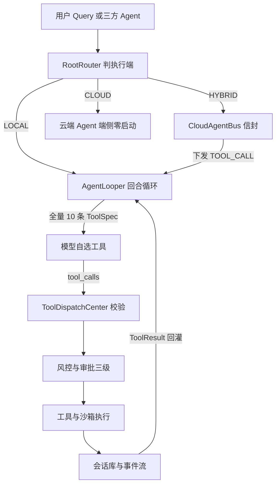
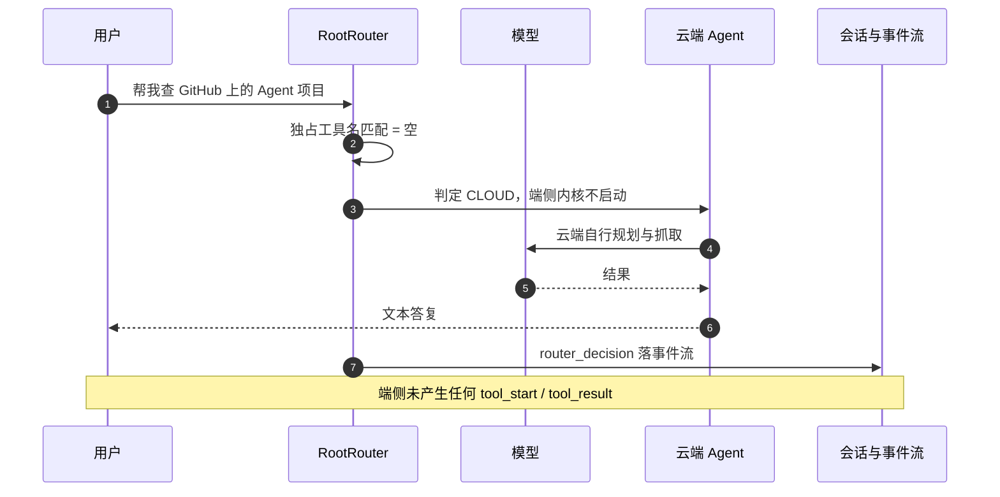
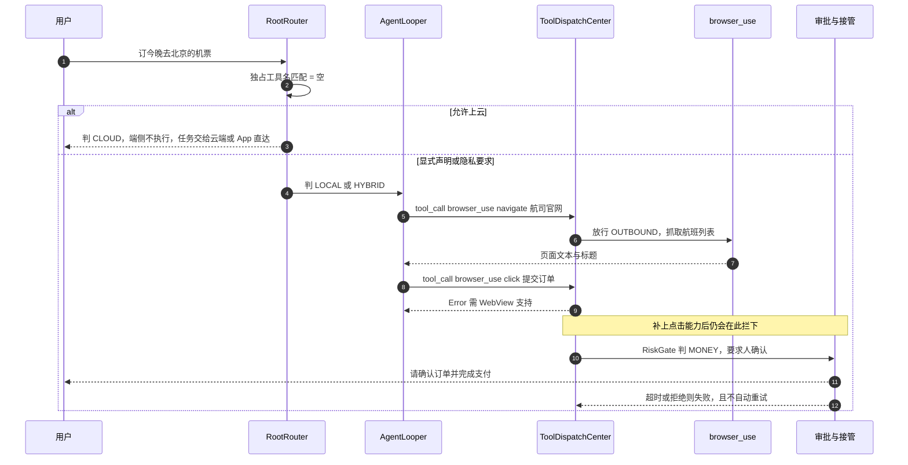

# 工具召回机制与浏览器调用案例走查

> 本文回答一个具体问题：一句自然语言（例如「帮我订一下今晚的机票，去北京的」）进来，框架是怎么决定「用不用 browser_use」的？以及它在什么条件下才会真的被调用。
> 与《方案设计文档 V1.1/V1.2》《browser_use 浏览器工具数据链路分析》同口径；凡代码可查的结论标「实证」，凡设计取舍标「设计」，凡能力缺失标「缺口」。

## 0 结论先行

三句话：

1. **本项目没有工具检索层。** 10 个工具在编译期固定装配，每个回合把全部 schema 连同 system prompt 一起发给模型，由模型自己挑。所谓「召回」，实际是「全量注入 + 模型选择」。
2. **「帮我订一下今晚的机票」这句话，现在连端侧 Loop 都不会启动。** Router 用字面匹配工具名来判「是否依赖端侧独占能力」，这句话里没有 `browser_use` 字样，因此被判为「无本地工具依赖」→ 在线时直接 CLOUD，浏览器工具零出场（实证，见 `router/RootRouter.kt` 的 `decide()`）。
3. **即便强制走 LOCAL，也不该让 browser_use 去「下单」。** 它能做的是「看」——导航、读页面、截图；「订」包含账号、实名、支付三段，属 `RiskClass.MONEY`，必须人工确认，末段必须 hand_over。runtime 里 `click`/`input` 还直接返回「需 WebView 支持」（实证，`tools/PlatformTools.kt:163`）。

## 1 整体架构：一次请求要过四道判定

五层是老口径，这里补的是「判定点」——每一层都在替下一层缩小可能性，工具召回只是其中一个判定点。



四道判定及其归属：

| # | 判定 | 在哪 | 判什么 | 结果影响 |
| :-- | :--- | :--- | :--- | :--- |
| 1 | 执行端 | RootRouter | 网络、独占工具依赖、隐私词、来源（fromCloud）、调用方偏好 | LOCAL / HYBRID / CLOUD；决定端侧内核是否启动 |
| 2 | 工具选择 | 模型 | 读 10 条 spec 的 description，决定发不发、发哪个 | 产生 tool_calls；这是唯一的「语义召回」环节 |
| 3 | 按名分发与校验 | ToolDispatchCenter | 工具存在性、required/类型、OffloadGate、来源标记 | 未知工具/参数非法直接失败；云端调用强制同链路风控 |
| 4 | 风险与审批 | ShellGuard / BrowserGuard / RiskGate | SAFE / INSTALL / DESTRUCTIVE / OUTBOUND / REMOTE / **MONEY** | 非 SAFE 一律进审批；MONEY 与支付语义强制人确认 |

一条容易被忽略的事实：**第 2 道是概率性的，第 1、3、4 道是确定性的**。工具选错可以靠第 3、4 道兜住（校验与审批），但「该用端侧却判了 CLOUD」这种第 1 道的错，后面三道都看不见——因为内核没跑。

## 2 工具召回的真实形态

### 2.1 没有检索，只有全量注入

```kotlin
// Runtime.kt：编译期固定装配，运行时不做裁剪
val tools: List<Tool> = defaultTools(root.resolve("system"), memory, capability)

// AgentLoop.kt:86：每回合全量下发
provider.complete(system = systemPrompt, messages = window, tools = tools.map { it.spec })
```

`defaultTools()` 里就是写死的十个：`shell_execute`、`file_read`、`file_write`、`file_edit`、`read_image`、`browser_use`、`memory_write`、`memory_get`、`android_calendar`、`android_notify`（实证，`tools/PlatformTools.kt:353`）。

这个选择在 10 个工具的规模下是对的：十条 schema 大约几百 token，做向量检索的收益抵不过检索本身的误召与延迟。**但它有一个隐性上限**——工具涨到 30 个以上，全量注入会开始吃掉上下文预算，并且相似工具之间会互相「抢召」（比如 `browser_use` 与将来的 `http_fetch`）。

### 2.2 三条召回通路

| 通路 | 机制 | 确定性 | 谁在用 |
| :--- | :--- | :--- | :--- |
| 隐式：模型自选 | spec 全量注入，模型读 description 判断 | 概率性，取决于描述质量与模型 | LOCAL / HYBRID 下的常规任务 |
| 显式：调用方声明 | `AgentRequest.explicitTools = ["browser_use"]`；`fromCloud=true` 亦强制端侧 | 确定 | 三方 Agent、云端子任务、评测用例 |
| 协议直达：按名调用 | `McpAdapter` / `A2AAdapter` / `AppFunctionAdapter` → `dispatch.invokeRaw(name, args)` | 确定，不过模型 | 外部工具网关、原生能力导出 |

协议直达值得单独说：它把「选择」这件事从模型手里拿走，直接按名字进调度中心，**但风控一条不少**——`invokeRaw` 内部仍然走 `invoke()`，`OffloadGate`、参数校验、审计照旧。这也是「云端下发 TOOL_CALL」与「本地模型自选」能共用同一条安全链路的原因。

### 2.3 description 就是召回率

模型能看到的只有一行：

> `browser_use` — 浏览器自动化：navigate 打开公网页面、extract 提取正文。click/input 需 Android WebView 支持。

这句话同时在做三件事：告诉模型**能干什么**（navigate/extract）、**边界在哪**（公网）、以及**悄悄暴露了实现限制**（click/input 需 WebView）。第三件事其实该挪到能力矩阵里，留在描述里会让模型在需要点击时提前放弃。

好的描述应当回答「何时用」而不只是「是什么」：例如「当任务需要读取某个公网页面的实时内容、且该内容无法通过 API 获取时使用；不要在已知有结构化接口的站点使用」。这是把召回策略写进接口，而不是留给模型猜。

## 3 案例 A：帮我查一下 GitHub 上的 Agent 项目

这句话**是** browser_use 的典型场景，但按当前实现**不会**走到它。逐步走一遍：

| 步 | 发生了什么 | 结果 |
| :-- | :--- | :--- |
| 1 | Router 扫 query 找独占工具名：`browser_use`、`shell_execute`… 一个都不在句子里 | `hits = []` |
| 2 | 无隐私词、非 fromCloud、在线、`allowCloud=true` | 判 **CLOUD**，reason「无本地工具依赖，云端全权」 |
| 3 | `runCloud` 分支执行，端侧 `AgentLoop` 不构造 | 10 条 spec 不下发，浏览器工具零出场 |
| 4 | 云侧若也具备抓取能力，任务照样完成，但**端侧没有任何审计与截图留痕** | 用户拿到结果，链路不可观测 |



要让它走 HYBRID（云端规划、端侧抓页面、结果回传），需要满足其一：

- 调用方显式声明：`explicitTools=["browser_use"]`（三方 Agent 或上层 planner 填）；
- 用户话术命中隐私词（「本地」「不上云」）→ 强制 LOCAL，但仍要靠模型自己选工具；
- Router 的判定从「字面匹配工具名」升级为「意图标签匹配」——这是根本解，见第 6 节。

## 4 案例 B：帮我订一下今晚的机票，去北京的

这句话比案例 A 更值得拆，因为它同时暴露三类问题：路由、能力、风险。

### 4.1 会不会触发 browser_use

不会。三层原因，逐层落地：

1. **路由层**：句子里没有工具名，`hits=[]`，在线即 CLOUD。端侧不启动，浏览器工具不存在于这次执行里。
2. **能力层**：即使强制 LOCAL、即使模型选了 `browser_use`，runtime 的实现也只能 `navigate` 与 `extract`；`click`/`input` 直接返回「需 WebView/无障碍能力，纯后台骨架不支持」。**它能看，不能点。**
3. **风险层**：即便点击能力补齐，「提交订单 / 支付」属 `RiskClass.MONEY`（`Contracts.kt:101`、`ShellGuard` 的支付识别），必须弹审批；验证码与支付密码必须 hand_over，模型不得代输。

### 4.2 如果强行让它走一遍，会停在哪



四个停点，任一个都足以让「订票」不成：

| 停点 | 触发条件 | 系统行为 |
| :-- | :--- | :--- |
| 路由 | 无工具名依赖且允许上云 | 判 CLOUD，端侧完全不参与 |
| 能力 | 需要点击「提交/支付」 | `browser_use` 返回不支持 |
| 风控 | 命中 MONEY | 强制人工确认，超时即失败 |
| 交互 | 需要登录、验证码、支付密码 | hand_over 挂起，人完成后才继续 |

### 4.3 正确的形态：不是缺工具，是缺业务能力

订票需要三样东西：**账号体系、实名校验、支付通道**。这三样都不是「浏览器能点」就能解决的，它们是业务能力，必须由 OTA / 航司的官方接口或 App 提供。

所以正确的分层是：

| 环节 | 该谁做 | 为什么 |
| :--- | :--- | :--- |
| 查航班、比价、读退改签规则 | `browser_use` 只读（navigate + extract） | 页面是公开信息，读即可，不需要登录态 |
| 选座、填乘机人、锁价 | 官方 API / App Function | 需要账号与实名信息，模拟点击既脆弱又危险 |
| 提交订单、支付 | 官方 API，且强制 MONEY 级审批 | 资金动作不可由模型自主完成 |
| 验证码、支付密码 | hand_over | 凭证不得进入模型上下文 |

runtime 现状：`AppFunctionAdapter` 只是把工具表导出成 `{functions:[…]}` 的 schema（实证，`interop/A2AAdapter.kt:91`），并没有接入任何订票服务。**这是能力缺口，不是工具缺口**——再加十个工具也订不了票，只有接上服务方接口才行。

### 4.4 一句话总结这个案例

> browser_use 是「看网页的手」，不是「下单的手」。它可以替你把航班查清楚，但不能替你把钱付出去。

## 5 判定矩阵：什么任务该走哪条通道

| 任务形态 | 首选通道 | 风险档 | 端侧是否必须 | 当前实现 |
| :--- | :--- | :--- | :--- | :--- |
| 读公网页面、抓实时信息 | browser_use（navigate/extract） | OUTBOUND | 否，但端侧有登录态时优先 | 可用（HTTP 抓取） |
| 需要点击/输入/登录态页面 | browser_use（click/input/hand_over） | OUTBOUND → MONEY | 是（WebView 独占） | 缺口 |
| 订票、下单、支付 | 官方 API / App Function + 审批 | MONEY | 否 | 缺口（无业务接入） |
| 本地文件处理、脚本 | shell / file_* | SAFE/DESTRUCTIVE | 是 | 可用（沙箱） |
| 读本地图片 | read_image | SAFE | 是 | 可用 |
| 记忆读写 | memory_* | SAFE | 是 | 可用 |
| 日历、通知 | android_calendar / android_notify | SAFE | 是 | 可用 |
| 外部工具生态 | MCP / A2A / App Function 旁路 | 同工具 | 视工具 | 适配层已就绪，未接真实服务 |

这张表的价值在于：它把「召回失败」拆成了三种完全不同的病——**路由把请求送错了地方**、**工具没有这项能力**、**业务没有这项服务**。三种病的药完全不同。

## 6 缺口与改造清单

### P0：让路由能认出「需要浏览器」

现状：`RootRouter.decide()` 用 `rawQuery.contains(toolName)` 判独占工具依赖，自然语言几乎永不命中。

改法：给每个工具打**意图标签**（`web.read` / `web.interact` / `fs.write` / `money.pay` …），Router 匹配标签而非工具名；标签可由轻量分类器或关键词表产生，且必须可配置（对齐 DESIGN 第 12 章「路由规则配置化」）。

```kotlin
// 目标形态（设计）
val intents = IntentClassifier.classify(req.rawQuery)          // ["web.read", "time.today"]
val hits = config.intentToTools.filterKeys { it in intents }    // browser_use
```

副作用要一起考虑：意图识别一旦误判成「需要端侧」，会把本可云端完成的任务拖回本地，抬高延迟与耗电。所以标签匹配只应作为「禁止 CLOUD」的**下界**，不应作为「必须 LOCAL」的强制。

### P0：browser_use 的风险档要从 OUTBOUND 细化

现状：`BrowserUseTool` 只做出网审批（OUTBOUND）。补齐 click 后，「提交订单/支付/删除」这类动作必须升到 MONEY，并复用同一张审批卡。

### P1：工具集分层下发

10 个可以全量；到 20+ 时按 Router 判定的 capability 子集裁剪，避免 schema 预算膨胀与近似工具抢召。

### P1：描述改写为「何时用 / 何时不用」

把实现限制（「需 WebView 支持」）移出 description，改为能力矩阵字段 `availability: LOCAL_ONLY`，让模型看到的是能力边界而非宿主缺陷。

### P2：把 hand_over 接进运行时

现状：审批有 `ApprovalGate`（含 180s 超时），但没有「页面接管」这种长时挂起语义。补齐后，订票类任务的最后一步才有合法的落点。

## 7 验收用例

| 编号 | 输入 | 通过条件 |
| :--- | :--- | :--- |
| AC-R1 | 「帮我查一下 GitHub 上的 Agent 项目」+ `explicitTools=["browser_use"]` | Router 判 LOCAL 或 HYBRID，事件流出现 `router_decision` 且 `local_exclusive_hits` 含 browser_use |
| AC-R2 | 同上但不显式声明 | 允许判 CLOUD；若判 CLOUD，端侧不得出现任何 `tool_start`（避免「影子执行」） |
| AC-R3 | 「订今晚去北京的机票」 | 不得由 `browser_use` 完成下单；命中 MONEY 时必须有审批记录，拒绝/超时后不自动重试 |
| AC-R4 | 强制 LOCAL 后请求 click | 返回明确的能力不支持错误码，不得静默失败，模型能据此改走其它通道 |
| AC-R5 | 意图标签误判为 `web.read` 但目标为内网地址 | 在 `loadUrl`/HTTP 请求之前返回 `risk_block`，事件流留痕 |
| AC-R6 | MCP 按名调用 `browser_use` | 跳过模型选择，但仍产生 `offload_gate` 与 `tool_start` 审计，风控不旁路 |

## 8 结论

这套框架的「召回」不是搜索，而是**四道确定性判定把可能性逐层收窄，只留一道概率性判定（模型选择）**。它的稳健性来自后三道（校验、风控、审批）兜得住模型选错；它的脆弱性来自第一道——Router 判错执行端时，后面三道全部失效，因为内核根本没启动。

「订机票」这句话之所以值得写进文档，正因为它同时踩中三处：路由把它送走、能力只够看不够点、业务根本没有服务可接。修好它需要三件不同的事，而不是「再加一个工具」。
