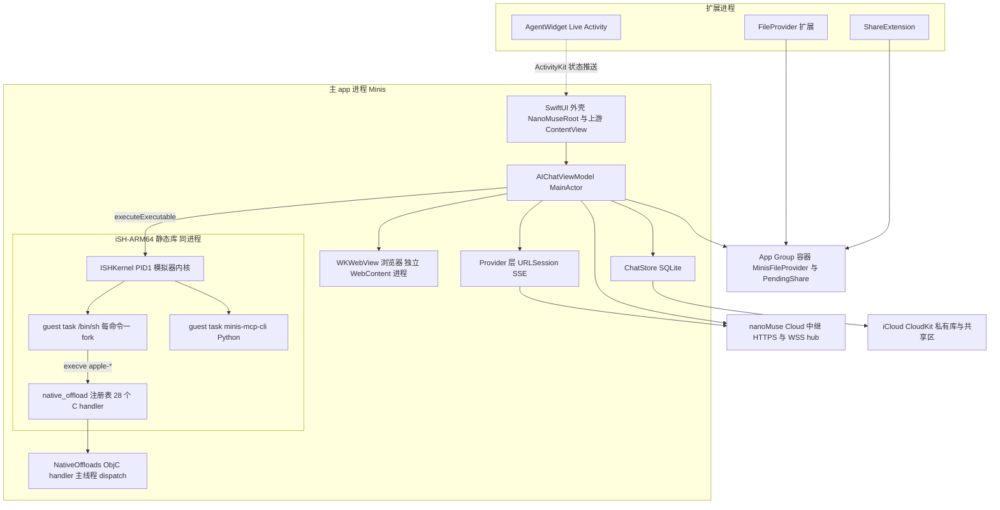
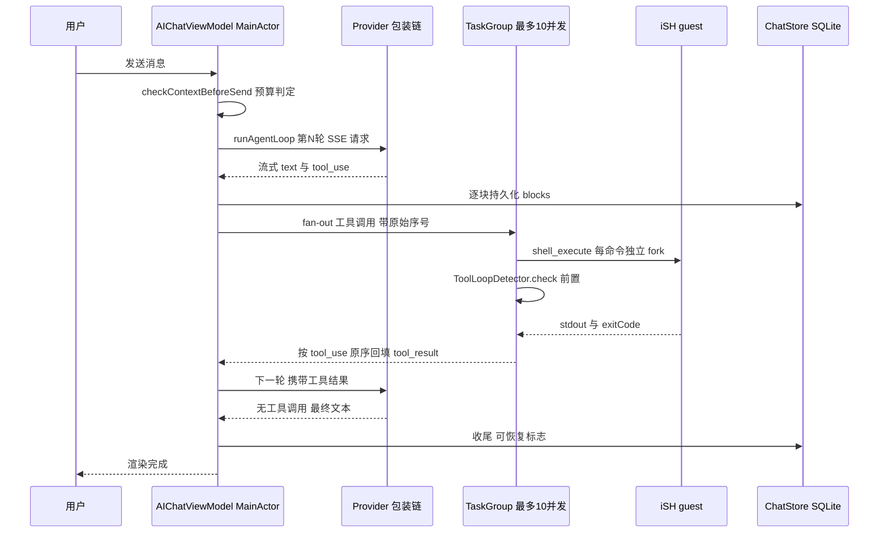
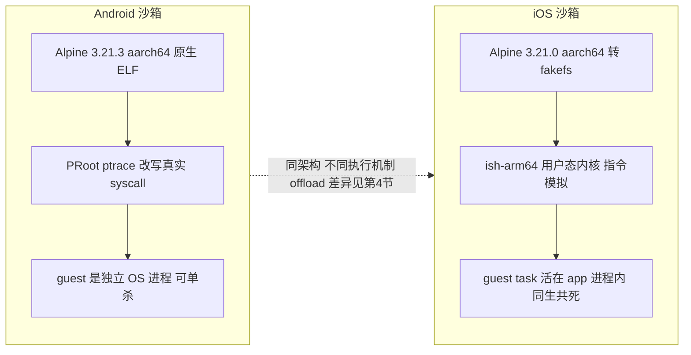
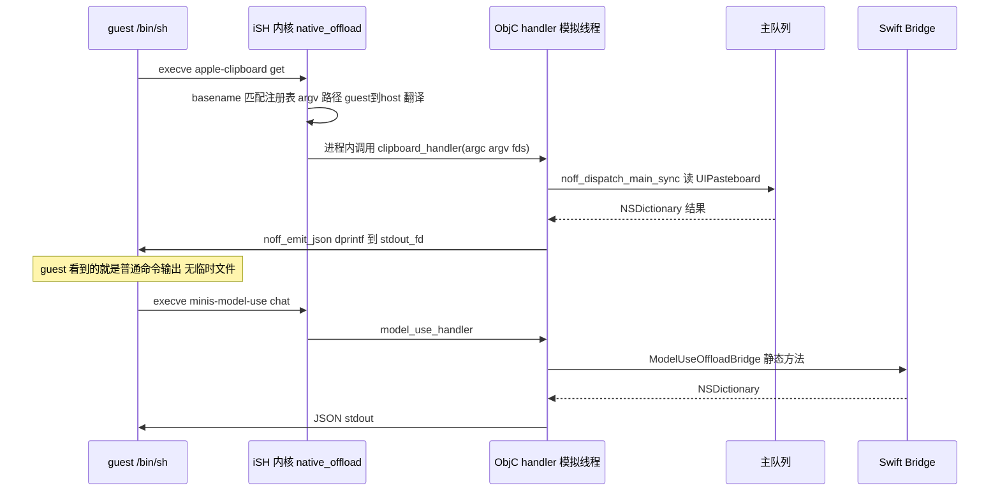
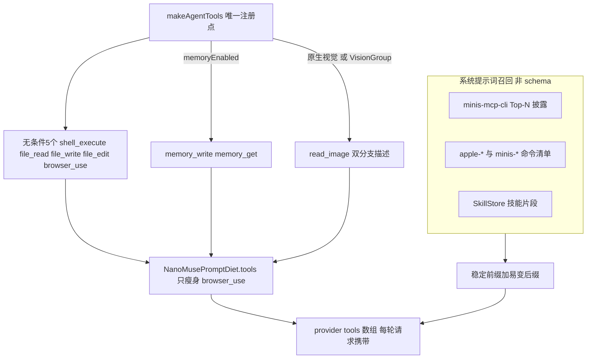
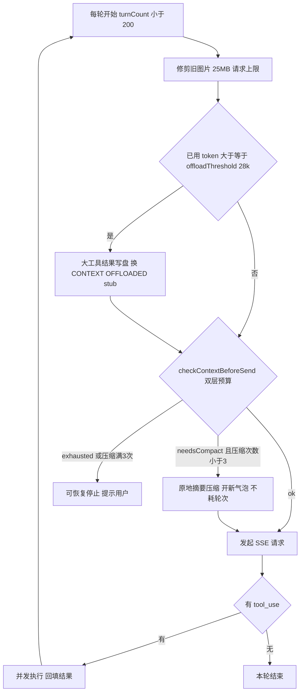
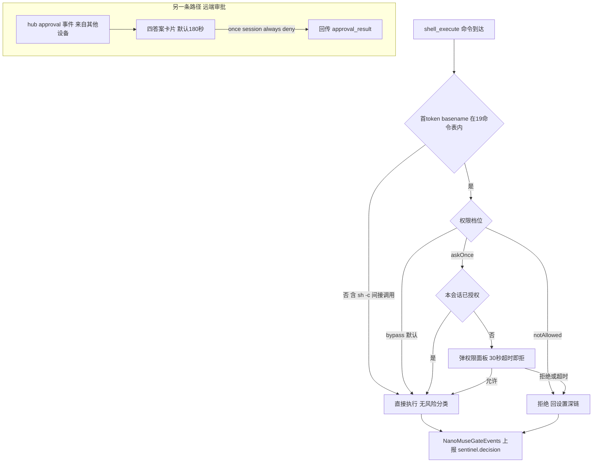
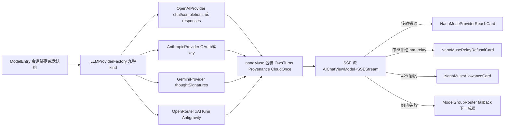
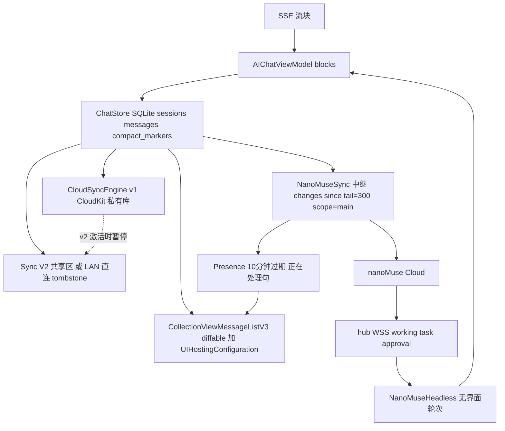

# 01 · iOS 整体架构与数据流

> **基线**：commit `067384b7e5b3c47a7eeca217895be71493396518`（2026-11-13），versionName 1.0.9（`android/src/ios/Minis.xcodeproj/project.pbxproj:3231`）。
> **方法声明**：本环境无 Xcode、无 macOS、无真机。本章全部结论来自**静态源码考证**（读代码、grep 调用方、读构建脚本与 CI 配置），没有任何编译或运行验证。凡属推断均显式标注「推断」。文档（`docs/ios.md` 等）与源码冲突时以源码为准，冲突本身作为发现记录。
> **路径约定**：所有行号引用相对仓库根 `/data/repo`。iOS 工程位于 `android/src/ios/`——目录名叫 android 但里面是 iOS 工程，这是仓库结构事实而非笔误：`android/` 是整个 OpenMinis 上游仓库的 git subtree，iOS 半壁被恢复在上游原来的位置以保持 `git subtree pull` 双端可用（`docs/ios.md:19-23`）。
> **取舍标准**：556 个 .swift 文件 / 265438 行（实测 `find . -name "*.swift" | wc -l` 与逐文件求和）不可能穷尽。本章按「与 Android 拆解对位 + 能力差异来源」优先：Agent 循环、iSH 沙箱、NativeOffloads、工具注册表、上下文、风控、Provider 层拆透；UI 与业务能力全量清单放在姊妹篇 `02-ios-capabilities.md`。

## 本章回答什么问题

1. iOS 工程的物理结构是什么：几个 target、几个进程、代码怎么分布？
2. Agent 循环怎么跑：轮次上限、并发工具、循环检测器与 Android 是否同源？
3. **iOS 沙箱到底是什么**：是 iSH 吗？是 x86 吗？rootfs 从哪来？与 Android PRoot 的能力差异从何而来？
4. **NativeOffloads 的 IPC 形态**：与 Android 的 unix socket + execve 改写对位吗？注册了哪些 offload？
5. 模型手里有几个原生工具？上下文管理是单层还是双层？风控审批有没有 Android RiskGate 的对位物？
6. Provider 层支持哪些协议？数据怎么从 SSE 流到 SQLite 再流到 UICollectionView？
7. 逐项对位 Android 架构，差在哪里？

---

## 1. 工程结构：一个 app、三个扩展、四个同步文件夹

### 1.1 仓库位置与规模

iOS 工程整体在 `android/src/ios/`，Xcode 工程 `Minis.xcodeproj`。顶层目录实测：

| 目录 | 内容 | 规模线索 |
|---|---|---|
| `Agent/` | 上游 OpenMinis 的 agent 核心：Chat / Session / Sync / Shell / ISH / BrowserUse / MessageList / Markdown / Intents / Speech / Background / Backup / Offload + `ToolLoopDetector.swift` | 83086 行，最大文件 `ChatStore.swift` 7461 行、`AIChatViewModel.swift` 6487 行 |
| `NanoMuse/` | nanoMuse 自有业务层（账号/形象/目标/动态/例程/hub/同步/外壳），Xcode **同步文件夹**（丢进 .swift 即编译） | 94 个 .swift / 30380 行 |
| `Providers/` | LLM Provider 层：OpenAI / Anthropic / Gemini / xAI / Kimi / OpenRouter / Antigravity + 模型组路由 + Voice + Thinking | 9 种 providerKind |
| `NativeOffloads/` | 28 个沙箱命令的宿主 handler（.h/.m 为主，7 个 Swift 桥） | 5187 行 |
| `iSH/` | iSH 内核 ObjC 封装 + rootfs 管理 + 终端 UI | ISHKernel.m 1935 行、ISHShellExecutor.m 1196 行 |
| `Views/` | 上游 SwiftUI 界面：Chat / Settings / Providers / MCP / Skills / Sync / Backup / Alarms / Rootfs | `ContentView.swift` 为上游根视图 |
| `Shared/` | 跨 target 共享：App Group 存储、分词（cppjieba）、BPE tokenizer、深链路由、ObjC 安全垫片 | 含 `cl100k_base.tiktoken` |
| `FileProvider/` | Files app 集成扩展（NSFileProviderReplicatedExtension） | 1139 行 |
| `AgentWidget/` | Live Activity / 灵动岛扩展 | 465 行 |
| `ShareExtension/` | 系统分享面板扩展 | 4 个文件 |
| `Diagnostics/` | CrashReporter（MetricKit + 信号处理）/ BrowserResourceMonitor | 1540 行 |
| `Debug/` | DebugServer（JSON-RPC）+ 视图检查 + AutoTouch + 性能追踪 | 31 个文件，Release 编译掉 RPC 部分 |
| `WebApp/` | 把会话生成的 HTML 作为「网页 App」加到主屏 | 7 个文件 |
| `Vendor/` | cppjieba（中文分词 C++ 库） | — |
| `MinisTests/` `MinisUITests/` | 单元测试（55 个文件）与 UI 测试 | 均为同步文件夹 |
| `default_mount/` | 每次 boot 覆盖进 guest 的文件：`etc/profile.d/minis.sh`、`usr/local/bin/minis-mcp-cli`、xdg-open 系列包装器 | Python MCP CLI 活在 guest 里 |
| `Configs/` `fastlane/` | ProviderCustomization.xcconfig.example；TestFlight 两条 lane | — |
| 9 个 `*.lproj` | en / zh-Hans / zh-Hant / ja / ko / de / es / fr / ru，各含 `AppShortcuts.strings` + `InfoPlist.strings` | 加 `Localizable.xcstrings` 共九语 |

**target 拓扑**（`Minis.xcodeproj/project.pbxproj`）：主 app `Minis`（bundle id `io.github.nanomuse.app`，`:3498`）+ 三个扩展 `MinisShare` / `MinisFileProvider` / `AgentWidgetExtension`（bundle id 见 `fastlane/Fastfile:40-45`）+ 两个测试 target。四个 target 的同步文件夹只有 `Terminal`、`NanoMuse`、`MinisUITests`、`MinisTests`（`project.pbxproj:1229-1232`）——**其余目录的文件是显式引用的**，这个事实在 §10 的死代码检测里会用到。

部署目标：app 与扩展 **iOS 16.0**（`project.pbxproj:3379,3442`），AgentWidget **16.2**（`:3681`，Live Activity 的最低版本），测试 target 26.2（`:3230,3282`）。构建用 iOS 26 SDK（`docs/ios.md:805`）。app 的 C 预处理定义里有 **`GUEST_ARM64=1`**（`project.pbxproj:3370,3433`）——这是沙箱架构辨析的第一个硬证据（§3）。

### 1.2 进程拓扑

iOS 侧没有 Android 那种「app 进程 + proot tracee 进程」的分离：**iSH 内核以静态库形式链接进 app 主进程**（`android/deps/build_ish.sh:6-9`：产出 `libish.a / libish_emu.a / libfakefs.a`），guest 的每个「进程」是模拟器内的一个 task，不是 OS 进程。扩展（FileProvider / Widget / Share）是独立 OS 进程，靠 App Group 容器 `group.io.github.nanomuse.app` 与主 app 交换文件（`FileProvider/FileProviderExtension.swift:15-22`）。



### 1.3 上游与自有层的边界纪律

规则（`docs/ios.md:40-42`）：新代码进新文件（`NanoMuse/`），改上游 Swift 必带 `// nanoMuse:` 注释，品牌化由 `scripts/rebrand.py` 完成。实测执行严格：`AIChatViewModel.swift:4796` 的 `NanoMusePromptDiet.tools(...)`、`+Compaction.swift:25` 与 `+Offloading.swift:374` 的 `NanoMuseContextBudget.policy(...)` 都是单行标记接入。**架构含义**：对上游 agent 核心的侵入是「包装点」式（provider 包装、工具描述/预算替换、权限检查包装），非 fork 式改写——subtree pull 可持续，但 iOS 能力天花板基本由上游 OpenMinis 决定，nanoMuse 层做账号、形象、跨设备与体验。

---

## 2. Agent 循环与轮次管理

### 2.1 对位结论先行

| 项 | Android | iOS | 证据 |
|---|---|---|---|
| 轮次上限 | `MAX_AGENT_TURNS = 200` | `maxAgentTurns = 200` | Android `ChatViewModel.kt:412`；iOS `Agent/Chat/AIChatViewModel.swift:73` |
| 循环入口 | `runAgentLoop`（`ChatViewModel.kt:7968` 的 `agentTurns@ for`） | `runAgentLoop(resumingAt:committedBlocks:)`（`:4736`），`loopLabel: while turnCount < Self.maxAgentTurns`（`:5002`） | 同名同构 |
| 触顶行为 | finalizing as resumable（`ChatViewModel.kt:9440`） | 同：`hitTurnLimit` 标志 + 可恢复收尾（`:4997,6117-6119`） | 注释明说 Mirrors Android |
| 循环内压缩上限 | —（未对位考证） | `maxInLoopCompactions = 3`（`:77`） | iOS 独有常量，Android 对位物未确认 |
| 并发工具 | 未确认常量 | `maxConcurrentTools = 10`（`+ConcurrentTools.swift:25`） | TaskGroup fan-out |

iOS 的注释直接承认对位关系（真实摘录，`Agent/Chat/AIChatViewModel.swift:66-77` 节选末两行）：

```swift
    /// runaway. Mirrors Android ChatViewModel.MAX_AGENT_TURNS.
    static let maxAgentTurns = 200
```

完整注释还说明：这是绕过 ToolLoopDetector 的失控工具循环的最后防线，触顶走可恢复收尾而非无界跑飞；`maxInLoopCompactions = 3`（`:77`）防止无休止压缩架空该上限。

### 2.2 一轮 runAgentLoop 的解剖

`runAgentLoop`（`AIChatViewModel.swift:4736`）是 `@MainActor` 类（`:14-15`）上的 async 方法：循环跑在主 actor，工具经 TaskGroup 并发，UI 变更天然串行。流程：

1. **诊断轮次标记**：ROUND BEGIN/END 计数器（`:4737-4744`），日志按 attempt 切片。
2. **Provider 解析**：`resolveCurrentEntry()` 失败报「No model configured」（`:4753-4758`）；`makeAgentProvider(for:)`（`:4759`）被 nanoMuse 层层包装（OwnTurns/Provenance/CloudOnce，§8）。
3. **模型组回退**：绑定来自 group 时启用 fallback（`:4772-4794`）；`.directEntry` pin 不启用（注释：不「背着用户换模型」）。
4. **工具表**：`let tools = NanoMusePromptDiet.tools(makeAgentTools())`（`:4796`）——先注册再瘦身（§5）。
5. **系统提示词装配**：稳定前缀 + 易变后缀（`NanoMusePromptCacheLayout`，`:4800-4830`）；skills/MCP/记忆/USER.md/运行时上下文进后缀，保 prefix cache（§6.4）。
6. **轮次循环**（`:5002` 起）：每轮先 `Task.checkCancellation()`，再做三件上下文管理（§6）：`trimOldImagesFromHistory()`（`:5053`）→ `offloadContextIfNeeded(...)`（`:5057`）→ `switch checkContextBeforeSend()`（`:5078`）。`.needsCompact` 时原地压缩并**不消耗轮次**（预减 turnCount 抵消 defer 的 +1，`:5075-5077` 注释），但 200 上限永不重置。
7. **消息索引自愈**：每轮用稳定 id 重锚 `msgIdx`（`:5015-5050`），外部变更（压缩分隔线、DB 重载、用户删除）致数组漂移时 RESYNC/REBIND/REAPPEND 三级兜底——2026-07-31 现场冻结事故（sessions 35D4D2B2/7FDC5B52）的修复，注释带事故编号。
8. **SSE 流式调用** → 工具 fan-out（§2.3）→ 结果按序回填 → 无工具调用则 break 收尾。
9. **触顶收尾**：`hitTurnLimit` 只在 while 条件自然变假时保持 true（`:4989-4996` 注释解释了为什么不能用 `turnCount >= maxAgentTurns` 判断——defer 在 break 时也 +1），触顶时注入「Stopped after 200 agent turns…」+ Resume（`:6117-6119`）。



### 2.3 并发工具分发

分发器在 `AIChatViewModel.swift:5912-5948`：`withTaskGroup(of: (Int, ToolExecOutcome).self)`，在途上限 `maxConcurrentTools = 10`（`+ConcurrentTools.swift:25`），用 `added - harvested >= cap` 的收割循环限流（`:5917-5924`）。**顺序约束**：Anthropic 要求 tool_result 与 tool_use 同序，所以每个子任务带原始 idx，全部完成后按序缝合（`:5950-5960`）。停止语义：整批开始前重置一次 `commandCancelledByUser`（`:5904`），子任务只读（单任务内重置会竞态清掉兄弟任务的停止信号，注释明说）。

单工具执行 `executeSingleToolUse`（`+ConcurrentTools.swift:84`）的前置链：取消预检（合成 cancellation result 保持 history 配对，`:95-115`）→ `toolLoopDetector.check`（`:125`）→ preflight 校验 → 分发 switch（`shell_execute :282` / `file_read :487` / `browser_use :547` / `read_image :640` / `memory_write :786` / `memory_get :794`）→ `toolLoopDetector.record` 后置（`:961`）。

### 2.4 ToolLoopDetector：与 Android 逐行同源

`Agent/ToolLoopDetector.swift`（370 行）与 Android `app/src/main/java/com/openminis/app/agent/ToolLoopDetector.kt` 是**同一设计的两份实现**，四策略、阈值、节流算法完全一致：

| 参数/策略 | iOS | Android |
|---|---|---|
| historySize / warning / unknownTool / critical / globalCircuitBreaker | 30 / 10 / 10 / 20 / 30（`ToolLoopDetector.swift:39-43`） | 30 / 10 / 10 / 20 / 30（`ToolLoopDetector.kt:42-46`） |
| 四策略：unknown_tool_repeat / global_circuit_breaker / poll_no_progress 双阈值 / generic_repeat 非连续计数 | `:81-86` / `:89-94` / `:97-111` / `:114-126` | 同（poll `:126` 起、generic `:146` 起） |
| poll 工具判定 | `command_status` + `process` 的 poll/log（`:322-331`） | 同（`ToolLoopDetector.kt:260-268`） |
| argsHash 忽略 `tool_title` | `:257-259` | `:406` |
| 结果哈希剥离时间戳/时长/请求id/空白 | `stripVolatile :278-301` | 同构 |
| 警告节流 bucket = count / warningThreshold | `:211-216` | `:274` 起 |

**两处实现差异**（非语义漂移，但值得记录）：
- 配置校验：Android 用 `require(...)` 抛异常（`ToolLoopDetector.kt:49-56`），iOS 用 `max()` **自动纠正顺序**（`ToolLoopDetector.swift:45-55`）——同样的非法配置在 Android 崩溃、在 iOS 静默修正。
- iOS 的 `getNoProgressStreak` 对缺失 resultHash 的记录直接 break（`:341-343`，「无法证明 no-progress 就停」），Android 侧未逐行核对这一分支（列入未确认）。

### 2.5 工具参数修复（ToolPreflight）

`+ToolPreflight.swift:33-80` 在 preflight 拒绝前先跑三级 JSON 修复：截断闭包补齐（≤3 个 `}`/`]`/`"`）、必需字段类型强转（`String(describing:)`）、Levenshtein ≤1 的字段名模糊匹配（`comand`→`command`）——对流式残缺参数的工程化容忍。Android 在 `ChatViewModel.kt:9089` 附近有 truncationRepairTag 痕迹（未逐行对位）。

---

## 3. iSH 沙箱：ARM64 用户态 Linux 模拟器，不是 x86，也不是 PRoot

### 3.1 关键辨析：三个流行假设都不准确

**假设 A「iOS 用 x86 iSH」——错。** 上游 iSH 确实是 x86 模拟器，但本仓库用的是 **OpenMinis/ish-arm64 fork**，模拟 **ARM64 (aarch64) guest**：

- `.gitmodules`：`[submodule "android/deps/ish"] url = https://github.com/OpenMinis/ish-arm64.git`。
- `android/deps/build_ish.sh:6-9`（真实摘录）：

```bash
# This script builds libish, libish_emu, and libfakefs as static libraries
# for iOS (arm64) integration, using the ish-arm64 fork which emulates an
# ARM64 Linux guest on iOS.
```

- app 构建定义 `GUEST_ARM64=1`（`project.pbxproj:3370,3433`）。
- `iSH/RootfsManager.swift:46`：`private let currentArch = "aarch64"`，rootfs 目录带 `.arch` 标签文件，架构不匹配即视为未安装（`:52-58`）。
- `docs/ios.md:22,30` 也明写 submodule 是「the ARM64 iSH fork」，并给出依赖构建顺序 **LAME → FFmpeg → iSH → Alpine rootfs → rclone**（`build_lame.sh → build_ffmpeg.sh → build_ish.sh → prepare_alpine_rootfs.sh → build_rclone_ios.sh`）——确认 `prepare_alpine_rootfs.sh` 属 iOS 链路，与 Android 的 `prepare_android_sandbox.sh` 分属两条。

**假设 B「`prepare_alpine_rootfs.sh` 与 Android 共用 rootfs」——半对。** 两端下载的是**同一架构**（aarch64）的 Alpine minirootfs，但**版本与格式不同**：

| | iOS | Android |
|---|---|---|
| 脚本 | `android/deps/prepare_alpine_rootfs.sh` | `android/scripts/prepare_android_sandbox.sh` |
| Alpine 版本 | **3.21.0**（`prepare_alpine_rootfs.sh:30-33`：`ALPINE_VERSION=3.21, ALPINE_MINOR=0, ALPINE_ARCH=aarch64`） | **3.21.3**（`prepare_android_sandbox.sh:17-19`） |
| 格式 | 转成 iSH **fakefs**（`data/` 目录 + `meta.db` SQLite 元数据），打进 bundle 的 `alpine-rootfs.zip` | 原生 tar 解包，PRoot 直接 chroot 语义 |
| 运行时 | 首启解压到 `Documents/alpine-rootfs`（`RootfsManager.swift:36-39`） | app 私有目录 |

**假设 C「iSH 是 syscall 翻译层，类似 PRoot」——机制不同。** PRoot 靠 ptrace 拦截真实进程的真实 syscall 做路径/语义改写；iSH 是**完整的用户态内核**：自己实现 ELF 加载、进程（task）模型、VFS、TTY、socket，guest 指令由 JIT/解释器执行（转述，细节不可考）。iOS 上 `become_first_process()` 让 app 进程「成为 PID 1」（`iSH/ISHKernel.m:599`），guest 的一切都是这个进程内的数据结构。证据链：

```objc
// iSH/ISHKernel.m:576-616（节选，真实摘录）
err = mount_root(&fakefs, _dataPath.fileSystemRepresentation);
...
err = become_first_process();
...
do_mount(&procfs, "proc", "/proc", "", 0);
do_mount(&devptsfs, "devpts", "/dev/pts", "", 0);
```

**注意**：`android/deps/ish` submodule **未展开**（目录为空），内核 C 源码不可直接引用；内核行为描述均来自 app 侧封装代码及其注释中的内核行号转述，标注「转述」。

### 3.2 boot 序列与运行时护栏

`ISHKernel.m` 的 boot（`bootWithRootPath:`）顺序：mount fakefs（`:576`）→ 记录 canonical data path 供 bind-mount 自环守卫（`:584-595`）→ `become_first_process`（`:599`）→ procfs/devpts（`:614-615`）→ DNS：`/etc/resolv.conf` 文件级 bind mount 指向宿主 `Library/MinisChat/dns/resolv.conf`（`:619,907-930`）→ exit hook（`:621`）→ guest AF_UNIX socket 前缀重定向到 app 沙箱 tmp（`:625`）→ **fork 内存守卫**（`:627-639`）：

```objc
// iSH/ISHKernel.m:632-635（真实摘录）
g_fork_guard_max_footprint = minis_fork_guard_compute_ceiling();
minis_fork_guard_start_pressure_source();
ish_set_fork_guard(minis_fork_memory_guard);
```

守卫按设备 RAM 缩放足迹上限，只在系统内存压力下等待——这是 iOS Jetsam（内存杀进程）约束的直接产物：**guest fork 风暴不能把 app 足迹顶到 Jetsam 线**。Android 没有对位物（Linux OOM killer 语义不同，且 proot tracee 是独立进程）。随后 TTY console + stdio（`:642-653`）→ 28 个 offload 注册（§4）→ `_isBooted = YES`。

**不可逆约束**：内核单例每进程只 boot 一次。`RootfsManager.swift:21-32` 的注释写明：reset 删掉 rootfs 后 `isBooted` 仍为 true 但 fakefs 挂载已指向不存在的树，再用必崩；`didResetWhileBooted` 标志置位后终端拒绝启动 shell 直到冷重启，「进程内没有办法 un-boot」。这是「模拟器内核活在 app 进程里」的架构代价，Android 的 PRoot 可以杀进程重来。

rootfs 安装另有两个事故驱动的防御：arch 标签丢失诊断（`RootfsManager.swift:60-84`，2026-08-21 事故）；删除失败时 `rename(2)` 移开旧树兜底（`:86-120`，PATH_MAX 1024 被 10 层 80 字符目录名顶穿致 ENAMETOOLONG，Foundation 误报「file name invalid」）。

### 3.3 每会话文件路由：fs_context 令牌

Android 用「每会话一壳 + 每会话 rootfs 视图」；iOS 用**路径翻译钩子**达到同构效果。`Agent/ISH/MinisFsRouter.swift:1-27`：

```swift
//  Routes guest paths under /var/minis/{offloads,attachments,workspace,browser}
//  to per-session host directories via the iSH fakefs path-translate hook.
```

注释续文说明：每会话一个 u64 fs_context 令牌，盖在该会话的 task group 上，task 及其 fork 子代触碰四桶路径时由 C 层钩子查令牌重写到 `~/Library/.../minis/<sid>/<bucket>/`。钩子 API 在 `iSH/ISHKernel.h:122-144`（`installPathTranslateHandler:`，C 层每次 open/stat/readdir/unlink/rename/mkdir/**native offload** 路径翻译都 consult，要求非阻塞可重入）；反向钩子（host→guest，供 readdir 修正）在 `:146-155`。全局桶 `/var/minis/{memory,skills,shared}` 不走令牌，落 legacy `g_bind_mounts[]` 表（`MinisFsRouter.swift:19-21`）。外部文件夹挂载用 `bindMountPath:toHostPath:readOnly:`（`ISHKernel.h:70-82`），只读靠 meta.db 顶层目录 mode 0555 + 标准 access_check，「没有特殊 fakefs 管道」。

**并发模型**：`ISHExecutionCoordinator`（actor，`Agent/ISH/ISHExecutionCoordinator.swift:39`）的注释明确：每次 `executeExecutable("/bin/sh", stdinData:…, fsContext:…)` fork 全新 sh task，独立 PID/管道/fs_context，**跨会话与会话内全并发**；历史上的 FIFO 串行在 2026-05-25 移除，因为它把上层 TaskGroup 并行偷偷串行化了（`:33-38`）。`perSessionInflight` 仅保留给停止按钮枚举 PID 用（`:56-67`）。执行 API 在 `iSH/ISHShellExecutor.h:69-96`（三个重载）；`shell_execute` 工具默认超时 900s（`+ToolDefinitions.swift:46`）。

### 3.4 bash 按需安装与 bashism 检测

guest 默认 shell 是 busybox ash。`Agent/Shell/BashismDetector.swift:5-16`：用共享规则 JSON（`bashism_rules.json`，**Android 加载同一份**）检测 ash 不兼容语法，先剥 heredoc 体（避免 python/awk 内容误报风暴），50ms 保险丝 + 4KB 行上限防 ReDoS，命中分 S/E/T1 三级。`OnDemandBash.swift:5-13`：确认需要才 `apk add bash`，带 5s 网络预检、10 分钟 unavailable TTL、24h/3-strikes 持久退避、每进程一次安装预算——「模拟器里 apk 慢脆」的工程补偿。

### 3.5 能力后果：能跑什么、不能跑什么

基于上述机制的推断与证据混合结论（逐项标注）：

- **能跑**：Alpine aarch64 仓库的用户态程序（python3、node 等 apk 包）——rootfs 就是标准 Alpine（证据：rootfs 脚本 + `default_mount/etc/pip/pip.conf`）。guest 二进制是真实 ARM64 ELF，由 ish-arm64 执行（转述：fork 名与 GUEST_ARM64 定义；JIT 细节不可考，submodule 未展开）。
- **慢**：指令级模拟 + fakefs 文件操作走 SQLite 元数据 + 路径钩子，CPU/IO 密集任务显著慢于 Android PRoot（原生执行 + ptrace 改写）。「推断」——无真机基准，但 fork 守卫、bash 安装退避、900s 默认超时都是围绕慢与脆的设计。
- **不能跑**：需要真实内核特性的东西——内核模块、ptrace 类工具、Docker、systemd、需要 `/proc` 完整语义的程序（procfs 是 iSH 自实现的简化版，`ISHKernel.m:614`）。GPU/硬件访问不存在。
- **网络**：guest socket 由 iSH 内核实现并落到宿主网络栈；AF_UNIX 被重定向到 app 沙箱 tmp（`ISHKernel.m:625`），DNS 走宿主写入的 resolv.conf bind mount（`:907-930`）。
- **与 Android 的最大差异来源**：不是「x86 vs ARM」（两端 guest 同为 aarch64），而是**模拟执行 vs 原生执行 + 进程内内核 vs 独立 tracee**。Android 的 guest 进程是真 Linux 进程（可被 OOM 单独杀、可 ptrace）；iOS 的 guest task 与 app 同生共死，Jetsam 杀 app 即杀全部 guest，且无法在进程内重启内核（§3.2）。



---

## 4. NativeOffloads：进程内函数分发，对位 Android 的 socket 协议

### 4.1 IPC 形态辨析

Android 的链路（`android/src/android/app/src/main/java/com/openminis/app/sandbox/NativeOffload.kt:18-28` 注释）：guest `execve("<handler-name>")` → proot 扩展经 **abstract unix socket** 发 argv/env/cwd（小端二进制协议，MAGIC `NOFF`/`NOFR`，`:59-61`）→ 宿主 Kotlin handler → 输出写 guest `/tmp` 临时文件 → 回 `(exit_code, tmpfile_path)` → **execve 被改写成 `/bin/cat <tmpfile>`**。

iOS **没有 socket、没有临时文件、没有 execve 改写**。iSH 内核自带 `native_offload` 注册表，execve 命中注册名时**直接在进程内调用 C handler**：

```objc
// NativeOffloads/ClipboardOffload.m:313-319（真实摘录）
void clipboard_offload_register(void) {
    int err = native_offload_add_handler("apple-clipboard", clipboard_handler);
    if (err == 0) {
        noff_ensure_guest_stub("/usr/local/bin/apple-clipboard");
        NSLog(@"NativeOffloads: apple-clipboard handler registered");
    } ...
}
```

guest 侧的 `/usr/local/bin/apple-clipboard` 是**零字节占位 stub**（`noff_ensure_guest_stub` 用 `generic_open(O_CREAT, 0755)` 创建，`NativeOffloadUtils.m:248-270`），只为 PATH 查找能成功；真正的分发按 **argv[0] 的 basename** 在内核里完成（转述：`OffloadPermissionManager.swift:186-189` 注释引用 `deps/ish/kernel/native_offload.c:186-196` 的 `strrchr(guest_path,'/')` 匹配）。Android 的 `NativeOffload.kt:28` 注释也自认「Mirrors iOS `native_offload_add_handler` + `native_offload_exec`」——**iOS 是这套机制的原型，Android 是跨进程移植**。

handler 签名是 C 的 `(argc, argv, stdin_fd, stdout_fd, stderr_fd)`，输出直接 `dprintf(stdout_fd, ...)`（`noff_emit_json`，`NativeOffloadUtils.m:159-194`），guest 看到的就像普通命令的 stdout。需要 UIKit/主线程的操作经 `noff_dispatch_main_sync`（`dispatch_sync` 到主队列，`:204-213`）或带超时的信号量变体（`:215-244`，超时后 block 写入堆上 result box 而非死栈槽——注释解释了 use-after-return 防御）。**架构风险**：handler 与 UI 共享主线程，慢 handler 卡 UI；Android handler 在独立线程池天然隔离（影响程度推断，机制有代码证据）。

路径翻译：内核 `exec_handler` 在 handler 运行前把 argv 里每个绝对路径 guest→host 翻译（bind mounts 优先，再 fakefs data root）；`noff_resolve_host_path`（`NativeOffloadUtils.m:274-300`）带幂等守卫——已在 app 沙箱或 App Group 内的路径原样返回，否则会二次嵌套成 `…/data/private/var/…/data/…`（T-offload-double-path-translate 事故注释）。

### 4.2 注册全集：iOS 28 个 vs Android 25 个

iOS 注册点集中在 `iSH/ISHKernel.m:656-687`（26 个无条件 + `debug_offload_register()` 全构建注册但 RPC 子命令 DEBUG-gated + `minis-hangtest` 仅 DEBUG，`DebugOffload.m:557-559`）。逐项对位：

| iOS 命令 | 实现文件 | Android 对位 | 备注 |
|---|---|---|---|
| apple-alarm | AlarmOffload.m + AlarmOffloadBridge.swift | android-alarm | AlarmKit 仅 iOS 26+，16–25 直接报错（AlarmOffload.m:180-184,249） |
| apple-bluetooth | BluetoothOffload.m | **无** | iOS 独有；不在应用层权限表（§7） |
| apple-calendar | CalendarOffload.m | android-calendar | EventKit vs CalendarProvider |
| apple-clipboard | ClipboardOffload.m | android-clipboard | |
| apple-device | DeviceOffload.m | android-device | |
| apple-healthkit | HealthKitOffload.m | **无** | iOS 独有（HealthKit） |
| apple-homekit | HomeKitOffload.m | **无** | iOS 独有（HomeKit） |
| apple-location | LocationOffload.m | android-location | |
| apple-maps | MapsOffload.m | **无** | iOS 独有（MapKit） |
| apple-media | MediaOffload.m | nanomuse-media（语义不同） | iOS 是 Apple Music/媒体库；Android nanomuse-media 是媒体生成 |
| apple-nfc | NFCOffload.m | **无** | iOS 独有；不在应用层权限表 |
| apple-nlp | NLPOffload.m | **无** | NaturalLanguage 框架 |
| apple-notification | NotificationOffload.m | android-notification | |
| apple-open | OpenOffload.m | android-open | |
| apple-photos | PhotosOffload.m | android-photos | |
| apple-player | PlayerOffload.m + PlayerOffloadBridge.swift | android-player | |
| apple-reminders | RemindersOffload.m | **无** | EventKit 提醒事项 |
| apple-speak | SpeakOffload.m | android-speak | |
| apple-speech | SpeechOffload.m | android-speech | |
| apple-vision | VisionOffload.m | **无** | Vision 框架（OCR 等） |
| apple-weather | WeatherOffload.m + WeatherOffloadBridge.swift | android-weather | iOS 用 WeatherKit（entitlement） |
| ffmpeg | FFmpegOffload.m | **无同名**（Android 走 guest 内 ffmpeg 二进制，推断） | iOS 把 FFmpeg 编成宿主库直接调，绕过模拟执行 |
| minis-browser-use | BrowserUseOffload.m + Bridge | minis-browser-use | shell 里驱动宿主 WKWebView |
| minis-config | ConfigOffload.m + ConfigOffloadBridge.swift | minis-config | 设置读写 + 确认面板 + 审计 |
| minis-debug | DebugOffload.m | minis-debug（DEBUG） | logs 子命令 Release 可用（OSLogStore），RPC 子命令 DEBUG-only（`:470-497`） |
| minis-model-use | ModelUseOffload.m + ModelUseOffloadBridge.swift | minis-model-use | 沙箱内脚本调 LLM |
| minis-sessions-cli | SessionsOffload.m + SessionsOffloadBridge.swift | minis-sessions-cli | |
| minis-hangtest | DebugOffload.m:557（DEBUG） | **无** | 信号转发测试用故意卡死 handler |
| **无** | — | android-contacts | iOS 无通讯录 offload |
| **无** | — | android-a11y-cli | iOS 无无障碍驱动（平台禁止） |
| **无** | — | android-shizuku-cli | Android 特权通道 |
| **无** | — | nanomuse-hands | iOS 不能驱动自己屏幕（docs/ios.md:994） |
| **无** | — | nanomuse-pc | iOS 的 Reach 走 hub UI 而非沙箱命令（NanoMuseReach.swift） |
| **无** | — | nanomuse-backup | iOS 备份无沙箱命令入口 |
| **无** | — | minis-scheduled | iOS 例程无沙箱命令入口（Shortcuts intents 替代，MinisApp.kt:585-589 注释自认对位 iOS Shortcuts） |

计数：iOS **28**（Release 27，hangtest DEBUG-only）；Android **25**（Release 24，minis-debug DEBUG-only；注册点 `MinisApp.kt:560-597` 及各 handler 文件）。`.h/.m/.swift 三件套`只出现在需要回调 Swift 世界的 7 个 offload（Alarm/BrowserUse/Config/ModelUse/Player/Sessions/Weather）：ObjC handler 解析参数，`@objc public class XxxOffloadBridge: NSObject` 的静态方法进 Swift（例：`ModelUseOffloadBridge.swift:15-23`），纯 ObjC 能完成的（Clipboard 等）不需要桥。



### 4.3 与 Android 的协议级差异总结

| 维度 | Android | iOS |
|---|---|---|
| 传输 | abstract unix socket，小端帧（NOFF/NOFR，version 1） | 进程内函数调用 |
| 输出回灌 | /tmp 文件 + execve 改写 `/bin/cat` | 直接写 guest stdout fd |
| 失败面 | socket 被占（EADDRINUSE 重试 + per-process fallback，NativeOffload.kt:100-118）、tmp 泄漏（TTL 10min 清扫，`:64-77`） | 主线程阻塞、handler 崩溃即 app 崩溃 |
| 会话上下文 | `MINIS_CHAT_SESSION_ID` env 转发（T340） | 同 env 约定（`OFFLOAD_GLOBAL_SESSION_ID` 注释明说镜像 Android commit 20d8e68，OffloadPermissionManager.swift:114-118） |
| stub | PRootKernel.installHandlerStubs 写 17 字节 exit-0 stub | noff_ensure_guest_stub 写零字节 0755 文件 |

---

## 5. 工具注册表：最多 8 个，与 Android 同集

`makeAgentTools()`（`Agent/Chat/AIChatViewModel+ToolDefinitions.swift:30`）是 iOS 的唯一工具定义点（对应 Android `AgentTools.kt` + 四个 File/ReadImage Tool 文件）：

| # | 工具 | 行号 | 注册条件 | Android 对位 |
|---|---|---|---|---|
| 1 | shell_execute | `:40` | 无条件 | AgentTools.kt:47 |
| 2 | file_read | `:52` | 无条件 | FileReadTool.kt:12 |
| 3 | file_write | `:66` | 无条件 | FileWriteTool.kt:11 |
| 4 | file_edit | `:90` | 无条件 | FileEditTool.kt:11 |
| 5 | browser_use | `:103` | 无条件 | AgentTools.kt:64 |
| 6 | memory_write | `:137` | `memoryEnabled`（每会话开关） | AgentTools.kt:116 |
| 7 | memory_get | `:147` | 同上 | AgentTools.kt:132 |
| 8 | read_image | `:193` | 模型原生视觉 **或** Vision Group 已配置 | ReadImageTool.kt:13 |

**结论：双端同为 8 个原生工具上限，同名同集**；其余能力走沙箱 PATH 命令名（§4）。两处 iOS 特色：

1. **read_image 的双分支描述**（`:163-207`）：文本模型 + Vision Group 时，工具描述明说「你看不见图，返回的是视觉模型写的描述 + 文字转录」，并给 `prompt` 参数作为宿主模型唯一的追问杠杆；注册与 handler 都从 `resolveCurrentEntry()` 解析**实际服务本请求的模型**（`activeModelHasNativeVision`，`:24-27`），注释记录了 #182 事故：两处各自读 `selectedModel`（UI 属性）导致「告诉模型一套、喂给模型另一套」。
2. **file_write 的描述里写进了生成经济学**（`:66-88`，GH#223）：>8KB 内容要求分块 append 或写脚本生成，因为「每个字节都是模型生成的 tool 参数，流式传输中请求死掉」被用户报成「file_write 超时」。这是把运维经验固化进 schema 文案的实例。

工具表在进请求前经 `NanoMusePromptDiet.tools()`（`NanoMuse/NanoMusePromptDiet.swift:60-77`）：只重写 browser_use 的描述与 14 个参数文案（7.9k 字符瘦身，动作/参数/enum/required 全保留），其余工具原样。动机注释：一周 420 次 iPhone 浏览器调用里 cookies/viewport/无限滚动文案占三分之二却很少被用到（`:5-10`）。Android PromptDiet 还压提示词工具段，iOS 只压 schema（注释自述）。

browser_use 的 22 个 action（`Agent/BrowserUse/BrowserUseActions.swift:5-27`）：navigate / screenshot / click / type / get_text / scroll / get_page_info / execute_js / find_elements / hover / get_readable / set_user_agent / set_viewport / get_backbone / fetch / new_tab / close_tab / list_tabs / get_cookies / set_cookies / scroll_and_collect / wait_for_dom_stable。实现是宿主 **WKWebView**（`BrowserWebView.swift`），每池最多 3 tab（`BrowserTabPool.swift:193`），进程级全局上限约 3 会话 × 2-3 tab（`:10-25`，每个 WebContent 进程 30-80MB 常驻）；`minis://` URL 路由到会话文件（工具描述 `:104`）。cookie 读取只回摘要 + offload env 文件路径，**原始值不进工具响应**（描述 `:104`，`. /var/minis/offloads/env_cookies_xxx.sh` 复用）。

MCP 不是 native 工具：`Agent/Session/MCPStore.swift:56` 注释明说协议栈「lives entirely in the in-guest `minis-mcp-cli` daemon」，宿主只共写 `/var/minis/mcp-servers` 的 servers.json（`:245`）并替它跑 OAuth（`MCPOAuthController.swift`）；系统提示词只披露 Top-N 服务器 + 用法两行（`:622-638`）。与 Android 同构（guest Python 协议栈 + 宿主 OAuth）。



---

## 6. 上下文管理：双层治理，与 Android 同构

### 6.1 第一层：上游 ContextPolicy 四档

`Agent/Chat/ContextPolicy.swift:11-54`（真实摘录核心分支）：

```swift
init(contextWindow: Int) {
    if contextWindow < 32_000 {
        offloadThreshold = 0; offloadTarget = 0; compactThreshold = 0
        exhaustedOnly = true; manualCompactAllowed = false
    } else if contextWindow < 64_000 {
        offloadThreshold = contextWindow - 10_000
        offloadTarget = contextWindow - 15_000
        compactThreshold = 0
        ...
    } else if contextWindow < 128_000 {
        offloadThreshold = contextWindow - 20_000
        compactThreshold = contextWindow - 10_000
        ...
    } else {
        offloadThreshold = contextWindow - 40_000
        compactThreshold = contextWindow - 20_000
        ...
    }
}
```

（摘录为排版压缩了同行语句，原文每语句独立一行，行号 `:24-53`。）档位语义：<32K 不治理只提示新开；32-64K 只 offload 不自动压缩；64-128K 与 ≥128K 双阈值。

### 6.2 第二层：NanoMuseContextBudget 压线

`NanoMuse/NanoMuseContextBudget.swift:18-38`：

```swift
enum NanoMuseContextBudget {
    static let compactTokens = 32_000
    static let offloadTokens = 28_000
    static let offloadTargetTokens = 22_000

    static func policy(contextWindow: Int) -> ContextPolicy {
        let tier = ContextPolicy(contextWindow: contextWindow)
        guard tier.compactThreshold > compactTokens else { return tier }
        return ContextPolicy(
            offloadThreshold: min(tier.offloadThreshold, offloadTokens),
            offloadTarget: min(tier.offloadTarget, offloadTargetTokens),
            compactThreshold: compactTokens, ...
        )
    }
}
```

**结论：iOS 是双层，与 Android 的 ContextPolicy + ContextBudget（`io/github/nanomuse/chat/ContextBudget.kt:4`）完全同构。** 动机注释（`:6-13`）带实测数据：托管模型首 token 时延随 prompt 增长（8-12k 4.7s → 40k+ 54s，P95 80-138s），每天约 770 次调用白等中继 180s——所以 64K 以上窗口一律 32k 压缩、28k offload、22k 目标；<64K 档不动。三接入点（`+Compaction.swift:25`、`+Offloading.swift:374`、循环内 `AIChatViewModel.swift:5078`）均带 `// nanoMuse:` 标记；上游档位与测试原样保留（`ContextPolicyTests.swift`）。

### 6.3 offload 与压缩的物理动作

- **offload**（`+Offloading.swift`）：旧的大工具结果写宿主盘 `…/minis/<sid>/offloads/tools/<tool>_<id12>.<ext>`（`:22-36`），history 里替换为 stub：`[CONTEXT OFFLOADED] Content (~N tokens, B bytes) saved to: /var/minis/offloads/tools/… Use file_read tool to retrieve if needed.`（`:526,543`）。图片同理（`:40-63`）。模型可用 file_read 取回——**上下文换磁盘，召回靠工具**。
- **图片修剪**：每轮先 `trimOldImagesFromHistory()`（`AIChatViewModel.swift:5053`），只保留最近 N 张，旧的变文字占位；请求级图片总量上限 `kRequestImageMaxBytes = 25MB`（`:64`），注释记录 gpt-5.5 经 factory.pub 超限会静默返回 200+空 SSE+stop（T-request-imgsize）。
- **压缩**（`+Compaction.swift:479` `compactBefore`）：摘要式，插 `compactDivider` 分隔行、旧消息标 `isCompactedHistory` 灰显；循环内压缩后**封掉当前气泡、在分隔线下开新气泡**（`AIChatViewModel.swift:5081-5120`，GH#235：否则新输出流进已灰显的旧气泡）。压缩迭代不消耗轮次但受 `maxInLoopCompactions = 3` 限制，超限按 exhausted 可恢复停止。
- **token 估算**：`Shared/BPETokenizer.swift` + `cl100k_base.tiktoken`（真实 BPE，非字符数近似）；中文分词 cppjieba（`Vendor/cppjieba` + `JiebaWrapper.mm`）供记忆搜索。

### 6.4 提示词缓存布局

`NanoMuse/NanoMusePromptCacheLayout.swift`（装配点 `AIChatViewModel.swift:4800-4830`）：稳定前缀 = 基础系统提示词（工具与安全指引）；易变后缀 = 模型能力片段 + skills + MCP + 记忆 + USER.md/会话附加 + 运行时上下文（当前时间/语言/可用模型数，确定性排序）。目的：记忆写入或每小时时间刷新不再击穿 provider 的 prefix cache；fallback 模型重建同一布局（`docs/ios.md:90-95`，测试 `MinisTests/NanoMusePromptCacheLayoutTests.swift`）。Android 对位物同名同责。



---

## 7. 风控与审批：没有 RiskGate 对位物，只有上游三档权限 + 远端审批卡

### 7.1 结论与搜索记录

**iOS 本地没有 Android `io.github.nanomuse.guard.RiskGate` 的对位物。** 搜索记录：全 iOS 树 grep `RiskGate|RiskClass|RiskTier|GuardKind|ShellGuard`，命中仅 `NanoMuse/NanoMuseRemoteApproval.swift`（远端审批，§7.3）与 `NanoMuse/NanoMuseGateEvents.swift`（遥测包装，§7.2）——两者都不是本地命令风险分类器。Android 的六类 RiskClass（SAFE/INSTALL/DESTRUCTIVE/OUTBOUND/REMOTE/MONEY，`guard/Risk.kt:7-26`）、三档 RiskTier（NOTICE/CONFIRM/HIGHEST，`:44`）、180s 静默即拒（`RiskGate.kt:70` `TIMEOUT_MS = 180_000`）、ShellGuard 对任意 shell 命令的风险评估（`guard/ShellGuard.kt`）在 iOS **全部缺位**。

iOS 本地的闸是上游 `Agent/Offload/OffloadPermissionManager.swift`：

```swift
// Agent/Offload/OffloadPermissionManager.swift:6-9（真实摘录）
enum OffloadPermissionLevel: Int, CaseIterable {
    case bypass = 0
    case askOnce = 1
    case notAllowed = 2
}
```

- **三档**：Bypass（默认，`:167`）/ Ask Once（每会话授权，`sessionGrants[sessionId]`，`:152,245,275`）/ Not Allowed（拒绝并回设置深链，`:241`）。
- **超时 30s**（不是 180s）：`:264-271`，`Task.sleep(30_000_000_000)` 后清 pendingRequest 并 resume(false)；还有超时竞态的二次判定（`:280-283`）。
- **覆盖面 19 个命令**（`allCommands`，`:124-147`）：Privacy 7（healthkit/calendar/reminders/photos/location/homekit/clipboard，可配置）+ Media 4（speak/speech/player/media，恒 bypass）+ System 8（device/notification/alarm/open/maps/weather/nlp/vision，恒 bypass）。
- **两个注册了但不在权限表的 offload**：`apple-bluetooth`、`apple-nfc`——`extractOffloadCommand` 返回 nil，工具分发层按「非 offload 命令」直接放行（`+ConcurrentTools.swift:297-315`），只剩 iOS 系统 TCC 权限兜底。ffmpeg 与 minis-* 同样不过这道闸（minis-config 有自己的确认面板，见其工具描述 `AIChatViewModel.swift:1971`）。
- **匹配规则与已知绕过**：按首 token 的 **basename** 匹配（`:210-222`），注释完整记录 GH#242：曾经按原始首 token 比较，`/usr/local/bin/apple-healthkit` 匹配不到就无检查放行，而内核按 basename 照样分发——真机验证过零字节 stub 返回真实剪贴板 JSON。修复后仍**不覆盖间接调用**（`sh -c '…'`、`env …`、脚本、子进程），注释明说需要把检查移到分发点本身（`:205-209`）。**这意味着 iOS 上任意 shell 命令（rm、curl 外发等）没有任何风险分类或确认**——Android 的 DESTRUCTIVE/OUTBOUND/INSTALL/MONEY 语义全部不存在，是双向差集里最大的安全架构差异。

### 7.2 nanoMuse 层做了什么：遥测包装，不是加闸

`NanoMuse/NanoMuseGateEvents.swift:22-35` 用 extension 把上游 `checkPermissionBare` 包成 `checkPermission`（保持上游名字与签名，工具循环零改动），把每次判定以 `sentinel.decision` / `approval.result` 两种事件上报中继（仅命令名/类别/决定/等待时长，不含参数）。风险词映射是**三档到 Android 词汇的翻译**（`:53-60`）：privacy→sensitive、media→moderate、其余→safe；`sheetTimeout = 30`（`:46`）。文件头注释自认：「Android: guard/RiskGate.kt (the risk gate there sends the same two kinds)」——**上报协议对齐，闸门本体不对齐**。

### 7.3 远端审批：180s 与四答案在这里

`NanoMuse/NanoMuseRemoteApproval.swift` 处理**别的设备**经 hub 发来的 approval：四答案 once/session/always/deny（`:146`），付款类只给 once/deny；目标未指定时限时 **`defaultTimeout = 180`**（`:186-187`，注释「Android's RiskGate waits this long when the other side names no timeout」）；目标设备本地先答（`approval_result`）则本机卡片撤下。长期授权按设备 id 存本机，可在智能体页「审批」撤销。**辨析**：180s 只在「替其他设备代答」路径；本机命令静默超时是 30s，混淆两个数字会得出错误对位结论。



---

## 8. Provider 层：九种 kind，双协议，与 Android 同构

`Providers/LLMProviderFactory.swift:15-38` 的 switch 给出全集：`anthropic / gemini / openAI / antigravity / openRouter / openAIResponses / xAI / kimiCode / unsupported`。要点：

- **OpenAI 双协议**：`OpenAIProvider.swift:91` 注释列出 API-key 走 `/chat/completions`、Codex OAuth 走 `chatgpt.com/backend-api/codex/responses`；`forceResponsesAPI` 开关（`:164`）让任意实例强制 `/v1/responses`。`OpenAIAgentProvider.swift:30` 定义 `responsesAPIProviderKind = "openai-responses"`，Responses 工具转换（`:432`）、终止事件处理（`:684-704`）、call_id 去重（测试 `ResponsesCallIdDeduplicationTests.swift`）。**与 Android 的 OpenAIProvider + Responses 双协议对位成立。**
- **OAuth 订阅登录**：Anthropic（Claude）、Gemini、OpenAI（Codex）、Kimi（设备码）、xAI 各有 OAuth 目录；刷新有单飞协调（`OAuthRefreshCoordinator.swift` / `OAuthRefreshSingleFlight.swift`）与竞态测试（`OAuthRefreshRaceAllProvidersTests.swift` 等 4 个）。
- **模型组与回退**：`ModelGroupRouter.swift` / `ModelGroup.swift` / `ProviderConfigStore.swift`（绑定 per-session）/ `ProviderConfigDB.swift`；循环内 fallback 只在 group 绑定或默认组发现时启用（§2.2 第 3 步）。`ModelReleaseIndex.swift` / `ModelsDevAPI.swift` + bundle 内 `models-dev-api.json` 提供模型目录。
- **Thinking 规则**：`Providers/Thinking/`（ThinkingRuleResolver / ThinkingWireFormat / ThinkingRuleCoding）+ `ThinkingLevelCatalog.swift`，把「思考强度」按 provider 线格式翻译；黄金快照测试 4 个（`ThinkingWireGoldenSnapshotTests` 等）。
- **Vision Group**：`VisionGroupResolver.swift`——文本模型借视觉组成员看图（§5 read_image 双分支）。
- **Voice Provider**：`Providers/Voice/` 18 文件（系统声音 + 厂商 TTS，Factory/Resolver），与 Agent/Speech 识别/纠错栈（02 章）配套。
- **nanoMuse 包装链**（`makeAgentProvider`，`+ProviderFactory.swift`）：OwnTurns（自有 key 轮次事后上传中继，`NanoMuseOwnTurns.swift`）→ Provenance（`X-NanoMuse-Run/Platform` 头，`NanoMuseProvenance.swift`）→ CloudOnce（自有模型失败时「这次改用 Cloud」，`resolveCurrentEntry()` 顶部读取）。错误侧：`LLMError.swift` 给网络错误附 `[host: …]`；`NanoMuseReachSignal` 截留 mapHTTPError 丢弃的 401/403/429 体，`NanoMuseRelaySignal` 把中继拒绝规范化成 `nm_relay:` 行（`docs/ios.md:293-327`，接入点在上游文件带标记）。
- **Anthropic OAuth 前缀**：`NanoMuseAnthropicPrompt.swift` 要求 OAuth 请求携带配置标识前缀，缺失时**返回 provider 错误而非终止 app**（`tests/ios/AnthropicPromptChecks.swift:6-16` 在 CI 无 SDK 编译运行验证）——这是 CHANGELOG「Missing Claude sign-in customization now returns a provider error」的实体。



---

## 9. 数据流：Chat → SQLite → UICollectionView，三套同步并存

### 9.1 存储与渲染

- **ChatStore**（`Agent/Chat/ChatStore.swift`，7461 行）：裸 SQLite3（`:2` import SQLite3），`sessions` / `messages` / `compact_markers` 表（`:587,597,716`），同步 API、注释要求调用方自行放后台（`:447`）。消息以 **blocks** 粒度持久化（text/thinking/tool 块），流式期间逐块落库，`runAgentLoop` 的 committedBlockCount 机制保证重试/恢复时只重放未提交块（`:3458-3472` 注释）。
- **MessageList**（`Agent/MessageList/CollectionViewMessageListV3.swift`，5371 行）：UICollectionView + diffable data source（`:981`）+ 每类型 cell 注册（WholeMessage / AssistantHeader / AssistantBlock / AssistantFooter，`:712-717`），cell 内容用 `UIHostingConfiguration` 承载 SwiftUI（`:236,1010-1014`）。**这是 UIKit 列表 + SwiftUI 细胞的混合体**，不是纯 SwiftUI List——docs 里「消息列表是 UICollectionView 所以卡片不能挂在最后一条消息下」（`docs/ios.md:398-400`）等约束都源于此。NanoMuse 的卡片（额度/星标/等待线）因此挂在 shell 顶部 inset 或 composer 上方（`NanoMuseChatCardsHost`）。
- **Markdown**：`Agent/Markdown/MinisMarkdownParser.swift`（972 行）自解析 + KaTeX（`Resources/KaTeX`），分页/可选择视图。

### 9.2 三套同步，各管一段

| 系统 | 传输 | 管什么 | 证据 |
|---|---|---|---|
| **CloudSyncEngine（v1）** | CloudKit 私有库 | 会话/文件/技能的上游 iCloud 同步，SyncLogStore 1000 条可视化日志 | `Agent/Sync/CloudSyncEngine.swift:1-60` |
| **Sync V2** | iCloud 共享区（`ICloudSharedZoneTransport.swift` 2005 行）+ **LANTransport**（局域网直连） | 可同步类型注册表 + tombstone + 迁移引擎；v2 激活时 v1 暂停（`MinisApp.swift:422` 注释） | `Agent/Sync/V2/` 16 文件 |
| **NanoMuseSync** | 中继 REST：`GET/POST /v1/sync/changes?since=&limit=500&scope=main|all&tail=300`、`GET/PUT /v1/sync/state`、DELETE 会话/changes | 跨设备账号级对话同步；首拉 tail=300；侧聊默认不同步（Contract C9）；账号归属表 nanomuse-sync-accounts.json / nanomuse-owners.json（C10/C12） | `NanoMuse/NanoMuseSync.swift:19-34,206-207,494-532` |

另有 **presence**（`NanoMusePresence.swift`）：`POST /v1/sync/working` + hub `working` 帧，10 分钟过期 map，渲染「〈设备〉正在处理：〈步骤〉」。**hub**（`NanoMuseHub.swift:157-180`）：`URLSessionWebSocketTask` 连 `wss://<relay>/v1/hub`，close code 语义 4001/4002 停试、4003 等 30s、hub_paused 等 2min（docs/ios.md:528-533）；`NanoMuseHubTasks.swift` 处理远端 task/stop/approval，`NanoMuseHeadless.run`（`NanoMuseScheduler.swift:406`）跑无界面轮次。

**停止后同步冻结**：`postStopSyncHoldSeconds = 60`（`AIChatViewModel.swift:110`），循环结束后 60s 内双向 iCloud 同步按住，防延迟同步覆盖刚落库候选（现场复现：Stop 后内容消失 + 加载闪烁）；定时器/离开会话/退后台最早者释放并补一次同步。



---

## 10. 与 Android 的逐项架构对位表

| 架构项 | Android（路径略写 `app/src/main/java/`） | iOS（`android/src/ios/`） | 对位判定 |
|---|---|---|---|
| 沙箱内核 | PRoot + ptrace，`sandbox/PRootKernel.kt` | ish-arm64 用户态内核静态库，`iSH/ISHKernel.m` | **机制不同**，guest 同为 aarch64 Alpine |
| rootfs | Alpine 3.21.3 原生 tar | Alpine 3.21.0 fakefs zip | 版本差 3 个 patch，格式不同 |
| 沙箱进程模型 | 独立 OS 进程，可单杀 | app 进程内 task，Jetsam 连坐，boot 不可逆 | **iOS 更脆** |
| offload IPC | abstract unix socket + /tmp + /bin/cat 改写 | 进程内 C handler + stdout fd 直写 | 协议不同，语义同 |
| offload 数量 | 25（Release 24） | 28（Release 27） | 差集见 §4.2 |
| 轮次上限 | MAX_AGENT_TURNS=200（ChatViewModel.kt:412） | maxAgentTurns=200（AIChatViewModel.swift:73） | **同值同名** |
| 循环检测 | ToolLoopDetector.kt 四策略 30/10/10/20/30 | ToolLoopDetector.swift 同 | **同源**，配置校验行为差 |
| 原生工具 | 8（AgentTools.kt + 4 Tool 文件） | 8（+ToolDefinitions.swift:30） | **同集**，read_image 双分支 iOS 特色 |
| 并发工具 | 未确认常量 | maxConcurrentTools=10 | 待对位 |
| 上下文治理 | ContextPolicy + ContextBudget 双层 | ContextPolicy + NanoMuseContextBudget 双层 32k/28k/22k | **同构同数** |
| 本地风控 | RiskGate 6 类 3 档 180s + ShellGuard | OffloadPermissionManager 3 档 30s 19 命令，**无命令风险分类** | **iOS 显著缺位** |
| 远端审批 | RiskGate REMOTE 类 | NanoMuseRemoteApproval 四答案 180s | 语义对位 |
| Provider | OpenAI 双协议 + 多家 | 九 kind 双协议 + OAuth 单飞 | 同构 |
| MCP | guest Python + 宿主 OAuth | 同（minis-mcp-cli in guest） | **同构** |
| 存储 | Room/SQLite（未逐行核对） | 裸 SQLite3 ChatStore | 待对位细节 |
| 消息渲染 | Compose LazyColumn（推断自 Android 章） | UICollectionView + UIHostingConfiguration | 机制不同 |
| 同步 | 中继 sync + hub | 中继 sync + hub + iCloud v1/V2 + LAN | **iOS 多两套 iCloud/LAN** |
| 后台执行 | 前台服务 + 精确闹钟（Android 章） | ~30s grace + 静音音频/粗定位双腿 + BGAppRefresh 只发提醒 | **iOS 显著受限** |
| 屏幕驱动 | nanomuse-hands + a11y-cli + Shizuku | 无（平台禁止），Shortcuts 是门 | **iOS 缺位** |
| 系统集成 | 通知/分享/Widget | FileProvider + Live Activity + 9 AppIntents 与 1 LiveActivityIntent + ShareExtension + WebApp | **iOS 独有面** |

### 休眠代码与文档冲突（本章发现）

1. **`ISHCommandExecutionExample.swift`（顶层，ISHCommandExecutor 类）是死文件**：全树 grep 零调用方，且 `Minis.xcodeproj/project.pbxproj` 中零引用（`grep -c ISHCommandExecutionExample` = 0）——顶层文件是显式引用制，它**根本不参与编译**。内容是上游留下的示例代码。
2. **`Agent/BrowserUse/CookieAuditLogger.swift` 是休眠类**：参与编译（pbxproj 4 处引用），注释写「Call once at app launch」（`:47-48`），但全树无任何 `CookieAuditLogger.shared` / `.start()` 调用——cookie 丢失审计（ITP 归因）整套双层 diff 机制**从未启用**。
3. **`Info.plist:7` 声明的 BGTask id `io.github.nanomuse.app.liveactivity-refresh` 无注册代码**：全 Swift 树 grep 该字符串零命中；唯一注册的 BGTask 是 scheduler（`NanoMuseScheduler.swift:212`）。Live Activity 刷新实际走前台 renew + 预算管理（`AgentLiveActivityManager.swift:396`），plist 声明是上游遗留。
4. **`Agent/Backup/BackupExporter.swift:8-14` 头注释与代码矛盾**：注释说「Current scope: export only, **unencrypted** … until §5's AES-GCM layer lands」，但同文件 `:369-370` 已使用 `BackupCrypto.Keys`，`BackupCrypto.swift:19-23` 实现了 PBKDF2-SHA256 600k 轮 + HKDF + AES-GCM（与 Android JCA/Tink 参数对齐表就在注释里），且 `BackupImporter.swift` 存在——「export only」与「unencrypted」双双过时。含凭据导出强制 passphrase（`:133-142`）。
5. **文档滞后**：`docs/ios.md` 通篇几乎不描述 iSH/offload/工具集（它是 nanoMuse 差异文档，沙箱属上游），反向需求拆解不能只读它；`android/deps/ISH_INTEGRATION.md` 的 RootfsManager 示例是无 arch 标签的旧版，与实际 `RootfsManager.swift` 不符（示例性质，非承诺）。**例外**：`docs/ios.md:976-1010` 的 14 行 Android→iOS 移植对位表经逐行源码复核**全部属实**（复核表见 02 章 §12.4），可直接作为反向需求输入。

---

## 证据索引表

| # | 结论 | 证据路径:行号 |
|---|---|---|
| 1 | iOS 工程在 android/src/ios，subtree 结构 | docs/ios.md:19-23；.gitmodules |
| 2 | 556 文件 / 265438 行；MARKETING_VERSION 1.0.9 | 实测 find/wc；android/src/ios/Minis.xcodeproj/project.pbxproj:3231 |
| 3 | 四同步文件夹仅 Terminal/NanoMuse/两测试 | android/src/ios/Minis.xcodeproj/project.pbxproj:1229-1232 |
| 4 | app 部署目标 iOS 16.0，Widget 16.2，GUEST_ARM64=1 | project.pbxproj:3379,3442,3681,3370,3433 |
| 5 | maxAgentTurns=200，maxInLoopCompactions=3 | android/src/ios/Agent/Chat/AIChatViewModel.swift:73,77 |
| 6 | runAgentLoop 入口与 while 循环 | AIChatViewModel.swift:4736,5002 |
| 7 | 触顶可恢复收尾 hitTurnLimit | AIChatViewModel.swift:4997,6117-6119 |
| 8 | 并发工具上限 10，TaskGroup 按序缝合 | Agent/Chat/AIChatViewModel+ConcurrentTools.swift:25；AIChatViewModel.swift:5912-5960 |
| 9 | ToolLoopDetector 四策略与阈值同源 | Agent/ToolLoopDetector.swift:39-43,81-126,322-331；Android ToolLoopDetector.kt:42-46,260-268 |
| 10 | 配置校验差异：iOS 自动纠正 vs Android require | ToolLoopDetector.swift:45-55；ToolLoopDetector.kt:49-56 |
| 11 | ish-arm64 fork，ARM64 guest | .gitmodules；android/deps/build_ish.sh:6-9；RootfsManager.swift:46 |
| 12 | Alpine 3.21.0 fakefs vs Android 3.21.3 | android/deps/prepare_alpine_rootfs.sh:30-33；android/scripts/prepare_android_sandbox.sh:17-19 |
| 13 | boot 序列 mount/become_first_process/procfs | iSH/ISHKernel.m:576,599,614-615 |
| 14 | fork 内存守卫（Jetsam 防御） | iSH/ISHKernel.m:627-639 |
| 15 | boot 不可逆，reset 后须冷重启 | iSH/RootfsManager.swift:21-32 |
| 16 | fs_context 每会话路径路由 | Agent/ISH/MinisFsRouter.swift:1-27；iSH/ISHKernel.h:122-155 |
| 17 | 全并发执行，FIFO 已移除 | Agent/ISH/ISHExecutionCoordinator.swift:26-38 |
| 18 | bash 按需安装与共享 bashism 规则 | Agent/Shell/OnDemandBash.swift:5-13；BashismDetector.swift:5-16 |
| 19 | offload 进程内注册 + 零字节 guest stub | NativeOffloads/ClipboardOffload.m:313-319；NativeOffloadUtils.m:248-270 |
| 20 | basename 分发规则（内核行号转述） | Agent/Offload/OffloadPermissionManager.swift:186-199 |
| 21 | 主线程 dispatch 与超时变体 | NativeOffloads/NativeOffloadUtils.m:204-244 |
| 22 | argv 路径预翻译 + 幂等守卫 | NativeOffloads/NativeOffloadUtils.m:274-300 |
| 23 | iOS 28 offload 注册点 | iSH/ISHKernel.m:656-687；DebugOffload.m:557-559 |
| 24 | Android 25 offload 注册点 | Android MinisApp.kt:560-597 及 sandbox/offload/* |
| 25 | Android socket 协议与 /bin/cat 改写 | Android sandbox/NativeOffload.kt:18-28,59-61 |
| 26 | 8 工具注册与条件 | Agent/Chat/AIChatViewModel+ToolDefinitions.swift:30,40,52,66,90,103,137,147,193 |
| 27 | read_image 双分支与 #182 事故 | +ToolDefinitions.swift:7-27,163-207 |
| 28 | browser_use 22 action，3 tab，进程级上限 | Agent/BrowserUse/BrowserUseActions.swift:5-27；BrowserTabPool.swift:10-25,193 |
| 29 | PromptDiet 只瘦身 browser_use | NanoMuse/NanoMusePromptDiet.swift:5-10,60-77 |
| 30 | MCP 协议栈在 guest，宿主共写 servers.json | Agent/Session/MCPStore.swift:56,245,622-638 |
| 31 | ContextPolicy 四档 | Agent/Chat/ContextPolicy.swift:24-53 |
| 32 | 双层预算 32k/28k/22k 与三接入点 | NanoMuse/NanoMuseContextBudget.swift:18-38；+Compaction.swift:25；+Offloading.swift:374 |
| 33 | offload stub 文案与写盘路径 | Agent/Chat/AIChatViewModel+Offloading.swift:22-36,526,543 |
| 34 | 图片修剪与 25MB 请求上限 | AIChatViewModel.swift:64,5053 |
| 35 | 循环内压缩开新气泡 GH#235 | AIChatViewModel.swift:5081-5120 |
| 36 | 权限三档、30s 超时、19 命令表 | Agent/Offload/OffloadPermissionManager.swift:6-9,124-147,264-271 |
| 37 | basename 匹配 GH#242 与间接调用绕过 | OffloadPermissionManager.swift:186-222 |
| 38 | bluetooth/nfc 不在权限表 | OffloadPermissionManager.swift:124-147 对照 ISHKernel.m:677-678 |
| 39 | GateEvents 遥测包装与风险词翻译 | NanoMuse/NanoMuseGateEvents.swift:22-35,46,53-60 |
| 40 | 远端审批四答案 180s | NanoMuse/NanoMuseRemoteApproval.swift:146,186-187 |
| 41 | Android RiskClass 6 类 / RiskTier 3 档 / 180s | Android guard/Risk.kt:7-26,44；guard/RiskGate.kt:70 |
| 42 | 九种 providerKind 与双协议 | Providers/LLMProviderFactory.swift:15-38；OpenAIProvider.swift:91,164；OpenAIAgentProvider.swift:30 |
| 43 | Anthropic OAuth 前缀错误化 | tests/ios/AnthropicPromptChecks.swift:6-16；ios-check.yml:47-49 |
| 44 | ChatStore 裸 SQLite 三表 | Agent/Chat/ChatStore.swift:2,587,597,716 |
| 45 | MessageList UICollectionView+Hosting | Agent/MessageList/CollectionViewMessageListV3.swift:712-717,981,1010-1014 |
| 46 | 三套同步与端点 | Agent/Sync/CloudSyncEngine.swift；Agent/Sync/V2/；NanoMuse/NanoMuseSync.swift:33-34,206-207 |
| 47 | hub WSS 与 close code 语义 | NanoMuse/NanoMuseHub.swift:157-180；docs/ios.md:528-533 |
| 48 | 停止后同步冻结 60s | AIChatViewModel.swift:104-110 |
| 49 | 死文件 ISHCommandExecutionExample | 全树 grep 零调用；pbxproj grep -c = 0 |
| 50 | 休眠类 CookieAuditLogger | Agent/BrowserUse/CookieAuditLogger.swift:47-48；全树 grep 零调用 |
| 51 | liveactivity-refresh BGTask 无注册 | Info.plist:7；全 Swift grep 零命中；NanoMuseScheduler.swift:212 唯一注册 |
| 52 | BackupExporter 注释与加密实现矛盾 | Agent/Backup/BackupExporter.swift:8-14,369-370；BackupCrypto.swift:19-23 |

## 未确认问题清单

| # | 问题 | 缺什么证据 |
|---|---|---|
| 1 | ish-arm64 内核内部实现（JIT 还是解释、native_offload.c 实际行号、fork guard 算法） | `android/deps/ish` submodule 未展开，C 源码不可读；本章相关描述均为 app 侧注释转述 |
| 2 | iOS 模拟执行 vs Android 原生执行的量化性能差 | 无真机、无基准；只有设计侧间接证据 |
| 3 | Android 并发工具上限常量与 iOS 10 的对位 | 未在 ChatViewModel.kt 定位到对应常量（grep maxConcurrent/maxParallel 未命中），需 Android 章作者确认 |
| 4 | Android ToolLoopDetector 对缺失 resultHash 的分支行为是否与 iOS 一致 | 未逐行读 Kotlin 版 getNoProgressStreak |
| 5 | Android 是否有 maxInLoopCompactions 对位常量 | 未搜索 Android 压缩计数逻辑 |
| 6 | ChatStore 与 Android Room schema 的字段级对位 | 只读了 iOS DDL 头部，未对照 Android entity |
| 7 | `minis-hangtest` 之外是否还有 DEBUG-only 注册差异（Android minis-debug 的注册条件原文） | MinisApp.kt:597 之后被截断，未读完注册块尾部 |
| 8 | Vision Group 在 Android 的对位实现与行为一致性 | 本章只考证 iOS 侧；Android 章未覆盖该细节 |
| 9 | Live Activity 的 push 更新是否启用（entitlements 无 aps-environment） | 需核对 AgentLiveActivityManager 是否用 pushType token；本章未逐行读 |
| 10 | 测试 target 部署目标 26.2 是否意味着单测只能在 iOS 26 模拟器跑 | 无 Xcode 验证；CI 实际不跑 xctest（ios-check 只 build），影响面待确认 |