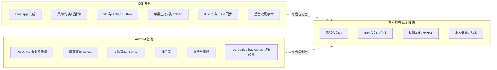
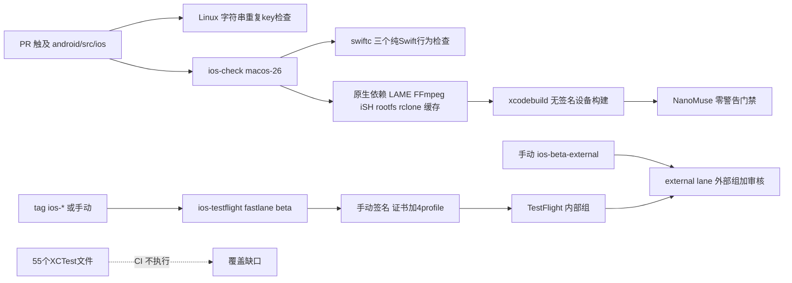

# 02 · iOS 能力全清单（反向需求拆解底座）

> **基线与方法**：同 01 章——commit `067384b7e5b3c47a7eeca217895be71493396518`（1.0.9），**纯静态考证，无编译无真机**；路径相对仓库根，表格内省略 `android/src/ios/` 前缀（跨端引用除外）。
> **用途与规则**：反向需求拆解的直接输入，每条能力给模块+行号（类型声明或关键语句）、平台限制、Android 对等、独有/缺失标记。「对等」=语义与用户可感知结果一致，不要求实现同构；「部分」=平台降级；「缺失」=搜过对位物未找到（搜索记录见各节）；未实测行为标「推断」。

## 本章回答什么问题

1. iOS 端到底有哪些可枚举的产品能力？每条由哪个模块实现？
2. 哪些能力是 iOS 独有（反向需求里要写成 iOS-only 需求）？哪些是 Android 有而 iOS 没有（要写成缺口或平台豁免）？
3. 每条能力的平台限制是什么（后台、沙箱、权限、审核）？
4. 权限声明、entitlements、测试与 CI 覆盖了什么、没覆盖什么？

---

## 1. 对话域

| 能力 | 实现模块与行号 | 平台限制 | Android 对等 | 标记 |
|---|---|---|---|---|
| 多轮流式对话（SSE，text/thinking/tool 块） | `Agent/Chat/AIChatViewModel.swift:4736`（runAgentLoop）、`+SSEStream.swift`（1363 行） | 主 actor 串行 UI；后台存活依赖 §8 的腿 | 对等 | — |
| 200 轮上限 + 触顶可恢复（Resume） | `AIChatViewModel.swift:73,6117-6119` | — | 对等（MAX_AGENT_TURNS=200） | — |
| 并发工具执行（≤10 在途，按序回填） | `AIChatViewModel.swift:5912`；`+ConcurrentTools.swift:25` | — | 对等（常量未对位确认） | — |
| 停止/取消（批级停止信号，100ms 内响应 delay 倒计时） | `+ConcurrentTools.swift:316-340`；`AIChatViewModel.swift:5904` | — | 对等 | — |
| 从任意消息/工具块重试（复用未提交块） | `AIChatViewModel.swift:3458-3553,3684,3806`（launchRerunAgentLoop） | — | 对等 | — |
| 中断恢复（canResume，远端 user 行不触发） | `AIChatViewModel.swift:2887,3034`；docs/ios.md:464-466 | — | 对等 | — |
| 消息排队（处理中继续输入） | `+Compaction.swift:52-60`（QueuedPrompt） | — | 对等 | — |
| 主聊 + 旁聊（side chat）+ 抽屉 + 边缘滑动 | `NanoMuse/NanoMuseShell.swift:18`（1649 行）、`NanoMuseEdgeSwipe.swift:23` | 旁聊保留系统返回手势 | 对等（Android 抽屉） | — |
| 设备聊天（选账号下另一台设备开聊，@设备委派） | `NanoMuse/NanoMuseDeviceConversations.swift:5`、`NanoMuseDeviceMention.swift:17`、`NanoMuseDeviceReply.swift:16` | 发送需目标在线且支持 task.status；离线可建聊 | 对等（hub task） | — |
| 远端审批代答（四答案，180s 默认） | `NanoMuse/NanoMuseRemoteApproval.swift:146,186-187` | 卡片在根视图，被其他 sheet 盖住需先关 | 对等（Android 四答案） | — |
| 上下文压缩（手动 /compact、长按 Compact Above、自动） | `+Compaction.swift:479`（compactBefore）、`+SlashCommands.swift` | 循环内自动压缩 ≤3 次（AIChatViewModel.swift:77） | 对等 | — |
| 双层 token 预算（32k 压缩 / 28k offload / 22k 目标） | `NanoMuse/NanoMuseContextBudget.swift:18-38` | — | 对等（ContextBudget.kt） | — |
| 工具结果落盘 + file_read 召回 | `+Offloading.swift:22-36,526` | — | 对等 | — |
| 每会话记忆开关（工具与注入同时 gated） | `+ToolDefinitions.swift:31-38`；`AIChatViewModel.swift:4806-4815` | — | 对等 | — |
| 记忆写入撤销 | `Views/Chat/MemoryWriteRevoker.swift` | — | 未确认 | 待对位 |
| 斜杠命令（/compact /memory 等） | `+SlashCommands.swift`（347 行处技能片段注释） | — | 对等 | — |
| @ 提及菜单（文件 + 在线设备） | `+MentionMenu.swift:132`；docs/ios.md:276-278 | @ 菜单光标精度降级为文末（原生 TextField 代价，docs/ios.md:441-443） | 部分 | iOS 降级 |
| 附件（相机/相册/文件粘贴） | `+Attachments.swift`；Info.plist:201-222 | 粘贴图片进输入框在 Muse 布局缺失（plus 菜单 Paste image 替代，docs/ios.md:440-442） | 部分 | iOS 降级 |
| 标题自动生成 | `+TitleGeneration.swift` | 后台标题生成也受 Anthropic OAuth 前缀检查约束（docs/ios.md:782-784） | 对等 | — |
| 会话生物识别锁（Face ID） | `Agent/Session/SessionLockStore.swift:65`；`Views/Settings/FaceIDProtectionSettingsView.swift`；Info.plist:203-204 | 锁元数据走 side-channel，不进同步 | 未确认（Android 有无会话锁） | 待对位 |
| 等待线（10s 后「模型忙，已等 N 秒」+ 排队位次） | `NanoMuse/NanoMuseStreamStatus.swift:17` | 依赖中继 0.31 nanomuse 相位块 | 对等 | — |
| 步骤胶囊开关（完成消息默认收起工具步骤） | `NanoMuse/NanoMuseSteps.swift:8` | — | 对等（nm.show_steps） | — |
| 赞/踩 + 停止原因追问（五选项） | `NanoMuse/NanoMuseFeedback.swift:21` | 例程/远端轮次不问 | 对等 | — |
| 消息列表长图分享/打印 | `Views/Chat/ChatTurnScreenshot.swift`、`PrintHelper.swift` | — | 未确认 | 待对位 |
| 朗读回复（TTS，系统声音按回复语言选中/英） | `Providers/Voice/VoiceOutputPlayer.swift`、`NanoMuse/NanoMuseSystemOutputVoice.swift` | 后台朗读需 Background Speak 开关 | 对等 | — |
| 语音输入（SFSpeechRecognizer，支持语种内优先端上识别） | `Agent/Speech/SpeechRecognitionManager.swift:39,226` | 识别语种受系统支持集约束（`:110-124`） | 对等 | — |
| 语音纠错学习（选词替换捕获 → 候选融合 → 建议） | `Agent/Speech/VoiceCorrectionEngine.swift:76,158`、`CorrectionAdmission.swift`、`VoiceCorrectionRecorder.swift` | Muse 原生输入框丢失 select-and-replace 捕获（docs/ios.md:441-442），纠错学习入口降级 | 部分 | iOS 降级 |
| Action Button / Back Tap 语音提示 | `NanoMuse/VoicePromptIntent.swift:29`、`NanoMuseVoicePrompt.swift` | App Intent 拿不到自由语音，必须亮屏进 app；请求 30s 过期（docs/ios.md:757-777） | **缺失**（Android 无 Action Button 概念） | **iOS 独有** |
| 聊天单色水墨风（用户墨色 pill、agent 灰 pill） | `NanoMuse/NanoMuseFaces.swift:18`（NanoMuseTones）、`NanoMuseChatCards.swift` | — | 对等（#331） | — |
| iPad 单列 760pt 布局 | `NanoMuse/NanoMuseShell.swift`（NanoMuseColumn）、docs/ios.md:688-704 | — | 对等（平板自适应） | — |
| 输入框健康看门狗 + Composer check 诊断页 | `NanoMuse/NanoMuseComposerWatch.swift`、`NanoMuseComposerCheck.swift` | 每次出现最多重建 2 次 | **缺失** | **iOS 独有**（UIKit/SwiftUI 混合布局事故产物） |

## 2. 工具域（模型可调用面）

8 个原生工具（注册点 `Agent/Chat/AIChatViewModel+ToolDefinitions.swift:30`，逐项行号见 01 章 §5）：shell_execute / file_read / file_write / file_edit / browser_use / memory_write / memory_get / read_image。**与 Android 同集同上限**。

| 能力 | 实现模块与行号 | 平台限制 | Android 对等 | 标记 |
|---|---|---|---|---|
| shell_execute（iSH /bin/sh -c，默认 900s，delay 参数不占壳） | `+ToolDefinitions.swift:40-50`；`Agent/ISH/ISHExecutionCoordinator.swift:93` | 模拟执行慢；无命令风险闸（01 章 §7） | 部分（Android 原生执行 + RiskGate） | 语义对等、风控缺失 |
| file_read（分页 offset/lines/tail/续读头，拒二进制） | `+ToolDefinitions.swift:52-64`；`+FileTools.swift` | — | 对等 | — |
| file_write（append/create_dirs，>8KB 分块 guidance） | `+ToolDefinitions.swift:66-88` | — | 对等 | — |
| file_edit（精确串替换，replace_all） | `+ToolDefinitions.swift:90-101` | — | 对等 | — |
| browser_use 22 action（含 cookie 读写、scroll_and_collect、wait_for_dom_stable、set_viewport、full_page 截图） | `Agent/BrowserUse/BrowserUseActions.swift:5-27`；`BrowserUseManager.swift`（2897 行） | WKWebView 每池 3 tab（BrowserTabPool.swift:193），进程级全局上限；WebContent 进程可被系统杀（BrowserResourceMonitor.swift:25-47） | 对等 | — |
| cookie 导出为 env 文件（原始值不进模型上下文） | 工具描述 `+ToolDefinitions.swift:104`；`/var/minis/offloads/env_cookies_*.sh` | — | 对等 | — |
| minis:// 资源预览（会话 HTML/图片在浏览器渲染，子资源解析） | `Agent/Chat/ChatURLBrokerage.swift`、`MinisURLPathDecoding.swift` | — | 对等 | — |
| read_image 双分支（原生视觉给像素；文本模型经 Vision Group 给描述+转录+prompt 追问） | `+ToolDefinitions.swift:163-207`；`Providers/VisionGroupResolver.swift` | — | 对等（ReadImageTool.kt） | — |
| memory_write/memory_get（日记 YYYY-MM-DD.md + GLOBAL.md 只读，关键词模糊搜索） | `+ToolDefinitions.swift:137-160`；`+MemoryTools.swift` | GLOBAL.md 用户维护 | 对等 | — |
| MCP 服务器（guest Python minis-mcp-cli 全协议栈；宿主 OAuth + servers.json 共写 + Top-N 提示词披露） | `Agent/Session/MCPStore.swift:56,245,622-638`；`default_mount/usr/local/bin/minis-mcp-cli` | 协议栈跑在模拟环境里，慢 | 对等 | — |
| 连接器目录 + MCP OAuth（RFC 7591 动态注册、8 个需手填 client id 的服务） | `NanoMuse/NanoMuseConnectors.swift:18`（917 行）、`NanoMuseMcpOAuthTokens.swift:4`；bundle `connectors.json` | — | 对等（桌面目录同源） | — |
| 跨设备连接器清单（profile.connectors，不含 token） | `NanoMuseConnectors.swift`（NanoMuseSharedConnectors） | 他设备条目只读，需本机再登录 | 对等 | — |
| 技能（SKILL.md 导入/会话覆盖/提示词注入，skills.db 旁路存储） | `Agent/Session/SkillStore.swift:5-7,70,333-359` | — | 对等 | — |
| SOUL.md 身份（frontmatter emoji/icon 保留） | `Agent/Session/SoulStore.swift:471-527` | — | 对等 | — |
| 沙箱内调模型（minis-model-use，脚本/定时任务用，瞬态重试） | `NativeOffloads/ModelUseOffloadBridge.swift:15-23`；`MinisTests/ModelUseTransientRetryTests.swift` | — | 对等 | — |
| 沙箱内查聊天历史（minis-sessions-cli） | `NativeOffloads/SessionsOffload.m` + `SessionsOffloadBridge.swift` | — | 对等 | — |
| 沙箱内改设置（minis-config，写操作确认面板 + 1000 条可回滚审计，密钥只写不读） | `NativeOffloads/ConfigOffload.m` + `ConfigOffloadBridge.swift`；`Shared/Config/Audit/ConfigAuditLog.swift:11,21`；工具描述 `AIChatViewModel.swift:1971` | — | 对等 | — |
| 沙箱内调试（minis-debug logs Release 可用；RPC 子命令 DEBUG-only） | `NativeOffloads/DebugOffload.m:470-497` | Release 无视图树/截图 RPC | 对等（minis-debug DEBUG） | — |
| 循环检测（四策略熔断） | `Agent/ToolLoopDetector.swift:39-43` | — | 对等（同源） | — |
| 工具参数三级修复（截断/类型/模糊字段名） | `+ToolPreflight.swift:33-80` | — | 对等（痕迹） | — |

## 3. 沙箱域

| 能力 | 实现模块与行号 | 平台限制 | Android 对等 | 标记 |
|---|---|---|---|---|
| ARM64 Alpine Linux 环境（iSH-ARM64 模拟） | `iSH/ISHKernel.m:576-690`；`android/deps/build_ish.sh:6-9` | 指令模拟慢；Jetsam 连坐；boot 每进程一次不可逆（RootfsManager.swift:21-32） | 部分（PRoot 原生执行） | 机制差异最大项 |
| rootfs 安装/架构标签/重置 | `iSH/RootfsManager.swift:36-58,86-120` | 重置后必须冷重启 app | 对等（重装沙箱） | — |
| 交互式终端（ANSI 解析、画布渲染、键盘附件条） | `iSH/Terminal/`（TerminalEmulator.swift 631 行、TerminalCanvasView.swift 1006 行等 6 文件） | — | 对等 | — |
| 每会话四桶隔离（offloads/attachments/workspace/browser） | `Agent/ISH/MinisFsRouter.swift:19-27` | fs_context 令牌路由，非独立 rootfs | 对等（每会话一壳） | — |
| 全局桶 memory/skills/shared + 外部文件夹挂载（可只读） | `iSH/ISHKernel.h:70-82`；`Views/Settings/MountedFoldersManager.swift` | 只读靠 meta.db mode 0555 | 对等 | — |
| Files app 双向可见（memory/skills/shared 三目录） | `FileProvider/FileProviderExtension.swift:8,25` | 仅三目录，非整个沙箱 | **缺失**（Android 无 Files 对位，SAF 部分替代） | **iOS 独有** |
| bash 按需安装 + bashism 检测（共享规则 JSON） | `Agent/Shell/OnDemandBash.swift:5-13`、`BashismDetector.swift:5-16` | apk 慢脆：24h/3-strikes 退避 | 对等（同规则文件） | — |
| FFmpeg 宿主加速（ffmpeg 命令不进模拟执行） | `NativeOffloads/FFmpegOffload.m`；`android/deps/build_ffmpeg.sh` + LAME | — | **缺失**（Android guest 内 ffmpeg，推断） | **iOS 独有** |
| rclone 远端存储（备份目的地/服务器管理） | `android/deps/build_rclone_ios.sh`（Rclone.xcframework）；`Views/Settings/RcloneAddServerView.swift` | — | 对等（build_rclone_android.sh） | — |
| guest URL 打开拦截（xdg-open 系列 → 宿主浏览器/深链） | `default_mount/usr/local/bin/xdg-open` 等 6 包装器；`default_mount/etc/profile.d/minis.sh:11-16` | $BROWSER 由执行器注入 envp | 对等 | — |
| fork 内存守卫（设备 RAM 缩放上顶） | `iSH/ISHKernel.m:627-639` | iOS Jetsam 特有 | **缺失** | **iOS 独有** |
| guest DNS 宿主管理 | `iSH/ISHKernel.m:907-930` | — | 对等 | — |
| 会话文件变更追踪（fakefs change hook → 同步） | `iSH/ISHKernel.h:105-119`；`Agent/Sync/V2/SessionFileChangeTracker.swift` | 环形缓冲溢出丢最旧事件 | 对等（inotify 类） | — |

## 4. NativeOffloads 能力清单（沙箱命令面）

28 个注册命令全表与 Android 逐项对位见 01 章 §4.2。此处按**用户可感知能力**重排，补平台限制：

| 能力 | 命令 | 实现 | 平台限制 | Android 对位 |
|---|---|---|---|---|
| 闹钟/计时器 | apple-alarm | AlarmOffload.m + Bridge（`AlarmOffloadBridge.swift:13-17` canImport(AlarmKit) + @available(iOS 26.0, *)） | **仅 iOS 26+**：编译闸 `AlarmOffload.m:180` + 运行期直接报错「AlarmKit requires iOS 26.0 or later」（`:249`），iOS 16–25 **无降级路径**；nanoMuse 例程调度器未接此能力（§15 第 8 条） | android-alarm（精确闹钟权限） |
| 日历读写 | apple-calendar | CalendarOffload.m | EventKit Full Access（Info.plist:197-200） | android-calendar |
| 提醒事项 | apple-reminders | RemindersOffload.m | Full Access（Info.plist:223-226） | **缺失** | 
| 健康数据读写 | apple-healthkit | HealthKitOffload.m | HealthKit entitlement + 临床记录（Minis.entitlements:5-10） | **缺失** |
| 智能家居 | apple-homekit | HomeKitOffload.m | HomeKit entitlement | **缺失** |
| 定位 | apple-location | LocationOffload.m | WhenInUse/Always（Info.plist:213-216） | android-location |
| 照片库 | apple-photos | PhotosOffload.m | PhotoKit 读写（Info.plist:219-222） | android-photos |
| 剪贴板 | apple-clipboard | ClipboardOffload.m:47-110 | 系统粘贴板读取提示 | android-clipboard |
| BLE 设备 | apple-bluetooth | BluetoothOffload.m | TCC 蓝牙权限；**不在应用层权限表**（01 章 §7.1） | **缺失** |
| NFC 标签 | apple-nfc | NFCOffload.m | NFC entitlement TAG/PACE；**不在应用层权限表** | **缺失** |
| 地图 | apple-maps | MapsOffload.m | MapKit | **缺失** |
| 天气 | apple-weather | WeatherOffload.m + Bridge | WeatherKit entitlement（Minis.entitlements:29-30） | android-weather（自有数据源） |
| 本地通知 | apple-notification | NotificationOffload.m | 用户通知授权 | android-notification |
| 打开 URL/应用 | apple-open | OpenOffload.m | 系统 URL 调度 | android-open |
| 设备信息 | apple-device | DeviceOffload.m | — | android-device |
| TTS | apple-speak | SpeakOffload.m | — | android-speak |
| 语音识别 | apple-speech | SpeechOffload.m | 麦克风 + 识别授权 | android-speech |
| 音频播放 | apple-player | PlayerOffload.m + Bridge | 后台播放需 audio mode | android-player |
| 媒体库/播放控制 | apple-media | MediaOffload.m | Apple Music 权限（Info.plist:191-192） | nanomuse-media 语义不同 |
| OCR/视觉分析 | apple-vision | VisionOffload.m | — | **缺失** |
| 自然语言处理 | apple-nlp | NLPOffload.m | — | **缺失** |
| 音视频转码 | ffmpeg | FFmpegOffload.m | 宿主库，非 guest 二进制 | guest ffmpeg（推断） |
| 浏览器驱动 | minis-browser-use | BrowserUseOffload.m + Bridge | 同 §2 browser_use | minis-browser-use |
| 模型调用 | minis-model-use | ModelUseOffload.m + Bridge | — | minis-model-use |
| 聊天历史查询 | minis-sessions-cli | SessionsOffload.m + Bridge | — | minis-sessions-cli |
| 设置管理 | minis-config | ConfigOffload.m + Bridge | 写需确认面板 | minis-config |
| 调试 | minis-debug / minis-hangtest | DebugOffload.m:470-497,557 | RPC 子命令 DEBUG-only | minis-debug（DEBUG） |

Android 有而 iOS 无命令形态的六项（contacts / hands+a11y / shizuku / nanomuse-pc / nanomuse-backup / minis-scheduled）集中列于 §12.2，含替代入口与搜索记录，此处不重复。

## 5. 系统集成域

| 能力 | 实现模块与行号 | 平台限制 | Android 对等 | 标记 |
|---|---|---|---|---|
| Siri / 快捷指令：Ask nanoMuse | `Agent/Intents/AskMinisIntent.swift:14` | — | 部分（Android 无 Siri；Assistant 集成未确认） | **iOS 独有** |
| Send Prompt / Follow Up / Retry Run / Open Session / List Sessions / Get Session Status / Quick Task | `Agent/Intents/SendPromptIntent.swift:8`、`FollowUpSessionIntent.swift:8`、`RetryRunIntent.swift:8`、`OpenSessionIntent.swift:5`、`ListSessionsIntent.swift:5`、`GetSessionStatusIntent.swift:60`、`QuickTaskIntent.swift:53` | 后台执行受 §8 约束；ShortcutRunTracker 记录入口快照（`ShortcutRunTracker.swift:12`） | minis-scheduled 部分对位 | **iOS 独有**（形态） |
| Live Activity 播放/暂停朗读按钮 | `Shared/AudioTogglePlaybackIntent.swift:33`（LiveActivityIntent） | — | **缺失** | **iOS 独有** |
| 灵动岛/锁屏实时活动（多会话进度、soul 名字、完成态） | `AgentWidget/AgentLiveActivityWidget.swift:6-50`；`Agent/Background/AgentLiveActivityManager.swift:9` | iOS 16.2+；iPadOS 16 崩溃防御 dlopen 探针（`:47-95`）；刷新预算前台 renew（`:396`）；`NSSupportsLiveActivitiesFrequentUpdates`（Info.plist:231-232） | **缺失** | **iOS 独有** |
| 系统分享面板接收（文本/文件 → nanomuse://share） | `ShareExtension/ShareViewController.swift:4,73`；`Shared/PendingShare.swift`、`SharedContainerStore.swift` | 扩展进程经 App Group 交接 | 对等（Android share intent） | — |
| 分享扩展内目标会话选择 | `ShareExtension/ShareViewModel.swift`；`MinisTests/ShareBufferTargetingTests.swift` | — | 未确认 | 待对位 |
| Files app 集成（replicated extension，三目录） | `FileProvider/FileProviderExtension.swift:8`；`AppGroupChangeWatcher.swift`、`FPSyncTraceLog.swift` | iOS 16+；macOS 27 beta 启动崩溃取证埋点（`:47-56`） | **缺失** | **iOS 独有** |
| 网页 App 加主屏（会话 HTML → 图标/独立窗口） | `WebApp/WebAppShortcut.swift:66`、`WebAppAddToHomeSheet.swift`、`WebAppWebViewController.swift` | iOS 无真 PWA 安装 API，走快捷方式+WKWebView 形态（推断自文件构成） | 未确认 | **iOS 独有**（待对位） |
| 3D Touch 快速动作（三项） | `Shared/QuickActionRouter.swift:9-12,61-69`；`AppDelegate.swift:46` | — | 对等（Android shortcuts） | — |
| 深链路由（nanomuse:// 外部 → minis:// 内部契约） | `NanoMuse/NanoMuseOwnScheme.swift`；`Shared/DeepLinkRouter.swift`、`DeepLinkCoordinator.swift`；Info.plist:155-176 | 双 scheme 避免与 OpenMinis 冲突 | 对等 | — |
| App Group 共享容器 | `Minis.entitlements:31-34`；`Shared/SharedContainerStore.swift` | — | **缺失**（Android 无对位概念） | **iOS 独有** |
| iCloud 备份/同步（CloudKit 私有库 + 共享区） | `Agent/Sync/CloudSyncEngine.swift`、`Agent/Sync/V2/ICloudSharedZoneTransport.swift`；`Minis.entitlements:13-27` | 用户 iCloud 账号；数据保护类锁屏不可读时等待重试（docs/ios.md:535-539） | **缺失** | **iOS 独有** |
| LAN 直连同步 | `Agent/Sync/V2/LANTransport.swift`；`SyncV2Bootstrap.swift` | 本地网络权限（Info.plist:211-212） | 未确认 | 待对位 |
| 环境变量管理（$$VAR 注入 guest，密钥隐私存储） | `Shared/EnvVarStore.swift`、`EnvVarPrivacyStore.swift`、`EnvVarRedactor.swift` | — | 对等 | — |
| 应用内语言切换（九语，不随系统） | `Shared/AppLocalization.swift:5-48` | — | 对等 | — |
| 外部文件导入（文档选择器） | `Shared/ExternalFileImporter.swift` | — | 对等 | — |
| 备用应用图标（四款品牌皮肤） | `Resources/AlternateIcons`；docs/ios.md:82-84 | — | 未确认 | 待对位 |

## 6. 账号与云域（NanoMuse 层）

| 能力 | 实现模块与行号 | 平台限制 | Android 对等 | 标记 |
|---|---|---|---|---|
| 中继登录（+86 手机验证码 / 邮箱 / 密码 / 邀请码） | `NanoMuse/NanoMuseCloud.swift:117-118`（defaultBase=cloud.nanomuse.cn）、`NanoMuseCloudView.swift`、`NanoMuseFirstRun.swift:27` | 非 +86 手机号提示改用邮箱（docs/ios.md:467-470） | 对等 | — |
| 自建中继（https 强制，LAN 豁免规则与代理共用） | `NanoMuse/NanoMuseRelayPicker.swift`；`NanoMuseProxy.isLocal`（docs/ios.md:470-479） | — | 对等 | — |
| 账号页（额度池/用量/设备/时间线/删除） | `NanoMuse/NanoMuseAccountView.swift`、`NanoMuseAccount.swift` | — | 对等（CloudAccountScreen） | — |
| 额度耗尽卡片 + 80% 预警线 + 继续途径列表 | `NanoMuse/NanoMuseAllowance.swift:18`、`NanoMuseAllowanceCard.swift` | 卡片挂 shell 顶部 inset（UICollectionView 约束） | 对等（AllowanceSignal/AllowanceWaysCard） | — |
| 自有 key 目录（providers.json + 中继 spend.guidance 动态优先） | `NanoMuse/NanoMuseCatalogue.swift`、`NanoMuseVendorSheet.swift`；`NanoMuse/Resources/providers.json` | 保存前实测 key（401/403 拒收，docs/ios.md:575-578） | 对等 | — |
| 四槽模型选择（对话/屏幕/图片/视频） | `NanoMuse/NanoMuseModelSlots.swift`（729 行）、`NanoMuseModelsView.swift` | **屏幕槽 iPhone 禁用**（「不在 iPhone 上」）；媒体仅 DashScope 可驱动 | 部分（Android 屏幕槽可用） | iOS 降级 |
| 订阅登录（ChatGPT Codex / Claude / OpenRouter / Kimi 设备码） | `Providers/*/OAuth/`；`KimiDeviceLoginSheet`（docs/ios.md:349-353） | ChatGPT 条款风险提示文案 | 对等 | — |
| 本地模型接入（Ollama / LM Studio / vLLM 地址） | docs/ios.md:353-354（own-key sheet） | — | 对等 | — |
| HTTP 代理（PAC 脚本式 per-host，密码 Keychain 本机项） | `NanoMuse/NanoMuseProxy.swift:28`、`NanoMuseNetworkView.swift` | URLSession 无 per-host 代理，PAC 绕行；中继与 LAN 永不走代理 | 对等 | — |
| 连接失败卡片（传输错误/地区限制/套餐耗尽，nm_reach 规范行） | `NanoMuse/NanoMuseProviderReach.swift`、`NanoMuseProviderReachCard.swift` | — | 对等（ProviderReach） | — |
| 中继拒绝卡片（413/400 内容审核/401/403/429/404/503 全语义化，九语） | `NanoMuse/NanoMuseRelayRefusal.swift`、`NanoMuseRelayRefusalCard.swift` | 流内 error（200 携带）也结束轮次出卡 | 对等 | — |
| 「这次改用 Cloud」一次性重试 | `NanoMuseCloudOnce`（docs/ios.md:227-230，resolveCurrentEntry 顶部） | 媒体失败无此重试 | 对等 | — |
| 数据控制（记录统计/训练集开关/一键删除） | `NanoMuse/NanoMuseDataControls.swift:13` | — | 对等 | — |
| 自有 key 轮次事后上传（含图片，不含 key） | `NanoMuse/NanoMuseOwnTurns.swift:20` | — | 对等 | — |
| 请求溯源头（X-NanoMuse-Run/Device/Conversation/Platform） | `NanoMuse/NanoMuseCloudHeaders.swift:18`、`NanoMuseProvenance.swift:25` | — | 对等 | — |
| 客户端事件上报（权限判定/停止/赞踩，仅代码与数字） | `NanoMuse/NanoMuseClientEvents.swift:23`、`NanoMuseGateEvents.swift` | — | 对等 | — |
| 账号级对话同步（scope=main 默认，侧聊开关，tail=300） | `NanoMuse/NanoMuseSync.swift:206-207`、`NanoMuseSyncSettings.swift` | — | 对等（Contract C9） | — |
| 多账号数据隔离（owners 表 / 账号表 / 登出保留开关） | `NanoMuse/NanoMuseAccountData.swift:25`、`NanoMuseSignOutSheet.swift:10` | 401 bad_key 走保留路径，account_deleted 才删（C12） | 对等 | — |
| 设备在线状态与「正在处理」句 | `NanoMuse/NanoMusePresence.swift:24`、`NanoMuseFromDeviceCaption.swift` | 10 分钟过期 | 对等 | — |
| hub 客户端（WSS，close code 语义，断线退避） | `NanoMuse/NanoMuseHub.swift:157-180` | socket 只在 app 开着时活（every-device.md:200） | 部分（Android 前台服务保活） | iOS 降级 |
| 跨设备任务执行（远端 task → 无界面轮次，语言随发起方） | `NanoMuse/NanoMuseHubTasks.swift:20`；`NanoMuseScheduler.swift:406`（NanoMuseHeadless） | 后台存活受限 | 对等 | — |
| Reach（驱动账号下电脑：开链接/通知/shell/截图） | `NanoMuse/NanoMuseReach.swift:13` | 目标需在线运行 nanoMuse | 对等（nanomuse-pc 的 UI 形态） | — |
| 编程助手（Cursor/Codex/Claude Code 会话，hub coding.*） | `NanoMuse/NanoMuseCoding.swift:16`、`NanoMuseCodingTimeline.swift:3`、`NanoMuseOpenCodeSession.swift:19` | 电脑需同账号登录 | 对等 | — |
| 设备列表（最后在线时间、点在线设备 @ 进输入框） | `NanoMuse/NanoMuseDevicesSection.swift` | — | 对等 | — |
| 星标请求（中继 nudges 策略，7 时刻，4 次/机，7 天间隔） | `NanoMuse/NanoMuseNudges.swift:21` | — | 对等 | — |
| 版本检查（nanomuse.cn/dl/index.json 优先，GitHub 兜底，日缓存） | `NanoMuse/NanoMuseUpdateCheck.swift:16` | TestFlight 分发，无应用内更新 | 对等（UpdateCheck） | — |
| 智能体资料跨设备（名字/形象/clips 随 profile） | `NanoMuse/NanoMuseProfile.swift:19` | 本机记忆文件不随账号（docs/ios.md:490-491） | 对等 | — |

## 7. 形象域

| 能力 | 实现模块与行号 | 平台限制 | Android 对等 | 标记 |
|---|---|---|---|---|
| 五情绪动态形象（呼吸/浮动/倾斜/弹出/抖动） | `NanoMuse/NanoMuseFaces.swift:18`（NanoMuseMood） | Reduce Motion 时静帧+淡入淡出 | 对等 | — |
| 聊天驱动换形象（本地正则先识别，四候选卡，词选/点选/重生成） | `NanoMuse/NanoMuseAvatarFlow.swift:20,61,96` | 与 Android 同正则（NanoMuseLogicTests 验证） | 对等（AvatarFlow.kt） | — |
| 形象工作室（选图像模型、费用预估） | `NanoMuse/NanoMuseAvatarStudio.swift`（831 行） | 中继 /v1/estimate 先出费用卡；或自有百炼 key | 对等 | — |
| 图像生成（DashScope 原生端点） | `NanoMuse/NanoMuseImageGen.swift:16-26` | 托管 Cloud 无媒体生成，需自有 key | 对等 | — |
| 形象动画四短片（idle/working/waiting/happy，wan2.2-i2v-flash） | `NanoMuse/NanoMuseVideoGen.swift:79-83`、`NanoMuseAvatarMotion.swift:22` | 需自有百炼 key；12 分钟超时语义化 | 对等（VideoGen.kt/AvatarMotion.kt） | — |
| 自有短片当形象（MP4/MOV，≤15s ≤30MB，仅本机，排除备份） | `NanoMuse/NanoMuseOwnClip.swift:26` | H.264/HEVC；预览确认制 | 对等 | — |
| 形象分享卡 | `NanoMuse/NanoMuseAgentPage.swift`（NanoMuseAvatarShareSheet） | — | 对等（AvatarShareSheet.kt） | — |
| 智能体页（动态/审批/每日/SOUL 与记忆四面板） | `NanoMuse/NanoMuseAgentPage.swift`（742 行） | — | 对等（ui/profile） | — |
| emoji 形象 fallback（桌面/网页设置同步来） | `NanoMuseFaces.swift`；avatar/emoji.json（docs/ios.md:126-129） | 手机无 emoji 选择器 | 部分 | iOS 降级 |
| 播放不打断他人音频（mixWithOthers 会话类别） | CHANGELOG.md:415（iOS 1.0.x 条目） | — | 对等 | — |

## 8. 后台与调度域

| 能力 | 实现模块与行号 | 平台限制 | Android 对等 | 标记 |
|---|---|---|---|---|
| 标准后台宽限（~30s beginBackgroundTask） | `Agent/Chat/AIChatViewModel+BackgroundTask.swift:19,83-89` | 系统可拒（.invalid 日志） | 部分（Android 前台服务无此时限） | iOS 受限 |
| 增强后台两条腿：粗定位心跳 + 静音音频 | `Agent/Background/BackgroundKeepAliveManager.swift:26-46,216-270` | 需 Always/WhenInUse 定位授权或 Background Speak；静音音频 1.5s 防抖停止、媒体播放时挂起（`:304-313`） | **缺失**（Android 不需要这种 hack） | **iOS 独有机制** |
| 后台存活档位展示（short/extended） | `BackgroundKeepAliveManager.swift:26-46`；`Views/Settings/EnhancedBackgroundSettingsView.swift` | — | **缺失** | **iOS 独有** |
| 例程调度（每天/工作日/单次/每 N 小时，专属会话无界面轮次） | `NanoMuse/NanoMuseScheduler.swift:122-127,285` | **仅 app 打开时执行**：回前台补跑 + 每分钟检查 | 部分（Android 精确闹钟可后台跑） | **核心降级** |
| BGAppRefreshTask 只发到期提醒 | `NanoMuseScheduler.swift:212-213,245-247,252`；Info.plist:8 | iOS 授予时机不可控；handler 不跑例程（文案明说） | **缺失**（Android 真后台执行） | iOS 受限 |
| 到期本地通知（点击进对应会话） | `NanoMuseScheduler.swift:126`（NANOMUSE_ROUTINE category） | — | 对等 | — |
| 例程静默行（Routine · 标签 · 时间，模型附加「不是你打的」） | `NanoMuse/NanoMuseRoutineWakes.swift:20` | — | 对等 | — |
| 目标（nanomuse-goal / goal-update 围栏块 → 目标+检查例程） | `NanoMuse/NanoMuseGoals.swift:17,50,58`（740 行） | 检查受例程同一后台限制 | 对等（goals/） | — |
| 动态 Feed（每日例程写 feed/<day>/<n>.md，讨论开旁聊） | `NanoMuse/NanoMuseFeed.swift:19,264`（806 行） | 同上 | 对等（feed/） | — |
| 点子（Ideas：发到聊天/创建例程/开始目标） | `NanoMuse/NanoMuseRooms.swift:18` | — | 对等 | — |
| 缓存保温 | `Agent/Background/CacheKeepAliveManager.swift`（AIChatViewModel 引用） | — | 未确认 | 待对位 |
| Live Activity 后台刷新预算 | `Agent/Background/AgentLiveActivityManager.swift:342-396` | plist 声明的 liveactivity-refresh BGTask 无注册代码（01 章 §10 发现 3） | **缺失** | **iOS 独有** |

## 9. 备份与同步域

| 能力 | 实现模块与行号 | 平台限制 | Android 对等 | 标记 |
|---|---|---|---|---|
| .minisbak 打包导出（分类选择、staging 后 zip、journal 断点） | `Agent/Backup/BackupExporter.swift:20-36`、`BackupExportJournal.swift` | — | 对等 | — |
| 备份加密（PBKDF2-SHA256 600k + HKDF + AES-GCM，跨端参数对齐） | `Agent/Backup/BackupCrypto.swift:19-23,74,128` | 含凭据强制 passphrase（BackupExporter.swift:133-142）；**头注释谎称未加密**（01 章发现 4） | 对等（JCA/Tink 同参数） | — |
| 备份导入（分类恢复、凭据导入、rescue index） | `Agent/Backup/BackupImporter.swift`、`BackupImporter+Categories.swift`、`BackupRescueIndex.swift` | — | 对等 | — |
| 备份目的地（iCloud Drive / rclone 远端 / 本地） | `Agent/Backup/BackupDestinations.swift`、`Views/Settings/BackupDestinationPicker.swift` | — | 对等 | — |
| 定时备份 | `Agent/Backup/Remote/`；Android nanomuse-backup 对位缺失 | 受后台限制（推断：需 app 活跃） | 部分 | iOS 降级 |
| iCloud 自动备份 | `Agent/Sync/ICloudBackupManager.swift`；`Views/Backup/ICloudBackupView.swift` | — | **缺失** | **iOS 独有** |
| 备份活动锁/保温（导出期间防挂起） | `Agent/Backup/BackupActivityLock.swift`、`BackupKeepAlive.swift` | — | 未确认 | 待对位 |
| 三套同步并存（iCloud v1 / V2 共享区+LAN / 中继） | 01 章 §9.2 | v2 激活时 v1 暂停（MinisApp.swift:422） | 部分（Android 仅中继） | iOS 多出两套 |
| 停止后同步冻结 60s | `AIChatViewModel.swift:104-110` | — | 未确认 | 待对位 |
| 同步日志可视化（1000 条） | `Agent/Sync/CloudSyncEngine.swift:34-60`（SyncLogStore） | — | 未确认 | 待对位 |

## 10. 诊断与调试域

| 能力 | 实现模块与行号 | 平台限制 | Android 对等 | 标记 |
|---|---|---|---|---|
| 崩溃/退出取证（启动标记 + MetricKit + 信号处理，区分遗留标记与真诊断） | `Diagnostics/CrashReporter.swift:9,271-275,315-316`、`CrashSignalHandler.m`；`NanoMuse/NanoMuseCrashEvidence.swift:4` | SIGKILL 无法进程内捕获，靠标记启发式；连续前台退出标记 → 下次跳过会话恢复 | 对等（ACRA 类，机制不同） | — |
| 浏览器资源监控（WebContent 死亡检测，承认测不到其内存） | `Diagnostics/BrowserResourceMonitor.swift:23-52` | WKWebView 内存进程外不可测 | 未确认 | **iOS 独有**（问题域特有） |
| shell 命令环形缓冲（崩溃证据附带） | `Agent/ISH/ShellCommandRingBuffer.swift`（CrashReporter 引用） | — | 未确认 | 待对位 |
| DebugServer JSON-RPC（视图树/截图/AutoTouch/性能） | `Debug/DebugServer.swift`、`DebugJSONRPC.swift`、`AutoTouch.m` | DEBUG-only；本地网络权限 | 对位 Android DebugServer 127.0.0.1:5321（MinisApp.kt 注释） | — |
| 日志管理页（Settings → Logs，minis-debug logs 同源 OSLogStore） | `Views/Settings/LogManagementView.swift`；`DebugOffload.m` cmd_logs | Release 可用 | 对等 | — |
| 配置变更审计页（可回滚） | `Views/Settings/ConfigAuditView.swift`；`ConfigAuditLog.swift:21` | — | 对等 | — |
| Composer check 视图层级报告 | `NanoMuse/NanoMuseComposerCheck.swift` | 无 Mac 时的设备端取证 | **缺失** | **iOS 独有** |
| 请求追踪/流挂起日志 | `Debug/AgentRequestTrace.swift`、`StreamingHangLogger.swift`；`AIChatViewModel.swift:84`（diagRequestSeq） | — | 未确认 | 待对位 |
| 越狱/注入检测（仅检测不强制） | `Diagnostics/CrashReporter.swift:321`（TweakInject 注释） | — | 未确认 | 待对位 |

## 11. 无障碍与本地化域

| 能力 | 实现模块与行号 | 平台限制 | Android 对等 | 标记 |
|---|---|---|---|---|
| 九语本地化（en/zh-Hans/zh-Hant/ja/ko/de/es/fr/ru） | `Localizable.xcstrings` + 9 个 `*.lproj`（各含 AppShortcuts.strings + InfoPlist.strings） | Siri 短语九语齐全（第四轮审计，docs/ios.md:726-729） | 对等 | — |
| 文案纪律测试（禁破折号/感叹号/中文「代理/中转」误译） | `MinisTests/NanoMuseCopyTests.swift`；docs/ios.md:573-575,600-607 | Mac 上读源码跑 | 对等（文案规范） | — |
| VoiceOver 标签（分段选择器/菜单/底栏五 tab） | docs/ios.md:739-741；`Views/Chat/ChatAccessibilityAnnouncer.swift` | — | 对等 | — |
| Dynamic Type（Muse 标题/名字随动，上限 1.35×） | `NanoMuse/NanoMuseHeader.swift`（NanoMuseHeaderMetrics）；docs/ios.md:730-732 | — | 对等 | — |
| Reduce Motion（形象静帧、tab 指示器无弹簧） | `NanoMuseFaces.swift`；docs/ios.md:130-132,655-657 | — | 对等 | — |
| 硬件键盘（Return 发送/Shift+Return 换行，⌘N 新聊，iOS 17+ 方向键导航弹窗） | `NanoMuse/NanoMuseComposerField.swift:33`；docs/ios.md:444-446 | iOS 16 无 onKeyPress，弹窗键盘导航缺失 | 部分 | iOS 降级 |
| 隐私清单（NSPrivacyTracking=false，收集类型逐项声明） | `PrivacyInfo.xcprivacy:5-30` | App Store 审核要求 | 对等（Play 数据安全表） | — |
| 无障碍驱动手机 | **缺失**（平台禁止） | — | android-a11y-cli | **Android 独有** |

## 12. iOS ↔ Android 双向能力差集表

### 12.1 iOS 独有（反向需求中标 iOS-only）

| 能力 | 证据 | 需求含义 |
|---|---|---|
| Files app 文件集成（memory/skills/shared） | FileProvider/FileProviderExtension.swift:8,25 | 沙箱文件对外可见 |
| 灵动岛/锁屏实时活动 + 朗读控制按钮 | AgentWidget/AgentLiveActivityWidget.swift:6；AudioTogglePlaybackIntent.swift:33 | 任务进度离开 app 可见 |
| Siri/快捷指令 9 intents + Action Button 语音 | Agent/Intents/*（8 个）+ VoicePromptIntent.swift:29 | 系统级入口矩阵 |
| HealthKit / HomeKit / Reminders / Maps / NFC / BLE / Vision / NLP / WeatherKit 九类苹果生态 offload | ISHKernel.m:656-687 | 苹果生态数据面 |
| AlarmKit 闹钟（**仅 iOS 26+**，16–25 报错） | AlarmOffloadBridge.swift:13-17；AlarmOffload.m:180-184,249 | 系统级闹钟（非通知模拟）；例程调度器未接线（§15 第 8 条） |
| iCloud 同步/备份 + LAN 直连同步 | CloudSyncEngine.swift；Sync/V2/ | 无中继也能跨设备 |
| App Group 跨进程共享 | Minis.entitlements:31-34 | 扩展架构基础 |
| 增强后台双腿（定位心跳/静音音频）+ 存活档位 UI | BackgroundKeepAliveManager.swift:26-46 | 续命机制，既是需求也是风险 |
| fork 内存守卫 / FFmpeg 宿主加速 / boot 不可逆约束 | ISHKernel.m:627-639；FFmpegOffload.m | 模拟器架构的补偿机制 |
| Composer 看门狗与诊断页 | NanoMuseComposerWatch/Check.swift | UIKit 混合布局的质量护栏 |
| 会话 Face ID 锁 | SessionLockStore.swift:65 | Android 对位未确认，暂列 iOS 独有 |
| 网页 App 加主屏 | WebApp/（7 文件） | 会话产物的分发形态 |

### 12.2 Android 有而 iOS 缺失（反向需求中标缺口/平台豁免）

| 能力 | Android 证据 | iOS 搜索记录与结论 |
|---|---|---|
| 本地命令风险分类闸（6 RiskClass / 3 RiskTier / 180s / ShellGuard） | guard/Risk.kt:7-44；RiskGate.kt:70；ShellGuard.kt | 全树 grep RiskGate/RiskClass/ShellGuard 仅命中遥测与远端审批；**本地无对位物**，任意 shell 无确认 |
| 屏幕驱动（hands：截图→屏幕模型→手势） | nanomuse-hands（MinisApp.kt:561） | 平台禁止；模型槽「屏幕」iPhone 禁用（NanoMuseModelSlots） |
| 无障碍 CLI / Shizuku 特权 | android-a11y-cli、android-shizuku-cli 注册 | iOS 无对位 API |
| 通讯录 offload | android-contacts | NativeOffloads/ 无 Contacts 文件 |
| 真后台例程执行（精确闹钟） | goals/scheduler + AlarmManager | iOS 仅前台补跑 + BGAppRefresh 发提醒（NanoMuseScheduler.swift:252） |
| 沙箱命令形态的定时任务/备份/驱动电脑 | minis-scheduled、nanomuse-backup、nanomuse-pc | iOS 分别以 Shortcuts/UI/hub UI 替代，**模型无法经 shell 调用这三类能力** |
| 媒体生成 offload（nanomuse-media） | MinisApp.kt:560 | iOS 媒体生成仅 UI 流程（AvatarFlow/VideoGen），沙箱内无命令 |
| 原生执行性能 | PRoot 原生 ELF | iSH 模拟（01 章 §3.5） |
| 应用内更新（APK 直装） | release-apk.sh | iOS 仅 TestFlight，版本行只提示 |

### 12.3 双向都有但 iOS 降级（反向需求中写验收差异）

| 能力 | 降级点 | 证据 |
|---|---|---|
| 例程/目标检查/Feed | 仅 app 活跃时跑 | NanoMuseScheduler.swift:8-10,252 |
| hub 在线 | socket 随 app 前台 | every-device.md:200；NanoMuseHub.swift |
| @ 菜单/粘贴图片/纠错捕获/硬件键盘导航 | 原生 TextField 替代 representable 的代价 | docs/ios.md:440-446 |
| 权限审批 | 30s 超时、19 命令覆盖、无风险分级 | OffloadPermissionManager.swift:124-147,264 |
| emoji 形象 | 无本机选择器 | docs/ios.md:126-129 |
| 屏幕模型槽 | iPhone 禁用 | NanoMuseModelSlots（docs/ios.md:198-200） |

### 12.4 docs/ios.md 移植对位表逐行复核（`:976-1010`，14 行）

文档自述 12 行 Done、1 行无对位（hands）、1 行照搬（Widgets）。**逐行用 Swift 源码复核：全部属实、全部有活跃调用方，无「Done 但休眠」**。复核锚点（省略 `NanoMuse/` 前缀）：

| Android 模块 | iOS 源码复核锚点 |
|---|---|
| cloud | NanoMuseCloud.swift:117、NanoMuseAccount*.swift 3 文件 |
| ui.onboarding | NanoMuseFirstRun.swift:27；无 Hands 页有注释自证（:8,51,174,280） |
| community.StarPrompt/Nudges | NanoMuseNudges.swift:222（2 外部调用文件）；NanoMuseStar 实际在 **NanoMuseAccount.swift:254**（6 文件引用），非独立文件 |
| community.UpdateCheck | NanoMuseUpdateCheck.swift:17（3 文件引用） |
| avatar.VideoGen/AvatarMotion | NanoMuseVideoGen.swift:32（4 引用）、NanoMuseAvatarMotion.swift:23（8 引用） |
| nm.show_steps | NanoMuseSteps.swift:8（4 引用） |
| connectors | enum NanoMuseConnectors（:293）仅本文件内用，但入口 NanoMuseConnectorsView:592 由 ContentView.swift + NanoMuseSettings.swift 接线 |
| ui.home/chat/settings/profile | NanoMuseShell.swift:18（1649 行）+ Header/AgentPage/Settings/Chrome/Appearance |
| avatar | NanoMuseAvatarFlow/AvatarStudio/ImageGen.swift |
| goals/feed/scheduler | NanoMuseGoalsRoom:376、NanoMuseFeedRoom:425 均挂 NanoMuseShell；仅前台补跑 + BGAppRefresh 发提醒（NanoMuseScheduler.swift:252），无 alarm-exact——但见 §15 第 8 条 AlarmKit 未接线发现 |
| coding | NanoMuseCodingView:228 挂 Shell + Settings |
| reach | NanoMuseReachSection:13 挂 CloudView + Settings |
| hands | 无对位物（平台禁止）；FirstRun 注释明说 Shortcuts 是门 |
| Widgets | AgentWidgetExtension.appex（pbxproj:252） |

**结论**：该表零冲突、可直接信任；但只覆盖 nanoMuse 差异层，沙箱/offload/工具集仍以本清单为准。

## 13. 平台权限与 entitlements 清单

### 13.1 Info.plist 权限声明（`android/src/ios/Info.plist`）

| key | 行号 | 用途文案要点 |
|---|---|---|
| NSAlarmKitUsageDescription | :184 | agent 代设闹钟 |
| NSAppleMusicUsageDescription | :191 | 媒体库搜索与播放控制 |
| NSBluetoothAlways/PeripheralUsageDescription | :193-196 | BLE 扫描连接 |
| NSCalendars(FullAccess)UsageDescription | :197-200 | 日程查询/建事件 |
| NSCameraUsageDescription | :201 | 拍照附件 |
| NSFaceIDUsageDescription | :203 | 会话锁 |
| NSHealthShare/UpdateUsageDescription | :205-208 | 健康读写 |
| NSHomeKitUsageDescription | :209 | 智能家居 |
| NSLocalNetworkUsageDescription | :211 | 调试服务器 + 本地服务 |
| NSLocationAlwaysAndWhenInUse / WhenInUse | :213-216 | **文案自认**：后台定位用于保活任务，位置仅记录会话连接历史 |
| NSMicrophoneUsageDescription | :217 | 语音输入 |
| NSPhotoLibrary(Add)UsageDescription | :219-222 | 附件与保存媒体 |
| NSReminders(FullAccess)UsageDescription | :223-226 | 提醒事项 |
| NSSpeechRecognitionUsageDescription | :227 | 语音转文字 |
| NSSupportsLiveActivities(FrequentUpdates) | :229-232 | 实时活动 |
| UIBackgroundModes | :233-239 | **audio / fetch / location / remote-notification** |
| BGTaskSchedulerPermittedIdentifiers | :5-9 | liveactivity-refresh（**无注册代码，休眠声明**）+ scheduler |
| CFBundleURLSchemes | :155-176 | io.github.nanomuse.app / nanomuse / nanomuse-mcp |
| UTExportedTypeDeclarations | :240-260 | .minisbak 备份类型 |
| NSAppTransportSecurity | :186-189 | NSAllowsArbitraryLoads（自建中继/http 本地模型需要） |

**注意**：`remote-notification` background mode 已声明，但 `Minis.entitlements` **无 aps-environment**——远程推送未配置，通知全部本地（推断自 entitlements 缺失；若 CI 注入另说，fastlane 未见注入逻辑）。

### 13.2 Minis.entitlements（全文 37 行）

| entitlement | 值 | 行号 |
|---|---|---|
| healthkit + access | true + health-records（临床记录） | :5-10 |
| homekit | true | :11-12 |
| icloud-container-identifiers / services | iCloud.io.github.nanomuse.app / CloudKit | :13-19 |
| nfc.readersession.formats | TAG, PACE | :20-24 |
| ubiquity-container-identifiers | iCloud.io.github.nanomuse.app | :25-28 |
| weatherkit | true | :29-30 |
| application-groups | group.io.github.nanomuse.app | :31-34 |

**无**：push、associated domains、Sign in with Apple、App Attest。扩展各有独立 entitlements（FileProvider/AgentWidget/ShareExtension 目录内），共享 App Group。

### 13.3 应用层权限（Settings → Permissions）

19 命令三档表见 01 章 §7.1；`Views/Settings/OffloadPermissionSettingsView.swift` 为 UI；`MinisTests/OffloadPermissionBypassTests.swift` 覆盖 bypass 语义。**apple-bluetooth / apple-nfc / ffmpeg / minis-* 不在此表**。

## 14. 测试与 CI 覆盖表

| 层 | 内容 | 证据 | 覆盖判定 |
|---|---|---|---|
| 单元测试（55 文件，XCTest） | 备份 7、OAuth 竞态 5、Thinking 线格式 5、NanoMuse 业务 18（账号/设备回复/hub/模型槽/提示词布局/文案/溯源/轮次审计）、ToolLoopDetector、ToolPreflight、ContextPolicy、OffloadPermissionBypass、Responses call_id 去重、语音 4、分词、ISH continuation 竞态、SFTP 路径等 | `MinisTests/` 目录实测 | 业务逻辑覆盖密；**但 CI 不跑 xctest**（见下） |
| UI 测试 | 仅 `MinisUITests/MessageListV3UITests.swift` 1 文件 | 目录实测 | 极薄 |
| 无 SDK 纯 Swift 检查（CI 实际执行） | CrashEvidenceChecks / AnthropicPromptChecks / DeviceConversationsChecks，swiftc 直接编译对应 NanoMuse 源文件+检查文件运行 | `tests/ios/*.swift`；`.github/workflows/ios-check.yml:42-58` | 这是「Linux 写码、Mac 验证」策略下唯一在 CI 跑的行为测试 |
| 字符串目录重复 key 检查 | 逐 key pair 解析 xcstrings，任意深度重复即失败 | `tests/test_ios_strings.py:1-30` | 每 PR Linux 跑 |
| iOS build check | macos-26 无签名设备构建；**NanoMuse/ 零警告硬门禁**（grep warning 即 fail）；原生依赖缓存与 TestFlight 共享 | `ios-check.yml:28-29,97-117` | 每 PR（触 iOS 路径）+ 手动 |
| TestFlight 上传 | 手动签名（Distribution 证书 + 4 个 App Store profile），build号=run号，ipa+dSYM 附件 | `ios-testflight.yml`；`fastlane/Fastfile:54`（beta lane） | tag ios-* 或手动 |
| 外部测试组 | external lane：加组 + What to Test + 提 beta 审核，仅需 3 个 ASC secret | `Fastfile:165`；`ios-beta-external.yml` | 手动 |
| 目录同步校验 | providers.json / connectors.json 由 node 脚本生成，CI --check | docs/ios.md:241-243,338-340 | 每 PR |
| **缺口** | xctest 不在 CI（单测只能 Mac 手动跑）；UI 测试 1 文件；无真机自动化；iSH/offload 集成路径无端到端测试 | ios-check.yml 全文无 test action | 反向需求拆解时验收条款不能假设这些测试存在 |

## 15. 休眠代码与文档冲突汇总（含 01 章发现）

| # | 类型 | 内容 | 证据 |
|---|---|---|---|
| 1 | 死文件（不编译） | `ISHCommandExecutionExample.swift`（ISHCommandExecutor 示例类）零调用且不在 pbxproj | 01 章 §10 发现 1 |
| 2 | 休眠类（编译但零调用） | `CookieAuditLogger`：注释要求 app 启动调用 start()，全树无调用；cookie 丢失审计从未启用 | Agent/BrowserUse/CookieAuditLogger.swift:47-48 |
| 3 | 休眠 plist 声明 | `liveactivity-refresh` BGTask id 声明但无注册代码 | Info.plist:7；全 Swift grep 零命中 |
| 4 | 注释与代码矛盾 | BackupExporter 头注释「export only, unencrypted」vs 已实现 AES-GCM 加密与 Importer | BackupExporter.swift:8-14 vs :369-370、BackupCrypto.swift:19-23 |
| 5 | 文档滞后 | docs/ios.md 不覆盖沙箱/offload/工具集（差异文档定位所致）；ISH_INTEGRATION.md 示例 RootfsManager 无 arch 标签 | 01 章 §10 发现 5 |
| 6 | 权限覆盖缺口（非休眠，是设计缺口） | apple-bluetooth/apple-nfc 注册但不在权限表；sh -c 间接调用绕过 basename 闸（注释自认） | OffloadPermissionManager.swift:124-147,205-209 |
| 7 | 疑似未启用路径 | `remote-notification` background mode 声明但无 push entitlement | Info.plist:237；Minis.entitlements 全文 |
| 8 | 能力存在但未接线 | 沙箱有 AlarmKit 系统闹钟 offload（apple-alarm，iOS 26+），但 NanoMuseScheduler/RoutineWakes 零 AlarmKit 引用——例程「无 alarm-exact」是调度器未用该能力，非平台绝对无门（推断：AlarmKit 响铃也不等于后台执行代码，接线后仍只能提醒+用户点开） | AlarmOffload.m:180-184,249；AlarmOffloadBridge.swift:13-17；NanoMuseScheduler.swift 全文 grep 零命中 |

**提示**：第 2、3、8 条在需求文档中应标「已设计未启用/未接线」；第 4 条备份加密的验收条款可按已实现写，但上游注释会误导维护者。

---

## 证据索引表

| # | 结论 | 证据路径:行号 |
|---|---|---|
| 1 | 对话域各能力定位 | Agent/Chat/AIChatViewModel.swift:73,4736,5912；+ConcurrentTools.swift:25；NanoMuse/NanoMuseShell.swift:18 |
| 2 | 设备聊天与远端审批 | NanoMuse/NanoMuseDeviceConversations.swift:5；NanoMuseRemoteApproval.swift:146,186-187 |
| 3 | 语音输入端上优先 | Agent/Speech/SpeechRecognitionManager.swift:39,226 |
| 4 | 语音纠错引擎 | Agent/Speech/VoiceCorrectionEngine.swift:76,158 |
| 5 | Action Button 语音入口与 30s 过期 | NanoMuse/VoicePromptIntent.swift:29；docs/ios.md:757-777 |
| 6 | 8 工具同集 | Agent/Chat/AIChatViewModel+ToolDefinitions.swift:30,40,52,66,90,103,137,147,193 |
| 7 | browser 22 action / 3 tab | Agent/BrowserUse/BrowserUseActions.swift:5-27；BrowserTabPool.swift:193 |
| 8 | MCP guest 协议栈 | Agent/Session/MCPStore.swift:56,245,622-638 |
| 9 | 技能/SOUL 存储 | Agent/Session/SkillStore.swift:5-7,70；SoulStore.swift:471-527 |
| 10 | minis-config 审计 1000 条 | Shared/Config/Audit/ConfigAuditLog.swift:11,21 |
| 11 | iSH-ARM64 与 rootfs | android/deps/build_ish.sh:6-9；iSH/RootfsManager.swift:46；ISHKernel.m:576-690 |
| 12 | fs_context 四桶 | Agent/ISH/MinisFsRouter.swift:19-27 |
| 13 | FileProvider 三目录 | FileProvider/FileProviderExtension.swift:8,25 |
| 14 | bash 按需与共享规则 | Agent/Shell/OnDemandBash.swift:5-13；BashismDetector.swift:5-16 |
| 15 | AlarmKit 桥 | NativeOffloads/AlarmOffloadBridge.swift:13-14 |
| 16 | 28 offload 注册 | iSH/ISHKernel.m:656-687 |
| 17 | 9 AppIntents + 1 LiveActivityIntent | Agent/Intents/*.swift 各声明行；NanoMuse/VoicePromptIntent.swift:29；Shared/AudioTogglePlaybackIntent.swift:33 |
| 18 | Live Activity 与 iPad 崩溃防御 | AgentWidget/AgentLiveActivityWidget.swift:6；AgentLiveActivityManager.swift:47-95 |
| 19 | 分享扩展 nanomuse://share | ShareExtension/ShareViewController.swift:4,73 |
| 20 | 快速动作三项 | Shared/QuickActionRouter.swift:61-69 |
| 21 | 中继默认地址与同步端点 | NanoMuse/NanoMuseCloud.swift:117-118；NanoMuseSync.swift:206-207 |
| 22 | 账号隔离 C12 | NanoMuse/NanoMuseAccountData.swift:25；NanoMuseSignOutSheet.swift:10；docs/ios.md:492-509 |
| 23 | 代理 PAC 形态 | NanoMuse/NanoMuseProxy.swift:28；docs/ios.md:355-367 |
| 24 | 四槽模型与屏幕禁用 | NanoMuse/NanoMuseModelSlots.swift；docs/ios.md:197-200 |
| 25 | 形象流程正则与候选 | NanoMuse/NanoMuseAvatarFlow.swift:20,61,96 |
| 26 | 视频模型清单 | NanoMuse/NanoMuseVideoGen.swift:79-83 |
| 27 | 自有短片限制 | NanoMuse/NanoMuseOwnClip.swift:26；docs/ios.md:132-137 |
| 28 | 后台双腿与档位 | Agent/Background/BackgroundKeepAliveManager.swift:26-46,216-270 |
| 29 | 例程仅前台 + BG 只提醒 | NanoMuse/NanoMuseScheduler.swift:8-10,212-213,245-252 |
| 30 | 目标/动态围栏块 | NanoMuse/NanoMuseGoals.swift:6-8,17；NanoMuseFeed.swift:8-9,264 |
| 31 | 备份加密参数 | Agent/Backup/BackupCrypto.swift:19-23,74,128 |
| 32 | 凭据强制 passphrase | Agent/Backup/BackupExporter.swift:133-142 |
| 33 | 崩溃取证与恢复启发式 | Diagnostics/CrashReporter.swift:271-275,315-316 |
| 34 | WebContent 内存不可测自认 | Diagnostics/BrowserResourceMonitor.swift:23-52 |
| 35 | 九语与应用内切换 | Shared/AppLocalization.swift:5-48；9 个 lproj 实测 |
| 36 | 权限声明全表 | Info.plist:5-9,155-176,184-239 |
| 37 | entitlements 全表 | Minis.entitlements:5-34 |
| 38 | CI 三个纯 Swift 检查 | .github/workflows/ios-check.yml:42-58；tests/ios/*.swift |
| 39 | 零警告门禁 | ios-check.yml:113-117 |
| 40 | fastlane 双 lane 与四 target | fastlane/Fastfile:40-45,54,165 |
| 41 | 字符串重复 key 检查 | tests/test_ios_strings.py:1-30 |
| 42 | Android 差集各项 | MinisApp.kt:560-597；guard/Risk.kt:7-44；RiskGate.kt:70 |
| 43 | 休眠/矛盾八条 | 见 §15 各行内证据 |
| 44 | 移植对位表 14 行复核 | docs/ios.md:976-1010；§12.4 各行内锚点；NanoMuseFirstRun.swift:8,174 |
| 45 | AlarmKit iOS 26 双闸与调度器未接线 | NativeOffloads/AlarmOffload.m:180-184,249；AlarmOffloadBridge.swift:13-17 |

## 未确认问题清单

| # | 问题 | 缺什么证据 |
|---|---|---|
| 1 | 表中标「待对位」的 12 项（记忆撤销、长图分享、会话锁、分享目标选择、LAN 同步、备用图标、缓存保温、备份锁、同步冻结、同步日志、请求追踪、越狱检测在 Android 的对位物） | 需 Android 章作者逐项确认；本章未越界读 Android 源码细节 |
| 2 | AlarmKit 接线例程后能否绕过前台限制（响铃→用户点开 vs 后台执行） | 已确认 iOS 16–25 直接报错无降级（AlarmOffload.m:249）；iOS 26 真机行为无设备不可测 |
| 3 | 定时备份在 iOS 的实际触发条件 | Agent/Backup/Remote/ 未读；「需 app 活跃」为推断 |
| 4 | WebApp 加主屏的实际形态（Safari 快捷方式 vs WKWebView 容器） | WebApp/ 7 文件只读了声明行；「推断」标注处需补读 |
| 5 | remote-notification 是否有 CI 侧 push 配置 | fastlane 与 workflow 未见 aps 注入，但不能排除 ASC 侧配置 |
| 6 | MinisTests 是否可在 iOS 26 以下模拟器运行（测试 target 部署目标 26.2） | 无 Xcode 验证 |
| 7 | apple-media 与 nanomuse-media 的语义边界细节 | 两侧 handler 未逐行对读 |
| 8 | Android 并发工具上限、maxInLoopCompactions 对位 | 同 01 章未确认 3/5 |
| 9 | 语音纠错在 Muse 布局下的实际可用入口 | docs 说捕获降级，但 plus 菜单/长按是否补偿未考证 |
| 10 | 设备聊天「离线可建聊」的发送失败恢复细节 | NanoMuseDeviceConversations.swift 只读声明行；CI 有 DeviceConversationsChecks 可作后续入口 |