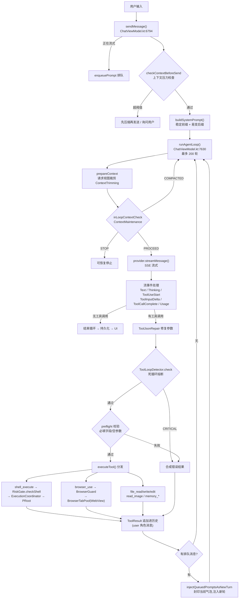

# 第 1 章 整体架构与数据流转

> 分析对象：`nano-muse/nanoMuse` 仓库 `main` 分支（快照日期 2026-11-17，版本号处于 1.0.x 之后的 Unreleased 状态）。
> 所有结论均以源码为准，官方文档（`docs/architecture.md`、`docs/android.md`）与论文（arXiv:2610.08699）作交叉印证。文中路径均相对仓库根目录。

## 1.1 项目定位与一个关键事实

nanoMuse 是浙江大学 APRIL 实验室团队开源的跨设备个人智能体（GPL-3.0-or-later），对标 Meta Muse。它覆盖 Android、iOS、桌面与 Web，每台设备运行一个完整的智能体实例，通过可选的开源中继（relay/hub）协同。

**做 Android 端架构分析前必须先澄清一个关键事实：当前 Android 应用是原生 Kotlin 实现，不是 Python。**

- 仓库里确实有一套完整的 Python 运行时（`nanomuse/` 包，含 `agent/core.py` 的 `MuseAgent`、`tools/`、`sentinel/` 等），但它服务于桌面 / Web / 服务端形态。
- 早期 Android 曾走"WebView 套 Python 服务"的路线，该路线已被归档为设计记录（`docs/archive/android-python-line.md`），**不是今天下载到的 APK**。
- 今天的 Android 应用基于 **OpenMinis 1.13**（GPL-3.0）改造：智能体主循环、工具执行、沙箱全部跑在手机原生层。官方文档原话："a native app whose agent runs **on the phone**"（`docs/android.md`）。

因此本知识库的"Looper"对应 Kotlin 侧 `ChatViewModel.runAgentLoop()`，"Runtime"对应 PRoot + Alpine 沙箱运行时，而不是 Python 包里的同名概念。两套实现的对照见第 8 章。

## 1.2 代码分层与命名约定

Android 工程位于 `android/src/android/`，包结构有两个命名空间，这是理解代码归属的钥匙：

| 命名空间 | 归属 | 说明 |
|---|---|---|
| `com.openminis.app.*` | OpenMinis 上游 | 沙箱、Provider、工具执行、聊天 ViewModel 等基础设施；nanoMuse 对上游文件的每处修改都以 `// nanoMuse:` 注释标记 |
| `io.github.nanomuse.*` | nanoMuse 自有 | 身份（SOUL.md）、守护（guard）、Hands、Feed、Goals、Hub、上下文管理（chat/Context*）等上层特性 |

应用 ID 为 `io.github.nanomuse.app`，对外 URL scheme 为 `nanomuse://`，应用内部沿用上游词汇 `minis://`（沙箱、系统提示词、模型看到的都是 `minis://`）。这样与同机安装的 OpenMinis 互不冲突（`docs/android.md`，`io.github.nanomuse.deeplink.OwnScheme`）。

打包形态：单一 APK，arm64-v8a，Android 8.0（API 26）起，targetSdk 35。Linux 环境、浏览器、MCP、技能、定时任务全部内置于 APK。

## 1.3 模块地图

以下是 Android 端的核心模块与源码位置（行数为快照时统计）：

| 模块 | 关键文件 | 职责 |
|---|---|---|
| 聊天 ViewModel / Agent 主循环 | `com/openminis/app/ui/chat/ChatViewModel.kt`（约 12800 行） | 消息发送、`runAgentLoop`、流式渲染、工具分发、持久化 |
| 工具定义注册表 | `com/openminis/app/tools/AgentTools.kt` | 8 个原生工具的 provider 无关定义 |
| 工具执行器 | `com/openminis/app/tools/{FileReadTool,FileWriteTool,FileEditTool,ReadImageTool,MemoryTools,BrowserUseTool}.kt` | 各工具的执行逻辑 |
| 循环检测 | `com/openminis/app/agent/ToolLoopDetector.kt` | 工具死循环的四级检测与熔断 |
| 模型 Provider | `com/openminis/app/provider/LLMProvider.kt` + `provider/{openai,anthropic,gemini,openrouter,xai,antigravity}/` | 多厂商流式协议适配 |
| 沙箱运行时 | `com/openminis/app/sandbox/{PRootKernel,RootfsManager,PersistentShell,ExecutionCoordinator,NativeOffload}.kt` | PRoot + Alpine Linux、会话级 shell、宿主桥接 |
| 权限守护（Sentinel 的 Android 形态） | `io/github/nanomuse/guard/{RiskGate,Risk,ShellGuard,BrowserGuard,TapWords,Grants}.kt` | 风险分级、审批卡片、授权记忆 |
| 浏览器 | `com/openminis/app/browser/{BrowserUseManager,BrowserTabPool}.kt`、`io/github/nanomuse/browser/BrowserHandOver.kt` | WebView 多标签、动作执行、人机交接 |
| 上下文管理 | `io/github/nanomuse/chat/{ContextBudget,ContextTrimming,ContextMaintenance,CompactHistory,PromptCacheLayout,ContextEstimate,...}.kt` | 预算、裁剪、压缩、缓存布局 |
| 记忆 | `com/openminis/app/data/repository/MemoryRepository.kt` | GLOBAL.md + 每日日志的注入与检索 |
| 技能 | `com/openminis/app/data/repository/SkillRepository.kt`、`io/github/nanomuse/skills/SkillDocuments.kt` | SKILL.md 解析、披露、按需读取 |
| MCP | `com/openminis/app/data/repository/MCPRepository.kt` | MCP 服务器配置与提示词披露 |
| 前台服务 | `com/openminis/app/service/AgentForegroundService.kt` | 后台续跑、通知栏状态 |
| Hands（屏幕操作） | `io/github/nanomuse/hands/` | 无障碍驱动的 GUI 操作器（独立子系统） |

## 1.4 一条消息的完整数据流

下图是一条用户消息从输入到最终回复的全链路（简化版，细节见第 2、4、6 章）：

几个决定架构形态的设计点：

1. **历史与请求视图分离。** `agentHistory`（内存中的完整对话）永远不被裁剪修改；每次请求前由 `prepareContext()` 生成一份只用于发送的视图（`preparedMessages`），裁剪、卸载（offload）都发生在视图上。持久化到 Room 数据库的也是完整历史。这是第 6 章全部上下文机制的地基。

2. **工具结果以 user 角色消息回传。** 每轮工具执行完，结果打包成 `LLMMessage(role=USER, contentParts=[ToolResult...])` 追加进历史——这是 Anthropic 风格的 wire format，OpenAI 系 Provider 在序列化时再转换成 `tool` 角色消息。

3. **一个 agent loop 一个气泡。** 整轮循环（可能几十次工具调用）默认渲染进同一条 assistant 消息（`assistantId`），只有两种情况会"封印旧气泡、开新气泡"：排队消息注入为新轮、循环内压缩（compaction）产生分隔线。

4. **UI 更新全部节流。** 流式文本按长度分级节流（150ms～2s），工具参数预览按工具类型节流（文件类 1s、其他 200ms），所有 UI 推送 hop 到 `Dispatchers.Main`，循环本体跑在 IO 协程。这是从真实 ANR 事故（"Waited 5001ms for MotionEvent"）反推出来的设计，源码注释里有完整事故编号（T94/T256/T307）。

5. **并发模型：会话内串行、会话间并行。** 每个会话一个 `PersistentShell` + 一把 Mutex；不同会话各有各的 shell 和锁，可并发执行命令（`ExecutionCoordinator`）。前台服务（`AgentForegroundService`）在任务运行期间挂常驻通知，显示会话数、当前工具名与耗时，让进程在后台存活。

## 1.5 与论文架构的对应

论文图 5 描述 Android 端为 "OpenMinis, modified"，与源码一致。论文中的 Sentinel（唯一权限权威）在 Android 端对应 `io.github.nanomuse.guard` 包：`RiskGate` 是审批队列，`ShellGuard`/`BrowserGuard`/`TapWords` 做风险判定，`Grants` 管理授权记忆。论文中"记忆即文件"（memory as files）对应 `/var/minis/memory/GLOBAL.md` 与每日日志。差异在于：Python 运行时的 Sentinel 是独立模块（`nanomuse/sentinel/gate.py`），Android 端把守护逻辑内嵌进了工具执行路径（shell 执行前、浏览器点击/输入前），第 4、5 章展开。

## 1.6 本章小结

- Android 端 = OpenMinis 原生壳 + nanoMuse 上层特性，智能体完全跑在手机上。
- 主循环在 `ChatViewModel.runAgentLoop()`，沙箱是 PRoot + Alpine，浏览器是应用内 WebView。
- 数据流的核心不变量：**完整历史不可变，请求视图可裁剪；工具结果走 user 角色；一轮循环一个气泡；UI 全节流**。
- 下一章拆解主循环的轮次管理、重试回退与各种终止路径。