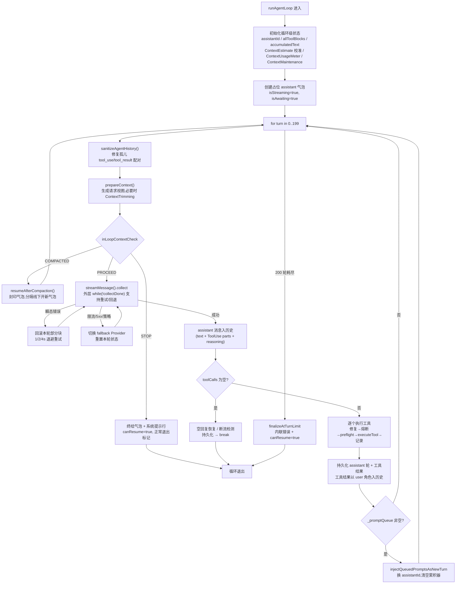
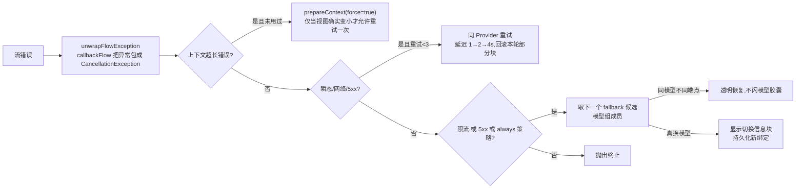

# 第 2 章 Looper：Agent 主循环与轮次管理

> 核心源码：`android/src/android/app/src/main/java/com/openminis/app/ui/chat/ChatViewModel.kt`
> 关键入口：`runAgentLoop()`（约 7630 行起）；辅助：`agent/ToolLoopDetector.kt`、`agent/InterruptedTailDetector.kt`。
> 行号为 2026-11-17 main 分支快照，后续版本可能漂移，以函数名为准。

## 2.1 关键常量

| 常量 | 值 | 位置 | 含义 |
|---|---|---|---|
| `MAX_AGENT_TURNS` | 200 | ChatViewModel.kt:412 | 单次 runAgentLoop 的轮次上限 |
| `AUTO_RETRY_DELAYS_SEC` | [1, 2, 4] | :457 | 同一 Provider 瞬态错误的自动重试退避 |
| `TOOL_INPUT_CHUNK_RING_MAX` | 10 | :455 | 每个工具保留的最近参数流快照数（供修复与诊断） |

"轮次（turn）"的定义：**一次完整的模型请求 + 其全部工具调用的执行**。模型不再请求工具时循环结束；否则带着工具结果进入下一轮。200 轮是防跑飞的天花板，不是目标。

## 2.2 循环骨架

## 2.3 轮内状态机：流事件如何变成 UI 与历史

Provider 的 SSE 流被抽象为 `LLMStreamChunk`（定义见 `data/model/`），循环对每类事件的处理：

| 事件 | 处理 |
|---|---|
| `ThinkingDelta` | 追加进 `thinking_$turn` 块，实时刷新思考面板 |
| `Text` | 追加进当前文本块（StringBuilder，见 2.6）；按长度分级节流推送 UI |
| `ToolUseStart` | 先把未推送的文本**无节流强制 flush** 并 `yield()` 让 Compose 渲染，再插入 `tool_use` 块（STREAMING 状态）——防止文本尾部被冻结截断（T154） |
| `ToolInputDelta` | 维护每工具最近 10 条参数快照环；流式解析 partial JSON 提前抽出 `tool_title` 更新工具胶囊标题；文件类工具 1s 节流、其他 200ms |
| `ToolCallComplete` | 参数收齐，块状态 PENDING；记录 Gemini 3.x `thoughtSignature` |
| `Usage` | 记录真实 input token 数，校准本地估算器（见第 6 章），驱动下一轮 `dynamicMaxTokens` |
| `ReasoningContent` | 保存不透明 reasoning blob（DeepSeek/Kimi），**空字符串也原样保留**以便下轮回传 |
| `Finished` | 记录 `finish_reason`，用于断流与空回复判定 |

**tool_call_id 去重**：部分 OpenAI 兼容网关会并行发出同 id 的 tool_calls。循环用三个计数器（start/complete/in-flight）把重复 id 重命名为 `<id>-2`、`<id>-3`，保证回传时不触发接收端 400（T-dedupe-toolcallid）。

**文本块的两种组装模式**（`LLMProvider.streamTextIsMonolithic`）：
- **Monolithic（OpenAI Chat Completions）**：一个响应只有一个 `content` 字符串，文本与 tool_calls 无时序关系。所有文本 delta 合并进**一个**位于工具块之前的文本块；qwen 等端点在 tool_calls 之后吐出的尾部 content 会被合并回前工具文本块，而不是伪造一个"工具后文本块"（T-android-tool-splits-reply-fix）。
- **Ordered（Anthropic content blocks / Responses API output items）**：到达顺序即语义顺序，工具块打断文本流后，新文本开新块。

## 2.4 重试与回退：三层容错

要点：
- **限流不重试同 Provider**，直接走 fallback——限流是 Provider 级信号。
- **上下文超长只允许一次"先本地瘦身再重发"**，禁止原样重发同一份历史（nanoMuse 修改，#719）。
- 重试/回退前回滚 `allToolBlocks` 到 `turnStartBlockIndex`，但**保留本轮已流出的文本**在屏幕上（T-android-fallback-text-rewind），新 Provider 重新流入新 StringBuilder。
- fallback 候选按 entry 自身 id 定位（不是 model id），避免同模型多实例时张冠李戴（T-android-fallback-entry-identity）。
- 全部耗尽时，把尝试过的模型轨迹 + 被静默跳过的组成员（未登录/禁用/隐藏）一起展示给用户。

## 2.5 终止路径全表

| 路径 | 触发 | 收尾动作 | 可恢复 |
|---|---|---|---|
| 正常结束 | 模型不再请求工具 | flush 文本、持久化、首轮自动生成会话标题 | — |
| 断流（部分回复） | `finish_reason == null` 且已有可见内容 | 内联错误"回复中断"、`markLiveInterruption()`、`canResume=true` | 是 |
| 空回复（工具结果后） | 空轮且上一条是 tool_result | **一次性**注入 `<system-reminder>` 到最后一条工具结果里，撤掉空 assistant 轮，重试一轮；第二次仍空则报错提示 | 自动 |
| 空回复（其他） | 空轮且正常 finish | 按上下文占用 >70% 与否给不同提示（建议压缩 / 重试换模型） | 手动 |
| 上下文 STOP | 压缩无法恢复到硬限以下 | 终结气泡、系统提示行、`canResume=true`；**不**走 turn-limit 错误 | 是 |
| 200 轮耗尽 | for 循环自然走完 | `finalizeAtTurnLimit`：内联错误 + Resume | 是 |
| 用户取消 | `cancelStream()` | 清理流状态、孤儿 tool_use 补占位结果 | 是 |

`loopExitedNormally` 标记是这里的关键防错设计：所有"有意停止"的 break 都置 true，只有跑满 200 轮才走 turn-limit 收尾——否则每次正常完成都会被贴上假的" hitting 200 turns"错误（源码注释记载的 v1.4.0-dev 真实 bug）。

## 2.6 性能工程：从 ANR 事故反推的设计

源码注释是一部事故史，三个编号值得记住：

- **T94**：每个 SSE delta 都 hop Main 线程触发全列表 recompose，Anthropic 慢轮 50-100 delta/s 直接打满触摸事件队列（"Waited 5001ms for MotionEvent" ANR）。修复：delta 先写本地状态，UI 推送按 50ms 合并。
- **T256**：固定 50ms 在 Pixel 4a 上仍卡（95 分位帧 77ms）。修复：**六级长度阶梯节流**——<500 字符 150ms、<2k 300ms、<32k 500ms、<64k 1s、<128k 1.5s、更长 2s；短回复遇换行且未 flush ≥50 字符时走快速通道。工具参数预览另按类型节流（file_write/file_edit 1s，其他 200ms）。
- **T307**：`String += chunk` 每 delta 分配整段新字符串，O(n²) 内存拷贝，长多语言回复打爆 256MB 堆。修复：三个热路径累积器全部改 StringBuilder，只在 flush 边界 `.toString()`。

另有**首包看门狗**（T-STALL-DIAG）：请求发出后每 10s 报告一次"仍未收到任何 chunk"，区分"请求没发出 / Provider 没回答 / chunk 路由错会话"三种卡死形态；每轮记录 TTFB。

## 2.7 死循环熔断：ToolLoopDetector

独立类，每会话一个实例，滑动窗口 30 条记录。两个钩子：执行前 `check()`（可 CRITICAL 拦截）、执行后 `record()`（只产 WARNING，附进工具结果给模型看）。

四级策略（优先级从高到低）：

| 策略 | 条件 | 阈值 | 动作 |
|---|---|---|---|
| unknown_tool_repeat | 连续调用同一个不存在的工具 | 10 | CRITICAL 拦截 |
| global_circuit_breaker | 同参数+同结果，跨任意工具 | 30 | CRITICAL 拦截 |
| known_poll_no_progress | 轮询类工具（command_status、process poll/log）结果冻结 | 警告 10 / 拦截 20 | WARNING / CRITICAL |
| generic_repeat | 非轮询工具同参数重复（计窗口内总数，非连续） | 10 | WARNING |

实现细节里有两个容易踩的坑，源码都处理了：
- **argsHash 剔除 `tool_title`**：模型爱给标题加 "#1/#2" 后缀，不剔除则每次哈希都不同，所有重复检测静默失效。参数做稳定 JSON（键递归排序）后 SHA-256。
- **"无进展"判定**：从窗口尾部向前数同 (工具,参数) 且结果哈希一致的记录；其他工具的记录跳过不打断，结果哈希变化即视为"有进展"停止计数。
- WARNING 按桶节流（每 10 次发一次：10、20、30），不会每轮都往结果里塞同一条警告。

CRITICAL 拦截时**合成一条 isError 的 ToolResult**，保持 tool_use/tool_result 配对平衡，模型下一轮能看到拦截原因。

## 2.8 中途消息：排队与注入

- 流式期间用户再发消息 → `enqueuePrompt()` 入队（UI 显示虚线边框待发消息），不丢弃。
- **注入时机是工具结果边界**，不是整个循环结束：每轮工具结果入历史后检查队列，非空则放弃剩余计划，把排队消息注入为独立新轮（T-android-queued-message-interrupt-on-toolclose，对齐 iOS d14174d3）。
- 注入时先插一条**仅存在于 wire format、不落库**的 assistant 桥接消息，使序列成为 `user(tool_result) → assistant(bridge) → user(queued)`——否则 Anthropic 的连续同角色合并会把排队消息折进工具结果，模型误读为上一轮的上下文（#579 回归）。
- 注入后封印当前气泡、换新 `assistantId`、清空全部累积器，排队消息渲染在两个气泡之间。

## 2.9 与 Python 运行时 MuseAgent 的对照

| 维度 | Android（Kotlin） | Python（nanomuse/agent/core.py） |
|---|---|---|
| 循环上限 | MAX_AGENT_TURNS=200 | max_steps（配置） |
| 卡死检测 | ToolLoopDetector 四级策略 | 同调用重复无进展检测 |
| 中途消息 | 队列 + 工具边界注入 + 桥接消息 | inbox，下次模型调用前折入 |
| 权限 | RiskGate 内嵌工具路径 | Sentinel.guard() 独立闸门 |
| 上下文 | ContextTrimming 请求视图 + 压缩 | context trimming + logged tool-result shortening |
| 终止 | terminate 由"无工具调用"隐式表达 | 显式 terminate 工具 |

两者是同一设计范式（Muse 式 harness）在不同平台的独立实现，行为对齐靠源码注释里互相引用的 iOS/Android 事故编号维持。

## 2.10 本章小结

Looper 的本质是"**200 轮预算内的流式状态机 + 三层容错 + 四级熔断 + 五种可恢复终止**"。它把大量工程预算花在真实事故上：ANR、堆爆炸、重复 tool id、假 turn-limit 错误、排队消息被误读。读这部分代码最大的收获不是循环本身，而是注释里完整的事故编号与修复推理链。