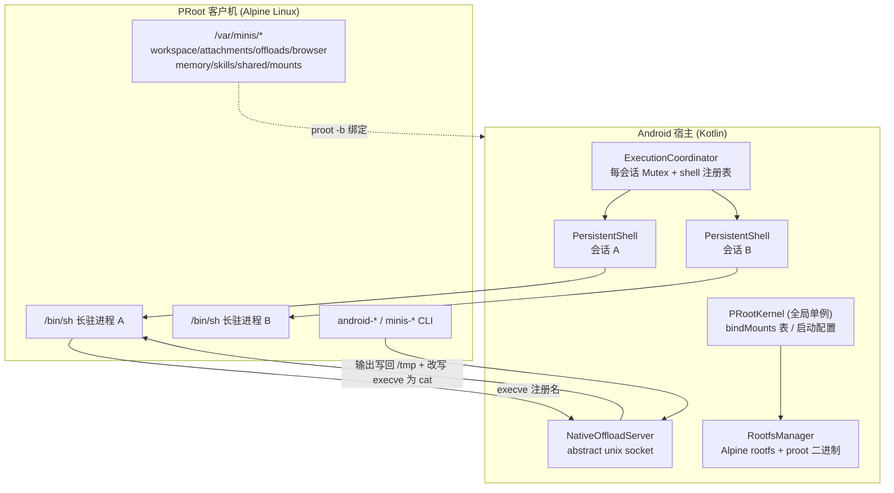
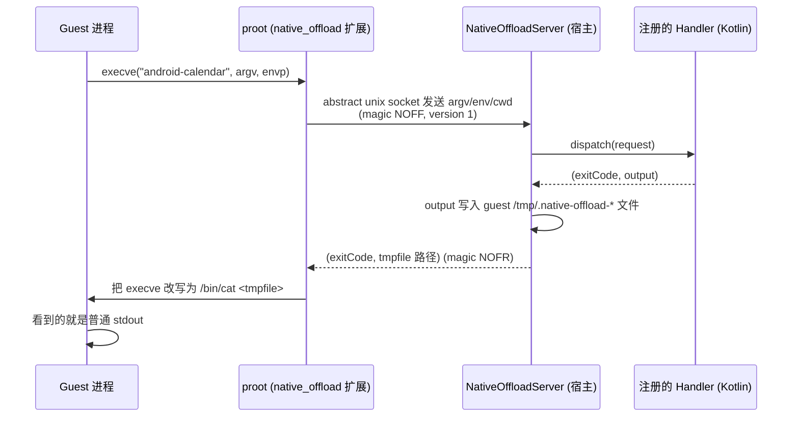

# 第 3 章 Runtime：PRoot 沙箱、会话 Shell 与宿主桥接

> 核心源码：`android/src/android/app/src/main/java/com/openminis/app/sandbox/`
> `PRootKernel.kt`（约 940 行）、`RootfsManager.kt`（约 660 行）、`ExecutionCoordinator.kt`（约 315 行）、`PersistentShell.kt`（约 580 行）、`NativeOffload.kt`（约 340 行）。

## 3.1 总体结构：一个内核、多个会话 Shell



- **PRootKernel 是全局单例**，只 boot 一次：解压/校验 Alpine rootfs、准备 proot 二进制、注册全局 bind mounts。它不是"常驻内核"，而是配置状态持有者（源码注释原话）。
- **PersistentShell 每会话一个**，拥有自己的 bind mounts 和长驻 `/bin/sh` 进程。
- **并发保证**（ExecutionCoordinator 注释）：同会话命令由会话级 Mutex 串行；不同会话并行；shell 创建由 globalLock 防重；shell 死亡在下次命令时检测并按原 bind mounts 重建。

## 3.2 proot 命令行：每个标志都有理由

`PRootKernel.buildProotCommand()`（约 605 行）生成的命令形如：

```
<proot> -0 --link2symlink -r <rootfs> -b /dev -b /proc -b /sys -w /root
        [-b <hostPath>:<linuxPath> ...]
        [--native-offload=<socketName>:<handler1,handler2,...>]
        /bin/sh -c "<command>"
```

| 标志 | 作用 | 为什么需要 |
|---|---|---|
| `-0` | 假 root（uid 0） | apk 安装、文件权限操作需要 |
| `--link2symlink` | hardlink() 翻译成 symlink() | Android /data（ext4/F2FS）拒绝应用 uid 跨目录硬链接；Alpine apk 安装 busybox-applet 包靠硬链接，不加此标志每个这类安装都 EPERM（T141） |
| `-r <rootfs>` | 指定客户机根文件系统 | Alpine |
| `-b /dev /proc /sys` | 绑定伪文件系统 | 设备/进程信息 |
| `-b host:linux` | 用户目录绑定 | 见 3.3 |
| `--native-offload=...` | 注册宿主桥接 | 见 3.5，这是 nanoMuse/OpenMinis 对 proot 的**自定义扩展** |

沙箱限制：ICMP 被阻断（`ping` 会永久挂起，系统提示词明确教模型用 curl/wget 代替）；shell 是 BusyBox ash（无 globstar、无花括号展开、无数组），提示词里有整段规避指南。

## 3.3 文件系统布局：会话隔离与共享池

`/var/minis/` 是模型看到的工作根目录，宿主侧映射分两类：

| Linux 路径 | 宿主路径 | 归属 |
|---|---|---|
| `/var/minis/workspace/` | `filesDir/minis-sessions/<sid>/workspace/` | 每会话 |
| `/var/minis/attachments/` | `filesDir/minis-sessions/<sid>/attachments/` | 每会话 |
| `/var/minis/offloads/` | `filesDir/minis-sessions/<sid>/offloads/` | 每会话（大输出卸载，见第 6 章） |
| `/var/minis/browser/` | `filesDir/minis-sessions/<sid>/browser/` | 每会话（截图/下载） |
| `/var/minis/memory/` | 全局共享池 | 跨会话（GLOBAL.md + 每日日志） |
| `/var/minis/skills/` | 全局共享池 | 跨会话 |
| `/var/minis/shared/` | 全局共享池 | 跨会话产物 |
| `/var/minis/mounts/<name>/` | SAF tree URI 解析出的外部目录 | 用户挂载，可能只读 |
| `/var/minis/feed/` | **一次性镜像**（FeedSandboxScope） | 只读 |

两个精细设计：

1. **会话路径解析不走全局表。** 全局 `bindMounts` 是 last-writer-wins（别的会话 boot shell 会覆盖），所以文件工具/链接解析用 `resolveSessionHostPath(sessionId, linuxPath)` 直接按会话目录解析，避免"中文 emoji 文件名消失"这类跨会话串扰 bug（源码 diag 注释）。
2. **PRoot 没有只读 bind 标志。** Feed 的只读不是靠 proot 实现的，而是每次 shell 命令前重建一个**可丢弃镜像**再绑定（`FeedSandboxScope.refresh`），真实 Feed 目录从不暴露；外部挂载的只读则由文件工具层拒绝写入（`isLinuxPathUnderReadOnlyMount`）。

## 3.4 PersistentShell：标记协议与超时语义

长驻 shell 的命令执行协议（`executeCommand`，约 460 行）：

```
写入 stdin:  <command>\necho "__MINIS_DONE_<marker>_EXIT_$?__"\n
readLoop:    逐行读 stdout，遇到标记行解析退出码，标记前的内容即输出
```

- marker 是 8 位随机 UUID 片段，防输出内容伪造标记。
- **超时不杀 shell**：`withTimeoutOrNull` 到期返回退出码 124（BusyBox/GNU timeout 约定），shell 进程保留，下条命令仍可用。
- shell 死亡时返回自描述报告：`[Shell not running] proot exit=<code>` + 最后 300 字符输出尾部（deathTail），让模型和用户都能看懂死因（T-android-shell-death-diagnosability）。
- **环境变量全量快照注入**：每次执行前把 EnvVarRepository 的当前全量 env 注入，并对"上次注入过、这次已删除"的键执行 `unset`——长驻 shell 否则永远留着过期密钥（T124a）。
- 隐私模式下 `EnvVarRedactor` 在工具结果交给模型前掩码 env 值（用户可见的流式输出不掩码）。

## 3.5 NativeOffload：guest execve → 宿主 Kotlin 的桥

这是整个 Runtime 最有意思的机制，让沙箱里的 CLI 能调用 Android 框架能力（日历、定位、通知、TTS、语音、Shizuku……）：



- socket 名带应用 ID：`io.github.nanomuse.app.native-offload`。abstract socket 是全设备一个命名空间，若沿用上游裸名，OpenMinis 与 nanoMuse 同机安装时第二个绑定的进程直接启动失败（#271）；名字仍被旧进程占用时退化为每进程名并告知 proot（`OffloadSocketName`）。
- 回复文件 TTL 10 分钟、每 50 次回复机会性清扫——正常路径写文件到 cat 读取是亚毫秒级，TTL 只为被停住的 tracee 兜底。
- 请求携带 `MINIS_CHAT_SESSION_ID` 环境变量转发的会话 id，让权限授予（ASK_ONCE）按会话 scoped（T340）。
- **权限闸门在 IPC 层**（OffloadGate）：无论模型走命名工具还是裸 shell 命令，CLI 都落到这里，三态权限检查一致（T330 把原先 ChatViewModel 里的死代码预检移到了这里）。

`android-*` CLI（alarm/calendar/clipboard/contacts/device/location/notification/open/photos/player/speak/speech/weather/shizuku-cli/a11y-cli）与 `minis-*` CLI（open/sessions-cli/model-use/config/scheduled/mcp-cli）都经此桥或直接在 guest 内运行。`minis-model-use` 甚至允许模型调用用户配置的其他 LLM（含多模态输出），形成"模型调模型"的递归能力。

## 3.6 bash 按需安装与自愈

Alpine 默认只有 BusyBox ash。`BashismDetector` 检测命令里的 bash 语法（数组、globstar 等），命中则：

1. `OnDemandBash.ensureBash` 用 apk 装 bash（安装时间不计入命令超时，有独立预算）；
2. `wrapForBash` 把脚本 base64 后在 guest 内自写临时文件执行，整体包在**子 shell** 里——因为 PersistentShell 靠标记行读退出码，裸 `|| exit 119` 会在标记 echo 之前杀掉长驻 shell 本身；
3. `command -v bash || exit 119` 哨兵：bash 被用户 `apk del` 后，119（或 wait(2) 编码 30464）触发**一次自愈**——重装 bash 并重跑本命令（M5）；
4. 装不上则降级 sh 执行，失败时附 BashismReminder 告诉模型哪些语法不兼容。

## 3.7 后台续跑

`AgentForegroundService`：任务运行期间挂常驻通知（会话数、当前工具名、耗时），START_STICKY；进程被杀后系统重建服务时通过 onStartCommand 计数与进程启动时间戳区分"冷启动复活"与"同进程重启"（T-STALL-DIAG）。系统提示词明确告知模型：crontab/at/nohup 在应用挂起后会停，跨后台的定时要用原生 AlarmManager（android-alarm）或 minis-scheduled（应用内调度，由宿主 AlarmManager 唤醒）。

## 3.8 本章小结

Runtime 的三层抽象：**PRootKernel（全局配置）→ ExecutionCoordinator（会话并发）→ PersistentShell（标记协议）**，加上 NativeOffload 这条"execve 改写"桥，把完整 Linux 环境与 Android 框架能力同时交给了模型。设计处处体现手机现实：硬链接被禁、abstract socket 命名冲突、长驻进程的过期 env、超时不能杀 shell、后台会被系统冻结。