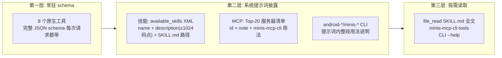
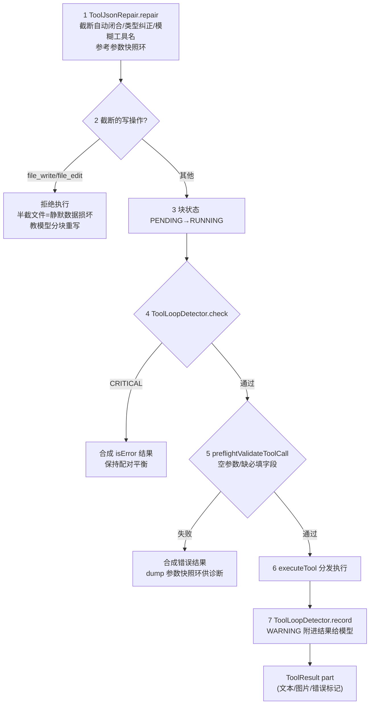

# 第 4 章 工具系统：定义、召回、执行与权限守护

> 核心源码：`com/openminis/app/tools/AgentTools.kt`、`data/model/AgentToolDefinition.kt`、`ChatViewModel.executeTool()`（约 9503 行）、`io/github/nanomuse/guard/`、`data/repository/{SkillRepository,MCPRepository}.kt`、`io/github/nanomuse/skills/SkillDocuments.kt`。

## 4.1 工具定义：provider 无关的 schema

`AgentToolDefinition` = name + description + parameters（类型/描述/枚举）+ required + propertyOrdering。`AgentTools.makeAgentTools()` 是中央注册表，产出与 iOS `makeAgentTools()` 对齐的定义列表，由各 Provider 在序列化时转成自家 function schema。

**原生工具只有 8 个**，且两个带准入门槛：

| 工具 | 准入条件 | 说明 |
|---|---|---|
| `shell_execute` |  always | 隔离 Linux 进程，/bin/sh -c，默认超时 900s，支持 delay 参数（阻塞 agent 流但不占 shell） |
| `file_read` / `file_write` / `file_edit` | always | 直接文件 I/O，比 cat/echo 快；file_edit 精确字符串替换 |
| `read_image` | 主模型原生视觉 **或** 配置了 Vision Group | 无视觉且无 Vision Group 时工具直接从 schema 消失 |
| `browser_use` | always | 见第 5 章 |
| `memory_write` / `memory_get` | 会话记忆开关开启 | 关闭时 schema 与提示词片段**同步消失**（双闸对称，绝不半残） |

每个工具都有必填的 `tool_title` 参数（5-10 词、跟随用户语言），专门用于 UI 胶囊标题——这是"可读性预算"的体现：用户看到的不是 JSON，是人话标题。

**其余一切能力都不走原生工具**，而是走 shell 里的 CLI：`android-*`（框架能力）、`minis-*`（应用自身能力）、`minis-mcp-cli`（MCP）。这是一个明确的架构取舍：原生工具只保留高频、需要特殊 UI/权限处理的动作，长尾能力用 CLI 统一承载，schema 保持小而稳定。

## 4.2 工具召回：三层披露机制

模型如何"知道"有哪些能力可用？三层渐进披露（progressive disclosure）：

### 技能（SKILL.md）

- 解析：`SkillDocuments.parse` 用 SnakeYAML **SafeConstructor** 解析 frontmatter（限 64KB、嵌套 32 层、禁重复键/递归键），保留标量词法形式（防 YAML 1.1 把 `on` 变布尔、`1.10` 变浮点）。
- 披露：`SkillDocuments.prompt` 把**所有启用技能**按更新时间倒序写进 `<available_skills>` XML，description 截断到 1024 个 Unicode 码点，附真实路径 `/var/minis/skills/<id>/SKILL.md`。**指令全文不进提示词**，模型用前必须 file_read。
- 热更新三条路径：① 每次 buildSystemPrompt 前 `reloadFromDisk()`（捕获 shell `git clone` 绕过文件钩子放入的技能）；② file_write/file_edit 命中 `/skills/*/SKILL.md` 时立即重扫（`maybeReloadSkillsForPath`）；③ file_read 读到某技能 SKILL.md 时 `recordSkillUse` 记录使用。
- 内置技能由应用管理（可导出/停用，不可编辑删除），自定义需导出副本。

### MCP

- `MCPRepository.mcpPromptFragment`：按会话启用状态过滤、创建时间倒序取 **Top-20**（MAX_MCPS_IN_PROMPT），只披露 id + note（截断），教模型用 `minis-mcp-cli tools <server>` 发现工具、`minis-mcp-cli call <server> <tool> [args]` 调用。
- 配置里的密钥用 `$$VARNAME` 占位符，运行时从 App 环境变量解析，禁止硬编码。
- 每次构建提示词前重读 servers.json（CLI/文件浏览器可能带外修改）。
- 会话级启用覆盖存 SQLite（mcp_session_overrides 表）。

## 4.3 执行流水线：七道工序

`runAgentLoop` 拿到 ToolCallComplete 后，每个调用按序经过：

关键决策点：

- **截断写拒绝**（#119）：参数流被截断后自动闭合的 JSON，与"模型本来就写到这"无法区分。对写操作，半个文件落盘且 UI 报成功 = 静默损坏用户数据，比不写更糟。所以写操作直接拒绝并教模型分块写；只读/shell 工具保留修复后执行，但结果里附 `<system-reminder>` 告知模型参数被客户端改过。
- **preflight 在 RUNNING 之前**：`{}` 参数的调用不会 spawn shell、不会碰文件系统，模型下一轮自我纠正。
- **executeTool 分发**（约 9503 行）：file_read/write/edit → 各自执行器（带会话路径解析）；read_image → 视觉路由；shell_execute → RiskGate + ExecutionCoordinator；browser_use → 第 5 章；memory_* → MemoryRepository；未知工具 → "Unknown tool" 错误（喂给 ToolLoopDetector 的 unknown_tool 策略）。
- **read_image 的 Vision Group 路由**：主模型无原生视觉时，工具不返回像素（文本模型解码不了），而是把图片交给 Vision Group 里能看图的成员，返回**文字描述**；描述失败也标 success=true——错误结果会诱发模型重试循环，不如让它直接告诉用户图看不了。
- **结果展示裁剪**：shell_execute 的 UI 块只留输出末 80 行（长 stdout 尾部最有价值）；其他工具保留全文（file_read 的首行 banner 是元数据，砍头会丢信息，T263）。

## 4.4 权限守护：RiskGate（Sentinel 的 Android 形态）

### 风险分级

`Risk.kt` 定义六级风险类，按"对世界的影响"排序，合并时取高者：

| RiskClass | 含义 | 层级 | 行为 |
|---|---|---|---|
| SAFE | 读、算、沙箱内写 | NOTICE | 直接跑，不说话 |
| INSTALL | 往沙箱装软件 | NOTICE | 跑，但结果附 notice 让模型告知用户 |
| DESTRUCTIVE | 删用户文件/历史 | CONFIRM | 问 |
| OUTBOUND | 发消息/邮件/表单 | CONFIRM | 问 |
| REMOTE | 账号内其他设备经 hub 操作本机 | CONFIRM | 问 |
| MONEY | 动钱 | HIGHEST | 每次付时问；记住授权需**手机屏幕锁**确认且只绑一个对象 |

`warnings`（`rm -rf /`、`curl | sh`、force push 等永远问的标志）存在时，**任何授权都不能放行**，卡片也不提供"记住"选项。

### 审批队列

`RiskGate` 是单卡片队列：一次只显示一张审批卡，其余排队；**180 秒无应答 = 拒绝**（TIMEOUT），模型被告知"停下来等用户，不要自行重试"。调用方协程被取消（会话关闭/停止）会撤回卡片，下一张顶上。应用后台时发系统通知。决策五选一：ALLOW_ONCE / ALLOW_SESSION / ALLOW_ALWAYS / DENY / TIMEOUT。

授权记忆（`Grants`）：
- "本对话有效"：不提供给付钱、远程设备、定时任务；带 warning 的不提供。
- "永远允许 X"：必须绑定具体 target（文件夹/主机/收件人），"永远允许 X"就只是 X，不扩大。
- 付钱的长期授权是最高档：卡片上用屏幕锁确认，且第一次必须问（授权只能来自卡片）；之后每次自动放行都附 notice 让模型**说出来**（"这笔付款用了你记住的授权，可在设置里撤销"）。

### 审计

每次决策经 `ClientEvents.sentinelDecision/approvalResult` 上报中继：只含工具种类、风险档、决策、授权范围、等待秒数、应答者（person/other_device），**从不包含命令内容或页面内容**。

### shell 与浏览器的判定入口

- shell：`ShellGuard.assess(command)`（472 行规则）→ `RiskGate.checkShell`，在 `executeShellCommand` 开头执行，Denied 直接返回错误结果。
- 浏览器：`BrowserGuard` 在 click/type 前判定（第 5 章）。
- 屏幕（Hands）：`TapWords` 同一套敏感词表，付款/发送/删除逐次问。

## 4.5 工具结果的数据形态

`ToolExecutionResult` → `AgentContentPart.ToolResult`：id/name/content/isError + 可选 imageData/imageMimeType/imageLinuxPath。图片走双轨：**推理用**压缩 JPEG（≤2000px 长边）随请求发给模型；**展示/引用用**原图落盘 `/var/minis/browser/` 或 attachments，结果文本附 `minis_url:` 供模型在 Markdown 里引用。

## 4.6 本章小结

工具系统 = **小而稳定的原生 schema + 三层渐进披露 + 七道执行工序 + 六级风险守护**。长尾能力全部 CLI 化，权限判定内嵌在执行路径而非独立闸门，授权记忆严格绑定对象且付钱永远特殊对待。这套设计让"模型能做什么"与"模型被允许做什么"成为两个清晰分离的问题。