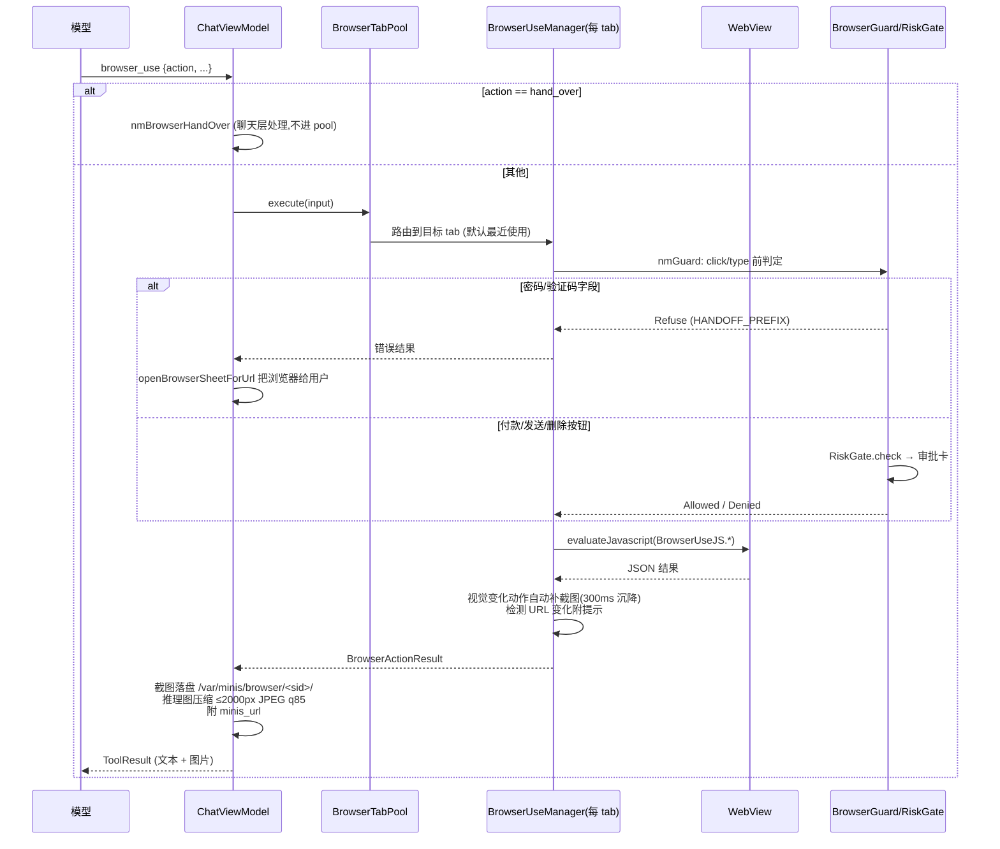
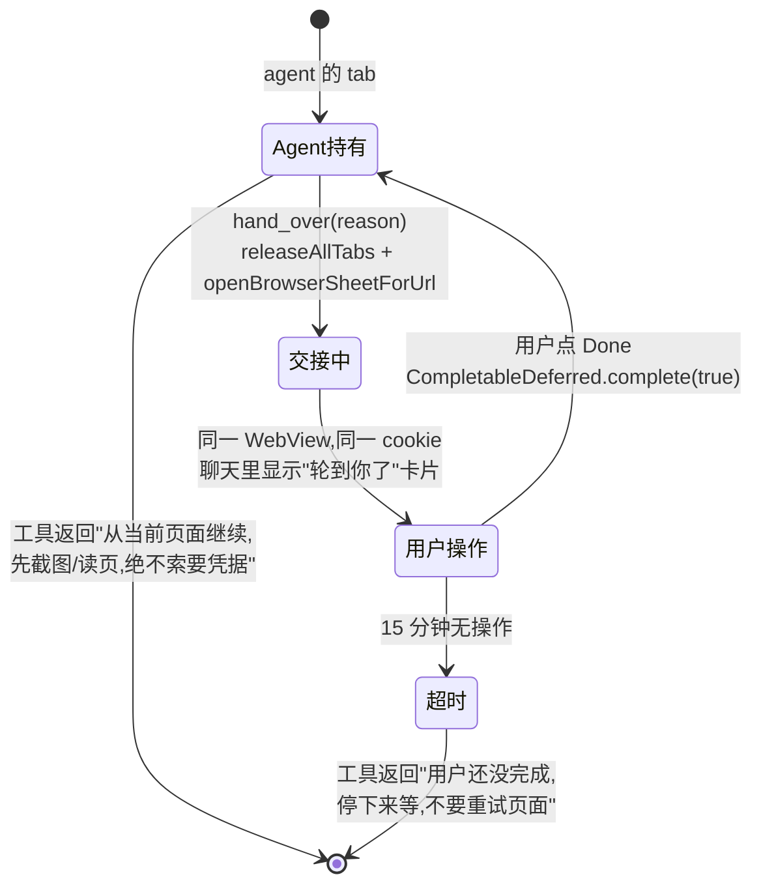

# 第 5 章 Browser 工具专项：调用链、WebView 后端与人机交接

> 核心源码：`com/openminis/app/tools/AgentTools.kt`（browser_use 定义）、`com/openminis/app/browser/{BrowserUseManager,BrowserTabPool,BrowserUseJS}.kt`、`io/github/nanomuse/browser/BrowserHandOver.kt`、`io/github/nanomuse/guard/{BrowserGuard,TapWords}.kt`、`ChatViewModel.executeBrowserUseTool()`（约 9889 行）。
> 交叉印证：`docs/browser.md`（注意其开头声明：Playwright 部分属于 Python 线，当前 Android 的浏览器就是 OpenMinis 的 browser_use + hand_over）。

## 5.1 为什么是 WebView

PRoot 沙箱里**起不了 Chromium**（docs/browser.md 原话），所以手机上的浏览器永远是应用内 WebView。这带来三个架构后果：

1. 浏览器与 App 同进程，截图、cookie、页面控制都走 Android WebView API + JS 注入，没有 CDP/Playwright 协议层。
2. 登录态存在 App 的 WebView cookie store 里，**人机交接零成本**：同一个 WebView 直接滑到用户面前，不重载、不换 cookie。
3. 站点看到的是 Android WebView（或伪装的 desktop_chrome UA）；Google 登录页永久禁止 in-app WebView 登录（disallowed_useragent），系统提示词里有专门一段教模型**不要重试**，改给 Custom Tab 链接让用户去系统 Chrome 完成。

## 5.2 动作集与调用链

`browser_use` 支持最多 **3 个标签页**（BrowserTabPool），动作枚举（BrowserAction）：

| 类别 | 动作 |
|---|---|
| 导航 | navigate、new_tab、close_tab、list_tabs |
| 感知 | screenshot、get_text、get_readable、get_page_info、get_backbone（DOM 简化树）、find_elements |
| 交互 | click（selector 或坐标）、type、hover、scroll、scroll_and_collect（无限滚动页累积去重采集）、execute_js（async 包装，支持 await/return） |
| 会话 | fetch（带页面 cookie 下载，不渲染）、get_cookies、set_cookies、set_user_agent、set_viewport、wait_for_dom_stable（DOM 变化率梯度稳定判定） |
| 交接 | hand_over |

调用链：

实现要点：

- **所有页面操作都是 JS 注入**：`BrowserUseJS` 生成 click/type/scroll 等脚本，`evaluateJavascript` 在 Main 线程执行并回传 JSON。type 用页面自己的 input 事件序列，React/Vue 受控组件能感知。
- **视觉变化动作自动补截图**（navigate/click/type/scroll 等）：延迟 300ms 等页面沉降再截，模型不用每次显式调 screenshot。
- **URL 变化检测**：动作前后 URL 去掉 hash 比较，变了就在结果里附 "[URL Changed] ... Take a screenshot..."，引导模型先看再继续。
- **set_viewport / 标签管理**必须由 Pool 路由（Manager 直接报错），因为视口与 tab 生命周期是池级状态。
- **minis:// 资源拦截**：`interceptMinisURL` 把 WebView 对 minis:// 的请求映射到会话宿主目录，HTML 及其相对路径子资源（JS/CSS/图片/字体）全部可解析——模型 file_write 写的多文件网页项目可以直接 navigate 预览。非 ASCII 文件名必须百分号编码，工具结果里的 minis_url 已编码好。

## 5.3 安全判定：BrowserGuard 的两条铁律

判定发生在**动作执行前**，一次 `evaluateJavascript`（`describeJs`）收集目标元素的全部元数据：tag/type/name/id/placeholder/autocomplete/inputmode/aria/label/text/href/maxlength/url/host。selector 用 querySelector，坐标用 elementFromPoint，向上 closest 到 input/button 语义元素。

**铁律一：绝不往密码/验证码字段输入。** `judgeType` 命中任一即拒绝：
- type=password；
- autocomplete ∈ {one-time-code, current-password, new-password, cc-csc}；
- name/id/placeholder/aria/label 命中 `TapWords.secretField` 正则；
- 启发式：inputmode=numeric 且 maxlength 4~8 且文案含 code/码。

拒绝结果带 `[nanoMuse handoff]` 前缀，聊天层看到前缀就 `openBrowserSheetForUrl` 把浏览器弹给用户，并告诉模型"别换 selector 或 JS 绕过"。

**铁律二：付款/发送/删除按钮先过审批卡。** `judgeClick` 取按钮 text/aria 标签，`TapWords.classify` 分类（与手机屏幕 Hands 共用同一套词表），命中则 `RiskGate.check`，授权绑定**页面 host**。词表刻意具体——点"支付宝"图标不会被误判为付款，点"确认支付"才会。

## 5.4 hand_over：把浏览器交给人

这是 nanoMuse 对上游的标志性扩展（`// nanoMuse:` 标记），解决"页面需要人本人"的死胡同：

- 等待用 `CompletableDeferred` + `withTimeoutOrNull(15min)`；新的交接会把旧等待 complete(false) 顶掉。
- 两种返回都标 success=true——这不是错误，是正常的人机协作状态；措辞直接指挥模型下一步行为。
- 工具定义里的描述写得极明确："Never type credentials and never end your turn by telling them to log in themselves."——禁止模型用"请你自行登录"结束回合，必须走 hand_over。

## 5.5 Cookie 的隐私设计

- `get_cookies` **不在工具结果里返回原始 cookie 值**：只返回摘要 + 一个 offload env 文件路径（`/var/minis/offloads/env_cookies_xxx.sh`）。模型要在 shell 里复用 cookie 时 `. 该文件 && command`，值不进对话上下文。支持 keywords/fuzzy 过滤。
- `set_cookies` 走原生 CookieManager，能写 HttpOnly（JS 写不了的）；兼容 EditThisCookie/Cookie-Editor/Playwright 导出的字段变体（httpOnly/expirationDate/sameSite 等），可直接粘贴。

## 5.6 界面呈现

- 聊天内：browser_use 的工具块渲染为**浏览器卡片**——截图 + 当前 URL + 动作标题（tool_title），全程可见。
- 交接时：浏览器 sheet 从底部滑出，就是 agent 用的那个 WebView 实例；顶部卡片说明原因（reason，用户语言）。
- 截图双轨：原图落盘供用户查看与 minis:// 引用；压缩图（长边 ≤2000px，JPEG q85，对齐 Anthropic 8000px/5MB 上限的保守值）随请求发给模型。

## 5.7 与 Python 线 browser 的对照

| 维度 | Android（本章） | Python 运行时（nanomuse/tools/browser.py） |
|---|---|---|
| 后端 | 应用内 WebView | Playwright headless Chromium（或 device 后端遥控手机） |
| 元素定位 | CSS selector / 坐标 | 编号元素列表（navigate 返回编号，click n） |
| 登录态 | WebView cookie store | 持久化 profile 目录 |
| 交接 | hand_over 动作 + 同 WebView sheet | 浏览器卡片接管 |
| 内网防护 | minis:// 拦截 + 提示词约束 | navigate 拒绝 localhost/私网/重定向入内网 |

技能若按 Python 线的编号元素语法写，在 Android 上需要适配 selector 语法——这是跨端复用技能时的实际差异点。

## 5.8 本章小结

Browser 工具 = **WebView 单后端 + JS 注入动作集 + 执行前双铁律判定 + hand_over 人机交接 + cookie 值不进上下文**。它把"浏览器自动化"和"凭据安全"的冲突用交接机制化解：模型永远不碰密码，人永远不用离开当前页面。