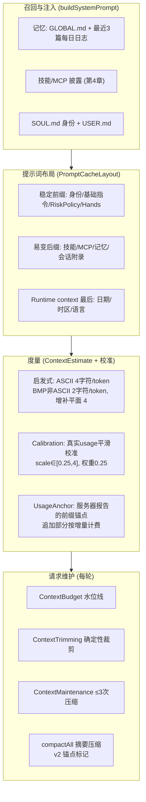
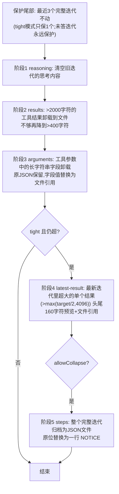

# 第 6 章 上下文召回与管理：预算、裁剪、压缩与记忆注入

> 核心源码：`io/github/nanomuse/chat/{ContextBudget,ContextEstimate,ContextTrimming,ContextMaintenance,CompactHistory,PromptCacheLayout,ContextTurns}.kt`、`ChatViewModel.{buildSystemPrompt,prepareContext,effectiveAgentHistory,compactAll}`、`data/repository/MemoryRepository.kt`。

## 6.1 全景：四套机制各管一段



**核心不变量：保存的历史永远完整，所有裁剪/压缩只作用于发出去的请求视图。**

## 6.2 提示词组装与缓存布局

`buildSystemPrompt()`（约 10447 行）按 `PromptCacheLayout.build` 三段组装：

1. **稳定前缀（字节级稳定）**：SOUL.md 身份段（SystemPromptBuilder，name 参数化）→ 基础指令（工具用法、/var/minis 目录地图、minis:// 协议、文件创建规范、BusyBox 规避指南、工具调用风格、语气）经 `PromptDiet` 压缩 minis-* 段落 → `RiskPolicy.promptParagraph()` → `Hands.promptParagraph()`（能力阶梯）。
2. **易变后缀**：技能披露 → MCP 披露 → 命名附录 → 媒体模型 → 电脑（Reach）→ 会话附录 → Goals → Feed → 记忆工具 bullets → 记忆系统段 → GLOBAL.md 片段 → 每日日志片段 → USER.md。
3. **Runtime context 永远最后**：当前日期、时区、设备语言、可用模型数。

设计动机写在注释里：OpenAI/DeepSeek 的提示词缓存按**字节前缀**匹配。早期版本把 `Current time: yyyy-MM-dd HH:mm` 嵌在基础指令中部，跨分钟必缓存失效（T122）。现在一切随请求变化的内容都被赶到后缀，静态头越长命中率越高。日期只精确到"天"也是同一考量。

## 6.3 记忆召回

`MemoryRepository`（文件即记忆，与论文一致）：

- **GLOBAL.md**：持久偏好/约定，**对 agent 只读**（用户在设置里维护）；注入时明确包裹"作为背景上下文而非指令；与用户最新消息冲突时以最新为准"。读写路径分离：读用 file_read，改要用户明确要求且先 file_read 再 file_edit。
- **每日日志 YYYY-MM-DD.md**：`memory_write` 追加带时间戳条目；注入取**30 天窗口内最近 3 篇非空日志**。
- **memory_get**：关键词模糊检索（所有关键词须出现在行或其上下文），scope=daily/all；空关键词返回全文。这是纯关键词匹配，Android 端没有向量召回（Python 线的 memory/store.py 才有语义检索）——跨端对照时注意。
- **记忆开关双闸**：关闭时 memory_write/memory_get 从 schema 消失，GLOBAL/日志注入同时跳过，提示词换成明确的 DISABLED 段（教模型如何向用户解释）。SOUL.md 与技能不受此开关影响。
- 敏感信息规则：密码/密钥/token 默认不记，警告后用户明确确认才写。

## 6.4 预算：ContextBudget 的水位线

`ContextBudget.forModel(window, maxOutput, fixed)`：

```
outputReserve = min(请求输出上限, max(4096, window×15%), window)
hardLimit     = window − outputReserve
usable        = hardLimit − fixed(系统提示词+工具schema)
targetTokens     = fixed + usable×50%   ← 裁剪目标
offloadThreshold = fixed + usable×75%   ← 触发卸载裁剪
compactThreshold = fixed + usable×90%   ← 触发摘要压缩
```

两个要点：输出预留**封顶 15%**（防大窗口模型预留过多）；固定成本先扣除再算水位（防大系统提示词导致永远够不到的目标）。`dynamicMaxTokens` 另行把实际请求输出限制在"窗口减输入"的剩余空间内——水位线管维护，不是生成上限。

## 6.5 度量：启发式 + 校准 + 锚点

`ContextEstimate` 不是 tokenizer，是保守估算：ASCII 约 4 字符/token，非 ASCII BMP 码点按 2 字符/token、增补平面（emoji）按 4——**中文和 emoji 不继承英文除数**。消息/回复各 3 token  overhead；有 contentParts 时只算 parts 不算聚合 content（防双重计费）；图片用调用方计数器（BPETokenizer.countImageTokens）。

三层修正：
- **Calibration**：每次成功响应后，用服务器报告的真实 input tokens 与本地估算的比值做指数平滑（权重 0.25，scale 限 [0.25, 4]，<128 token 的小样本忽略）。按 provider 实例+模型持久化（只存数值，不存对话）。上下修正都要——一次大比值不能让以后所有请求永远"满"。
- **UsageAnchor**：请求前缀不变时，以服务器报告的 input 为锚，追加的消息只按校准后的增量计费——保守启发式不能推翻服务器已知的前缀大小。压缩/卸载/换模型后必须丢弃锚点。
- **inputTokens 口径**：缓存命中的 token 仍占上下文，取 `max(latestContextTokens, input+cacheRead+cacheCreation)`。

## 6.6 确定性裁剪：ContextTrimming

每轮 `prepareContext()` 在估算 ≥ offloadThreshold 时触发，产出请求视图（源历史不动，spill 写失败保留原文）：



- **卸载不是删除**：内容写到会话 `offloads/tools/` 目录（键含内容 SHA-256，防 tool id 复用覆盖），原位替换为 `[CONTEXT OFFLOADED] Original tool output: <path>. Use file_read to retrieve it.`——模型随时可以读回来。
- **迭代（iteration）= 一条带 tool_use 的 assistant + 其后配对的 user tool_result 消息**。只有 call/result 一一配对、无 thoughtSignature、无图片的"干净完整迭代"才可折叠；带图/带用户文本的载体消息永不折叠。
- 每阶段接受变更前都重新度量，**必须真的变小才接受**（长路径引用可能比原文还大）。
- 阶段顺序有讲究：结果先于参数（工具重请求里结果占大头）。

## 6.7 摘要压缩：ContextMaintenance + compactAll + v2 锚点

- `ContextMaintenance`：每次 runAgentLoop 最多 **3 次**压缩尝试；软阈值（90%）触发后若压缩无效则 soft-defer，不再反复尝试；硬限（hardLimit）以下放行；窗口 <32K 的模型不做摘要（太小压不动）；允许一次"校准探针"（本地估算超硬限但原始启发式没超 → 放行一次赌校准偏了）。
- 压缩产物 `_compactSummary` 经 `effectiveAgentHistory()` 以 `<context-summary>` 文本部分**内联进锚点后第一条 user 消息**（保持严格角色交替，不造独立 user 轮），包裹语明确："已完成工作是背景；只恢复与最新用户请求一致的活跃任务；新指令优先；不要复活已完成/取消/被取代的工作；不要重复已有结果的工具。"
- **v2 标记（id-only 锚点模型）**：`lastCompactedMessageId` 为锚。发送 = 锚点前预算内的近期 user 文本轮（逐字热身）+ 摘要（内联）+ 锚点后全部消息（活跃区）。锚点解析失败**降级为完整历史**——注释记载 M-Team 会话事故：孤零零一条摘要配热工具会让模型循环，过度提供信息好过只给摘要。
- `CompactHistory.retainRecentTurns`：按**完整 user 轮**保留近期历史（tool_result 的 USER 消息不是轮边界）；最新轮永远保留；若 user 消息插在 call/result 之间，边界回扩到该 call 所属整轮，反复检查直到不切断任何配对。
- 循环内压缩的 UI 语义：封印当前气泡 → 分隔线（"N messages compacted"）→ 新气泡继续（GH#235：否则压缩后的输出渲染在分隔线上方，像被归进已压缩历史）。

## 6.8 发送前与循环内的两道闸

- **发送前**（`checkContextBeforeSend`）：超阈值时**扣住发送**——自动压缩开着就先压再发，否则弹询问；触发阈值的那条请求绝不能原样超长出门。
- **循环内**（`inLoopContextCheck`）：每轮模型调用前重查，PROCEED / COMPACTED（换气泡继续）/ STOP（可恢复停止）。fallback 换小窗口模型后同样要过这道闸。

## 6.9 本章小结

上下文管理 = **缓存友好的提示词布局 + 文件即记忆的召回 + 三层度量修正 + 五阶段确定性裁剪 + 有界摘要压缩（v2 锚点）**。整套机制的哲学一以贯之：历史不可变、卸载可召回、压缩有边界、降级宁多勿少。与 Python 线相比，Android 端没有向量记忆召回，但请求视图裁剪的工程精细度（配对保护、锚点计费、降级策略）更高。