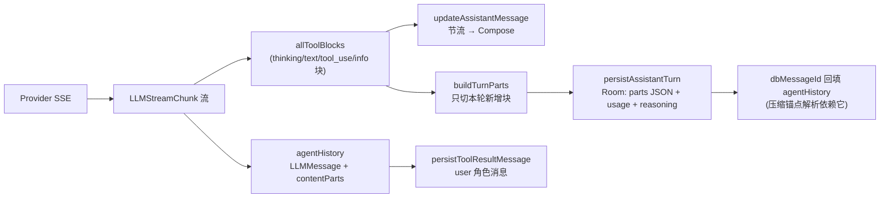

# 第 7 章 模型输出与工具执行：Provider 层与序列化契约

> 核心源码：`com/openminis/app/provider/LLMProvider.kt`、`provider/{openai/OpenAIProvider.kt,anthropic/AnthropicProvider.kt,gemini/GeminiProvider.kt,ProviderFactory.kt,ToolJsonRepair.kt}`、`data/model/{AgentTypes.kt,AgentToolDefinition.kt,LLMStreamChunk}`、`ChatViewModel` 的持久化函数群。

## 7.1 Provider 抽象：结构性钳制而非约定

`LLMProvider` 接口的设计有一个值得学习的模式——**把约束做进结构，而不是依赖实现者记得**：

```kotlin
// 公共入口（不可被实现覆盖）：先按当前 model 的天花板钳制 thinkingLevel
fun streamMessage(..., thinkingLevel) = streamMessageClamped(..., clampThinkingLevel(thinkingLevel))
// 实现者只覆盖 Clamped 版本，收到的 level 保证已钳制
fun streamMessageClamped(...): Flow<LLMStreamChunk>
```

这样即使 fallback 中途换了 model，新模型的 thinking 上限也自动生效——不存在"某条代码路径忘了钳制"的可能（T-android-thinking-level-arch，对齐 iOS）。

其他接口契约：
- `effectiveMaxOutputTokens`：model 级上限优先于 provider 默认（16384）。
- `streamTextIsMonolithic`：声明该协议的文本是否"单块"（见第 2 章 2.3）。OpenAI Chat Completions 为 true；Anthropic content blocks / Responses output items 为 false（到达顺序即语义顺序）。
- `failOnSilentEmptyCompletion()` 扩展算子：流"正常结束"但没有任何内容也没有 finish reason → 抛 TransientError 触发自动重试。这是中继静默断 SSE 的兜底（T-android-empty-stream-retry）；带 stop reason 的空流故意放行，交给主循环的空回复恢复路径处理。

## 7.2 Provider 家族与协议适配

| Provider | 协议 | 特殊处理 |
|---|---|---|
| OpenAIProvider | Chat Completions（默认）或 Responses API（OAuth/Codex 或显式开关） | 双协议序列化；Azure base 路径改写；extra body/headers 透传；ThinkPrefixStreamParser 解析思考前缀 |
| AnthropicProvider | Messages API | enhancedCache 开关（每轮在循环 choke point 盖章）；content blocks 有序组装 |
| GeminiProvider | Gemini API | 3.x thoughtSignature 随 tool_call 捕获、持久化、下轮回传（#179） |
| OpenRouter / xAI / Antigravity | OpenAI 兼容变体 | 各自端点与鉴权 |

`ProviderFactory.create` 按实例配置产出 Provider；模型目录（ModelsApi/ModelsCache）拉取各厂商模型清单与能力（上下文窗口、最大输出、thinking 天花板、视觉）。

**跨协议序列化契约**（docs/architecture.md 明确记载，Android/iOS 序列化器共同遵守）：
- Responses API 请求内 `function_call.call_id` 必须唯一，配对的 `function_call_output` 做同样的请求内重写；reasoning item id 不动。
- `sanitizeToolId`：把 tool id 过滤成 Anthropic 接受的 `^[a-zA-Z0-9_-]+$`（Responses 可能吐 `call_abc|fc_def`）。
- 工具结果在历史里是 user 角色 + ToolResult parts（Anthropic 形状），OpenAI 系序列化时转 `tool` 角色消息。
- reasoning_content 不透明回传：DeepSeek V4 非思考轮发 `""`，必须原样保留——伪造文本会被模型在上下文里"学走"。

## 7.3 工具参数修复：ToolJsonRepair 三策略

模型（尤其经中继的）吐出的工具参数经常残缺。修复发生在 preflight 之前，原地改 args 并返回策略标签：

| 策略 | 触发 | 动作 |
|---|---|---|
| truncation+suffix | args 为空 dict 且参数快照环显示流被截断 | 用快照环尾部自动闭合 JSON |
| coercion | 必填字段存在但类型不对 | 强转 String |
| fuzzy:candidate->field | 必填字段缺失但有近似名 | 模糊匹配改名 |

修复标签的下游语义（第 4 章已述）：`truncation+*` 对写操作直接拒绝；对其他工具执行后附 system-reminder 告知模型"你的参数被客户端改过，核对结果"。快照环（每工具最近 10 条 accumulated JSON）是修复的证据来源，preflight 拒绝时也会 dump 进日志供诊断（#119）。

## 7.4 流式输出到持久化的完整链路



- **块（AssistantBlock）是 UI 概念，parts（AgentContentPart）是 wire/持久化概念**，buildTurnParts 负责翻译；toolInputMap 跨轮累积保证持久化包含全部参数 JSON。
- 工具执行期间就把 live parts 写进会话预览（updateSessionPreview），首页列表不用等整轮结束才更新。
- 会话标题在首轮交换后自动生成（独立 title provider 可配），失败有 fallback 标题路径。
- 中断恢复：`InterruptedTailDetector` 在会话加载时识别被截断的尾部；`resume()` 从 canResume 状态续跑；rerunFromToolBlock 支持从某个工具块重跑。

## 7.5 用量与计费口径

`LLMUsage` 区分 input/output/cacheRead/cacheCreation；`ContextEstimate.inputTokens` 取"缓存也算占位"的口径（第 6 章）。usage 只用于上下文预算与校准，中继侧另有 token/费用账本（docs/cloud.md：账本记模型名、token 数、费用，不存输入输出内容）。

## 7.6 本章小结

Provider 层的工程主题是**协议差异的收敛**：thinking 钳制结构化、文本块语义按协议声明、tool id 跨协议清洗、reasoning 不透明回传、参数三策略修复。所有差异被压在 Provider 边界内，主循环只面对统一的 LLMStreamChunk 与 AgentContentPart——这是它能同时伺候六家厂商还保持单一状态机的原因。