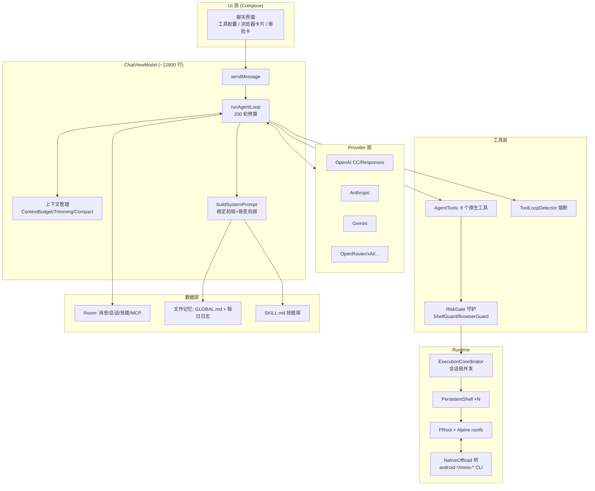
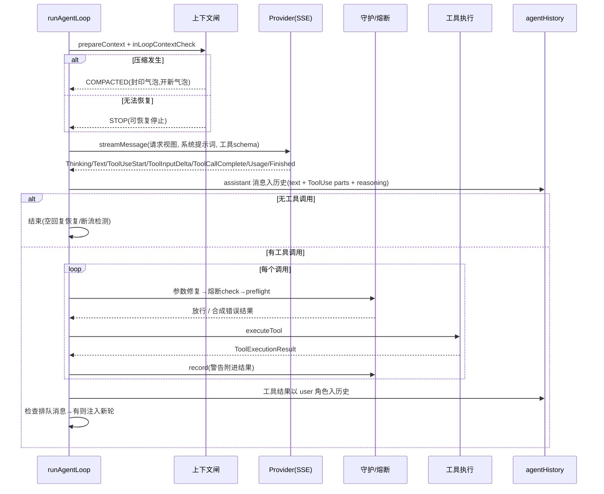
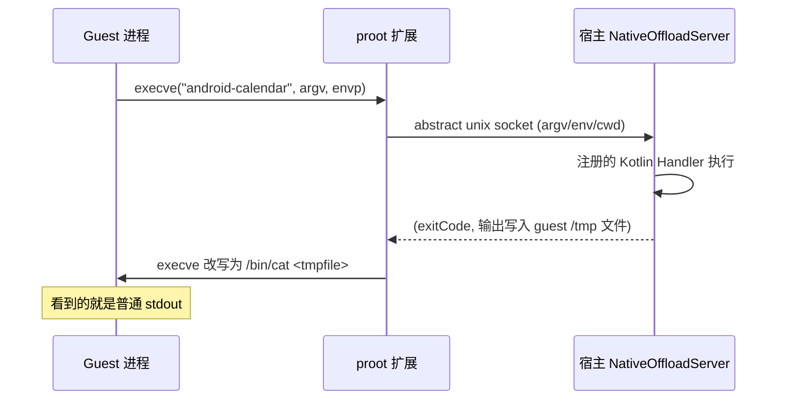
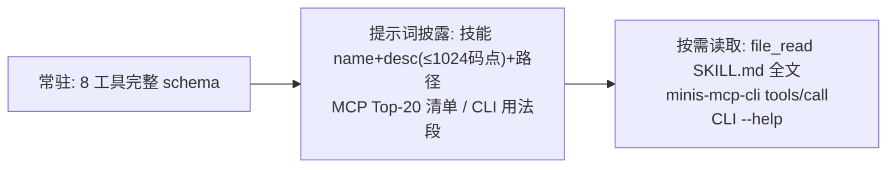
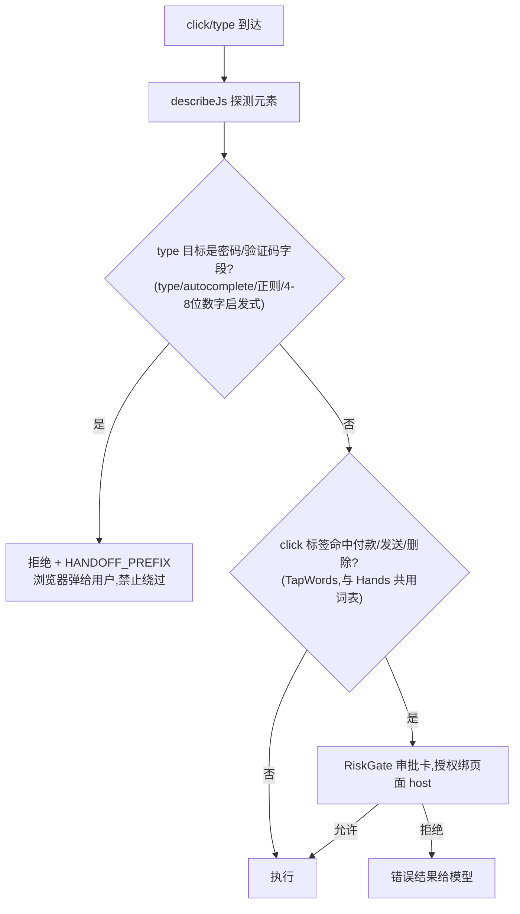

# 把一整个 Linux 和一只 Agent 装进手机：nanoMuse 安卓端架构深度拆解

> 本文从架构师视角拆解开源个人智能体 nanoMuse（浙江大学 APRIL 实验室，GPL-3.0）的 Android 端实现：从整体架构到数据流转，从 Looper（Agent 主循环）到 Runtime（沙箱运行时），从工具的定义、召回到执行，从 Browser 工具的调用链到界面，再到上下文管理与模型 I/O。所有结论基于 main 分支源码（2026-11-17 快照），标注文件与函数名，可复查、可重现。配套分章知识库见同目录 README。

## 0. 先纠正一个普遍误解

很多人（包括不少二手文章）以为 nanoMuse 的 Android 端是"App 里跑一个 Python 服务"。**不是。** 仓库里确实有一套完整的 Python 运行时（`nanomuse/` 包），但那是桌面/Web/服务端形态；早期 Android 的 Python 路线已被归档进 `docs/archive/android-python-line.md`。今天下载到的 APK 是基于 **OpenMinis 1.13** 改造的**原生 Kotlin 应用**——智能体主循环、工具执行、沙箱全部跑在手机原生层。官方文档的原话是 "a native app whose agent runs on the phone"。

这个事实决定了整篇拆解的坐标系：

- 论文里的 **Sentinel**（唯一权限权威），在 Android 端是 `io.github.nanomuse.guard` 包；
- 社区讨论里的 **Looper**，在 Android 端是 `ChatViewModel.runAgentLoop()`；
- **Runtime**，是 PRoot + Alpine Linux 沙箱加一条精妙的宿主桥接。

代码分两个命名空间：`com.openminis.app.*` 是上游基础设施（nanoMuse 的每处修改都带 `// nanoMuse:` 注释标记），`io.github.nanomuse.*` 是 nanoMuse 自有特性。读代码时先看包名，就知道这个设计是谁的。

## 1. 整体架构：一张图看懂



一条消息的数据流可以浓缩成五个不变量：

1. **完整历史不可变，请求视图可裁剪。** 内存里的 `agentHistory` 和 Room 里的持久化历史永远是全量；每次请求前生成一份只用于发送的视图，裁剪、卸载都发生在视图上。
2. **工具结果以 user 角色消息回传**（Anthropic 形状），OpenAI 系 Provider 序列化时再转 `tool` 角色。
3. **一轮 agent loop 一个气泡。** 几十次工具调用渲染进同一条 assistant 消息，只有排队消息注入和循环内压缩会"封印旧气泡、开新气泡"。
4. **UI 全节流。** 文本按长度六级节流（150ms～2s），工具参数按类型节流（文件 1s/其他 200ms）。
5. **会话内串行、会话间并行。** 每会话一个长驻 shell 一把锁，跨会话并发。

下面逐层拆。

## 2. Looper：200 轮预算内的流式状态机

主循环在 `ChatViewModel.kt` 约 7630 行，`for (turn in 0 until MAX_AGENT_TURNS)`，上限 200。每轮做五件事：



### 2.1 流事件处理的三个精细设计

**文本块的两种语义。** Provider 接口有个布尔属性 `streamTextIsMonolithic`：OpenAI Chat Completions 的一个响应只有一个 content 字符串，文本与 tool_calls 没有时序关系——所以全部文本合并进一个位于工具块之前的文本块；qwen 等端点在 tool_calls 之后吐尾部 content 的分块怪癖，会被合并回前工具文本块，而不是伪造"工具后文本"。Anthropic/Responses 则是到达顺序即语义顺序，工具打断文本后新文本开新块。**把协议差异声明成属性，而不是在循环里写 if-else 猜**，这是值得抄的设计。

**tool_call_id 去重。** 部分兼容网关并行发同 id 的 tool_calls，回传必 400。循环用 start/complete/in-flight 三个计数器把重复 id 重命名为 `<id>-2`、`<id>-3`，UI 块、持久化、结果配对全部用重命名后的 id。

**工具开始前的强制 flush。** ToolUseStart 到达时，先把节流窗口里没推送的文本无节流 flush 并 `yield()` 让 Compose 渲染，再插工具块——否则前一段文本的尾巴会被冻结在流式渲染器里（事故编号 T154）。

### 2.2 三层容错

- **瞬态/网络/5xx**：同 Provider 重试，退避 1→2→4s，回滚本轮部分块但保留已流出的文本在屏幕上。
- **限流**：不重试同 Provider（限流是 Provider 级信号），直接切模型组里的下一个 fallback；同模型不同端点的恢复是透明的，不闪模型胶囊。
- **上下文超长**：只允许一次"先强制裁剪、确认视图真的变小、再重发"，禁止原样重发。

### 2.3 四级熔断：ToolLoopDetector

独立类，每会话一个，30 条滑动窗口，执行前 check（可拦截）/执行后 record（只警告）：

| 策略 | 阈值 | 抓什么 |
|---|---|---|
| unknown_tool_repeat | 连续 10 | 模型幻觉出不存在的工具反复调 |
| global_circuit_breaker | 30 | 同参数同结果的终极兜底 |
| known_poll_no_progress | 警告 10/拦截 20 | 轮询类工具结果冻结 |
| generic_repeat | 10 | 非轮询工具同参数重复 |

两个魔鬼细节：参数哈希**剔除 tool_title**（模型爱加 "#1/#2" 后缀，不剔除则所有重复检测静默失效）；参数做键递归排序的稳定 JSON 再 SHA-256。拦截时合成 isError 的 ToolResult 保持配对平衡，模型下一轮看得到拦截原因。这个类零 Android 依赖，是整个项目最值得直接移植的组件。

### 2.4 五种终止与排队注入

终止路径：正常结束（无工具调用）、断流（finish_reason 为 null 且有内容 → 可恢复）、空回复（工具结果后的一次性 system-reminder 重试）、上下文 STOP（可恢复）、200 轮耗尽（finalizeAtTurnLimit，可恢复）。`loopExitedNormally` 标记区分"有意停止"与"跑飞"，否则每次正常完成都会被贴假的 turn-limit 错误——这是源码注释里记载的真实 bug。

用户在流式期间再发消息会入队，**注入时机是工具结果边界**而非整轮结束：注入时先插一条只存在于 wire format、不落库的 assistant 桥接消息，防止 Anthropic 的连续同角色合并把排队消息折进工具结果（#579 回归）。

### 2.5 性能：一部 ANR 事故史

源码注释里的 T94/T256/T307 是三个真实事故：每 delta  hop Main 线程打满触摸队列（5001ms ANR）→ 50ms 合并；固定 50ms 在 Pixel 4a 仍卡 → 六级长度阶梯节流；`String +=` 的 O(n²) 拷贝打爆 256MB 堆 → 热路径全改 StringBuilder。另有首包看门狗每 10s 报告"没收到任何 chunk"，区分请求没发出/Provider 没答/路由错会话三种卡死。**读这段代码最大的收获不是循环本身，是注释里完整的事故推理链。**

## 3. Runtime：PRoot、长驻 Shell 与 execve 桥

### 3.1 三层抽象

PRootKernel（全局单例，boot 一次：Alpine rootfs + proot 二进制 + bind mounts 表）→ ExecutionCoordinator（每会话 Mutex + shell 注册表，会话间并发）→ PersistentShell（每会话一个长驻 `/bin/sh`）。

proot 命令每个标志都有理由：`-0` 假 root；`--link2symlink` 把硬链接翻译成软链接——Android /data 拒绝应用 uid 跨目录硬链接，而 Alpine apk 装 busybox-applet 包靠硬链接，不加这个标志每个这类安装都 EPERM；`-b` 绑定 /dev /proc /sys 与用户目录。

### 3.2 长驻 shell 的标记协议

命令写入 stdin 时追加一行 `echo "__MINIS_DONE_<随机marker>_EXIT_$?__"`，readLoop 遇标记行解析退出码。三个语义值得记：**超时不杀 shell**（返回 124，下条命令仍可用）；shell 死亡返回自描述报告（退出码 + 最后 300 字符输出）；环境变量**全量快照注入**并 unset 已删除的键——长驻进程否则永远留着过期密钥。

### 3.3 NativeOffload：最有意思的机制

沙箱里的 `android-calendar`、`android-location`、`minis-model-use` 这些 CLI 怎么调用 Android 框架能力？答案是对 proot 的自定义扩展：



guest 以为自己在执行一个二进制，实际执行被劫持到宿主 Kotlin，输出经临时文件回流。socket 名带应用 ID（abstract socket 全设备一个命名空间，与 OpenMinis 同机安装会打架，#271）；权限闸门放在 IPC 层，无论模型走命名工具还是裸 shell，CLI 都落到同一处检查。`minis-model-use` 甚至让模型调用用户配置的其他 LLM——模型调模型的递归能力。

### 3.4 bash 按需与自愈

Alpine 只有 BusyBox ash。BashismDetector 检出 bash 语法就 apk 装 bash（独立预算不占命令超时），脚本 base64 自写临时文件执行，整体包子 shell（裸 exit 会在标记 echo 前杀掉长驻 shell）；`command -v bash || exit 119` 哨兵检测 bash 被用户删掉，触发一次重装自愈。

## 4. 工具系统：小 schema、渐进披露、七道工序

### 4.1 只有 8 个原生工具

shell_execute、file_read/write/edit、read_image、browser_use、memory_write/get。两个带准入：read_image 只在主模型有视觉或配了 Vision Group 时出现；memory 工具随记忆开关与提示词片段**同步消失**（双闸对称）。其余一切能力——日历、定位、通知、TTS、Shizuku、MCP、定时任务、调其他模型——全部走 shell 里的 CLI。这是明确的取舍：**原生 schema 小而稳定，长尾能力 CLI 化**。每个工具必填 `tool_title`（5-10 词、用户语言），用户看到的工具胶囊是人话标题不是 JSON。

### 4.2 三层渐进披露



技能是 SKILL.md（YAML frontmatter 用 SafeConstructor 解析，限 64KB/32 层嵌套），披露只给元数据，指令全文模型用前必须读；读到即记录使用。热更新有三条路径：每次构建提示词前重扫磁盘（捕获 shell git clone 放入的技能）、file_write/edit 命中 SKILL.md 立即重扫、设置页导入。MCP 只披露 Top-20 服务器 id+note，密钥用 `$VAR` 运行时占位符。

### 4.3 执行七道工序

参数修复（ToolJsonRepair：截断闭合/类型强转/模糊字段名）→ **截断的写操作直接拒绝**（半截文件落盘且报成功 = 静默数据损坏，比不写更糟；教模型分块重写）→ 块状态 RUNNING → 熔断 check → preflight（空参数/缺必填，不 spawn shell 不碰文件系统）→ executeTool 分发 → record 警告附进结果。

### 4.4 RiskGate：Sentinel 的 Android 形态

六级风险类：SAFE（跑，不说话）/ INSTALL（跑，附 notice 让模型告知）/ DESTRUCTIVE、OUTBOUND、REMOTE（问）/ MONEY（每次付时问）。三条硬规则：

- **warning 永不豁免**：`rm -rf /`、`curl | sh` 这类标志存在时，任何授权都不放行，卡片也不给"记住"选项。
- **授权绑定对象**："永远允许 X"就只是 X（某文件夹/主机/收件人），不扩大；"本对话"不提供给付钱。
- **付钱的长期授权要屏幕锁确认**，且之后每次自动放行都附 notice 让模型说出来。

审批是单卡片队列，**180 秒无应答即拒**，模型被告知"停下等用户，不要自行重试"。审计只上报代码与数字（工具种类/风险档/决策/等待秒数），从不包含命令或页面内容。

## 5. Browser：WebView、双铁律与 hand_over

PRoot 里起不了 Chromium，所以手机浏览器永远是应用内 WebView。这反而成就了最优雅的交接：登录态在 App 的 cookie store 里，**同一个 WebView 直接滑到用户面前，不重载不换 cookie**。

动作集覆盖导航/感知/交互/会话四类（navigate、screenshot、click、type、get_readable、get_backbone、scroll_and_collect、fetch、get/set_cookies、wait_for_dom_stable……），最多 3 标签页，全部经 JS 注入执行。视觉变化动作自动补截图（300ms 沉降），URL 变化附提示引导模型先看再继续。截图双轨：原图落盘供引用，压缩图（≤2000px JPEG q85）随请求发模型。

安全判定在**动作执行前**，一次 JS 收集目标元素全部元数据，两条铁律：



**hand_over** 是 nanoMuse 的标志性扩展：页面需要人本人（登录/验证码/付款/CAPTCHA）时，模型调 hand_over(reason)，聊天层释放所有 tab、把浏览器 sheet 弹出，工具调用挂在 CompletableDeferred 上等用户点 Done（15 分钟超时）。返回措辞直接指挥模型："从当前页面继续，先截图，绝不索要凭据。"工具定义里明令禁止模型用"请你自行登录"结束回合。cookie 也有隐私设计：get_cookies 只回摘要 + offload env 文件路径，**原始值不进对话上下文**。

## 6. 上下文：历史不可变，视图可裁剪

### 6.1 提示词缓存布局

OpenAI/DeepSeek 按字节前缀缓存。早期把精确到分钟的时间嵌在提示词中部，跨分钟必失效（T122）。现在 PromptCacheLayout 三段式：稳定前缀（SOUL.md 身份 + 基础指令 + 风险政策 + Hands 阶梯）→ 易变后缀（技能/MCP/记忆/会话附录）→ Runtime context 永远最后（日期只到天）。

### 6.2 度量三层修正

启发式估算对中文友好（ASCII 4 字符/token，非 ASCII BMP 2 字符，emoji 4）；Calibration 用服务器真实 usage 做指数平滑（权重 0.25，scale 限 0.25~4）；UsageAnchor 让服务器报告的前缀大小不可被本地启发式推翻，追加部分按增量计费。

### 6.3 水位线与五阶段裁剪

预算公式：输出预留封顶窗口 15%，硬限 = 窗口 − 预留，扣固定成本后 50% 裁剪目标 / 75% 卸载阈值 / 90% 压缩阈值。ContextTrimming 每轮在请求视图上执行：清旧 reasoning → 卸载 >2000（再 >400）字符的工具结果 → 卸载长参数字段 → 硬压力下归档最新超大结果 → 最后手段折叠整个完整迭代。**卸载不是删除**：内容写文件，原位留 `[CONTEXT OFFLOADED] ... Use file_read to retrieve it.`，模型随时读回。最近 3 个迭代受保护，未答迭代永远不动，每阶段必须真的变小才接受。

### 6.4 有界压缩与 v2 锚点

每次循环最多 3 次摘要压缩；摘要以 `<context-summary>` 内联进锚点后第一条 user 消息（保持角色交替），包裹语明确"新指令优先，不要复活已完成工作"。v2 标记以 lastCompactedMessageId 为锚：锚点前预算内的近期轮逐字热身 + 摘要 + 锚点后全量。**锚点解析失败降级为完整历史**——注释记载了真实事故：孤零零一条摘要配热工具会让模型循环，宁多勿少。

记忆召回则是"文件即记忆"：GLOBAL.md 对 agent 只读（用户维护），每日日志注入最近 3 篇（30 天窗口），memory_get 关键词检索。注意 Android 端没有向量召回，那是 Python 线的能力。

## 7. 模型 I/O：把差异压在边界内

Provider 接口最漂亮的设计是**结构性钳制**：公共入口 streamMessage 不可覆盖，先按当前 model 钳制 thinkingLevel 再委托给实现者覆盖的 streamMessageClamped——fallback 中途换模型也自动生效，不存在"忘了钳制"的代码路径。

跨协议契约：Responses 的 call_id 请求内唯一化重写；sanitizeToolId 过滤成 Anthropic 可接受的字符集；reasoning_content 不透明回传（DeepSeek 的 `""` 也原样保留，伪造会被模型学走）；Gemini 3.x thoughtSignature 捕获-持久化-回传。静默断流（无内容无 finish reason 的"正常结束"）被 failOnSilentEmptyCompletion 算子转成瞬态错误触发重试。

持久化侧：UI 块（AssistantBlock）与 wire/持久化 parts（AgentContentPart）分离，buildTurnParts 翻译；工具执行中就更新会话预览；dbMessageId 回填历史供压缩锚点解析。

## 8. 架构师总评：值得抄什么

把整套实现读完，nanoMuse Android 端最值得借鉴的不是某个算法，而是五种工程姿态：

1. **事故驱动的注释文化**。T94/T256/T307/#579/#271……每个反直觉设计都附事故编号与推理链。代码即文档，文档即战报。
2. **不变量优先**。历史不可变、视图可裁剪；卸载可召回；授权绑对象；warning 永不豁免。先定不变量，再写实现。
3. **协议差异声明化**。monolithic/ordered、thinking 钳制、call_id 清洗——差异被声明成属性或压进边界，主循环保持单一状态机。
4. **可读性当预算花**。tool_title 人话标题、浏览器卡片、审批卡预览、自描述 shell 死亡报告——用户看到的每一步都是可理解的。
5. **降级宁多勿少**。锚点失效给完整历史、描述失败也标 success、超时不杀 shell。宁可多给信息、多留活路，不造静默失败。

可直接移植的组件（注意 GPL-3.0 传染性，借鉴思想不受限）：ToolLoopDetector（零依赖）、ContextBudget+ContextTrimming（纯 Kotlin）、PersistentShell 标记协议、RiskGate 三硬规则、PromptCacheLayout 纪律。

## 9. 重现路径

```bash
git clone https://github.com/nano-muse/nanoMuse.git
bash scripts/android/build-natives.sh        # NDK r27c, Go 1.25+; 大陆网络先设 GOPROXY
cd android/src/android && ./gradlew :app:assembleDebug
./gradlew :app:testDebugUnitTest --tests 'io.github.nanomuse.*'
adb logcat -s ToolChain[VM]                  # 观察一次完整工具链
```

分章知识库（含源码索引、测试地图、调试标签、官方文档对照表）见同目录 01–08 章。行号会漂移，以函数名为锚。

---

*分析快照：nano-muse/nanoMuse main 分支，2026-11-17。源码 GPL-3.0-or-later；论文 arXiv:2610.08699。本文为独立撰写的架构分析，引用源码仅作评论研究目的。*