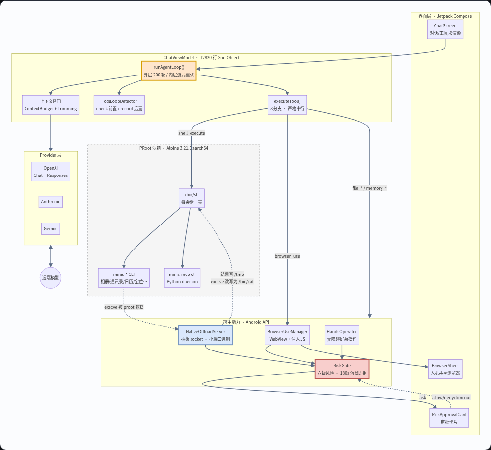

# qoderwiki · nanoMuse Android 架构知识库

从架构师视角对 **nanoMuse Android 端**做的源码级拆解：整体架构 → 数据流转 → 每个模块的实现逻辑，覆盖 Looper 实现与轮次管理、Runtime（PRoot/Alpine）实现、每个工具的定义/召回/使用、Browser 工具的调用与界面、上下文召回与管理、模型输出与工具执行。

定位与仓库现有文档的关系：`docs/` 是**面向新框架的前向设计**（PRD / DESIGN / SRS），本目录是**面向上游既有实现的后向考证**——回答"nanoMuse 现在到底是怎么写的"，为前向设计提供事实底座。两者口径冲突时，本目录提供行号证据，`docs/PRD.md` 1.6 口径裁决表做产品裁决。

**代码基线**：nanoMuse `067384b7e5b3c47a7eeca217895be71493396518`（2026-11-13），versionName 1.0.9 / versionCode 52。全部行号引用以此 commit 为准。

## 入口

- **[nanoMuse-android-架构知识库.html](nanoMuse-android-架构知识库.html)** — 推荐阅读入口。单文件自包含（marked + mermaid 已内联），**离线双击即开，不需要服务器、不需要 CDN**。7 章、23 张图、61 张证据表、100 段源码摘录，带侧边分章目录、全文搜索、图表点击放大。
- `parts/*.md` — Markdown 源，可在 GitHub 上直接阅读（Mermaid 图 GitHub 原生渲染）。

| 章节 | 内容 |
| :--- | :--- |
| [00-overview.md](parts/00-overview.md) | 总纲：全局架构图、三个必须先辨析的概念混淆、7 条实测核心事实、休眠代码清单、两条未收口风险线索 |
| [01-architecture.md](parts/01-architecture.md) | 整体架构与数据流转（双包结构、777 处 `// nanoMuse:` 增量分布、五层调用链） |
| [02-looper.md](parts/02-looper.md) | Looper 与轮次管理（最长一章，1885 行 / 180 行证据表） |
| [03-provider-model-output.md](parts/03-provider-model-output.md) | 模型输出与 Provider（SSE 解析、tool_call 装配与 id 去重、Responses 双协议） |
| [04-runtime-tools.md](parts/04-runtime-tools.md) | Runtime 与工具体系（PRoot + Alpine 3.21.3、native_offload、8 个原生工具、瘦 schema 胖 shell） |
| [05-context-memory.md](parts/05-context-memory.md) | 上下文召回与管理（双层治理、90/75/50% 水位线、压缩与缓存前缀、记忆检索） |
| [06-browser.md](parts/06-browser.md) | Browser 工具调用与界面（23 个 action、OSC 1337 通道、接管态状态机） |

## 三个先辨析清楚的概念

不先钉死这三条，整份分析都会跑偏：

1. **Looper 不是一个类。** agent 循环是 `ChatViewModel.runAgentLoop`（`:7630`）这个 suspend 函数，宿主是 12,820 行的 ViewModel，不是 Actor / Service / 独立 Looper 类。轮次上限 `MAX_AGENT_TURNS = 200`（`:412`），触顶走 `finalizeAtTurnLimit`（`:9457`）。
2. **Android Runtime 不是 Python runtime。** 它是 PRoot + Alpine 3.21.3 aarch64 沙箱；受 Android W^X 限制，proot 被伪装成 `libproot.so` 放进 `nativeLibraryDir` 才能执行。
3. **两个 "offload" 不是同一个东西。** `sandbox/NativeOffload.kt` 是活的（execve 拦截 → 抽象 unix socket → 宿主执行 → 把 execve 改写成 `/bin/cat <tmpfile>`）；`ContextOffload` 是**休眠的**，零调用方。

## 已实测确立的事实（不是读代码推断）

- **两阶段工具循环守卫**：`check()` 在执行**前**调用，可返回 CRITICAL 硬阻断；`record()` 在执行**后**调用，**只返回 NONE 或 WARNING**。探针实测：只调 `record()` 跑 32 次变参调用，全局断路器一次都不触发；补上 `check()` 立刻触发。**调用方漏掉 `check()`，硬阻断形同虚设。**
- **上下文双层治理**：上游 `data/ContextPolicy.kt` 的四档只服务 UI；真正决定请求预算的是 `io/github/nanomuse/chat/ContextBudget.kt`（`ContextPolicy.kt:61-62` 注释明确了这个分工）。
- **正确 logcat tag 是 `nanoMuse.ChatVMStream`**，不是 `ChatViewModel.kt:399` 注释里写的 `Minis.ChatVMStream`（`logging/AppLogger.kt:309` 拼的是 `"nanoMuse.$category"`）。**照注释敲命令一条日志都看不到。**
- **四处休眠/死代码**：`ContextOffload`（零调用方）、BPETokenizer 文本路径、`walkBackUserTurnsBounded`、`known_poll_no_progress`；另有一处注释与代码矛盾（EnvVarPrivacyStore 注释说默认关闭，`DEFAULT_ENABLED = true`）。清单见 `parts/00-overview.md` §5.7。

最后一条是本次拆解最高价值的产出，方法论写在 §5.7 与 §10.3：**读注释会描述出一个不存在的系统，对齐调用链才能描述真实系统。**

## 可重现：JVM 验证台

```bash
cd verify
./fetch_deps.sh     # 首次：拉 Kotlin 2.0.21 编译器 + byte-buddy
./run_all.sh        # 自动发现全部 *Test.kt，编译 + 跑测试 + 跑行为探针
```

**实测结果：19 个测试类 / 145 个测试全绿**，原始输出见 [verify/run-all-output.txt](verify/run-all-output.txt)，行为探针输出见 [verify/probe-output.txt](verify/probe-output.txt)。

| 套件 | 覆盖 |
| :--- | :--- |
| `verify/src/` | 工具循环守卫、ContextPolicy 四档分档、行为探针 |
| `verify/src_loop/` | 会话尾部形态分类（决定是否显示 Resume） |
| `verify/src_ctx/` | 上下文预算 / 裁剪 / 压缩 / 缓存布局 / 记忆检索 |

设计原则：**被测类原样拷贝，零改动。** 唯一 shim 是 `AppLogger`（真实实现依赖 `android.content.Context` / `android.util.Log`，纯 JVM 加载不了）与 `src_ctx/AndroidContentShim.kt` 的最小 `Context` 桩。所以绿灯说明的是**上游逻辑本身**的行为。

刻意绕开的重路径：完整 Gradle 构建需要 Android SDK 36 + NDK 27.2.12479018，且 `android/deps/` 下 proot / Alpine rootfs / rclone / ffmpeg 需先交叉编译。验证台只跑纯逻辑，**无 Android SDK 也能重现**。

## 重建 HTML

```bash
cd vendor && ./fetch_vendor.sh && cd ..   # marked + mermaid，不入库
python3 tools/build_site.py               # → nanoMuse-android-架构知识库.html
```

只需 Python 3 标准库。可选的渲染实测（`pip install playwright && playwright install chromium`）：

```bash
python3 tools/verify_render.py
# 期望：TOTAL rendered SVG: 23   render failures: 0   console/page errors: 0
```

这一步抓出过 3 个真实 mermaid 语法 bug：`stateDiagram-v2` 标签里的 `<br/>` 与嵌套 `:`、`sequenceDiagram` 里的 `<` 比较符、以及 **`;` 在 mermaid 里是语句分隔符**（写在消息文本里会静默截断整行）。肉眼看 Markdown 发现不了。



## 已知边界

- 完整 Gradle 构建、真机运行、PRoot 实际启动、WebView 实际渲染**均未在验证环境执行**，相关结论来自静态考证，章内已标注。每章末尾另有"未确认问题"清单，说明确缺什么证据，而不是用推测填空。
- `parts/00-overview.md` §10 两条风险线索**源码证据已拿到、缺真机复现**，标注为高置信度推断：
  1. `data/SessionForkManager.duplicateSession`（`:56`）逐字节照搬 `partsJson` 但不搬宿主目录，而 `attachments/offloads/workspace/browser` 按 sessionId 隔离（`PRootKernel.kt:670`）→ 复制会话里的历史附件路径大概率悬空。
  2. 全局 `bindMounts` 是 last-writer-wins，上游自己在 `PRootKernel.kt:672-681` 注释里承认；`resolveSessionHostPath` 是绕开它的旁路，但旧调用点未迁移完。
- 行号会随上游演进漂移。重新定位时用锚点函数名（`runAgentLoop` / `finalizeAtTurnLimit` / `executeTool`）而不是行号。