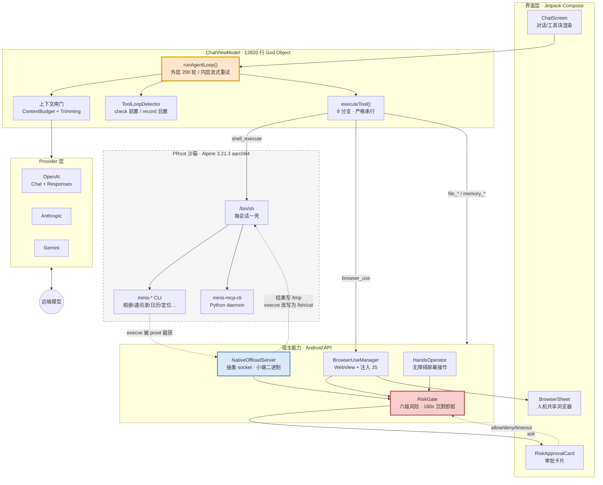

# nanoMuse Android 端架构拆解 · 知识库

> 从架构师视角拆解 nanoMuse 的 Android 实现：整体架构 → 数据流转 → 模块实现 → Looper → Runtime → 工具的定义/召回/执行 → Browser → 上下文治理。
> 目标是**可分析、可重现、可复用**。

---

## 0. 这份知识库的立场

三条写作纪律，贯穿全部章节：

1. **源码优先于文档。** 仓库自带的 `docs/*.md` 是设计说明，不是实现契约。凡文档与源码冲突，以源码为准并显式标注冲突。
2. **每个论断可定位。** 关键结论一律给出 `相对路径:行号`。读者可以在 30 秒内跳到源码验证。
3. **能实测的不靠推断。** 纯逻辑类被原样抽出，在 JVM 上真实编译、真实跑单测、真实跑行为探针。实测输出附在章节里，并标明哪些是 shim、哪些是原样源码。

---

## 1. 代码基线

| 项 | 值 |
|---|---|
| 仓库 | `nano-muse/nanoMuse` |
| Commit | `067384b7e5b3c47a7eeca217895be71493396518` |
| 提交日期 | 2026-11-13 |
| 应用版本 | `versionName = 1.0.9` / `versionCode = 52` |
| applicationId | `io.github.nanomuse.app` |
| 许可 | GPL-3.0（Android 端继承 OpenMinis 1.13） |

**构建参数**（`android/src/android/app/build.gradle.kts`）

| 项 | 值 | 行号 |
|---|---|---|
| compileSdk | 36 | :33 |
| minSdk | 26（Android 8.0） | :58 |
| targetSdk | 35 | :59 |
| ndkVersion | 27.2.12479018 | :36 |
| ABI | arm64-v8a 单一架构 | — |

**技术栈**：Kotlin 2.1.0、Gradle 8.11.1、Jetpack Compose（Material3 + adaptive 1.2.0）、Room 2.6.1、OkHttp 4.12.0（含 `okhttp-sse`）、Navigation Compose 2.8.5、Lifecycle ViewModel Compose 2.8.7。

依赖版本被刻意钉住而非追新，源码里有明确理由，例如 `app/build.gradle.kts:216` 注释说 Haze 停在 1.6.10 是因为 1.7.x/2.x 需要 compileSdk 37；:231 说 adaptive 停在 1.2.0 是因为 1.3.0 硬要求 compileSdk 37 + AGP 9.1.0。**这类"为什么不用最新版"的注释本身就是架构约束的证据。**

---

## 2. 代码规模与增量分布

Android 主源码树 `android/src/android/app/src/main/java/`：

| 包 | 文件数 | 性质 |
|---|---|---|
| `com/openminis/app/**` | 478 | 上游 OpenMinis 内核 |
| `io/github/nanomuse/**` | 249 | nanoMuse 自有层 |
| 合计 | 727 | 约 228,580 行 Kotlin |

**nanoMuse 对上游的侵入式改动**：`// nanoMuse:` 标记共 **777 处，分布在 135 个文件**。

改动最密集的 20 个文件：

| 文件 | 标记数 |
|---|---|
| `ui/chat/ChatViewModel.kt` | 140 |
| `ui/chat/ChatScreen.kt` | 125 |
| `data/repository/SkillRepository.kt` | 33 |
| `ui/settings/SettingsScreen.kt` | 30 |
| `ui/navigation/AppNavigation.kt` | 26 |
| `MinisApp.kt` | 19 |
| `MainActivity.kt` | 15 |
| `deeplink/DeepLinkHandler.kt` | 14 |
| `backup/BackupExporter.kt` | 13 |
| `ui/scheduled/ScheduledTaskEditScreen.kt` | 11 |
| `ui/settings/SkillsManagementScreen.kt` | 10 |
| `ui/settings/AppearanceScreen.kt` | 10 |
| `ui/settings/AddProviderScreen.kt` | 10 |
| `speech/VoiceActivityDetector.kt` | 10 |
| `speech/SystemSpeechRecognitionEngine.kt` | 10 |
| `scheduled/ScheduledTask.kt` | 10 |
| `ui/settings/ProviderDetailScreen.kt` | 9 |
| `ui/chat/ChatFlatItems.kt` | 9 |
| `scheduled/ScheduledAgentRunner.kt` | 9 |
| `provider/openai/OpenAIProvider.kt` | 9 |

**读法**：改动高度集中在 `ChatViewModel` + `ChatScreen`（265/777 ≈ 34%）。这说明 nanoMuse 的增量主要落在**agent 循环与对话界面**这一层，而不是分散重写。理解 nanoMuse 的架构，本质上是理解"它在上游的 Looper 和上下文管线上做了什么手术"。

---

## 3. 一张图看懂全局

先建立物理图景，再谈细节。下图是 nanoMuse Android 端的完整执行拓扑——注意**沙箱边界**这条竖线，agent 的每一次工具调用都要决定"留在墙内"还是"穿墙"。



三个关键观察：

1. **模型手里只有 8 个工具**，但沙箱 PATH 上有几十个命令名。能力扩张不增加 tool schema，因此固定 token 成本几乎不变。
2. **穿墙有两条路**：`execve` 被 proot 截获走抽象 socket（蓝色），以及 stdout 里的 OSC 1337 转义序列（图中未画，见 §5.2）。
3. **RiskGate 是三个执行面的共同收口**（红色）：shell、browser、屏幕操作都要过它。这是整个安全架构的枢纽。

---

## 4. 三个必须先辨析清楚的概念混淆

这是阅读后续所有章节的前提。这三组概念名字相似但实质不同，混淆会导致整份分析失效。

### 4.1 "Looper" 不是一个类

Android 端**没有**名为 `Looper` 的类型。用户语境里的 Looper 指的是：

```
com/openminis/app/ui/chat/ChatViewModel.kt:7630
private suspend fun runAgentLoop(provider, systemPrompt, fallbackProviders, fallbackStrategy)
```

一个 **12,820 行 ViewModel 里的 suspend 函数**。轮次硬上限 `MAX_AGENT_TURNS = 200`（:412），到限走 `finalizeAtTurnLimit`（:9457）转为可 Resume 状态。

注意与 Android SDK 的 `android.os.Looper`（主线程消息循环）**毫无关系**。源码里 `Looper` 字面量的 57 处命中基本都是 SDK 用法或 `HandsLoopWatch` 之类的无关命名。

### 4.2 "Runtime" 在两个平台是两套东西

| | Android（APK 内） | Python（桌面/服务端） |
|---|---|---|
| Agent 循环 | `ChatViewModel.runAgentLoop()` | `nanomuse/agent/core.py::MuseAgent.run()` |
| 运行时载体 | PRoot + Alpine rootfs + PersistentShell + NativeOffload | `nanomuse/runtime.py` + `bridge/` |
| 权限守卫 | `io/github/nanomuse/guard/` RiskGate | `nanomuse/sentinel/` |
| 浏览器 | WebView（`browser/BrowserUseManager`） | Playwright（`tools/browser_backends.py`） |
| 记忆 | Markdown 文件 + 关键词匹配 | SQLite + IDF + CJK bigram |

**APK 里跑的不是 Python agent。** 早期确实有过"WebView 套 Python 服务器"的方案，但已被废弃，仅作为设计记录留在 `docs/archive/android-python-line.md`。把 Python 侧的算法当成 Android 实现，是这份调研最容易犯的错误。

### 4.3 两个 "offload" 完全不同，而且其中一个已经休眠

| | `data/ContextOffload.kt` | `sandbox/offload/` |
|---|---|---|
| 方向 | 上下文 → 磁盘 | Linux guest → Android 宿主 |
| 目的 | 把大工具输出写盘，历史里留短 stub 省 token | 把 Android 系统能力伪装成 Linux 命令 |
| 状态 | **休眠：全源码零调用** | 现役 |
| 章节 | 第 5 章 | 第 4 章 |

**重要修正**：`ContextOffload` 这个对象虽然存在且注释详尽，但 Grep 全仓 `ContextOffload.` 排除自身文件后**零命中**——它没有任何调用者。现役的上下文卸载是 nanoMuse 自建的 `io/github/nanomuse/chat/ContextTrimming.kt` + `ContextTrimStore.kt`，文件名格式也不同（`nm-context-<kind>-<sha256>.txt|json`，而非上游注释里写的 `<name>_<id>.<ext>`）。

这是本次调研最有价值的一类发现：**照着休眠代码的注释写架构分析，会描述一个不存在的系统。**

---

## 5. 已经实测确立的核心事实

以下结论**不是从文档抄的，是源码 + 真实运行得出的**。细节展开在对应章节。

### 5.1 只有 8 个原生工具，其余能力全在 shell 里

`tools/AgentTools.kt:14-43` 的 `makeAgentTools()` 注册表：

| 工具 | 条件 |
|---|---|
| `shell_execute` | 无条件 |
| `file_read` | 无条件 |
| `file_write` | 无条件 |
| `file_edit` | 无条件 |
| `browser_use` | 无条件 |
| `read_image` | `supportsImageInput \|\| visionGroupConfigured` |
| `memory_write` | `memoryEnabled` |
| `memory_get` | `memoryEnabled` |

**这是"瘦 schema，胖 shell"架构。** 相册、通讯录、日历、定位、通知、无障碍屏幕操作、Shizuku、MCP……几十种能力全部通过沙箱内的 CLI 暴露，模型用 `shell_execute` 调用。工具 schema 只占极小的固定 token，能力却在持续扩张。

代价与收益在第 4 章展开。

### 5.2 沙箱→宿主有两条独立通道

**通道 A：抽象 socket + proot execve 重写**（`sandbox/NativeOffload.kt`，344 行）

源码注释（:17-28）把机制说得很清楚：guest 发起 `execve("<handler-name>", argv, envp)` → proot 扩展把 argv/env/cwd 通过抽象 unix socket 发给宿主 → 宿主执行 Android API → 把输出写进 guest 的 `/tmp` 临时文件 → 回复 `(exit_code, tmpfile_path)` → **proot 把这次 execve 偷换成 `/bin/cat <tmpfile>`**。

对 guest 完全透明：任何 shell 脚本、任何 Python 程序都能"调用 Android 能力"，无需任何 SDK、无需知道宿主存在。

协议不是 JSON，是**魔数 + 小端二进制**：`MAGIC_REQ = 0x46464F4E`（'NOFF'）、`MAGIC_RSP = 0x52464F4E`（'NOFR'）、`VERSION = 1`（:57-60）。

**通道 B：OSC 1337 终端转义序列走 stdout**（`assets/default_mount/usr/local/bin/minis-open`）

协议：`ESC ] 1337 ; MinisOpenURL = <url> BEL`。宿主扫描器从显示输出里剥离整条序列并路由到内置查看器。

`xdg-open`、`sensible-browser`、`www-browser`、`x-www-browser`、`gnome-open`、`kde-open` 全是一行 `exec minis-open "$@"` 包装——**把 Linux 桌面生态的所有"打开"约定劫持到宿主**。

### 5.3 Android 侧有统一风险平面，覆盖三个执行面

`io/github/nanomuse/guard/`（16 文件 1767 行）是 Python Sentinel 的 Android 对应物，但设计不同。

六级 `RiskClass`（`Risk.kt:6-34`）：

| 类别 | 行为 | Tier |
|---|---|---|
| `SAFE` | 静默执行 | NOTICE |
| `INSTALL` | 执行 + 事后告知 | NOTICE |
| `DESTRUCTIVE` | 问 | CONFIRM |
| `OUTBOUND` | 问 | CONFIRM |
| `REMOTE` | 问持机人 | CONFIRM |
| `MONEY` | 每次支付都问 | HIGHEST |

`RiskGate.TIMEOUT_MS = 180_000`（`RiskGate.kt:70`）——**3 分钟无应答即拒绝**。沉默不是允许。

三个执行面共用同一闸门：
- shell：`ChatViewModel.kt:9714` `RiskGate.checkShell(activeSessionId, command)`
- browser：`browser/BrowserUseManager.kt` 引用 RiskGate
- screen：`io/github/nanomuse/hands/HandsOperator.kt` 引用 RiskGate

**模型侧契约直接写进 system prompt**（`guard/RiskPolicy.kt`，标题 `## Before you act (nanoMuse)`）。关键条款：

> You do not have to ask twice: run the command and, if it needs approval, a card appears for the user; the tool result tells you what they chose.

模型**不需要自己判断该不该问**——直接执行，由 gate 拦截。这与"让模型自律"是根本不同的架构选择。

> If the user denies something, do not retry it or route around it (another command, JavaScript, a different selector).

显式禁止绕过拒绝。

> Never type passwords, verification codes or card numbers anywhere; when a page needs one, say so — the app hands the browser to the user and they type it.

凭据交还人类。这是第 6 章"人机共享浏览器"的核心机制。

### 5.4 上下文治理是双层的，上游那套只管 UI

`data/ContextPolicy.kt:61-62` 的 nanoMuse 改动注释原文：

> nanoMuse: UI callers retain native tiers; outgoing requests use ContextBudget.forModel with the model's output reserve and the cost of the fixed prompt and tool schemas.

即：**上游四档策略只用于 UI 展示，真正的请求预算走 nanoMuse 自建的 `io/github/nanomuse/chat/ContextBudget.kt`。**

`io/github/nanomuse/chat/` 下有 **25 个 Kotlin 文件 + 29 个对应单测**，是 nanoMuse 重建的整套上下文引擎：ContextBudget / ContextEstimate / ContextTrimming / ContextTrimStore / ContextMaintenance / ContextTurns / ContextErrors / ContextCalibrationStore / ContextUsageMeter / CompactHistory / CompactSummary / CompactSummaryBudget / PromptDiet / PromptCacheLayout / ScreenshotBudget / CheckpointReplay / SessionAddenda / VisionFamilies / …

**这是 nanoMuse 最重要的架构增量之一**，第 5 章详述。

### 5.5 system prompt 按"字节前缀稳定性"排序

`ChatViewModel.kt:10650-10651` 注释原文：

> nanoMuse: cache providers match a byte prefix. Keep the safety policy and Hands ladder ahead of every memory/runtime/session fragment, then append volatile data deterministically.

三段式结构（`PromptCacheLayout.build()`）：

- **stableSections**：`PromptDiet.prompt(base)`（上游 minis-* 说明被压缩过）→ `RiskPolicy.promptParagraph()` → `Hands.promptParagraph()`
- **volatileSections**：skill / mcp / naming / media / computers / sessionAddenda / goals / feed / toolListMemoryBullets / memorySystem / globalMemory / dailyMemory / userFile（13 项，顺序确定）
- **runtimeContext**：日期 + 时区 + 设备语言 + `minis-model-use models available: N`

排序不是美学选择，而是**为了让 provider 的 prompt cache 命中最长前缀**。固定段越稳定，缓存命中越高，成本越低。

### 5.6 记忆召回是 Markdown + 空格切分，不是向量检索

`data/repository/MemoryRepository.kt`（559 行）的 `getMemory(keywords, scope)`（:100）：

```kotlin
val keywordList = keywords.trim().lowercase().split(Regex("\\s+")).filter { it.isNotEmpty() }
```

**纯空格切分。无分词、无 IDF、无向量、无 SQLite。** 存储是 `GLOBAL.md` + 按日期命名的日记 `.md`，日记按文件名降序（新→旧）遍历，命中行区间由 `mergeRanges`（:544）合并成 **±2 行上下文窗口**，AND 语义（所有关键词都要命中），输出受行数 + UTF-8 字节双重上限截断（60 行搜索 / 500 行 dump / 30KB 硬顶），并在提示里告诉模型"还有更多匹配被丢了"。

顺带辨析：assets 里确实有 5.4MB 的 jieba 词典（`assets/jieba/jieba.dict.utf8` + `hmm_model.utf8`），但 Grep 全仓，使用方只有 `shared/JiebaEngine`、`shared/TextSegmenter` 和 `speech/correction/*` ——**服务于语音识别纠错，与记忆检索无关**。

### 5.7 三处大型休眠代码：注释描述的系统并不存在

这是静态阅读最容易踩的坑，单列一节警示：

| 对象 | 注释宣称 | 实际 |
|---|---|---|
| `data/ContextOffload.kt` | 大工具输出写盘 + `[CONTEXT OFFLOADED]` stub | **零调用者**，现役是 `ContextTrimming` |
| `data/BPETokenizer.kt` 文本路径 | BPE 精确 token 计量 | `countTokens` / `loadVocabularyFromAssets` **零调用者**，且无 cl100k 词表资产；只有 `countImageTokens` 在跑 |
| `ChatViewModel.walkBackUserTurnsBounded` | 回溯用户轮次 | 休眠 |
| `ToolLoopDetector` 的 `known_poll_no_progress` 策略 | 检测轮询类工具无进展 | **死代码**：`isPollTool` 只认 `command_status` 与 `process`（:260-267），而 `executeTool` 的分发只有 8 个工具（:9521-9553），这两个名字都不在其中，全仓也无其他产生者 |

**关于最后一条的验证方法**（可复现）：

```bash
# isPollTool 认哪些工具
sed -n '260,267p' .../agent/ToolLoopDetector.kt
# executeTool 实际分发哪些工具
sed -n '9503,9556p' .../ui/chat/ChatViewModel.kt | grep -- '->'
# 全仓是否有别处产生这两个工具名
grep -rn '"command_status"\|"process"' --include=*.kt . | grep -v ToolLoopDetector
# → 零命中
```

所以 Android 侧实际生效的只有 3 条策略：`generic_repeat`、`unknown_tool_repeat`、`global_circuit_breaker`。单测 `ToolLoopDetectorTest` 里那些 `known_poll_no_progress` 用例测的是一段**永远不会被真实调用触发的逻辑**——测试全绿不等于机制生效。这是"测试覆盖率骗人"的教科书案例。

**文本 token 估算的真实实现**是 `io/github/nanomuse/chat/ContextEstimate.kt` 的字符权重法（ASCII 0.25 / BMP 2 / 增补平面 4 tokens per char）+ EMA 校准（clamp 到 [0.25, 4]）+ 逐消息 SHA-256 前缀指纹锚点（`ContextUsageMeter.kt`）。**不是 BPE。**

另一处注释与代码直接矛盾：`data/EnvVarPrivacyStore.kt:18-19` 注释写 "Default OFF — opt-in to avoid surprising users"，但 :26-27 的代码是 `private const val DEFAULT_ENABLED = true`，且紧邻注释写 "Default ON"。**以代码为准：默认开启。**

这些沉积大概率来自 iOS parity 的移植过程——把 iOS 的实现照搬过来，后来换了方案但旧代码没删。

---

## 6. 实测验证台

纯逻辑类被原样抽出，在 JVM 上真实编译运行。**这是"可重现"的落地，不是口号。**

### 环境

| 项 | 值 |
|---|---|
| Kotlin 编译器 | 2.0.21（`verify/lib/kotlinc/bin/kotlinc`） |
| JRE | Temurin 21.0.12.1 |
| 测试库 | JUnit 4.13.2 + Hamcrest 1.3 + org.json 20240303 |

### 唯一的 shim

`AppLogger` 真实实现依赖 `android.content.Context` 与 `android.util.Log`，无法在纯 JVM 加载。`ToolLoopDetector` 只调用 `warning(tag,msg)` 与 `debug(tag,msg)`，故提供一个仅打印到 stdout 的最小 stub。

**被测类 `ToolLoopDetector.kt` 与 `ContextPolicy.kt` 是原样拷贝，零改动。**

### 编译与运行：一条命令

```bash
cd verify
./run_all.sh          # 自动发现全部 *Test.kt，编译 + 跑测试 + 跑行为探针
```

`run_all.sh` 从源码里读 `package` 行拼出全限定类名，因此新增测试文件不需要改脚本。三个独立套件：

| 套件 | 覆盖 | 输出目录 |
|---|---|---|
| `src/` | 工具循环守卫 + ContextPolicy 分档 + 行为探针 | `out/` |
| `src_loop/` | 会话尾部形态分类（Resume 判定） | `out_loop/` |
| `src_ctx/` | 上下文预算 / 裁剪 / 压缩 / 缓存布局 / 记忆检索 | `out_ctx/` |

手工跑单个套件（等价于脚本内部做的事）：

```bash
lib/kotlinc/bin/kotlinc src/*.kt \
  -cp lib/junit.jar:lib/hamcrest.jar:lib/json.jar -d out

CP="out:lib/junit.jar:lib/hamcrest.jar:lib/json.jar:lib/kotlinc/lib/kotlin-stdlib.jar"
java -cp "$CP" org.junit.runner.JUnitCore com.openminis.app.agent.ToolLoopDetectorTest
java -cp "$CP" ProbeKt
```

### 实测结果：19 个测试类 / 145 个测试全绿

最近一次完整运行（`verify/run-all-output.txt` 为原始输出）：

| 测试类 | 结果 |
|---|---|
| `agent.ToolLoopDetectorTest` | **OK (18 tests)** |
| `data.InLoopContextPolicyTest` | **OK (6 tests)** |
| `agent.InterruptedTailDetectorTest` | **OK (11 tests)** |
| `chat.ContextBudgetTest` | **OK (4 tests)** |
| `chat.ContextTrimmingTest` | **OK (14 tests)** |
| `chat.ContextEstimateTest` | **OK (12 tests)** |
| `chat.ContextMaintenanceTest` | **OK (11 tests)** |
| `chat.CompactSummaryTest` | **OK (13 tests)** |
| `chat.CheckpointReplayTest` | **OK (7 tests)** |
| `chat.ContextTurnsTest` | **OK (6 tests)** |
| `chat.ContextUsageMeterTest` | **OK (6 tests)** |
| `chat.ContextTrimStoreTest` | **OK (6 tests)** |
| `chat.ContextErrorsTest` | **OK (5 tests)** |
| `chat.ContextRecoveryTest` | **OK (5 tests)** |
| `chat.PromptCacheLayoutTest` | **OK (3 tests)** |
| `chat.ContextCalibrationStoreTest` | **OK (3 tests)** |
| `chat.CompactHistoryPairingTest` | **OK (2 tests)** |
| `chat.ContextToolSequenceTest` | **OK (2 tests)** |
| `data.repository.MemoryRepositoryProbeTest` | **OK (11 tests)** |
| **合计** | **145 tests, 0 failures** |

其中 `MemoryRepositoryProbeTest` 与 `Probe.kt` / `LoopProbe.kt` 不是上游测试，是本次拆解**新写的行为探针**——用来把"读代码得出的推断"变成"跑出来的事实"。其余均为上游测试原样抽取。

### 探针实测：ToolLoopConfig 默认值

```
historySize                   = 30
warningThreshold              = 10
unknownToolThreshold          = 10
criticalThreshold             = 20
globalCircuitBreakerThreshold = 30
```

### 探针实测：两阶段守卫（关键设计）

`ToolLoopDetector.kt:163-167` 注释原文：

> Critical outcomes are reported by `check()` *before* the call; `record()` only ever returns NONE or WARNING.

- `check(toolName, params)` = **执行前**钩子，只读历史，可返回 **CRITICAL（硬阻断，工具不执行）**
- `record(toolName, params, result, errorMessage, toolCallId)` = **执行后**钩子，追加历史，**只返回 NONE 或 WARNING（软提示，追加进 tool result 给模型看）**

探针最初只调 `record()` 跑 32 次变参调用，**全局断路器一次都没触发**；补上 `check()` 前置调用后立刻触发。

**这证明：调用方漏掉 `check()`，硬阻断就形同虚设。** 这是可复用设计里必须写进契约的一条。

真实告警文案（实测输出）：

```
call #10 -> WARNING  [LOOP WARNING] You have called file_read 10 times with identical
                     arguments. If this is not making progress, stop retrying and
                     report the task as failed.

PRE call #11 -> CRITICAL [LOOP BLOCKED] CRITICAL: attempted unavailable tool
                     'teleport_user' 10 times. Stop retrying that missing tool and
                     answer without it.
```

告警按 `currentCount / warningThreshold` 分桶节流，同 key 每 10 次只发一次（:270-276）。

### 探针实测：ContextPolicy 四档真实数值

```
window    offload   offTgt    compact   exhaustedOnly manualCompact
16000     0         0         0         true          false
31999     0         0         0         true          false
32000     22000     17000     0         true          true
48000     38000     33000     0         true          true
63999     53999     48999     0         true          true
64000     44000     34000     54000     false         true
100000    80000     70000     90000     false         true
127999    107999    97999     117999    false         true
128000    88000     68000     108000    false         true
200000    160000    140000    180000    false         true
1000000   960000    940000    980000    false         true
```

注意 63999→64000 与 127999→128000 两处**阈值跳变导致 offload 线反而下降**（53999→44000、107999→97999）。这是分档策略的固有台阶，不是 bug，但对边界窗口的模型意味着行为不连续。

`check()` 的判定实测确认了单测注释里的不变式：**EXHAUSTED 只可能来自 `exhaustedOnly` 档**，因为 `compactThreshold > 0` 时 NEEDS_COMPACT 优先返回。

---

## 7. 章节导航

| 章 | 主题 | 核心问题 |
|---|---|---|
| [01](01-architecture.md) | 整体架构与数据流转 | 进程拓扑、分层、持久化、一条消息的端到端旅程 |
| [02](02-looper.md) | Looper 与轮次管理 | 循环状态机、退出条件全集、中断恢复、反卡死 |
| [03](03-provider-model-output.md) | 模型输出与 Provider | 三家协议差异、流式解析、思考链、工具调用健壮性 |
| [04](04-runtime-tools.md) | Runtime 与工具体系 | PRoot 沙箱、offload 双通道、8 工具、能力召回、风险平面 |
| [05](05-context-memory.md) | 上下文召回与管理 | 双层预算、裁剪压缩、记忆、prompt 缓存布局 |
| [06](06-browser.md) | Browser 工具与界面 | 调用链、元素定位、tab 池、人机共享界面 |

**建议阅读顺序**：先读本页第 3 节（全局图）、第 4 节（概念辨析）与第 5 节（核心事实），再按 01 → 02 → 04 → 05 → 03 → 06。把 Looper 和 Runtime 放在一起读，因为循环的每一次工具调用都要穿过沙箱边界。

---

## 8. 可复现性总入口

### 拿到同一份代码

```bash
git clone https://github.com/nano-muse/nanoMuse
cd nanoMuse && git checkout 067384b7e5b3c47a7eeca217895be71493396518
```

### 静态定位

```bash
# agent 循环本体
grep -n "runAgentLoop\|MAX_AGENT_TURNS\|finalizeAtTurnLimit" \
  android/src/android/app/src/main/java/com/openminis/app/ui/chat/ChatViewModel.kt

# 工具注册表
sed -n '14,43p' android/src/android/app/src/main/java/com/openminis/app/tools/AgentTools.kt

# nanoMuse 改动分布
grep -rc "// nanoMuse:" android/src/android/app/src/main/java --include=*.kt \
  | grep -v ":0$" | sort -t: -k2 -rn | head -20

# offload handler 完整注册表（注意跨两个包）
grep -rn "NativeOffloadServer.register\|\.register(" \
  android/src/android/app/src/main/java --include=*.kt
```

### 运行时观察

```bash
# agent 循环的流式状态
# 注意：源码注释里写的 "Minis.ChatVMStream" 是上游遗留，实际前缀已被 nanoMuse 改掉。
# AppLogger.kt:309 拼的是 "nanoMuse.$category"，所以正确过滤是：
adb logcat -s nanoMuse.ChatVMStream:D

# 抽象 socket 是否绑定
adb shell cat /proc/net/unix | grep offload

# 沙箱内手动调 offload CLI
# （在 app 的终端里）
minis-open https://example.com
minis-mcp-cli --help
```

**这是一个值得单独记住的坑**：`ChatViewModel.kt:399` 的注释仍写着 `adb logcat -s Minis.ChatVMStream:D`，但 `logging/AppLogger.kt:309` 实际拼的 tag 是 `"nanoMuse.$category"`。**照注释敲命令会一条日志都看不到。** 文档与源码冲突的典型案例。

### 单元测试

Android 单测 270 个文件、instrumented 测试 13 个。与本项目最相关的：

```
app/src/test/java/com/openminis/app/agent/ToolLoopDetectorTest.kt
app/src/test/java/com/openminis/app/agent/InterruptedTailDetectorTest.kt
app/src/test/java/com/openminis/app/data/InLoopContextPolicyTest.kt
app/src/test/java/com/openminis/app/data/CompactBudgetTest.kt
app/src/test/java/com/openminis/app/data/CompactToolPairingTest.kt
app/src/test/java/com/openminis/app/provider/ResponsesCallIdDeduplicationTest.kt
app/src/test/java/com/openminis/app/sandbox/OffloadReplySweepTest.kt
app/src/test/java/io/github/nanomuse/chat/ContextBudgetTest.kt
app/src/test/java/io/github/nanomuse/chat/ContextTrimmingTest.kt
app/src/test/java/io/github/nanomuse/guard/  (12 个测试文件)
```

完整 Gradle 构建需要 Android SDK 36 + NDK 27.2.12479018，且 `android/deps/` 下的 proot / Alpine rootfs / rclone / ffmpeg 需先交叉编译。**本知识库的 JVM 验证台刻意绕开了这条重路径**，只验证纯逻辑，因此可在无 Android SDK 的环境重现。

---

## 9. 这份知识库不承诺什么

- **未实测的部分会明确标注。** Gradle 完整构建、真机运行、PRoot 实际启动、WebView 实际渲染均未在本环境执行，相关结论来自静态考证。
- **未确认的问题会列清单。** 每章末尾都有"未确认问题"小节，说明确缺什么证据，而不是用推测填空。
- **不替上游做设计辩护。** 12,820 行的 ViewModel、UI 与 agent 循环强耦合、分档阈值的台阶效应——这些会被直接指出，包括它们为什么大概率是历史包袱而非本质复杂度。
---

## 10. 两条已定位但未收口的架构风险线索

这两条不是猜测：源码证据已经拿到，缺的是真机复现。放在这里而不是塞进某一章，是因为它们**跨章**（会话复制 × 沙箱路径解析 × 媒体卸载），任何单章视角都会漏掉。

### 10.1 会话复制不搬宿主目录，partsJson 里的沙箱路径会悬空

`data/SessionForkManager.kt:56` 的 `duplicateSession` 做的事是**纯数据库深拷贝**：

```kotlin
for (msg in messages) {
    val newMsg = chatRepository.appendMessage(
        sessionId = new.id,
        role = msg.role,
        partsJson = msg.partsJson,   // ← 逐字节照搬，没有路径重写
        tokenUsage = msg.tokenUsage,
        reasoningContent = msg.reasoningContent,
    )
```

整个函数（`:56`–`:170`）里没有任何文件拷贝：没有 `copyTo`、没有 `walkTopDown`、没有对 `attachments/offloads/workspace/browser` 的处理。而 `PRootKernel.kt:670` 明确声明这四个子目录是**按 sessionId 隔离**的：

```kotlin
private val perSessionSubdirs = setOf("attachments", "offloads", "workspace", "browser")
```

同时 `media/MediaOffloadHandler.kt:75` 写进工具回复里的路径是**会话相对**的：

```kotlin
.put("path", "/var/minis/attachments/$name")
```

把三件事叠起来：源会话里一条 `minis-image` 的工具回复，其 `path` 是 `/var/minis/attachments/foo.png`；复制后这条回复被原样搬进新会话；新会话的 `resolveSessionHostPath(newId, ...)`（`PRootKernel.kt:683`）会去 `minis-sessions/<newId>/attachments/foo.png` 找——**那个目录里什么都没有**。

**推断的后果**：复制出来的会话里，历史图片/视频预览失效、历史 offload 存根指向空文件、workspace 里的代码产物全部不可见。会话看起来"完整复制"了，实际上只复制了对话文本。

**缺的证据**：真机上复制一个带图片附件的会话，看预览是否 404；以及是否存在别处的补偿逻辑（例如 UI 层回退到源 sessionId）。我搜过 `resolveSessionHostPath` 的调用点，没看到这种回退，但**没有真机验证，所以这条标注为"高置信度推断"而非"已实测事实"**。

### 10.2 全局 bindMounts 是 last-writer-wins，多会话视图会互相覆盖

这条是上游**自己在注释里承认**的，`PRootKernel.kt:672`–`:681`：

```
 * Resolve a `/var/minis/...` Linux path directly against a specific session's
 * host directory, bypassing the global [bindMounts] map. Use this when the
 * caller knows the owning session (chat link resolver, file preview, etc.) —
 * the global map is overwritten every time another session boots its shell,
 * so its answer is last-writer-wins rather than "this session's view".
```

也就是说：全局 `bindMounts` 是一个**进程级单例映射**，任何一个会话启动 shell 都会把它整体改写。`resolveSessionHostPath` 是为绕开这个缺陷而加的旁路，只对 `perSessionSubdirs` 生效；对 `memory/skills/shared` 这三个共享子目录仍然回落到全局 `resolveHostPath`（`:687`）——这三个本来就是共享的，所以回落是安全的。

**真正的风险面**在于：任何**没有**改造成 `resolveSessionHostPath` 的旧调用点，在多会话场景下会拿到"最后一个启动 shell 的会话"的视图。这是一个典型的"加了正确的新 API，但旧调用点没迁移完"的半完成重构。

**缺的证据**：需要把 `resolveHostPath` 的全部调用点列出来，逐个判断它处理的路径是否落在 `perSessionSubdirs` 内。落在里面又没传 sessionId 的，就是实际 bug。这份清点没有做完。

### 10.3 为什么把它们写进来

因为这份知识库的立场是"**不替上游做设计辩护**"（§9）。一份只讲"设计得很巧妙"的拆解是没有工程价值的。这两条线索的定位方式本身是可复用的方法论：

1. 找到隔离边界声明（`perSessionSubdirs`）；
2. 找到跨越边界的数据搬运（`duplicateSession` 的 `partsJson` 照搬）；
3. 找到边界内的路径生成方（`MediaOffloadHandler` 的会话相对 path）；
4. 三者对齐处就是 bug 候选点。

同样的方法在本知识库里已经命中了四处休眠代码（§5.7）。**读注释会描述出一个不存在的系统；对齐调用链才能描述真实系统。**
