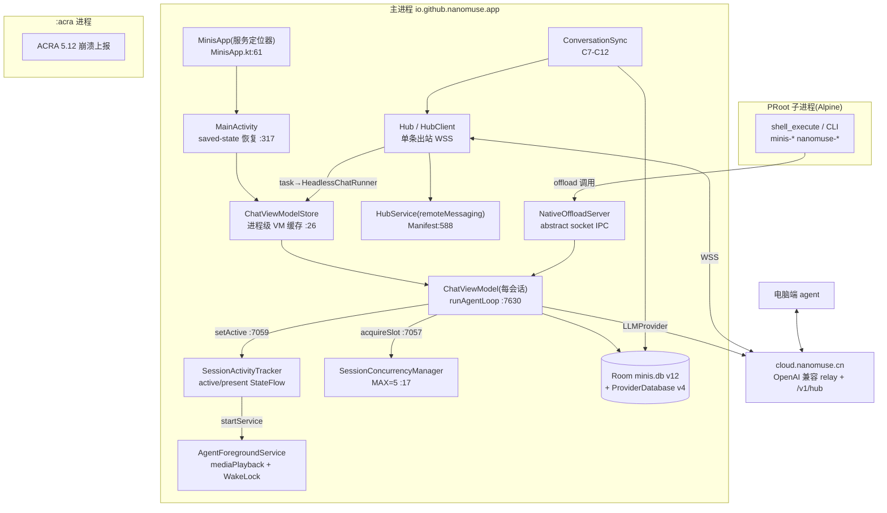
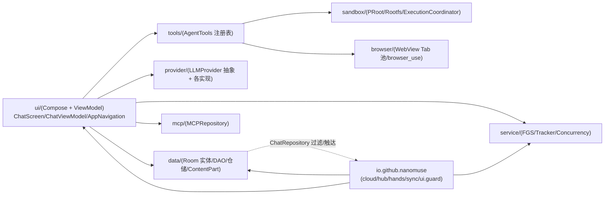
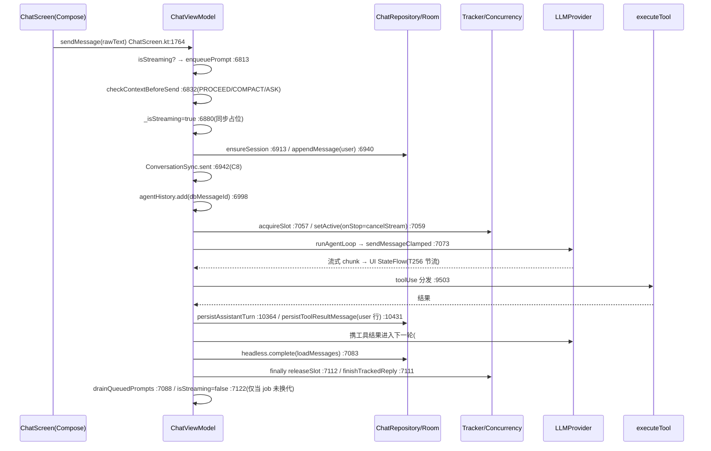

# 第一章 整体架构与数据流转

> 研究员 #1 · nanoMuse Android 架构研究 · 基线 commit `067384b7e5b3c47a7eeca217895be71493396518`(2026-11-13)
> 证据路径约定:`J = android/src/android/app/src/main/java`,下文所有 `J/...` 均为仓库相对路径缩写;其余路径直接为仓库相对路径。文档(design record)与源码冲突时以源码为准,冲突处显式标注。

## 1. 概述

nanoMuse Android 是 OpenMinis 1.13(GPL-3.0,Kotlin/Compose 应用)的 fork:内核(agent 循环、Room 持久化、Provider 抽象、PRoot 沙箱、浏览器)保留在 `com.openminis.app` 包内,nanoMuse 增量(云账号、Hub 跨设备、Hands 手机操控、会话同步)集中在 `io.github.nanomuse` 包,并以 `// nanoMuse:` 注释标记散点式侵入内核。applicationId 为 `io.github.nanomuse.app`(`android/src/android/app/build.gradle.kts:57`),对外 deep-link scheme 为 `nanomuse://`(AndroidManifest.xml:237),内核内部沿用 `minis://`。全仓库 `// nanoMuse` 标记共 877 处、分布于 135 个文件,其中 866 处在 `com/openminis`、11 处在 `io/github/nanomuse`——说明增量层不是独立模块,而是与内核高度交织的"寄生式"扩展。

从架构史的角度看,这个 fork 的策略是"保住内核、包办外壳":OpenMinis 原本是一个单机、单用户、以本地沙箱为卖点的 Android agent 应用,nanoMuse 想做的是"云端账号 + 多设备协同"的 agent 网络。两种诉求的张力体现在代码组织上——凡是能靠新增 `object` 单例解决的(账号、同步、Hub 连接),都放进了独立包;凡是必须改变内核既有行为的(发送前检查、历史装配、会话过滤、路由拦截),就直接在 `com.openminis` 的源文件里插入带 `// nanoMuse:` 标记的代码段。这种做法的好处是升级合并上游时冲突点全部显式可查(搜标记即可),坏处是内核彻底失去了独立编译与独立测试的能力,本章 §4 与 §10 会详细讨论这个代价。

本章回答六个问题:进程与组件如何组织、分层与依赖方向、一条用户消息的端到端数据流、nanoMuse 增量如何挂接、跨设备"手机作为电脑 agent 的手"在 Android 侧的落点、以及如何构建复现。Looper 内部(研究员 #2)、Provider 序列化(#3)、工具执行细节(#4)、上下文压缩(#5)、浏览器内核(#6)只给出边界与调用点,不展开。阅读建议:如果只关心"消息是怎么跑起来的",直接看 §6 的时序图与九步拆解;如果关心"为什么划掉 App 后 agent 还在跑",看 §3.4;如果关心跨设备,看 §8——但请先读 §2,否则很容易把已归档的 Python 线误当成 APK 的实际行为。

## 2. 双运行时辨析:APK 跑的是 Kotlin 循环,不是 Python MuseAgent

仓库同时存在两条运行时线,必须先厘清,否则后续所有分析都会错位:

1. **Kotlin 线(本 APK 实际运行的)**:agent 循环是 `ChatViewModel.runAgentLoop`(`J/com/openminis/app/ui/chat/ChatViewModel.kt:7630`),工具分发在同文件 `:9503-9555`,持久化经 Room `ChatRepository`。Python 代码不参与 APK 内推理。
2. **Python 线(已归档)**:`nanomuse/agent/core.py:63` 的 `MuseAgent`、`nanomuse/server/api.py`、`nanomuse/phone/link.py` 属于电脑端/服务器端运行时。`docs/device.md:3` 明确写 "Design record of the Python line";Android 侧的 Python 运行方案已归档到 `docs/archive/android-python-line.md`。

**文档与源码冲突(两处,以源码为准)**:
- `nanomuse/runtime.py` 的 docstring 描述 Android 在 PRoot 内启动 `nanomuse serve` 并注入 `NANOMUSE_*` 环境变量——对 Android Kotlin 全量 grep `NANOMUSE_DEVICE`/`nanomuse serve`/`NANOMUSE_HOST` 均为 0 命中,该描述属于归档的 Python 线,不代表当前 APK。
- `nanomuse/tools/phone.py` docstring 声称 Android 无障碍服务通过 PhoneLink 的 device 协议接入——但 `device_request`/`device_result` 协议帧在仓库内的实现者只有 `demo/mobilegym/apps/nanoMuse/bridge.ts`(MobileGym 演示)与测试;Android Kotlin 无任何命中。Android 真实的"手机作为手"路径是云 Hub(见 §8)。

因此本章数据流分析全部基于 Kotlin 线;Python 线仅在 §8 作架构定位对比。

为什么会有两条线并存?从仓库结构推断:Python 线(`nanomuse/` 目录)是 nanoMuse 的"电脑/服务器大脑",`MuseAgent` 在那里跑完整的推理循环,手机最初被设想为一个纯外设——电脑发 `device_request`,手机截屏、点击、回传 `device_result`,手机自身不做任何推理。而 Android fork 走的是另一条路:手机自己就是一个完整的 agent(有自己的循环、自己的工具、自己的沙箱),电脑与手机是**对等的两个 agent 节点**,通过云端 Hub 互相调用对方的能力。两种世界观在仓库里留下了不同的接线痕迹:前者只活在 demo 与 Python 服务端代码里,后者才是 APK 的真实形态。这个判断对后续所有跨设备分析至关重要——当你读到 `nanomuse/tools/phone.py` 里的 PhoneScreen/PhoneAct/PhoneTask 时,不要以为 Android 端有一个对应的协议解析器在等着它,Android 端等着的是 Hub 的 `call` 帧,动作名、鉴权模型、结果封装完全不同(§8)。`docs/android.md` 与 `docs/archive/android-python-line.md` 的归档动作本身也佐证了这个演进方向:曾经确实考虑过在手机的 PRoot 里跑 Python 运行时,后来放弃了。

## 3. 进程与组件拓扑

### 3.1 进程

- **主进程**:Application `MinisApp` + `MainActivity` + 全部服务。
- **`:acra` 进程**:ACRA 崩溃报告独立进程,`MinisApp.onCreate` 检测进程名后早退(`J/com/openminis/app/MinisApp.kt:258-261`),避免崩溃上报器自身触发初始化。`ACRA.init` 在 `attachBaseContext` 完成(`MinisApp.kt:220-236`)。
- **PRoot 子进程**:Alpine rootfs 内的 Linux 进程,由 `libproot.so` ptrace 驱动;通过 abstract unix socket `io.github.nanomuse.app.native-offload` 与 Kotlin 侧 `NativeOffloadServer` IPC(`docs/android.md`;注册点 `MinisApp.kt:542-608`)。

选择 abstract unix socket 而非 TCP 端口或 Binder 是有理由的:abstract 命名空间不落在文件系统上,不受 PRoot 伪造的文件系统视图影响(Linux 进程看到的 `/` 是 Alpine rootfs,普通 socket 文件路径会在两个视图间错位),也不需要网络权限;`docs/android.md` 还记载了 OffloadSocketName 的按进程名回退机制,用于多进程场景下避免 socket 名冲突。PRoot 的 execve 拦截让沙箱内进程执行 `nanomuse-hands`、`minis-sessions-cli` 这类"命令"时,实际被重定向为一次 socket RPC 到 Kotlin 侧的注册 handler——沙箱里的 agent 因此感觉自己拥有一台"能操作手机、能读写会话"的 Linux 机器,而这一切都没有离开应用进程的安全边界。这是整个架构里最巧妙的一层虚拟化:**用 ptrace + socket 把 Android 能力伪装成 Linux 命令**。

### 3.2 Application 初始化顺序(MinisApp.kt,974 行)

`MinisApp : Application(), ImageLoaderFactory`(`:61`),`onCreate` 关键顺序:

1. nanoMuse `SessionAccess/AppAccess.initialize` **最先**(`:242-244`)——后续所有子系统都可能查询账号态;
2. `:acra` 进程早退(`:258-261`);`NativeCrashHandler.install`(NDK 信号处理,`:289`);FGS-timeout 专用 UncaughtExceptionHandler(`:310-335`);
3. `CrashFrequencyDetector` 崩溃爆发检测→安全模式早退(`:344`, `:354-357`);`HangDetector.start`(`:386`);
4. `DatabaseVersionGuard.evaluate` 打开 Room 前预检(`:411`)、`AndroidRestoreRecovery.recover`(`:428`);
5. DB + 仓储赋值(`:429-446`):`chatRepository = ChatRepository(database.chatDao())`(`:430`)、`providerRepository`(`:431`)、`OwnProviderProxy.install`(`:434`)、`memoryRepository` 指向 `filesDir/minis-global/memory`(`:445`);
6. `subsystemsInitialized = true` **提前置位**(`:456`,在沙箱初始化之前);整个初始化包在 catch 中,失败进入降级模式而非崩溃(`:457-464`)。`subsystemsInitialized` 是单向标志(`:77-79`),`MainActivity` 以它而非 `isSafeMode` 作 UI 门禁(`MainActivity.kt:258-301`,GH 崩溃循环修复);
7. SoulStore(`:471`)→ ConfigRegistry(`:478-482`)→ ModelsDevApi(`:485`)→ RootfsManager/ExecutionCoordinator(`:488-490`)→ networkMonitor(`:501`)→ `PRootKernel.registerGlobalBindMounts`(`:506`)→ MountedFoldersStore(`:514-536`);
8. `NativeOffloadServer` 注册全部 handler(`:542-608`):`nanomuse-media`(`:559`)、`nanomuse-hands`(`:561`)、`nanomuse-pc`(`:563`)、`nanomuse-backup`(`:565`)、`Hub.autoStart`(`:567`)、`minis-config`(`:571`)、`minis-browser-use`(`:575`)、`minis-sessions-cli`(`:582`)、`minis-scheduled`(`:586`)、`android-shizuku-cli`(`:595`)、`minis-debug`(仅 DEBUG,`:603`);随后 `start`(`:610`);
9. `SessionActivityTracker.init`(`:613`)、SessionBadgeStore(`:618`)、中断徽章与 DB 对账(`:627-634`)、BackgroundTaskNotifier(`:641-650`);
10. nanoMuse 集中初始化(`:668-679`):Grants/FeedFlow/RoutineWakes/ClientEvents/AvatarStore/ProfileSync/AccountData/ConversationSync/AvatarStudio/RiskGate notifier;
11. `ActivityLifecycleCallbacks` started/stopped 计数驱动 `isAppForegroundFlow`(`:687-753`,初值 true,`:192-194`)。

这个顺序不是随意的,读源码可以还原出几条明确的设计约束。第一,**账号态必须最先可用**:nanoMuse 的 SessionAccess/AppAccess 在一切之前初始化,因为紧随其后的仓储层(ChatRepository)在构造后第一次被观察时就要查询"当前账号隐藏了哪些会话",如果账号态未就绪,会话列表会闪变甚至泄漏别的账号的数据。第二,**崩溃防线必须先于业务**:ACRA 在 `attachBaseContext` 就装好,NativeCrashHandler、FGS 超时异常处理器、崩溃频率检测依次就位,然后才碰数据库和沙箱——任何一步炸了都有人接住并留下现场。第三,**数据库打开前有一道版本预检**:DatabaseVersionGuard 先用轻量方式探测库版本,发现"新库配旧 APK"(用户降级安装)时走受控路径而不是让 Room 直接抛异常;配合 `MIGRATION_12_11` 这个有意为空的降级迁移,构成新旧版本互装的容错闭环。第四,**`subsystemsInitialized` 提前置位是一个经过事故修正的折中**:它在重量级的沙箱初始化之前就设为 true,意味着"UI 可以进来了,但沙箱可能还没好"——相比让首屏等待整个初始化链,这是用降级换启动速度的选择;而 MainActivity 用这个标志而不是 `isSafeMode` 做门禁,注释指明是为了修复一个崩溃循环(安全模式下 UI 被门禁挡住,用户永远进不去修复入口)。第五,初始化整体包在 catch 里、失败不重抛(`:457-464`),配合可空访问器,App 会以"能看历史但不能干活"的降级形态存活,而不是白屏或崩溃——对一个装着用户全部对话数据的应用来说,这个取向是对的。

**DI 风格:无框架,手写服务定位器**。全仓库依赖清单无 Hilt/Dagger/Koin;`MinisApp` 持 `lateinit` 仓储(`:147-168`)+ 大量 Kotlin `object` 单例(SessionActivityTracker、SessionConcurrencyManager、Hub、ConversationSync…),再以构造参数注入 Compose 层:`AppNavigation(app.chatRepository, providerRepository, envVarRepository, skillRepository, mcpRepository, memoryRepository, navController, initialDeepLink)`(`MainActivity.kt:606-615`)。可空访问器 `chatRepositoryOrNull`(`:120`)供降级模式使用。这种风格的代价与收益都很典型:收益是零注解处理开销、初始化顺序完全显式可控(上面那 11 步就是"注入图"本身)、降级路径容易表达(框架 DI 很难表达"这个依赖现在可能是 null");代价是没有编译期依赖图校验、`lateinit` 未初始化访问只能靠初始化顺序纪律来避免、object 单例把生命周期隐式绑定到进程而非任何可管理的范围——这正是后文 SessionActivityTracker 进程死亡语义问题的根源。对象单例之间还形成了隐性耦合网:ConversationSync 观察 SessionActivityTracker 的流,ChatRepository 调 ConversationSync 的方法,Hub 的回调又反过来驱动 ConversationSync——没有框架的作用域约束,这些环状引用只能靠"初始化顺序 + 惰性求值"来避免死锁,理解任何一处行为都必须把整张网放在脑子里。

### 3.3 组件拓扑图



### 3.4 后台存活:三件套,而非单靠前台服务

用户划掉 App 后 agent 继续跑,机制是三层叠加:

1. **协程真正存活的地方:`ChatViewModelStore`**(`J/com/openminis/app/ui/chat/ChatViewModelStore.kt:16`,object)。按 sessionId 缓存进程级 `ViewModelStore`(`:26`),`ownerFor`(`:91`)取用、`release`(`:108`)显式释放。KDoc 明言"a session's agent loop keeps running even if the user [leaves]"——Activity/导航销毁不触及 `viewModelScope`,循环继续。Headless 入口同样走它(`J/com/openminis/app/debug/HeadlessChatRunner.kt:51`)。
2. **`AgentForegroundService`**(`J/com/openminis/app/service/AgentForegroundService.kt`,1023 行)只负责降低进程被杀概率:`startForeground(FOREGROUND_SERVICE_TYPE_MEDIA_PLAYBACK)`(`:235-243`)——刻意选 mediaPlayback 规避 dataSync 类型的 6 小时上限(Manifest:490-493);`START_STICKY`(`:245`);`PARTIAL_WAKE_LOCK "minis:inference"` 无超时(`:601-618`),`onDestroy` 释放(`:315-324`)。`onTaskRemoved`(`:261-302`)清 presence,无活跃会话则 `stopSelf`,否则重新 `startForeground` 以对抗 OEM ROM。通知在 API 36 升级为 Live Updates/ProgressStyle "灵动岛"样式(`:875+`,必须含正进度段);普通通知构建 `:709-863`,由 15 个 flow combine 的悬浮胶囊观察器驱动(`:338-398`,ToolOverlayController)。
3. **`SessionActivityTracker`**(`J/com/openminis/app/service/SessionActivityTracker.kt`,640 行):`activeSessions`(流式中)与 `presentSessions`(打开着)两条 StateFlow,`shouldRunService() = active || present`(`:204-205`)。`setActive(sessionId, onStop)` 同时注册取消器到 `streamCancellers`(`:218`, `:312-314`)供通知栏 Stop 扇出(`cancelAllActiveStreams :475`)。纯内存 object,不跨进程死亡持久化。

辅助:`BackgroundInterruptionTracker`(`J/com/openminis/app/service/BackgroundInterruptionTracker.kt:34-46`)后台超 5 秒回前台即标记 interrupted;`power/PowerOptimizationManager.kt`(T50)提供 Doze 豁免查询(`isIgnoringBatteryOptimizations`)与 MIUI/EMUI/ColorOS 等 OEM 自启动设置页 deep-link 兜底——注释明确"前台服务在 Android 13+ 原生与国产 ROM 上都不够"。

值得展开的是"active 与 present 分离"这个语义设计。active 表示"这个会话的 agent 循环正在流式运行",present 表示"用户正打开着这个会话的界面"。前台服务的存续取两者的**或**:只要有任何一个会话在跑、或者用户还停留在任何会话页面上,服务就活着。这样划掉 App(task removed)时,若还有循环在跑,`onTaskRemoved` 会重新把自己钉回前台;若没有,才允许自停。而"presence 清除"与"active 保留"的区分也让通知栏文案能区分"正在思考"与"仅仅打开"。通知本身是一个小型 UI 系统:15 个 flow 合并驱动悬浮胶囊(`:338-398`),普通路径构建 RemoteViews 通知(`:709-863`,nanoMuse 用 NanoMuseIdentity.face 换头像 `:833`),Android 16 起走 ProgressStyle 提升通知(`:875+`)——系统强制要求正进度段,源码里专门处理了"无进度可报"时如何满足这个约束。Stop 按钮的动作链是 `ACTION_STOP → cancelAllActiveStreams → streamCancellers 里每个会话的 cancelStream`,也就是说通知栏停止与 UI 内停止走的是同一个取消函数,不存在第二套取消语义。

**并发**:`SessionConcurrencyManager`(`J/com/openminis/app/service/SessionConcurrencyManager.kt:17`)`MAX_CONCURRENT=5`,超额者 `suspendCancellableCoroutine` FIFO 排队(`:31-99`),**无排队超时**,仅 10s watchdog 打 T-STALL-DIAG 泄漏嫌疑日志(`:44-55`);`releaseSlot` 唤醒队首(`:111-128`)。槽位泄漏会让全部会话静默卡死,是架构级风险(§10)。

**进程死亡恢复**:FGS `START_STICKY` 复活时 `intent==null`,服务打 T-STALL-DIAG 探针(`AgentForegroundService.kt:175-183`)——此时新进程里 Tracker 的 StateFlow 为空,服务只能自停;真正的会话恢复靠 `MainActivity` saved-state 里的 `KEY_CURRENT_CHAT_SESSION_ID`(`MainActivity.kt:56`, `:317-320`,T166 LMK 修复),deep-link 优先于恢复(`:534-541`)。恢复后 `loadSession` 从 Room 重建历史;进行中的流视同取消,`ChatRepository.isInterruptedTail`(USER 行全为 toolResult、或 ASSISTANT 行含 toolUse,`J/com/openminis/appnanoMuse 仓库根sitory/ChatRepository.kt:59-97`)驱动 PAUSED/中断徽章。

把这条恢复链完整走一遍:低内存杀进程 → 协程与 VM 缓存全部消失,但 Room 里已落库的 user 行、assistant 半截行、toolResult 行都在 → 系统可能重启服务(START_STICKY),服务发现没有任何活跃会话,自停 → 用户点开 App,Activity 从 saved-state 拿到 sessionId,导航直达该会话 → `loadSession` 分页读回消息、`toLLMMessage` 重建内存历史 → 尾部若是"助手发了 toolUse 但结果没回来"或"结果回来了但助手没续写",判定为中断尾巴,亮出继续/暂停徽章,等用户显式恢复。**没有任何机制会自动续跑被杀掉的循环**——这是有意为之还是能力缺口,源码没有注释说明,但从 headless 任务有 10 分钟超时、RiskGate 审批需要人来看,不自动续跑至少避免了后台无限重试的风险。缺口在于:这条链的入口押在 Activity 的 saved-state 上,若进程被杀时用户在桌面(无 Activity 状态可恢复),后台跑的 Hub 任务就只剩 Room 里的中断尾巴,没有任何组件负责把它捞起来(§11 问题 1)。

## 4. 分层与依赖

包职责与依赖方向(箭头=编译期依赖):



- `ui` 是聚合点:`ChatViewModel`(12820 行)同时持有仓储、Provider、工具分发、沙箱句柄——它是事实上的"上帝对象",分层在 ViewModel 处收拢而非严格分离。
- `data` 本应最底层,但存在**反向依赖**:`ChatRepository.observeSessions` 过滤 `ConversationSync.hidden` 与 `FeedFlow.hidden`(`ChatRepository.kt:16-19`)、`appendMessage` 末尾调 `ConversationSync.changed()`(`:423`)、`AccountData.claim`(`:41`)。内核仓储直接引用增量层 object,是 fork 交织的最直接证据。
- `provider` 定义 `LLMProvider` 接口(`J/com/openminis/app/provider/LLMProvider.kt:13`),公开入口先做 thinking-level 结构性钳制再委托 `*Clamped`(`:54/:68→:87/:98`),`failOnSilentEmptyCompletion`(`:138-162`)把静默空补全转成 `LLMError.TransientError`(细节归 #3)。
- `tools/AgentTools.kt:14` `makeAgentTools(supportsImageInput, visionGroupConfigured, memoryEnabled)` 按能力条件注册:shell_execute/file_read/file_write/file_edit/read_image/browser_use/memory_write/memory_get;nanoMuse 给 browser_use 注入 `hand_over` 动作(`:82/:91`,交接给 Hands,归 #4/#6)。
- `MainActivity` 还通过 `import io.github.nanomuse.ui.guard.secureSetContent as setContent`(`MainActivity.kt:16`)替换 Compose 入口,并在 HomeShell 路由处做 nanoMuse 拦截(`:671/:742/:796`)——增量层甚至包住了 UI 的最外壳。
- `mcp` 经 `mcpRepository` 注入 AppNavigation(`MainActivity.kt:606-615`);其 transport 细节本章未展开(未确认,见 §11)。

对各层职责再补一段定性描述。`sandbox` 是这个应用最有特色的层:它不是"执行一个命令"的薄封装,而是管理一整个 Alpine Linux 用户空间——rootfs 解压与版本管理(RootfsManager)、全局 bind mount 注册(PRootKernel)、执行协调(ExecutionCoordinator)、以及把 Android 侧能力反向暴露给 Linux 进程的 NativeOffloadServer。方向值得注意:**不是 Kotlin 调 Linux,而是 Linux 里的 CLI 通过 abstract socket 调 Kotlin**——`minis-sessions-cli` 让沙箱里的 agent 脚本能读写会话,`nanomuse-hands` 让它能操控手机 UI,`minis-browser-use` 让它能驱动 WebView。这形成一个双向环:Kotlin 的 executeTool 把 shell 命令送进 PRoot,PRoot 里的进程又可能经 offload 调回 Kotlin 的浏览器或无障碍能力。`browser` 层持有进程级共享 Tab 池(`sharedBrowserTabPool`,MinisApp.kt:208-210,lazy),意味着多个会话的 browser_use 共享同一组 WebView 实例,会话隔离靠 Tab 归属而非进程隔离(细节归 #6)。`notification` 相关能力(BackgroundTaskNotifier、SessionBadgeStore、ToolOverlayController)分散在 service 与 ui 之间,没有独立的包边界,这也是 §10 说"分层在 ViewModel 处收拢"的一部分原因。

## 5. 数据模型与持久化

**两个 Room 库**。拆库的动机可以从注释与访问模式推断:对话库高频写、体积大、随同步膨胀;Provider 配置库低频写、含 API key 等敏感项、且生命周期与账号切换绑定(切换账号时对话要按隐藏集过滤,而 Provider 组要整体换血)。分库让两者的版本演进互不牵连——对话 schema 已到 v12,Provider schema 还在 v4,各自带各自的降级保护。
- `AppDatabase`(`J/com/openminis/app/data/db/AppDatabase.kt:10-24`):entities = [ChatSession, Message, CompactMarker, WebAppShortcut, Folder],version=12,exportSchema=true(schema 提交在 `app/build.gradle.kts:165-167`);库名 `minis.db`(`:316`);`MIGRATION_12_11` 是**有意的 no-op 降级迁移**(`:304-309`),配合 DatabaseVersionGuard 防止旧 APK 读新库崩溃。
- `ProviderDatabase`(`J/com/openminis/app/data/db/ProviderDatabase.kt:30-39`):version=4,独立存放 Provider/模型组配置,注释同样强调降级不崩(`:13`)。

**关键列**:
- `MessageEntity`:`parts_json`(`:25`)、`token_usage`(`:27`)、`error_info`(`:36`)、模型归因快照列(`:58-63`,刻意 nullable 以区分实测/估算)。
- `ChatSessionEntity`:`model_binding`(`:27`)JSON——`{"type":"group","groupId","lastEntryId"}` 或 `{"type":"entry","entryId"}`;`thinking_override`(`:38`);`folder_id`(`:55`)**故意不设外键**,容忍同步产生的孤儿行。
- `CompactMarkerEntity`:`last_compacted_message_id`(`:43`)、`version`(`:56`,1=旧版全文,2=仅 id 锚点)。压缩语义归 #5。

**parts_json 多态协议**(`J/com/openminis/app/data/model/ContentPart.kt`,`@SerialName`):`text` / `mediaRef` / `toolUse{toolUseId,name,input:String(转义 JSON 字符串),description}` / `toolResult{toolUseId,output,success,mediaRef}`;序列化器 `ContentPartSerializer`(`:54`)。内存态是另一套 sealed class `AgentContentPart`(Text/ToolUse 带 thoughtSignature/ToolResult 带 imageData/ImageData),两者在 `MessageEntity.toLLMMessage()`(`ChatViewModel.kt:12586-12654`)转换:text 含 `<user-attached-files>` XML 时只进 contentParts 不折叠进 content(防重试附件双份);toolUse 恢复 Gemini 3 thoughtSignature(`:12630`,否则下一轮 400);mediaRef 仅内联图片(`:12642-12654`,T128/T150)。

**写入约束**(`ChatRepository.kt`):`appendMessage`(`:368-425`)parts_json 上限 500_000 字符(`:900`),超限走 `buildTruncatedPartsJson`(`:902`);分页加载 `LOAD_PAGE_SIZE=200`(`:266-307`, `:891`,规避 CursorWindow 2MB,超大行逐行 blob 兜底);`updateSessionPreview`(`:441`)只更新会话预览不落消息行。**工具结果以 USER 角色行落库**(`persistToolResultMessage`,ChatViewModel.kt:10431-10445),含 output/success/snapshot(末 30 行);助手整轮经 `persistAssistantTurn`(`:10364-10383`)带 `modelSnapshot` 归因。

这套模型有三个值得咀嚼的决定。其一,**"落库形状"与"内存形状"刻意分离**:落库的 toolUse.input 是转义后的 JSON 字符串而不是嵌套对象,toolResult 不带图片字节只带 mediaRef 引用;内存的 AgentContentPart 才持有解析后的 JSONObject、图片字节、thoughtSignature。分离的代价是每次加载都要走一遍 `toLLMMessage` 的防御性解析(input 解析失败就回落空对象,`:12618-12622`),收益是数据库行不会因为 provider 特有的易变字段而膨胀,同步传输的也是稳定形状。其二,**工具结果伪装成用户消息**:多数 provider 协议要求 tool result 以特定角色回传,而这里的持久化统一用 USER 行承载 toolResult part,真正的角色映射推迟到 provider 序列化层(#3 领域)。后果是数据库里"role=user"不再等于"人类说的话",一切基于角色的统计、预览、中断判定都必须先看 parts 类型——`isInterruptedTail` 的"USER 行但全是 toolResult"判定就是这个妥协的直接产物。其三,**归因快照列 nullable 是语义而非疏忽**:token 用量与模型信息可能来自 API 实测,也可能是本地估算,列为 null 表示"没有实测值",这让后续的成本统计能区分置信度;`model_binding` 记"group + lastEntryId"而非展开的模型参数,则保证组内轮转策略变化后,老会话恢复时拿到的是**当前**策略下的可用模型,而不是刻舟求剑的旧配置——nanoMuse 在恢复路径上加的 isEnabled 检查(ChatViewModel.kt:4636)进一步保证不会绑到已被禁用的条目上。

## 6. 端到端数据流:一条用户消息的旅程

只画骨干,Looper 内部(#2)折叠为单节点。

先补一句时序图里被压缩的"流式 chunk → UI 渲染"支路:provider 的 SSE chunk 在循环里累积进 StringBuilder(T307,ChatViewModel.kt:7735,避免每 chunk 重建整串),再经 T256 的分级节流策略推送给 Compose。T256 的注释(`:7716-7722`)记录了一次真实的性能事故:固定 50ms 刷新窗口把 Pixel 4a 的 UI 线程打满(95 分位帧耗时 77ms、29% 卡顿),于是改成按回复长度分六档的阶梯——500 字符内的短回复用 150ms 门(约 6.5fps,读起来足够流畅),超过 32k 字符的长输出降到 0.5-2 秒一档,另有换行符快速通道让短消息按人类阅读节奏出字。工具输入增量走第二层按工具种类的门(`:7736-7740`, `:8487-8493`):file_write/file_edit 的多 KB JSON 用户根本读不过来,1Hz 足够;其他工具的命令/URL 预览给 5Hz。关键的实现纪律是**本地状态每个 delta 都无条件更新,只有向 `_messages` 的 UI 推送被节流**(`:8343-8349`),这样 ToolUseStart 等结构性事件读到的 allToolBlocks 永远是对的,且新工具块出现时会把门时间戳清零强制立即刷新(`:8417-8423`),用户不会看到"工具卡片迟到一秒"。会话列表的"最后一条预览"则走 `updateSessionPreview`(ChatRepository.kt:441)只写会话行不写消息行,消息行要等整轮结束才由 `persistAssistantTurn` 一次性落库。也就是说**流式期间 UI 看到的是内存态,DB 里只有已完成的轮次**,这正是进程被杀会丢半截回复、以及中断尾巴判定得以成立的原因。渲染侧的扁平化列表项(ChatFlatItems,20 处 nanoMuse 标记)负责把 parts 多态映射成气泡/工具卡片/媒体块,细节归 #2 与 UI 域。



逐点说明(全部 `ChatViewModel.kt`):

1. **入口**:Compose 侧 `viewModel.sendMessage(rawText)`(`J/com/openminis/app/ui/chat/ChatScreen.kt:1764`,另一入口 `:5771`)→ 公开 `sendMessage`(`:6316`)→ 私有重载 `sendMessage(text, skipContextCheck, headless: HeadlessTurn.Receipt?)`(`:6794`)。headless 参数是 nanoMuse #340 增量,把 Hub/定时任务的无头回合绑到同一骨干。
2. **流式互斥与排队**:已在流式则 `enqueuePrompt`(`:6813`,队列 `:5935`),本轮结束后 `drainQueuedPrompts`(`:6178`, `:7088`)。
3. **发送前上下文检查**:`checkContextBeforeSend`(`:6832-6850`)返回 PROCEED/COMPACT_THEN_SEND/ASK_USER(压缩归 #5);`_isStreaming=true` 在协程外同步置位(`:6880`)防双击。
4. **先落库再进历史**:`ensureSession`(`:6913`,懒建会话 `:3775`)→ `chatRepository.appendMessage(sessionId,"user",userPartsJson)`(`:6940`)→ `ConversationSync.sent`(`:6942`,契约 C8 立即推送+working 态)→ `agentHistory.add(LLMMessage(..., dbMessageId=persistedUser.id))`(`:6998-7004`)。**DB 行 id 随内存消息携带**,是 headless Receipt 定位结果的关键。
5. **Provider 解析**:`loadSession`(`:3913`)优先级:草稿(`:3948-3971`)→ `restoreFromBinding`(`:3989`,解析 group/entry JSON `:4614-4652`,nanoMuse 在 `:4636` 加 isEnabled 检查)→ model_id 兜底(`:3992-4010`)→ `buildFallbackProviders`(`:4862`)。OAuth 刷新与 `buildSystemPrompt`(`:7007-7040`,静态头部缓存友好 `:10447`)。
6. **历史装配**:`effectiveAgentHistory = dropOrphanedToolParts(...)`(`:2741`),v2 压缩锚点之后的首条 user 消息内联 `<context-summary>`(`:2745-2814`,nanoMuse ContextBudget/CheckpointReplay 介入,#5 领域)。
7. **进入循环**:`launch(Dispatchers.IO)`(`:7044`)→ `acquireSlot`(`:7057`)→ `setActive(onStop={cancelStream()})`(`:7059`,通知栏 Stop 即经此取消,`:11728`)→ `runAgentLoop(provider, systemPrompt, fallbackProviders, fallbackStrategy)`(`:7073`;循环体 `:7630`,单 assistantId `:7694`、allToolBlocks `:7695`、T256 分级 UI 节流、T307 StringBuilder `:7735`)。
8. **工具回合**:`executeTool`(`:9503-9555`)分发 FileRead/Write/Edit、ReadImage、shell_execute→executeShellCommand、browser_use、memory_*(T330 门控移至 OffloadGate,#4 领域);结果以 USER 行回写(`:10431`)并 append 进 agentHistory,循环续轮。
9. **收尾**:headless 时 `receipt.complete(dao.loadMessages(...))`(`:7083`)按 saved user 行定位最后一条 assistant;`finally` 中 `finishTrackedReply` + `releaseSlot`(`:7111-7112`);`_isStreaming=false` 仅当 `streamJob === coroutineContext[Job]`(`:7122-7124`,防陈旧 job 覆写新流);外层 `headlessJob.invokeOnCompletion { receipt.jobEnded(...) }`(`:7148-7150`)。`streamJob` 在 `:6908` 记录(nanoMuse #340)。

从数据流转的视角总结这条链的几个不变量。**第一,数据库先于网络**:user 行在发起任何 provider 请求之前就已落库(`:6940` 在 `:7073` 之前),所以无论后面网络失败、进程被杀还是用户取消,用户的输入永远不丢;这也是同步契约 C8 能把"用户刚发了一条"立刻推给其他设备的前提。**第二,内存历史与 DB 行靠 id 缝在一起**:agentHistory 里的每条 LLMMessage 带着 dbMessageId,headless Receipt、编辑重发、压缩锚点全都依赖这个 id 而不是位置下标——位置会因为分页、压缩、删除而漂移,id 不会。**第三,流式状态的所有权是"job 代际"而不是布尔**:`_isStreaming` 的清除必须验证当前 job 仍是自己(`:7122`),否则一个被取消的旧协程在 finally 里会把新流的状态错误地抹掉;这类竞态防护在取消语义复杂(通知栏 Stop、UI Stop、headless requestStop 三个入口)的系统里是必需品。**第四,占位与排队发生在协程之外**:`_isStreaming=true` 在 launch 之前同步设置(`:6880`),保证 Compose 重组间隙里的第二次点击一定走排队而不是并发双流。整个骨干里 nanoMuse 的侵入点其实非常克制——C8 同步触达(`:6942`)、headless Receipt(`:6908/:7083/:7148`)、上下文预算(#5 领域)——其余全部沿用 OpenMinis 原有路径,这解释了为什么远端 Hub 任务与本地输入能共享同一条数据流而不需要平行的"后台专用循环"。

## 7. nanoMuse 增量层:挂接方式与标记分布

挂接共四种形态:
1. **独立包**:`io/github/nanomuse/{cloud,hub,hands,sync,ui.guard,...}`,经 MinisApp 初始化(`:242-244`, `:668-679`)与 offload handler 注册(`:559-565`)接入。
2. **内核散点侵入**:`// nanoMuse:` 标记 877 处/135 文件。**Top 20**:ChatViewModel 167、ChatScreen 140、AppNavigation 39、SkillRepository 35、SettingsScreen 33、MinisApp 21、ChatFlatItems 20、MainActivity 15、AppearanceScreen 14、DeepLinkHandler 14、BackupExporter 13、SettingsComponents 12、ScheduledTask 12、ProviderDetailScreen 11、ScheduledTaskEditScreen 11、VoiceActivityDetector 11、ChatRepository 11、SkillsManagementScreen 10、AddProviderScreen 10、SystemSpeechRecognitionEngine 10(另 ScheduledAgentRunner 10、OpenAIProvider 9)。主题分类:聊天主干与 UI(≈45%)、设置/账号/外观(≈20%)、定时任务与技能(≈15%)、同步/备份/语音(≈20%)。
3. **行为替换**:secureSetContent 别名(MainActivity.kt:16)、HomeShell 路由拦截(`:671/:742/:796`)、仓储层过滤/触达(ChatRepository.kt:16-19/:41/:423)。
4. **协议寄生**:云端 relay 复用 ProviderInstance(下节),不新增网络栈。

对标记分布再做一点解读。前两名(ChatViewModel 167 + ChatScreen 140)合计占全部标记的 35%,与"聊天主干是侵入重灾区"的直觉一致;但值得注意的是 SkillRepository(35)排在第四——技能系统几乎被 nanoMuse 重写了一半,而它不在本章六个域的任何核心里,提示技能/定时任务可能值得后续研究单独立项。设置与外观类文件(SettingsScreen 33、AppearanceScreen 14、SettingsComponents 12、ProviderDetailScreen 11、AddProviderScreen 10)合计约百处,主要是账号入口、云模型组展示与主题化;语音相关(VoiceActivityDetector 11、SystemSpeechRecognitionEngine 10)说明 nanoMuse 还接管了输入侧的语音链路。`io/github/nanomuse` 包内只有 11 处标记,因为标记的用途是"在内核文件里标出增量",自己包内的代码不需要标——这也意味着**标记数低估了真实增量规模**,独立包本身还有大量代码未计入(实测 `io/github/nanomuse` 下 Kotlin 共 41283 行,`wc -l` 统计)。

## 8. 跨设备接线:手机作为电脑 agent 的"手"

**云 relay = 普通 Provider**:`NanoMuseCloud`(`J/io/github/nanomuse/cloud/NanoMuseCloud.kt:49`)`DEFAULT_BASE="https://cloud.nanomuse.cn"`;KDoc(`:38-43`)明言 relay 就是一个 OpenAI 兼容 ProviderInstance。`adopt()`(`:720-775`)创建 `ProviderInstance(openAI, customBaseURL=base, appendV1Suffix=true)`(`:737-744`)、存 `nm_` key、refreshModels、`AccountData.leave/enter`、`Hub.restart`(`:771`)、`ConversationSync.signedIn`(`:773`)。默认聊天模型 `Qwen/Qwen3.6-27B-FP8`(`:117`)。辅助端点:blobs `/v1/blobs/{sha256}`(`:480-511`)、postTurn `/v1/turns`(`:514`)、postEvents `/v1/events`(`:528`)、`/v1/me` 401 即本地登出(`:778`)。

**Hub = 单条出站 WSS**:`Hub.autoStart(enabled && isSignedIn)`(`J/io/github/nanomuse/hub/Hub.kt:86-89`),url = base→wss + `/v1/hub`(`:97`);hello 帧宣告 `device:{id:"phone-…",kind:"phone",actions,llm}`(`:132-144`)。`HubClient`(`J/io/github/nanomuse/hub/HubClient.kt`)OkHttp WS ping 25s(`:127`)、退避 1s→30s(`:175-187`)、close 4001/4002 停止、4003 被替换/暂停(`:215-232`)、帧分发 welcome/devices/profile/sync/working/call(`:250-273`)。保活由 `HubService` 承担,FGS 类型 **remoteMessaging**(AndroidManifest.xml:588-590,注释 "keeps the phone on the hub in the background")——与推理服务的 mediaPlayback 分工明确。

**远端动作落点**:`HubActions`(`J/io/github/nanomuse/hub/HubActions.kt`):GATED 动作需逐设备 RiskGate 授权(`:66`, `:108-121`);`shell`→PRoot 沙箱 ShellExecutor(`:137-153`);`screen`→`MinisAccessibilityService.captureScreenshot`(Android 11+,`:242-253`;Manifest:573-584);**`task`→完整 agent 回合**(`:292-315`, `:317-349`):`AgentForegroundService.startService`(`:323`)→ `Provenance.arm(RUN_HUB)`(`:331`)→ `HeadlessChatRunner.prompt(wait=true, timeout 10min)`(`:335`),每 conversation 建独立会话(binding group JSON `:448`,source="scheduled" `:446`);审批卡片回传呼叫设备(`relayApprovals :357-389`)。`HeadlessTurn.Receipt`(`J/io/github/nanomuse/hub/HeadlessTurn.kt`)状态机 start/saved/complete/fail/requestStop/jobEnded,`complete()` 以 saved user 行锚定其后最后一条 assistant(`:33-40`)。**这就是"电脑 agent 的手"在 Android 的真实落点:电脑经云 Hub 发 call 帧 → HubActions → HeadlessChatRunner → 与本地用户完全相同的 sendMessage 骨干。**

HeadlessChatRunner 这个中间层值得单独看一眼(`J/com/openminis/app/debug/HeadlessChatRunner.kt`,588 行):它先经 `ChatViewModelStore.ownerFor`(`:51`)拿到目标会话的进程级 ViewModel——与 UI 打开会话时取的是**同一个实例**,因此远端任务与用户手动输入天然共享互斥队列与并发槽,不会出现"后台任务和前台用户同时往一个会话里写"的撕裂;然后 `HeadlessTurn.run`(`:220`)包一层 `withTimeoutOrNull`(HeadlessTurn.kt:61-79)后调用 `vm.sendMessage(text)`(`:235`),取消走 `:528`。注意它放在 `debug` 包里却被生产路径(Hub、定时任务)依赖——包名与实际职责已经漂移,这是快速迭代的痕迹而非分层意图。Receipt 状态机的精妙处在 `saved` 这个中间态:sendMessage 内部落库 user 行后立刻回调 receipt,把行 id 交给等待方,于是即便循环超时或被打断,等待方也能凭 id 去 Room 里捞"已经写进去多少",而不是只拿到一个空洞的失败。

**Hands 本地闭环**:`HandsOffloadHandler`(`J/io/github/nanomuse/hands/HandsOffloadHandler.kt`)提供 PRoot 内 `nanomuse-hands` CLI(status/apps/run/stop),就绪条件 = Android 11+ + 无障碍 + 悬浮窗 + 视觉模型(`:64-73`),`Hands.claim()` 原子抢占(`:86`),结局 Done/Infeasible/Stopped/NeedsUser/Failed 对应退出码 0-4。

**同步**:`ConversationSync`(`J/io/github/nanomuse/sync/ConversationSync.kt`)契约 C7-C12(KDoc `:38-58`);PUSH 延迟 2s / PULL 60s(`:64-65`);ON_START syncSoon、ON_STOP pushNow(`:121-153`);`sent()` 立即推(`:221`);watchSteps 组合 Tracker 流 + RiskGate.pending 上报 working 态(`:243-272`);引擎 = SyncEngine(RoomSyncStore, RoomChats, RelaySyncApi, deviceId, account)(`:483-497`)。

从架构定位收拢一下这套接线的安全与拓扑取向。**拓扑上,手机永远只发起出站连接**:推理走 HTTPS(OpenAI 兼容),控制走一条 WSS,没有监听端口(DebugServer 仅 DEBUG 且绑 127.0.0.1,MinisApp.kt:802-808),这穿透 NAT/防火墙的能力是"电脑随时能召唤手机"的前提,代价是云端成为必经的信任中枢。**权限上,远端能力默认收紧**:HubActions 把动作分成免审批与 GATED 两类,后者需要用户在本机逐设备授予 RiskGate 许可,且审批请求本身会以卡片形式回传给发起设备展示——即电脑上的 agent 触发手机的高危操作时,决策权仍在手机持有者手里。**身份上,一切按账号隔离**:ConversationSync 的引擎按 account 构造,ChatRepository 过滤隐藏集,登出(`/v1/me` 401)即本地遗忘,避免设备转手时泄漏对话。**一致性上,同步是"最终一致 + 显式触达"**:常规变更 2 秒防抖推送、60 秒兜底拉取,只有"用户刚发消息"(C8)与"正在工作"(working)这两个对多端体验最敏感的信号走立即通道。整体上这是一个把"手机作为手"实现为**受控 RPC 端点**而非"透明外设"的设计——与 Python 线 PhoneLink 的裸设备协议哲学形成鲜明对照。

**Python PhoneLink 的定位**:`nanomuse/phone/link.py`(`device_request/device_result :11-12`,STOP_MARKER `"nanomuse:stop" :88`,ops screen/act/browser/task)由 `nanomuse/server/api.py:2173-2177`(kind=="device"→attach)与 `service.py:421` 接线,供 `tools/phone.py` 的 PhoneScreen/PhoneAct/PhoneTask(`:371`)调用——但 device 端实现只在 MobileGym demo bridge.ts。它描述的是 Python 线的设备协议蓝图,与 Android APK 的 Hub 路径是**平行两套**,勿混淆(§2 冲突标注)。

## 9. 构建与复现

工具链:AGP 8.7.3 / Kotlin 2.1.0 / KSP 2.1.0-1.0.29(`android/src/android/build.gradle.kts`),Gradle wrapper 8.11.1,JDK 17;compileSdk 36 / minSdk 26 / targetSdk 35 / versionCode 52 / versionName "1.0.9"(`app/build.gradle.kts:33/:57-61`);**NDK 固定 27.2.12479018(r27c)**(`:36`)。ABI 仅 arm64-v8a(`:76`,`-Pnm.abi=x86_64` 可出仅聊天测试包);release minify(`:96`);assets `noCompress tar.gz/proot-aarch64`(`:121`);签名 keystore.properties 缺失时回落 debug(`:42-54`);lint checkReleaseBuilds=false(`:154`)。依赖:Room 2.6.1、OkHttp 4.12+sse、Compose BOM 2025.09.00、ACRA 5.12.0、Shizuku 13.1.5、rclone.aar(flatDir)、JitPack VAD 1.0.5。

命令序列(**全部未实测**,依 `android/BUILDING.md` 与脚本源码整理):

```bash
# 前置:JDK 17、Android SDK 36、NDK(见冲突说明)、git submodule(deps/ish、deps/proot)
cd android
./deps/build_proot.sh            # [重编译+需 NDK] 静态 libtalloc + proot fork
                                 # → assets/proot-aarch64 + jniLibs libproot.so / loader*.so
./scripts/prepare_android_sandbox.sh  # [网络下载] Alpine 3.21.3 aarch64 minirootfs(dl-cdn.alpinelinux.org)
                                 # + Termux proot 5.1.107-70 .deb;文件已存在则跳过——顺序敏感
# 可选:./deps/build_rclone_android.sh  # [网络+Go/gomobile] 裁剪后端 → rclone.aar
cd src/android
./gradlew :app:assembleDebug     # [网络:首次拉取 Gradle/依赖]
```

要点:jniLibs 仅提交 `libproot-loader.so`(18KB)/`libproot-loader32.so`(6KB),`libproot.so` 被 gitignore(已用 git check-ignore 验证)——**W^X 规避**:Android 10+ 禁止 exec 应用数据区可写文件,故把 proot 本体伪装成 .so 由 loader 从 jniLibs 只读区加载。rootfs 不入库,必须跑 prepare 脚本。ffmpeg 的 `build_ffmpeg.sh` 在 iOS 路径,Android 是否内置 ffmpeg **未确认**(仅见字符串引用)。

**文档冲突(第三处)**:`android/BUILDING.md` 与 `deps/build_proot.sh` 默认路径写 "NDK r28+",而 `app/build.gradle.kts:36` 钉死 r27c(nanoMuse 注释)。以 gradle 为准;用 r28 编 proot 与 r27c 编 JNI 理论可行但未经本项目验证。proot 构建注明非字节级可复现。

复现难度评估:整条构建链里真正脆弱的环节是 proot——它依赖 NDK 交叉编译静态 libtalloc 与一个 proot fork,产物不保证字节级一致,且 W^X loader 技巧对加载路径与页权限有隐含假设,换 NDK 大版本属于高风险变更(这大概就是 gradle 里钉死 r27c 并留 nanoMuse 注释的原因)。rootfs 下载脚本的"文件存在即跳过"逻辑意味着**脚本执行顺序会改变产物**:如果先跑了某个会放置 proot 资产的步骤,prepare 脚本可能跳过 Termux .deb 的下载,得到一个混合来源的沙箱——复现时应从干净 checkout 开始严格按序执行。签名回落 debug 的设计让无密钥环境也能出可安装包,但 release minify 开着而 lint 的 checkReleaseBuilds 关着,说明发布把关依赖 CI 而非本地构建,本地 assembleRelease 成功不代表通过了项目的质量门。最后强调:本节所有命令均**未实测**,是按脚本与文档静态整理的预期序列,网络下载步骤(Alpine rootfs、Gradle 依赖、gomobile 工具链)在受限网络环境下需要预置缓存。

### 可复现验证命令

```bash
# 标记统计(本章数字的来源)
grep -rc "// nanoMuse" android/src/android/app/src/main/java --include='*.kt' | sort -t: -k2 -rn | head -20
grep -rn "device_request\|NANOMUSE_DEVICE" android/src/android/app/src/main/java  # 应为 0 命中
# 骨干调用点抽查
grep -n "acquireSlot\|setActive\|runAgentLoop\|releaseSlot" \
  android/src/android/app/src/main/java/com/openminis/app/ui/chat/ChatViewModel.kt | head
# 运行时观察(装 Debug 包后)
adb logcat -s MinisApp AgentForegroundService SessionTracker PRootStderr Hub HubActions ConversationSync PowerOpt
adb logcat | grep -E "T-STALL-DIAG|T-HANG-DIAG"   # 并发槽泄漏/卡死诊断
adb shell dumpsys activity services io.github.nanomuse.app  # 两个 FGS 类型
# 构建(未实测):cd android/src/android && ./gradlew :app:assembleDebug
```

## 10. 架构评述

**优点**:(1) 存活机制职责清晰——VM 缓存管协程、FGS 管 OOM 优先级、WakeLock 管 CPU、PowerOpt 管 OEM,各司其职且注释详实(T50/T166/T-STALL-DIAG 等事故编号可追溯);(2) mediaPlayback/remoteMessaging 双 FGS 分工是对 Android 15+ 类型时限的务实规避;(3) 崩溃防线纵深(ACRA 独立进程、NativeCrashHandler、DatabaseVersionGuard、no-op 降级迁移、safe-mode、subsystemsInitialized 门禁)显示经历真实线上事故打磨;(4) headless Receipt 用"落库行 id 锚定"把 Hub 远端任务干净地缝进用户消息骨干,零分叉。

**风险**:(1) ChatViewModel 12820 行上帝对象,任何域改动都在同一文件冲突(167 处 nanoMuse 标记);(2) 并发槽无超时排队 + releaseSlot 依赖 finally,泄漏即全局静默停滞,现有 T-STALL-DIAG 只是诊断不是自愈;(3) data→nanoMuse 反向依赖使内核无法脱离增量层单测/复用;(4) SessionActivityTracker 纯内存,进程死亡后 FGS 复活只能自停,恢复语义完全押在 Activity saved-state 上,纯后台(无 Activity)被杀场景的恢复未确认;(5) 工具结果以 USER 行落库是 provider 协议妥协,历史装配必须 dropOrphanedToolParts 兜底,契约脆弱;(6) 三处文档-源码漂移(§2/§9)提示 design record 需随 fork 演进维护。

再往深一层看,这些风险有一个共同的结构性根源:**进程被当成了隐式的生命周期容器**。ViewModelStore 缓存、Tracker 的 StateFlow、并发槽计数、Hub 连接、同步引擎,全部是进程级内存态,没有任何一个把自己的关键状态外置到可恢复的存储里(Room 只存对话,不存"运行态")。在进程稳定的理想世界里这套设计运转良好且开销极低;但 Android 的现实是进程随时可能被 LMK、OEM 省电策略或 FGS 时限杀掉,于是每类内存态都需要一条各自的恢复路径——对话靠 saved-state + Room,Hub 靠服务重启 + autoStart,同步靠 ON_START 触发,而并发槽与活跃流干脆没有恢复(视同取消)。这不是缺陷清单,而是一个一致的哲学:**"运行态可丢,数据态不可丢"**。评价它是否成立,取决于产品对"后台任务必达"的承诺强度——如果 Hub 的 task 语义是"尽力而为、失败可重试",当前设计够用;如果未来要承诺"电脑派的任务一定完成",就需要把待办任务外置成持久化队列并补一个进程无关的调度器,那将是一次真正的架构升级而非修补。

## 11. 未确认问题清单

以下问题在本章的证据范围内无法给出确定结论,列出以免后续研究把推断当事实;每条都标注了建议的核实方向或归属域。

1. 纯后台(无 Activity saved-state)进程被杀后,START_STICKY 之外是否有 WorkManager/Alarm 兜底重启会话——未确认(Manifest:497/:516 有 alarm receiver,归属定时任务,未核实覆盖面)。
2. ProviderDatabase v4 的完整 entity 列表与迁移链——仅确认版本号,未逐一核对。
3. MCPRepository 的 transport(stdio/SSE)与进程模型——未展开。
4. ffmpeg 是否随 Android 包分发——仅见字符串引用,构建脚本在 iOS 路径,未确认。
5. `loadSession` 历史重建循环是否对全部 200 行分页做 toolUse/toolResult 配对校验——只读到 provider 解析段,重建细节未确认(与 #2/#5 交界)。
6. r27c 与 r28 混编 proot/JNI 的实际兼容性——未实测。
7. HubService remoteMessaging FGS 在 Android 15+ 的时限语义是否影响长连保活——源码未见时限处理,未确认。

## 12. 证据索引表

| # | 结论 | 证据(仓库相对路径:行) |
|---|------|--------------------------|
| 1 | applicationId/io.github.nanomuse.app, minSdk 26 | android/src/android/app/build.gradle.kts:57-61 |
| 2 | NDK 钉死 r27c(与 BUILDING.md r28+ 冲突) | android/src/android/app/build.gradle.kts:36; android/BUILDING.md |
| 3 | 手写服务定位器,lateinit 仓储 | J/com/openminis/app/MinisApp.kt:147-168 |
| 4 | nanoMuse Access 最先初始化 | J/com/openminis/app/MinisApp.kt:242-244 |
| 5 | :acra 独立进程早退 | J/com/openminis/app/MinisApp.kt:258-261 |
| 6 | subsystemsInitialized 提前置位+降级 catch | J/com/openminis/app/MinisApp.kt:456-464 |
| 7 | UI 门禁用 subsystemsInitialized 而非 safeMode | J/com/openminis/app/MainActivity.kt:258-301 |
| 8 | 构造注入 AppNavigation | J/com/openminis/app/MainActivity.kt:606-615 |
| 9 | LMK 恢复 saved-state sessionId,deep-link 优先 | J/com/openminis/app/MainActivity.kt:317-320, 534-541 |
| 10 | secureSetContent 别名替换 Compose 入口 | J/com/openminis/app/MainActivity.kt:16 |
| 11 | FGS mediaPlayback + START_STICKY | J/com/openminis/app/service/AgentForegroundService.kt:235-245; AndroidManifest.xml:490-493 |
| 12 | PARTIAL_WAKE_LOCK 无超时 | J/com/openminis/app/service/AgentForegroundService.kt:601-618 |
| 13 | onTaskRemoved 重锚对抗 OEM | J/com/openminis/app/service/AgentForegroundService.kt:261-302 |
| 14 | START_STICKY 复活探针(intent==null) | J/com/openminis/app/service/AgentForegroundService.kt:175-183 |
| 15 | API36 ProgressStyle 提升通知 | J/com/openminis/app/service/AgentForegroundService.kt:875+ |
| 16 | shouldRunService = active‖present | J/com/openminis/app/service/SessionActivityTracker.kt:204-205 |
| 17 | Stop 扇出 streamCancellers | J/com/openminis/app/service/SessionActivityTracker.kt:218, 475 |
| 18 | 并发上限 5、FIFO 无超时、泄漏诊断 | J/com/openminis/app/service/SessionConcurrencyManager.kt:17, 31-99 |
| 19 | 后台>5s 标记 interrupted | J/com/openminis/app/service/BackgroundInterruptionTracker.kt:34-46 |
| 20 | Doze 豁免 + OEM 自启动 deep-link | J/com/openminis/app/power/PowerOptimizationManager.kt:14-52 |
| 21 | 进程级 VM 缓存 = 循环存活机制 | J/com/openminis/app/ui/chat/ChatViewModelStore.kt:16-26, 91 |
| 22 | 发送骨干:排队/占位/落库/入历史 | J/com/openminis/app/ui/chat/ChatViewModel.kt:6813, 6880, 6940, 6998 |
| 23 | acquireSlot→setActive→runAgentLoop→releaseSlot | J/com/openminis/app/ui/chat/ChatViewModel.kt:7057-7112 |
| 24 | 陈旧 job 防覆写 isStreaming | J/com/openminis/app/ui/chat/ChatViewModel.kt:7122-7124 |
| 25 | 工具结果 USER 行落库 | J/com/openminis/app/ui/chat/ChatViewModel.kt:10431-10445 |
| 26 | toLLMMessage 恢复 thoughtSignature/附件 XML | J/com/openminis/app/ui/chat/ChatViewModel.kt:12586-12654 |
| 27 | binding 解析优先级 + isEnabled 检查 | J/com/openminis/app/ui/chat/ChatViewModel.kt:3989-4010, 4614-4652 |
| 28 | Room minis.db v12 五实体 + no-op 降级迁移 | J/com/openminis/app/data/db/AppDatabase.kt:10-24, 304-316 |
| 29 | ProviderDatabase v4 独立库 | J/com/openminis/app/data/db/ProviderDatabase.kt:30-39 |
| 30 | 500KB 上限 / 200 行分页 / 中断尾巴判定 | J/com/openminis/appnanoMuse 仓库根sitory/ChatRepository.kt:900, 891, 59-97 |
| 31 | 仓储反向依赖 nanoMuse(过滤/触达) | J/com/openminis/appnanoMuse 仓库根sitory/ChatRepository.kt:16-19, 41, 423 |
| 32 | parts_json 多态协议 | J/com/openminis/app/data/model/ContentPart.kt:54 及 @SerialName 各处 |
| 33 | LLMProvider 钳制入口 + 空补全转错误 | J/com/openminis/app/provider/LLMProvider.kt:54-117, 138-162 |
| 34 | 条件工具注册 + hand_over | J/com/openminis/app/tools/AgentTools.kt:14, 82-91 |
| 35 | offload handler 注册全景 | J/com/openminis/app/MinisApp.kt:542-610 |
| 36 | 云 relay = OpenAI 兼容 ProviderInstance | J/io/github/nanomuse/cloud/NanoMuseCloud.kt:38-49, 720-775 |
| 37 | Hub 单条 WSS + hello kind:phone | J/io/github/nanomuse/hub/Hub.kt:86-97, 132-144 |
| 38 | HubService FGS remoteMessaging | android/src/android/app/src/main/AndroidManifest.xml:586-590 |
| 39 | WS 退避/close 码语义 | J/io/github/nanomuse/hub/HubClient.kt:175-187, 215-232 |
| 40 | task→FGS→HeadlessChatRunner(10min 超时) | J/io/github/nanomuse/hub/HubActions.kt:317-349 |
| 41 | RiskGate 门控 + 审批回传 | J/io/github/nanomuse/hub/HubActions.kt:66, 108-121, 357-389 |
| 42 | Receipt 以落库行锚定结果 | J/io/github/nanomuse/hub/HeadlessTurn.kt:33-40 |
| 43 | 同步契约 C7-C12 / 2s push / 60s pull | J/io/github/nanomuse/sync/ConversationSync.kt:38-65, 221 |
| 44 | Hands 就绪条件与结局码 | J/io/github/nanomuse/hands/HandsOffloadHandler.kt:64-88 |
| 45 | device 协议仅 demo 实现,Android 0 命中 | nanomuse/phone/link.py:11-12; demo/mobilegym/apps/nanoMuse/bridge.ts; grep 见 §9 |
| 46 | Python 线归档声明 | docs/device.md:3; docs/archive/android-python-line.md |
| 47 | 标记 877 处/135 文件、Top20 分布 | grep -rc "// nanoMuse"(命令见 §9) |
| 48 | W^X loader 伪装 .so、libproot.so 不入库 | android/BUILDING.md; git check-ignore jniLibs/arm64-v8a/libproot.so |
| 49 | rootfs 下载脚本、顺序敏感 | android/scripts/prepare_android_sandbox.sh |
| 50 | 无障碍截屏服务(Android 11+) | AndroidManifest.xml:573-584; J/io/github/nanomuse/hub/HubActions.kt:242-253 |