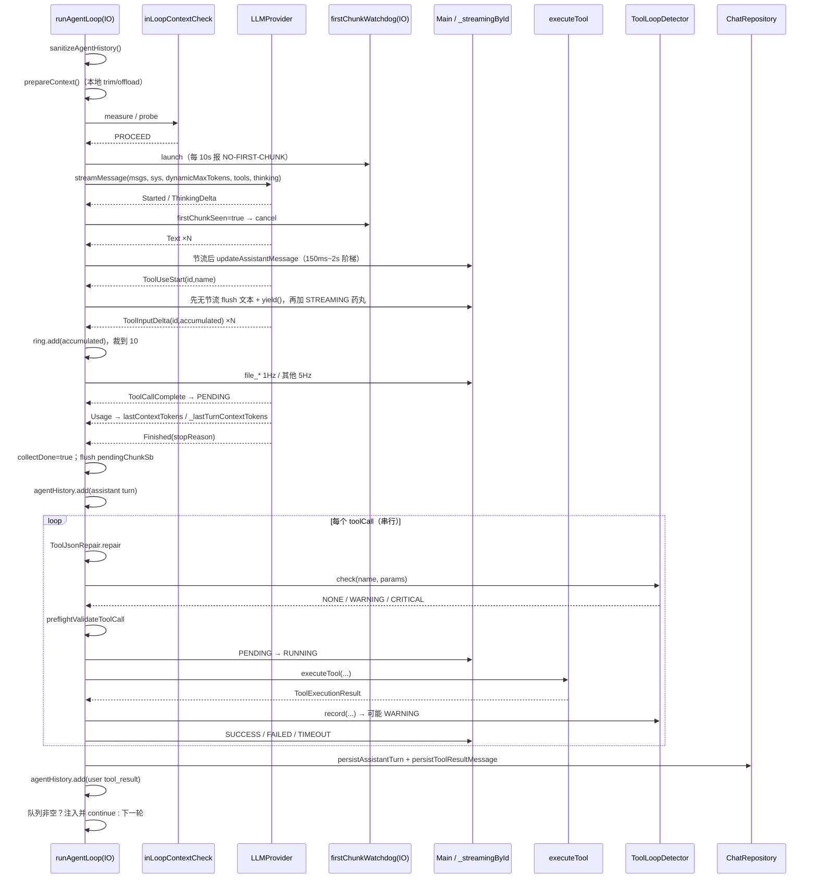
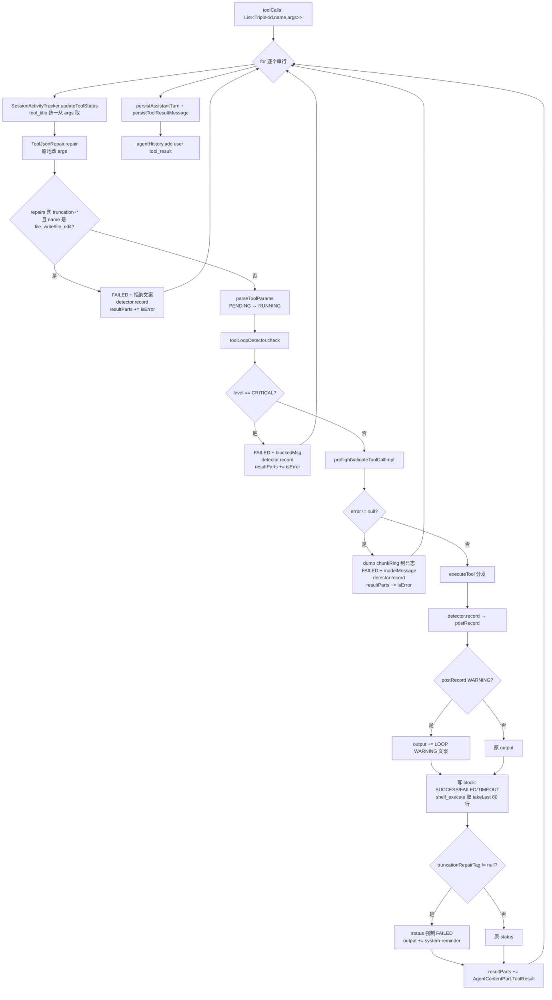
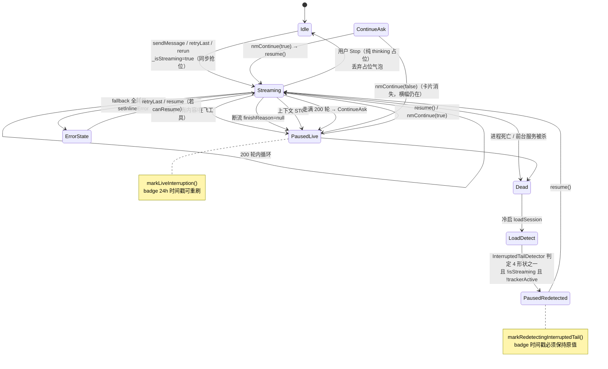

# 第 2 章 Looper（agent 循环）与轮次管理

> 基线 commit `067384b7e5b3c47a7eeca217895be71493396518`。
> **路径约定**：本章正文中的 `CVM:NNNN` 一律指
> `android/src/android/app/src/main/java/com/openminis/app/ui/chat/ChatViewModel.kt` 的第 NNNN 行（全文 12820 行）。
> 其他文件一律给出相对 nanoMuse 仓库根 的完整路径 + 行号。第 13 节「证据索引表」把所有关键结论重新展开为完整路径。
> 所有摘录均为源码原文（含原注释），未做改写。

---

## 0. 结论速览（先看这一节）

Android 端**不存在 `Looper` 类**。用户口中的 "Looper" 就是 `ChatViewModel.runAgentLoop()`（`CVM:7630`）。它是一个 **suspend 函数内的双层循环**，不是独立的状态机类、不是 Actor、也不是 Service：

```
runAgentLoop()                                  CVM:7630
├─ 一次性入场准备（探针 / 累加器 / 占位气泡）    CVM:7636-7967
├─ agentTurns@ for (turn in 0 until 200)        CVM:7968
│   ├─ sanitizeAgentHistory() + prepareContext() CVM:7970-7973
│   ├─ inLoopContextCheck → PROCEED/COMPACTED/STOP CVM:7974-8047
│   ├─ while (!collectDone)  ← 流式 + 重试 + fallback  CVM:8148-8844
│   ├─ 写 assistant 历史 / 空轮诊断                CVM:8850-8894
│   ├─ if (toolCalls.isEmpty()) → break            CVM:8897-9017
│   ├─ for ((id,name,args) in toolCalls)  ← 串行   CVM:9043-9326
│   ├─ persistAssistantTurn + persistToolResultMessage CVM:9342-9361
│   └─ if (_promptQueue.isNotEmpty()) → 注入并 continue CVM:9393-9426
└─ if (!loopExitedNormally) finalizeAtTurnLimit()  CVM:9437-9447
```

三个必须给确切答案的问题：

| 问题 | 确切答案 | 证据 |
|---|---|---|
| 单次 reply 的最大轮次 | **200**（`MAX_AGENT_TURNS`），到限不报错卡死，而是转为可 Resume | `CVM:412`、`CVM:7968`、`CVM:9437-9443`、`CVM:9457-9491` |
| 工具并发度 | **1，严格串行**。同一轮的 `toolCalls` 用普通 `for` 逐个 `suspend executeTool`，无 `async`/`launch`/`awaitAll` | `CVM:9043`、`CVM:9224`、`CVM:9503` |
| LoopDetector 阈值 | 窗口 `historySize=30`；`warningThreshold=10`；`unknownToolThreshold=10`；`criticalThreshold=20`（仅 poll 类工具）；`globalCircuitBreakerThreshold=30`（任意工具） | `agent/ToolLoopDetector.kt:41-60` |

补充两条容易被文档写错的事实：

- **logcat tag 前缀不是 `Minis.`**。`CVM:399` 的注释写着 `adb logcat -s Minis.ChatVMStream:D`，但 `AppLogger` 实际拼的是 `"nanoMuse.$category"`（`android/src/android/app/src/main/java/com/openminis/app/logging/AppLogger.kt:309`）。正确命令见第 10、11 节。
- **`InterruptedTailDetector` 不做「尾部残缺 tool_call 修复」**。它是会话加载时的「尾巴形状分类器」，只回答「这个尾巴是不是被打断了、要不要给 Resume」（`agent/InterruptedTailDetector.kt:41-93`）。真正修补 tool_use/tool_result 配对的是 `sanitizeAgentHistory()`（`CVM:7518`）和 `dropOrphanedToolParts()`（`CVM:2902`）。

---

## 1. 循环的完整控制流

### 1.1 五个入口，一个循环体

`runAgentLoop` 有 5 个调用点，全部包在 `streamJob = launch(Dispatchers.IO) { … }` 里，且都遵循同一套「先抢并发槽 → 登记活动 → 解析 fallback → 调循环 → drain 队列」外壳：

| 调用点 | 场景 | 外壳特征 |
|---|---|---|
| `CVM:5658` | `runRerunStreamTail`（`retryFromMessage` / `rerunFromToolBlock` 共用尾） | 日志带 `$label`，`CVM:5644` 起 |
| `CVM:6256` | `drainQueuedPrompts` 内部，队列排空后**再开一个完整 loop** | `CVM:6184` 的 while 里 |
| `CVM:7073` | 正常 `sendMessage` | `CVM:7044` 起 |
| `CVM:7447` | `retryLast` | `CVM:7433` 起 |
| `CVM:12157` | `resume()` | `CVM:12142` 起 |

这个「外壳重复 5 次」是本章后面要批评的历史包袱之一：并发槽、活动登记、fallback 解析、`_isStreaming` 清位、异常分类在 5 处各写一遍，只有 `runRerunStreamTail` 做了一次抽取。

### 1.2 入场：一次性准备（CVM:7636-7967）

这一段在 for 循环之外，整个 reply 只跑一次：

1. **`[CtxShape]` 探针**（`CVM:7645-7683`）：遍历 `agentHistory` 统计字符数、最大单条消息、tool_result 个数、内联图片字节、audio base64 长度，`approxTokens = chars / 4`，再拼上 `MemorySnapshot`。注释明确说明为什么加它：旧的 `messages-shape` 探针只在**会话加载**时跑，而 OOM 发生在**发送**时。
2. **循环级累加器**：`assistantId`（`CVM:7694`）、`allToolBlocks`（`:7695`）、`toolInputChunkRings`（`:7702`）、`accumulatedText`（`:7703`）、`allToolInputs`（`:7843`）。
3. **节流闭包 `textDeltaThrottleMs`**（`CVM:7741-7748`）：6 档阶梯，150ms→2000ms。
4. **上下文预算对象**：`ContextEstimate.Calibration`、`ContextUsageMeter`、`ContextBudget`、`ContextMaintenance`、`ContextTrimStore`（`CVM:7754-7763`），以及 `alignContextEstimate()` / `prepareContext()` 两个局部 suspend 闭包（`:7765`、`:7810`）。
5. **占位 assistant 气泡**（`CVM:7853-7859`）：`isStreaming=true, isAwaitingModelResponse=true`，让「思考中」指示器在首个 chunk 之前就亮。
6. **`loopExitedNormally = false`**（`CVM:7868`）——整个终止语义的枢纽，见 1.5。
7. **`resumeAfterCompaction()` 闭包**（`CVM:7883-7967`）：压缩后封气泡换气泡。

### 1.3 一轮的十二个阶段

```mermaid
stateDiagram-v2
    [*] --> Enter: runAgentLoop(provider, systemPrompt, fallbacks)
    Enter --> TurnTop: 建占位气泡 / loopExitedNormally=false

    TurnTop --> Sanitize: turn < 200
    Sanitize --> CtxGate: sanitizeAgentHistory + prepareContext

    CtxGate --> CompactSeal: COMPACTED
    CompactSeal --> TurnTop: resumeAfterCompaction(); continue
    CtxGate --> CtxStop: STOP
    CtxStop --> Resumable: 收尾气泡 + appendSystemInfo + canResume=true
    CtxGate --> Collect: PROCEED

    Collect --> Collect: 重试(1s/2s/4s) / fallback 换 provider
    Collect --> Throw: 重试与 fallback 全耗尽
    Throw --> [*]: 外层 catch → setInlineError

    Collect --> AppendHistory: collectDone=true
    AppendHistory --> NoTools: toolCalls.isEmpty()
    AppendHistory --> ToolDispatch: toolCalls 非空

    NoTools --> StreamDropped: finishReason==null 且有可见内容
    StreamDropped --> Resumable
    NoTools --> EmptyReminder: 空轮 且 上一条是 tool_result 且 未注入过
    EmptyReminder --> TurnTop: 注入 system-reminder; continue
    NoTools --> Done: 正常结束 / 空响应提示
    Done --> [*]: loopExitedNormally=true; break

    ToolDispatch --> ToolDispatch: 串行 for（repair→detector→preflight→executeTool）
    ToolDispatch --> Persist: resultParts 齐了
    Persist --> QueueInject: _promptQueue 非空
    QueueInject --> TurnTop: 换 assistantId + 清累加器; continue
    Persist --> TurnTop: 队列为空，下一轮

    TurnTop --> TurnLimit: for 走完 200 轮
    TurnLimit --> Resumable: finalizeAtTurnLimit
    Resumable --> [*]

    Collect --> Cancelled: Job.cancel()（协作式）
    ToolDispatch --> Cancelled
    Cancelled --> [*]: CancellationException 上抛
```



### 1.4 上下文预检：三分支改变控制流（CVM:7974-8047）

```kotlin
// CVM:7968-7980
        agentTurns@ for (turn in 0 until MAX_AGENT_TURNS) {
            // Sanitize history before each API call (mirrors iOS pre-API validation)
            sanitizeAgentHistory()

            // nanoMuse: deterministic trimming runs first and never edits saved history.
            prepareContext()
            when (inLoopContextCheck(contextMaintenance, requestBudget,
                ::measureContextTokens, ::measureProbeTokens, { prepareContext() })) {
                ContextMaintenance.Action.PROCEED -> {}
                ContextMaintenance.Action.COMPACTED -> {
                    resumeAfterCompaction()
                    continue
                }
```

- `PROCEED` → 继续本轮。
- `COMPACTED` → 调 `resumeAfterCompaction()`（封旧气泡、在 divider 下方开新气泡、清 4 个累加器），然后 `continue` **重新走一轮顶部的预检**。注意这会消耗一个 turn 计数。
- `STOP` → 见下。

`STOP` 分支（`CVM:7981-8045`）值得整段引用，因为它是「循环无法弹模态框」这一约束的直接产物：

```kotlin
// CVM:8027-8045
                    appendSystemInfo(
                        // nanoMuse: this path now means the actual capacity reserve was reached (#719).
                        text = context.getString(R.string.nm_context_limit_reached),
                        iconKind = "compact",
                    )
                    // [T-android-group-pause-badge-restamp] A LIVE interruption just
                    // happened: this is a real entry into the paused state, so the
                    // badge's 24h freshness stamp must be refreshed. Cancel any
                    // unconsumed re-detection mark left by a prior load so it cannot
                    // suppress the re-stamp here.
                    markLiveInterruption()
                    _canResume.value = true
                    // Android's equivalent of iOS's `hitTurnLimit = false`: this
                    // is a deliberate stop, NOT the runaway-ceiling path, so the
                    // post-loop tail must not slap a fake "hit 200 turns" error
                    // on it. finalizeAtTurnLimit is skipped; the notice above is
                    // the user-visible explanation.
                    loopExitedNormally = true
                    break
```

关键细节：这条路径**既不经过 `updateAssistantMessage(isStreaming=false)` 也不经过 `finalizeAtTurnLimit`**，所以 `CVM:8006-8020` 必须手工收尾气泡 + `clearStreamFlushState` + 从 `_streamingById` 摘掉 key，否则「思考中」永远挂着。注释里明确指出 `ContextPolicy` 给所有 <64K 窗口的模型设 `exhaustedOnly=true`，因此这条路径在**没有任何失败**的情况下也可达。

还有第二个预检点：fallback 换 provider 后 `preparedMessages == null`，于是在 collect 内部再检一次（`CVM:8198-8211`），此处 `STOP` 不是 break 而是 `throw LLMError.ProviderError(...)`，落到外层 catch。

### 1.5 退出条件全集（穷举，每条带证据）

| # | 退出条件 | 出口形式 | `loopExitedNormally` | 是否可 Resume | 证据 |
|---|---|---|---|---|---|
| 1 | 模型本轮无 tool call（正常收敛） | `break` | `true` | 否 | `CVM:8897`、`CVM:9015-9016` |
| 2 | 无 tool call 且 `finishReason==null` 且已有可见内容（断流） | `break` | `true` | **是** | `CVM:8931-8952` |
| 3 | 上下文闸门 `STOP`（容量耗尽且压缩救不回） | `break` | `true` | **是** | `CVM:7981-8045` |
| 4 | 走满 `for (0 until 200)`（模型持续要工具） | 循环自然结束 | `false` | **是** | `CVM:7968`、`CVM:9437-9443` |
| 5 | 重试 + fallback 全部耗尽 | `throw actual` | — | 否（inline error） | `CVM:8841`，外层 catch `CVM:7094-7100` |
| 6 | fallback 耗尽且有 trail/skipped | `throw ProviderError("$trail\n$finalDesc")` | — | 否 | `CVM:8833-8839` |
| 7 | collect 内二次预检 `STOP` | `throw ProviderError` | — | 否 | `CVM:8208-8209` |
| 8 | 真协程取消（`CancellationException` 且 `cause==null`） | 立即 rethrow | — | 由 `cancelStream` 决定 | `CVM:8631` |
| 9 | 用户 Stop（`cancelStream` → `streamJob.cancel()`） | 同上 | — | **是**（有部分内容/在飞工具时） | `CVM:11734`、`CVM:11981`、`CVM:12043`、`CVM:12053` |
| 10 | 空轮 + 上一条是 tool_result + 未注入过 reminder | **不退出**，`continue` 再跑一轮 | — | — | `CVM:8977-8994` |
| 11 | 队列非空（工具刚落地） | **不退出**，`continue` 换新气泡 | — | 置 `false` | `CVM:9393-9421` |
| 12 | `COMPACTED` | **不退出**，`continue` | — | — | `CVM:7977-7979` |
| 13 | 工具被 detector CRITICAL / preflight / 截断写拒绝 | **不退出本轮**，`continue` 到下一个 tool call | — | — | `CVM:9168`、`CVM:9220`、`CVM:9126` |
| 14 | 需用户审批（RiskGate / browser hand_over） | **不退出**，在 `executeTool` 内 suspend 阻塞 | — | — | `RiskGate.kt:239`、`BrowserHandOver.kt:66` |

**没有的东西也要说清**：循环体内**没有任何 `ensureActive()` / `isActive` 检查**（全文 `ensureActive` 只出现在 `CVM:2435` 的压缩路径和 import `CVM:86`）。取消完全依赖协作式挂起点：`withContext(Dispatchers.Main)`、`delay`、`executeTool` 内的 IO、`yield()`（`CVM:8415`）。这意味着一个纯 CPU 密集的 tool 段（例如超长 JSON 解析）不会被立即打断。

「审批阻塞」不是循环级状态，而是**工具级 suspend**：
- shell：`RiskGate.checkShell` → `ask(request)`，`TIMEOUT_MS = 180_000`（`io/github/nanomuse/guard/RiskGate.kt:70`），超时返回 `GateOutcome.Denied`，工具结果 `success=false`，循环继续下一轮让模型自己收场（`RiskGate.kt:265-268`）。
- browser `hand_over`：`BrowserHandOver.wait` 用 `CompletableDeferred` + `withTimeoutOrNull(15 * 60 * 1000)`（`io/github/nanomuse/browser/BrowserHandOver.kt:25`、`:40-53`），**超时也返回 `success=true`**，只是文案告诉模型「人还没做完，停下来等他」（`BrowserHandOver.kt:74-80`）。这是一个刻意的设计：避免 error 结果诱发模型重试循环。

### 1.6 collect 循环的三层 try 嵌套与异常归属

`while (!collectDone)` 内部是**三层嵌套 try**，读代码时极易看错归属，这里把骨架点清：

```
while (!collectDone) {                       CVM:8148
    try {                                    CVM:8149  ← 外层：重试/fallback 决策
        (currentProvider as? AnthropicProvider)?.enhancedCache = …   CVM:8155
        val firstChunkWatchdog = viewModelScope.launch(IO) { … }     CVM:8177
        try {                                CVM:8190  ← 中层：只为了保证看门狗被 cancel
            alignContextEstimate()                                   CVM:8197
            if (preparedMessages == null) { … 二次上下文闸门 … }      CVM:8198-8211
            currentProvider.streamMessage(...).collect { chunk -> … } CVM:8225-8580
            requestUsage?.let { … 校准落盘 … }                        CVM:8582-8589
            if (pendingChunkSb.isNotEmpty()) { … 尾部 flush … }       CVM:8595-8604
            collectDone = true                                       CVM:8612
        } finally {                          CVM:8618
            firstChunkWatchdog.cancel()                              CVM:8622
            if (!firstChunkSeen.get()) println(ENDED-WITHOUT-CHUNK)   CVM:8623
        }
    } catch (e: Exception) {                 CVM:8630  ← 外层 catch：分类 → 重试 / 换 provider / throw
        …
    }
}
```

三个由此产生的重要推论：

1. **看门狗的 cancel 在 `finally`，不在 `catch`**。所以无论成功、失败、还是被取消，它都不会活过本轮。如果把它写在外层 try 的末尾（成功路径），一次 provider 异常就会泄漏一个每 10 秒打印的协程——注释 `CVM:8619-8621` 明确说这是设计意图。
2. **二次上下文闸门的 `continue@agentTurns`（`CVM:8206`）是从 collect 内部直接跳到下一轮**，跨过外层 catch。这是全函数唯一的带标签 continue，也是为什么循环要叫 `agentTurns@`。
3. **`collectDone = true` 在中层 try 的最后一行**（`CVM:8612`），在尾部 flush 之后。任何在 flush 之前抛出的异常都会让 `collectDone` 保持 false，于是外层 catch 决定是重试还是抛出——**不存在「流读完了但被当成失败」的窗口**。

另外 `CVM:8612-8617` 在置 `collectDone` 之后顺手清了 `_autoRetryAttempt` / `_autoRetryCountdown`，这是「上一次重试留下的倒计时 UI 不能粘到成功流上」的收尾。

---

### 2.1 一个 reply = 一个气泡（iOS parity）

`assistantId` 在 `CVM:7694` 生成一次，整个 200 轮都往同一个 `ChatMessage` 里写。源码注释把契约写得很清楚：

```kotlin
// CVM:7684-7703
        // [T-android-queued-message-interrupt-on-toolclose] `assistantId` is
        // normally a single message id for the whole agent loop (iOS-parity:
        // multiple tool/text turns folded into one bubble). It is reassigned
        // ONLY when a queued mid-loop prompt is injected as a new turn: the
        // just-finished bubble is sealed and a fresh assistantId starts so the
        // queued user message renders BETWEEN them. `allToolBlocks` and
        // `accumulatedText` are also reset at that point so the new bubble
        // starts empty and `buildTurnParts(allToolBlocks, turnStartBlockIndex,
        // toolInputMap)` continues to slice only the current turn's blocks
        // (turnStartBlockIndex is captured at iteration start to 0 after reset).
        var assistantId = "assistant_${System.currentTimeMillis()}"
        val allToolBlocks = mutableListOf<AssistantBlock>()
```

**重新分配 `assistantId` 的场合只有两个**（都在循环内）：

1. `resumeAfterCompaction()`（`CVM:7916-7962`）：压缩 divider 尾插在旧气泡之后，若继续往旧气泡写，压缩后的新内容会渲染在 divider **上方**。修法是「封旧开新」，而不是搬动 divider。若旧气泡完全空（无 content 无 toolBlocks）则直接删掉（`CVM:7931-7941`）。
2. 队列注入（`CVM:9415-9419`）：为了让 queued user 消息渲染在两个 assistant 气泡**之间**。

两处都做同一套「seal + swap」：`updateAssistantMessage(sealedId, …, false, …)` → `clearStreamFlushState(sealedId)` → 从 `_streamingById` 摘 key → `assistantId = fresh` → `accumulatedText=""` → `allToolBlocks.clear()` → `allToolInputs.clear()` → `toolInputChunkRings.clear()`。

### 2.2 `turnStartBlockIndex` 的切片语义

```kotlin
// CVM:8049-8052
            // Mark where this turn's blocks start in allToolBlocks so we can persist
            // only the NEW parts from this turn (not the full accumulated history).
            // Matches iOS's per-turn RawMessage persistence.
            val turnStartBlockIndex = allToolBlocks.size
```

`allToolBlocks` 是**整个 reply 的有序块列表**（text / thinking / tool_use / info 四种 kind），而持久化必须**每轮一行 DB 记录**。`buildTurnParts` 就是把 `[turnStartBlockIndex, size)` 这一段切出来：

```kotlin
// CVM:10283-10309
    private fun buildTurnParts(
        allToolBlocks: List<AssistantBlock>,
        turnStartBlockIndex: Int,
        toolCallInputs: Map<String, String>,
    ): List<AgentContentPart> {
        if (turnStartBlockIndex >= allToolBlocks.size) return emptyList()
        val out = mutableListOf<AgentContentPart>()
        for (i in turnStartBlockIndex until allToolBlocks.size) {
            val block = allToolBlocks[i]
            when (block.kind) {
                "text" -> if (block.content.isNotEmpty()) {
                    out.add(AgentContentPart.Text(block.content))
                }
                "tool_use" -> {
                    val name = block.toolName
                    if (name.isBlank()) continue
                    val inputStr = toolCallInputs[block.id] ?: "{}"
                    val inputJson = try { JSONObject(inputStr) } catch (_: Exception) { JSONObject() }
                    // [T-android-gemini3-thoughtsig / #179] Carry the block's
                    // signature into the persisted/replayed ToolUse.
                    out.add(AgentContentPart.ToolUse(block.id, name, inputJson, thoughtSignature = block.thoughtSignature))
                }
                // "thinking" / "info" → not persisted in parts
                else -> { /* skip */ }
            }
        }
        return out
    }
```

三个语义要点：
- `thinking` / `info` 块**不入 parts**（thinking 走 `reasoningContent` 独立字段，info 是 fallback 提示，纯 UI）。
- `toolCallInputs` 传的是 `allToolInputs`（**跨轮累积**，`CVM:7843`、`CVM:8866`），不是本轮 map。因为 block id 全局唯一，跨轮 map 不会串味，且保证 retry 后仍能查到旧 id 的入参。
- `turnStartBlockIndex` 在**每轮顶部**重新取 `allToolBlocks.size`，所以 seal+swap 清空后自动变 0——这就是注释里那句「captured at iteration start to 0 after reset」的机制。

`buildTurnParts` 有 3 个调用点：无工具收敛时的持久化（`CVM:8902`）、工具执行**前**的会话列表实时预览（`CVM:9031`）、工具执行后的正式持久化（`CVM:9342`）。第二处的存在理由写在 `CVM:9020-9029`：长工具期间 DB 里还没有 assistant 行，首页会话列表会显示过期预览甚至「No messages yet」。

### 2.3 UI 折叠 vs 历史分行

这是本章最容易混淆的一点，必须分开讲：

| 维度 | 粒度 | 依据 |
|---|---|---|
| UI 气泡 | 1 个 reply → 1 个 `ChatMessage`（除 seal+swap） | `CVM:7694` |
| `agentHistory` | 1 轮 → 1 条 assistant + 1 条 user(tool_result) | `CVM:8876-8881`、`CVM:9356-9361` |
| DB 行 | 1 轮 → 1 行 assistant + 1 行 user | `CVM:9344`、`CVM:9353` |

也就是说：**模型看到的是 N 轮 N 组消息，用户看到的是 1 个气泡里 N 段文本 + N 组工具药丸**。`accumulatedText += turnText`（`CVM:8852`）负责把跨轮文本拼成气泡正文，而 `agentHistory` 里每轮的 `content = turnText` 只有本轮那一段。

`persistAssistantTurn` 返回 DB id 后会**回填** `agentHistory` 最后一条 assistant 的 `dbMessageId`（`CVM:9345-9350`），注释说明原因：压缩 marker 的边界解析依赖这个 id。

### 2.4 走查：一个三轮 reply 的两本账

抽象规则容易记混，这里用一个具体 reply（文本 → shell → 文本 → file_read → 收尾文本）把两本账同时推进。假设进入循环时 `allToolBlocks` 为空，`assistantId = A`。

**turn = 0**：`turnStartBlockIndex = 0`（`CVM:8049`，取的是**切片前**的 size）。流式产出 `text_0_0`（"我先看一下目录"）和 `tool_use`（shell_execute）。此时 `allToolBlocks = [text, tool]`，`turnTextSb = "我先看一下目录"`。工具执行完后 `buildTurnParts(allToolBlocks, 0, toolInputMap)` 切 `[0, 2)`，得到 `[Text("我先看一下目录"), ToolUse(shell)]`，作为 assistant 消息入 `agentHistory`；工具结果作为一条 user 消息追加（`CVM:9356-9361`）。`accumulatedText += turnText`（`CVM:8852`）。

**turn = 1**：`turnStartBlockIndex = 2`——注意它**不是 0**，前一轮的块永久留在 `allToolBlocks` 里供 UI 用，但不再进入本轮协议消息。本轮产出 `text_1_2`（"目录里有 config.json，我读一下"）和 `tool_use`（file_read），`allToolBlocks` 长度变 4，`buildTurnParts` 切 `[2, 4)`。`agentHistory` 此时是 4 条：assistant/tool_result × 2。UI 侧仍然只有一条 `ChatMessage(A)`，正文是两段文本拼接，药丸是两个。

**turn = 2**：`turnStartBlockIndex = 4`，模型不再发 tool_call，只产出 `text_2_4`（"配置里端口是 8080"）。`toolCalls.isEmpty()` → 走空工具轮出口 `break`。`agentHistory` 变 5 条，最后一条 assistant 只有 Text、没有 ToolUse，所以**不会**再追加 tool_result user 消息——这正是 `dropOrphanedToolParts` 的「尾部 assistant 无 tool_use」正常形态，而不是残缺。

三个可直接用于排障的推论：

1. **`allToolBlocks` 是单调增长的 reply 级账本，`turnStartBlockIndex` 是唯一的轮边界**。任何忘记更新它的改动都会导致把上一轮工具再发一遍给模型（重复 tool_use → 接收端 400 或 orphan）。
2. **块 id 里嵌了 `turn`**（`text_${turn}_${allToolBlocks.size}`，`CVM:8318`），所以从 UI 块 id 就能反推它属于第几轮，不必去翻日志。
3. **`accumulatedText` 与 `agentHistory` 中各轮 `content` 的关系是「拼接 vs 分片」**，二者不一致不是 bug；只有当 `buildTurnParts` 的切片起点错了，才会出现「模型看到的内容和用户看到的内容语义不同」这类真 bug。

---

## 3. 流式收集机制

### 3.1 `LLMStreamChunk` 全集（10 个变体）

`android/src/android/app/src/main/java/com/openminis/app/data/model/LLMStreamChunk.kt:5-41`：

| 变体 | 载荷 | 循环内处理 |
|---|---|---|
| `Started` | — | no-op（`CVM:8570`） |
| `Text(text)` | 文本增量 | `CVM:8259-8371` |
| `Usage(usage)` | token 用量 | `CVM:8542-8557` |
| `Finished(stopReason)` | 结束原因（可为 null） | `CVM:8566-8569` |
| `ThinkingDelta(text)` | 思考增量 | `CVM:8241-8258` |
| `ReasoningContent(content)` | 累积 reasoning blob（可为 `""`） | `CVM:8558-8565` |
| `ToolUseStart(id, name)` | 工具开始 | `CVM:8372-8438` |
| `ToolInputDelta(id, accumulated)` | **累积**入参 JSON 快照（不是增量片段） | `CVM:8439-8508` |
| `ToolCallComplete(id, name, args, thoughtSignature)` | 完整入参 | `CVM:8509-8541` |
| `MediaAttachment(attachment)` | 模型生成媒体 | **no-op**（`CVM:8571-8578`，只服务 CLI 路径） |

注意 `ToolInputDelta.accumulated` 语义是「到目前为止的全量 JSON 串」，所以环形缓冲存的是快照序列而非拼接片段。

### 3.2 一轮的时序



### 3.3 首 chunk 看门狗（CVM:8157-8189、8231-8239、8618-8628）

```kotlin
// CVM:8169-8189
                    val streamStartMs = android.os.SystemClock.elapsedRealtime()
                    val firstChunkSeen = java.util.concurrent.atomic.AtomicBoolean(false)
                    val diagSid = activeSessionId
                    println(
                        "[T-STALL-DIAG] stream REQUEST-OUT sid=$diagSid turn=$turn " +
                            "provider=${currentProvider.javaClass.simpleName} " +
                            "historySize=${agentHistory.size}",
                    )
                    val firstChunkWatchdog = viewModelScope.launch(Dispatchers.IO) {
                        var waited = 0L
                        while (!firstChunkSeen.get()) {
                            kotlinx.coroutines.delay(10_000L)
                            if (firstChunkSeen.get()) break
                            waited += 10_000L
                            println(
                                "[T-STALL-DIAG] stream NO-FIRST-CHUNK sid=$diagSid turn=$turn " +
                                    "waitedMs=$waited provider=${currentProvider.javaClass.simpleName} " +
                                    "— request sent, provider has returned NOTHING (not even message_start)",
                            )
                        }
                    }
```

**这是纯诊断，不是超时**：它只打印，从不取消请求。真正的超时靠 provider 的 OkHttp readTimeout（第 3 号研究员域）。`finally` 里无条件 `firstChunkWatchdog.cancel()`（`CVM:8622`），并在一个 chunk 都没收到时补一条 `ENDED-WITHOUT-CHUNK`（`:8623-8628`）。首个 chunk 到达时用 CAS 打一次 `FIRST-CHUNK … ttfbMs=… kind=…`（`CVM:8233-8239`）。

注意它用的是 `println` 而非 `AppLogger`——`AppLogger` 会把 `System.out` 换成写文件的 PrintStream（`AppLogger.kt:171` 附近注释），所以 `println` 同时进 logcat（`System.out` tag）和日志文件。

### 3.4 环形缓冲 `TOOL_INPUT_CHUNK_RING_MAX = 10`

```kotlin
// CVM:8450-8455
                        val ring = toolInputChunkRings.getOrPut(toolInputId) { mutableListOf() }
                        ring.add(chunk.accumulated)
                        if (ring.size > TOOL_INPUT_CHUNK_RING_MAX) {
                            // Drop from the front so we keep the most recent N.
                            ring.subList(0, ring.size - TOOL_INPUT_CHUNK_RING_MAX).clear()
                        }
```

用途有两个，都在工具编排阶段：
1. `ToolJsonRepair.repair(name, args, toolInputChunkRings[id]?.lastOrNull(), agentTools)`（`CVM:9064-9066`）——**截断修复的唯一原始材料**。当 provider 给出的 `args` 是空 `{}` 时，只有 raw tail 能救回来。
2. preflight 失败时把整个 ring 逐条 dump 到日志（`CVM:9179-9192`），用来判断「模型根本没发参数」还是「参数在传输中被截断」。

ring 在 preflight 失败（`CVM:9179` `remove`）、截断写拒绝（`CVM:9125` `remove`）、seal+swap（`CVM:7962`、`:9419`）时清理。**成功执行的 call 不 remove**——所以长 reply 里 ring map 会随工具数线性增长，每个最多 10 条快照。这是一个有界但非零的内存驻留，第 5 号研究员的内存分析可以接上。

### 3.5 双层节流（这是 Android 特有的复杂度）

**第一层：循环内 delta → `updateAssistantMessage`**（`CVM:7741-7748`、`CVM:8343-8370`）

```kotlin
// CVM:7741-7748
        fun textDeltaThrottleMs(len: Int): Long = when {
            len < 500     -> 150L
            len < 2_000   -> 300L
            len < 32_000  -> 500L
            len < 64_000  -> 1_000L
            len < 128_000 -> 1_500L
            else          -> 2_000L
        }
```

外加快路径：`len < 5000 && chunk.text.contains('\n') && unflushed >= 50`（`CVM:8354`）。工具入参另有两档：`file_write`/`file_edit` 1000ms，其他 200ms（`CVM:8496-8497`），`ToolUseStart` 会把两个时间戳清零强制首帧立即出（`CVM:8422-8423`）。

**第二层：`updateAssistantMessage` → `_streamingById` 侧信道**（`CVM:10054-10152`）

```kotlin
// CVM:10100-10113
            val structuralChange = prev == null ||
                prev.toolBlocks.size != toolBlocksImmutable.size ||
                prev.isAwaitingModelResponse != isAwaitingModelResponse ||
                toolStatusChanged
            val now = System.currentTimeMillis()
            val elapsed = now - st.lastFlushMs
            val throttle = streamFlushThrottleMs(content.length)
            val newChunk = if (content.length > st.lastFlushedLen) {
                content.substring(st.lastFlushedLen.coerceAtMost(content.length))
            } else ""
            val unflushed = content.length - st.lastFlushedLen
            val newlineFlush = content.length < NEWLINE_FLUSH_MAX_LEN &&
                newChunk.contains('\n') &&
                unflushed >= NEWLINE_FLUSH_MIN_CHARS
```

`streamFlushThrottleMs`（`CVM:695-702`）第一档是 **200ms**（循环内那层是 150ms），其余档位相同。**结构性变化一律立即发布**：块数变化、awaiting 翻转、以及**同位置块的 status 翻转**（`CVM:10095-10099` 的 `toolStatusChanged`，为了 spinner→checkmark 不延迟）。被节流时挂一个 `trailingJob`（跑在 `viewModelScope`，**不是 `streamJob`**）在窗口末尾补发最新值。

### 3.6 `_isStreaming` 与「思考中」的不变式

三个层次的状态，必须同时清干净才算真结束：

| 状态 | 含义 | 清位点 |
|---|---|---|
| `_isStreaming`（`CVM:772`） | 全局「这个会话在跑」 | 各 streamJob 尾部，带 stale-job 守卫 |
| `ChatMessage.isStreaming` / `isAwaitingModelResponse` | 单气泡 | `updateAssistantMessage(…, false, …)` |
| `_streamingById[id]`（`CVM:644`） | 侧信道增量 | `updateAssistantMessage` 的 `isStreaming=false` 分支 + 手工摘 key |

stale-job 守卫是必要的，因为 `streamJob` 是可变字段：

```kotlin
// CVM:7120-7127
                // [T-android-stale-streamjob-clears-isstreaming] guard — see
                // `var streamJob` KDoc; identical pattern as runRerunStreamTail.
                if (streamJob === coroutineContext[Job]) {
                    AppLogger.info(TAG_STREAM, "send _isStreaming=false (about to set)")
                    _isStreaming.value = false
                } else {
                    AppLogger.info(TAG_STREAM, "send _isStreaming SKIPPED (stale job)")
                }
```

侧信道孤儿是「思考中永挂」的经典成因，`finalizeAtTurnLimit` 的注释把它讲透了：

```kotlin
// CVM:9466-9480
        // [T-android-thinking-indicator-linger] updateAssistantMessage drains
        // _streamingById[assistantId] above, but the agent loop ran on
        // Dispatchers.IO while this finalize hops to Main — a late streaming
        // delta can re-add the side-channel entry AFTER the drain, and since
        // the loop has now exited no further isStreaming=false write will ever
        // clear it. mergeStreamingOverlay (ChatScreen) forces isStreaming=true
        // on any message with a side-channel entry, so that orphan keeps the
        // "thinking" row alive forever. Defensively drop the entry here as the
        // last Main-thread write of this turn.
        // [T-android-stream-flush-review] Cancel the trailing flush too, so it
        // can't re-add this orphan entry after we drop it on the error path.
        clearStreamFlushState(assistantId)
        if (_streamingById.value.containsKey(assistantId)) {
            _streamingById.value = _streamingById.value - assistantId
        }
```

`clearStreamFlushState`（`CVM:678-680`）之所以必须显式调，正是因为 `trailingJob` 挂在 `viewModelScope` 而非 `streamJob`——`streamJob.cancel()` 杀不掉它。同一防御在 `STOP` 分支（`CVM:8016-8019`）和 seal+swap（`CVM:7951-7954`）各写了一遍。

### 3.7 文本块归属：monolithic vs ordered 两种 provider 语义

`Text` chunk 到达时最难的不是节流，而是**这段字应该追加到哪个块**。判定入口是 provider 的一个布尔属性：

```kotlin
                        val lastIdx = allToolBlocks.lastIndex
                        val monolithic = currentProvider.streamTextIsMonolithic
                        val activeSb = if (monolithic && turnTextBlockIdx >= 0 && currentTextBlockSb != null) {
```
（`CVM:8285-8287`）

该旗标在接口上默认 `false`（`provider/LLMProvider.kt:42`），OpenAI provider 覆写为 `usesChatCompletionsAPI`（`provider/openai/OpenAIProvider.kt:392`）——即**同一个 provider 类在 Responses API 与 Chat Completions API 下语义不同**，这也是它必须做成运行时属性而非常量的原因。

两条分支的语义完全不同：

- **monolithic = true（Chat Completions 系）**：一次 response 的 `content` 在协议上就是**一个字符串**。某些 OpenAI 兼容网关（注释点名 qwen）会把这同一个字符串的 delta 排在 `tool_calls` delta **之后**发出。若照时序新建块，就会把一句话从中间劈成「工具前」「工具后」两段，UI 上表现为断词。所以这里无条件合并回 `turnTextBlockIdx` 指向的那个块，并打一条一次性日志：

```kotlin
                                AppLogger.info(
                                    TAG_STREAM,
                                    "[T-android-tool-splits-reply-fix] post-tool_calls content delta merged into pre-tool text block (model=${currentProvider.model.id})",
                                )
```
（`CVM:8300-8303`，`loggedPostToolTextMerge` 保证只打一次）

- **monolithic = false（Anthropic 式有序 content blocks）**：只有当**最后一个块本身就是 text** 时才追加（`CVM:8307`），否则说明中间隔了 tool_use/thinking，必须开新块——这才是真实的时序交错，不能合并。

新建块时 monolithic 还有一步**位置纠正**，这是全章少见的「往列表中间插」：

```kotlin
                            val firstToolIdx = (turnStartBlockIndex until allToolBlocks.size)
                                .firstOrNull { allToolBlocks[it].kind == "tool_use" }
                            if (firstToolIdx != null) {
                                allToolBlocks.add(firstToolIdx, block)
                                turnTextBlockIdx = firstToolIdx
                            } else {
                                allToolBlocks.add(block)
                                turnTextBlockIdx = allToolBlocks.lastIndex
                            }
```
（`CVM:8329-8337`）

即：本轮若已经先到了 tool_use 块而文本块还不存在（网关完全没有 preface text 的极端 chunking），新文本块要**插到本轮第一个 tool_use 之前**，让持久化顺序回到规范的 `{content, tool_calls}` 形状。注意插入会让后续块的下标整体后移，而 `turnStartBlockIndex` 是**轮起点**、不受影响，`buildTurnParts` 的切片仍然正确——这是「reply 级账本 + 轮起点」这套设计的一个隐性收益。

排障提示：如果看到「一句话被工具药丸劈开」，先确认该 provider 的 `streamTextIsMonolithic` 取值；若为 false 而网关实际是 monolithic 语义，症状就完全一致。日志关键字 `T-android-tool-splits-reply-fix` 只会在合并真的发生时出现。

### 3.8 `tool_call_id` 去重：为什么需要三张表

上游 OpenAI 兼容网关偶发「多个并行 tool_call 共用同一个 id 但 name/args 不同」，原样回传会触发接收端唯一性检查（HTTP 400 duplicate tool_call_id）。修法与 iOS 对齐：首次出现保留原 id，第二次改 `<id>-2`，第三次 `<id>-3`。Android 侧的实现比 iOS 复杂，原因写在注释里：

```kotlin
            // Three pieces of state because Android routes ToolInputDelta
            // by chunk.id (iOS routes by name) and OpenAI emits ALL completes
            // together after finish_reason — so we can't drop the
            // "currently in-flight" map by the time completes arrive.
            //
            //   dedupeStartCounts    raw id → # ToolUseStart events seen
            //   dedupeCompleteCounts raw id → # ToolCallComplete events seen
            //   inFlightRenamedId    raw id → renamed id of the tool currently
            //                        streaming deltas (overwritten on each start)
```
（`CVM:8110-8118`）

```kotlin
            val dedupeStartCounts = mutableMapOf<String, Int>()
            val dedupeCompleteCounts = mutableMapOf<String, Int>()
            val inFlightRenamedId = mutableMapOf<String, String>()
            fun dedupeToolStartId(raw: String): String {
                val n = (dedupeStartCounts[raw] ?: 0) + 1
                dedupeStartCounts[raw] = n
                val renamed = if (n == 1) raw else "$raw-$n"
                if (n > 1) {
                    AppLogger.warning(TAG_STREAM, "[ToolDedupe] duplicate tool_call id on stream start: '$raw' #$n -> renamed '$renamed'")
                }
                inFlightRenamedId[raw] = renamed
                return renamed
            }
            fun dedupeToolInputId(raw: String): String =
                inFlightRenamedId[raw] ?: raw
            fun dedupeToolCompleteId(raw: String): String {
                val n = (dedupeCompleteCounts[raw] ?: 0) + 1
                dedupeCompleteCounts[raw] = n
                return if (n == 1) raw else "$raw-$n"
            }
```
（`CVM:8122-8141`）

三张表各自的必要性：

| 表 | 服务的 chunk | 为什么不能省 |
|---|---|---|
| `dedupeStartCounts` | `ToolUseStart` | 决定改名序号，同时刷新 in-flight 映射 |
| `inFlightRenamedId` | `ToolInputDelta` | delta 只带 raw id，必须查表才知道它属于哪个改名后的调用；也是 `toolInputChunkRings` 的 key 来源 |
| `dedupeCompleteCounts` | `ToolCallComplete` | OpenAI 在 `finish_reason` 之后**一次性**吐出所有 complete，此时 in-flight 表早已被最后一个 start 覆盖，只能靠独立计数器复现同样的序号 |

这套设计有一个**明确的正确性前提**，注释也直说了：`Start/complete ordering match: OpenAI streams emit tools in index order at finish_reason, mirroring start order`（`CVM:8120-8121`）。也就是说 complete 的第 n 次出现必须对应 start 的第 n 次出现。若某网关乱序发 complete，改名就会错配，表现为「参数装到另一个工具上」。这是一个**已知但未加断言的假设**（列入未确认清单）。

排障关键字：`[ToolDedupe] duplicate tool_call id on stream start`。它出现说明上游确实在发重复 id；紧随其后若出现 orphan tool_result 或参数错配，就要怀疑上面这个顺序假设被打破。

---

## 4. 工具调用编排

### 4.1 编排 flowchart



### 4.2 并发度 = 1（证据）

```kotlin
// CVM:9041-9043
            // Execute all tool calls
            val resultParts = mutableListOf<AgentContentPart>()
            for ((id, name, args) in toolCalls) {
```

```kotlin
// CVM:9223-9225
                android.util.Log.d("ToolChain[VM]", "[turn=$turn] executeTool START name=$name args=${argsStr.take(200)}")
                val result = executeTool(name, argsStr, id, allToolBlocks, assistantId, accumulatedText)
                android.util.Log.d("ToolChain[VM]", "[turn=$turn] executeTool END name=$name success=${result.success} title=${result.toolTitle} outputLen=${result.output.length} output=${result.output.take(200)}")
```

`executeTool` 是 `private suspend fun`（`CVM:9503`），直接顺序 await，**没有 `async`/`awaitAll`/`coroutineScope`**。`resultParts` 是普通 `mutableListOf`，也证明无并发写。iOS 侧文件名是 `AIChatViewModel+ConcurrentTools`（`CVM:9088`、`CVM:9269` 注释引用），**Android 并未跟进并发化**——这是一处明确的平台差异，值得写进跨平台对照表。

需要区分的是**会话级并发**：`SessionConcurrencyManager.MAX_CONCURRENT = 5`（`android/src/android/app/src/main/java/com/openminis/app/service/SessionConcurrencyManager.kt:17`），每个 streamJob 入场先 `acquireSlot`（`CVM:7057`）。所以「5 个会话可同时跑 loop，但每个 loop 内工具串行」。

### 4.3 `executeTool` 的分发结构（CVM:9503-9555）

```kotlin
// CVM:9521-9554
        return when (name) {
            FileReadTool.NAME -> {
                val result = FileReadTool.execute(argsJson, activeSessionId, context)
                // Record skill usage when SKILL.md under /var/minis/skills/<id>/ is read.
                if (result.success) {
                    runCatching {
                        val readPath = JSONObject(argsJson).optString("path", "")
                        if (readPath.isNotEmpty()) {
                            skillRepository?.skillIdFromPath(readPath)?.let { sid ->
                                skillRepository.recordSkillUse(sid)
                            }
                        }
                    }
                }
                result
            }
            FileWriteTool.NAME -> FileWriteTool.execute(argsJson, activeSessionId, context).also {
                if (it.success) maybeReloadSkillsForPath(argsJson)
            }
            FileEditTool.NAME -> FileEditTool.execute(argsJson, activeSessionId, context).also {
                if (it.success) maybeReloadSkillsForPath(argsJson)
            }
            ReadImageTool.NAME -> executeReadImageTool(argsJson)
            "shell_execute" -> executeShellCommand(argsJson, toolId, toolBlocks, assistantId, currentText)
            "browser_use" -> executeBrowserUseTool(argsJson)
            "memory_write" -> executeMemoryWriteTool(argsJson)
            "memory_get" -> executeMemoryGetTool(argsJson)
            else -> ToolExecutionResult("Unknown tool: $name", false)
        }
```

只有 8 个原生分支，其余工具（calendar/location/… 以及 MCP）走 offload/shell 桥。`CVM:9511-9518` 明确记录：T330 把三态权限门从这里搬到了 `OffloadGate`，因为这里的 `permissionTools` 预检实际上早已是死代码。具体工具实现属第 4 号研究员。

`else -> "Unknown tool: $name"` 这一行是 `ToolLoopDetector` 的 `unknown_tool_repeat` 策略的**唯一信号源**——detector 的正则 `unknown tool[:\s]+…`（`ToolLoopDetector.kt:408-411`）正是匹配它。

### 4.4 `ToolBlockStatus` 状态翻转

枚举 7 态：`STREAMING, PENDING, RUNNING, SUCCESS, FAILED, CANCELLED, TIMEOUT`（`android/src/android/app/src/main/java/com/openminis/app/ui/chat/ChatModels.kt:223-225`）。

| 迁移 | 触发 | 行号 |
|---|---|---|
| ∅ → STREAMING | `ToolUseStart` 建块 | `CVM:8430` |
| STREAMING → PENDING | `ToolCallComplete`（入参齐了，等分发） | `CVM:8526-8527` |
| PENDING → RUNNING | 分发前一刻（过了 repair，未过 detector/preflight） | `CVM:9132-9138` |
| RUNNING → SUCCESS/FAILED/TIMEOUT | `executeTool` 返回 | `CVM:9270-9275` |
| PENDING/RUNNING → FAILED | detector CRITICAL / preflight / 截断写拒绝 | `CVM:9153`、`CVM:9202`、`CVM:9109` |
| 任意 in-flight → CANCELLED | 用户 Stop | `CVM:11931` 起的 `handleUserCancelledCleanup` |

注意一个**顺序瑕疵**：`CVM:9130-9138` 先把 PENDING 翻 RUNNING，**然后**才做 detector check（`:9143`）和 preflight（`:9177`）。而 preflight 的注释（`CVM:9171-9173`）声称「BEFORE the UI flips to RUNNING」。实际实现与注释不一致：被 preflight 拒的调用在 UI 上会闪一下 RUNNING 再变 FAILED。这是可观察到的小瑕疵，不影响正确性（最终态是 FAILED），但注释应视为过期。

`IN_FLIGHT_TOOL_STATUSES = {STREAMING, PENDING, RUNNING}`（`CVM:393-397`）定义了「没有配对 tool_result」的集合，`retryLast` 会丢弃这些块以免产生孤儿 tool_use。

### 4.5 `preflightValidateToolCallImpl` 校验什么（CVM:323-372）

纯函数，放在 companion 里以便单测（`CVM:318-322` 注释说明）。规则：

1. 工具名不在 `agentTools` 里 → **返回 null**（放行），交给 `executeTool` 的 `else` 分支报 Unknown，避免双重失败（`CVM:328-331`）。
2. `enforced = toolDef.required - PREFLIGHT_NON_BLOCKING_FIELDS`，后者目前只有 `tool_title`（`CVM:277`）。
3. `args.length()==0 && enforced.isNotEmpty()` → 拒绝，报文列出真实必填项（`CVM:338-340`）。
4. 逐字段：`!args.has(field) || args.isNull(field)` → missing。**显式 JSON null 也算缺失**（`CVM:343-351`，org.json 的 `has()` 对 `{"x":null}` 返回 true，曾漏检）。
5. 字符串字段：**只拒真正的 `""`，不拒空白**（`CVM:352-366`）。注释解释：`.trim().isEmpty()` 曾误杀 `file_edit` 的 `new_string:"\n"` 和 `old_string:"  "`。
6. 白名单例外：`PREFLIGHT_EMPTY_STRING_ALLOWED_FIELDS = {"file_edit": {"new_string"}}`（`CVM:294-296`），因为 `new_string:""` 是文档承诺的「删除 old_string」写法。判定函数 `preflightEmptyStringAllowed`（`CVM:299-300`）。
7. **不做类型/枚举/范围校验**（`CVM:311-314` 明确划界，那些属各工具自己的 helper）。

失败后循环的动作（`CVM:9178-9221`）：dump ring → 块置 FAILED（UI 文案 `"Blocked invalid tool call"`）→ `detector.record(errorMessage=modelMessage)` → `resultParts.add(ToolResult(isError=true))` → `continue`。**给模型的文案和给用户的文案是两套**：

```kotlin
// CVM:9197-9198
                    val uiMessage = "Blocked invalid tool call"
                    val modelMessage = "Error: Tool call rejected before execution. $preflightError The arguments your client sent were empty or missing required fields — re-issue the call with all required parameters filled in. Do not retry with the same empty arguments."
```

这是全章反复出现的模式：**每个守卫都必须合成一个 `isError=true` 的 tool_result**，否则 tool_use/tool_result 失衡，下一次请求 400。

### 4.6 `ToolJsonRepair` 何时介入（CVM:9059-9074）

在 preflight **之前**、detector check 之前，原地 mutate `args`：

```kotlin
// CVM:9064-9066
                val repairs = com.openminis.app.provider.ToolJsonRepair.repair(
                    name, args, toolInputChunkRings[id]?.lastOrNull(), agentTools,
                )
```

三策略（`android/src/android/app/src/main/java/com/openminis/app/provider/ToolJsonRepair.kt:45-88`）：
1. **截断修复**：仅当 `args.length()==0` 且 rawTail 非空，依次试 10 个闭合后缀 `["", "\"", "\"}", "\"]}", "}", "}}", "]}", "]}}", "]", "]]"]`，首个能 parse 的胜出，tag `truncation+<suffix>`。
2. **类型强转**：required 字段存在但非 String → `toString()`，tag `type-coerce:<field>`。
3. **模糊字段名**：missing required 字段，找 Levenshtein 距离**恰好 1** 且不属于 schema 的兄弟 key 改名（`comand`→`command`），tag `fuzzy:a->b`。

**截断写拒绝**（`CVM:9082-9127`）是关键安全阀：`truncation+*` 命中且工具是 `file_write`/`file_edit` → **不执行**，返回长文案告诉模型「什么都没写，磁盘未变，请分片重写」。理由在注释里：自动闭合 JSON 与「模型真的在这里结束 content」不可区分，半个文件落盘比不写更糟。

非写类工具仍带修复执行，但必须**告诉模型它的参数被改过**（`CVM:9307-9315` 追加 `<system-reminder>`），且 UI 状态强制 FAILED（`CVM:9270-9271`：`result.success && truncationRepairTag != null -> FAILED`）。

### 4.7 结果如何回写

```kotlin
// CVM:9317-9325
                resultParts.add(AgentContentPart.ToolResult(
                    id = id,
                    name = name,
                    content = outputForLLMWithNote,
                    isError = !result.success,
                    imageData = result.imageData,
                    imageMimeType = result.imageMimeType,
                    imageLinuxPath = result.imageLinuxPath,
                ))
```

`outputForLLM` 的组装顺序（`CVM:9230-9244`）：`result.output` →（若 postRecord 是 WARNING）追加 `\n\n${postRecord.message}` →（若截断修复）追加 system-reminder。**UI 展示与模型输入分离**：UI 侧 `shell_execute` 只留最后 80 行（`CVM:9260-9261`），且若流式期间已累积更长内容则保留更长的（`CVM:9265`）；模型侧拿到完整输出。注释解释了为什么 80 行裁剪只对 shell 生效——`file_read` 的首行 banner 会被裁掉。

最后整轮 tool_result 作为**一条 user 角色消息**入历史（`CVM:9356-9361`），与 iOS 一致。

---

## 5. 循环守卫与反卡死

### 5.1 `ToolLoopDetector` 完整算法

文件：`android/src/android/app/src/main/java/com/openminis/app/agent/ToolLoopDetector.kt`（418 行）。实例是 **per-ViewModel**（`CVM:1249` `private val toolLoopDetector = ToolLoopDetector()`），在 clearChat / retry / truncate / edit 等 6 处 `reset()`（`CVM:4992, 5307, 5437, 5522, 5918`），但 `retryLast` 刻意**不 reset**（`CVM:7381` 注释：已完成的工具记录应保留）。类注释明确「One detector instance per Session. Not thread-safe」——串行工具分发正好满足这个前提。

**配置与不变式**：

```kotlin
// agent/ToolLoopDetector.kt:41-59
data class ToolLoopConfig(
    val historySize: Int = 30,
    val warningThreshold: Int = 10,
    val unknownToolThreshold: Int = 10,
    val criticalThreshold: Int = 20,
    val globalCircuitBreakerThreshold: Int = 30,
) {
    init {
        require(warningThreshold > 0) { "warningThreshold must be positive" }
        require(warningThreshold < criticalThreshold) {
            "warningThreshold ($warningThreshold) must be < criticalThreshold ($criticalThreshold)"
        }
        require(criticalThreshold < globalCircuitBreakerThreshold) {
            "criticalThreshold ($criticalThreshold) must be < globalCircuitBreakerThreshold ($globalCircuitBreakerThreshold)"
        }
        require(historySize >= globalCircuitBreakerThreshold) {
            "historySize ($historySize) must be >= globalCircuitBreakerThreshold ($globalCircuitBreakerThreshold)"
        }
    }
}
```

**指纹计算**：`argsHash = sha256("$toolName:${stableJson(filtered)}")`（`:284-295`）。两个关键设计：
- `filtered` 剔掉 `ARGS_HASH_IGNORED_KEYS = {"tool_title"}`（`:406`）。注释指出模型习惯给 title 加 `#1/#2` 计数后缀，不剔的话「每个逻辑相同的调用都哈希唯一，所有策略静默失效」。
- `stableJson` 递归对每层 Map key 排序（`:301-332`），保证插入顺序无关。

`resultHash = sha256("err=" + errorMessage + "out=" + result)`（`:365-373`）——**成功与失败都参与**，`record` 时 success 传 `result=output, errorMessage=null`，失败传 `result=null, errorMessage=output`（`CVM:9231-9237`）。

**四策略，优先级从高到低**（`check()`，`:98-159`）：

| 优先级 | 策略 | 计数方式 | 阈值 | 命中动作 |
|---|---|---|---|---|
| 1 | `unknown_tool_repeat` | 从尾往前数**连续**同名 unknown-tool 错误（`countUnknownStreakFromTail`，`:227-234`） | ≥10 | **CRITICAL 硬阻断** |
| 2 | `global_circuit_breaker` | `getNoProgressStreak`（同 tool+args 且 resultHash 恒定） | ≥30 | **CRITICAL 硬阻断** |
| 3 | `known_poll_no_progress` | 同上，仅 poll 工具 | ≥20 CRITICAL / ≥10 WARNING | 阻断 / 提示 |
| 4 | `generic_repeat` | 窗口内同 tool+args 的**总计数**（非连续），仅非 poll 工具 | ≥10 | **仅 WARNING** |

`getNoProgressStreak`（`:242-258`）的语义很讲究：**跳过其他工具的记录（不打断 streak）**，但目标工具一旦 resultHash 变化就 break——这就是「观察到进展」的信号。

poll 工具判定（`:260-267`）只认两种：`command_status`，以及 `process` 且 `action ∈ {poll, log}`。**注意：这两个工具都不在 `executeTool` 的 8 个原生分支里**，所以策略 3 在当前 Android 分发结构下实际很难命中（走 offload 桥时工具名是否保持 `process`/`command_status` 未确认，见第 14 节）。策略 2 的 30 次熔断是实际生效的通用兜底。

**WARNING 的桶节流**（`:274-280`）：`bucket = currentCount / warningThreshold`，同 bucket 只发一次。所以 30 次重复只在 10/20/30 三次附文案，不是每轮都刷屏。

**命中后的动作分工**：
- `check()` 才可能返回 CRITICAL；`record()` 按 spec 只返回 NONE/WARNING（`:163-167` 注释）。
- CRITICAL → 循环**跳过执行**，合成 error tool_result，并且**仍然 record**（`CVM:9159-9162`，让连续阻断继续计入窗口）。
- WARNING → 不阻断，把文案追加到 tool_result 尾部给模型看（`CVM:9238-9244`）。

### 5.2 detector 与 MAX_AGENT_TURNS 的分工

`CVM:402-412` 的注释就是分工声明：

```kotlin
// CVM:402-412
        /**
         * Hard ceiling on agent loop iterations within a single user turn.
         * Backstop against runaway tool-call cycles that slip past
         * [ToolLoopDetector] (e.g. visited args/results vary just enough to
         * dodge the global circuit breaker). On reaching the limit the loop
         * finalizes as resumable — see runAgentLoop's tail and
         * [finalizeAtTurnLimit] — so the user gets an inline explanation +
         * Resume button rather than a silently stuck "thinking" indicator.
         * Mirrors iOS AIChatViewModel.maxAgentTurns.
         */
        private const val MAX_AGENT_TURNS = 200
```

- detector 管**语义重复**（同参同果），粒度是工具调用，动作是「教育模型 / 阻断单个调用」。
- MAX_AGENT_TURNS 管**变化型跑飞**（参数每次都微调，哈希都不同），粒度是轮次，动作是「停下来问用户要不要继续」。
- 两者都不管**单轮内的时长**——那由工具自己的 timeout（shell `coerceIn(1,900)` 秒，`CVM:9702`）和 provider readTimeout 负责。

到限的处理（`CVM:9437-9447` + `CVM:9457-9491`）：清 streaming/awaiting → 清 flush 状态与侧信道 → `_nmContinueAsk.value = MAX_AGENT_TURNS`（弹「继续吗？」卡片，`ChatScreen.kt:582` 消费）→ `markLiveInterruption()` → `_canResume.value = true`。注释特别说明 nanoMuse 把 iOS 的「错误横幅」改成了「询问卡片」，但底下的 Resume 状态仍然置起，卡片被 dismiss 后横幅还在。

### 5.3 `InterruptedTailDetector`：解决的是「Resume 该不该出现」

`android/src/android/app/src/main/java/com/openminis/app/agent/InterruptedTailDetector.kt`（94 行）。5 种形状（`:15-39`）：

| 形状 | 含义 |
|---|---|
| `TOOL_RESULT_TAIL` | 工具跑完了，后续模型调用没发出 |
| `ASSISTANT_TOOL_USE` | 模型要了工具，工具从没执行 |
| `CONTINUE_REMINDER` | 合成的「用户停止了上一次回复」reminder 已落库，但 `resume()` 没重入 |
| `UNANSWERED_USER_TURN` | 纯文本 user 尾巴，压根没有回复（GH#262/#263） |
| `NONE` | 没被打断 |

第 4 种的成因写在 `:26-34`：`send()` 先持久化 user 行，`persistAssistantTurn()` 又会丢掉无 parts 的 assistant 行（`CVM:10370` `if (parts.isEmpty()) return null`），所以两者之间进程死亡就留下一个「看起来完整其实没答案」的尾巴。

两条硬约束：
- **liveness 不由它判断**（`:47-54`）：调用方必须额外 gate `!isStreaming && !SessionActivityTracker.isActive(sid)`。`loadSession` 的对应注释在 `CVM:4293-4304`，三道闸门。
- **同步来的远端行永不给 Resume**（`:57-59`，`RemoteRows.isRemote`，契约 C9）：那是别的设备的轮次，不是本机断流。

`loadSession` 里的检测点（`CVM:4313-4338`）在置 `_canResume=true` **之前**调 `markRedetectingInterruptedTail()`，并打日志 `shape=A/toolResult-tail|B/assistant-toolUse|C/continue-reminder|D/unanswered-user-turn`。

### 5.4 真正的「残缺 tool_call 修复」：两道扫

**`sanitizeAgentHistory()`（`CVM:7518-7585`，每轮 API 调用前跑，原地改 `agentHistory`）**：
1. 顺序遍历，对每条带 tool_use 的 assistant，检查**下一条**是否含匹配 tool_result；缺的合成 `"Tool execution was interrupted by an unexpected error."`（`isError=true`）注入（`CVM:7544-7565`）。
2. 反向扫：删掉 id 不在任何 tool_use 集合里的 tool_result；消息被清空且 content 空白则整条删除（`CVM:7569-7584`）。

**`dropOrphanedToolParts()`（`CVM:2902-2978`，作用于**出站视图**，不改 `agentHistory`）**：

```kotlin
// CVM:2917-2932
        // [T-android-compact-orphan-toolcall] IN-FLIGHT EXEMPTION (iOS
        // 5d346dc2e). The tool_uses in the FINAL assistant message are not
        // orphans while the loop sits between "model asked for tools" and
        // "results appended" — agentHistory legitimately looks unpaired for
        // that whole window (the assistant turn is appended at ~7500 and its
        // tool results only at ~7517). Any snapshot taken inside that gap would
        // otherwise carry fabricated "interrupted" results for tools that were
        // about to run normally, telling the model its tools had failed.
        // Trailing unanswered calls need no repair anyway: a request ending on
        // an assistant tool_use is exactly what the API expects mid-round.
        val last = history.lastOrNull()
        if (last != null && last.role == LLMMessage.Role.ASSISTANT) {
            for (part in last.contentParts) {
                if (part is AgentContentPart.ToolUse) orphanedUses.remove(part.id)
            }
        }
```

策略不对称（`CVM:2890-2900` 注释）：**孤儿 result → 删**（call 已不在切片里，无法重建）；**孤儿 call → 合成 error result**（删 call 会静默丢掉模型自己的推理）。被清空的消息整条移除，因为 parts-less 消息在多家 provider 上非法。

为什么必要：`CVM:2883-2888` 说明孤儿对是 OpenAI 兼容 API 的硬 400（`No tool call found for function call output with call_id …`），而切片是**确定性重算**的，所以每次 retry、每个 fallback 模型都会重复同一个 400，会话彻底卡死直到用户清空。

调用链：`effectiveAgentHistory() = dropOrphanedToolParts(effectiveAgentHistoryUncounted())`（`CVM:2741-2742`），而 `prepareContext` / `measureRawTokens` 全部走 `effectiveAgentHistory()`（`CVM:7795`、`:7802`、`:7812`）。**每一次请求都过这道扫**。

### 5.5 Bashism 三件套：/bin/sh 不是 bash 的踩坑防护

Android 的 PRoot guest 默认 shell 是 busybox ash。模型（尤其被 bash 语料训练的）会写 `[[ ]]`、`array=()`、`${var,,}`、`source`、进程替换等 bash-only 语法，在 ash 下**要么报错、要么静默给出错误结果**。三件套就是为此存在：

**`BashismDetector`**（`agent/shell/BashismDetector.kt`）：规则表是**跨平台共享 JSON** `assets/bashism/bashism_rules.json`（由 `src/shared/bashism` 生成，iOS 加载同一份，`:8-13`），保证两端不漂移。算法三步（`:15-18`）：
1. 剥掉 heredoc **body**（那是数据不是 shell 语法，F1 假阳性修复），`shellLayerLines` 保留原始行号（`:117-140`）。
2. 逐行正则扫。
3. **50ms 墙钟保险丝（fail-open）+ 每行 4KB 截断**（`:142-169`）——ReDoS 防护，超时就返回已有 hits 而不是卡住工具。

三档 tier：`S`（silent，exit 0 但结果错）、`E`（error）、`T1`（脚本自己调 bash）。`mustSwitchInterpreter = hits.any { S || E }`（`:43`）。

**`OnDemandBash`**（`agent/shell/OnDemandBash.kt`）：按需装 bash，四道闸（`:26-34`）：三态可用性缓存（unavailable TTL 10 分钟）、host 侧 5s 网络预检（HEAD `dl-cdn.alpinelinux.org`）、持久化退避（24h 窗口 / 3 strikes，SharedPreferences）、每次进程启动只尝试一次安装（成功会重新 arm，允许 M5 自愈）。安装预算 60s，**不计入命令 timeout**。

**`BashismReminder`**（`agent/shell/BashismReminder.kt`）：装不上 bash、退回 sh 执行时，往 tool_result 追加 `<system-reminder>`，逐条列出命中行 + rule + behaviorNote + fixHint，最多 8 条（`:30-31`）。**脚本行是不可信输入**，`sanitize` 把 `<` `>` 换成 `‹` `›`、过滤控制字符、截到 120 字符（`:12-19`），防止模型脚本从 trusted wrapper 里越狱。

循环侧接线全在 `executeShellCommand`（`CVM:9763-9794`、`CVM:9825-9841`、`CVM:9866-9876`）：

```kotlin
// CVM:9769-9794（节选）
            BashismDetector.ensureLoaded(context)
            val bashism = BashismDetector.detect(command)
            var bashReminder: String? = null
            val originalCommand = command
            var bashScript: String? = null   // set when we bash-wrapped; enables M5 self-heal retry
            if (bashism.needsBash) {
                val executor = OnDemandBash.Executor { c, t ->
                    ExecutionCoordinator.execute(sessionId = dispatchSessionId, command = c, timeout = t).exitCode
                }
                when (val outcome = OnDemandBash.ensureBash(context, executor)) {
                    is OnDemandBash.Outcome.Available -> {
                        if (bashism.mustSwitchInterpreter) {
                            command = wrapForBash(command)
                            bashScript = originalCommand // remember for self-heal retry
                        }
                        // T1-only (script invokes bash itself) → run as-is under sh.
                    }
                    is OnDemandBash.Outcome.Unavailable ->
                        bashReminder = BashismReminder.build(bashism.hits, outcome.reason)
                }
            }
```

`wrapForBash`（`CVM:9681-9690`）把脚本 base64 后在 guest 内自写临时文件再 `bash` 执行，**整体包在子 shell `( … )` 里**。`CVM:9673-9680` 的注释是本项目最好的一段「为什么」：`PersistentShell` 靠 `{cmd}; echo …_EXIT_$?…` 的 marker 读退出码，裸 `|| exit 119` 会杀掉持久 shell 本身、marker 永不输出、`parseExitCode` 退化成 -1，于是 M5 自愈哨兵永不成 match。子 shell 让 `exit 119` 只退出子 shell。

哨兵 `BASH_MISSING_SENTINEL = 119`（`CVM:9667`），同时接受 `119 shl 8 = 30464` 的 wait(2) 编码（`CVM:9831-9832`）。命中则 `markDisappeared()` → 重装 → **本条命令 inline 重跑一次**（`CVM:9833-9841`）。

reminder 附加条件（`CVM:9874-9876`）：`exitCode != 0` **或** 命中 S 类（exit 0 也可能错）。

---

## 6. 中断、取消、恢复、续跑

### 6.1 状态迁移图



### 6.2 取消如何传播

`cancelStream()`（`CVM:11728-11779`）是唯一的用户 Stop 入口，顺序是：

1. `nmRemoteBridge.cancel()` / `nmHeadlessReceipt?.requestStop()`（远端/无头轮次优先）。
2. **`streamJob?.cancel()`**（`CVM:11734`）——协程取消，传播到 `runAgentLoop` 的所有子挂起点。
3. `_isStreaming.value = false`（`:11735`），**不等 finally**。
4. `flushAllStreamingDeltas()`（`:11740`）把侧信道增量灌回 canonical，让后续清理看到真实内容。
5. `SessionActivityTracker.markReplyIncomplete` / `clearToolRunning(Cancelled)` / `setInactive`（`:11752-11755`）。注释解释为什么不等待：OkHttp 卡在阻塞 `execute()` 时 finally 可能很久才跑，RPC `chat.session.status` 会一直报 isRunning=true。
6. `ExecutionCoordinator.stopCurrentCommand(activeSessionId)`（`:11763`），draft/real 双 id 都扫（`:11764-11767`），否则 runaway 的 yt-dlp/ffmpeg 活着。
7. `handleUserCancelledCleanup()`（`:11768`）。
8. 队列非空 → `resumeQueueAfterCancel()`（`:11774-11778`）。

`handleUserCancelledCleanup`（`CVM:11931-12055`）三个 case：
- **Case 1（在飞工具）**：把 in-flight 块置 CANCELLED，为每个合成 `CANCELLED_MARKER` 的 tool_result 并持久化（`CVM:11964-11974`），`_canResume=true`。`CANCELLED_MARKER` 是跨平台对齐的 `<system-reminder>The user cancelled this operation…`（`CVM:436-437`），注释说明为什么不用 `[cancelled by user]`——iOS 会把它当不透明工具输出。旧标记 `LEGACY_CANCELLED_MARKER`（`CVM:445`）只用于识别老版本落库行。
- **Case 0（纯 thinking 占位）**：无文本、无 tool_use、历史未以 assistant 结尾 → **直接删掉占位气泡**（`CVM:12011-12015`），UI 瞬间回到 idle。
- **Case 2（文本流中途）**：把部分文本 + `<system-reminder>The user stopped this response. Content may be incomplete.</system-reminder>` 作为 assistant 轮 commit 进历史与 DB（`CVM:12017-12036`），`_canResume=true`。

### 6.3 `resume()` 链路（CVM:12086-12200）

```kotlin
// CVM:12086-12099（节选）
    fun resume() {
        if (_isStreaming.value || !_canResume.value) return
        val provider = currentProvider ?: run {
            _error.value = context.getString(R.string.nm_chat_no_model)
            return
        }
        _canResume.value = false
        _nmContinueAsk.value = null // nanoMuse
        _error.value = null
        clearPersistedLastAssistantError()
```

然后（`CVM:12112-12129`）：**只有历史以 assistant 结尾时**才注入 continue reminder：

```
<system-reminder>The user stopped the previous response but now wants to continue. Pick up exactly where you left off.</system-reminder>
```

若历史以 user(tool_result) 结尾（Case 1），那本身就是合法的下次请求起点，**不注入**。这个字符串正是 `InterruptedTailDetector.CONTINUE_REMINDER_MARKER`（`InterruptedTailDetector.kt:44`）匹配的锚。

`nmContinue(keepGoing)`（`CVM:803-806`）只有 3 行：清卡片 → `if (keepGoing) resume()`。所以「继续吗？」卡片和 Resume 横幅是**同一个状态的两个 UI**。

### 6.4 badge 时间戳：`markLiveInterruption` vs `markRedetectingInterruptedTail`

这对函数（`CVM:845-858`）解决一个非常细的 UI 语义问题：会话组卡片上的「暂停」徽章有 24h 新鲜度窗口。**真的新中断**可以重刷时间戳；**加载时重新发现几天前的旧中断**不能重刷，否则老会话永远把组标成新鲜。

实现用两个 `@Volatile` 代数计数器而非 boolean（`CVM:837-838`），原因写在 `CVM:816-835`：badge collector 是 StateFlow 上的异步 collect，赋值后立刻清 boolean 几乎必然在 collector 恢复前就变 false，标注丢失。所以标记是**粘性**的：检测点只 raise 不 clear，collector 消费时才 clear，代数比较解决多次 load 竞态。

`markLiveInterruption()` 的实现就是 `consumedRedetectGen = redetectingInterruptedTailGen`（`CVM:857`）——即「作废任何未消费的 re-detect 标记」。全部 6 个 live 中断点都调它：`CVM:8037`（ctx STOP）、`CVM:8947`（断流）、`CVM:9489`（turn limit）、`CVM:11980`（工具取消）、`CVM:12042`、`CVM:12052`（文本取消）。

### 6.5 进程死亡 / 前台服务被杀后续跑

没有「循环状态序列化」机制。恢复完全靠**DB 尾巴形状重建**：

1. 每轮的 assistant 行与 tool_result 行都是**独立事务落库**（`CVM:9344`、`CVM:9353`），所以进程死亡最多丢失当前轮。
2. 冷启 `loadSession` 读 DB → 重建 `agentHistory` → `InterruptedTailDetector` 分类 → `markRedetectingInterruptedTail()` + `_canResume=true`（`CVM:4313-4325`）。
3. 用户点 Resume → `resume()` → 新 `streamJob` → `runAgentLoop` 从 DB 尾巴接着跑。**turn 计数从 0 重新开始，detector 窗口是空的**（新 VM 实例，`CVM:1249`）。这意味着「200 轮上限」是 per-run 而非 per-task，反复 Resume 可以无限延长任务——这是刻意的（用户显式授权）。

`BackgroundInterruptionTracker`（`android/src/android/app/src/main/java/com/openminis/app/service/BackgroundInterruptionTracker.kt`，55 行）与循环**几乎不耦合**：它只在 `onBackground(sessionActive)` 记时间戳，`onForeground()` 时若之前在跑且后台超过 **5000ms** 就置 `_interrupted=true` + 时长（`:34-46`）。它不取消任何东西、不改 `_canResume`、不碰 `agentHistory`——纯 UI 提示层。真正的中断判定还是靠 6.2/6.3 那套。**这是本章一个重要的「预期与现实不符」修正**：不要把它写成循环的恢复机制。

---

## 7. 中途消息注入（inbox）

### 7.1 入队来源与两个排空时机

`_promptQueue: MutableStateFlow<List<QueuedPrompt>>`（`CVM:1056`）。唯一入队函数 `enqueuePrompt(text)`（`CVM:5935-5963`），**门槛是 `_isStreaming.value == true`**（`:5938`），否则直接 return（走正常 send）。入队同时 append 一个 `isQueued=true, queuedPromptId=prompt.id` 的占位 user 气泡（虚线边框 + 红 X）。撤回落 `removeQueuedPrompt` / `withdrawQueuedMessage`（`CVM:5966-5979`）。

两个排空时机，语义完全不同：

| 时机 | 位置 | 语义 | 是否新开 runAgentLoop |
|---|---|---|---|
| **工具落地后（mid-loop）** | `CVM:9393-9426` | 打断当前计划，注入为**新 user 轮**，同一 loop 内 `continue` | 否，同一个 loop |
| **loop 收敛后（drain）** | `CVM:6184-6274` | 每个批次**重新跑一个完整 runAgentLoop** | 是 |

mid-loop 那条的动机（`CVM:9368-9381`）：用户报告「怎么样了」排队气泡在一条 sync→export→read→gh-issue 长工具链后面干等，因为 `drainQueuedPrompts` 只在**整个工具循环收敛**时才触发。tag 是 `T-android-queued-message-interrupt-on-toolclose`。

### 7.2 为什么需要 assistant bridge

这是本节最重要的协议细节。此刻 `agentHistory` 尾巴是 `user(tool_result)`。若直接 append `user(queued_text)`，Anthropic 的 `mergeConsecutiveSameRole` 会把两条 user 合并，**queued prompt 就被模型读成上一轮的 in-loop 上下文**（#579 / iOS 回归）。所以先插一条 assistant bridge：

```kotlin
// CVM:6066-6074
        agentHistory.add(
            LLMMessage(
                role = LLMMessage.Role.ASSISTANT,
                content = "(Interrupted mid-task by a new user message. Decide based on the new message and overall context whether the prior task should continue — do not forget or abandon it unless the user explicitly says to stop, or the new message makes clear it is no longer needed.)",
                contentParts = listOf(
                    AgentContentPart.Text("(Interrupted mid-task by a new user message. Decide based on the new message and overall context whether the prior task should continue — do not forget or abandon it unless the user explicitly says to stop, or the new message makes clear it is no longer needed.)"),
                ),
            ),
        )
```

bridge **只进 `agentHistory`，不落库**（`CVM:5998-6000`、`CVM:6060-6065`），它纯粹是 wire-format spacer。最终序列：`…user(tool_result) → assistant(bridge) → user(queued) → …assistant(responds-to-queued)`（`CVM:9388-9390`）。bridge 文案本身还承担语义职责：**告诉模型不要默认放弃原任务**。

### 7.3 注入后的状态重置与竞态

`injectQueuedPromptsAsNewTurn`（`CVM:6004-6171`）的动作序列：
1. 取走整个队列并清空（`:6009-6011`）——**一次注入全部**，多条 queued 用 `\n\n` 拼成一条 user 消息（`:6034-6040`）。
2. **删掉占位气泡**（`:6022-6025`）。注释记录了 bug：旧行为只翻 `isQueued=false` 保留占位，而这里又 append 了新气泡，同一条消息渲染两遍（`T-android-queued-message-duplicated-on-inject`）。drain 路径复用占位所以不受影响。
3. 附件合并 + `prepareUserAttachments` + `[Pasted#N]` 展开（`:6029-6094`）。
4. `combinedParts.isEmpty()` → **返回 null**（`:6052-6058`），调用方 fall through 到正常下一轮，避免空 user 消息 400 且队列不把 loop 钉死（`CVM:9423-9425`）。
5. bridge → 持久化 user 行 → `agentHistory.add(user)`（`:6066-6117`）。
6. Main 线程一次性：unqueue 占位 → seal 旧气泡 → append `queuedUserMsg` + `nextAssistantMsg`（`:6126-6163`）。
7. 返回 `InjectedTurn(newAssistantId)`。

循环侧收到非 null 后（`CVM:9408-9422`）：`assistantId = handled.newAssistantId`、`accumulatedText=""`、`allToolBlocks.clear()`、`allToolInputs.clear()`、`toolInputChunkRings.clear()`、**`_canResume.value = false`**、`continue`。

**竞态处理的确切边界**：注入检查点在 `CVM:9393`，即「本轮**全部**工具都执行完、tool_result 已入历史与 DB」之后。**没有**「单个工具执行中途抢占」——`executeTool` 一旦开始就跑到底（或超时/被 Stop 取消）。所以 tag 名字里的 "on-toolclose" 精确含义是「本轮工具批次闭合时」，不是「每个工具关闭时」。工具执行期间到达的新消息只是在队列里等着，UI 上显示为虚线气泡。这是刻意的：中途抢占会留下未配对的 tool_use。

`drainQueuedPrompts`（`CVM:6178-6275`）则是外层 while：每批取走队列 → 翻占位为已发送 → 合并持久化 → `runAgentLoop(...)` → `nmAfterTurn()`。`CancellationException` 直接 rethrow（交给 `cancelStream` 的 `resumeQueueAfterCancel`），其他异常 `setInlineError` + `break`（`:6263-6273`）。

`resumeQueueAfterCancel`（`CVM:11793-11930`）：**delay 200ms**（对齐 iOS `Task.sleep(200_000_000)`，给被取消的 streamJob finally 释放并发槽的时间），三道 race guard（队列空 / 已在 streaming / 正在 compact），然后重解析 provider + OAuth + systemPrompt，走 `drainQueuedPrompts`。compact 在飞时直接 return 是安全的，因为每次成功 compact 都会从自己尾部重新 kick（`CVM:2483-2484`）。

---

## 8. fallback 与错误恢复

### 8.1 三层恢复策略

`while (!collectDone)`（`CVM:8148-8844`）里叠了三层，优先级从内到外：

```
第 1 层：同 provider 自动重试（transient / 5xx / 一次上下文溢出）
第 2 层：换 provider（rate limit / 5xx / strategy=always）
第 3 层：throw → 外层 catch → setInlineError
```

**分类逻辑**（`CVM:8630-8651`）：

```kotlin
// CVM:8630-8651
                } catch (e: Exception) {
                    if (e is CancellationException && e.cause == null) throw e  // real job cancellation
                    val actual = unwrapFlowException(e)
                    val isRateLimit = actual is com.openminis.app.data.model.LLMError.RateLimited
                    val is5xx = actual is com.openminis.app.data.model.LLMError.ProviderError &&
                        actual.detail.contains(Regex("[5][0-9]{2}"))
                    val isTransient = actual is com.openminis.app.data.model.LLMError.NetworkError ||
                        actual is com.openminis.app.data.model.LLMError.TransientError ||
                        is5xx
                    var recoveredContext = false
                    if (!contextOverflowRetried && isContextTooLargeError(actual)) {
                        contextOverflowRetried = true
                        val before = measureRawTokens()
                        prepareContext(force = true)
                        recoveredContext = measureRawTokens() < before
                    }
```

三个要点：
- `CancellationException` **且 cause==null** 才是真取消，立即 rethrow。因为 `callbackFlow` 会把 provider 抛的 `LLMError` 包成 `CancellationException(cause=LLMError)`（`CVM:8143-8145` 注释），`unwrapFlowException`（`CVM:7587-7594`）沿 cause 链找 `LLMError`。
- **rate limit 不重试同 provider，直接 fallback**（`CVM:8637-8639` 注释：429 是 provider 级信号）。
- 上下文溢出**只允许一次重试，且必须证明本地 trim 真的缩小了同一个请求**（`recoveredContext = measureRawTokens() < before`）。注释：「No blind resend of identical history」。`contextOverflowRetried` 是 **loop 级**而非 turn 级（`CVM:7760`）。

重试用 `AUTO_RETRY_DELAYS_SEC = intArrayOf(1, 2, 4)`（`CVM:457`），共 3 次；`recoveredContext` 那次 delay=0（`CVM:8653`）。倒计时期间 `setTransientInlineError` 且保持 `isStreaming=true`（`CVM:8657-8662`）。

### 8.2 重试前的回滚（这是正确性关键）

`CVM:8675-8713`：把 `allToolBlocks` 截回 `turnStartBlockIndex`（**只丢本轮，保留往轮**），然后清 `turnTextSb` / `currentTextBlockSb` / `turnTextBlockIdx=-1` / `turnThinking` / `toolCalls` / `toolCallSignatures` / `pendingChunkSb` / 4 个节流时间戳。

但 UI 上**不回退已显示的文字**：

```kotlin
// CVM:8682-8693
                            // [T-android-fallback-text-rewind] Keep this turn's
                            // already-streamed text on screen across the rollback.
                            // `accumulatedText` only folds in `turnTextSb` after the
                            // while loop completes successfully, so passing bare
                            // `accumulatedText` here would visibly rewind everything
                            // the user already read this turn. The next attempt
                            // streams into a fresh `turnTextSb` and re-publishes
                            // `accumulatedText + newTurnText`, so this transient
                            // value is overwritten cleanly (no duplication).
                            withContext(Dispatchers.Main) {
                                updateAssistantMessage(assistantId, accumulatedText + turnTextSb.toString(), true, allToolBlocks)
                            }
```

### 8.3 `FallbackCandidate` / `FallbackStrategy`

- `FallbackCandidate(provider, entryId)` 是 **ChatViewModel 私有 data class**（`CVM:4857-4860`），不在 `data/model/`。带 `entryId` 的理由（`CVM:4845-4856`）：两个 instance 可以暴露同一个 `model.id`（实测 `deepseek-v4-flash` 同时在 "DeekSeak" 和 "Bailian OpenAI" 下），事后按 model.id 反查会拿到 `modelEntries` 里第一个匹配项，导致 provider 名显示错误 + `activeEntryId` 污染 + 持久化绑定错误，重进会话恢复到**错误的 instance**。
- `FallbackStrategy` 在 `android/src/android/app/src/main/java/com/openminis/app/data/model/ProviderConfig.kt:178-181`，只有两个值：`default`（仅 429/5xx 触发）、`always`（任何错误都触发）。挂在 `ModelGroup.fallbackStrategy`（`:189`）。
- `buildFallbackProviders`（`CVM:4862-4896`）：从 group 里当前 entry **之后**开始环形遍历，过滤 `!instance.isEnabled` 和 `!hasAnyCredential(instance)`（后者保证 OAuth 登录的成员不被误滤，`CVM:4884-4888`）。

**切换动作**（`CVM:8731-8826`）：
- `shouldFallback = isRateLimit || is5xx || strategy == always`（`:8731-8732`）。
- `remainingFallbacks.removeFirstOrNull()`（`:8733`）——**列表是 loop 级 mutable，跨轮消耗，不补充**。所以一个长 reply 里 fallback 预算是全局有限的。
- 同时更新 `this@ChatViewModel.currentProvider`（`:8757`），让下次 `sendMessage` 从这里开始。
- `isRealModelChange = next.model.id != currentProvider.model.id`（`:8752`）——**只有真正换模型才闪模型胶囊**；同模型换 endpoint 是透明重试（`T-android-model-indicator-flash-on-endpoint-retry`）。
- 按 `nextCandidate.entryId` 查 entry（`:8776-8778`），更新 `_activeEntryId` / `currentModel` / `_providerName`，并 `persistBinding`（`:8790-8796`）。
- 往 `allToolBlocks` **索引 0** 插一个 `kind="info"` 的「Switched model」块（`:8798-8805`），先 removeAll 旧 info。注意这会让所有块索引位移，所以 `turnTextBlockIdx` 必须重置为 -1（`:8819-8822`）。
- 重置本轮累加器后 **不 continue**，靠 while 条件自然重跑（`:8826` 注释）。

耗尽路径（`CVM:8827-8842`）：若 `shouldFallback` 且有 `fallbackReasons` 或 `unavailableGroupMembers()`，把「试过的」+「被静默跳过的（disabled/未登录/hidden）」拼成 trail 一起 throw，让用户知道为什么 fallback 没到某个成员。

### 8.4 `shouldSplitOnError` / `isSegmentRetryableError`：属压缩，不属工具轮

必须澄清边界：`shouldSplitOnError`（`CVM:159-196`）与 `isSegmentRetryableError`（`CVM:3237-3238`，直接 delegate）**只服务压缩摘要的「对半切分重试」**，调用点在 `CVM:3138`（`depth >= 3` 处）。它们不参与 `runAgentLoop` 的 provider 重试决策。

它的价值在于记录了「切分放大」这个事故：`CVM:151-157` 说明未分类错误也切分（超长拒绝多数以无类型 ProviderError 到达），但已知与尺寸无关的类别必须排除，否则一次失败变成最多 15 次串行慢调用，造成 15-20 分钟的假死。排除清单：`CompactSummaryIdleTimeoutException` / `CompactSummaryOutputException` / `CancellationException` / 参数拒绝 / 内容审查拒绝（`RelayRefusal.contentCheck`）/ `Cancelled` / `NetworkError` / `RateLimited` / `TransientError` / `InvalidApiKey` / `java.io.IOException`。保留可切：`ProviderError` / `DecodingError` / `Unknown`。

配套的三个压缩上限（`CVM:140`、`:144`）：`MAX_COMPACT_LLM_CALLS = 6`、`COMPACT_MAX_TOTAL_MS = 900_000`，加上原有 depth 3。算法内部交第 5 号。

---

## 9. 循环内的上下文闸门（只讲接线）

### 9.1 三个函数的职责分工

| 函数 | 位置 | 时机 | 返回 | 对控制流的影响 |
|---|---|---|---|---|
| `checkContextBeforeSend()` | `CVM:3250-3292` | **send 之前**（loop 外） | `PreSendContextAction` | `ASK_USER` → 不启动 loop，弹模态 |
| `inLoopContextCheck(...)` | `CVM:3346-3371` | **每轮顶部** + fallback 后 | `ContextMaintenance.Action` | `COMPACTED` → continue；`STOP` → break/throw |
| `awaitCompaction()` | `CVM:3382-3399` | 被 `inLoopContextCheck` 的 compact 回调调用 | `Boolean` | 挂起 loop 直到压缩落地 |

`PreSendContextAction` 三值（`CVM:3295-3304`）：`PROCEED` / `COMPACT_THEN_SEND` / `ASK_USER`。判定来自 `ContextPolicy.forContextWindow(window).check(tokens, window)`：
- `OK` → PROCEED。
- `NEEDS_COMPACT` → 看 `AutoCompactPrefs.isEnabled()`：开 → `COMPACT_THEN_SEND`，关 → `ASK_USER`（`CVM:3264-3278`）。注释记录了旧 bug：以前只 append 提示然后照发，于是「触发阈值的那个请求本身还是超长发了出去，警告和它要避免的失败一起到达」。
- `EXHAUSTED` → append 提示但**仍然 PROCEED**（`CVM:3284-3290`），因为小窗口模型压缩不划算，不能把用户锁在自己的会话外。

模态三个出口：`compactAndSendPending`（`CVM:3320-3328`）/ `sendPendingWithoutCompacting`（`:3331-3336`）都走 `sendMessage(text, skipContextCheck=true)`；`cancelCompactBeforeSend`（`:3339-3343`）把文本还给输入框。

### 9.2 `inLoopContextCheck` 的接线

```kotlin
// CVM:3352-3370（节选）
    ): ContextMaintenance.Action {
        val wasDeferred = maintenance.softDeferred
        val action = maintenance.check(budget, measureContextTokens, measureRawTokens) { tokens, attempt ->
            AppLogger.info(TAG, "[AutoCompact] attempt=$attempt estimated=$tokens " +
                "window=${budget.window} hardLimit=${budget.hardLimit}")
            appendSystemInfo(
                context.getString(R.string.nm_context_compacting, tokens, budget.window), "compact",
            )
            val installed = awaitCompaction()
            prepareAfterSummary()
            installed
        }
        val afterTokens = measureContextTokens()
        _lastTurnContextTokens.value = afterTokens
        if (!wasDeferred && maintenance.softDeferred && maintenance.attempts > 0 && action == ContextMaintenance.Action.PROCEED) {
            appendSystemInfo(context.getString(R.string.nm_context_compact_deferred), "compact")
```

`ContextMaintenance`（`android/src/android/app/src/main/java/io/github/nanomuse/chat/ContextMaintenance.kt`）默认 `maxCompactions = 3`（`:4`），`check` 的判定骨架（`:29-58`）：低于 `compactThreshold` → PROCEED；未达 hardLimit 且已 softDeferred → PROCEED；尝试用尽或窗口 <32000 → softDeferred + `capacityAction`；否则尝试压缩，压完 remeasure，没装成功或没变小 → `capacityAction`；变小 → COMPACTED。`capacityAction`（`:61-69`）：低于 hardLimit → PROCEED；否则**一次性** calibration probe（raw 估计低于 hardLimit 就放行）；再否则 STOP。

**这就是「上下文耗尽」退出条件的完整判据**：`measured >= hardLimit` 且 calibration probe 已用掉或 raw 也超限。

### 9.3 `prepareContext`：本地 trim 先于摘要

```kotlin
// CVM:7810-7838（节选）
        suspend fun prepareContext(force: Boolean = false) {
            alignContextEstimate()
            val source = if (force) preparedMessages ?: effectiveAgentHistory() else effectiveAgentHistory()
            val messages = applyRequestImageBudget(source)
            preparedMessages = messages
            val before = contextEstimate.estimate(rawTokens(messages))
            if (force || before >= requestBudget.offloadThreshold) {
                val tight = force || before >= requestBudget.hardLimit
                val result = ContextTrimming.trim(
                    messages,
                    targetTokens = if (force) minOf(requestBudget.targetTokens, (before.toLong() * 3 / 4).toInt())
                        else requestBudget.targetTokens,
                    measure = { contextEstimate.estimate(rawTokens(it)) },
                    spill = { trimStore.write(it) },
                    options = ContextTrimming.Options(
                        keepRecentIterations = if (tight) 1 else 3,
                        allowCollapse = tight && (force || contextMaintenance.attempts > 0),
                        allowOversizedLatestResult = tight,
                    ),
                )
```

控制流上只需记三点：
1. **确定性 trim 先跑，且从不改已保存历史**（`CVM:7972` 注释）——它产出 `preparedMessages` 这个出站视图。
2. 触发线是 `offloadThreshold`，`tight` 模式（`force` 或超 hardLimit）把 `keepRecentIterations` 从 3 降到 1 并允许 collapse。
3. `spill = { trimStore.write(it) }` 把裁掉的 tool 输出写到 `minis-sessions/<sid>/offloads/tools`（`CVM:7762-7763`），模型可以按需读回。算法内部交第 5 号。

`awaitCompaction`（`CVM:3382-3399`）用 `suspendCancellableCoroutine` 把 fire-and-forget 的 `compactAll` 变成可 await，并在 `invokeOnCancellation` 里取消 attemptJob——**取消 turn 就取消它的摘要**（#719）。不这么做的话下一次 API 调用会读到压缩前历史，闸门立刻再次触发（`CVM:3376-3379` 注释）。

---

## 10. 可观测性

### 10.1 tag 全表

`AppLogger` 的 logcat tag 是 **`nanoMuse.<category>`**（`logging/AppLogger.kt:309`），文件行格式 `[HH:mm:ss.SSS] [LEVEL] [category] message`（`:321`），文件名 `minis-<yyyy-MM-dd>.log`（`:333`）。

| category / tag | 常量 / 出处 | 内容 |
|---|---|---|
| `ChatVMStream` | `TAG_STREAM`，`CVM:401` | loop ENTER/EXIT、每轮 dispatch/break、`[CtxShape]`、空轮诊断、断流、QueueInterrupt、注入、resume 全链路 |
| `ChatViewModel` | `TAG`，`CVM:118` | `[ContextTrim]`、`[AutoCompact]`、`[Compact]`、`[CompactDiag]`、sanitize、fallback 切换、resume |
| `ToolPreflight` | 字面量，`CVM:9069/9092/9181/9189` | `[ToolRepair] REPAIRED/REFUSED`、`BLOCKED` + chunkRing 逐条 dump |
| `ToolLoopDetector` | `ToolLoopDetector.kt:106/119/130/138/152` | CRITICAL/WARNING + 策略名 + streak |
| `ToolChain[VM]` | **裸 `android.util.Log`**，`CVM:8378/8444/8515/9146/9223/9225/9291` | 每个 chunk 与每次 executeTool START/END、状态翻转（**无 `nanoMuse.` 前缀**） |
| `System.out` | `println`，`CVM:8172/8183/8234/8624` | `[T-STALL-DIAG]` REQUEST-OUT / NO-FIRST-CHUNK / FIRST-CHUNK / ENDED-WITHOUT-CHUNK |
| `HangDetector` / `System.out` | `diagnostics/HangDetector.kt:43/138/296/332` | `[T-HANG-DIAG]`、`[JankDiag]` |
| `Bashism` | `BashismDetector.kt:47`、`OnDemandBash.kt:26` | 规则加载数、保险丝触发、安装/失败 |
| `ShellExecDiag` | `CVM:9760` | dispatch sessionId vs realSessionId vs draft |
| `VisionGroup` | `CVM:9625` | read_image 的 vision fallback 尝试 |
| `EnvVarRedact` | `CVM:9863` | 隐私模式下屏蔽了几个 env 值 |

### 10.2 `[CtxShape]` 打印了什么

```kotlin
// CVM:7675-7682
            AppLogger.info(
                TAG_STREAM,
                "[CtxShape] historySize=${agentHistory.size} totalChars=$chars " +
                    "maxMsgChars=$maxOne maxMsgRole=$biggestRole toolResultParts=$toolResults " +
                    "imageParts=$images imageBytes=$imageBytes audioB64Chars=$audioChars " +
                    "approxTokens=${chars / 4} " +
                    "${com.openminis.app.diagnostics.MemorySnapshot.capture().toLogString()}",
            )
```

字段来源：`chars` 累加每条消息的 `content.length` + 各 part 的长度（ToolResult 的 content、Text 的 text）；`imageBytes` 单独统计（内联图片字节从不进 char 计数，`CVM:7660-7663`）；`audioB64Chars` 来自 `m.audioParts`。**每个 runAgentLoop 只打一次，不是每轮**（`CVM:7643` 注释：walk 是 O(parts)，为了便宜）。

### 10.3 `HangDetector`（335 行）

主线程心跳看门狗，与 loop 的关系是「loop 的 UI 写入把主线程压死时抓证据」：

| 常量 | 值 | 行 |
|---|---|---|
| `HEARTBEAT_INTERVAL_MS` | 1000 | `HangDetector.kt:46` |
| `HANG_THRESHOLD_MS` | 3000 | `:49` |
| `MID_HANG_RESAMPLE_MS` | 3000 | `:63` |
| `HANG_LIMIT_FOR_BREAKER` | 3（强制冷启回首页） | `:66` |
| `RENDER_DEGRADE_HANG_COUNT` | 2（流式 markdown 降级纯文本） | `:76` |
| `RESET_AFTER_QUIET_MS` | 10000 | `:79` |

一次 hang episode **只计数一次但反复采样**（`:244-259`），栈写 `files/logs/stall-<date>.log`（25 帧）+ stdout top5（`:271-308`）。`renderBreakerActive` 从**持久化的** hang count 播种（`:122-125`），因为 ANR-kill 循环里进程活不到攒够 2 次。这直接解释了为什么循环内要做那么多层节流——`RENDER_DEGRADE_HANG_COUNT=2` 的注释说基线日志显示系统在 hang #2 和 #3 之间就杀进程。

### 10.4 Debug RPC 中与循环相关的方法

`android/src/android/app/src/main/java/com/openminis/app/debug/DebugRPCHandler.kt`：

| method | 行 | 与循环的关系 |
|---|---|---|
| `chat.prompt` | `:153` | 启动一次 loop（headless） |
| `chat.retry` | `:155` | 走 retryLast → loop |
| `chat.rerunFromToolBlock` | `:156` | 走 runRerunStreamTail → loop |
| `chat.session.status` | `:157` | 返回 `isRunning = SessionActivityTracker.isActive(sid)`（`debug/ChatMutationMethods.kt:204`）——**这是判断 loop 是否在跑的 RPC 探针** |
| `chat.session.cancel` | `:158` | `HeadlessChatRunner.cancel`（`ChatMutationMethods.kt:215`） |
| `chat.compact.before` / `markers.list` / `revert` | `:163-165` | 上下文闸门相关 |
| provider traces（`last=true`） | `:753-769` | 拿最近一次请求的 trace，对齐 `[CtxShape]` |

### 10.5 用 logcat 完整跟踪一轮 loop（实操）

```bash
# 0) 清屏并锁定本会话（sid 从 chat.sessions.list 或 UI 拿）
adb logcat -c

# 1) 主视图：loop 生命周期 + 工具链 + 守卫（注意 ToolChain[VM] 无前缀）
adb logcat -s nanoMuse.ChatVMStream:V nanoMuse.ChatViewModel:V \
             nanoMuse.ToolPreflight:V nanoMuse.ToolLoopDetector:V \
             'ToolChain[VM]:V' System.out:I

# 2) 只看轮次骨架（ENTER / dispatching / break / EXIT）
adb logcat -s nanoMuse.ChatVMStream:I | grep -E 'runAgentLoop (ENTER|EXIT)|turn=[0-9]+ (dispatching|no tool calls)'

# 3) 首 chunk 停滞诊断（请求是否真的发出、provider 是否一个字节都没回）
adb logcat -s System.out:I | grep T-STALL-DIAG

# 4) 上下文闸门与 trim
adb logcat -s nanoMuse.ChatViewModel:I | grep -E '\[CtxShape\]|\[ContextTrim\]|\[AutoCompact\]|\[Compact\]|\[CompactDiag\]'

# 5) 主线程被流式压死的证据
adb logcat -s System.out:I HangDetector:V | grep -E 'T-HANG-DIAG|JankDiag'

# 6) 拉日志文件（需 Settings → Logging 打开）
adb shell run-as com.openminis.app ls files/logs
adb shell run-as com.openminis.app cat files/logs/minis-2026-11-16.log > loop.log
adb shell run-as com.openminis.app cat files/logs/stall-2026-11-16.log > stall.log
```

**一轮健康 loop 的期望日志序列**（按 tag 简化）：

```
ChatVMStream  runAgentLoop ENTER provider=… historySize=N
ChatVMStream  [CtxShape] historySize=N totalChars=… approxTokens=…
System.out    [T-STALL-DIAG] stream REQUEST-OUT sid=… turn=0 …
System.out    [T-STALL-DIAG] stream FIRST-CHUNK sid=… turn=0 ttfbMs=… kind=Started
ToolChain[VM] [turn=0] ToolUseStart id=… name=shell_execute
ToolChain[VM] [turn=0] ToolInputDelta id=… len=…            （×N）
ToolChain[VM] [turn=0] ToolCallComplete id=… args=…
ChatVMStream  runAgentLoop turn=0 dispatching 1 tool call(s), continuing
ToolChain[VM] [turn=0] executeTool START name=shell_execute …
ToolChain[VM] [turn=0] executeTool END name=… success=true …
ToolChain[VM] [turn=0] block[i] status→SUCCESS …
（下一轮 turn=1 …）
ChatVMStream  runAgentLoop turn=K no tool calls → break (finishReason=end_turn)
ChatVMStream  runAgentLoop EXIT (loop body ended naturally)
```

缺哪一条就定位到哪一段：缺 `REQUEST-OUT` = 卡在 `acquireSlot`（看 `send PRE-ACQUIRE` 的 `diagSnapshot`，`CVM:7052-7055`）；有 REQUEST-OUT 无 FIRST-CHUNK = provider 层挂住（第 3 号域）；有 FIRST-CHUNK 无 `dispatching`/`break` = collect 内异常走了重试/fallback；有 `dispatching` 无 `executeTool START` = 被 detector/preflight/截断拒绝（去 `ToolPreflight`/`ToolLoopDetector` 找）。

### 10.6 故障模式 → 定位表

把前面各节的机制反向索引一次，供值班排障直接用。每行的「第一落点」都是可 grep 的字面量或可断点的位置。

| 现象 | 最可能的机制 | 第一落点（字面量 / 位置） | 归属域 |
|---|---|---|---|
| 气泡永远转圈、没有正文 | trailingJob 复活了已删的 `_streamingById` 条目 | `clearStreamFlushState`（`CVM:678`）；`[T-android-stream-flush-review]` | 本章 §3.6 |
| 有正文但工具药丸永远 STREAMING | collect 抛异常后块状态没被收尾 | `IN_FLIGHT_TOOL_STATUSES`（`CVM:393-397`）+ 失败路径状态翻转 | 本章 §4.4 |
| 一句话被工具药丸从中间劈开 | provider `streamTextIsMonolithic` 取值与网关实际语义不符 | `[T-android-tool-splits-reply-fix]`（`CVM:8302`） | 本章 §3.7 / #3 |
| 工具参数装到了另一个工具上 | 重复 tool_call_id 改名时 start/complete 顺序假设被打破 | `[ToolDedupe] duplicate tool_call id`（`CVM:8130`） | 本章 §3.8 / #3 |
| HTTP 400 duplicate tool_call_id | 去重未覆盖到某条路径（如 fallback 后复用旧 id） | 同上 + `buildTurnParts`（`CVM:10283`） | 本章 §2.2 |
| HTTP 400 orphan tool_use / tool_result | 两道扫都没盖住的形状（如压缩切断了配对） | `sanitizeAgentHistory`（`CVM:7518`）、`dropOrphanedToolParts`（`CVM:2902`） | 本章 §5.4 / #5 |
| 同一工具反复调用直到 200 轮 | detector 的 argsHash 每次都变（参数含时间戳等噪声） | `argsHashFor`（ToolLoopDetector.kt:284）；`generic_repeat` 告警 | 本章 §5.1 |
| 工具明明只调了 3 次却被熔断 | 命中 `global_circuit_breaker`（30 次历史窗口内总量） | ToolLoopDetector.kt:41-60 阈值 | 本章 §5.1 |
| 长命令跑到一半模型说「失败」 | 工具级超时，不是循环超时 | 各工具自身超时（#4）；`executeTool END success=false` | #4 |
| 审批弹窗点了同意但循环没继续 | 审批是工具级 suspend，超时已返回 Denied | `RiskGate.TIMEOUT_MS = 180_000`（RiskGate.kt:70） | 本章 §4 / #4 |
| 浏览器接管 15 分钟后模型以为成功 | 超时**故意**返回 success=true | BrowserHandOver.kt:74-80 | #6 |
| 跑到 200 轮后停下并出现「继续」 | 正常的 turn limit 收尾 | `finalizeAtTurnLimit`（`CVM:9457`）、`_nmContinueAsk` | 本章 §6 |
| 上下文超限后直接停、可 Resume | 闸门 STOP 分支 | `nm_context_limit_reached`（`CVM:8027-8045`） | 本章 §1.4 / #5 |
| 中途发的新消息没被看到 | 排空时机只在轮边界，本轮工具批次还没关闭 | `while (_promptQueue.value.isNotEmpty())`（`CVM:6184`、`CVM:9379`） | 本章 §7 |
| 新消息注入后模型忘了原任务 | assistant bridge 缺失或被持久化污染 | `injectQueuedPromptsAsNewTurn`（`CVM:6066-6074`） | 本章 §7.2 |
| 点停止后工具还在跑 | 协作式取消：工具内部无挂起点 | `cancelStream`（`CVM:11728`）；无 `ensureActive()` | 本章 §6.2 / #4 |
| 杀进程后重进没有 Resume 按钮 | 尾部形状被判为 NONE 或远端行豁免 | InterruptedTailDetector.kt:47-59 | 本章 §5.3 |
| Resume 按钮出现但点了没反应 | 重检测世代号已被消费 | `consumedRedetectGen` / `redetectingInterruptedTailGen` | 本章 §6.4 |
| shell 报 `[[ : not found` 之类 | /bin/sh 非 bash，Bashism 防护未命中该规则 | assets/bashism/bashism_rules.json；BashismDetector.kt | 本章 §5.5 / #4 |
| 首字迟迟不来但最终成功 | provider 侧慢，看门狗只打印不取消 | `[T-STALL-DIAG] stream NO-FIRST-CHUNK`（`CVM:8179-8189`） | #3 |
| UI 卡顿 / ANR 但循环日志正常 | 主线程被渲染或其它同步工作占住 | HangDetector.kt:46/49/63/66/76/79 | 本章 §10.3 |
| 多会话时某会话一直不开始 | 会话级并发闸（不是轮内工具并发） | `SessionConcurrencyManager.MAX_CONCURRENT = 5`（:17） | #1 |

用法：先按现象取「第一落点」grep 一次日志，命中即进入对应小节读机制；未命中则沿 §10.5 的标准日志序列找断点，判断卡在哪个阶段，再回到本表。

---

## 11. 可复现

### 11.1 相关单测（全部在 `android/src/android/app/src/test/` 下）

| 文件 | 行数 | 覆盖 |
|---|---|---|
| `java/com/openminis/app/agent/ToolLoopDetectorTest.kt` | 302 | 四策略 + 桶节流 + key 排序稳定性 + tool_title 忽略 + reset + config 不变式（18 个 test） |
| `java/com/openminis/app/agent/InterruptedTailDetectorTest.kt` | 133 | 5 种尾巴形状 + 优先级 + `isInterrupted` 一致性（11 个 test） |
| `java/com/openminis/app/ui/chat/ToolPreflightTest.kt` | 206 | 空串白名单 / 空白放行 / JSON null / 非阻塞 tool_title / 未知工具静默 / 多字段缺失（17 个 test） |
| `java/com/openminis/app/agent/shell/BashismDetectorTest.kt` | 77 | heredoc body 剥离 + tier 判定 |
| `java/io/github/nanomuse/chat/ContextMaintenanceTest.kt` | — | PROCEED/COMPACTED/STOP + calibration probe |
| `java/io/github/nanomuse/chat/ContextToolSequenceTest.kt` | — | 工具序列与上下文 |
| `java/io/github/nanomuse/chat/ContextRecoveryTest.kt` | — | 溢出恢复 |
| `java/com/openminis/app/data/CompactToolPairingTest.kt` | — | 压缩边界上的 tool 配对（孤儿相关） |
| `java/com/openminis/app/ui/chat/FallbackEntryIdentityTest.kt` | — | `FallbackCandidate.entryId` 的歧义修复 |

关键 test 名（可直接 `-Dtest.single` 风格定位）：
- `global_circuit_breaker blocks any tool at 30`（`ToolLoopDetectorTest.kt:242`）
- `global_circuit_breaker does not trip when results vary`（`:258`）
- `known_poll_no_progress blocks at critical threshold`（`:199`）
- `argsHash ignores tool_title counter suffix`（`:84`）
- `generic_repeat is order-stable across param key reordering`（`:64`）
- `file_edit with empty new_string is allowed`（`ToolPreflightTest.kt:55`）
- `an explicit JSON null is treated as missing`（`:130`）
- `plain text user tail with no reply is recoverable`（`InterruptedTailDetectorTest.kt:45`）

运行（Gradle，工作目录 `android/src/android`）：

```bash
cd android/src/android
./gradlew :app:testDebugUnitTest --tests '*ToolLoopDetectorTest*'
./gradlew :app:testDebugUnitTest --tests '*ToolPreflightTest*'
./gradlew :app:testDebugUnitTest --tests '*InterruptedTailDetectorTest*'
./gradlew :app:testDebugUnitTest --tests '*ContextMaintenanceTest*'
```

> 未确认：本机未执行 Gradle（无 Android SDK / 网络受限），上述 task 名按标准 AGP 约定给出，实际 flavor 名需核对 `app/build.gradle.kts`。

### 11.2 人为触发 turn limit（200 轮）

三条路，从易到难：

1. **改常量重编**：`CVM:412` 改 `MAX_AGENT_TURNS = 3`，让模型做一个必然多步的任务（例如「逐个列出 /var/minis 下每个文件的前 3 行，一次只读一个」）。第 4 轮走满 → 观察 `runAgentLoop EXIT — hit MAX_AGENT_TURNS=3, finalizing as resumable`（`CVM:9438-9441`）+ `_nmContinueAsk` 卡片。
2. **不改代码**：给模型一个长枚举任务且明确要求「一次工具只做一件事」，200 轮不难达到（每轮一次 `file_read`）。缺点是耗时。
3. **验证 Resume 链路**：到限后点「继续」，确认 `nmContinue(true)` → `resume()` → `resume runAgentLoop CALL`（`CVM:12156`），且 turn 从 0 重新计数。

### 11.3 人为触发 loop detector

- **generic_repeat WARNING（10 次）**：诱导模型对同一文件重复 `file_read` 完全相同的参数。注意 `tool_title` 会被哈希忽略（`ToolLoopDetector.kt:406`），所以模型改 title 加 `#2` 没用——这正是设计意图。第 10 次起 tool_result 尾部出现 `[LOOP WARNING] You have called file_read 10 times with identical arguments…`，且只在 10/20/30 出现（桶节流）。
- **global_circuit_breaker CRITICAL（30 次）**：让同一调用持续返回**完全相同**的输出（例如 `shell_execute` 跑 `echo hello`，参数与输出都恒定）。第 30 次 `check()` 返回 CRITICAL，日志 `CRITICAL global_circuit_breaker tool=shell_execute streak=30`，UI 药丸 FAILED，模型收到 `[LOOP BLOCKED] … Session execution blocked by global circuit breaker.`。
- **unknown_tool_repeat CRITICAL（10 次）**：诱导模型调用一个不存在的工具名（例如在 prompt 里提到 `deploy_to_prod` 但不注册它）。`executeTool` 的 `else` 返回 `Unknown tool: deploy_to_prod`（`CVM:9553`），被 `UNKNOWN_TOOL_RE_1` 解析（`ToolLoopDetector.kt:408`），连续 10 次后阻断。
- **反例（验证不误杀）**：让同一命令输出递增计数（`cat counter; echo $((…))`），resultHash 每次不同 → `getNoProgressStreak` 在第一次 mismatch 就 break → 永不熔断。对应单测 `global_circuit_breaker does not trip when results vary`。

### 11.4 人为触发 orphan tool parts

- **制造孤儿 result**：在会话 DB 里删掉一条含 `toolUse` 的 assistant 行，保留其后的 tool_result 行（`adb shell run-as … sqlite3` 改 `messages` 表），重进会话再发一条消息。期望日志 `[CompactDiag] orphan tool parts in OUTGOING history — repairing. orphanedOutputs=1 …`（`CVM:2936-2942`）。
- **制造孤儿 call**：反过来删掉 tool_result 行。期望 `orphanedCalls=1` 且合成 `"Tool execution was interrupted by an unexpected error."`。
- **验证 in-flight 豁免**：在工具正在跑（药丸 RUNNING）时触发一次压缩（`/compact` 或 RPC `chat.compact.before`）。此时 `agentHistory` 尾巴是 assistant(tool_use)，`CVM:2927-2932` 的豁免必须生效，日志**不应**出现 orphan 修复。这是回归的高危点。
- **验证 sanitize**：`sanitizeAgentHistory` 的日志是 `sanitize: injecting N placeholder tool_result(s) after history[i]`（`CVM:7551`，tag `ChatViewModel`，裸 `Log.w`）。

### 11.5 人为触发其他守卫

| 目标 | 手法 | 期望证据 |
|---|---|---|
| preflight 空参 | 让模型对 `file_read` 发 `{}` | `ToolPreflight BLOCKED tool=file_read … reason="…empty arguments {}…"` + chunkRing dump |
| 截断写拒绝 | 让模型对 `file_write` 写一个远超 `dynamicMaxTokens` 的 content（例如「把这段 50 万字原样写入文件」） | `[ToolRepair] REFUSED truncated write tool=file_write … strategy=truncation+"}` |
| 截断修复 + 提示 | 同上但用 `shell_execute` 的长 command | `[ToolRepair] REPAIRED … strategies=[truncation+…]`，UI FAILED，模型收到 system-reminder |
| 断流可 Resume | 流式中途断网（`adb shell svc wifi disable` + 移动数据关） | `stream closed without a finish reason after N chars`（`CVM:8932-8935`）+ Resume 横幅 |
| 上下文 STOP | 用小窗口模型（<64K，`exhaustedOnly=true`）灌长历史 | `[AutoCompact] stopping turn: context exhausted and compaction cannot recover`（`CVM:7985-7988`） |
| mid-loop 队列注入 | 工具跑起来后在输入框再发一条 | `📨[QueueInterrupt] turn=… N queued prompt(s)`（`CVM:9394-9397`）+ `injectQueuedPromptsAsNewTurn: injected … finishedId=… newId=…` |
| Bashism S 类 | 让模型写 `echo ${VAR,,}`（bash lowercase 扩展） | `Bashism loaded N rules` + 若装不上 bash 则 tool_result 尾部 `<system-reminder>This command was executed by busybox sh (NOT bash)…` |
| 审批超时 | 触发一个需确认的 shell（删除/发送/支付类），3 分钟不点 | 工具结果含 `No answer from the user within 3 minutes…`（`RiskGate.kt:266`） |
| hand_over 超时 | `browser_use` 的 `hand_over`，15 分钟不点 Done | 工具结果 `The person has not finished the hand-over …`，`success=true`（`BrowserHandOver.kt:75-79`） |

---

## 12. 可复用：把这套 Looper 抽象成通用 agent 循环

### 12.1 本质复杂度（换任何平台/语言都得付的代价）

1. **双层循环，而非单层**。外层是「轮次」（模型↔工具往返），内层是「一次流式请求的尝试」（重试/换 provider）。把它们压成一层会让「重试」错误地消耗轮次预算，或让「换 provider」丢掉本轮已累积的块。OpenMinis 的 `for (turn …) { while (!collectDone) { … } }` 是正确的骨架。
2. **per-turn 切片 + per-reply 累积的双账本**。`allToolBlocks`（reply 级，供 UI）与 `buildTurnParts(turnStartBlockIndex)`（turn 级，供协议/持久化）必须并存。任何「UI 模型直接当协议消息用」的设计都会在多轮工具时崩。
3. **每个守卫都必须合成 tool_result**。detector 阻断、preflight 拒绝、参数截断拒绝、用户取消——四条路径都要产出配对的 `isError=true` result。这是 tool-calling 协议的硬约束，不是实现选择。
4. **出站视图 vs 存储历史的分离**。`agentHistory`（可变、原地 sanitize）与 `preparedMessages`（确定性重算、可 trim/offload）必须是两个对象。混在一起会导致「压缩把已保存历史改坏」和「重试时历史越改越短」。
5. **孤儿配对的两道扫 + in-flight 豁免**。协议要求 tool_use/tool_result 严格配对，但循环天然存在「已 ask 未 answer」的合法窗口。所以必须区分「历史中段的孤儿」（真错误，要修）和「尾巴上的未答调用」（合法，豁免）。少了豁免就会告诉模型「你即将正常执行的工具失败了」。
6. **三类独立的失控上界**。语义重复（detector）、轮次跑飞（turn ceiling）、单次时长（tool/provider timeout）互不覆盖，必须都有。OpenMinis 的注释把 detector 与 ceiling 的分工写得很准：ceiling 兜的是「参数/结果每次都微调，刚好躲过熔断」那一类。
7. **中断状态的可恢复性必须落在持久层**。协程/线程/进程都可能死，唯一可靠的恢复依据是「已落库的消息尾巴形状」。`InterruptedTailDetector` 那 5 种形状是一个可直接抄的分类表。
8. **中断的「新鲜度」语义**。live interruption 与 re-detected interruption 必须区分，否则任何「最近暂停」类 UI 会被老会话永久污染。OpenMinis 用粘性代数计数器解决异步 collector 的竞态，这个模式值得复用。
9. **流式 UI 的背压**。token 速率 × 全列表 recompose = ANR。必须有节流，且必须区分「结构性变化立即发」与「文本增量可合并」，还要有 trailing flush 保证暂停前的最后一批字符不丢。
10. **中途消息注入需要协议级 spacer**。当历史尾巴是 tool_result（user 角色）时，直接追加 user 文本会被 provider 的 same-role merge 吃掉。插一条不落库的 assistant bridge 是通用解法。

### 12.2 通用循环的最小接口（与 nanoMuse 无关）

把上面 10 条抽出来，一个可移植的 agent 循环只需要这些依赖：

```
interface AgentLoopDeps {
    // 协议层
    suspend fun stream(messages, systemPrompt, tools, maxTokens): Flow<Chunk>
    suspend fun executeTool(name, argsJson, id): ToolResult   // 串行即可

    // 存储层
    fun loadHistory(): List<Message>
    fun appendAssistantTurn(parts, usage, reasoning): DbId
    fun appendToolResults(parts): DbId

    // 视图层（可选，纯 UI 平台才有）
    fun publish(bubbleId, text, blocks, streaming, awaiting)

    // 守卫
    fun loopCheck(name, params): Level
    fun loopRecord(name, params, result, error)
    fun preflight(name, args, tools): String?
    fun repairArgs(name, args, rawTail, tools): List<String>

    // 上下文
    fun prepareOutgoing(history): List<Message>      // 确定性 trim/offload
    suspend fun contextGate(): PROCEED | COMPACTED | STOP

    // 生命周期
    fun isCancelled(): Boolean
    fun onPaused(reason)                             // 置 resumable
}
```

循环骨架（伪代码，**不是源码**，仅示意可移植形态）：

```
bubbleId = newBubble()
for turn in 0 until CEILING:
    sanitize(history)
    outgoing = prepareOutgoing(history)
    when contextGate(): COMPACTED -> { sealAndSwapBubble(); continue }
                        STOP      -> { finalize(); onPaused(CONTEXT); return }
                        PROCEED   -> {}
    turnStart = blocks.size
    attempt = 0
    while true:
        try: collect(stream(outgoing, …)); break
        catch e:
            if isRealCancel(e): throw e
            if retryable(e) && attempt < BACKOFF.size: rollbackTo(turnStart); delay(…); attempt++; continue
            if shouldFallback(e) && fallbacks.isNotEmpty(): switchProvider(); rollbackTo(turnStart); continue
            throw e
    history += assistantTurn(text, toolCalls)
    if toolCalls.isEmpty(): finalize(); return
    for call in toolCalls:            // 串行
        repair → loopCheck → preflight → executeTool → loopRecord
        blocks[call.id] = outcome
        results += ToolResult(...)    // 每条路径都必须产出
    persist(turnParts(blocks, turnStart), results)
    history += userToolResults(results)
    if inbox.notEmpty(): injectWithBridge(); sealAndSwapBubble(); continue
onPaused(TURN_CEILING)                // 可 Resume，不是错误
```

对照可见：OpenMinis 的实现与这个骨架**结构上完全一致**，多出来的全是平台适配与历史修补。

### 12.3 OpenMinis 的历史包袱（可以且应该剥离的部分）

| 包袱 | 证据 | 为什么是包袱 | 通用设计里怎么做 |
|---|---|---|---|
| **12820 行 / 733KB 的单个 ViewModel** | 全文 | loop、UI 状态、持久化、压缩、附件、paste、slash、编辑、TTS、vision、sync 全在一个类里。`runAgentLoop` 自己就 1819 行（7630→9448） | 循环抽成独立 `AgentLoop` 类，依赖注入；ViewModel 只做状态投影 |
| **UI 与 loop 强耦合** | `CVM:8255`、`8367`、`8412`、`9135`、`9217`、`9332` 等数十处 `withContext(Dispatchers.Main)` | 循环体里直接写 `_messages` / `_streamingById`，导致循环无法在无 UI 环境（headless/测试）运行；每个终止路径都要手工清 3 层 streaming 状态 | 循环只 emit 事件流，UI 层订阅。终止状态由一个 `finally` 统一收口 |
| **5 份重复的 streamJob 外壳** | `CVM:5644`、`6256`、`7044`、`7433`、`11857`、`12142` | 并发槽 / 活动登记 / fallback 解析 / stale-job 守卫 / 异常分类各写 5 遍，任何一处漏改就是 bug（`_isStreaming` 永挂类问题的温床） | 一个 `runTurn(kind)` 包装器 |
| **双层节流 + 侧信道 + trailingJob** | `CVM:7741`、`695`、`10087-10152` | 三层状态（canonical / side-channel / flushState）× 两套阈值，`clearStreamFlushState` 必须在 6+ 个终止点手工调，漏一个就「思考中永挂」 | 单一节流器 + 结构化并发（flush job 挂在 loop 的 scope 下，随 loop 取消自动死） |
| **`loopExitedNormally` 布尔旗标** | `CVM:7868`、`8044`、`8951`、`9015`、`9437` | 用「是否假 200 轮错误」的反向旗标编码 4 种终止语义，注释里明确记录它修的就是「每次正常完成都被贴假错误」 | 密封类 `LoopOutcome { Completed, TurnCeiling, ContextExhausted, StreamDropped, Failed(e) }`，尾部 `when` 分派 |
| **`assistantId` 靠字符串时间戳** | `CVM:7694`、`7917`、`6125` | `System.currentTimeMillis()` 在同毫秒内 seal+swap 会撞 id（未确认是否实际发生，见第 14 节） | 单调计数器或 UUID |
| **`toolInputChunkRings` 成功路径不清理** | `CVM:9179`、`9125` 只在失败时 remove | 长 reply 里内存随工具数线性增长（每项 ≤10 快照） | 用 per-call 生命周期，执行完即释放 |
| **preflight 注释与实现顺序不符** | `CVM:9130-9138` 先翻 RUNNING，`CVM:9171-9173` 声称在此之前 | 被拒调用在 UI 上闪一下 RUNNING | 把 status 翻转移到所有守卫之后 |
| **`known_poll_no_progress` 策略在 Android 空转** | `ToolLoopDetector.kt:260-267` 认 `command_status`/`process`，但 `CVM:9521-9554` 无这两个分支 | 从 iOS 移植过来的策略，在 Android 分发结构下几乎不可达 | 策略与工具注册表联动，或删掉 |
| **`persistAssistantMessage` 已 @Deprecated 但仍在** | `CVM:10385-10411` | 旧的「每次累积全历史」写法留在文件里 | 删除 |
| **`BackgroundInterruptionTracker` 与恢复机制无关却同名** | `service/BackgroundInterruptionTracker.kt` 全文 55 行 | 名字暗示它负责中断恢复，实际只是 5s 阈值的 UI 提示 | 改名 `BackgroundNoticeTracker` |
| **`Minis.` vs `nanoMuse.` tag 注释过期** | `CVM:399` vs `AppLogger.kt:309` | 照着注释敲 logcat 命令什么都看不到 | 修注释 |
| **provider 层序列化/重试与 loop 层重试叠加** | `CVM:8652` 的 3 次 × provider 内部重试（第 3 号域） | 最坏情况延迟乘积，用户感知为「卡住」 | 重试预算集中在一层 |

### 12.4 一句话总结

**这套 Looper 的骨架是对的，值得抄；它的肉是 Android + Compose + 三年 bug 修补长出来的，不值得抄。** 具体地：双层循环、双账本切片、守卫必产 result、出站视图分离、孤儿豁免、三类上界、持久层恢复、注入 bridge —— 这 8 条是本质。12820 行 ViewModel、三层 streaming 状态、5 份外壳、布尔终止旗标 —— 这 4 条是包袱。

---

## 13. 证据索引表

路径均相对 nanoMuse 仓库根。`CVM` = `android/src/android/app/src/main/java/com/openminis/app/ui/chat/ChatViewModel.kt`。

| # | 结论 | 证据（file:line） |
|---|---|---|
| 1 | `runAgentLoop` 定义与签名（provider/systemPrompt/fallbackProviders/fallbackStrategy） | `CVM:7630-7635` |
| 2 | `MAX_AGENT_TURNS = 200`，注释声明它是 detector 的兜底 | `CVM:402-412` |
| 3 | 轮次循环 `agentTurns@ for (turn in 0 until MAX_AGENT_TURNS)` | `CVM:7968` |
| 4 | 每轮先 `sanitizeAgentHistory()` 再 `prepareContext()` | `CVM:7970-7973` |
| 5 | 上下文闸门三分支 PROCEED/COMPACTED/STOP | `CVM:7974-8047` |
| 6 | COMPACTED → `resumeAfterCompaction(); continue` | `CVM:7977-7979` |
| 7 | STOP → 手工收尾气泡 + clearStreamFlushState + 摘侧信道 key | `CVM:8006-8020` |
| 8 | STOP → appendSystemInfo + markLiveInterruption + canResume=true + loopExitedNormally=true + break | `CVM:8027-8045` |
| 9 | `turnStartBlockIndex = allToolBlocks.size`（每轮顶部） | `CVM:8049-8052` |
| 10 | 流式收集循环 `while (!collectDone)` 起止 | `CVM:8146-8148`、`CVM:8844` |
| 11 | `[CtxShape]` 探针字段与打印 | `CVM:7645-7683` |
| 12 | 探针每 loop 一次而非每轮（注释） | `CVM:7642-7644` |
| 13 | `assistantId` 一个 reply 一个气泡 + 仅注入时重分配（契约注释） | `CVM:7684-7694` |
| 14 | `allToolBlocks` / `toolInputChunkRings` / `accumulatedText` 声明 | `CVM:7695`、`7702`、`7703` |
| 15 | `textDeltaThrottleMs` 6 档 150/300/500/1000/1500/2000ms | `CVM:7741-7748` |
| 16 | `streamFlushThrottleMs` 6 档 200/300/500/1000/1500/2000ms | `CVM:695-702` |
| 17 | 文本快路径 `len<5000 && contains('\n') && unflushed>=50` | `CVM:8354` |
| 18 | 工具入参节流 file_* 1000ms / 其他 200ms | `CVM:8496-8497` |
| 19 | ToolUseStart 清零两个入参节流时间戳 | `CVM:8422-8423` |
| 20 | `prepareContext` 的 offloadThreshold / tight / keepRecentIterations / spill | `CVM:7810-7838` |
| 21 | `ContextTrimStore` 落盘目录 `minis-sessions/<sid>/offloads/tools` | `CVM:7762-7763` |
| 22 | `resumeAfterCompaction` 封气泡换气泡 + 删空气泡 + 清 4 累加器 | `CVM:7883-7967` |
| 23 | `loopExitedNormally` 声明与存在理由 | `CVM:7861-7868` |
| 24 | 占位 assistant 气泡 isStreaming/isAwaiting=true | `CVM:7853-7859` |
| 25 | 首 chunk 看门狗（10s 周期，纯诊断不取消） | `CVM:8169-8189` |
| 26 | 首 chunk CAS + ttfbMs 日志 | `CVM:8233-8239` |
| 27 | finally 无条件 cancel 看门狗 + ENDED-WITHOUT-CHUNK | `CVM:8618-8628` |
| 28 | `LLMStreamChunk` 10 个变体全集 | `android/src/android/app/src/main/java/com/openminis/app/data/model/LLMStreamChunk.kt:5-41` |
| 29 | ThinkingDelta 处理（thinking_$turn 块） | `CVM:8241-8258` |
| 30 | Text 处理 + monolithic 合并（OpenAI Chat Completions） | `CVM:8259-8371`、`CVM:8079-8085` |
| 31 | ToolUseStart → STREAMING 块 + 先无节流 flush 文本 + `yield()` | `CVM:8372-8438`（`yield()` 在 `:8415`） |
| 32 | `TOOL_INPUT_CHUNK_RING_MAX = 10` | `CVM:453-455` |
| 33 | ring 追加与裁剪 | `CVM:8450-8455` |
| 34 | ToolCallComplete → PENDING + toolCalls.add + thoughtSignature | `CVM:8509-8541` |
| 35 | Usage → lastContextTokens / `_lastTurnContextTokens` | `CVM:8542-8557` |
| 36 | ReasoningContent blob 优先于 ThinkingDelta 拼接 | `CVM:8558-8565`、`CVM:8868-8874` |
| 37 | MediaAttachment 在 chat loop 内 no-op | `CVM:8571-8578` |
| 38 | tool_call_id 去重（首个保原名，后续 `-2/-3`） | `CVM:8102-8141` |
| 39 | collectDone=true + 尾部 flush + 节流基线重置 | `CVM:8595-8617` |
| 40 | 真取消判定 `CancellationException && cause==null` | `CVM:8631` |
| 41 | `unwrapFlowException` 沿 cause 链找 LLMError | `CVM:7587-7594` |
| 42 | 重试分类 transient/5xx，rate limit 直接 fallback | `CVM:8633-8642` |
| 43 | 上下文溢出仅一次重试且必须证明缩小 | `CVM:8645-8651` |
| 44 | `AUTO_RETRY_DELAYS_SEC = [1,2,4]` | `CVM:456-457` |
| 45 | 重试回滚到 turnStartBlockIndex + 清本轮累加器 | `CVM:8675-8713` |
| 46 | 回滚不回退已显示文字（fallback-text-rewind） | `CVM:8682-8693` |
| 47 | `FallbackStrategy` 仅 default/always | `android/src/android/app/src/main/java/com/openminis/app/data/model/ProviderConfig.kt:172-181` |
| 48 | `FallbackCandidate(provider, entryId)` 是 VM 私有类 | `CVM:4857-4860` |
| 49 | `buildFallbackProviders` 环形遍历 + isEnabled + hasAnyCredential | `CVM:4862-4896` |
| 50 | shouldFallback 判定 + `remainingFallbacks.removeFirstOrNull()` | `CVM:8731-8733` |
| 51 | 同模型换 endpoint 不闪胶囊（isRealModelChange） | `CVM:8752`、`CVM:8787-8789` |
| 52 | 按 entryId 查 entry + persistBinding | `CVM:8776-8796` |
| 53 | fallback info 块插索引 0 + turnTextBlockIdx 重置 | `CVM:8798-8822` |
| 54 | fallback 耗尽 throw trail + skipped | `CVM:8827-8842` |
| 55 | `accumulatedText += turnText`；每轮独立 assistant 历史条目 | `CVM:8850-8881` |
| 56 | 空轮诊断日志（finishReason/reasoningLen/model） | `CVM:8887-8894` |
| 57 | 无 tool call → break（正常收敛） | `CVM:8897-8901`、`CVM:9015-9016` |
| 58 | 断流判定 finishReason==null && hasVisibleContent → 可 Resume | `CVM:8931-8952` |
| 59 | 空轮 after tool_result 一次性 system-reminder 重试 | `CVM:8960-8995`（reminder 文本 `:8985`） |
| 60 | `didInjectEmptyToolReminder` 一次性守卫声明 | `CVM:7869-7875` |
| 61 | 空响应提示三分支（已注入 / 上下文 >70% / 通用） | `CVM:8996-9011` |
| 62 | 工具执行前推会话列表实时预览 | `CVM:9020-9039` |
| 63 | **工具串行 for（并发度 1）** | `CVM:9041-9043` |
| 64 | `executeTool` 顺序 await，无 async | `CVM:9224`、`CVM:9503` |
| 65 | `ToolJsonRepair.repair` 调用点（preflight 之前） | `CVM:9064-9066` |
| 66 | 三策略：截断 10 后缀 / 类型强转 / Levenshtein=1 | `android/src/android/app/src/main/java/com/openminis/app/provider/ToolJsonRepair.kt:45-88` |
| 67 | 截断写拒绝（file_write/file_edit） | `CVM:9082-9127` |
| 68 | PENDING→RUNNING 翻转（在 detector/preflight 之前） | `CVM:9130-9138` |
| 69 | detector.check CRITICAL → 跳过执行 + 合成 error + 仍 record | `CVM:9143-9169` |
| 70 | preflight 失败 → dump ring + FAILED + error result | `CVM:9177-9221` |
| 71 | UI 文案 vs 模型文案分离 | `CVM:9197-9198` |
| 72 | detector.record post + WARNING 追加到 tool_result | `CVM:9230-9244` |
| 73 | shell_execute 取 takeLast(80)，其他全量；保留更长的流式内容 | `CVM:9259-9265` |
| 74 | 截断修复即使 success 也强制 FAILED | `CVM:9270-9275` |
| 75 | 截断修复追加 system-reminder 给模型 | `CVM:9307-9315` |
| 76 | `AgentContentPart.ToolResult` 回写（含 image 三字段） | `CVM:9317-9325` |
| 77 | 工具后 isAwaitingModelResponse=true | `CVM:9332-9337` |
| 78 | persistAssistantTurn + 回填 dbMessageId | `CVM:9342-9350` |
| 79 | tool_result 作为 user 角色消息入历史 + 落库 | `CVM:9353-9361` |
| 80 | mid-loop 队列注入检查点与 continue | `CVM:9393-9426` |
| 81 | `loopExitedNormally==false` → finalizeAtTurnLimit | `CVM:9437-9447` |
| 82 | `finalizeAtTurnLimit` 全体（清状态 + nmContinueAsk + canResume） | `CVM:9457-9491` |
| 83 | `executeTool` 8 分支 + else Unknown tool | `CVM:9521-9554` |
| 84 | 权限门已移到 OffloadGate（原预检是死代码） | `CVM:9511-9518` |
| 85 | `ToolBlockStatus` 7 态 | `android/src/android/app/src/main/java/com/openminis/app/ui/chat/ChatModels.kt:223-225` |
| 86 | `IN_FLIGHT_TOOL_STATUSES = {STREAMING,PENDING,RUNNING}` | `CVM:388-397` |
| 87 | `ToolLoopConfig` 五阈值 + 四条构造期不变式 | `android/src/android/app/src/main/java/com/openminis/app/agent/ToolLoopDetector.kt:41-60` |
| 88 | 四策略优先级与阈值判定 | `…/ToolLoopDetector.kt:98-159` |
| 89 | `record` 只返回 NONE/WARNING（spec） | `…/ToolLoopDetector.kt:163-217` |
| 90 | `getNoProgressStreak` 跳过其他工具、resultHash 变化即 break | `…/ToolLoopDetector.kt:242-258` |
| 91 | poll 工具仅 command_status / process(poll\|log) | `…/ToolLoopDetector.kt:260-267` |
| 92 | WARNING 桶节流 `count / warningThreshold` | `…/ToolLoopDetector.kt:274-280` |
| 93 | argsHash 忽略 `tool_title` + stableJson 递归排序 | `…/ToolLoopDetector.kt:284-332`、`:406` |
| 94 | resultHash = sha256("err=…out=…") | `…/ToolLoopDetector.kt:365-373` |
| 95 | unknown tool 两条正则 | `…/ToolLoopDetector.kt:408-415` |
| 96 | detector per-VM 实例 + 6 处 reset | `CVM:1249`、`4992`、`5307`、`5437`、`5522`、`5918` |
| 97 | retryLast 刻意不 reset detector | `CVM:7381` |
| 98 | `preflightValidateToolCallImpl` 全规则 | `CVM:323-372` |
| 99 | `PREFLIGHT_NON_BLOCKING_FIELDS = {tool_title}` | `CVM:270-277` |
| 100 | `PREFLIGHT_EMPTY_STRING_ALLOWED_FIELDS = {file_edit:{new_string}}` | `CVM:279-300` |
| 101 | `sanitizeAgentHistory` 双向扫（注入 placeholder / 删孤儿 result） | `CVM:7518-7585` |
| 102 | `dropOrphanedToolParts` 不对称策略 + in-flight 豁免 | `CVM:2880-2978`（豁免 `:2917-2932`） |
| 103 | `effectiveAgentHistory()` 每次请求都过孤儿扫 | `CVM:2735-2742` |
| 104 | `InterruptedTailDetector` 5 形状 + liveness 由调用方 gate + 远端行豁免 | `android/src/android/app/src/main/java/com/openminis/app/agent/InterruptedTailDetector.kt:15-93` |
| 105 | loadSession 检测点 + markRedetecting + shape 日志 | `CVM:4313-4338` |
| 106 | loadSession 三道防误报闸门（注释） | `CVM:4293-4304` |
| 107 | `markRedetectingInterruptedTail` / `markLiveInterruption` 代数计数器 | `CVM:837-858` |
| 108 | 6 个 live 中断点 | `CVM:8037`、`8947`、`9489`、`11980`、`12042`、`12052` |
| 109 | `cancelStream` 全序列（cancel → 立即清 flag → flush → tracker → 停 shell → cleanup → 队列） | `CVM:11728-11779` |
| 110 | `CANCELLED_MARKER` 跨平台对齐文本 | `CVM:428-437` |
| 111 | 取消 Case 1（在飞工具合成 CANCELLED result） | `CVM:11960-11983` |
| 112 | 取消 Case 0（纯 thinking 占位直接删） | `CVM:12001-12015` |
| 113 | 取消 Case 2（部分文本 + stopped reminder commit） | `CVM:12017-12043` |
| 114 | `resume()` 守卫 + 清 canResume/nmContinueAsk/持久化 error | `CVM:12086-12099` |
| 115 | resume 仅在 assistant 尾巴时注入 continue reminder | `CVM:12112-12129` |
| 116 | `nmContinue(keepGoing)` 3 行实现 | `CVM:803-806` |
| 117 | `nmContinueAsk` 被 ChatScreen 消费 | `android/src/android/app/src/main/java/com/openminis/app/ui/chat/ChatScreen.kt:582`、`:3931` |
| 118 | `BackgroundInterruptionTracker` 仅 5s 阈值 UI 提示，不参与恢复 | `android/src/android/app/src/main/java/com/openminis/app/service/BackgroundInterruptionTracker.kt:26-46` |
| 119 | `_promptQueue` 声明 / `enqueuePrompt` 门槛 isStreaming | `CVM:1056`、`CVM:5935-5963` |
| 120 | 撤回队列项两个入口 | `CVM:5966-5979` |
| 121 | `injectQueuedPromptsAsNewTurn` 全体 | `CVM:6004-6171` |
| 122 | assistant bridge 文本 + 只进 history 不落库 | `CVM:6060-6074`、`CVM:5998-6000` |
| 123 | 删占位气泡避免重复渲染 | `CVM:6013-6025` |
| 124 | 空内容返回 null → fall through 不钉死 loop | `CVM:6052-6058`、`CVM:9423-9425` |
| 125 | `drainQueuedPrompts` while + 每批重开 runAgentLoop | `CVM:6178-6275`（调用 `:6256`） |
| 126 | `resumeQueueAfterCancel` delay 200ms + 三道 race guard | `CVM:11793-11806` |
| 127 | compact 成功后 re-kick drain | `CVM:2483-2484` |
| 128 | `checkContextBeforeSend` / `PreSendContextAction` 三值 | `CVM:3250-3304` |
| 129 | 模态三出口 | `CVM:3320-3343` |
| 130 | `inLoopContextCheck` 接线 + deferred 提示 | `CVM:3346-3371` |
| 131 | `awaitCompaction` suspendCancellableCoroutine + 取消传播 | `CVM:3373-3399` |
| 132 | `ContextMaintenance` maxCompactions=3 + check/capacityAction | `android/src/android/app/src/main/java/io/github/nanomuse/chat/ContextMaintenance.kt:4`、`:29-69` |
| 133 | `dynamicMaxTokens` + `GLOBAL_MAX_TOKENS_CEILING = 128_000` | `CVM:7604-7628`、`CVM:413-427` |
| 134 | `shouldSplitOnError` 排除清单（仅服务压缩） | `CVM:146-196` |
| 135 | `isSegmentRetryableError` delegate + depth>=3 调用点 | `CVM:3237-3238`、`CVM:3138` |
| 136 | 压缩三上界 MAX_COMPACT_LLM_CALLS=6 / COMPACT_MAX_TOTAL_MS=900000 | `CVM:134-144` |
| 137 | `updateAssistantMessage` 侧信道 + 结构性变化立即发 + trailingJob | `CVM:10054-10152` |
| 138 | `clearStreamFlushState` 及为何必须显式调（trailingJob 在 viewModelScope） | `CVM:670-689` |
| 139 | `_isStreaming` / `_streamingById` 声明 | `CVM:772-773`、`CVM:644-645` |
| 140 | stale-job 守卫（5 处同构） | `CVM:7122`、`5701`、`7485`、`11905`、`12194` |
| 141 | `buildTurnParts` 切片 + thinking/info 不持久化 | `CVM:10283-10310` |
| 142 | `persistAssistantTurn` parts 空则不写行 | `CVM:10364-10383` |
| 143 | logcat tag 实际前缀 `nanoMuse.$category` | `android/src/android/app/src/main/java/com/openminis/app/logging/AppLogger.kt:309` |
| 144 | 日志文件名 `minis-<date>.log` / 行格式 | `…/AppLogger.kt:321`、`:333` |
| 145 | `TAG_STREAM = "ChatVMStream"` 与过期注释 `Minis.` | `CVM:398-401` |
| 146 | `TAG = "ChatViewModel"` | `CVM:118` |
| 147 | `ToolChain[VM]` 裸 Log（无前缀） | `CVM:8378`、`8444`、`8515`、`9223`、`9225`、`9291` |
| 148 | HangDetector 六常量 | `android/src/android/app/src/main/java/com/openminis/app/diagnostics/HangDetector.kt:46,49,63,66,76,79` |
| 149 | HangDetector episode 计数一次采样多次 + renderBreaker 持久播种 | `…/HangDetector.kt:244-259`、`:122-125` |
| 150 | Debug RPC 循环相关方法 | `android/src/android/app/src/main/java/com/openminis/app/debug/DebugRPCHandler.kt:153-165` |
| 151 | RPC status 用 SessionActivityTracker.isActive | `android/src/android/app/src/main/java/com/openminis/app/debug/ChatMutationMethods.kt:204` |
| 152 | RPC cancel 走 HeadlessChatRunner.cancel | `…/ChatMutationMethods.kt:215` |
| 153 | `SessionConcurrencyManager.MAX_CONCURRENT = 5` | `android/src/android/app/src/main/java/com/openminis/app/service/SessionConcurrencyManager.kt:17` |
| 154 | RiskGate 审批超时 180_000ms → Denied | `android/src/android/app/src/main/java/io/github/nanomuse/guard/RiskGate.kt:70`、`:265-268` |
| 155 | shell 分发前过 RiskGate.checkShell | `CVM:9712-9722` |
| 156 | browser hand_over 15 分钟超时仍 success=true | `android/src/android/app/src/main/java/io/github/nanomuse/browser/BrowserHandOver.kt:25`、`:40-53`、`:74-80` |
| 157 | BashismDetector 共享规则 JSON + 50ms 保险丝 + 4KB 行截断 | `android/src/android/app/src/main/java/com/openminis/app/agent/shell/BashismDetector.kt:8-18`、`:142-169` |
| 158 | heredoc body 剥离保留行号 | `…/BashismDetector.kt:117-140` |
| 159 | BashismReminder 最多 8 条 + sanitize 不可信脚本行 | `android/src/android/app/src/main/java/com/openminis/app/agent/shell/BashismReminder.kt:12-19`、`:30-31` |
| 160 | OnDemandBash 四道闸 + TTL/backoff 常量 | `android/src/android/app/src/main/java/com/openminis/app/agent/shell/OnDemandBash.kt:26-34`、`:56-102` |
| 161 | `wrapForBash` 子 shell 与 marker 退出码的因果 | `CVM:9669-9690` |
| 162 | `BASH_MISSING_SENTINEL = 119` + 30464 编码 + inline 自愈重跑 | `CVM:9667`、`CVM:9825-9841` |
| 163 | reminder 附加条件 exitCode!=0 或 hasSilent | `CVM:9871-9876` |
| 164 | shell timeout `coerceIn(1,900)` 秒 | `CVM:9702` |
| 165 | 循环体内无 ensureActive（取消纯协作式） | `CVM:86`（import）、`CVM:2435`（唯一使用点，在压缩路径） |
| 166 | `parseToolParams` 把 JSONObject 转 Map（NULL→null） | `CVM:12804-12818` |
| 167 | 单测：ToolLoopDetector 18 例 | `android/src/android/app/src/test/java/com/openminis/app/agent/ToolLoopDetectorTest.kt:23-298` |
| 168 | 单测：InterruptedTailDetector 11 例 | `android/src/android/app/src/test/java/com/openminis/app/agent/InterruptedTailDetectorTest.kt:45-127` |
| 169 | 单测：ToolPreflight 17 例 | `android/src/android/app/src/test/java/com/openminis/app/ui/chat/ToolPreflightTest.kt:55-193` |
| 170 | 单测：BashismDetector | `android/src/android/app/src/test/java/com/openminis/app/agent/shell/BashismDetectorTest.kt` |
| 171 | 单测：ContextMaintenance / ContextRecovery / ContextToolSequence / CompactToolPairing / FallbackEntryIdentity | `android/src/android/app/src/test/java/io/github/nanomuse/chat/ContextMaintenanceTest.kt`、`ContextRecoveryTest.kt`、`ContextToolSequenceTest.kt`、`android/src/android/app/src/test/java/com/openminis/app/data/CompactToolPairingTest.kt`、`android/src/android/app/src/test/java/com/openminis/app/ui/chat/FallbackEntryIdentityTest.kt` |

| 172 | `streamTextIsMonolithic` 默认 false，OpenAI 侧 = `usesChatCompletionsAPI` | `android/src/android/app/src/main/java/com/openminis/app/provider/LLMProvider.kt:42`、`android/src/android/app/src/main/java/com/openminis/app/provider/openai/OpenAIProvider.kt:392` |
| 173 | 文本块归属三分支（monolithic 合并 / ordered 尾块追加 / 新建） | `CVM:8285-8342` |
| 174 | post-tool content delta 合并的一次性日志 | `CVM:8296-8303` |
| 175 | monolithic 新建文本块插到本轮首个 tool_use 之前 | `CVM:8322-8337` |
| 176 | 块 id 内嵌 turn 号 `text_${turn}_${allToolBlocks.size}` | `CVM:8318` |
| 177 | tool_call_id 去重三张表与三个函数 | `CVM:8102-8141` |
| 178 | 去重依赖 start/complete 同序（注释声明，无断言） | `CVM:8120-8121` |
| 179 | thinking 块在首个 Text delta 到达时被置 SUCCESS | `CVM:8271-8275` |
| 180 | thinking 追加位置也按 monolithic 分流 | `CVM:8081` |

---

## 14. 未确认清单

| # | 问题 | 缺什么 | 建议谁接 |
|---|---|---|---|
| 1 | `known_poll_no_progress` 策略在 Android 是否真的可达 | `command_status` / `process` 不在 `executeTool` 的 8 分支里（`CVM:9521-9554`）。需确认 offload/MCP 桥是否以这两个名字进入 `toolCalls`，否则该策略是死代码 | 第 4 号（工具分发/offload 桥） |
| 2 | `assistantId = "assistant_${System.currentTimeMillis()}"` 在同毫秒 seal+swap 时是否会撞 id | 需要构造同毫秒内两次 swap 的场景（压缩紧接队列注入）并观察 `_messages` 是否出现重复 id。未做实验 | 本章后续 / 第 1 号 |
| 3 | Gradle 单测 task 名与 flavor | 未在沙箱执行 Gradle（无 Android SDK）。`testDebugUnitTest` 按 AGP 约定给出，需核对 `android/src/android/app/build.gradle.kts` 的 flavor 配置 | 任意有构建环境的研究员 |
| 4 | provider 内部重试次数与 loop 层 3 次重试的乘积上界 | `streamMessage` 内部重试/超时策略未读（明确划归第 3 号）。因此「最坏一轮多久」无法给确切数 | 第 3 号 |
| 5 | `applyRequestImageBudget` 的图片预算算法 | 只确认它在 `prepareContext` / `measureRawTokens` 里被调（`CVM:7795`、`7813`），内部未读 | 第 5 号 |
| 6 | `ContextTrimming.trim` 的 stages 与 `ContextBudget` 三条线的具体数值 | 只确认接线与 `keepRecentIterations`/`allowCollapse` 的开关条件（`CVM:7820-7831`）。阈值公式未读 | 第 5 号 |
| 7 | `ContextPolicy.forContextWindow` 的分档与 `exhaustedOnly` 判定 | `CVM:8002-8005` 注释声称 <64K 窗口一律 `exhaustedOnly=true`，未去 `ContextPolicy` 源码核实 | 第 5 号 |
| 8 | `nmAfterTurn()` 对循环状态的影响 | 5 个外壳里都在 loop 返回后调（`CVM:7085` 等），未读其实现，不确定它是否会改 `agentHistory` / `_canResume` | 第 1 号（分层） |
| 9 | `HeadlessChatRunner` 如何在无 UI 时驱动同一个 ViewModel | RPC `chat.prompt` / `chat.session.cancel` 走它（`ChatMutationMethods.kt:215`），未读。这关系到「循环能否脱离 UI 运行」的结论强度 | 第 1 号 |
| 10 | `SessionActivityTracker` / `ExecutionCoordinator` 与前台服务生命周期的耦合 | 只确认循环调用点。服务被杀时 shell 进程是否存活、`stopCurrentCommand` 是否够，未验证 | 第 4 号 / 第 1 号 |
| 11 | `browserTabPool.execute` 内部的并发与超时 | `executeBrowserUseTool`（`CVM:9889`）之后未读，明确划归第 6 号 | 第 6 号 |
| 12 | `toolInputChunkRings` 成功路径不清理的实际内存量级 | 需要一次长 reply（100+ 工具）的 heap dump 才能量化。未做 | 第 5 号（内存） |
| 13 | `mergeStreamingOverlay` 在 ChatScreen 的确切实现 | `CVM:9470-9472` 注释声称它对任何有侧信道 entry 的消息强制 `isStreaming=true`，未在 ChatScreen 里核实该行 | 第 1 号（UI 层） |
| 14 | iOS `ConcurrentTools` 的实际并发度 | Android 侧注释多处引用 `AIChatViewModel+ConcurrentTools`（`CVM:9088`、`9269`），但 iOS 源码不在本次范围。跨平台并发差异只能确认 Android=1 | 跨平台对照负责人 |
| 15 | 重复 tool_call_id 去重是否在所有网关都成立 | 实现显式假设「complete 的出现顺序 == start 的出现顺序」（`CVM:8120-8121`），代码里**没有**任何断言或校验。需要一个乱序发 complete 的网关样本才能证伪。未做实验 | 第 3 号 |
| 16 | `streamTextIsMonolithic` 在各 provider 的取值是否都与其真实 chunking 一致 | 只核实了默认值 false（`LLMProvider.kt:42`）与 OpenAI 的 `usesChatCompletionsAPI`（`OpenAIProvider.kt:392`）。Anthropic/Gemini 等覆写情况未逐个核对 | 第 3 号 |

### 给其他研究员的跨域线索

- **第 1 号（分层）**：`runAgentLoop` 的 5 个外壳（`CVM:5644/6256/7044/7433/11857/12142`）是「ViewModel 即 God Object」的最强证据；`nmAfterTurn` / `HeadlessChatRunner` / `ConversationSync.sent`（`CVM:6096`、`6243`）是循环伸向其他层的触手，值得单独画一张依赖图。
- **第 3 号（provider）**：循环交给 provider 的契约是 `streamMessage(messages, systemPrompt, dynamicMaxTokens(...), tools, thinkingLevel)`（`CVM:8225-8229`），返回 `Flow<LLMStreamChunk>`；`callbackFlow` 把 `LLMError` 包成 `CancellationException(cause=…)`（`CVM:8143-8145`），这是 loop 侧 `unwrapFlowException` 存在的原因。另外 `streamTextIsMonolithic`（`CVM:8081`、`8286`）是 provider 必须暴露的语义旗标，直接决定文本块合并行为。`enhancedCache` 每轮在 `CVM:8155-8156` 被强制 stamp。
- **第 4 号（工具）**：`executeTool` 只有 8 个原生分支，其余走 offload；`ToolExecutionResult` 的字段（`output/success/toolTitle/timedOut/pageURL/imageFilePath/imageData/imageMimeType/imageLinuxPath`）是循环与工具的唯一契约（消费点 `CVM:9246-9325`）。`RiskGate` 在 `executeShellCommand` 内部而非 `executeTool`（`CVM:9712-9722`），browser 的 gate 在 `BrowserGuard`。
- **第 5 号（上下文/压缩）**：循环调压缩的**唯一两个时机**是 `CVM:7974`（每轮顶部）与 `CVM:8201`（fallback 后 preparedMessages 为空）；`awaitCompaction` 把 fire-and-forget 的 `compactAll` 变成可 await 且取消可传播（`CVM:3382-3399`）。`ContextMaintenance.Action` 三值直接决定 continue/break/throw。`[CtxShape]`（`CVM:7675`）与 `[ContextTrim]`（`CVM:7834`）是现成的内存/裁剪探针。`toolInputChunkRings` 成功不清理是一个可疑驻留点。
- **第 6 号（Browser）**：`hand_over` 是**唯一会阻塞循环 15 分钟等人**的工具路径，且超时返回 `success=true`（`BrowserHandOver.kt:74-80`）。这个「超时不算错误」的设计是为了避免模型重试循环，值得在 Browser 章展开。