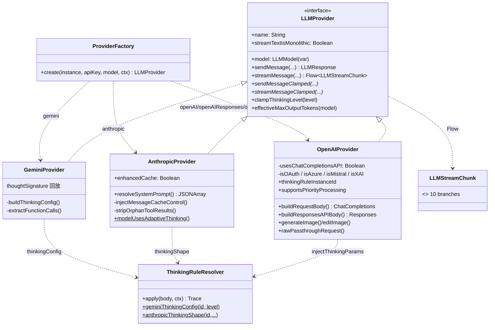
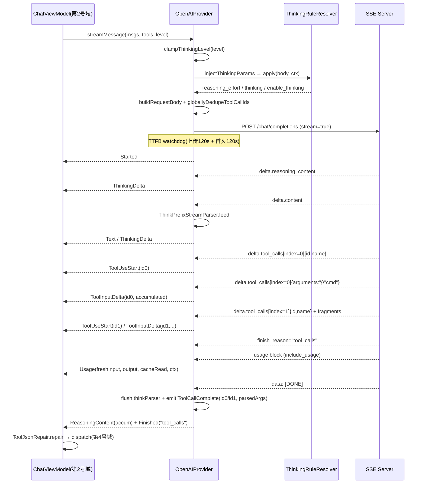
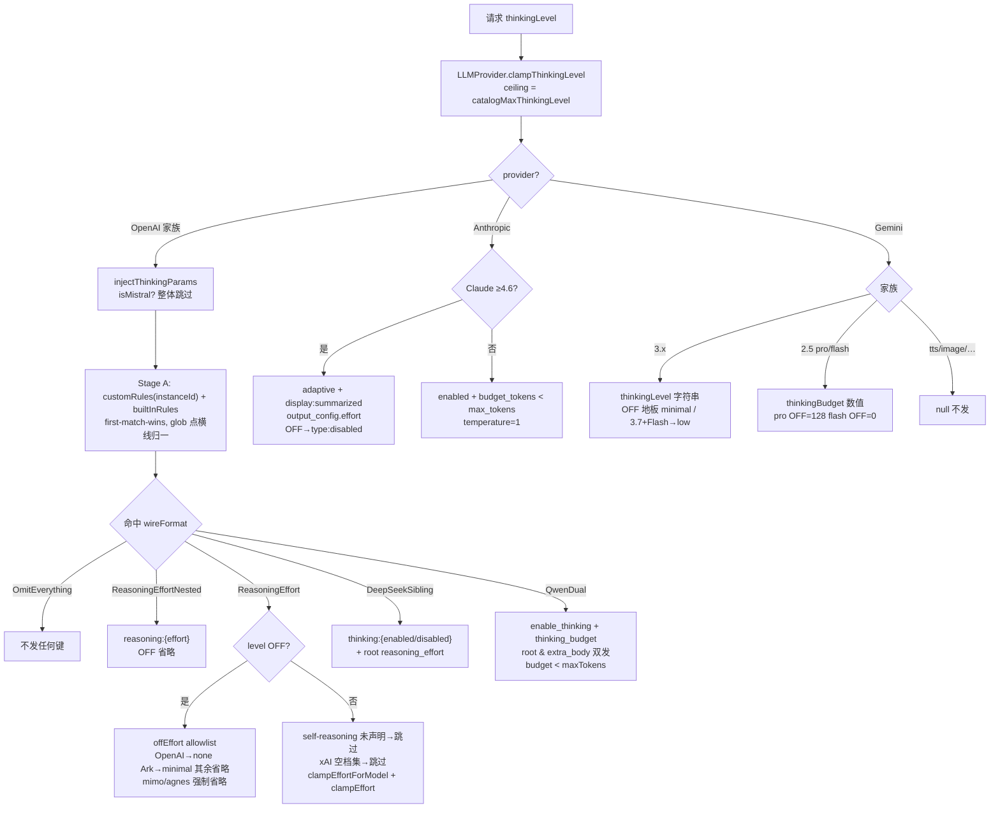

# 03 · 模型输出层：Provider 抽象、流式协议解析、思考链与工具调用序列化

> 基线 commit `067384b7e5b3c47a7eeca217895be71493396518`。路径缩写：`K/` = `android/src/android/app/src/main/java/com/openminis/app/`，`N/` = `android/src/android/app/src/main/java/io/github/nanomuse/`，`T/` = `android/src/android/app/src/test/java/`。所有行号以基线为准。
>
> 边界说明：agent 循环控制流（runAgentLoop / fallback 调度）归第 2 号研究员；工具实现归第 4 号；上下文压缩算法归第 5 号（本章只覆盖 token 估算与 ImageBudget）；本章只讲 provider 边界内发生的事。

---

## 1. Provider 抽象契约

### 1.1 LLMProvider 接口

`K/provider/LLMProvider.kt:13-118` 定义了全部契约，核心设计是**"公共入口 + Clamped 实现"双层结构**：

- `name: String`、`var model: LLMModel`（LLMProvider.kt:14-15）——model 是**可变**的，fallback 换模型时直接改写同一 provider 实例。
- `sendMessage(messages, systemPrompt, maxTokens, temperature?, imageParts, tools, thinkingLevel): LLMResponse`（suspend，LLMProvider.kt:54-65）与 `streamMessage(...): Flow<LLMStreamChunk>`（LLMProvider.kt:68-79）是公共入口，**provider 不覆写它们**；默认实现先 `clampThinkingLevel()` 再委托给 `sendMessageClamped` / `streamMessageClamped`（抽象方法，LLMProvider.kt:87-106）。
- 钳制是结构性的：`clampThinkingLevel` 按 `model.catalogMaxThinkingLevel` 的 rank 截断（LLMProvider.kt:114-117）。注释明言这样"任何代码路径都不可能发出超档位请求——中途换 model 的 fallback 自动按新模型上限钳制"。

```kotlin
// K/provider/LLMProvider.kt:114-117 —— 整个钳制机制只有这四行，
// 但因为它在 interface 默认入口而非 impl 里，所有路径都被覆盖
fun clampThinkingLevel(level: ThinkingLevel): ThinkingLevel {
    val ceiling = model.catalogMaxThinkingLevel
    return if (level.rank > ceiling.rank) ceiling else level
}
```

注意 `ceiling` 每次调用都从**当前** `model` 现读，不缓存——这正是 fallback 中途换模型后钳制自动生效的机制细节：没有失效通知、没有监听器，靠"每次现算"消除状态一致性问题。
- 能力声明**不在接口上**，而在 `LLMModel` 数据上：`supportsReasoning` / `reasoningEffortValues` / `inputModalities` / `outputModalities` / `contextWindow` / `maxOutputTokens`（K/data/model/LLMModel.kt:11-38）。vision 判定走扩展属性 `LLMModel.hasImageInput`（K/data/model/VoiceModality.kt:90-96）：声明缺失时由 nanoMuse 自有层 `VisionFamilies.looksLikeItSees(id, displayName)` 按名字猜（上游行为是"未声明=看不见"）。上下文窗口走 `LLMModel.contextWindowTokens`（LLMModel.kt:237 起）的 id 启发式。
- `effectiveMaxOutputTokens(model) = model.maxOutputTokens ?: defaultMaxOutputTokens(16384)`（LLMProvider.kt:22-26）。
- `streamTextIsMonolithic`（LLMProvider.kt:42）：语义极重要的一个布尔。Chat Completions 的文本是**单块** content，text delta 与 tool_calls delta 之间没有位置语义（qwen 会在 tool_calls 之后吐尾巴文本，纯属分块伪影）；Responses / Anthropic 的块到达顺序即语义顺序。OpenAIProvider 覆写为 `get() = usesChatCompletionsAPI`（K/provider/openai/OpenAIProvider.kt:392），ChatViewModel 据此决定文本块重建策略（K/ui/chat/ChatViewModel.kt:8081、8286、8408）。

**取消语义**：三家 provider 都用 `callbackFlow` 包住阻塞式 OkHttp `call.execute()` + `BufferedReader.readLine()` 循环，`awaitClose { response.close() }` 兜底（OpenAIProvider.kt:650、891-894；AnthropicProvider.kt:128、273；GeminiProvider.kt:108、179）。协程取消 → channel 关闭 → response 关闭 → readLine 抛 IOException 退出。没有显式 `LLMError.Cancelled` 发射路径（该类存在于 LLMError.kt:10，但 provider 层未见构造，取消以 CancellationException 传播）。

**空流防御**：`Flow<LLMStreamChunk>.failOnSilentEmptyCompletion(providerName)`（LLMProvider.kt:138-162）——流"正常"结束但既无内容 chunk 也无 finish reason 时抛 `TransientError`，三家全部套用（OpenAIProvider.kt:640、AnthropicProvider.kt:118、GeminiProvider.kt:98）。带 stop reason 的空流（"stop"/"length"）刻意放行，交给 agent 循环处理。

### 1.2 LLMStreamChunk 完整分支清单（10 个）

`K/data/model/LLMStreamChunk.kt`，密封类，逐分支：

| # | 分支 | 行号 | 语义 |
|---|------|------|------|
| 1 | `Started`（data object） | LLMStreamChunk.kt:6 | 流开始。OpenAI 在读取循环前发（OpenAIProvider.kt:945）；Anthropic 在 `message_start` 事件发（AnthropicProvider.kt:206）；Gemini 在首个可解析 SSE 帧发（GeminiProvider.kt:138-141） |
| 2 | `Text(text)` | :7 | 可见正文增量 |
| 3 | `Usage(usage: LLMUsage)` | :8 | token 计量，可多次（Anthropic message_start + message_delta 各一次） |
| 4 | `Finished(stopReason: String?)` | :9 | 终止。stopReason 是归一化字符串："stop"/"tool_use"/"length"/"end_turn"/"max_tokens" 等 |
| 5 | `ThinkingDelta(text)` | :12 | 实时思考增量（渲染思考气泡） |
| 6 | `ReasoningContent(content)` | :17 | **累积的完整** reasoning blob（DeepSeek/Kimi/QwQ `reasoning_content`），与 ThinkingDelta 区别在于它是"回显契约"：下一轮必须原样带回，空串也要回传（OpenAIProvider.kt:911-918） |
| 7 | `ToolUseStart(id, name)` | :20 | 工具调用开始 |
| 8 | `ToolInputDelta(id, accumulated)` | :21 | 参数 JSON 增量——注意携带的是**累积串**而非碎片 |
| 9 | `ToolCallComplete(id, name, args: JSONObject, thoughtSignature: String?=null)` | :22-31 | 参数拼装完成。thoughtSignature 仅 Gemini 3.x 填充（#179），必须持久化并在下一轮回放 |
| 10 | `MediaAttachment(attachment: LLMMediaAttachment)` | :40 | 模型生成的媒体（gpt-image-2 经 Codex 后端出的图），供非流式调用者收进 `LLMResponse.mediaAttachments` |

另有平行的 `AgentStreamEvent`（K/data/model/AgentTypes.kt:14-36），注释称其为 agent 循环用的"超集"，但**当前三家 provider 实际只发 LLMStreamChunk**，AgentStreamEvent 未见 provider 侧构造（未确认其活跃使用方）。

### 1.3 消息与内容模型

`LLMMessage`（K/data/model/LLMMessage.kt:3-72）：role 只有 `USER/ASSISTANT` 两个（:33-36）——system 走独立参数，tool 角色由各 provider 序列化时合成。字段：`content: String`（扁平文本）、`imageParts`（当前轮附件，ImagePart 带 `linuxPath`（elide 占位符用）与 `noVisionPlaceholder`（Vision Group 提示语，GH#182），:38-65）、`audioParts`（base64 原样保存，避免 MB 级解码/重编码churn，:67-71）、`contentParts: List<AgentContentPart>`（结构化历史）、`dbMessageId`（压缩边界锚点）、`reasoningContent`（回显契约）。

`AgentContentPart`（K/data/model/AgentContentPart.kt:10-88）四分支：`Text`(:11)、`ToolUse(id,name,input,thoughtSignature?)`(:13-22)、`ToolResult(id,name,content,isError,imageData?,imageMimeType?,imageLinuxPath?)`(:24-56)、`ImageData(data,mimeType,linuxPath?,noVisionPlaceholder?)`(:58-87)。**工具结果的图片直接挂在 ToolResult 上**——这是 read_image 像素回传的通道，三家 provider 各自解决"tool 消息装不下图"的 schema 限制（见 §3/§4/§5）。

`LLMError`（K/data/model/LLMError.kt:3-33）八类，并给出三个调度谓词：`isRetryable = NetworkError || TransientError`（同模型重试），`isFallbackable = RateLimited || InvalidApiKey || ProviderError`（换组内下一模型，:17-20）。**重试/回退循环本体在 ChatViewModel（第 2 号域），provider 层只负责分类**。

这套契约有一个值得点名的架构取向：**能力与协议解耦**。接口上没有任何 `supportsVision()`/`supportsThinking()` 之类的能力方法——能力全部长在 `LLMModel` 数据上（catalog 数据驱动 + 用户 override），协议差异全部封在三个 impl 里。于是"换模型"只是改 `provider.model` 这一个 var：fallback 路径不需要重建 provider、不需要重新询问能力，钳制与 thinking 规则解析在每次请求时按**当前** model 重新求值。反过来，"换协议"（Chat↔Responses）也只是同一 OpenAIProvider 内部的布尔分流。数据（能力）、协议（线格式）、调度（重试/回退）三个变化轴各自独立演化，这是 204KB 的 OpenAIProvider 没有把上层拖垮的根本原因。

### 1.4 Provider 类图



注：openrouter/xai/antigravity 目录下只有 ModelsApi（模型目录发现），**没有独立 Provider 类**——OpenRouter 与 xAI 都是 OpenAIProvider 换 basePath/headers 的实例（ProviderFactory.kt:106-157）；antigravity 在 Android 是 decode-only，工厂直接抛 InvalidApiKey（ProviderFactory.kt:199-201）。

---

## 2. ProviderFactory 与配置解析

### 2.1 实例化决策

`ProviderFactory.create(instance: ProviderInstance, apiKey, model, context, record)`（K/provider/ProviderFactory.kt:18-211）按 `instance.providerType` 分派：

- **anthropic**：`AnthropicProvider(apiKey, model, basePath?, isOAuth, customUserAgent)`（:35-41）。
- **gemini**：`GeminiProvider(apiKey, model, basePath?)`（:42-45）。
- **openAI / openAIResponses**（:50-105）：三条子路径——① credentialType=oauth 且无 Manual Bearer 且无自定义 base → **Codex OAuth 构造器**，tokenProvider 是 `OpenAIOAuthManager.validAccessToken()`（刷新感知），走 chatgpt.com Responses 后端；② Manual Bearer 视同 API key 走 Chat Completions（chatgpt.com 只认真实会话 token）；③ API key + `useResponsesAPI` 实例开关（openAIResponses 类型强制置 true，:89-90）。Azure 模式传**原始** customBaseURL（保留 ?api-version 查询），因为 effectiveBaseURL 已把 query 剥掉（:95-100）。
- **openRouter**：OpenAIProvider + 固定 base `https://openrouter.ai/api/v1` + `HTTP-Referer`/`X-Title` 头（:106-117）。
- **xAI**：OAuth 走 `OpenAIProvider.oauthOpenAICompat()`（forceChatCompletions=true，避免 OAuth 被误拖去 Codex 后端，OpenAIProvider.kt:226-236）；两种构造都置 `supportsPriorityProcessing=true`（能力旗标，用户开关在 FastModePrefs，请求构建时才读，OpenAIProvider.kt:107-143）。
- **kimiCode**：`/coding/v1` 的 `/v1` 是 load-bearing（/coding/chat/completions 404，ProviderFactory.kt:158-192）。
- **antigravity / unsupported**：抛 `InvalidApiKey`（:199-201）。

收尾两步：给 OpenAI 家族贴 `thinkingRuleInstanceId = instance.id`（自定义 thinking 规则查缓存用，:208）；nanoMuse 层 `OwnTurns.wrap()` 包一层记账 wrapper（:210）。

**自定义 OpenAI-compatible endpoint**：`instance.effectiveBaseURL` 统一 trim 尾斜杠 + 补 `/v1`（T174 修复了 `/v1//v1/chat/completions` 404，ProviderFactory.kt:19-33）；OpenAIProvider 拼 `$basePath/chat/completions` 或 `/responses`（OpenAIProvider.kt:2430-2441）。无 key 端点（ollama/LM Studio/LiteLLM）支持：`applyKeyAuth` 在 token 为空时**不发任何认证头**而不是发空 Bearer（OpenAIProvider.kt:342-350）。`absoluteEndpointOverride` 可整体替换 host 后的路径（:326-333）。

### 2.2 ModelGroup 与四槽位

`ModelGroup`（K/data/model/ProviderConfig.kt:184-202）：`memberEntryIds` + `strategy(fallback|loadBalance)` + `fallbackStrategy(default|always)` + 组级默认 `defaultThinkingLevel` / `contextLimitTokens`。`ProviderRepository`（KnanoMuse 仓库根sitory/ProviderRepository.kt，3078 行）持有 `ProviderConfig` StateFlow，槽位字段：`defaultPrimaryGroupId`（chat）、`defaultSubGroupId`、`voiceInputGroupId`/`voiceOutputGroupId`（:398-406）、`visionGroupId`（:412，meta KV 行、不进 CRDT 同步）、`agentLoopGroupIds`（:416）。删组时联动清空所有引用（:1284-1297）。

docs/android.md 说的 Settings→Models 四行在 nanoMuse 层 `N/ui/models/ModelsScreen.kt:49-53` + `N/models/ModelSlots.kt:37-41`：

| UI 行 | Slot | 落点 |
|---|---|---|
| Chat | `Slot.CHAT` | `config.defaultPrimaryGroupId`（与上游 Model groups 屏共享同一字段，ModelsScreen.kt:76） |
| Operating the screen | `Slot.HANDS` | `Hands.screenModel(context)` / `hands.model_entry` 偏好（ModelSlots.kt:123-126），capability=VISION |
| Making pictures | `Slot.IMAGE` | `ImageGen.endpoint(context)` 偏好（ModelSlots.kt:131） |
| Making clips | `Slot.VIDEO` | `MediaModels.videoEndpoint(context)`（ModelSlots.kt:132） |

即**只有 Chat 槽走 ModelGroup 机制**，其余三槽是独立偏好存储（ModelSlots.kt:30 注释明言）。Vision Group（`visionGroupId`）是另一条独立通道，服务于 read_image 路由（§8）。

### 2.3 ProviderRepository：配置持久化中枢

`KnanoMuse 仓库根sitory/ProviderRepository.kt`（3078 行）是 provider 配置的唯一权威：内存 `_config: StateFlow<ProviderConfig>`，加载走 `loadConfigSuspending()`（:277，Room 为主、JSON mirror 兼容旧数据），每次变更经 `persistToDbAndMirror()`（:446）双写 Room 与 JSON 镜像（跨平台导入导出用）。与本章直接相关的三个职责：

1. **凭证**：`saveApiKey/loadApiKey`（:2420-2424）走加密存储；`usableApiKey(instance)`（:2437）对无 key 第三方兼容端点返回 `""` 而非 null——空字符串是"合法无凭证"的语义，VisionGroupResolver 与工厂都靠它保持 keyless 端点可路由（VisionGroupResolver.kt:226-228）。
2. **自定义 thinking 规则的发布**：请求构建器是同步调用而 Room 是异步的，所以 repository 在加载后 `loadAllThinkingRulesIntoCache()`（:1648-1653）把全部规则按 instance 分组推进 `ThinkingRuleResolver.setAllCustomRules`，每次增删改/重排后 `setCustomRules(instanceId, …)`（:1658、saveThinkingRule :1667）；删除实例时清空对应缓存（:843）。缓存 miss 只意味着"回到 built-in 行为"，永远不会给出错误 shape（ThinkingRuleResolver.kt:113-114）。
3. **模型目录刷新**：`refreshModels(instance)`（:2158）调各 ModelsApi 拉取 `/models`，结果经 ProviderModelsCache（7 天 TTL）与 ModelsDevApi.enrichModels 补能力元数据后写回 ModelEntry。空组自动清理并解除所有槽位引用（:830-834）。

---

## 3. OpenAI Provider 深拆（OpenAIProvider.kt，3760 行）

### 3.0 网络基座与端点谓词

OkHttp client（OpenAIProvider.kt:438-449）：connectTimeout 30s、**readTimeout 600s**、writeTimeout 30s。600s 有实测依据：Codex OAuth + gpt-5.5 + 440KB agent body 在 reasoning item 与文本爆发之间可以合法静默 2:50-3:10 且无 keep-alive 字节，180s 上限曾把正常思考静默误判成 SocketTimeout（T-android-openai-codex-timeout，:408-426）。连接池刻意用 `NetworkMonitor.sharedLLMConnectionPool` **共享池**——per-client 池收不到网络切换驱逐通知，本地代理的死 h2 隧道会在每次重试中被复用造成无限挂起（:442-446）。`proxyAuthenticator` 接 nanoMuse 自有层带密码代理（Settings→Network，:448）。每个 call 挂 `OkHttpNetTraceListener`（:3569 起）记录 DNS/代理选择/TCP/TLS/连接获取/上传完成/首头各 leg 的毫秒时间戳与连接 identityHash——超时报告能定位到"哪条腿卡住"，也是 TTFB 看门狗的数据源。

vendor 判定全部是 **host 谓词**而非能力元数据（能力元数据在 relay 场景不可信）：

| 谓词 | 判定 | 行号 | 作用 |
|---|---|---|---|
| `isOpenRouter` | base 含 openrouter.ai | :452 | max_tokens 旧形状、去 stream_options、nested reasoning |
| `needsOpenRouterAnthropicCacheControl` | isOpenRouter && id 以 `anthropic/` 开头 | :477-478 | 顶层 cache_control（OpenRouter 不给 Claude 自动开缓存，实测 cache_read 恒 0、成本 3-6 倍，#191） |
| `isDashScope` | base 含 dashscope | :481 | QwenDual AllModels 规则 |
| `isMistral` | base 含 mistral.ai（大小写不敏感） | :505 | 全面禁止 reasoning 键（closed schema 422） |
| `isXAI` | base 含 api.x.ai 或 //x.ai | :521-523 | 空 effort 集跳过（#163） |
| `usesUnifiedReasoningEffort` | isAzure 或 base 含 volces/ark./api.venice.ai | :554-557 | 统一网关：第三方家族也只用 root reasoning_effort；Venice `additionalProperties:false` 未知根键在 dispatch 前 400 |
| `explicitOffEffort()` | 官方 OpenAI→"none"；Ark/seed/doubao→"minimal"；其余 null | :572-583 | OFF 显式档 allowlist——只对有文档依据的 vendor 发，Azure 因 off 档随模型而异保持省略 |

共同局限（源码自认）：vanity 域名/中转 relay 不带这些 host 片段就识别不到，失败方向是"保持旧行为"（fail-safe）。`getToken()`（:403-406）：OAuth 走 tokenProvider（刷新失败抛 InvalidApiKey），否则 apiKey。

### 3.1 双路径分流

`usesChatCompletionsAPI = forceChatCompletions || (!isOAuth && !useResponsesAPI)`（OpenAIProvider.kt:386）。`rawStreamMessage` 顶层三分支（:651-679）：`isCodexImageModel`（OAuth + model=="gpt-image-2"，:400）→ `buildCodexImageBody`（wire model 固定 gpt-5.5，借 Codex 内置 image_generation 工具，绕开 OAuth token 缺 `api.model.images.request` scope 的 401）；否则 Chat Completions `buildRequestBody` 或 Responses `buildResponsesAPIBody`。**非流式 `sendMessageClamped` 内部永远发流式请求再拼接**（:593-628）——部分网关拒绝 stream=false。

Codex OAuth 请求指纹（:2398-2427）：URL 固定 `https://chatgpt.com/backend-api/codex/responses`，头 `Version: 0.162.1`、`Openai-Beta: responses=experimental`、`User-Agent: codex_cli_rs/0.162.1 (Android; arm64)`、`Originator: codex_cli_rs`、可选 `Chatgpt-Account-Id`；Content-Type 必须裸 `application/json`（charset 后缀会被拒，:2400、442-448 两处自定义 RequestBody 就为此）。Codex 路径 body 不加 max_output_tokens、不 merge chatExtraBody（客户端指纹不可污染，:2986-2991、2326）。

### 3.2 Chat Completions 请求体（buildRequestBody，:1913-2315）

要点按序：`max_completion_tokens`（OpenRouter 例外用 `max_tokens`，:1938-1942）；`stream_options.include_usage=true`（OpenRouter 除外，:1957-1959）；thinking 参数经 `injectThinkingParams` → ThinkingRuleResolver（Mistral 整体跳过，:1974-1976）；OpenRouter 上的 `anthropic/*` 模型加顶层 `cache_control:{type:"ephemeral"}`（automatic 形式，断点自动推进，#191，:1988-1990）；tools 用 `toOpenAIJson()` 包裹格式 + `tool_choice:"auto"`（:1993-2000）；system 是 messages[0] 的 role:"system"（:2003-2008）。

**reasoning_content 回显门**（:2016-2039）：`includeReasoning = (level.isEnabled || model.supportsReasoning==true) && supportsReasoning!=false && !isMistral`。开启时每条 assistant 历史带 `reasoning_content`（捕获值原样回传，含空串；无捕获则发 `""` 占位——T249/T257 教训：任何合成占位文本都会被 DeepSeek V4 in-context learn 并当成自己的思考吐回来）。Mistral 双向禁止：请求参数 422 `extra_forbidden body.reasoning`，消息字段也 422（isMistral 按 host 判，:505）。

消息映射：assistant ToolUse → `tool_calls:[{id,type:"function",function:{name,arguments}}]`（:2076-2090）；user ToolResult → 独立 `role:"tool"` 消息 + `tool_call_id`（:2099-2104）；**ToolResult.imageData 在 Chat Completions 无处安放（tool 消息 content 是纯字符串），像素改为紧随其后的 user 消息 `image_url` 块，前置文本 `[Image returned by <tool>]`**（T-android-toolresult-image-dropped，:2105-2145）。所有图片入口都过 `ImageBudget.compressUnderBudget` 兜底（:2121、2176、2241）；无 vision 模型收占位文本（`noVisionPlaceholder` 或默认字面量，:2191-2195）。音频走官方 `input_audio:{data,format}` 块（GH#67，:2270-2278）。

**id 治理三件套**：
1. `capChatToolCallId`（:3374-3382）：取 `|` 前半（剥离 Responses 组合 id），仍 >64 字符则 SHA-256 派生 `call_`+56hex（61 字符）——确定性保证 tool_call 与 tool result 仍配对。
2. `globallyDedupeToolCallIds`（:2340-2387）：跨消息扫 assistant.tool_calls[].id 与 role:"tool".tool_call_id，重复 id 改名 `{id}-{N}`（首现保留原值），改名通过 `renameForPendingResults` 传播到紧随的 tool 回复。防 DB 重载历史/跨 provider 切换后 DeepSeek 系 "Duplicate value for tool_call_id" 400。
3. Responses 侧的 call_id 唯一化见 §3.4。

### 3.3 SSE 解析与 tool_calls 增量拼装

读取循环（:951-1387）：容忍 `data:` 无空格（中国电信 eaichat 端点，:953-962）；`[DONE]` → flush ThinkPrefixStreamParser → 发 ReasoningContent（若见过字段或累积非空）→ `Finished(finishReason)`（:963-986）。**无 [DONE] 尾巴**：Responses 常以 response.completed 结束后直接关 socket，循环退出后若 `sawFinishReason && !sentFinished` 补发 Finished（:1451-1472），否则记警告交给 failOnSilentEmptyCompletion。

Chat Completions 分支（:1275-1386）：inline `error` 对象（OpenRouter 空 choices 带 error）直接 mapHttpError 抛出（:1278-1284）；nanoMuse 扩展 `nanomuse` 字段喂 NmStreamStatus（排队提示，:1285）；`delta.reasoning_content` / `delta.reasoning` 双拼写 → ThinkingDelta + reasoningAccum（:1295-1312）；`delta.content` 全部经 ThinkPrefixStreamParser（:1324-1333，无 vendor 白名单，无前缀原样直通）。

**tool_calls 拼装算法**（:1336-1361）——按 `index` 键控的 accumulator map：

```kotlin
// K/provider/openai/OpenAIProvider.kt:1338-1359（节选）
for (i in 0 until toolCalls.length()) {
    val tc = toolCalls.getJSONObject(i)
    val idx = tc.optInt("index", 0)
    val acc = toolCallAccumulators.getOrPut(idx) { ToolCallAccumulator() }
    tc.safeOptString("id", "").let { if (it.isNotEmpty()) acc.id = it }
    tc.optJSONObject("function")?.let { fn ->
        fn.safeOptString("name", "").let { if (it.isNotEmpty()) acc.name = it }
        fn.safeOptString("arguments", "").let { if (it.isNotEmpty()) acc.args.append(it) }
    }
    if (!acc.started && acc.id.isNotEmpty() && acc.name.isNotEmpty()) {
        acc.started = true
        send(LLMStreamChunk.ToolUseStart(acc.id, acc.name))
    }
    if (acc.id.isNotEmpty() && acc.args.isNotEmpty()) {
        send(LLMStreamChunk.ToolInputDelta(acc.id, acc.args.toString()))
    }
}
```

id/name 可能分片到达（首帧只有 id，后续帧补 name），ToolUseStart 恰好一次；`ToolCallComplete` 在**流结束**统一发（:1401-1407），args 解析失败给空 JSONObject（修复交给 ToolJsonRepair，§7）。Responses 分支以 `item_id`(fc_…) 键控，`response.output_item.added` 建 accumulator、`function_call_arguments.delta` 追加、`output_item.done` 用 item 里的权威 `arguments` 覆盖自拼 buffer 后发 Complete（:1073-1124）；**流中途截断时未 done 的 accumulator 也强制 flush 成 Complete**（T247/T248：否则 UI 工具缩略图永转，:1408-1425）。对外 id 是 `"$callId|$fcId"` 组合串（combineResponsesAPIIds，:3346-3347），下一轮 splitResponsesAPIIds 拆回（:3349-3353）。

Responses 终止事件：`response.failed` 提取结构化 error，server_error/rate_limit_exceeded → TransientError（同模型重试），其余 ProviderError（触发组回退）（:1126-1148）；`response.incomplete` 若已有非空白文本则按 `finish_reason=length` 保留部分输出，否则抛错并提示"思考烧光预算"这一真实杠杆（:1150-1225）；`response.completed` 有 function_call 输出时合成 `finishReason="tool_use"`（API 本身不给 stop_reason，:1227-1245）。

### 3.4 call_id 唯一化重写 —— Android 侧确切位置

**已找到，就在 `buildResponsesAPIBody` 尾部：K/provider/openai/OpenAIProvider.kt:3297-3331**，标 `// nanoMuse:`，与 docs/architecture.md 描述一致：

```kotlin
// K/provider/openai/OpenAIProvider.kt:3297-3314（节选）
// nanoMuse: Responses rejects duplicate function_call call_id values across the
// whole input. ... Deliberately
// inspect call_id only: reasoning item ids and function_call item ids are untouched.
val responseCallIdCounts = HashMap<String, Int>()
val usedResponseCallIds = HashSet<String>()
val pendingResponseOutputs = HashMap<String, java.util.ArrayDeque<String>>()
for (i in 0 until input.length()) {
    val item = input.optJSONObject(i) ?: continue
    val rawId = item.optString("call_id", "")
    if (rawId.isEmpty()) continue
    when (item.optString("type")) {
        "function_call" -> {
            var occurrence = (responseCallIdCounts[rawId] ?: 0) + 1
            var rewritten: String
            while (true) {
                val suffix = if (occurrence == 1) "" else "-$occurrence"
                rewritten = rawId.take(64 - suffix.length) + suffix
```

算法：顺序扫 input items；function_call 第 N 次出现同 rawId 时改写为 `rawId截断到(64-后缀长) + "-N"`，且用 `usedResponseCallIds` 全局集合防改写结果再撞车；每个改写 id 入 `pendingResponseOutputs[rawId]` FIFO 队列，后续 `function_call_output` `pollFirst()` 领取同一改写（:3325-3329），保证并行/重复调用配对不乱。**reasoning item id 与 function_call 的 `id`(fc_…) 不动**，只动 `call_id`。Chat Completions 侧对应机制是 §3.2 的 globallyDedupeToolCallIds（:2340）。单测：`T/com/openminis/app/provider/ResponsesCallIdDeduplicationTest.kt`（109 行）。

### 3.5 Responses 请求体差异（buildResponsesAPIBody，:2852-3339）

`store:false` + `parallel_tool_calls:true` + `prompt_cache_key`（首条 user 文本 SHA-256 前 32hex，`minis-` 前缀；跨轮稳定、跨会话不同——补上 Android Codex 缓存命中率 ~70% vs iOS 90%+ 的缺口，:2895-2907、3392-3407）；`include:["reasoning.encrypted_content"]` **仅 OAuth**（第三方 Responses 代理不认识会 400，:2916-2918）；`reasoning:{effort,summary:"auto"}`——summary:"auto" 是"思考开着但 UI 无字"修复的关键（否则只有加密内容、delta 全空，:2928-2967）；OFF 且 supportsReasoning=true 时按 allowlist 发显式 off 档（官方 OpenAI→"none"，Ark→"minimal"，其余省略字段，:2968-2980、572-583）；system → `instructions`；tools 用**扁平** `{type,name,description,parameters}`（toResponsesAPIJson，:3432-3448）；ToolUse → `function_call` item（fcId 缺失时合成 `fc_syn_<callId后24>`，:3058-3074）；ToolResult → `function_call_output`（output 纯字符串），像素同样外挂 user `input_image` 消息，注意 **Responses 的 image_url 是字符串**而 Chat Completions 是 `{url}` 对象（:3139-3145）。

### 3.6 usage / 错误分类 / 超时与重试

`parseChatCompletionsUsage`（:2482-2505）：cacheRead 取 `prompt_tokens_details.cached_tokens`，fallback DeepSeek 的 `prompt_cache_hit_tokens`；**inputTokens = prompt_tokens - cacheRead（fresh-only，对齐 Anthropic 口径，否则命中率被腰斩）**，`latestContextTokens` 保留全量 prompt。Responses 版取 `input_tokens_details.cached_tokens`（:3451-3472）。

`mapHttpError`（:3474-3508）：401/403→InvalidApiKey；429→RateLimited；400 且 body 说上游没给东西（"HTTP 0"，nanoMuse ModelBlip）→TransientError；500/502/503/504/529→TransientError，但 503 带 `no_available_providers`/`model_not_found` →ProviderError（该换模型了）；其余 ProviderError。IOException→NetworkError（:3510-3514）。

**TTFB 看门狗**（:744-817）：上传阶段（call start→requestBodyEnd）宽限 120s（STREAM_UPLOAD_CAP_MS），上传完成后 TTFB 预算 120s（STREAM_TTFB_TIMEOUT_MS，从 30s 上调——本地大模型/慢代理首头合法超 30s）；超时 cancel 该 call 并**只关闭这一条物理连接**（CallWatchState.connection，OkHttp EventListener 在 connectionAcquired 捕获，:3533-3538），绝不 evictAll。SSE 流动后无总时长限制（readTimeout 600s）。provider 层自身无重试循环；TransientError/NetworkError 由 ChatViewModel 按 `isRetryable` 重试（第 2 号域）。

### 3.7 一次流式请求时序（Chat Completions + 并行 tool_calls）



### 3.8 图像生成与透传通道（chat 之外的三条出口）

OpenAIProvider 并非只有 chat 一条协议出口，还承担图像生成与原始透传，这三条通道展示了同一 provider 对象如何被复用为"带认证与指纹的 HTTP 端点适配器"：

**（a）Images API 路径 `generateImage`（:1609-1740）**。请求体 `{model,prompt,n,size?,quality?,response_format:"b64_json"}`。关键防御是 **b64_json 探测重试**：xAI 等网关拒绝 `response_format` 字段，收到"400 且 body 提到该字段"时**去掉字段重试一次**（:1686-1690，iOS parity）；但若用户在 `imageExtraBody` 里显式给了 `response_format`，则尊重用户、跳过探测（:1633-1634）。透传字段合并顺序有讲究：`imageExtraBody` 的用户键覆盖默认键（可以改 prompt/size、加 Seedream 的 `image`/`watermark`），**但 `model` 在合并后被强制写回 resolved id**（:1648-1649）——防止用户误传 model 把请求错路由到别的模型（GH#62）。URL 三级决策：绝对路径 override（`absoluteEndpointOverride`，能逃逸 base 前缀）> Azure deployments 路径 > `$basePath$imagePath`（imagePathOverride 可改相对路径，:1624-1629）。路由模式由 `ImageEndpointMode`（ProviderConfig.kt:165-170）控制：`auto` 先试 `/images/generations`，路由缺失型 4xx（404 / "got chat completions response"，由上层 `looksLikeEndpointMissing()` 判定）回退 chat 多模态输出并把可用端点缓存进 `imageEndpointResolved`，下次跳过探测；wire 值 `images_generations`/`chat_completions` 与 iOS 一致保证配置 JSON 跨平台互导。

**（b）Codex OAuth 图像流 `handleCodexImageStream`（:2677-2788）**。gpt-image-2 走 Responses 协议但输出不是文本而是 `image_generation_call` item。解析器用局部函数 `scanItem` 双通道取值：流式的 `response.output_item.done` 逐项扫，若流结束仍没拿到 base64，则在 `response.completed` 的完整 `response.output[]` 里**兜底再扫一遍**（:2732-2740，对齐 iOS scanItem——有些代理不发增量 done 事件）。`scanItem` 同时收集三类信号：`result`（base64 图）、`revised_prompt`、以及 `message/output_text` item 里的**拒绝解释文本**（:2690-2711）。成功路径：Base64 解码 → `detectImageMime(bytes)` **按魔数识别 PNG/JPEG/WebP/GIF**（gpt-image-2 不保证 PNG，硬编码 image/png 曾错标格式）→ 发 `MediaAttachment` + `Finished("end_turn")`（:2761-2772）。失败路径分级：image call 显式 failed 或有 refusal 文本 → `ProviderError("Image generation was rejected by the safety system: …")`（把模型拒绝话术带给用户）；两者皆无 → `ProviderError("No image data in Codex response")`（:2778-2787）。这是 `MediaAttachment` 分支（LLMStreamChunk.kt:40）在源码中的主要生产者。

**（c）原始透传 `rawPassthroughRequest`（:1539-1590）**。给上层（ModelUseOffloadHandler 等）一个"只借认证与连接池、不碰 body"的出口：body JSONObject 原样 UTF-8 字节化（自定义 RequestBody 精确 contentLength），endpoint 以 `/` 开头走 hostRootURL、否则拼 basePath；头合并顺序是 **ctor extraHeaders 在前、调用方 headers 在后**（OkHttp `header()` 是替换语义，后写者胜，:1570-1572），认证仍走 `applyKeyAuth(getToken())` 享受 OAuth 刷新。返回 `RawPassthroughResult(data bytes, status, contentType, url)` 原样字节，不做 JSON 假设——图像二进制响应也能过。日志打 `[ModelUseRoute] route=raw-passthrough` 带排序后的 bodyKeys/headerOverrides，便于排查透传污染。

---

## 4. Anthropic Provider（AnthropicProvider.kt，1063 行）

**system 独立字段**：`resolveSystemPrompt`（:289-326）返回 content-block 数组。OAuth 路径必须以 Claude Code 标识块开头（nanoMuse `ClaudeSignIn.identifier`，为空直接 ProviderError 拒发，#333/#373），该块**不带 cache_control**；用户 tail 作为第二块带 ephemeral。API key 路径单块 + ephemeral。

**请求体**（:328-448）：`max_tokens` 必带；temperature 仅在 thinking OFF 且模型接受时发（Claude ≥4.6 拒 temperature，`modelRejectsTemperature` 按版本号解析，:809-812；单段版本号如 claude-fable-5 解析为 (5,0)，:795-803）。thinking 双协议（§6）。tools 每个加 `eager_input_streaming:true`（GA，无需 beta 头），**最后一个 tool 打 `cache_control` 断点**（:424-436）。消息经 `stripOrphanToolResults`（孤儿 tool_result 会 400，只清洗出站副本不动存储历史，:458-504）→ `mergeConsecutiveSameRole`（:701）→ `injectMessageCacheControl`。

**prompt caching 断点布局（provider 侧，与第 5 号 EnhancedCache 的接线）**：`enhancedCache: Boolean` 是 provider 上的 var（:61），由 ChatViewModel.enhancedCacheEnabled 注入；`ephemeralCacheControl()` 默认 `{type:"ephemeral"}`（5 分钟），增强版加 `ttl:"1h"`（:64-70）并附 beta 头 `extended-cache-ttl-2025-04-11`（API key 路径 :957-959；OAuth mimicry 列表本来就带）。四个断点预算的用法：system tail 块（:314/324）+ 最后一个 tool（:430）+ **最后两条 user 消息的最后一个 content block**（injectMessageCacheControl 倒序数 user，:767-780）——正好 4 个，滚动前缀缓存。

**消息映射**（:539-660）：ToolUse → `{type:"tool_use",id:sanitizeToolId(id),name,input}`（Anthropic id 正则 `^[a-zA-Z0-9_-]+$`，Responses 组合 id 的 `|` 会被替换成 `-`，AgentTypes.kt:77-81）；ToolResult → `{type:"tool_result",tool_use_id,content:[text, image?],is_error?}`——**图片可以直接嵌在 tool_result 里**（base64 source 块，:597-613），这是与 OpenAI 两路径最大的 shape 差异。thinking 回显（issue #70）：`shouldEchoInterleavedThinking() = supportsReasoning!=false && interleavedReasoningField!=null && isCustomEndpoint`（:532-536）——DeepSeek/GLM/Kimi 的 Anthropic-compat 代理要求历史 assistant 轮带无签名 thinking 块（缺失 400），而**真 api.anthropic.com 校验 signature、无签名块反而 400**，所以官方端点绝不回显。回显块必须置于 assistant content 首位（:566-571）。

**同角色合并与块重排 `mergeConsecutiveSameRole`（:701-746）**：Anthropic 要求 user/assistant 严格交替，而 agent 循环的存储历史里"assistant 文本 + 外挂图片 user 消息 + 下一段 assistant"这类结构（以及 thinking 回显合成的额外 assistant 轮）会产生连续同角色消息。该函数把连续同 role 消息的 content 拍平合并（String content 先包成 text block，collectContentBlocks :749-760），然后对 **assistant 轮做三段稳定重排：thinking 全部置顶 → text/image 居中 → tool_use 全部沉底**（:723-733）。原因是 Anthropic 的两条硬校验：同轮内 text 不能出现在 thinking 之前、也不能出现在 tool_use 之后——多条 assistant 消息合并时（正是 #70 thinking 回显场景），若不把合成的 thinking 块统一 hoist 到最前，合并轮就会以 text 开头而 400。注意这是**出站副本的 shape 治理**，与 stripOrphanToolResults 一样不动存储历史；工具调用与文本在存储层的真实交错顺序由第 2 号域的 `streamTextIsMonolithic` 语义决定，provider 只负责让线格式合法。

**流式事件**（:204-264）：`message_start`（Started + 首次 Usage）→ `content_block_start`（type=tool_use 时记 id/name、发 ToolUseStart）→ `content_block_delta`（`text_delta`→Text；`thinking_delta`→ThinkingDelta；`input_json_delta.partial_json` 追加 buffer→ToolInputDelta）→ `content_block_stop`（parse buffer 发 ToolCallComplete；**同一时刻只有一个 current tool**，串行块协议天然无需 index map）→ `message_delta`（Usage + `delta.stop_reason` → Finished，stop_reason 原样透传："end_turn"/"tool_use"/"max_tokens"）。注意 Anthropic 的 SSE 匹配是严格 `data: `（:196），没有 OpenAI 那份无空格容忍。

**OAuth 指纹**（:924-978）：beta 组合 `claude-code-20250219,oauth-2025-04-20,interleaved-thinking-2025-05-14,prompt-caching-scope-2026-01-05,effort-2025-11-24,context-management-2025-06-27,extended-cache-ttl-2025-04-11`，**刻意去掉 redact-thinking-2026-02-12**（带上它 thinking 明文被抹成只剩 signature，:926-945）；UA `claude-cli/2.1.195 (external, cli)` + 全套 X-Stainless-* 头。API key 路径只带 body 需要的 beta（adaptive→effort，legacy→interleaved-thinking），绝不带 Claude-Code-only 标记。usage：`cache_creation_input_tokens`/`cache_read_input_tokens` 直取，input_tokens 本来就是 fresh-only（:1026-1035）。错误分类与 OpenAI 同构但无 503 特判（:1037-1056）。

---

## 5. Gemini Provider（GeminiProvider.kt，523 行）

URL：`$basePath/models/${model.id}:streamGenerateContent?alt=sse&key=$apiKey`（:110）——**key 在查询串**，非 Bearer。请求体（:182-378）：`contents[].{role: user|model, parts[]}`；system → `systemInstruction.parts[].text`（audio 输出模型拒收，按 outputModalities 判，#226，:330-340）；tools → `tools:[{function_declarations:[...]}]`（:343-349）；`generationConfig.{maxOutputTokens,temperature,thinkingConfig,responseModalities}`——图像输出模型必须声明 `responseModalities:["TEXT","IMAGE"]` 否则只回文本（:362-373）。**safetySettings：源码中不存在**（全文件无 "safety"），未发送任何安全阈值配置。

`toGeminiJson()`（K/data/model/AgentToolDefinition.kt:37-53）：type 大写（"OBJECT"/"STRING"，:88-92），可选 `propertyOrdering`（:46）——Gemini 的 JSON schema 不保证 properties 迭代序，propertyOrdering 显式固定参数生成顺序（例如 shell 工具先 command 后 timeout），由工具注册方提供（工具语义归第 4 号）。

**functionCall / functionResponse 映射**（:234-295）：ToolUse → part `{thoughtSignature?, functionCall:{name,args}}`；ToolResult → `{functionResponse:{name,response:{result,error?}}}`，像素紧随同轮 `inlineData` part（Gemini 允许异构 parts，无需外挂消息）。空 content 用 `" "` 占位、空 parts 用 `(empty)` 占位（oneof 400 防御，:264、273、322-324）。

**thoughtSignature（#179）**：Gemini 3.x 每个 functionCall part 带同级别（sibling，非嵌套）`thoughtSignature`，历史回放缺失即 400 "Function call is missing a thought_signature"。收流侧 `extractFunctionCalls` 提取三元组并放进 ToolCallComplete（:472-488、154-160）；发送侧 `requiresSig = id.contains("gemini-3")`（:200），无签名的历史 ToolUse **连同配对的 ToolResult 一起降级为文本摘要**（`[Called X with: …]` / `[Result of X: …]`，截断 500/1000 字符），绝不发裸 functionCall（:206-268）。工具 id 是本地合成 `"gemini_${System.nanoTime()}"`（Gemini 不给 id，:155）。

**流解析**：每帧是一个完整 GenerateContentResponse；`parts[].thought==true` 的 text → ThinkingDelta，其余 → Text（:408-427）；functionCall 无增量协议，直接 Start+Complete 连发；`finishReason` 归一化 STOP→"end_turn"、MAX_TOKENS→"max_tokens"、其余 lowercase（:490-499）；流尾统一 `Finished(lastFinishReason ?: "end_turn")`（:171）。usage 只有 `promptTokenCount`/`candidatesTokenCount`，**无缓存字段、latestContextTokens 缺省 0**（:501-507）——Gemini 路径的上下文占用水位依赖估算（§10）。

---

## 6. Thinking / Reasoning 体系

### 6.1 档位与钳制架构

`ThinkingLevel`（K/data/model/ProviderConfig.kt:106-143）：**OFF, LOW, MEDIUM, HIGH, XHIGH, MAX, ULTRA** 七档，rank=ordinal；ULTRA 是纯客户端概念（"Max + orchestration"），线上永远映射 "max"。未知持久化值 decoded() 钳到 XHIGH。天花板解析四层（K/provider/ThinkingLevelCatalog.kt:73-102）：`supportsReasoning==false → OFF`（先于一切家族规则）→ `selectableThinkingLevels.lastOrNull()`（**声明的 effort 集是比 id 规则更强的陈述**，["high","max"] 稀疏集直接决定 UI 可选档，:128-141）→ ThinkingLevelCatalog id 规则 → 默认 XHIGH。Catalog 规则表本身很小（7 条，:19-47）：gpt-6*→MAX（nanoMuse #475）、gpt-5.6-sol/terra/luna→MAX、gpt-5.5*→XHIGH、mimo/agnes→HIGH、seed-/bytedance-seed→HIGH、claude-opus-4*(点/横线归一)→MAX。用户手动 override 在 `ModelEntry.effectiveMaxThinkingLevel` 最高优先（:149-150）。

### 6.2 ThinkingRuleResolver：规则注册表

35KB 文件的大头是**证据注释**，规则本体精炼。`builtInRules(ctx)`（K/provider/thinking/ThinkingRuleResolver.kt:142-275）按 ctx 条件动态构建，**顺序 load-bearing**，最多 9 条：

1. `mistral-official`（isMistral 时）→ OmitEverything，全面禁止（422 extra_forbidden）
2. `openrouter` → ReasoningEffortNested(offValue=null)（OFF 时省略，强制思考后端拒 effort:"none"）
3. `o*` → ReasoningEffort（宽前缀刻意保留，收窄会改行为）
4. `gpt-5*` → ReasoningEffort
5. `qwen-dashscope`（isDashScope AllModels）→ QwenDual
6. `*qwen*` → QwenDual
7. `unified-gateway(ark|azure|venice)`（usesUnifiedReasoningEffort）→ ReasoningEffort——**必须排在 3-6 之后**：第一版把它提到前面导致 DashScope 上的 gpt-5 发 enable_thinking、Ark 上的 qwen 发 reasoning_effort 的静默回归；golden snapshot 单维度矩阵没抓到，补了交叉积行（:171-187）
8. `*deepseek-v4*` → DeepSeekSibling
9. `openai-compatible-default`（AllModels 兜底）→ ReasoningEffort

匹配语义：`Scope.matches` 手写 glob（仅 `*` 通配），**先 lowercase 再把 `.`→`-` 归一**（catalog 写 claude-opus-4-8、代理返回 claude-opus-4.8；MiMo 反向同理，ThinkingRule.kt:68-111）。`apply()`（:282-317）两阶段：**Stage A** first-match-wins，用户自定义规则（Room 持久化 → 进程级 `customRulesCache`，repository 加载/变更时同步刷新，:116-135）排在 built-ins 之前；**Stage B** wireFormat=null 落到 providerTypeDefault。emitted keys / clamp 前后值构成 Trace 打进日志（`[resolve] model=… level=…`，OpenAIProvider.kt:2579-2582）。

### 6.3 ThinkingWireFormat 各家线格式（emit，:324-495）

**档位→线上字符串的第一步是 `wireEffort`（ThinkingRuleResolver.kt:666-674，纯映射、不含任何 per-model 钳制）**：

| ThinkingLevel（UI） | wireEffort 输出 | 备注 |
|---|---|---|
| OFF | "low" | 占位值——OFF 分支根本不走 wireEffort，各格式有独立 OFF 语义 |
| LOW | "low" | |
| MEDIUM | "medium" | |
| HIGH | "high" | |
| XHIGH | "xhigh" | mimo/agnes 家族会被 clampEffortForModel 降回 "high"（:681-682，匹配**家族子串**而非单一拼写——线上 API 是 mimo-v2.5、文档写 mimo-2.5） |
| MAX | "max" | |
| ULTRA | "max" | ULTRA 永远不是合法服务端字符串（iOS b38bf3d5），"Max + orchestration"是纯客户端概念 |

映射之后是 `clampEffort`（:685-697）：把请求档吸附到模型**声明的 effort 集**上，阶梯 `none<minimal<low<medium<high<xhigh<max`，**先向下找最近声明档、找不到再取最低声明档向上**——例如声明集 ["high","max"] 的模型请求 medium 会得到 "high"（宁可多思考不可发非法值）。声明集为空/缺失则原样放行（catalog 没意见时保持宽容，中继站会服务 catalog 不认识的模型）。这个"先降后升"的方向性正是 §6.3 OFF 分支绕过它的原因：OFF 若被 clamp 会向上吸附成 "high"。

- **ReasoningEffort**（root `reasoning_effort`）：OFF 分支三岔——OpenAI-native 无条件发 offEffort；self-reasoning 家族（deepseek/glm/kimi/minimax）仅 unified 网关或声明集含该档才发；其余看声明集。**OFF 值刻意不 clamp**（clampEffort 会向上走，["high","max"] 模型会把 OFF 变 "high"，:349-356）。ON 分支：self-reasoning 家族"什么也没声明"时跳过（模型自思考）；xAI 且 declaresNoEffortTiers 时跳过（grok-build-0.1 400，**刻意不广泛数据驱动**——bundled catalog 有 2090 条同形状条目未验证，:399-425）；最后 `clampEffortForModel`（mimo/agnes 的 xhigh→high）+ `clampEffort`（阶梯 none<minimal<low<medium<high<xhigh<max，先向下吸附再向上，:685-697）。
- **ReasoningEffortNested**：`reasoning:{effort}`（OpenRouter）。
- **DeepSeekSibling**：`{"thinking":{"type":"enabled"},"reasoning_effort":"high"}` —— **档位是 root 兄弟键，嵌进 thinking 里就静默失效**（iOS 走了 3 个月弯路，ThinkingWireFormat.kt:53-63）；OFF 显式 `{"type":"disabled"}`。
- **QwenDual**：`enable_thinking` + `thinking_budget` **root 与 extra_body 双发**（DashScope 读 extra_body，vLLM/SGLang 读顶层）；budget LOW=4096/MEDIUM=16384/HIGH=32768/XHIGH+=65536，且必须**严格小于** max_completion_tokens（等值也 400），ceiling = maxTokens - max(2048, maxTokens/8)（:455-484）。OFF 走 nanoMuse `QwenThinking.applyOff`（Qwen3.8 Max 默认思考、摘要请求必须显式关，#719，:446-453）。
- **Anthropic / Gemini 不走 apply()**：resolver 以纯函数输出 shape，provider 自己发射（Phase 2 §1，:497-512）。`anthropicThinkingShape`（:643-663）→ Claude ≥4.6 adaptive：`thinking:{type:"adaptive",display:"summarized"}` + `output_config:{effort}`（display 必须显式 "summarized"，新模型默认 omitted=只剩签名，AnthropicProvider.kt:373-389）；≤4.5 legacy：`thinking:{type:"enabled",budget_tokens}` + temperature=1，budget LOW=8192/MEDIUM=32768/HIGH=min(max,65536)/XHIGH+=max，且**严格 < max_tokens**（等值 400，触顶回退 maxTokens-1，AnthropicProvider.kt:844-864）；adaptive 模型 OFF 必须显式 `{"type":"disabled"}`（默认思考会烧光小预算，:402-411）。effort 映射 XHIGH/MAX/ULTRA→"max"（:871-881）。
- **geminiThinkingConfig**（:535-632）：专用模态后缀 -tts/-image/-embedding/-vision **最先**排除（否则家族规则遮蔽，TTS 全灭，#226）；2.5-flash-lite→null；gemini-3.x→`thinkingLevel` 字符串，OFF 地板 "minimal"，但 **3.7+ Flash 拒 minimal（400）→"low"**（按 minor 版本正则判断，宁可多思考不可不可用，:529-533、578-579）；2.5-pro→`thinkingBudget` OFF=128（0 被拒）LOW=2048…XHIGH+=32768；2.5-flash→OFF=0 LOW=1024…XHIGH+=16384；未知 id→null（与 iOS 的 128-floor 表**刻意不同**，:509-512）。ON 时 `includeThoughts:true`。

### 6.4 解析决策 flowchart



### 6.5 ThinkPrefixStreamParser 与 ThinkingRuleCoding

`ThinkPrefixStreamParser`（K/provider/openai/ThinkPrefixStreamParser.kt:35-192）解决 MiniMax M3 / 部分 Qwen 部署把思考嵌成 content 的 `<think>…</think>` **前缀**的问题。显式 `UNDECIDED→THINKING→BODY` 状态机：只有**回合最开头**（容忍并丢弃前导空白）的 `<think>` 才进 THINKING，否则整轮 commit 到 BODY、文中出现标签原样直通（旧 scanner 任意偏移搜索会把"解释 think 标签的正文"吞进思考气泡）；跨 chunk 半截标签用 `safeEmitLength` 保留最长可能前缀（:180-191）；`</think>` 后空白丢弃；BODY 尾部空白扣留到证明是内部字符才释放（think-only 轮不产生 "\n\n" 空白块）；`finishTurn()` 幂等，未闭合 think 的余量归 thinking（:139-155）。provider 每轮新建一个实例，无 vendor 白名单（OpenAIProvider.kt:919-924）。

**`ThinkingRuleCoding` 勘误**：任务简报猜测它"针对编码模型的例外"——**不是**。它是自定义 thinking 规则的**持久化编解码器**（K/provider/thinking/ThinkingRuleCoding.kt:12-19）：把 ThinkingWireFormat 编成带 tag 的小 JSON（`{"type":"reasoning_effort","offValue":"low"}`）存 Room `ProviderThinkingRuleEntity`，以及 ThinkingRule↔Entity 互转（:139-169）。与"编码模型"无关。

---

## 7. 工具调用健壮性

**ToolJsonRepair**（K/provider/ToolJsonRepair.kt:27-135）三策略按序、各自 gated：

1. **截断修复**（:49-60）：args 为空 dict 且 rawTail（tool-input chunk ring 的最后快照）像被切断的 JSON 时，依次尝试后缀 `["", "\"", "\"}", "\"]}", "}", "}}", "]}", "]}}", "]", "]]"]`，首个可解析者胜，字段拷回 args。**没有**尾逗号/单引号/markdown fence 修复——那些不在策略集里（与 iOS repairToolArgs 对齐）。
2. **类型 coerce**（:63-73）：required 字段存在但非 String → toString()。
3. **模糊字段名**（:79-88）：缺失的 required 字段找 Levenshtein 距离恰为 1 的兄弟键（大小写不敏感，且不能是 schema 已声明字段）改名，`comand`→`command`。

**调用时机**：ChatViewModel 工具分发前、preflight 之前（K/ui/chat/ChatViewModel.kt:9064-9066），传入 `toolInputChunkRings[id]?.lastOrNull()` 作 rawTail；修复 tags 打 WARNING。**修复失败/截断写保护**：truncation 策略命中的 `file_write`/`file_edit` **拒绝执行**（自动闭合的 JSON 与模型真实结尾不可区分，半个文件落盘=静默数据损坏；只读/shell 工具保留 repair-and-run，ChatViewModel.kt:9088-9095）。provider 侧 args 解析失败一律给空 JSONObject（OpenAIProvider.kt:1403、AnthropicProvider.kt:244-248），把 salvage 机会留给 repair。

**JsonExt**（K/provider/JsonExt.kt:14-17）：`safeOptString` 修 Android JSONObject 的坑——值为 JSON null 时 `optString` 返回字面量 `"null"`；此函数在 key 缺失或 isNull 时都返回 fallback。SSE 解析全程使用。

**为什么修复放在消费端而不是 provider 端**：`ToolInputDelta` 携带累积串的设计（§1.2 分支 8）让 ChatViewModel 可以为每个工具 id 维护 chunk ring（`toolInputChunkRings`），ring 的最后一个快照就是"模型实际吐出的原始参数尾巴"。provider 在 args 解析失败时只给空 JSONObject 而**不丢弃 raw**，修复器在分发前拿着 schema（required 字段、类型）+ rawTail 才有足够信息做截断判定——provider 端没有 schema 语境，也无法区分"模型本来就发了 `{}`"与"JSON 被 max_tokens 掐断恰好剩 `{}`"。同理，截断写保护（file_write/file_edit 拒绝执行）是**工具语义级**决策，只能发生在知道工具名的分发层。三层分工：provider 保 raw、repair 器做语法 salvage、分发层做语义 gate——任何一层越界都会丢失信息或误放行。

**prompt-based tool fallback：Android 侧没有**。全源码 grep 无 `prompt_tools`/文本工具调用解析器；OpenAIProvider.kt:1100、3025 两处注释反而把模型自造 `<tool_call>{…}` 文本定性为**故障症状**（tools 字段没发出去的回归）。Python 侧存在 `nanomuse/llm/prompt_tools.py`（文件已确认在 repo），是 Python 独有机制，两端不对齐。

---

## 8. 多模态与预算

**ImageBudget**（K/provider/ImageBudget.kt）三层字节预算：单图 `MAX_PER_IMAGE_BYTES=5MB`（:34）、单条 user 消息累计 `MAX_TOTAL_BYTES=25MB`（:37）、**整个请求体累计 `MAX_REQUEST_BYTES=25MB`**（:49，长历史多轮截图累积曾让网关静默 200+空 SSE）。

- 单图压缩 `compressUnderBudget`（:128-145）：(maxEdge,quality) 梯子 2000/80→1600/75→…→640/45，每档**从原始字节重编码**（不叠加 JPEG 伪影），梯子走完仍超限则取最小产物（"发点什么"优于失败）。三家 provider 的每个图片入口都有这道兜底（§3/§4/§5 已列行号）。
- 消息级 `applyMessageBudget`（:167-193）：先压缩后累计，超 25MB 丢尾部。
- **请求级 `planRequestBudget`**（:254-293）：**倒序**（最新优先）分配预算，被 elide 的图记 `droppedIds`（ByteArray identityHash）+ `droppedPaths`；调用点在 ChatViewModel.kt:2664。elide 的图由 provider 发占位文本 `elidedImagePlaceholder`（:302-308）：`[image elided to fit 25MB request budget. Original at <path> — re-fetch with read_image …]`。无 linuxPath 的字节经 `ensureSpillover`（:323-366）按 SHA-1 落到 `attachments/spillover/<sha1>.<ext>`（bind-mount 到 iSH `/var/minis/attachments/spillover/`），保证占位符永远可回捞——这是与第 5 号 ContextOffload 的接线点：**图片的"压缩"是字节级的、可逆的（read_image 重取），与文本上下文压缩正交**。
- 音频：LLMMessage.AudioPart 保存调用方 base64 原样（LLMMessage.kt:67-71），OpenAI 两路径都发 `input_audio:{data,format}` 嵌套块（Chat :2270-2278；Responses 同形 :3236-3245）；Anthropic/Gemini 请求构建器未见 audioParts 消费（音频输入路由限于 OpenAI 家族，模态门在调用方）。

**Vision Group 的 provider 侧选模**（K/tools/VisionGroupResolver.kt）：候选 = `visionGroupId` 组成员，`describeOnce` 硬门 `entry.model.hasImageInput`（:230），经 ProviderFactory 建 provider 后 `sendMessage(maxTokens=2048, thinkingLevel 默认 OFF, imageParts=…)`（:246-251，OFF 原因同标题生成：防思考烧光预算回空体）；逐候选超时/失败轮转（MAX_ATTEMPTS 上限），全部失败也返回**成功的工具结果携带失败文本**而非 errored tool call（防主模型重试循环，:146-149）；描述文本包 `[Vision Group image description — untrusted data …]` 防注入框架（:264-277）。工具语义归第 4 号。

---

## 9. 模型目录与能力发现

- **ModelsDevApi**（K/provider/ModelsDevApi.kt）：源 `https://models.dev/api.json`（:25），三级加载：内存 cache → 磁盘 cache（TTL 48h，:26）→ bundled assets registry（loadBundledRegistry，:432），过期后台刷新（AtomicBoolean 防并发，:266-281）。两种用法：`fetchModels(forBaseURL)` 按 base URL 精确匹配（±/v1）→ hostname fallback（:54-88）；`enrichModel(s)` 给已有模型补 contextWindow/modalities/reasoning 元数据——同 id 多 provider 发布时**按 key 排序稳定选取、优先带 effort 声明的 richer 条目**（glm-5.2 有 19 个条目 17 个声明档位，:121-135）。

  **字段解析契约 `parseModelDevEntry`（:342-427）**——这张表是 thinking/多模态/预算三个子系统的数据源头：

  | models.dev 字段 | 落点 | 解析细节 |
  |---|---|---|
  | `limit.context` / `limit.output` | contextWindow / maxOutputTokens | 0 视为缺失（:347-349） |
  | `reasoning`（bool） | supportsReasoning | 字段缺失=null（"没意见"），非 false（:352） |
  | `interleaved`（bool 或对象） | interleavedReasoningField | `{"field":"reasoning_content"}` 取 field；bool true 默认 "reasoning_content"（:354-363）——正是 §4 Anthropic thinking 回显门的开关 |
  | `modalities.input/output`（数组） | inputModalities / outputModalities | 空数组归 null；hasImageInput 等谓词由此派生（:365-376） |
  | `reasoning_options[type=effort].values` | reasoningEffortValues | 只认 type=="effort" 的条目，values 逐个 lowercase（:380-394）——selectableThinkingLevels 与 clampEffort 的声明集 |
  | `reasoning_options` 存在但无可用 effort 条目 | **declaresNoEffortTiers=true** | OpenMinis#163：区分"catalog 没意见"（继续发 reasoning_effort，保持宽容）与"catalog **肯定地说**该模型不接受 effort 参数"（发了就是硬 400，xAI grok-build-0.1 / grok-4.20-0309-reasoning 均为 reasoning:true + reasoning_options:[]）。判定刻意基于"无可用 effort 条目"而非"数组为空"——只声明 toggle/budget_tokens 的模型同样算"肯定非 effort 控制"（:395-409） |
  | `release_date` / `cost.output` | releaseDate / outputCost | 供 ModelReleaseIndex 排序（新→贵→大窗口，:423-426） |

  三态语义（null / 空集肯定 / 有值）贯穿整个能力发现体系：reasoning、effort 集、modalities 都区分"未知"与"肯定没有"，前者宽容放行、后者主动规避——这是数据驱动适配不误伤长尾代理模型的关键设计。
- **ModelReleaseIndex**（K/provider/ModelReleaseIndex.kt:22-58）：从 catalog 提取发布日/输出价/上下文，排序 comparator **新→贵（≈更强）→大窗口→名字**，无日期模型沉底不隐藏；服务模型选择器排序。
- **ProviderModelsCache**（K/provider/ProviderModelsCache.kt:23-61）：各 provider `/models` 端点结果的磁盘缓存，`DEFAULT_TTL_MS = 7 天`，invalidate 按 cacheKey。
- **上下文窗口启发式两份**：`LLMModel.contextWindowTokens`（LLMModel.kt:237 起，agent 循环/计量用：claude 现代 1M、haiku/2/3 系 200K、gemini 1M、gpt-5/6 400K（nanoMuse）、deepseek 128K…）与 `inferContextWindowTokens`（K/data/model/ModelContextWindowHeuristic.kt:15-46，**仅供组级 Limit Context Window 滑条的 Unlimited 上限**，刻意不并入前者以免污染 source-of-truth；gpt-5 在此为 128K，与前者 400K 不同——两份表用途不同、数值有意分离）。
- **UserAgentOverride**（K/provider/UserAgentOverride.kt:29-41）：单一 chokepoint。自定义 UA 非空→替换；否则默认 `nanoMuse/<version> (Android <rel>; <model>)`（:63-68）；**Codex/Claude OAuth 路径传 defaultUserAgent=null 保留 CLI 指纹**——UA 是后端判定客户端身份的依据（Anthropic 对非 CLI 请求降级计费/静默关思考，AnthropicProvider.kt:912-918），这就是"为什么需要"：既要有可追溯的品牌 UA，又不能在指纹敏感路径覆盖。
- 各家 ModelsApi：Codex OAuth 不能调 /v1/models，用 `chatgpt.com/backend-api/codex/models?client_version=0.162.1` + 内置静态表兜底（K/provider/openai/OpenAIModelsApi.kt:23-83）；Anthropic /v1/models 无能力元数据，靠 `supportsThinking(id)`（Claude ≥3.7）补 supportsReasoning 旗标（AnthropicProvider.kt:838-841）。

---

## 10. Token 计量

**BPETokenizer**（K/data/BPETokenizer.kt:26-138）：默认**不加载词表**（省 ~2MB 包体），启发式 `max(1, codepoint数/3)`（英文/混合 CJK ±15%，与 iOS vocab 失败兜底一致，:99-107）；可选 `loadVocabularyFromAssets("cl100k_base.tiktoken")`（tiktoken 格式 `<base64> <rank>` 每行，:72-97）后走贪心 BPE 合并（每轮全扫最低 rank 相邻对，O(n²) 级、无优先队列——**性能仅适合短文本**，:114-138）。图片 token：长边缩到 2048、32×32 网格、`ceil(w/32)*ceil(h/32)`、下限 85、解码失败按 1000（:52-65）。消息/回复各 +3 token 常数（:27-28）。

**LLMUsage**（K/data/model/LLMUsage.kt:6-18）五字段：inputTokens（**统一 fresh-only 口径**）、outputTokens、cacheCreationInputTokens?（仅 Anthropic 填）、cacheReadInputTokens?、latestContextTokens（全量输入=上下文占用水位）。三家解析差异见 §3.6/§4/§5；Gemini 不填 latestContextTokens 是已知缺口。

**loadSessionTokenStats**（K/ui/chat/ChatViewModel.kt:1753-1780）：从 `chatRepository.sessionTokenUsages(sid)` 逐条 JSON 累加 input/output/cacheRead/cacheWrite；`context` 取**最后一条非零 latestContextTokens**（不是累加——它是水位不是流量）；loops = max(工具调用数, assistant 消息数)。估算与真实 usage 的偏差处理：`dynamicMaxTokens`（ChatViewModel.kt:7604-7629）优先用上一轮真实 `lastContextTokens` 算剩余窗口，`min(GLOBAL_MAX_TOKENS_CEILING(128K), effectiveMaxOutputTokens, 剩余窗口)`；没有真实 usage 时才依赖 BPE 估算路径（压缩触发侧归第 5 号）。

**估算与真实值的分工原则**：这套计量体系刻意维持"两条腿"——BPE/启发式估算是**请求前**的唯一可用信息（决定 maxTokens、判断是否触发压缩），服务端 usage 是**请求后**的权威修正。两者不追求一致，只要求口径可换算：估算按消息内容算"大约多少 token"，usage 的 latestContextTokens 直接给出"后端实际认为上下文占了多少"。一旦某轮拿到真实 usage，后续决策立即切换到真实水位（dynamicMaxTokens 的优先级），估算只在 Gemini 这类不回报水位的 provider 上持续兜底。这也解释了为什么 BPETokenizer 允许 ±15% 误差还不加载词表：它从不是计费或窗口的最终裁决者，只是冷启动的先验。图片 token 的 32×32 网格公式与 OpenAI 官方 vision 计费规则同形，保证带图会话的估算不至于离谱到影响压缩时机。

---

## 11. 语音 Provider（次要）

`VoiceProvider`（K/provider/voice/VoiceProvider.kt:28-243）是 **open class 而非接口**：默认实现 OpenAI 形状 `/v1/audio/transcriptions`（whisper-1）与 `/v1/audio/speech`（tts-1/alloy），vendor 覆写 `buildVoice*Request`/`parseVoiceInputResponse`/`applyVoiceAuth` 等钩子；含 PCM16→WAV 包装（:53）与 chat-based ASR 通道（`usesChatBasedASR`/`transcribeChatBased`，:231-243，供只有 chat 端点的 omni 模型）。`VoiceProviderFactory.make`（K/provider/voice/VoiceProviderFactory.kt:26 起）**没有独立 voice provider type**——从 instance 的 customBaseURL 嗅探 vendor；多凭证 vendor（讯飞 appId;apiKey;apiSecret）用分号复合串塞单 key 字段。Vendors 覆盖（VoiceProviderVendors.kt，45KB）：Groq(:37)、Alibaba(:44)、XAI(:49)、MiniMax(:59)、Doubao(:166)、Xunfei(:267)、Gemini(:451)、ElevenLabs(:532)、Deepgram(:568)、AzureTTS(:621)、Mimo(:650)、OpenRouter(:776，TTS 走 chat.completions+audio modality，/v1/audio/speech 不存在)。nanoMuse 自有 `N/speech/DashScopeVoiceProvider.kt:33` 直接继承同一基类——`speech/` 是 nanoMuse 的语音会话/终端层，复用上游 provider 抽象（ProviderSpeechTerminalTest / ProviderSpeechCancelTest 可证）。OpenRouter 的 ASR 按模型分裂于 chat 与 transcriptions 两端点。

与 chat 侧对照，语音层展示了同一问题的**另一种抽象答案**：chat 用"接口 + 三个大 impl + 数据驱动规则表"，语音用"OpenAI 形状当基类 + 十二个小 vendor 覆写钩子"。原因在变化轴的位置——chat 的差异是**结构性的**（三种完全不同的线协议），必须密封类收敛；语音的差异大多是**参数性的**（同一个 multipart/JSON 形状换 URL、换认证头、换响应字段名），继承覆写最省。只有两处结构性例外走了独立通道：chat-based ASR（omni 模型没有 transcriptions 端点，把音频塞进 chat.completions 的 input_audio）与 OpenRouter TTS（speech 端点不存在，走 chat + audio modality）——这两处恰好复用了 chat 侧已经趟平的 `input_audio` 编码经验（§8）。vendor 识别靠 base URL 嗅探而非显式类型字段，代价是自定义代理 URL 会嗅探失败落回 OpenAI 默认形状；这个取舍让"给现有实例加语音能力"零配置，符合语音作为附属能力的产品定位。

---

## 12. 三家 Provider 横向对比表

| 维度 | OpenAI Chat Completions | OpenAI Responses | Anthropic | Gemini |
|---|---|---|---|---|
| 端点/认证 | `{base}/chat/completions`，Bearer（Azure: api-key 头+deployments 路径） | `{base}/responses` 或 chatgpt.com/backend-api/codex/responses（OAuth 指纹头） | `{base}/v1/messages`，x-api-key/Bearer + anthropic-version | `models/{id}:streamGenerateContent?alt=sse&key=…`（key 在 URL） |
| system 承载 | messages[0] role:system（:2003） | `instructions`（:3018） | 独立 `system` block 数组（:414-417） | `systemInstruction.parts`（:336-340） |
| 工具声明 | `{type:function,function:{…}}` 包裹 | 扁平 `{type,name,description,parameters}`（:3432） | `{name,description,input_schema}` + eager_input_streaming | function_declarations，type 大写 + propertyOrdering |
| 工具调用增量 | delta.tool_calls 按 **index** 键控，流尾统一 Complete（:1336-1407） | output_item.added/arguments.delta/output_item.done 按 **item_id**，done 即 Complete（:1073-1124） | content_block_start/input_json_delta/content_block_stop，**串行单工具**（:211-255） | 无增量，functionCall 整块到达即 Start+Complete（:153-161） |
| 工具 id | 服务器 id，>64 SHA-256 缩短（:3374） | `callId\|fcId` 组合串（:3346） | 服务器 id，sanitizeToolId 过滤非法字符 | 本地合成 `gemini_<nanoTime>`（:155） |
| id 去重 | globallyDedupeToolCallIds `{id}-{N}`（:2340） | call_id 唯一化 + output FIFO 配对（:3297-3331，nanoMuse） | stripOrphanToolResults（:458） | 无签名调用整体降级文本（:206-268） |
| 工具结果带图 | 外挂 user image_url 消息（:2119-2145） | 外挂 user input_image（image_url 为**字符串**）（:3089-3108） | **直接嵌 tool_result content**（:597-613） | 同轮 inlineData part（:283-293） |
| 思考请求 | root reasoning_effort / thinking:{} / enable_thinking（规则解析） | reasoning:{effort,summary:"auto"}（:2960-2967） | adaptive+output_config.effort 或 enabled+budget_tokens（:383-396） | thinkingConfig.thinkingLevel 或 thinkingBudget（resolver :535） |
| 思考流 | delta.reasoning_content/reasoning + `<think>` 前缀剥离 | reasoning_text.delta / reasoning_summary_text.delta（Codex 加密内容需 include） | thinking_delta（OAuth 需去 redact beta + display:summarized） | parts[].thought==true（:420） |
| 思考回显契约 | assistant.reasoning_content 原样含 ""（Mistral 禁止） | encrypted_content 由后端自管（store=false + include） | 官方端点**禁**无签名回显；compat 代理**必须**回显（:532-536） | thoughtSignature 必须回放（3.x） |
| 终止语义 | finish_reason + [DONE] | response.completed/failed/incomplete，常无 [DONE]（尾部补 Finished） | message_delta.stop_reason | finishReason 归一化，流尾兜底 "end_turn" |
| usage 缓存字段 | prompt_tokens_details.cached_tokens / DeepSeek prompt_cache_hit_tokens | input_tokens_details.cached_tokens + prompt_cache_key | cache_creation/cache_read_input_tokens + 4 断点 cache_control | 无缓存字段 |
| prompt cache 手段 | OpenRouter anthropic/* 顶层 cache_control（:1988） | prompt_cache_key（首条 user SHA-256，:3392） | 4×ephemeral 断点（system/last tool/last 2 user），enhancedCache ttl 1h | 无显式控制 |

---

## 13. 可复现

### 13.1 curl 骨架（从 build*Body 推导）

Chat Completions（buildRequestBody :1913-2315；DeepSeek V4 + thinking HIGH 例）：

```bash
curl https://api.deepseek.com/v1/chat/completions -H "Authorization: Bearer $KEY" \
 -H 'Content-Type: application/json' -d '{
  "model":"deepseek-v4-pro","max_completion_tokens":16384,"stream":true,
  "stream_options":{"include_usage":true},
  "thinking":{"type":"enabled"},"reasoning_effort":"high",
  "tools":[{"type":"function","function":{"name":"shell_execute","description":"…",
    "parameters":{"type":"object","properties":{"command":{"type":"string","description":"…"}},"required":["command"]}}}],
  "tool_choice":"auto",
  "messages":[{"role":"system","content":"…"},
    {"role":"user","content":"…"},
    {"role":"assistant","reasoning_content":"","content":null,
     "tool_calls":[{"id":"call_abc","type":"function","function":{"name":"shell_execute","arguments":"{\"command\":\"ls\"}"}}]},
    {"role":"tool","tool_call_id":"call_abc","content":"…"}]}'
```

Responses（buildResponsesAPIBody :2852-3339；API key + useResponsesAPI 例）：

```bash
curl https://api.openai.com/v1/responses -H "Authorization: Bearer $KEY" -d '{
  "model":"gpt-5.5","stream":true,"store":false,"parallel_tool_calls":true,
  "prompt_cache_key":"minis-<sha256(首条user文本)前32hex>",
  "reasoning":{"effort":"high","summary":"auto"},
  "max_output_tokens":16384,"instructions":"…",
  "tools":[{"type":"function","name":"shell_execute","description":"…","parameters":{…}}],
  "tool_choice":"auto",
  "input":[{"role":"user","content":"…"},
    {"type":"function_call","id":"fc_…","call_id":"call_abc","name":"shell_execute","arguments":"{…}"},
    {"type":"function_call_output","call_id":"call_abc","output":"…"}]}'
```

（Codex OAuth 变体：去掉 max_output_tokens，加 `include:["reasoning.encrypted_content"]`，URL/头见 §3.1。）

Anthropic（buildRequestBody :328-448；legacy thinking 例）：

```bash
curl https://api.anthropic.com/v1/messages -H "x-api-key: $KEY" \
 -H 'anthropic-version: 2023-06-01' -H 'anthropic-beta: interleaved-thinking-2025-05-14' -d '{
  "model":"claude-sonnet-4-5","max_tokens":16384,"stream":true,"temperature":1,
  "thinking":{"type":"enabled","budget_tokens":8192},
  "system":[{"type":"text","text":"…","cache_control":{"type":"ephemeral"}}],
  "tools":[{"name":"shell_execute","description":"…","input_schema":{…},
    "eager_input_streaming":true,"cache_control":{"type":"ephemeral"}}],
  "tool_choice":{"type":"auto"},
  "messages":[{"role":"user","content":[{"type":"text","text":"…","cache_control":{"type":"ephemeral"}}]},
    {"role":"assistant","content":[{"type":"tool_use","id":"toolu_…","name":"shell_execute","input":{…}}]},
    {"role":"user","content":[{"type":"tool_result","tool_use_id":"toolu_…","content":[{"type":"text","text":"…"}]}]}]}'
```

Gemini（buildRequestBody :182-378）：

```bash
curl "https://generativelanguage.googleapis.com/v1beta/models/gemini-3-pro:streamGenerateContent?alt=sse&key=$KEY" -d '{
  "contents":[{"role":"user","parts":[{"text":"…"}]},
    {"role":"model","parts":[{"thoughtSignature":"<sig>","functionCall":{"name":"shell_execute","args":{…}}}]},
    {"role":"user","parts":[{"functionResponse":{"name":"shell_execute","response":{"result":"…"}}}]}],
  "systemInstruction":{"parts":[{"text":"…"}]},
  "tools":[{"function_declarations":[{"name":"shell_execute","description":"…",
    "parameters":{"type":"OBJECT","properties":{…},"required":["command"],"propertyOrdering":["command"]}}]}],
  "generationConfig":{"maxOutputTokens":16384,"thinkingConfig":{"thinkingLevel":"high","includeThoughts":true}}}'
```

### 13.2 相关单测（T/com/openminis/app/provider/）

`OpenAIProviderTest.kt`、`AnthropicProviderTest.kt`、`GeminiProviderTest.kt`、`ResponsesCallIdDeduplicationTest.kt`（call_id 重写）、`ResponsesApiFinishedTest.kt`（无 [DONE] 补 Finished）、`ResponsesIncompletePartialTest.kt`、`ResponsesTopLevelImageTest.kt`、`StreamDropNoFinishTest.kt`、`ToolResultImageSerializationTest.kt`、`MistralReasoningFieldTest.kt`、`OpenRouterCacheControlTest.kt`、`XAIPriorityProcessingTest.kt`、`XAIDynamicCatalogTest.kt`、`ThinkingWireGoldenSnapshotTest.kt`（382 行，119 行矩阵 pin 死 pre-refactor 行为）、`ThinkingWireGeminiAnthropicSnapshotTest.kt`、`ThinkingRulesRegressionTest.kt`、`ThinkPrefixStreamParserTest.kt`、`thinking/ThinkingRuleCustomMergeTest.kt`、`thinking/XAIEmptyEffortTiersTest.kt`、`ModelReleaseIndexTest.kt`、`ImageEditRoutingMatrixTest.kt`、`OpenAIEditImageTest.kt`、`EmptyKeyRefreshTest.kt`；另有 `T/com/openminis/app/data/ThinkingLevelTest.kt`、`T/io/github/nanomuse/models/QwenThinkingTest.kt`、`T/io/github/nanomuse/speech/{DashScopeVoiceProviderTest,ProviderSpeechTerminalTest,ProviderSpeechCancelTest}.kt`。ToolJsonRepair 未见独立单测文件（未确认，可能覆盖在 ChatViewModel 级测试中）。

### 13.3 调试入口

`K/debug/ProviderDebugMethods.kt`（JSON-RPC 方法，debug 构建）：`types()`(:39) 列 provider 类型规格与默认 base；`instancesList`(:93)、`modelsList`(:130)、`groupsList`(:234)；`export`/`import`(:176/:204) provider 配置 JSON；**`quickTest(entryId, kinds=[text|tts|asr|imagegen])`**(:298-365) 对任一模型条目实测四种能力并返回耗时/字节数/失败原因。请求级：debug 构建 `LLMRequestLog` 记录完整请求体/头/响应码（OpenAIProvider.kt:843-869）；`[T321]` 日志系列给出请求摘要、逐 SSE delta 计数、finish_reason/usage 终局（:735-741、998-1042、1474-1481）；`Thinking [resolve]` 日志给出命中规则与 emitted keys；`OkHttpNetTraceListener`（:3569 起）逐网络 leg 时间戳。

---

## 14. 可复用：Provider 适配层设计要点与踩坑清单

**设计要点**
1. **公共入口做结构性钳制**（clamp 在 interface 默认方法而非各 impl），换模型/fallback 路径不可能漏钳——比"每个 impl 记得钳"可靠一个量级。
2. **统一流事件密封类 + 语义化 stopReason 归一**，让三种线协议（index 增量 / item 事件 / content block / 整块）收敛到同一 agent 循环；`streamTextIsMonolithic` 这类"线格式语义旗标"要显式建模，否则文本/工具块顺序重建必错。
3. **thinking 契约数据驱动 + first-match 规则表 + 可观测 Trace**；规则顺序即语义，用 golden snapshot（含交叉积行）pin 死重构。
4. **id 治理是独立子系统**：长度上限（确定性问题→确定性哈希）、跨消息去重（改名传播到配对回复）、双 id 组合串（callId|fcId）三件事分层解决。
5. **字节预算与 token 预算分离**：图片走可逆 elide+spillover（占位符携带回捞路径），不污染文本压缩。
6. usage 统一 fresh-only 口径 + latestContextTokens 水位，缓存命中率统计才不被双计。

**踩坑清单（全部有源内事故编号）**
- SSE `data:` 无空格变体（OpenAIProvider.kt:953）；Responses 无 [DONE]（:1430-1472）；空流无 finish reason 要当瞬态错误（LLMProvider.kt:138）。
- 思考占位文本会被模型 in-context learn——回显占位只能是 `""`（T249/T257，:2060-2069）。
- DeepSeek V4 档位嵌进 thinking 对象=静默失效 3 个月（ThinkingWireFormat.kt:53-63）；Qwen budget == max_tokens 也 400（:69-71）；Anthropic budget_tokens == max_tokens 400（AnthropicProvider.kt:856-863）。
- OFF 不是"省略字段"：默认思考的模型（DeepSeek V4 / Qwen3 / Claude adaptive / Codex）必须显式关，否则小预算请求烧光在思考上返回空体（AnthropicProvider.kt:402-411）。
- OFF 值不能过 clampEffort（会向上吸附，把 OFF 变 high，ThinkingRuleResolver.kt:349-356）。
- Mistral/Venice 类 closed-schema：未知键在 dispatch 前 422/400，"关掉思考"也救不了 disabled 分支仍发键（ThinkingWireFormat.kt:24-33）。
- tool 消息装不下图：Chat/Responses 需外挂 user 消息，Anthropic/Gemini 可内嵌——漏掉就是"工具卡绿色成功但模型说看不见"（:2105-2118）。
- Gemini 3.x 无签名 functionCall 必 400，且 functionResponse 不能独存——成对降级文本（GeminiProvider.kt:201-268）。
- 官方 Anthropic 与 compat 代理对无签名 thinking 块要求**相反**（AnthropicProvider.kt:507-536）。
- 模型 id 拼写漂移（点/横线、mimo-2.5 vs mimo-v2.5）：匹配前归一化（ThinkingRule.kt:82-88）。
- OAuth 指纹（UA/beta/Content-Type charset/body 字段集）是后端身份判定输入，不可"顺手统一"（OpenAIProvider.kt:2400、AnthropicProvider.kt:912-923）。
- 大 body 只序列化一次（T302 OOM）；TTFB 计时从上传完成起算且只驱逐单条连接（#188）。
- 截断 JSON 自动闭合对写工具是数据损坏，必须拒绝执行（#119，ChatViewModel.kt:9088）。

**接入一个新 vendor 的方法论（从源码归纳的操作序列）**

以本章证据反推，接一个新 OpenAI-compatible 端点最小闭环是六步，每步都有现成挂钩点、不需要动上层：

1. **先确认线协议归属**。能走 Chat Completions 就绝不新写 Provider 类——OpenRouter/xAI/Kimi/Mistral 全是 OpenAIProvider 换 basePath/headers/谓词（§2.1），新 vendor 大概率只需要工厂里一个 case + 一个 host 谓词（§3.0 表）。只有线协议结构性不同（如当年的 Responses/Gemini）才值得新 impl。
2. **thinking 契约用规则表表达，不写 if**。确认该端点接受什么键（root effort？嵌套？兄弟键？什么都不接受？），映射到五种 ThinkingWireFormat 之一；实在特殊就让用户配自定义规则（Room 持久化 + 缓存发布链路现成，§2.3/§6.2）。规则插位要考虑与既有 9 条的遮蔽关系，并给 golden snapshot 加行——unified-gateway 事故的教训是**单维度矩阵不够，要交叉积**（§6.2 第 7 条）。
3. **能力元数据优先走 catalog**。models.dev 有条目就靠 enrichModels（声明集、modalities、interleaved 全自动）；没有条目才考虑 ThinkingLevelCatalog/id 启发式，且要意识到启发式是"最后手段"层（§6.1 四层顺序）。区分"没意见"与"肯定没有"（declaresNoEffortTiers 的三态语义，§9）。
4. **历史回放契约单独验证**。新 vendor 最容易翻车的不是首轮请求而是**第二轮**：reasoning 回显要不要带（§3.2 的 "" 占位）、thinking 块要不要回显（官方 vs compat 相反，§4）、签名要不要回放（Gemini 3.x，§5）、tool id 会不会撞（§3.4）。用带工具调用的多轮会话实测，单轮 curl 测不出来。
5. **错误分类对齐调度谓词**。把该端点的真实错误 body 样本喂进 mapHttpError 的分类逻辑：哪些该重试（瞬态）、哪些该换模型（503 no_available_providers 型）、哪些是参数拒绝（ContextErrors 双语标记，nanoMuse 层）。分类错了上层重试循环就会空转或误切换。
6. **用 quickTest + 日志闭环验收**。`ProviderDebugMethods.quickTest`（§13.3）实测四种能力；`Thinking [resolve]` 日志核对 emitted keys 与预期 wire shape；`[T321]` 系列核对 finish_reason/usage 口径（fresh-only、latestContextTokens 是否为 0）。

**跨层协作的三个"不要"**：不要在 provider 里做重试/回退（调度归 ChatViewModel，provider 只分类）；不要在 provider 里做工具语义判断（repair/gate 归分发层，provider 保 raw）；不要在 provider 里改存储历史（stripOrphan/merge/降级都只治理出站副本）。本章读到的所有"防御性改写"都严格遵守这三条边界，这是 provider 层可以独立测试（§13.2 的 25+ 个单测文件几乎全是纯函数级）的前提。

---

## 15. 证据索引表

| # | 结论 | 证据（相对 nanoMuse 仓库根） |
|---|---|---|
| 1 | 双层入口 + 结构性 thinking 钳制 | android/…/K/provider/LLMProvider.kt:54-117 |
| 2 | streamTextIsMonolithic 语义与覆写 | K/provider/LLMProvider.kt:29-42；K/provider/openai/OpenAIProvider.kt:392 |
| 3 | 空流→TransientError | K/provider/LLMProvider.kt:138-162；三家 :640/:118/:98 |
| 4 | LLMStreamChunk 10 分支 | K/data/model/LLMStreamChunk.kt:6,7,8,9,12,17,20,21,22-31,40 |
| 5 | LLMMessage 双 role + reasoningContent 契约 | K/data/model/LLMMessage.kt:3-36 |
| 6 | AgentContentPart 四分支 + ToolResult 带图 | K/data/model/AgentContentPart.kt:11-87 |
| 7 | LLMError retry/fallback 谓词 | K/data/model/LLMError.kt:17-20 |
| 8 | sanitizeToolId | K/data/model/AgentTypes.kt:77-81 |
| 9 | 工厂分派 + antigravity decode-only | K/provider/ProviderFactory.kt:34-201 |
| 10 | effectiveBaseURL /v1 归一（T174） | K/provider/ProviderFactory.kt:19-33 |
| 11 | xAI OAuth forceChatCompletions | K/provider/openai/OpenAIProvider.kt:64-71,226-236 |
| 12 | thinkingRuleInstanceId / OwnTurns.wrap | K/provider/ProviderFactory.kt:208-210 |
| 13 | ModelGroup 字段 | K/data/model/ProviderConfig.kt:184-202 |
| 14 | 槽位字段（primary/sub/voice/vision） | K/data/model/ProviderConfig.kt:398-416 |
| 15 | 四槽 UI 落点 | N/ui/models/ModelsScreen.kt:49-53；N/models/ModelSlots.kt:37-41,117-132 |
| 16 | Chat/Responses 分流谓词 | K/provider/openai/OpenAIProvider.kt:386 |
| 17 | gpt-image-2 Codex 后端路由 | K/provider/openai/OpenAIProvider.kt:400,651-674 |
| 18 | Codex 指纹头 + 裸 Content-Type | K/provider/openai/OpenAIProvider.kt:2398-2427,2442-2455 |
| 19 | reasoning_content 回显门 + "" 占位 | K/provider/openai/OpenAIProvider.kt:2016-2070 |
| 20 | tool_calls index 拼装 | K/provider/openai/OpenAIProvider.kt:1336-1361,1401-1407 |
| 21 | Responses item_id 拼装 + 截断 flush | K/provider/openai/OpenAIProvider.kt:1073-1124,1408-1425 |
| 22 | **call_id 唯一化重写（nanoMuse）** | K/provider/openai/OpenAIProvider.kt:3297-3331 |
| 23 | Chat 侧全局去重 | K/provider/openai/OpenAIProvider.kt:2340-2387 |
| 24 | id 长度治理（SHA-256 / 64 cap） | K/provider/openai/OpenAIProvider.kt:3356-3382 |
| 25 | callId\|fcId 组合/拆分 | K/provider/openai/OpenAIProvider.kt:3346-3353 |
| 26 | prompt_cache_key 推导 | K/provider/openai/OpenAIProvider.kt:2895-2907,3392-3407 |
| 27 | include encrypted_content 仅 OAuth | K/provider/openai/OpenAIProvider.kt:2908-2918 |
| 28 | reasoning.summary=auto 修复 | K/provider/openai/OpenAIProvider.kt:2928-2967 |
| 29 | response.failed/incomplete/completed 处理 | K/provider/openai/OpenAIProvider.kt:1126-1270 |
| 30 | 无 [DONE] 尾部补 Finished | K/provider/openai/OpenAIProvider.kt:1430-1472 |
| 31 | usage fresh-only + DeepSeek cache fallback | K/provider/openai/OpenAIProvider.kt:2482-2505,3451-3472 |
| 32 | HTTP 错误分类（503 特判/ModelBlip） | K/provider/openai/OpenAIProvider.kt:3474-3514 |
| 33 | TTFB/上传双阶段看门狗 + 单连接驱逐 | K/provider/openai/OpenAIProvider.kt:183-213,744-817,3533-3538 |
| 34 | ToolResult 图片外挂 user 消息（Chat） | K/provider/openai/OpenAIProvider.kt:2105-2145 |
| 35 | Responses input_image 字符串 url | K/provider/openai/OpenAIProvider.kt:3139-3145 |
| 36 | Anthropic system 双路径 + Claude Code 前缀 | K/provider/anthropic/AnthropicProvider.kt:289-326 |
| 37 | 4 断点 cache_control 布局 | K/provider/anthropic/AnthropicProvider.kt:314,324,430,767-780 |
| 38 | enhancedCache ttl 1h + beta 头 | K/provider/anthropic/AnthropicProvider.kt:61-70,954-959 |
| 39 | Anthropic SSE 事件机 | K/provider/anthropic/AnthropicProvider.kt:204-264 |
| 40 | 孤儿 tool_result 清洗 | K/provider/anthropic/AnthropicProvider.kt:458-504 |
| 41 | thinking 回显门（官方禁/代理必） | K/provider/anthropic/AnthropicProvider.kt:507-571 |
| 42 | adaptive vs legacy thinking + display | K/provider/anthropic/AnthropicProvider.kt:349-411,820-881 |
| 43 | OAuth beta 组合去 redact-thinking + CLI 指纹 | K/provider/anthropic/AnthropicProvider.kt:924-978 |
| 44 | Gemini URL/key、无 safetySettings | K/provider/gemini/GeminiProvider.kt:110（全文件无 safety） |
| 45 | thoughtSignature 收/发/降级 | K/provider/gemini/GeminiProvider.kt:153-160,195-268,472-488 |
| 46 | propertyOrdering / type 大写 | K/data/model/AgentToolDefinition.kt:37-53,88-92 |
| 47 | Gemini usage 无缓存字段 | K/provider/gemini/GeminiProvider.kt:501-507 |
| 48 | ThinkingLevel 七档 + decoded 钳制 | K/data/model/ProviderConfig.kt:106-143 |
| 49 | 天花板四层解析 | K/provider/ThinkingLevelCatalog.kt:73-102,128-150 |
| 50 | 规则表顺序 load-bearing（≤9 条） | K/provider/thinking/ThinkingRuleResolver.kt:142-275 |
| 51 | glob 点横线归一 | K/provider/thinking/ThinkingRule.kt:68-111 |
| 52 | 自定义规则缓存 + first-match | K/provider/thinking/ThinkingRuleResolver.kt:116-135,282-297 |
| 53 | OFF 不 clamp / xAI 空档集跳过 | K/provider/thinking/ThinkingRuleResolver.kt:349-356,399-425 |
| 54 | QwenDual 双发 + 严格不等式 | K/provider/thinking/ThinkingRuleResolver.kt:446-484 |
| 55 | Gemini thinkingConfig（3.7 minimal 400） | K/provider/thinking/ThinkingRuleResolver.kt:529-632 |
| 56 | ThinkPrefixStreamParser 状态机 | K/provider/openai/ThinkPrefixStreamParser.kt:24-155 |
| 57 | ThinkingRuleCoding 是持久化编解码（勘误） | K/provider/thinking/ThinkingRuleCoding.kt:12-19,139-169 |
| 58 | ToolJsonRepair 三策略 | K/provider/ToolJsonRepair.kt:49-88 |
| 59 | repair 时机 + 截断写拒绝 | K/ui/chat/ChatViewModel.kt:9064-9095 |
| 60 | safeOptString JSON-null 坑 | K/provider/JsonExt.kt:14-17 |
| 61 | Android 无 prompt-tool fallback；Python 有 | grep 全源码无；nanomuse/llm/prompt_tools.py 存在 |
| 62 | ImageBudget 三层预算 + 梯子 | K/provider/ImageBudget.kt:34-72,128-145 |
| 63 | planRequestBudget 倒序 elide + spillover | K/provider/ImageBudget.kt:254-366；K/ui/chat/ChatViewModel.kt:2664,2683 |
| 64 | hasImageInput 名字兜底（nanoMuse） | K/data/model/VoiceModality.kt:90-96 |
| 65 | VisionGroup describeOnce OFF/2048/硬门 | K/tools/VisionGroupResolver.kt:230-251 |
| 66 | 描述防注入框架 | K/tools/VisionGroupResolver.kt:264-277 |
| 67 | ModelsDevApi 48h TTL + richer 条目优先 | K/provider/ModelsDevApi.kt:25-26,121-135 |
| 68 | ModelReleaseIndex 排序 | K/provider/ModelReleaseIndex.kt:26-58 |
| 69 | ProviderModelsCache 7 天 TTL | K/provider/ProviderModelsCache.kt:61 |
| 70 | 两份上下文启发式分离 | K/data/model/LLMModel.kt:237 起；K/data/model/ModelContextWindowHeuristic.kt:8-46 |
| 71 | UA chokepoint + OAuth 保留指纹 | K/provider/UserAgentOverride.kt:29-41,63-68 |
| 72 | BPE 启发式 cp/3 + 可选词表 + 图片网格 | K/data/BPETokenizer.kt:40-65,99-138 |
| 73 | LLMUsage 五字段口径 | K/data/model/LLMUsage.kt:6-18 |
| 74 | loadSessionTokenStats 水位取最后非零 | K/ui/chat/ChatViewModel.kt:1753-1780 |
| 75 | dynamicMaxTokens 剩余窗口钳制 | K/ui/chat/ChatViewModel.kt:7604-7629 |
| 76 | ContextErrors 溢出/参数拒绝二分（nanoMuse） | N/chat/ContextErrors.kt:6-91 |
| 77 | VoiceProvider open class + 12 vendors | K/provider/voice/VoiceProvider.kt:28-243；VoiceProviderVendors.kt:37-776 |
| 78 | speech/ 继承上游 VoiceProvider | N/speech/DashScopeVoiceProvider.kt:33-39 |
| 79 | quickTest 四能力调试 | K/debug/ProviderDebugMethods.kt:298-365 |
| 80 | call_id 重写单测 | T/com/openminis/app/provider/ResponsesCallIdDeduplicationTest.kt |

（表中 `K/`、`N/`、`T/` 展开为文首定义的完整前缀。）

---

## 16. 未确认清单

1. **AgentStreamEvent 的活跃使用方**：定义存在（AgentTypes.kt:14-36）但三家 provider 均只发 LLMStreamChunk，未逐一确认是否有其他组件消费。
2. **ToolJsonRepair 独立单测**：test 目录未见同名文件；截断写拒绝逻辑可能有 ViewModel 级覆盖，未定位。
3. **Gemini 隐式缓存**：usage 无缓存字段解析；Gemini API 是否返回 cachedContentTokenCount 而 Android 未读，未验证（源码只取 promptTokenCount/candidatesTokenCount）。
4. **Anthropic/Gemini 的音频输入**：请求构建器未见 audioParts 消费，推断音频输入仅 OpenAI 家族支持，但未穷尽调用方门控代码（模态门在 ChatViewModel/model-use，属边界外）。
5. **BPE 词表 asset 是否实际打包**：`loadVocabularyFromAssets` 是 opt-in，assets 中是否存在 cl100k_base.tiktoken 及调用方，未查。
6. **`ContextErrors.isContextOverflow` 的重写/压缩响应链**：判定函数在本章（§15 #76），触发后的 history 重写归第 5 号，未展开。
7. **VoiceProviderVendors 各 vendor 的线格式细节**（讯飞 WebSocket 握手等）：仅确认类清单与工厂路由，45KB 细节未逐行核。
8. **docs 冲突**：docs/android.md 四行模型描述与源码一致，但"Operating the screen"槽并非 visionGroupId（Vision Group）而是 Hands 偏好——简报中"chat/vision/image/video 四类模型分工"的 vision 一词易混淆，已按源码区分（§2.2）。