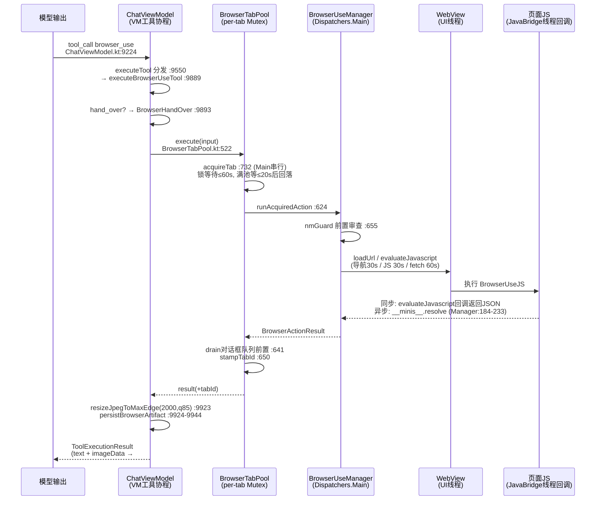
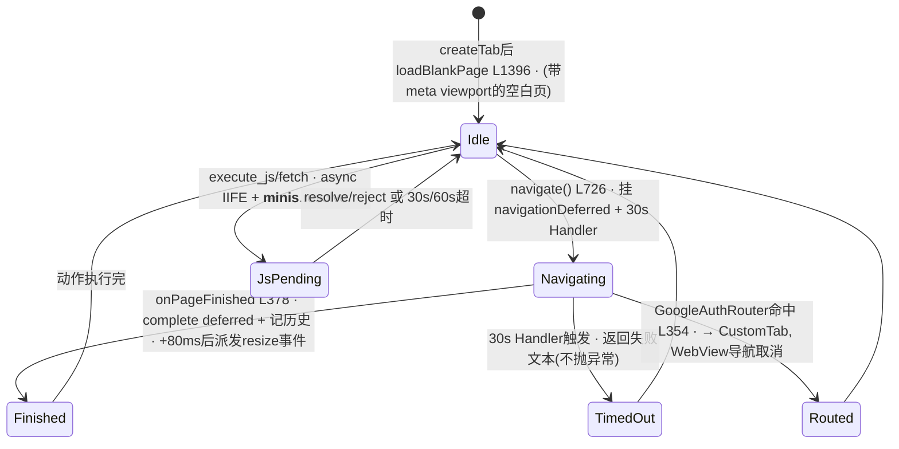
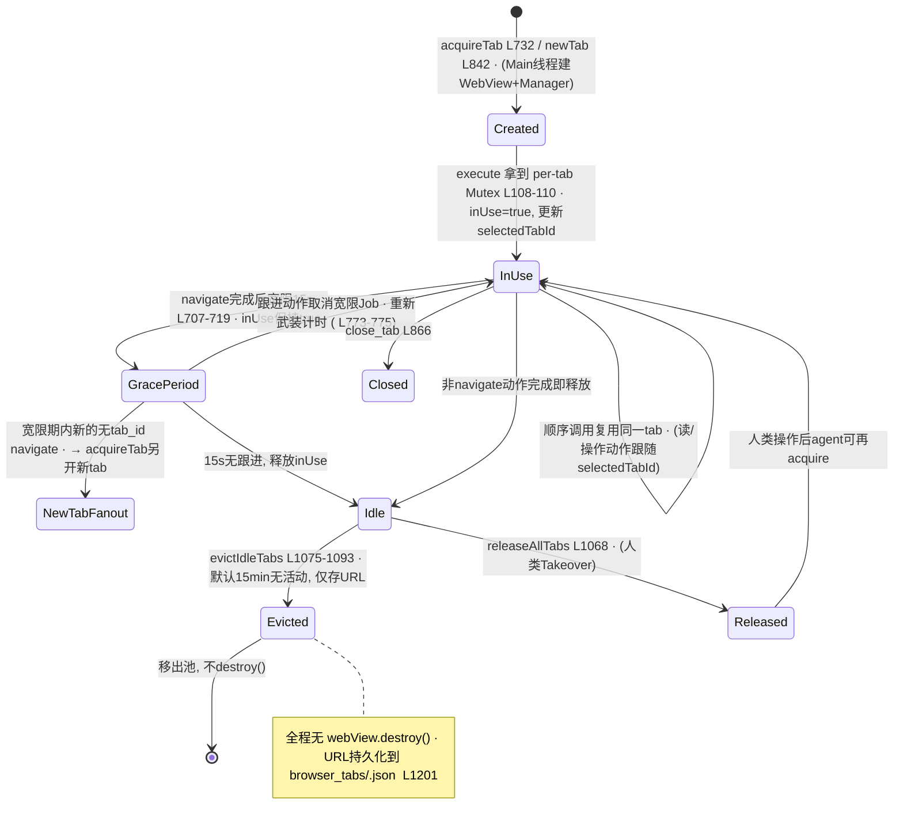
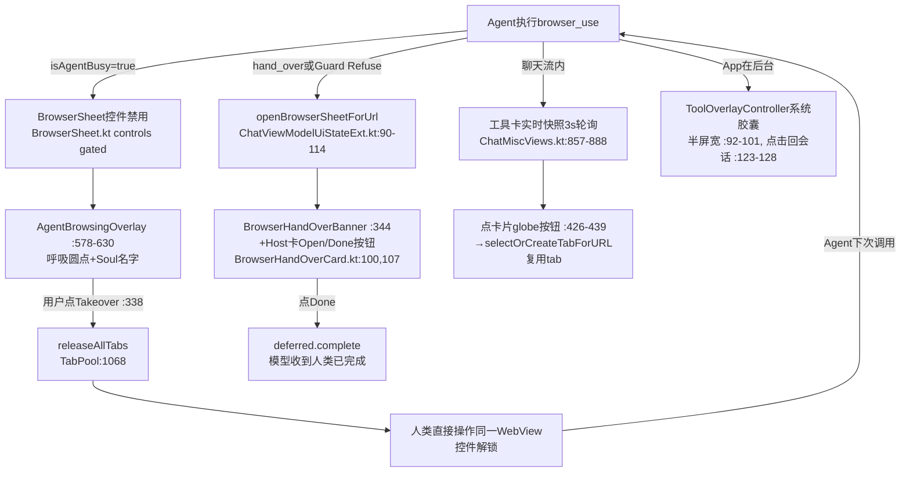

# 06 · Browser 工具：调用链、引擎实现与人机共享界面

> 研究员 #6 交付件。基线 commit `067384b7e5b3c47a7eeca217895be71493396518`。
> 路径约定：下文 `A/` = `android/src/android/app/src/main/java/`；`com/openminis/app/**` 为上游 OpenMinis 层，`io/github/nanomuse/**` 为 nanoMuse 增量层。所有行号均为基线实测，代码摘录均从源码逐字核对。
> 边界：Agent 循环内部归 #2，Provider 序列化归 #3，Offload 框架归 #4，上下文压缩归 #5，分层架构归 #1；本文只覆盖浏览器域，跨界处显式标注"移交"。

---

## 1. 工具契约：browser_use 的对外承诺与真实行为

### 1.1 定义位置与双 schema 问题

模型看到的工具定义在 `A/com/openminis/app/tools/AgentTools.kt:63-112`（`browserUseDefinition`）：`name = "browser_use"`，`required = ["tool_title", "action"]`。也就是说，除了动作本身，模型每次调用都必须给一个人类可读标题。其余参数按动作选用：`url`、`selector`、`x`/`y`、`text`、`direction`、`amount`、`js`、`profile`、`width`/`height`、`full_page`、`depth`、`limit`、`fuzzy`、`keywords`、`cookies`、`timeout`、`viewport_width`/`viewport_height`、`reset`、`scroll_count`、`item_selector`、`reason`（hand_over 用）等。契约把二十多个动作塞进单一工具而不是拆成多个工具，好处是工具列表短、系统提示词省 token，代价是参数合法性完全靠模型自觉——解析层必须容错（见 §1.3）。

注意仓库里存在第二个 schema 对象 `A/com/openminis/app/tools/BrowserUseTool.kt`（`NAME="browser_use"`，参数更少），属于遗留定义；实际注册进工具列表的是 AgentTools 里的版本。二者并存是历史债，后续研究若先 grep 到旧文件会得出错误的参数集，务必以 AgentTools 为准。

nanoMuse 层还会在发请求前用 `A/io/github/nanomuse/chat/PromptDiet.kt:22-66` 把 browser_use 的 description 和参数说明改写成压缩版（"节食"），在 `A/com/openminis/app/ui/chat/ChatViewModel.kt:1228` 处应用 `PromptDiet.tools(...)`。也就是说：**模型实际读到的契约是 PromptDiet 改写后的版本，而非 AgentTools 原文**。改写只动文字不动参数结构：description 被压成密集短句，参数说明逐个重写（:46-66），`tools()`（:69-77）对工具列表做映射。这解释了为什么抓包看到的 schema 与源码字符串对不上——不是版本漂移，是有意压缩。

### 1.2 动作全集（23 个，完整枚举，无省略）

动作枚举在 `A/com/openminis/app/browser/BrowserAction.kt`，解析在 `A/com/openminis/app/browser/BrowserActionInput.kt`。其中 `hand_over`（BrowserAction.kt:30）是 nanoMuse 增量，其余 22 个来自上游。按职能可分五组：导航与 tab 管理（navigate/new_tab/close_tab/list_tabs）、页面交互（click/type/hover/scroll）、信息读取（get_text/get_readable/get_page_info/find_elements/get_backbone）、环境控制（set_user_agent/set_viewport/get_cookies/set_cookies）、高级通道（execute_js/fetch/scroll_and_collect/wait_for_dom_stable/screenshot/hand_over）。

| # | action | 关键参数 | 实现入口（BrowserUseManager.kt，除注明外） | 说明 |
|---|--------|----------|------|------|
| 1 | navigate | url（必填） | :726-769 | 30s 超时；唯一"可能开新 tab"的动作 |
| 2 | screenshot | full_page | :812-894 | JPEG q80；full_page 拉伸高度上限 32768px |
| 3 | click | selector 或 x,y | :1032-1039 | 合成完整鼠标事件序列 + el.click() |
| 4 | type | selector 或 x,y + text | :1043 | 原生 setter + 逐字符键盘事件 |
| 5 | get_text | selector（可省=body） | :1051 | innerText 截断 10000 字符 |
| 6 | scroll | direction（默认 DOWN）、amount（默认 500） | :1064 | window 优先，其次最大可滚容器 |
| 7 | get_page_info | — | :1073 | url/title/readyState/视口/滚动位置 |
| 8 | execute_js | js | :1079-1127 | async IIFE 包装，30s 超时 |
| 9 | find_elements | selector、limit（默认 20） | :1131 | 返回 rect/pageXY/visible |
| 10 | hover | selector 或 x,y | :1138 | mouseover/mouseenter/mousemove |
| 11 | get_readable | — | :1058 | 候选选择器启发式正文提取，15000 上限 |
| 12 | set_user_agent | profile（mobile_chrome/desktop_chrome/custom） | :1313-1334 | 换 UA 后 reloadAndWait |
| 13 | set_viewport | width、height、reset | TabPool :1182-1197 | 会话级视口，应用后全 tab 重载 |
| 14 | get_backbone | depth（默认 5） | :1145 | 可见叶子扫描→区域树，附 shortSelector |
| 15 | fetch | url | :1163-1212 + :1220-1245 | 页内 fetch→arrayBuffer→btoa，60s |
| 16 | new_tab | url（可省） | TabPool :842-864 | 显式建 tab |
| 17 | close_tab | tab_id | TabPool :866-881 | 关 tab（不 destroy WebView） |
| 18 | list_tabs | — | TabPool :883-895 | `* Tab N: title — url` |
| 19 | get_cookies | url（可省=当前页） | :1631-1661 | CookieManager 读取，值预览 80 字符 |
| 20 | set_cookies | cookies（数组或 JSON 串） | :1672-1757 | 支持 HttpOnly；sameSite 接受但未实现 |
| 21 | scroll_and_collect | item_selector（必填）、scroll_count（默认 5，1..50） | :1870-1920 | 滚动采集去重，每项预览 160 字符 |
| 22 | wait_for_dom_stable | timeout（ms，默认 5000，1000..60000） | :1802-1861 | readyState 快路径 + innerHTML 长度稳定采样 |
| 23 | hand_over | reason | `A/io/github/nanomuse/browser/BrowserHandOver.kt:57-81` | 交还人类，最长等 15 分钟 |

两组语义集合值得记住（BrowserAction.kt:46-70）：`visualChangeActions = {NAVIGATE, CLICK, SCROLL, HOVER, TYPE}` 用于判断"页面可能变了"（触发 UI 自动快照与 URL 变化检测），`opensNewPageActions = {NAVIGATE}` 用于 tab 池的隐式宽限逻辑（见 §5）。这两个集合是池路由和 UI 刷新的共同依据，改动它们会同时影响并发行为与界面表现。

`UserAgentProfile`（BrowserAction.kt:83-111）内置两档：mobile_chrome（412×915 视口）与 desktop_chrome（1280×800），UA 串均为 Chrome/134 系。默认档位决定初始视口，而 `set_viewport` 的会话级设置优先级更高（§5.3）。

### 1.3 参数解析的实际默认值（与 schema 文字不一致处）

`BrowserActionInput.parse()`（BrowserActionInput.kt）实测：

- `fuzzy` 默认 **false**（:31、:74），而 schema 描述宣称默认 true——**文档与实现不一致**。fuzzy 影响 find_elements 的文本模糊匹配（keywords 参数配套），默认关闭意味着模型不显式传 true 时走精确匹配。
- `timeout` 键映射到 `timeoutMs`（:77），单位毫秒；schema 文字里按秒理解会差三个数量级。
- `cookies` 同时接受 JSON 数组和 JSON 编码字符串（:93-103），对模型输出容错——模型有时会把数组再包一层引号，解析层两种都认。
- `reason` 不在 parse 里，hand_over 直接从原始 argsJson 取（BrowserHandOver.kt:58），因为 hand_over 在 VM 层短路，根本不进 BrowserActionInput。

这类"解析层宽进、文档层严出"的组合是单一胖工具契约的必然产物：参数没有 per-action 的 JSON Schema 约束，只能靠解析兜底。

### 1.4 模型侧结果文本格式与尺寸上限（定论）

结果统一由 `formatJSONResult`（BrowserUseManager.kt:1479-1552）等函数生成。JS 层返回 JSON 字符串，Kotlin 层按分支翻译成**带缩进的纯文本行——不是 JSON、不是 markdown，也没有可点击的元素编号**。例如点击成功输出 `Clicked <BUTTON>` 加两行缩进的 Position/Text（文本截 200 字符），输入成功输出 `Typed N chars into <selector>`。文本类结果的核心截断：

```kotlin
// A/com/openminis/app/browser/BrowserUseManager.kt:1512-1519
json.has("text") && json.has("length") -> {
    val title = json.optString("title", "")
    if (title.isNotEmpty()) appendLine("Title: $title")
    val text = json.optString("text", "")
    val len = json.optInt("length", text.length)
    appendLine("Text ($len chars):")
    append(text.take(10000))
}
```

注意 `Text ($len chars)` 里的 len 是 JS 层截断后的长度，模型能据此判断"是否还有更多"，但没有任何分页/续读参数——想要更多只能换 selector 或 execute_js 自取。各动作上限汇总（均有实现行号支撑）：

| 内容 | 上限 | 出处 |
|------|------|------|
| 通用文本分支 | 10000 字符 | BrowserUseManager.kt:1518 |
| get_text（JS 层先截） | 10000 | BrowserUseJS.kt:114-135 |
| get_readable | 15000 | BrowserUseJS.kt:139-159 |
| find_elements | 20 条 × 文本 80 字符，格式 `[idx] <tag> #id "text" -> href` | BrowserUseJS.kt:228-248 + Manager:1521-1544 |
| get_backbone | 每节点文本 120 字符 | BrowserUseJS.kt:271-434 |
| scroll_and_collect | 每项预览 160 字符 | BrowserUseManager.kt:1915 |
| get_cookies | 每值预览 80 字符 | BrowserUseManager.kt:1631-1661 |
| click/hover 回显文本 | 200 字符 | BrowserUseManager.kt:1486,1510 |
| 截图 | JPEG q80 → VM 侧缩到最长边 2000 q85 → ImageBudget 5MB/图、25MB/请求 | §9 |
| 自动快照 | q70，仅 imageFilePath，**从不进模型** | Manager:711-722 |

backbone 的文本格式由 `formatBackboneResult`/`formatBackboneNode`（Manager:1554-1601）生成：首行统计 `Page backbone: N nodes, depth D, M merged`，随后递归缩进输出区域树，每个节点头行为 `<tag> #id .cls [role] | shortSelector | rect`，子行依次是引号包裹的文本、`-> href`、`img:`、`input:`。这个格式等于把"页面骨架 + 可操作提示"压成一份纯文本地图，模型读完即可构造 selector，不需要截图也能完成大部分定位——这是 Android 线省图片 token 的核心手段。

find_elements 的 `[idx]` 只是列表序号，**不是可回传的点击编号**——click 只认 selector 或坐标，模型必须从返回的 id/tag 自己构造选择器。这是与 Python 线最容易被混淆的一点（§10）。

另一个契约级差异：schema 声称 get_cookies 返回"摘要 + offload env 文件路径，不含原始 cookie 值"，但实现（Manager:1631-1661）直接给 80 字符原值预览，**没有任何 env 文件生成代码**。这是需要向上游反馈的文档债，也意味着敏感 cookie 值确实会部分进入模型上下文。

---

## 2. 完整调用链（含线程与超时）

### 2.1 时序图



### 2.2 逐跳说明与线程模型

1. **循环侧入口**：`ChatViewModel.kt:9224` 执行工具（logcat tag `ToolChain[VM]`），:9503-9555 的 when 分发中 `"browser_use" -> executeBrowserUseTool(...)`（:9550）。循环的调度、重试、并行策略属 #2 范围，此处只确认浏览器调用发生在 VM 的工具执行协程里；并行工具调用可能同时发起多个 browser_use，这正是池层 per-tab 锁存在的原因。
2. **VM 适配层**：`executeBrowserUseTool`（ChatViewModel.kt:9889-9959）做四件事：hand_over 分支短路（:9893-9895）；若结果文本带 `[nanoMuse handoff]` 前缀则 `openBrowserSheetForUrl`（:9903-9905，Guard 触发的强制交接）；截图重编码 `resizeJpegToMaxEdge(raw, 2000)`（:9923，实现 :10000-10013，q85）；产物落盘 `persistBrowserArtifact`（:9924-9944，实现 :9967-9978，写入 `filesDir/minis-sessions/<sid>/browser/`，结果附 `minis_url` 供后续 read_image 或浏览器打开）。
3. **池路由**：`BrowserTabPool.execute`（BrowserTabPool.kt:522-580）决定用哪个 tab、是否串行（§5）。`acquireTab`（:732）整体跑在 `Dispatchers.Main` 上——这不是性能瓶颈而是正确性设计：并发的无 tab_id 调用在 Main 上逐个解析，第一个认领空闲 tab 并标记 inUse，第二个自然跳过它落到别的 tab，避免两个并行 navigate 互相践踏 tab 0（源码注释 :740-750 明确写了这个意图）。
4. **Manager 执行**：`BrowserUseManager.execute`（:653-709）先 nmGuard（:655），再 when 分发（:657-685），随后对视觉变更类动作附加 300ms 延迟的 q70 UI 快照（:688-690，实现 :711-722），并检测 URL 变化补导航元数据（:692-704）——click 触发跳转时模型也能在结果里看到新 URL。
5. **JS 往返的两条通道**：所有 `evaluateJavascript` 都经 `Manager.evaluateJavascript`（:1423-1439）切到 Main 执行并对返回值去引号/反转义。**同步动作**（click/type/get_text 等）的 JS 是立即返回 JSON 字符串的 IIFE，走 evaluateJavascript 的回调即可；**异步动作**（execute_js 的 async IIFE、fetch、blob 下载）因为 `evaluateJavascript` 不会等待 Promise，必须经 `__minis__` JavascriptInterface（:184-233）主动回调 resolve/reject，**回调线程是 WebView 的 JavaBridge 线程**，用 CompletableDeferred 桥接回协程。所有 WebView 触碰都收敛到 Main，是避免 WebView 线程断言崩溃的纪律。

线程纪律上有一个值得注意的对比：沙箱 CLI 入口用 `runBlocking`（§8）阻塞调用线程等待结果，而内部 execute 又要切 Main——这要求调用方绝不能在 Main 上（否则自锁）；NativeOffloadServer 的具体线程模型归 #4，本文未逐行确认，但该约束是此设计成立的隐含前提。整条链的规则可以概括为：**协程挂起等待（withTimeout/deferred），Main 只做 WebView 触碰，JavaBridge 只做回调投递**，三层各不阻塞对方。

### 2.3 超时总表

| 环节 | 超时 | 超时后行为 | 出处 |
|------|------|-----------|------|
| 页面导航 | 30s（Handler 兜底） | 返回失败文本，不重试 | Manager:52-85, :726-769 |
| execute_js | 30s | 返回超时错误文本 | Manager:1079-1127 |
| fetch / awaitPromiseJs | 60s | 返回超时错误文本 | Manager:1220-1245 |
| tab Mutex 获取 | 60s | 放弃，报错 | TabPool:60 |
| 满池等待空位 | 20s（250ms 轮询） | **回落到最久未活动 tab**（非报错） | TabPool:94-95, :756-768 |
| wait_for_dom_stable | 默认 5s，钳制 1–60s | 返回当前稳定状态 | Manager:52-85, :1802-1861 |
| 沙箱 CLI 单次调用 | 90s | JSON 错误信封 exit 1 | BrowserUseOffloadHandler.kt:391 |
| hand_over 等人 | 15min（Android） | 返回"人类未完成"文本 | BrowserHandOver.kt:25 |
| hand_over 等人 | 600s（Python 线） | hold 超时 | nanomuse/agent/holds.py:30 |

注意满池等待的兜底语义：等不到空位时**不是失败而是复用最小活动 tab**（acquireTab :768 `picked ?: currentTabs.firstOrNull()`），即极端并发下仍可能践踏 busy tab——这是"有界等待优先于永久挂起"的折衷，源码注释（:751-755）明说只在等待窗口耗尽后才允许。

---

## 3. BrowserUseManager 深拆：状态机、动作分发与错误分类

### 3.1 导航状态机

Manager 本身无显式 enum 状态机，状态由 `navigationDeferred` + WebViewClient 回调隐式构成。每个 tab 对应一个 Manager 实例，持有自己的 WebView、jsBridge 与导航 deferred：



关键点：`onPageFinished`（Manager:378-404）除了完成 deferred，还写入 BrowserHistory、并在 80ms 后向页面派发 `resize` 事件——很多响应式布局依赖这个补偿，因为 detached WebView 的尺寸是我们手动 measure 出来的，页面初次布局时拿到的视口可能与最终值不同。导航元数据由 `navigationMetadata`（:771-808）补充最终 URL/标题，供结果文本与 UI 胶囊使用。

用"deferred + 回调"代替显式状态机的好处是没有状态枚举要维护、非法迁移天然不存在（deferred 只能 complete 一次）；代价是状态不可观测——调试时无法直接问 Manager"你现在处于什么状态"，只能从日志推断。对需要复现导航竞态（如超时与 onPageFinished 几乎同时到达）的问题，这是第一个要补的观测点。

### 3.2 元素定位机制（定论）

**Android 侧只有两种定位方式：CSS 选择器（`document.querySelector`，取第一个匹配）和坐标（`document.elementFromPoint`）。没有元素编号标注、没有可访问性树、没有 `data-minis-*` 属性注入、没有高亮覆盖层。** 模型的定位信息来源是两条读取通道：

- `find_elements`（BrowserUseJS.kt:228-248）：`querySelectorAll` 前 20 个（limit 可调），返回 tag/id/text/rect/pageXY/visible，适合"我知道大概的 selector"的场景；
- `get_backbone`（BrowserUseJS.kt:271-434）：适合"我不知道页面结构"的场景。算法分五步：①扫描可见叶子节点（最小尺寸 MIN_SIZE=8px 过滤装饰像素）；②矩形邻近合并（间距 ≤10px 的叶子归为一组，把图标+文字合成一个语义块）；③按共同祖先分组构建区域树；④每节点生成 `shortSelector`（优先 `#id`，否则 `nth-of-type` 链路径）并附文本（截 120 字符）；⑤按面积排序、剪枝、限深（depth 默认 5）后输出。

即模型的标准工作流是 `get_backbone` 拿 shortSelector → `click(selector=...)`；backbone 的 shortSelector 是**生成的提示而非注入的标记**，页面 DOM 不被修改，因此不存在标注失效/重排后编号漂移的问题，代价是 selector 可能因页面动态变化而失配。这与 Python 线的 `_ANNOTATE_JS` 编号方案（§10）是**两套完全不同的机制，不可混谈**。

### 3.3 点击与输入的合成事件（真实代码摘录）

```javascript
// A/com/openminis/app/browser/BrowserUseJS.kt:28-43（click 内嵌JS，逐字）
(function() {
    var el = document.querySelector('<selector>');
    if (!el) return JSON.stringify({error: 'Element not found: <selector>'});
    if (el.disabled) return JSON.stringify({error: 'Element is disabled', tag: el.tagName});
    var bOpts = {bubbles: true, cancelable: true, view: window};
    var nbOpts = {bubbles: false, cancelable: true, view: window};
    el.dispatchEvent(new MouseEvent('mouseover', bOpts));
    el.dispatchEvent(new MouseEvent('mouseenter', nbOpts));
    el.dispatchEvent(new MouseEvent('mousemove', bOpts));
    el.dispatchEvent(new MouseEvent('mousedown', bOpts));
    el.dispatchEvent(new MouseEvent('mouseup', bOpts));
    el.click();
    el.dispatchEvent(new MouseEvent('mouseleave', nbOpts));
    el.dispatchEvent(new MouseEvent('mouseout', bOpts));
    return JSON.stringify({clicked: true, tag: el.tagName, text: (el.innerText || '').substring(0, 100)});
})()
```

（摘录中 `<selector>` 为源码 `${jsQuote(selector)}` 模板插值的示意，其余逐字。）三个细节：事件序列完整模拟真实鼠标（enter/leave 用不冒泡的 nbOpts，符合 DOM 规范）；`el.disabled` 前置检查避免对禁用按钮假成功；**不做 scrollIntoView**——元素在视口外也照点，因为合成事件不依赖可见性，这与坐标点击不同。坐标版 `clickCoordinate`（:46-63）用 `elementFromPoint(x, y)` 取目标后派发同一序列，点到什么算什么（可能是覆盖层），返回带 x/y 便于模型核对。

```javascript
// A/com/openminis/app/browser/BrowserUseJS.kt:71-92（type 内嵌JS核心，逐字）
el.focus();
if (el.tagName === 'INPUT' || el.tagName === 'TEXTAREA') {
    var nativeSetter = Object.getOwnPropertyDescriptor(
        el.tagName === 'TEXTAREA' ? HTMLTextAreaElement.prototype : HTMLInputElement.prototype, 'value'
    );
    if (nativeSetter && nativeSetter.set) {
        nativeSetter.set.call(el, '<text>');
    } else {
        el.value = '<text>';
    }
} else {
    el.innerText = '<text>';
}
var chars = '<text>';
for (var i = 0; i < chars.length; i++) {
    var c = chars[i];
    el.dispatchEvent(new KeyboardEvent('keydown', {key: c, bubbles: true}));
    el.dispatchEvent(new KeyboardEvent('keypress', {key: c, bubbles: true}));
    el.dispatchEvent(new InputEvent('input', {data: c, inputType: 'insertText', bubbles: true}));
    el.dispatchEvent(new KeyboardEvent('keyup', {key: c, bubbles: true}));
}
el.dispatchEvent(new Event('change', {bubbles: true}));
```

用原生 prototype setter 而非 `el.value =` 是关键：React 等框架劫持了实例 value setter，直接赋值不会触发其状态更新；从原型上取回原始 setter 绕过劫持。随后逐字符派发 keydown/keypress/InputEvent/keyup，照顾按 keystroke 校验的组件（验证码、搜索联想）；非输入元素退化为 `innerText` 赋值（contenteditable 场景）。:93-108 还有框架善后：Angular 的 `scope.$apply()`、Vue 的 `__vue__.$forceUpdate()` 与 `_vei` 检测、最后对输入元素补 blur/focusout 触发表单校验。整套下来，type 是"先整体赋值、再逐字符补事件"的混合策略，而非真实逐字输入。

### 3.4 等待与重试

- `wait_for_dom_stable`（Manager:1802-1861）：快路径 = `readyState === 'complete'` 且间隔 50ms 两次采样 body 非空即通过；慢路径 = 每 200ms 采样 `document.body.innerHTML.length`，连续相等判稳。**没有网络 idle 检测**，对 SPA 长轮询/懒加载页面可能误判稳定，也可能把持续增长的流式页面判为永不稳定直到超时。
- 导航失败/超时不自动重试，返回失败文本交给模型决策（循环层重试归 #2）。这是"浏览器域只报告、不决策"的分工。
- `scrollAndCollect`（:1870-1920）自带节奏：每轮 `scrollBy(0, innerHeight)` 后等 400ms 再采集，用 LinkedHashSet 按文本去重，scroll_count 钳制 1..50（:1875），item_selector 必填（:1877，缺失直接报错——schema 里"自动检测"的说法不成立）。

### 3.5 错误分类与对话框协作

错误统一走 `BrowserActionResult(success=false, text=...)`，不抛异常穿透到循环。类别：元素未找到/禁用（JS 返回 error JSON）、导航超时（30s Handler）、JS 执行超时（30s/60s）、Guard 拒绝（§6.4）、tab 锁等待超时（60s）、下载失败。JS 层的 error 字段由 formatJSONResult 的 fallback 分支原样透出，模型能看到 `error: Element not found: ...` 这类可操作的文本。

JS 对话框由三个 handler 拦截（Manager:575-622）：`alert → dialog.confirm()`（静默放行）、`confirm → dialog.cancel()`（页面拿到 false）、`prompt → cancel()`（拿到 null）。每次拦截记入 `InterceptedDialogQueue`（`A/com/openminis/app/browser/InterceptedDialogQueue.kt`，容量 20，:30，synchronized 保护），在下一次工具结果前 drain 前置（TabPool:641-643）：

```kotlin
// A/com/openminis/app/browser/InterceptedDialogQueue.kt:103-112（drainReport 尾部，逐字）
val plural = if (drainedEvents.size == 1) "a dialog" else "${drainedEvents.size} dialogs"
return "[Browser Dialog Intercepted] The page tried to show $plural, which was " +
    "NOT shown to the user — this is headless automation and cannot wait for " +
    "human input. The page was given the default response shown below and " +
    "continued running.\n" +
    lines.joinToString("\n") + "\n" +
    "If you need a different outcome, use execute_js to drive the page's " +
    "DOM/JS state directly instead of relying on native dialogs (for example " +
    "override window.confirm before triggering the action).\n\n" +
    "[Original tool result below]\n\n"
```

每条事件行格式为 `- confirm(): "消息" on <url> — page received \`false\``（:88-94），超过 20 条时附"earlier dialogs dropped"计数。这个设计让模型能感知"我点的按钮弹了确认框且被自动取消"，并给出自助方案（execute_js 覆写 window.confirm），是纯代理浏览器里少见的闭环。源码注释（:71-76）也坦承已知局限：**只有该 tab 再次产出工具结果时才会 drain**；若 agent 触发弹窗后不再调用浏览器，记录随 tab 消亡——有意不防御，因为内存有界且每次拦截在 record 时已打日志。

### 3.6 截图与视口

`screenshot(full_page=true)`（Manager:812-894）：读页面完整高度，钳制到 `MAX_FULL_PAGE_HEIGHT_PX=32768`（Bitmap 尺寸与内存的硬保护），把 WebView 临时 measure/layout 到该高度、draw 到 Bitmap、再恢复原尺寸——全页截图是"拉伸再还原"的侵入式操作，期间页面会经历一次布局变化。普通截图走 `captureWebViewBitmap`（:954-984）：按 CSS 像素 × `displayMetrics.density` measure/layout 后 `draw(canvas)`——**不依赖 WebView 是否附着在窗口上**，这是"后台代理浏览"成立的根基。`viewportMetadata`（:897-943）在截图结果里附视口/页面尺寸，模型可据此换算坐标。`applyShrinkToFit`（:319-340）用 `setInitialScale` 让宽页缩进视口；`loadBlankPage`（:1396-1412）加载带 meta viewport 的 BLANK_PAGE_HTML，绕开 about:blank 默认 980px 布局宽度的坑——acquireTab 在返回前必须完成这个初始加载（TabPool:783-787），保证 agent 的第一次 JS 求值能看到非空 document.body。

### 3.7 环境切换与 cookie 写入的细节

`set_user_agent`（Manager:1313-1334）切换档位或自定义 UA 后调 `reloadAndWait`（:1356-1384）重新加载当前页并等待完成——UA 变更对已加载页面不生效是 WebView 的固有行为，重载是必须的；这也意味着换 UA 会丢页面内状态，模型应在导航前而非操作中途换档。

`set_cookies`（:1672-1757）是错误引导做得最细的动作，值得单独记录：未加载页面时提示"navigate first"；cookies 解析失败时区分"缺失/不可解析"与"空数组"两种错误，错误文本直接教模型传合法 JSON 数组、并建议 CLI 场景改用 `--cookies-file` 避免 shell 转义问题（:1679-1690 注释明说 schema 把 cookies 标为 string 导致模型可能传二次编码的 JSON 串）。字段兼容层覆盖主流导出格式：`http_only`/`httpOnly` 双别名（:1725）、过期时间接受 `expires`（Puppeteer）与 `expirationDate`（EditThisCookie/Cookie-Editor，常为小数）双别名，≤0 视为会话 cookie 不写 Expires（:1726-1732）；`sameSite` 接受但不应用，TODO 注释（:1733-1738）写明原因：CookieManager.setCookie 本身支持 SameSite 属性，但接线前需要针对跨站 captcha 流程做验证——**不是没能力，是怕改坏验证流程**。写入经 `CookieManager.setCookie`（可写 HttpOnly，这是 JS document.cookie 做不到的），最后 `flush()` 持久化；部分成功时返回"Set N cookie(s) ... Skipped M invalid entry(ies)"的明细，模型能精确知道哪几条没进去。

---

## 4. BrowserUseJS：注入脚本盘点

`A/com/openminis/app/browser/BrowserUseJS.kt`（463 行）是全部页内 JS 的唯一来源，以 Kotlin 字符串模板函数形式组织（`jsQuote` 负责转义防注入），按函数划分：click(:27)、clickCoordinate(:46)、type(:67)、getText(:114)、getReadable(:139)、scroll(:163)、hover(:216)、findElements(:228)、getPageInfo(:252)、getBackbone(:271)、fetch(:438)。

```javascript
// A/com/openminis/app/browser/BrowserUseJS.kt:140-157（getReadable 内嵌JS，逐字）
(function() {
    var candidateSelectors = [
        'article', '[role="main"]', 'main', '.post-content',
        '.article-body', '.entry-content', '#content', '.content'
    ];
    var el = null;
    var matchedSelector = null;
    for (var i = 0; i < candidateSelectors.length; i++) {
        var found = document.querySelector(candidateSelectors[i]);
        if (found && window.getComputedStyle(found).display !== 'none' && (found.innerText || '').length > 0) {
            el = found; matchedSelector = candidateSelectors[i]; break;
        }
    }
    if (!el) { el = document.body; matchedSelector = 'document.body (fallback)'; }
    var title = document.title || '';
    var innerTextVal = el.innerText || '';
    var text = innerTextVal.replace(/\s+/g, ' ').trim().substring(0, 15000);
    return JSON.stringify({title: title, text: text, length: text.length, source: matchedSelector});
})()
```

要点与边界：

- `getReadable` 是**候选选择器启发式，不是 Mozilla Readability**：按固定顺序取**第一个可见且非空**的匹配（不是取最长），无 DOM 重构、无评分算法；命中即 break，全部落空退化为 body 全文。返回的 `source` 字段告诉模型正文来自哪个选择器，便于判断可信度。对非常规布局（正文在 `.story-body` 之类未收录的容器里）会退化为噪音较多的 body 文本。
- `getText`（:114-135）区分有无 selector 两个版本，都截 10000；无 selector 版额外带 url/title。
- `scroll`（:163-212）先试 window，不行则深度 ≤10 遍历找 `overflowY: auto/scroll` 且面积最大的容器——覆盖内滚式 SPA；返回 scrollY/scrollHeight/viewportHeight 让模型判断是否到底。
- `fetch`（:438-462）在页面上下文发请求（带页面 cookie 与同源身份），`arrayBuffer→btoa` 回传二进制，是绕过部分反爬与拿原始响应体的关键通道；60s 上限，结果经 fetchedFileData/fetchedFileName 落盘（BrowserActionResult 字段）。
- **没有** iframe/shadow-DOM 穿透、没有除 UA 外的反指纹伪装、没有高亮标注注入。跨 iframe 操作在 Android 侧未实现（未确认是否有其他通道）——hCaptcha 之类跨域 iframe 验证只能靠三方 cookie 放行（§6.1）间接支持，无法直接点进 iframe 内部。

`__minis__` 桥（Manager:184-233）暴露 `resolve/reject/saveBlobDownload` 三个方法，仅服务异步路径。下载监听（Manager:239-252）对 `blob:` URL 注入 FileReader 转 base64 走 `saveBlobDownload`（:278-296），`data:` URL 直接解码——WebView 的 DownloadListener 本身不会处理 blob/data 协议，这两条 JS 通道是补洞而非锦上添花。

---

## 5. BrowserTabPool：容量、复用与并发（定论）

`A/com/openminis/app/browser/BrowserTabPool.kt`（1269 行）。**注意与 KatexWebViewPool 无关**——后者是公式渲染池，不在本文范围。

### 5.1 核心常量（真实代码）

```kotlin
// A/com/openminis/app/browser/BrowserTabPool.kt:36-45, 60, 85, 94-95（节选，中间省略）
private const val MAX_TABS = 3
private const val IDLE_CHECK_INTERVAL_MS = 60_000L  // 60 seconds
const val DEFAULT_IDLE_TIMEOUT_MINUTES = 15
const val PREF_IDLE_TIMEOUT_MINUTES = "idle_timeout_minutes"
const val MIN_IDLE_TIMEOUT_MINUTES = 1
const val MAX_IDLE_TIMEOUT_MINUTES = 240
// ……
private const val TAB_SERIAL_WAIT_TIMEOUT_MS = 60_000L
// ……
private const val IMPLICIT_TAB_GRACE_MS = 15_000L
// ……
private const val IMPLICIT_TAB_WAIT_MS = 20_000L
private const val IMPLICIT_TAB_WAIT_POLL_MS = 250L
```

注释里有两个对齐信息：闲置 15 分钟与 iOS BrowserTabPool.idleTimeout 对齐（:38）；60s 锁等待**只是拿锁的等待，不是浏览器任务超时**，拿到锁后各动作仍用自己的超时（:53-59 注释）。

### 5.2 tab 生命周期图



### 5.3 路由与并发策略

`execute`（:522-580）的路由规则：

1. 显式 `tab_id` 且存在 → 定位该 tab，拿它的 per-tab Mutex（最多等 60s，:60）。tab_id 不存在时回落默认路径（acquireTab :735-738 注释：覆盖空池时传 `tab_id: 0` 的情形）。
2. 无 tab_id 的**读取/操作类动作** → 跟随 `selectedTabId`（用户或上一次动作选中的 tab）。这是 #612/#614 的修复成果（T-browser-readaction-follow-tab 标记）：以前读操作可能落到错误 tab，截图截到别的页面。
3. `navigate`（唯一 opensNewPageAction）→ 走隐式宽限扇出。宽限的精确语义（:75-84 注释）：navigate 本身挂起到 onPageFinished/30s，完成后 inUse 再保持 15s；**宽限期内 acquireTab(null) 看到 inUse=true 会另开新 tab**——N 个背靠背的无 tab_id navigate 打开 N 个独立 tab 而不是互相覆盖 tab 0；而同一任务的跟进链（navigate→screenshot→click）每次命中都取消宽限 Job 并重新武装（:773-775），tab 在连续操作间存活。这是"并行探索扇出、串行任务粘滞"的双全设计。
4. 满池（3 个全 inUse）→ 有界等待后回落：

```kotlin
// A/com/openminis/app/browser/BrowserTabPool.kt:756-768（acquireTab 等待段，逐字）
var picked = currentTabs.firstOrNull { !it.inUse } ?: createTab(currentTabs)
if (picked == null) {
    val waitDeadline = IMPLICIT_TAB_WAIT_MS
    var waited = 0L
    while (waited < waitDeadline) {
        delay(IMPLICIT_TAB_WAIT_POLL_MS)
        waited += IMPLICIT_TAB_WAIT_POLL_MS
        currentTabs = _tabs.value.toMutableList()
        picked = currentTabs.firstOrNull { !it.inUse } ?: createTab(currentTabs)
        if (picked != null) break
    }
}
picked ?: currentTabs.firstOrNull()
```

即 20s 内每 250ms 重试"找空闲或建新"，窗口耗尽后**复用列表首个（最久未活动）tab**——有界等待优先于永久挂起，极端情况下接受践踏（§2.3）。

5. `singleTab=true`（"YOLO 模式"，:510-521 文档注释）→ 全部动作串行挤选中的 tab，不做宽限扇出。**只有沙箱 CLI 用这个模式**（§8），Agent 主链路不启用；显式 --tab-id 仍正常路由。

池还向 UI 暴露两个关键只读视图（TabPool:136-150）：`isAgentBusy` = 任一 tab 的 inUse 为 true（含宽限期），是 BrowserSheet 禁用控件、显示 AgentBrowsingOverlay 的唯一依据；`activeManager` = 当前 selectedTabId 对应 tab 的 Manager，无选中则回落第一个 tab（注释注明对齐 iOS activeManager），聊天卡 3s 实时快照（§7.3）就是经它拿到的。这意味着**宽限期内 UI 也显示"agent 正在浏览"**，即使动作早已执行完——人类看到的忙碌状态与池的扇出逻辑严格一致，不会出现"界面说空闲、agent 却还占着 tab"的错位。

`runAcquiredAction`（:624-677）在锁内执行：先 drain 对话框队列前置到结果文本（:641-643），执行动作，然后 `stampTabId`（:650，实现 :688-697）在文本尾部追加 `  tab_id: N`——模型由此知道自己在哪个 tab，下次可显式指定。这是无状态模型获得会话定位能力的最小机制：不靠系统提示词维护 tab 表，靠每条结果自带坐标。

### 5.4 会话绑定、持久化与驱逐

每个 ChatViewModel 持有一个池（ChatViewModel.kt:1260-1273 lazy），`setSession`（:3825）切换会话时加载 `filesDir/browser_tabs/<sid>.json`（saveState :1201-1228 / loadSavedState :1230-1264）。**持久化只存 URL 列表，不存 DOM/滚动/表单状态**；重启后按 URL 重新加载，登录态靠全局 CookieManager 天然恢复，但页面内状态（购物车、填了一半的表单）丢失。Cookie 跨会话、跨两个池实例共享，这既是便利也是隐私面（§8）。

闲置驱逐（:1075-1093，60s 巡检一次）把 URL 存档后将 tab 移出池，但代码里**从不调用 `webView.destroy()`**——被驱逐 WebView 的 native 资源回收依赖 GC，这是一个资源泄漏风险点（未在代码中确认有补偿机制）。对长时间挂后台的 App，3 个 tab × 多会话的 WebView 累积值得警惕。

Cookie 的全局共享还有一层隐私含义：聊天池、CLI 共享池、人类手动浏览用的是同一个 CookieManager，任何一处登录都对其余两处可见。这换来了"agent 登录一次、处处可用"的便利，但也意味着沙箱脚本天然继承用户的全部登录态——§6.4 的 Guard 只拦聊天链路的 click/type，**CLI 链路不经过 nmGuard 的 UI 审批交互**（RiskGate 需要 UI，沙箱场景无人可问），敏感操作的防线在两条链路上并不对称。这一点值得 #4 域在 Offload 门控层面确认是否有补偿。

窗口与 UI 协作：`setSupportMultipleWindows(true)` 下 `onCreateWindow` 走 `handleNewWindow`（:899-933，WebViewTransport 交接到新 tab，target=_blank 链接因此可用）；`selectOrCreateTabForURL`（:996-1011）+ `normalizeUrlForMatch`（:1013-1024）让"用户点开某 URL"优先复用已打开该页的 tab（忽略尾斜杠等差异）；`ensureTabForUI`（:1033-1047）保证人类打开面板时至少有一个 tab。`releaseAllTabs`（:1068-1071）释放所有 inUse 标记，是 Takeover 的底层原语——注意它只放标记不关页面，人类接管后看到的正是 agent 的现场。

视口治理：`resolvedViewportSize`（:1101-1109）优先级 会话级 > 全局设置（SharedPreferences，:48-50）> UA 档默认；`handleSetViewport`（:1182-1197）写会话级并 `applyViewportToAllTabs`（:1169-1180）逐 tab `reloadAndWait`——改视口是破坏性操作（页面重载），模型应谨慎使用；reset 走 `resetSessionViewport`（:1151）。

---

## 6. WebView 配置与安全面

### 6.1 WebSettings（真实代码摘录）

```kotlin
// A/com/openminis/app/browser/BrowserUseManager.kt:96-110（configureWebView 核心，逐字）
webView.setLayerType(android.view.View.LAYER_TYPE_HARDWARE, null)
webView.settings.apply {
    javaScriptEnabled = true
    domStorageEnabled = true
    @Suppress("DEPRECATION")
    databaseEnabled = true
    loadWithOverviewMode = true
    useWideViewPort = true
    builtInZoomControls = false
    setSupportMultipleWindows(true)
    mixedContentMode = WebSettings.MIXED_CONTENT_ALWAYS_ALLOW
    val ua = customUA ?: profile.userAgentString
    if (ua != null) userAgentString = ua
}
```

两个配置自带长篇注释，动机值得记录：

- **LAYER_TYPE_HARDWARE**（:89-95 注释，T-android-browser-blank）：浏览器面板是 Material3 ModalBottomSheet，内容宿主在独立次级窗口；部分 OEM GPU 上 WebView 的 hardware draw functor 在该窗口合成失败——页面正常加载（标题/URL 更新）但内容区黑屏/白屏。强制走自己的硬件层纹理是 WebView-in-dialog 空白渲染的标准解法。
- **三方 cookie 放行**（:111-123 注释 + CookieManager.setAcceptCookie(true)/setAcceptThirdPartyCookies(true)）：WebView 默认禁三方 cookie，会打断 hCaptcha/Turnstile/reCAPTCHA——验证 widget 住在跨域 iframe，靠 Set-Cookie 往返把 token 传回父页。注释明确定位："agent 浏览器是用户的替身，对齐 Chrome 默认行为，放行用户在真浏览器里能过的同一批验证"。

`MIXED_CONTENT_ALWAYS_ALLOW` 是为兼容老旧站点的宽松策略，属于**有意为之的安全折衷**。未发现 `setWebContentsDebuggingEnabled` 调用——chrome://inspect 调试 WebView 在基线代码中未开启（见 §11）。

### 6.2 WebViewClient 关键拦截

`WebViewClient`（Manager:343-425）四道拦截：

1. **GoogleAuthRouter**（:354 调用；`A/com/openminis/app/browser/GoogleAuthRouter.kt`）：命中 Google 登录域（hosts :32-38，后缀匹配 :41-45）即改走 Chrome Custom Tab（:52-68，失败回退 ACTION_VIEW）。文件头注释给出完整理由：Google 用多信号封杀 WebView 登录（UA、`X-Requested-With` 头、Sec-CH-UA、JS 表面特征、TLS ClientHello 指纹），单改 UA 只会得到 403 disallowed_useragent，因此**放弃伪装、正路走 Custom Tab**；代价是登录 cookie 留在 Chrome，WebView 侧拿不到 Google 会话——这是产品级取舍而非 bug。对 agent 的实际影响：需要 Google 登录的任务必须 hand_over 给人类在 Custom Tab 里完成，且完成后 WebView 侧仍无登录态，只能靠人类把结果带回来。
2. **ExternalSchemeHandler**（:369-375）：非 http(s)/about/file 一律交 `A/com/openminis/app/ui/browser/BrowserExternalSchemeHandler.kt` 路由，且 Origin 标记为 `AGENT_BACKGROUND`（:75-90 定义 USER_INITIATED/AGENT_BACKGROUND 两种来源）。代理后台触发的外链默认 BLOCK + Toast（:183-197），用户亲手点的才允许 VIEW 类 scheme（:57-60）或 `intent://` 解析（:201-246，含 browser_fallback_url 回退）。这个 Origin 二分是防"网页借 agent 之手拉起支付/拨号 intent"的关键闸门。nanoMuse 增量：`minis://`、`nanomuse://` 自有 scheme 路由回 MainActivity（:174-177）。
3. **minis:// 资源拦截**（`shouldInterceptRequest` :417-423 → `interceptMinisURL` :428-489）：把 `minis://` URL 经 `PRootKernel.resolveSessionHostPath` 解析为**会话作用域**的沙箱宿主路径并流式返回——沙箱里生成的 HTML 报告可以直接在浏览器打开，且不能越权读别的会话文件。随后 `ensureMetaViewport`（:496-516）给无 viewport 的本地 HTML 注入 meta 标签，保证手机上的可读布局。这条通道把"沙箱产物"与"浏览器渲染"缝在一起：agent 在 PRoot 里跑脚本生成报表，下一步 navigate 到 minis:// 即可可视化检查，无需先把文件搬出沙箱。
4. **onPageFinished**（:378-404）：导航完成三件事（deferred、历史、resize 补偿），见 §3.1。

### 6.3 下载治理

普通 URL 下载由 TabPool `startUrlDownload`（:392-451）在 IO 线程用 HttpURLConnection 执行，**手动附带 WebView 的 CookieManager cookie**（HttpURLConnection 与 WebView cookie 栈天然不通，不手动带就会下到登录墙页面）；blob/data 下载走 §4 的 JS 通道（saveBlobDownload :454-484）。下载注册表（:275-302）供 UI 展示进度，文件名用 `middleTruncated`（:69-72）做 Files 风格中段截断保留扩展名；落盘到 `sessionWorkspaceDir`（:371-375），ChatViewModel 侧 `onDownloadEvent → appendSystemInfo`（:1260-1273）把下载事件写进聊天流，模型与人类同时可见。

### 6.4 nanoMuse BrowserGuard：敏感动作前置审查

```kotlin
// A/com/openminis/app/browser/BrowserUseManager.kt:653-657（execute 开头，逐字）
suspend fun execute(input: BrowserActionInput): BrowserActionResult {
    val prevUrl = withContext(Dispatchers.Main) { webView.url }
    val nmGate = nmGuard(input) // nanoMuse: secret fields refused, pay/send/delete taps approved first
    nmGate.blocked?.let { return it }
    var result: BrowserActionResult = when (input.action) {
```

```kotlin
// A/com/openminis/app/browser/BrowserUseManager.kt:999-1010（nmGuard 判定段，逐字）
private suspend fun nmGuard(input: BrowserActionInput): NmGate {
    if (input.action != BrowserAction.CLICK && input.action != BrowserAction.TYPE) return NmGate()
    val guard = io.github.nanomuse.guard.BrowserGuard
    val described = runCatching {
        evaluateJavascript(guard.describeJs(input.selector, input.coordinateX, input.coordinateY))
    }.getOrNull() ?: return NmGate()
    val target = io.github.nanomuse.guard.BrowserGuard.Target.parse(described) ?: return NmGate()
    val verdict = if (input.action == BrowserAction.TYPE) guard.judgeType(target) else guard.judgeClick(target)
    return when (verdict) {
        is io.github.nanomuse.guard.BrowserGuard.Verdict.Proceed -> NmGate()
        is io.github.nanomuse.guard.BrowserGuard.Verdict.Refuse ->
            NmGate(blocked = BrowserActionResult.error(verdict.text).copy(pageURL = target.url.ifBlank { prevUrlOrNull() }))
```

`A/io/github/nanomuse/guard/BrowserGuard.kt`（117 行）：`HANDOFF_PREFIX = "[nanoMuse handoff]"`（:17）；`describeJs`（:65-92）用 closest input/button + label/aria 描述目标元素（一次 JS 往返取回元素画像）；`judgeType`（:94-107）对 `type=password`、autocomplete one-time-code/cc-csc、4–8 位 maxlength 纯数字验证码框判 **Refuse**（禁止代理输入密码/验证码，强制交接人类）；`judgeClick`（:109-116）经 TapWords 分类支付/发送/删除类按钮判 **Ask**——nmGuard 的 Ask 分支（:1011-1024）调 `RiskGate.check(kind=GuardKind.BROWSER, assessment, preview, pageUrl, elementText)` 弹用户审批，Allowed 带 notice 放行、Denied 返回错误。注意 Guard 的失败开放设计：describeJs 执行失败或 Target 解析失败都返回空 NmGate 放行（:1004-1005）——**审查是尽力而为，不阻塞正常浏览**。

Refuse 的结果文本带前缀，VM 检测到后直接 `openBrowserSheetForUrl` 弹出浏览器面板（ChatViewModel.kt:9903-9905）——**安全策略与 UI 交接是联动的**，不是只回一句错误。

`hand_over` 动作（BrowserHandOver.kt:57-81）：取 reason（:58），`releaseAllTabs` + `openBrowserSheetForUrl`（:62-65），挂 CompletableDeferred 等用户点 Done（:35-53），15 分钟超时（:25）；完成/超时分别返回不同 success 文本告知模型人类是否操作完毕。模型由此可以编排"我查到航班列表→hand_over 让人类输密码支付→拿回结果继续"的混合任务。

---

## 7. 人机共享同一个浏览器界面（产品核心）

### 7.1 共享机制：同一个 WebView 对象的重新挂载

Agent 用的 WebView 与人类看到的 WebView **是同一个对象**。`A/com/openminis/app/ui/browser/BrowserWebView.kt`（74 行）用 Compose `AndroidView`，factory 造一个空 FrameLayout 容器，update 时把池里的 WebView detach 旧 parent 后 add 进来（:45），并处理触摸拦截冲突（:46-57，requestDisallowInterceptTouchEvent 防止 BottomSheet 拖拽抢走网页滚动）、onRelease 时 removeAllViews。因此人类打开面板的瞬间看到的就是 Agent 正在操作的实时页面（含滚动位置、表单内容、登录态），无需截图传输、无需状态同步协议。这也解释了 §6.1 的硬件层 workaround：同一个 WebView 要在"detached 后台绘制"与"ModalBottomSheet 次级窗口"两种宿主间切换，渲染路径必须两边都稳。

### 7.2 交互流程图



三条典型路径值得展开：**旁观**——用户不打开面板，只在聊天流里看工具卡的 3s 实时快照，成本极低（q70 截图不进模型）；**接管**——用户打开面板点 Takeover，releaseAllTabs 只放 inUse 标记，agent 的下一次调用会正常重新 acquire，人机交替没有硬切换；**交接**——hand_over 或 Guard Refuse 主动弹面板挂横幅，agent 协程挂在 deferred 上最长 15 分钟，人类点 Done 才继续。三条路径共用同一套 tab 池与 WebView，差别只在 inUse 标记与 deferred 的持有方。

实时快照的 3000ms 轮询间隔是体验与开销的平衡点：截图走 captureLiveSnapshot（Manager:952）在 Main 上 measure/draw，太密会挤占 UI 帧预算，太疏则"直播感"消失；3s 配合 q70 压缩，把单帧开销压在低位。轮询只在工具块 RUNNING/STREAMING/PENDING 时激活（ChatMiscViews.kt:857-888），流结束即停，最后一帧交给 BrowserFrames 的 24MB LRU 保管——按块 id 缓存而非按会话，保证长聊天流里每个浏览器工具卡都能找回自己的末帧，而总内存有硬上限。

### 7.3 界面组件清单

- **BrowserSheet**（`A/com/openminis/app/ui/browser/BrowserSheet.kt`，640 行）：主面板。WebView 仅在 currentURL 非空时挂载（:309-320，避免空池白屏）；地址栏输入经 `normalizeURLInput`（:633-640）非 URL 转 Google 搜索；Agent 忙碌时导航控件禁用，覆盖 AgentBrowsingOverlay（:578-630）显示"××正在浏览"+Takeover 按钮（:338）。控件禁用而非隐藏，让人类随时知道"为什么我现在不能点"。
- **BrowserSettingsSheet**：UA 档位/自定义 UA、全局视口、闲置驱逐分钟数（:323）、按域名清 cookie（:386）与全清（:421）。设置项与 §5/§6 的池常量一一对应，是人类侧的治理入口。
- **BrowserHistorySheet**：搜索、按天分组、清空；数据源 `A/com/openminis/app/browser/BrowserHistory.kt`（单例，7 天保留 :18，`browser_history.json`，连续同 URL 去重 :48）。agent 的每次导航完成都写历史（§3.1），人类可以回溯 agent 去过哪。
- **BrowserDownloadsSheet**：进度/取消，完成后 ACTION_VIEW 经 FileProvider 打开（:229）。
- **聊天流内渲染**（`A/com/openminis/app/ui/chat/ChatToolDetailUI.kt:836-1028`）：browser 分支渲染 action 胶囊（品牌蓝 #015CFB）+ 可复制 URL 胶囊（resolvedUrl 回退链 :841-854）、截图卡（`liveBitmap ?: savedBitmap`，落盘图 IO 回读 :869-890）、等宽字体 Result 块。实时快照来自 `rememberBrowserLiveSnapshot`（`A/com/openminis/app/ui/chat/ChatMiscViews.kt:857-888`）：工具块处于 RUNNING/STREAMING/PENDING 时每 3000ms 调 `activeManager.captureLiveSnapshot`；nanoMuse 的 `A/io/github/nanomuse/status/BrowserFrames.kt` 用 24MB LruCache 按块缓存最后一帧，供流结束后缩略图兜底（`A/com/openminis/app/ui/chat/ChatComposerWidgets.kt:700,716`：`liveBitmap ?: savedBitmap ?: BrowserFrames.get(block.id)`）——三级回退保证历史消息滚动回来时缩略图仍在。
- **系统级悬浮**：`A/com/openminis/app/service/ToolOverlayController.kt` 半屏宽胶囊（:92-101），`toolDisplayLabel` 把 browser_use 映射为"Browser"（:758），优先展示 tool_title（:452-498），点击经 `minis://session/<id>` 跳回会话（:123-128）。工具卡文案"nanoMuse is using Browser"在 `A/com/openminis/app/ui/chat/ChatToolFormatting.kt:58-118`。

**tool_title 的语义**由此清晰：它是模型写给人类看的一句话意图（"正在查航班价格"），贯穿聊天卡、悬浮胶囊、浏览器面板三处 UI，不参与任何执行逻辑。required 里强制它，本质是把"可旁观性"写进了工具契约。

---

## 8. 沙箱入口：minis-browser-use（同池主张的证伪）

`A/com/openminis/app/sandbox/offload/BrowserUseOffloadHandler.kt`（483 行）。沙箱内 CLI 命令名是 **`minis-browser-use`**（`TOOL_NAME`，:389），注册于 `A/com/openminis/app/MinisApp.kt:575`（`NativeOffloadServer.register("minis-browser-use", ...)`）。单次调用 90s 超时（:391）。

**关键证伪**：任务前提说 CLI"驱动同一个浏览器"。实际代码是：

```kotlin
// A/com/openminis/app/sandbox/offload/BrowserUseOffloadHandler.kt:88-100（逐字，注释略）
val result: BrowserActionResult = try {
    runBlocking {
        withTimeout(EXECUTE_TIMEOUT_MS) {
            // [T-browser-readaction-follow-tab-and-yolo-android] The CLI
            // (`minis-browser-use`) is a serial human/script driver: …
            app.sharedBrowserTabPool.execute(input, singleTab = true)
        }
    }
} catch (_: TimeoutCancellationException) {
```

而 `MinisApp.kt:203-210` 明确注释 `sharedBrowserTabPool` "Separate from the per-ChatViewModel pool"，会话 id 固定为 `"minis-browser-use"`。即：**CLI 与聊天 Agent 用的是两个独立的 BrowserTabPool 实例，tab 互不可见；共享的只有全局 CookieManager（登录态互通）与同一套 Manager/JS 实现。** 实际后果：agent 在聊天里打开的页面，沙箱脚本 list_tabs 看不到；但 agent 登录过的站点，脚本带着同一份 cookie 直接是登录态。CLI 用 singleTab=true 串行模式（源码注释 :91-97：脚本驱动是 navigate→execute_js/get_text 的顺序链，期望每步都作用在刚导航的页面上，不能扇出），因为脚本没有并发探索需求。

其余细节：`buildInputJson`（:125-198）做 CLI flag→BrowserActionInput 映射；cookies 支持 Netscape 格式解析（:208-235，curl/wget 导出的 cookies.txt 可直接喂）；`encodeData`（:239-302）把截图/文件产物落到沙箱可见的 `/var/minis/browser/` 并附 minis_url，base64 仅在 `--with-base64` 时输出（省 token）；JSON 信封 `{ok, tool, action, data|error, timestamp}`，错误带 code（如超时走 ERR_INTERNAL，:101-104）与非零 exit，支持 compact/quiet 输出开关供脚本消费；`SessionActivityTracker.updateToolStatus`（:82）让 UI 能显示沙箱正在用浏览器；HELP 文本 :408-481。这套"JSON 信封 + 文件落盘 + 可选 base64"的输出设计使 CLI 既能被 shell 脚本 jq 解析，也能被沙箱内的 agent 直接读文件，两种消费者互不干扰。Offload 的 socket 协议与门控归 #4。

---

## 9. 上下文成本控制

浏览器是图片大户，成本链条三级：

1. **源头**：screenshot JPEG q80（Manager:52-85）；full_page 高度封顶 32768px 防止超长页 Bitmap 爆炸。
2. **VM 级**：`resizeJpegToMaxEdge(raw, 2000)` q85（ChatViewModel.kt:9923, :10000-10013）。
3. **请求级**：`A/com/openminis/app/provider/ImageBudget.kt`——单图 5MB（:34）、单消息 25MB（:37）、单请求 25MB（:49）；默认最长边 2000/q80（:52-55）；超限走阶梯降级 LADDER（:64-72，2000/80 → … → 640/45）；`planRequestBudget`（:254-293）**最新图优先保留**，旧图替换为 `elidedImagePlaceholder`（:302-308，提示模型可用 read_image 重看）；`ensureSpillover`（:323）落盘兜底。序列化细节归 #3。

"最新优先"的取舍对浏览器任务尤其合理：agent 的推理几乎总是依赖最近一张截图，十步之前的页面早已导航走；旧图降级为占位符既省预算又保留"这里曾经有图"的线索，配合落盘的 minis_url 可无损找回。

从量级上估算（非实测，仅按参数推算）：一张 2000px 长边、q85 的 JPEG 通常在数百 KB，base64 后约放大 4/3，25MB 的请求预算大约容纳二三十张这个规格的图；而一次 get_text 满载 10000 字符按中英混合粗估合数千 token。因此浏览器任务的上下文压力主要来自**文本累积**而非截图——截图有预算阶梯自动降级，文本却没有 per-tool 的卸载（ContextOffload 未接线），一次长浏览任务里几十次 get_text/backbone 的叠加才是挤占窗口的主力。这个不对称是 #5 域值得关注的优化点。

两条重要的"不进模型"边界：

- 视觉变更动作附带的 q70 自动快照（Manager:711-722）只写 `imageFilePath`，**不填 base64Image**，故仅供 UI 实时卡/缩略图，永不消耗 token。BrowserActionResult 的字段注释（BrowserActionResult.kt:20-28）明确了这个双通道设计。一次 click 的模型成本只有几十字节文本，而人类看到的却是连续画面——成本与体验解耦。
- `A/com/openminis/app/data/ContextOffload.kt` 提供 `[CONTEXT OFFLOADED]` 存根机制（offloadContent :65 / offloadImage :91 / stub :123），但**基线主源码中 grep 无任何调用方**——浏览器结果没有接入文本卸载，长会话里 get_text 的 10000 字符会原样累积，压缩全靠 #5 的通用机制。此为跨域线索，移交 #5 确认。

---

## 10. Android WebView 实现 vs Python Playwright 实现（不可混淆）

仓库同时存在两条浏览器实现线。`docs/browser.md` 明确说明：Python 侧的手机半区（DeviceBackend）是 Python 线遗留，当前 Android 产品用的是 OpenMinis browser_use + nanoMuse hand_over。

| 维度 | Android（本文主体） | Python Playwright 线 |
|------|--------------------|----------------------|
| 引擎 | 系统 WebView，detached 手动 measure/draw | 持久化 Chromium profile，headless（browser_backends.py:266-290） |
| 动作数 | 23（BrowserAction.kt） | 13（nanomuse/tools/browser.py:137-151） |
| 元素定位 | querySelector 首匹配 / elementFromPoint；backbone 给 shortSelector | **编号标注**：`_ANNOTATE_JS` 注入 `data-om-idx`（browser.py:81-96），模型按序号点 |
| 状态文本上限 | get_text 10000 / readable 15000 | `_state` 3000/9000 文本 + 60/150 元素（browser.py:688-689） |
| fetch | 页内 fetch→btoa，60s | FETCH_MAX_CHARS=20000（browser.py:48） |
| 截图 | JPEG q80→2000/q85→ImageBudget | 帧 q55（browser.py:187） |
| 安全 | BrowserGuard+RiskGate（nanoMuse） | SSRF route guard（browser.py:506-522, backends:308-322） |
| hand_over | 15min（BrowserHandOver.kt:25） | 600s（holds.py:30）+ user_action（browser.py:614-680） |
| tab 治理 | 3-tab 池+Mutex+宽限扇出 | 单持久上下文，无池 |
| 手机协议 | 不适用 | DeviceBackend 14-op（backends:417-436）引用 DeviceBrowser.kt，**该文件不在当前树中**（glob 确认），属死代码路径 |

Python `_ANNOTATE_JS` 的真实编号方案（对照用，说明两条线的本质差异）：

```javascript
// nanomuse/tools/browser.py:82-94（_ANNOTATE_JS 字符串内JS，逐字）
(maxElements) => {
  const sel = 'a[href], button, input, textarea, select, summary, [role=button], [role=link], [role=tab], [role=menuitem], [onclick], [contenteditable=true]';
  document.querySelectorAll('[data-om-idx]').forEach(e => e.removeAttribute('data-om-idx'));
  const visible = (e) => {
    const r = e.getBoundingClientRect(); const s = getComputedStyle(e);
    return r.width > 0 && r.height > 0 && s.visibility !== 'hidden' && s.display !== 'none';
  };
  const els = Array.from(document.querySelectorAll(sel)).filter(visible).slice(0, maxElements);
  return els.map((e, i) => {
    e.setAttribute('data-om-idx', String(i));
    const text = (e.innerText || e.value || e.getAttribute('aria-label') || e.getAttribute('placeholder') || e.getAttribute('title') || e.getAttribute('name') || '').trim().replace(/\s+/g, ' ').slice(0, 80);
    return { i, tag: e.tagName.toLowerCase(), type: e.getAttribute('type') || '', text, href: (e.getAttribute('href') || '').slice(0, 120) };
  });
}
```

Python 线每次取状态都先清旧标注再重新编号（DOM 被修改），模型回传序号即可点击；Android 线 DOM 零侵入，模型必须持有 selector。两种哲学的取舍清晰：编号方案对模型更友好（一个整数即可操作）、但标注会被页面重渲染冲掉且侵入 DOM 可能触发反爬检测；selector 方案对页面零侵入、但把"构造正确选择器"的认知负担压给了模型，backbone 的 shortSelector 正是为减轻这个负担而生。结论：**任何"编号点击""可访问性快照"的描述只适用于 Python 线**；写 Android 侧文档/提示词时若照搬编号语义会直接误导模型。两线的 hand_over 语义也差 5 分钟（15min vs 600s），跨线对齐文档时需注意。

---

## 11. 可复现性：调试与验证路径

- **debug JSON-RPC**：`A/com/openminis/app/debug/DebugServer.kt` 仅 debug 构建启动，端口 **5321**（:23；注意 :15 的旧注释写 8321，是过期注释），监听 0.0.0.0；loopback 免 token，局域网需 `X-Minis-Token`（取自 `files/debug_server_token`，:62-75）。复现：`adb forward tcp:5321 tcp:5321` 后向 `http://127.0.0.1:5321` POST JSON-RPC，例如 `{"jsonrpc":"2.0","id":1,"method":"debug.browser.listTabs","params":{}}`，再依次调 `debug.browser.pageInfo`、`debug.browser.executeJS` 验证页内脚本通道；screenshot 方法可拿回共享池当前页截图，全程无需模型参与，是隔离验证浏览器引擎的最短路径。
- **debug.browser.***：`A/com/openminis/app/debug/BrowserDebugMethods.kt:26-30` 起，listTabs/pageInfo/executeJS/getReadable/getText/screenshot 六个方法，**操作的是 sharedBrowserTabPool**（CLI 那个池，不是聊天池）——想调试聊天 agent 的 tab，RPC 看不到，只能靠 logcat 与 UI；分发在 DebugRPCHandler.kt:113-118，方法规格 DebugMethodRegistry.kt:391-436。
- **logcat**：工具链 tag `ToolChain[VM]`（ChatViewModel.kt:9224 附近）可观察 browser_use 的进出与耗时；池侧 tag `BrowserTabPool`（:35）；对话框拦截在 record 时即打日志（InterceptedDialogQueue 注释 :75-76）。
- **手动触发**：聊天里让模型执行 `browser_use action=navigate`，打开 BrowserSheet 观察 Takeover/接管；或沙箱内跑 `minis-browser-use navigate --url ...` 后 `minis-browser-use get_text`，验证 singleTab 粘滞。
- **chrome://inspect**：基线未发现 `setWebContentsDebuggingEnabled(true)` 调用，WebView 远程调试默认不可用（未确认是否有构建变体开启）。
- **测试**：单元测试 `android/src/android/app/src/test/java/com/openminis/app/browser/InterceptedDialogQueueTest.kt`（13 个 @Test）、`.../test/java/io/github/nanomuse/guard/BrowserGuardTest.kt`（5 个）、`.../test/java/com/openminis/app/ui/browser/ExternalSchemeOriginTest.kt`（10 个），另有 PromptDietTest、ScreenshotBudgetTest。**androidTest 无浏览器插桩测试**——tab 池并发、宽限扇出、WebView 截图等核心路径无自动化覆盖，回归全靠手测；这也是本文把并发语义写到注释级精度的原因：没有测试兜底，注释就是唯一规格。

---

## 12. 可复用模式与踩坑清单

**值得复用的模式**：

1. **detached WebView + 手动 measure/draw**：浏览器不必可见即可被代理操作，UI 只是"临时挂载窗口"。同一对象人机共享，接管零成本（§7.1）。配套纪律：所有 WebView 触碰收敛 Main、初始空白页带 meta viewport、硬件层规避次级窗口合成 bug。
2. **JavascriptInterface 补 Promise 缺口**：`evaluateJavascript` 不 await，`__minis__.resolve/reject` + CompletableDeferred 是 Android 上跑异步页内脚本的标准解法；同步脚本则直接返回 JSON，两条通道各司其职（§2.2/§4）。
3. **对话框拦截→有界队列→下次结果前置**：把不可见的页面弹窗变成模型可感知、可自助修复的文本（§3.5），比静默吞掉或阻塞等待都优；且明确接受"无后续调用则记录消亡"的局限，不为边缘场景加复杂度。
4. **安全拒绝与 UI 交接联动**：Guard Refuse 不是报错终点，而是带前缀触发面板弹出（§6.4），"拒绝"被设计成"移交"；审查失败开放，不阻塞正常浏览。
5. **双通道图片**：base64Image 给模型、imageFilePath 给 UI，自动快照零 token（§9）；配合最新优先的预算阶梯，长浏览任务的上下文成本可控。
6. **tab_id 尾注 + 宽限扇出**：结果尾部 stamp tab_id 给模型最小定位能力；15s 宽限让并行探索自动扇出、串行任务自动粘滞，无需模型显式管理 tab（§5.3）。
7. **Google 登录正路绕行**：与其伪装指纹对抗多信号检测，不如 Custom Tab 走真 Chrome，代价（cookie 隔离）显式接受（§6.2）。
8. **Origin 二分的外链闸门**：同一个 scheme 路由，按 USER_INITIATED/AGENT_BACKGROUND 区分放行策略，防网页借 agent 之手拉起敏感 intent（§6.2）。

**踩坑清单（本域实测发现）**：

- schema 与实现漂移：fuzzy 默认值、timeout 单位、scroll_count 默认/上限、item_selector 是否必填、get_cookies env 文件承诺——五处文字与代码不符（§1.3/1.4），提示词若按 schema 写会踩坑。
- about:blank 的 980px 默认布局宽度：必须加载自带 meta viewport 的空白页（Manager:1396-1412），且要在首次 JS 求值前完成（TabPool:783-787）。
- React 受控输入：必须用 prototype 原生 setter，`el.value=` 无效（BrowserUseJS.kt:71-92）。
- ModalBottomSheet 次级窗口里 WebView 黑屏/白屏：LAYER_TYPE_HARDWARE 是已验证解法（Manager:89-96）。
- HttpURLConnection 不共享 WebView cookie：下载必须手动带 CookieManager 头（TabPool:392-451）。
- 被驱逐 tab 从不 destroy()：native 内存回收存疑（§5.4）。
- DebugServer 注释端口 8321 vs 实际 5321；BrowserUseTool.kt 旧 schema 与 AgentTools 新 schema 并存；`executeBrowserUse`（ChatViewModel.kt:10730-10754）公开入口在主源码无调用方——三处死代码/过期注释易误导后续研究。
- 两条实现线混淆风险：编号定位、13 动作、SSRF guard 都是 Python 线专属（§10）。
- 满池 20s 等待后回落复用 busy tab 而非报错：极端并发下结果可能来自被践踏的页面，排查"截图不对"类问题时要想到这一层（TabPool:768）。

---

## 附录 A · 证据索引（相对 nanoMuse 仓库根，A/ = android/src/android/app/src/main/java/）

1. A/com/openminis/app/tools/AgentTools.kt:63-112 — browserUseDefinition 契约
2. A/com/openminis/app/tools/BrowserUseTool.kt — 遗留 schema
3. A/io/github/nanomuse/chat/PromptDiet.kt:22-77 — 契约压缩改写
4. A/com/openminis/app/ui/chat/ChatViewModel.kt:1228 — PromptDiet.tools 应用点
5. A/com/openminis/app/browser/BrowserAction.kt:30 — hand_over 枚举
6. A/com/openminis/app/browser/BrowserAction.kt:46-70 — visualChange/opensNewPage 集合
7. A/com/openminis/app/browser/BrowserAction.kt:83-111 — UA 档位与视口
8. A/com/openminis/app/browser/BrowserActionInput.kt:31,74,77,93-103 — 解析默认值
9. A/com/openminis/app/browser/BrowserActionResult.kt:20-28 — 双通道图片字段
10. A/com/openminis/app/browser/BrowserUseManager.kt:52-85 — 超时常量
11. A/com/openminis/app/browser/BrowserUseManager.kt:88-124 — configureWebView（含硬件层/三方cookie注释）
12. A/com/openminis/app/browser/BrowserUseManager.kt:184-233 — __minis__ 桥
13. A/com/openminis/app/browser/BrowserUseManager.kt:239-296 — 下载/blob 通道
14. A/com/openminis/app/browser/BrowserUseManager.kt:319-340 — shrinkToFit
15. A/com/openminis/app/browser/BrowserUseManager.kt:343-425 — WebViewClient 拦截
16. A/com/openminis/app/browser/BrowserUseManager.kt:428-516 — minis:// 与 meta viewport
17. A/com/openminis/app/browser/BrowserUseManager.kt:575-622 — 对话框 handler
18. A/com/openminis/app/browser/BrowserUseManager.kt:653-722 — execute/nmGuard/自动快照
19. A/com/openminis/app/browser/BrowserUseManager.kt:726-808 — navigate+元数据
20. A/com/openminis/app/browser/BrowserUseManager.kt:812-984 — 截图/视口/Bitmap
21. A/com/openminis/app/browser/BrowserUseManager.kt:999-1026 — nmGuard 实现
22. A/com/openminis/app/browser/BrowserUseManager.kt:1032-1245 — 各动作+fetch
23. A/com/openminis/app/browser/BrowserUseManager.kt:1295-1412 — 视口/UA/重载/空白页
24. A/com/openminis/app/browser/BrowserUseManager.kt:1423-1439 — evaluateJavascript Main
25. A/com/openminis/app/browser/BrowserUseManager.kt:1479-1552 — formatJSONResult 分支与截断
26. A/com/openminis/app/browser/BrowserUseManager.kt:1631-1757 — cookies 读写
27. A/com/openminis/app/browser/BrowserUseManager.kt:1802-1920 — dom_stable/scroll_collect
28. A/com/openminis/app/browser/BrowserUseJS.kt:27-63 — click/坐标点击（同步JSON）
29. A/com/openminis/app/browser/BrowserUseJS.kt:67-110 — type 原生 setter+框架善后
30. A/com/openminis/app/browser/BrowserUseJS.kt:114-159 — getText/getReadable（首匹配）
31. A/com/openminis/app/browser/BrowserUseJS.kt:163-267 — scroll/hover/find/pageInfo
32. A/com/openminis/app/browser/BrowserUseJS.kt:271-462 — backbone/fetch
33. A/com/openminis/app/browser/BrowserTabPool.kt:36-95 — 池常量（含语义注释）
34. A/com/openminis/app/browser/BrowserTabPool.kt:108-150 — 锁/isAgentBusy/activeManager
35. A/com/openminis/app/browser/BrowserTabPool.kt:275-484 — 下载注册/URL/blob 下载
36. A/com/openminis/app/browser/BrowserTabPool.kt:510-697 — execute 路由/锁内执行/stampTabId
37. A/com/openminis/app/browser/BrowserTabPool.kt:707-790 — 宽限/acquireTab（Main串行+等待回落）
38. A/com/openminis/app/browser/BrowserTabPool.kt:792-895 — create/new/close/list
39. A/com/openminis/app/browser/BrowserTabPool.kt:899-1093 — 新窗口/UI 复用/release/驱逐
40. A/com/openminis/app/browser/BrowserTabPool.kt:1101-1264 — 视口治理/状态持久化
41. A/com/openminis/app/browser/GoogleAuthRouter.kt:32-68 — 域名/CustomTab
42. A/com/openminis/app/browser/InterceptedDialogQueue.kt:30,71-113 — 队列/局限注释/drainReport
43. A/com/openminis/app/browser/BrowserHistory.kt:18,48 — 7 天/去重
44. A/com/openminis/app/ui/browser/BrowserWebView.kt:45-57 — 同对象挂载
45. A/com/openminis/app/ui/browser/BrowserExternalSchemeHandler.kt:38-90,121-246 — scheme 路由/Origin
46. A/com/openminis/app/ui/browser/BrowserSheet.kt:309-344,578-640 — 面板/接管/横幅
47. A/com/openminis/app/ui/browser/BrowserSettingsSheet.kt:323,386,421 — 设置项
48. A/com/openminis/app/ui/browser/BrowserDownloadsSheet.kt:229 — FileProvider 打开
49. A/com/openminis/app/ui/chat/ChatViewModel.kt:1260-1273,3825,5007 — 池归属/会话/释放
50. A/com/openminis/app/ui/chat/ChatViewModel.kt:9224,9503-9555 — 工具分发
51. A/com/openminis/app/ui/chat/ChatViewModel.kt:9889-10013 — 浏览器适配/缩图/落盘
52. A/com/openminis/app/ui/chat/ChatViewModel.kt:10730-10754 — 无调用方入口
53. A/io/github/nanomuse/browser/BrowserHandOver.kt:25-81 — 15min 交接
54. A/io/github/nanomuse/guard/BrowserGuard.kt:17,65-116 — 前缀/判定
55. A/io/github/nanomuse/ui/chat/BrowserHandOverCard.kt:100-147 — Host 卡/横幅
56. A/com/openminis/app/ui/chat/ChatToolDetailUI.kt:426-439,836-1028 — 工具卡渲染
57. A/com/openminis/app/ui/chat/ChatMiscViews.kt:857-888 — 3s 实时快照
58. A/io/github/nanomuse/status/BrowserFrames.kt — 24MB LRU 末帧
59. A/com/openminis/app/ui/chat/ChatComposerWidgets.kt:700,716,789 — 缩略图回退链
60. A/com/openminis/app/service/ToolOverlayController.kt:92-128,452-498,758 — 系统胶囊
61. A/com/openminis/app/ui/chat/ChatViewModelUiStateExt.kt:90-114 — 面板开关
62. A/com/openminis/app/sandbox/offload/BrowserUseOffloadHandler.kt:88-100,125-302,389-481 — CLI
63. A/com/openminis/app/MinisApp.kt:203-210,575 — 独立共享池/注册
64. A/com/openminis/app/provider/ImageBudget.kt:34-72,254-323 — 图片预算
65. A/com/openminis/app/data/ContextOffload.kt:65-123 — 未接线存根
66. A/com/openminis/app/debug/BrowserDebugMethods.kt:26-30 — debug.browser.*
67. A/com/openminis/app/debug/DebugServer.kt:23,62-75 — 5321/token
68. A/com/openminis/app/debug/DebugRPCHandler.kt:113-118 — RPC 分发
69. android/src/android/app/src/test/java/com/openminis/app/browser/InterceptedDialogQueueTest.kt — 13 测试
70. android/src/android/app/src/test/java/io/github/nanomuse/guard/BrowserGuardTest.kt — 5 测试
71. android/src/android/app/src/test/java/com/openminis/app/ui/browser/ExternalSchemeOriginTest.kt — 10 测试
72. nanomuse/tools/browser.py:48,81-96,137-151,187,506-522,582-689 — Python 线
73. nanomuse/tools/browser_backends.py:266-322,417-436 — Playwright/Device 后端
74. nanomuse/agent/holds.py:30 — Python 交接 600s
75. docs/browser.md — 手机半区遗留声明

## 附录 B · 未确认清单

1. **chrome://inspect 可用性**：主源码未见 setWebContentsDebuggingEnabled，是否有构建变体/运行时开关未确认。
2. **被驱逐 WebView 的 native 回收**：无 destroy() 调用，是否依赖 GC finalizer 或有其他补偿，未确认。
3. **iframe / shadow-DOM 内元素操作**：BrowserUseJS 无穿透逻辑，是否存在其他通道未确认（倾向于不支持）。
4. **executeBrowserUse（ChatViewModel.kt:10730）的历史用途**：主源码无调用方，疑为旧 API 残留，未确认。
5. **get_cookies 的 env 文件承诺**：schema 声称输出 offload env 路径，实现无对应代码；是计划中功能还是文档错误，未确认。
6. **set_cookies 的 sameSite**：参数被接受但标注 TODO 未应用（Manager:1733-1738），跨站 cookie 注入行为受限程度未实测。
7. **DeviceBackend 对应的 DeviceBrowser.kt**：当前树中不存在（glob 确认），Python 手机协议是否彻底废弃需 #1/上游确认。
8. **ContextOffload 未接线**：是 #5 域的待接入项还是已放弃方案，移交 #5。