# 桌面端总纲 · 三层拼装、全局图与必须先辨析的概念

> 本章回答：nanoMuse 桌面端到底是什么？它和 Android 端在架构上是同一个东西的两种移植，还是两个根本不同的东西？
>
> **答案是后者。** 桌面端不实现 agent loop。它是 **DeepSeek Harness（dsh）+ nanoMuse 插件 bundle + 自己的 Electron 外壳**。把 Android 端的心智模型直接套到桌面端，会从头错到尾。
>
> 路径缩写：`$H/` = `harness/`，`$D/` = `harness/desktop/`，`$B/` = `harness/dsh-nanomuse/`，`$P/` = `nanomuse/`（Python runtime）。所有路径相对 nanoMuse 仓库根，行号以 commit `067384b7e5b3c47a7eeca217895be71493396518`（2026-11-13，versionName 1.0.9）为准。

---

## 0. 这份拆解的立场

与已发布的 Android 端知识库（`qoderwiki/`）同一套纪律：

- **每个结论给 `路径:行号`。** 没有行号的判断标注为「推断」。
- **文档与源码冲突时以源码为准，并把冲突本身写出来。** Android 端靠这条抓出 4 处休眠代码和 1 处注释与代码矛盾——那是整份拆解里最有价值的部分，因为只读注释会描述出一个不存在的系统。
- **未实测的部分明确标注。** 本环境无 macOS、无 Windows、无 Electron 图形栈，桌面端的窗口行为、macOS 权限弹窗、Windows 沙箱实际隔离效果均未真机验证。
- **不替上游做设计辩护。** 「站在 dsh 上」这个决策的收益与代价都会被直接指出，包括把一个 0.2.0-rc 的开发者预览版作为产品底座意味着什么。

---

## 1. 一句话架构

```
nanoMuse Desktop
  = Electron 外壳（自己的，$D/，23 个 .ts / 5,493 行）
  + DeepSeek Harness（上游 MIT，Node，提供 loop / tools / skills / compaction / sub-agents / MCP / 整个 web UI）
  + dsh-nanomuse bundle（自己的插件，$B/，131 个 .ts / 44,188 行）
  + Python runtime（自己的，$P/，只为了 Hands 的 computer-use，经 MCP stdio 接入）
```

四层的归属权是本章最重要的一张表：

| 能力 | 归谁 | 证据 |
|---|---|---|
| agent loop / 轮次管理 | **dsh** | `$H/README.md` 末段明确 "Everything else — the agent loop, tools, skills, goals, plan mode, compaction, sub-agents, MCP, the web UI — is dsh's, unchanged." |
| 工具注册表 | **dsh**，nanoMuse 追加 4 行 | `$B/presets/nanomuse.patch.yml:20-199` |
| 上下文压缩 / plan mode / 子 agent | **dsh** | 同上 `:64-146` |
| web UI 框架与 seat 机制 | **dsh** | `$B/package.json:80-88` 的 `dsh.client.inject` 列出 4 个 dsh client 插件 |
| 窗口、托盘、权限、更新、operator | **nanoMuse Electron 外壳** | `$D/src/*.ts` |
| 账号 / 形象 / 人格 / Rooms / Reach / 连接器 | **nanoMuse bundle 宿主半** | `$B/src/*.ts` 顶层，24,246 行 |
| 窗口塑形（rail / 四房间 / live stage / 设置分组） | **nanoMuse bundle 浏览器半** | `$B/src/client/**`，76 文件 / 19,942 行 |
| computer-use（屏幕截图 + 鼠标键盘） | **nanoMuse Python runtime** | `$P/computer/`，7 个 .py / 2,665 行 |

**这张表的含义**：桌面端 nanoMuse 自己写的代码里，**没有一行是 agent 循环**。它写的是「怎么把别人的 loop 包装成 Muse 的样子」和「怎么给别人的 loop 加手脚」。这与 Android 端「12,820 行 `ChatViewModel.kt` 里的一个 suspend 函数就是 loop」是两种完全不同的工程形态。

---

## 2. 为什么是这个决策

`docs/harness.md:14-31` 把理由写得很直白（原文摘录）：

> The desktop app today is our own harness: an Electron shell around the Python runtime, which carries its own agent loop, tool registry, skills, schedule, memory, sub-agents and web UI … Every one of those parts has a counterpart in DeepSeek Harness (`dsh`) … It is at 0.2.0-rc, a developer preview whose plugin API will break, and it has the community a project of ours will not have for years.
>
> So the next desktop is **dsh plus nanoMuse plugins** … We stop maintaining a second harness for the desktop.

翻译成工程判断：**放弃维护第二套 harness，换取上游社区与演进速度；代价是把产品底座押在一个明说会破坏插件 API 的 rc 版本上。**

这个代价在代码里留下了可见的痕迹——`$B/presets/nanomuse.patch.yml:7-10` 的注释：

```yaml
# The plugin list below mirrors `@deepseek-ai/dsh-web-app/presets/standard.patch.yml`
# of the pinned dsh version; when dsh moves, diff against it. Only the `persona`
# row differs.
```

**「dsh 一动就要手工 diff」** 是明写在注释里的维护负担。preset 是**整表复制**而非继承覆写，所以上游每加一个工具、改一个默认值，这份 199 行的 YAML 就要人工跟一次。这是典型的「用复制换取可控性，用人工 diff 支付利息」。

另一处痕迹：`$B/cordis.patch.yml:5-6` 说明 patch 的语义是**整体替换 config**：

```yaml
# A patch replaces a row's whole `config`, so the rows restated below carry every key they need.
```

也就是说 nanoMuse 改 dsh 任何一行配置的一个字段，都必须把那一行的全部字段重述一遍。上游加字段时，nanoMuse 的重述会**静默丢掉新字段**。这是一个结构性的漂移风险，不是假想。

---

## 3. 一张图看懂桌面端全局

```mermaid
flowchart TB
    subgraph OS["操作系统 Windows / macOS / Linux"]
        SCREEN["真实屏幕与鼠标键盘"]
        FS["真实文件系统与真实 shell"]
        PERM["系统权限 TCC / 屏幕录制 / 辅助功能"]
    end

    subgraph ELECTRON["Electron 外壳 harness/desktop 5493 行"]
        MAIN["main.ts 窗口与生命周期"]
        HOSTSTART["host-start.ts 拉起 dsh 宿主进程"]
        PRELOAD["preload.ts contextBridge 暴露面"]
        OPERATOR["operator.ts + operator-server.ts"]
        MACPERM["mac-permissions.ts + mac-helper.ts"]
        GLOW["glow.ts 落点光环 overlay"]
        UPD["windows-updates.ts 自动更新"]
    end

    subgraph DSH["DeepSeek Harness 上游 MIT 不在本仓库"]
        LOOP["agent loop 轮次与工具调度"]
        TOOLS["dsh 工具集 bash pwsh fs web todo present"]
        COMPACT["compaction plan-mode sub-agents"]
        MCPCLIENT["dsh MCP client"]
        SEATS["web UI 与 seat 机制 sidebar main overlay settings"]
        LLM["dsh-llm-pi-ai 模型适配层"]
    end

    subgraph BUNDLE["dsh-nanomuse bundle 44188 行"]
        subgraph HOSTHALF["宿主半 src 顶层 24246 行"]
            CLOUD["cloud.ts 账号与 nanoMuse Cloud provider"]
            HUB["hub.ts 本机作为账号设备"]
            REACH["reach.ts 七个跨设备工具"]
            ROOMS["rooms.ts Feed Ideas Goals Library memory"]
            HANDST["hands-tools.ts 挂载 MCP client"]
            FENCES["fences.ts admit.ts refusals.ts 准入"]
            WINSBX["windows-pwsh-sandbox.ts 仅 Electron 跳板"]
        end
        subgraph CLIENTHALF["浏览器半 src/client 19942 行"]
            RAIL["rail 与 chats 列"]
            PANELS["四房间面板"]
            STAGE["live stage 画中画与接管"]
            SETTINGS["设置分组对话框"]
            FIRSTRUN["FirstRun.tsx 首跑四页"]
        end
    end

    subgraph PY["Python runtime nanomuse/computer 2665 行"]
        MCPSRV["bridge/mcp_server.py stdio"]
        HANDS["hands.py operator.py screen.py coords.py"]
    end

    RELAY["nanoMuse Cloud relay 账号与模型"]
    PHONE["账号里的其他设备 Android / iOS"]

    MAIN --> HOSTSTART
    HOSTSTART --> LOOP
    MAIN --> PRELOAD
    PRELOAD --> CLIENTHALF
    CLIENTHALF -->|"占 seat 盖样式"| SEATS
    HOSTHALF -->|"注册插件与 patch"| LOOP
    CLOUD --> RELAY
    RELAY --> LLM
    HUB <-->|"设备协议"| PHONE
    REACH --> HUB
    HANDST --> MCPCLIENT
    MCPCLIENT -->|"stdio nanomuse mcp"| MCPSRV
    MCPSRV --> HANDS
    HANDS --> SCREEN
    OPERATOR --> SCREEN
    MACPERM --> PERM
    GLOW --> SCREEN
    TOOLS --> FS
    WINSBX --> FS
    STAGE -.->|"截图流"| HANDS

    style LOOP fill:#2d3748,stroke:#a0aec0,color:#e2e8f0
    style HANDST fill:#2b4c7e,stroke:#63b3ed,color:#e2e8f0
    style FENCES fill:#5b2333,stroke:#fc8180,color:#e2e8f0
    style WINSBX fill:#5b2333,stroke:#fc8180,color:#e2e8f0
    style DSH fill:#1a202c,stroke:#718096,color:#e2e8f0
```



图里最该注意的三件事：

1. **`LOOP` 是灰色的**——它在 dsh 里，不在 nanoMuse 仓库里。你在本仓库搜不到桌面端的 agent 循环实现，因为它不存在于此。
2. **Python runtime 只挂在 MCP 一条线上**。它不再是桌面端的宿主（那是 0.1.29 之前的形态），只剩「Hands 的执行体」这一个职责。
3. **风控有三层**：dsh 自己的 approval policy（图外，属 DSH）、bundle 的 `fences/admit/refusals` 在模型层、Hands 的 HMAC 票据在工具层。红色的 `windows-pwsh-sandbox` **不是风控**，它只是让 dsh 的 ACL runner 在 Electron 下跑起来的跳板（见 §4.3 的归属更正）。

---

## 4. 四个必须先辨析清楚的概念混淆

不先钉死这四条，桌面端的分析一定跑偏。

### 4.1 三个「web」不是同一个东西

| 名字 | 位置 | 是什么 | 规模 |
|---|---|---|---|
| nanoMuse `web/` | `web/` | **mobile-first web app**，Python runtime 的 web 控制台 | 120 文件 / 30,030 行 |
| dsh web app | 上游依赖，不在本仓库 | **桌面端真正的 UI 框架**，提供 seat 机制 | — |
| nanoMuse client 插件 | `$B/src/client/` | 占 seat + 盖样式，把 dsh 窗口塑成 Muse 的样子 | 76 文件 / 19,942 行 |

证据：`web/package.json:5` 自述 `"nanoMuse mobile-first web app (chat, goals, ideas, memory, approvals)"`；而 `$B/package.json:80-88` 声明 client 半注入的是 dsh 的四个 client 插件：

```json
"client": {
  "platform": "web",
  "inject": [
    "@deepseek-ai/dsh-client-locale",
    "@deepseek-ai/dsh-client-ui-sidebar",
    "@deepseek-ai/dsh-client-ui-conversation",
    "@deepseek-ai/dsh-client-ui-settings"
  ]
}
```

**所以：本知识库放在 `web/` 目录，讲的是桌面端；但 nanoMuse 仓库里的 `web/` 目录不是桌面端的 UI。** 这个命名巧合是阅读源码时最容易踩的坑，第 04 章会用 `web/src/api.ts` 的指向进一步确认。

### 4.2 两个「runtime」不是同一个东西

- **Python runtime**（`$P/`）：曾经是桌面端的宿主（0.1.19–0.1.29），现在只剩两个用途——自 hosting / web 控制台，以及**给桌面端提供 Hands**。
- **dsh 宿主进程**：Node，由 Electron 外壳拉起（`$D/src/host-start.ts`），是当前桌面端真正的宿主。

`CHANGELOG.md:1906`（0.1.30）原文确认了这次职责转移：

> The Electron shell around the Python runtime and the web app (`desktop/app`, 0.1.19–0.1.29) is retired; the runtime still rides inside the new app for the hands (`nanomuse mcp`).

### 4.3 两个「沙箱」不是同一个东西

| 端 | 沙箱 | 归谁 | 隔离强度 |
|---|---|---|---|
| Android | PRoot + Alpine 3.21.3 aarch64 | **nanoMuse/上游 OpenMinis** | 文件系统视图隔离，guest 看不到宿主真实路径 |
| 桌面 Windows | `@deepseek-ai/dsh-pwsh-sandbox` + `dsh-sandbox-windows-acl` | **dsh 上游** | ACL 降权执行（非容器化） |
| 桌面 macOS / Linux | preset 直接启用 dsh 的 `tool-bash` | **dsh 上游** | `docs/every-device.md:41-43` 自述 "the shell is the real shell (sandboxed where the runtime can)" |

`$B/presets/nanomuse.patch.yml:36-41` 是平台分叉的直接证据：

```yaml
- id: tool-bash
  name: '@deepseek-ai/dsh-tool-bash'
  disabled: !!js process.platform === 'win32'
- id: tool-pwsh
  name: '@deepseek-ai/dsh-tool-pwsh'
  disabled: !!js process.platform !== 'win32'
```

**Windows 走 pwsh，其余走 bash，两者互斥。**

**这里有一处极易判断错的归属，我第一版就写错了，特此更正**：`windows-pwsh-sandbox` 虽然是 bundle 单独导出的插件（`$B/package.json:58-61`），但它**不是 nanoMuse 自己实现的沙箱**。看 `$B/src/windows-pwsh-sandbox.ts:1-11` 的头注释与 import：

```ts
/**
 * Repair the Windows ACL runner only when DeepSeek Harness is hosted by Electron.
 *
 * Adapted from the MIT-licensed DSH Desktop PowerShell adapter:
 * https://github.com/anywhere-labs/dsh-desktop
 */
import { SandboxPwshExecutor } from '@deepseek-ai/dsh-pwsh-sandbox'
```

`NanomuseWindowsPwshSandbox extends SandboxPwshExecutor`（`:69`）——**沙箱本体是 dsh 的，nanoMuse 只子类化并插入一个跳板**。跳板要解决的是一个非常具体的 Electron 问题：`adaptWindowsAclExecution`（`:38-66`）只在「win32 + Electron + program 是 execPath + runner 恰好是上游 ACL runner」四条同时成立时介入，把 `ELECTRON_RUN_AS_NODE` 规范化为 `1`（先大小写不敏感地删掉所有同名键再设），并把 argv 改成 `execPath → 自己的 trampoline → 上游 runner → 原 args`。`windows-acl-runner.ts` 则在进入上游 runner 前**再清一次** `ELECTRON_RUN_AS_NODE`（`:14-18`），避免它污染孙进程。

**为什么这个更正重要**：如果误判成「nanoMuse 自己补了 Windows 隔离」，就会得出「桌面端有自研沙箱能力」的错误结论，进而在跨端需求对齐时以为桌面端可以在沙箱上自主演进。实际上**桌面端的隔离强度完全由 dsh 决定**，nanoMuse 能做的只是让它在 Electron 里跑得起来。

**可复用的工程教训**：`ELECTRON_RUN_AS_NODE` 这类**进程级环境变量会向下传染**，包装别人的可执行文件时必须显式清理，且要在跳板与被包装进程两侧各清一次。这是 Electron 宿主包装原生 runner 的通用坑。

### 4.4 「Hands」在两端不是同一套实现

- Android：`io/github/nanomuse/hands/`，Kotlin，操作手机自己的屏幕，走 AccessibilityService。
- 桌面：Python `computer_screen` / `computer_act`，经 MCP stdio 到 dsh，操作电脑真实屏幕，走 nut-js / macOS helper。

同名、同产品语义、**完全不同的实现与权限模型**。`$B/presets/nanomuse.patch.yml:169-179` 的注释给了桌面侧的接入契约：

```yaml
# Hands: this computer's screen and mouse/keyboard, from the runtime's
# `nanomuse mcp` (nanomuse/bridge/mcp_server.py) over stdio — the tools
# arrive as mcp__nanomuse__computer_screen / computer_act, with the
# runtime's descriptions and its "ask the person first" gate. NANOMUSE_PY
# names the runtime's executable when it is not on PATH … a missing runtime
# leaves the preset without hands rather than broken.
```

两个可复用的设计点值得单独记住：

1. **工具名带命名空间前缀** `mcp__nanomuse__`——MCP 接入的工具与原生工具在模型眼里是可区分的。
2. **缺 runtime 时降级为「没有手」而不是「坏掉」**（`a missing runtime leaves the preset without hands rather than broken`）。这是优雅降级的正确写法，值得抄。

---

## 5. 桌面端工具注册表（实测清点）

Android 端的工具注册表是 `AgentTools.kt:14-43` 的 8 个原生工具，「瘦 schema 胖 shell」。桌面端完全不同：**工具是 preset 里的插件行**，一份 199 行 YAML 就是全部注册表。

以下逐行清点 `$B/presets/nanomuse.patch.yml`：

### 5.1 dsh 提供的部分（nanoMuse 只做配置与开关）

| 行号 | 行 id | 插件 | 状态 / 配置 |
|---|---|---|---|
| :20 | `persona` | `dsh-persona` | nanoMuse 人格，**唯一与上游 Standard 不同的行** |
| :32 | `agent-instructions` | `dsh-agent-instructions` | `maxBytes: 65536` |
| :36 | `tool-bash` | `dsh-tool-bash` | win32 上 disabled |
| :39 | `tool-pwsh` | `dsh-tool-pwsh` | 非 win32 上 disabled |
| :42 | `tool-fs` | `dsh-tool-fs` | 启用 |
| :44 | `tool-fs-search` | `dsh-tool-fs-search` | `sampleOverCapGlobResults: false` |
| :48 | `tool-jobs` | `dsh-tool-jobs` | 启用 |
| :50 | `skill-filesystem` | `dsh-skill-filesystem` | 启用 |
| :52 | `tool-skill` | `dsh-tool-skill` | 启用 |
| :54 | `command-goal` | `dsh-command-goal` | 启用 |
| :56 | `tool-goal` | `dsh-tool-goal` | 启用 |
| :64 | `plan-mode` | `dsh-plan-mode` | planning 组内 |
| :86 | `compaction-basic` | `dsh-compaction-basic` | compaction 组内 |
| :88 | `command-compact` | `dsh-command-compact` | compaction 组内 |
| :90 | `tool-result-pruner` | `dsh-compaction-tool-result-pruner` | compaction 组内 |
| :102 | `tool-subagent-control` | `dsh-tool-subagent-control` | delegation 组内 |
| :104 | `tool-subagent-list-agents` | `dsh-tool-subagent-control/list-agents` | delegation 组内 |
| :106 | `tool-subagent` | `dsh-tool-subagent` | delegation 组内 |
| :113 | `tool-subagent-fork` | `dsh-tool-subagent` | `subagentProvider: spawn`、`maxRounds: 64` |
| :119 | `tool-subagent-codex` | `dsh-tool-subagent` | **disabled: true** |
| :127 | `tool-subagent-claude-code` | `dsh-tool-subagent` | **disabled: true** |
| :135 | `workflow-ptc` | `dsh-workflow-ptc` | 启用 |
| :139 | `tool-workflow` | `dsh-tool-workflow` | 启用 |
| :141 | `tool-ralph` | `dsh-tool-ralph` | **disabled: true** |
| :147 | `tool-ask-user` | `dsh-tool-ask-user` | 启用 |
| :149 | `tool-todo` | `dsh-tool-todo` | `allowParallelInProgress: true` |
| :153 | `tool-web` | `dsh-tool-web` | `fetch: true`、`searchTimeoutMs: 60000` |
| :158 | `present` | `dsh-tool-present` | 启用 |
| :160 | `tool-plugin-manager` | `dsh-plugin-manager/tools` | **disabled: true** |

### 5.2 nanoMuse 追加的 4 行

| 行号 | 行 id | 插件 | 带来的工具 |
|---|---|---|---|
| :166 | `nanomuse-capability-skill` | `dsh-nanomuse/capability-skill` | 桌面能力手册，按需加载的 native skill |
| :180 | `nanomuse-hands` | `dsh-nanomuse/hands-tools` | `mcp__nanomuse__computer_screen` / `computer_act` |
| :188 | `nanomuse-reach` | `dsh-nanomuse/reach` | `devices` / `device_screen` / `device_shell` / `device_files` / `device_open` / `device_notify` / `delegate` |
| :193 | `nanomuse-rooms-tools` | `dsh-nanomuse/rooms-tools` | `goals_room_update` / `feed_post` / `library_add` / `remember` |
| :198 | `nanomuse-connectors-tools` | `dsh-nanomuse/connectors-tools` | 每个已连接服务一个 MCP client |

（表里 5 行，`capability-skill` 是 skill 不是 tool，所以「4 个工具行 + 1 个 skill 行」是准确说法。）

### 5.3 从这张表能直接读出的四个结论

**一、桌面端的工具数量远多于 Android。** Android 8 个原生工具 + 沙箱内几十个 CLI；桌面端约 25 个 dsh 工具行 + Reach 7 个 + Rooms 4 个 + Hands 2 个 + 连接器 N 个。**两端不是「同一套工具的两种移植」，而是两套不同的能力集合。** 做跨端需求对齐时，这是第一个必须承认的事实。

**二、四个 `disabled: true` 是有意的产品裁剪**，不是没写完：`tool-subagent-codex`（:119）、`tool-subagent-claude-code`（:127）、`tool-ralph`（:141）、`tool-plugin-manager`（:160）。前两个是把第三方 coding agent 作为子 agent 的通路，最后一个是让模型自己装卸插件。**关掉 `tool-plugin-manager` 是合理的安全边界**——否则模型可以给自己加权限。

**三、桌面端有 Android 端没有的三样结构能力**：plan mode（:64）、compaction 组（:86-91，含 tool-result-pruner）、delegation / sub-agents（:102-146，`maxRounds: 64`）。Android 端的压缩是自己在 `ChatViewModel` 里实现的，子 agent 与 plan mode 则没有对位物。**这是「站在成熟 harness 上」最直接的收益。**

**四、`maxRounds: 64` 是子 agent 的轮次上限，不是主循环的。** 主循环轮次归 dsh，本仓库里没有这个常量。要找桌面端的主循环上限，必须去 dsh 源码——**这是本次拆解的一条明确边界**，写进第 02 章的未确认清单。

---

## 6. 与 Android 端的架构对位

| 维度 | Android | 桌面 | 差异性质 |
|---|---|---|---|
| loop 宿主 | `ChatViewModel.runAgentLoop`（`:7630`），12,820 行 God-Object 里的 suspend 函数 | **dsh 的 loop**，本仓库无实现 | 根本不同 |
| 轮次上限 | `MAX_AGENT_TURNS = 200`（`:412`），触顶 `finalizeAtTurnLimit`（`:9457`） | 主循环归 dsh；子 agent `maxRounds: 64` | 归属不同 |
| 工具注册 | `AgentTools.kt:14-43`，8 个原生工具，瘦 schema 胖 shell | preset YAML 199 行，约 25 dsh 行 + nanoMuse 5 行 | 形态与规模都不同 |
| 沙箱 | PRoot + Alpine 3.21.3 aarch64，W^X 迫使 proot 伪装成 `libproot.so` | **归 dsh**：Windows ACL 降权，mac/Linux 真实 shell；nanoMuse 只加 Electron 跳板 | 归属与强度都不同 |
| 宿主能力桥 | proot `native_offload`：execve 拦截 → 抽象 socket → 宿主 → **execve 改写为 `/bin/cat`** | MCP stdio（`nanomuse mcp`）+ Electron preload contextBridge | 机制完全不同 |
| 风控 | 单一平面 RiskGate，6 RiskClass / 3 RiskTier / 180s 静默即拒 | 三层：dsh approval policy + bundle fences/admit/refusals + Hands 的 `confirmed: true` | 层数不同 |
| 上下文治理 | 双层：上游 ContextPolicy 只管 UI，nanoMuse ContextBudget 管真实预算（90/75/50%） | dsh compaction 组，配置在 preset | 归属不同 |
| UI | Jetpack Compose Material3，原生 | dsh web app + seat 占位 + DOM 样式覆盖 | 技术栈不同 |
| 跨设备 | Hub 客户端（手机侧） | Hub 客户端 + Reach 工具 + delegate 执行体 | 桌面多一个「被委托执行」角色 |
| 模型层 | 自研 OpenAIProvider + Responses 双协议 | dsh-llm-pi-ai，账号模型写成 `nanoMuse Cloud` provider | 自研 vs 复用 |

**一句话总结这张表**：Android 端是「全都自己写」，桌面端是「只写差异」。两种路线的维护成本曲线完全不同——Android 端的成本随功能线性增长且集中在一个 God-Object 里，桌面端的成本随上游 API 变动跳变且分散在 patch 与 preset 里。

---

## 7. 版本沿革（理解代码形态的必要背景）

桌面端在 20 个版本里换了三次形态。不知道这段历史，会把退役代码当现役读。

| 版本区间 | 形态 | 现状 |
|---|---|---|
| 0.1.19–0.1.29 | `desktop/app`：Electron 外壳包 Python runtime + 自研 web UI | **已退役**，`CHANGELOG.md:1906` |
| 0.1.27 起 | bundle 首次出现 | 演进为今天的 `$B/` |
| 0.1.28–0.1.29 | *nanoMuse Harness* 与旧 app 并存 | 过渡期 |
| 0.1.30 起 | **nanoMuse Desktop**：dsh + bundle + 自己的 Electron 外壳 | 现役 |
| 0.1.30–0.1.38 | 另有 `nanomuse-desktop-terminal` 终端二进制作为零安装兜底 | **已移除**，`CHANGELOG.md:1495`（0.1.39） |

`CHANGELOG.md:1495` 原文：

> **The Terminal edition is gone.** The `nanomuse-desktop-terminal` packages are no longer built or released（the `desktop/` Python package, its build script and workflow are removed）… the desktop app is the one desktop shape, and the Python runtime stays for self-hosting and the web console.

两个可复用的迁移细节值得记：

- **appId 沿用旧 app**（`$D/electron-builder.yml` 的 `appId: io.github.nanomuse.desktop`），注释明说是为了「装得上旧版的位置、保住系统权限列表里的条目」。**换技术栈但保住权限授予状态**，这在 macOS TCC 上是刚需——换 appId 等于让用户重新授权一遍。
- **home 目录一次性接管**：`~/.nanomuse/harness` → `~/.nanomuse/desktop`，账号与 chats 一起搬（`CHANGELOG.md:1906`）。

---

## 8. 章节导航

| 章 | 内容 | 主要证据范围 |
|---|---|---|
| 00（本章） | 三层拼装、全局图、四个概念辨析、工具注册表清点、跨端对位、版本沿革 | `$B/presets/`、`$B/package.json`、`CHANGELOG.md`、`docs/harness.md` |
| 01 | Electron 外壳：启动、窗口、preload 边界、operator、权限、更新、打包 | `$D/**` |
| 02 | dsh 宿主插件层：账号、hub、Reach、delegate、Rooms、fences、Windows 沙箱 | `$B/src/*.ts` 顶层 |
| 03 | 浏览器侧 UI：seat 机制、窗口骨架、live stage 接管、四房间、设置、首跑 | `$B/src/client/**` |
| 04 | Hands 运行时：computer-use 工具链、MCP 契约、坐标与多屏、三个「web」辨析 | `$P/computer/**`、`web/` |

阅读顺序建议：**本章 §4 概念辨析 → §5 工具注册表 → 01 → 02 → 03 → 04**。先钉死归属权，再看实现，否则会在「找桌面端的 loop」上浪费时间。

---

## 9. 这份拆解不承诺什么

- **dsh 内部实现不在范围内。** 它是上游 MIT 依赖，不在本仓库。凡涉及 loop 调度、compaction 算法、approval policy 判定、seat 渲染机制的内部细节，本知识库只到「nanoMuse 怎么配置与调用它」这一层，再往里就标注为未确认。
- **无 macOS / Windows / Electron 图形栈实测。** 窗口行为、TCC 弹窗、glow overlay 的点击穿透、Windows ACL 的实际隔离效果，全部来自静态考证与 CHANGELOG 里上游自述的实测数据（后者会标明出处，不当作我们自己的实测）。
- **不承诺 Python runtime 的完整拆解。** 只拆 Hands 相关路径（`$P/computer/` 与 MCP 接入点）。runtime 的其余部分（channels / coding / goals / hub / calendar / contacts…）是另一个体量，本次不展开。
- **每章末尾有「未确认问题」清单**，说明确缺什么证据，而不是用推测填空。