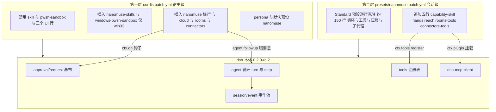
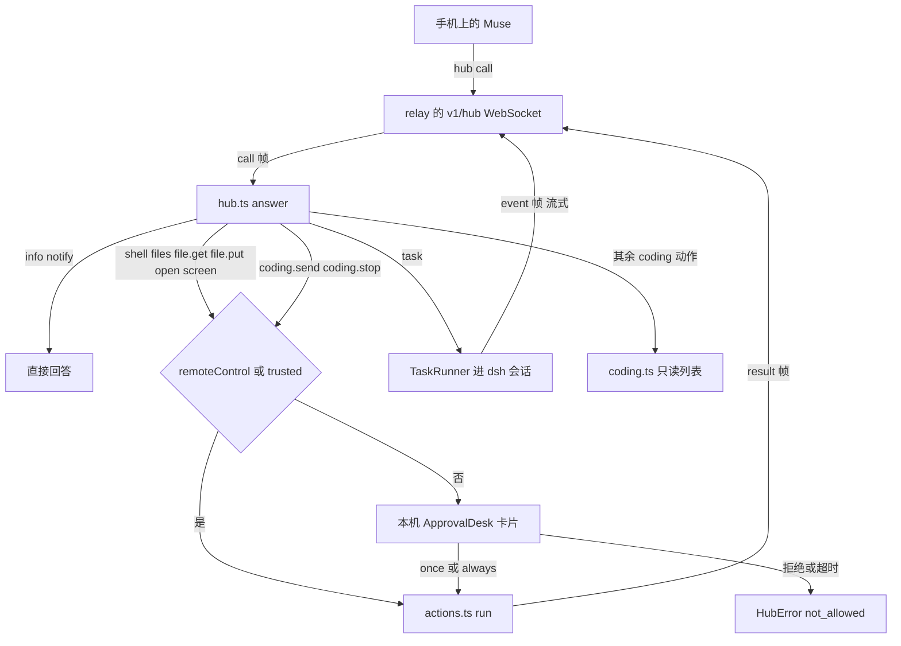
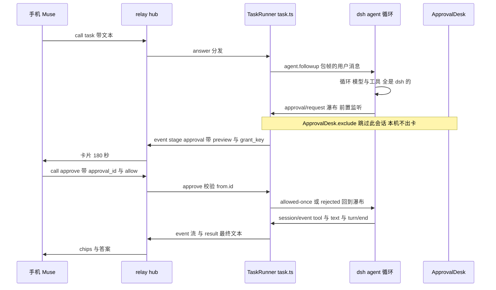
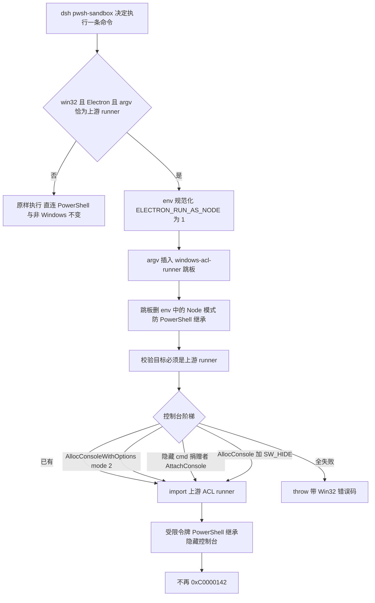
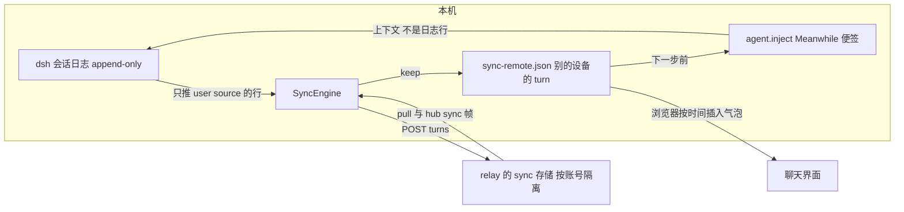

# 02 · dsh 宿主插件层：nanoMuse 只写插件，循环归 dsh

> 代码基线：`/data/repo`，commit `067384b7e5b3c47a7eeca217895be71493396518`（2026-11-13），versionName 1.0.9。
> 本章覆盖 `harness/dsh-nanomuse/src/*.ts` 顶层（54 个文件，24246 行）及 cordis.patch.yml、presets/、package.json、build.mjs。
> **明确排除**：`src/client/**`（浏览器半边）、`nanomuse/computer/**`、`web/**`、iOS、Android。
> 所有行号为仓库根相对路径；「推断」标记的结论未经运行验证。

## 本章回答什么问题

1. **头号事实**：nanoMuse Desktop 没有自己的 agent 循环。循环、工具注册表、技能系统、上下文压缩、子代理、MCP 客户端、Web UI 全是 dsh（DeepSeek Harness 0.2.0-rc.2）的；nanoMuse 写的是 Cordis 插件——服务、工具、钩子、路由、预设。本章用注册面（§1）、delegate 的执行路径（§4）、rooms 的批处理（§9）三处代码证明这一点，而不是引用 README。
2. 账号如何变成模型提供者？key 放在哪？relay 的「门」为什么存在？
3. 这台 PC 作为账号里的一台设备，应答哪些 hub 动作？「9 个动作」的准确清单是什么？
4. 手机把一个任务 delegate 过来，批准卡片如何回到手机、答案如何回到 dsh 的瀑布？
5. **Windows 沙箱三件套**（windows-pwsh-sandbox / windows-acl-runner / windows-console-host）：与 Android 的 PRoot 对位的那一层，到底修了什么、没改什么？
6. 拒绝分类、来源头、技能策略、围栏、同步契约 C7–C10 各是怎么落地的？
7. 哪些文档说法与源码冲突？哪些代码是休眠的？

对照 Android：Android 的循环是 `ChatViewModel`（12820 行）里一个 suspend 函数，工具分发、重试、压缩都在应用进程内；桌面端这些全部发生在 dsh 的 Host 进程里，nanoMuse 的 24246 行插件代码**没有一行在「决定下一步调用哪个工具」**——它只在 dsh 决定之后挂钩子（`tools/execute`、`llm/stream`、`approval/request`）、喂消息（`agent.followup` / `agent.inject`）、看事件（`session/event`）。

---

## 1. 注册面：一个 bundle 如何「寄生」在 dsh 上

### 1.1 三层补丁

`package.json:74-90` 声明 bundle 的两层补丁与 client 注入：

```json
  "dsh": {
    "bundle": {
      "patch": [
        "./cordis.patch.yml",
        "./presets/nanomuse.patch.yml"
      ]
    },
    "client": {
      "platform": "web",
      "inject": [
        "@deepseek-ai/dsh-client-locale",
        "@deepseek-ai/dsh-client-ui-sidebar",
        "@deepseek-ai/dsh-client-ui-conversation",
        "@deepseek-ai/dsh-client-ui-settings"
      ]
    }
  },
```

`peerDependencies`（`package.json:96-117`）把 18 个 dsh 包全部 pin 在 `0.2.0-rc.2`（cordis ~4.0.5）——包括 `dsh-pwsh-sandbox` 与 `dsh-sandbox-windows-acl`（§6 的主角）。文件头注释与 README 都承认这是开发者预览版，API 会破。

**第一层 `cordis.patch.yml`**（宿主级）做四件事：

1. **关掉 stock 行**：`skill`（`:10-11`，换成托管版）、`ui-brand-official`/`ui-sidebar`/`ui-settings-general`（`:38-53`，品牌与 UI 座位让位）、**`pwsh-sandbox`（`:60-61`）**——注释直说原因：

```yaml
# The stock Windows PowerShell sandbox assumes its host owns a console. Electron's
# Node-mode Host does not, so the nanoMuse provider below inserts a short-lived
# console trampoline before the restricted ACL child starts (#526). Both rows
# remain off on macOS and Linux, where the base profile uses bash.
- id: pwsh-sandbox
  disabled: true
```

2. **改 persona**（`:16-26`）：`includeHarnessIdentity: false`，personaPrefix 换成「You are nanoMuse … built on DeepSeek Harness … You never pretend a step succeeded」。
3. **默认预设**（`:31-33`）：`agent-preset-registry.config.default: nanomuse`。
4. **插入宿主行**（`:66-102`）：`nanomuse-skills`、`nanomuse-windows-pwsh-sandbox`（`disabled: !!js process.platform !== 'win32'`，`:69-71`）、`nanomuse`（根行）、`nanomuse-cloud`（baseURL 取 `NANOMUSE_CLOUD_URL` 或 `https://cloud.nanomuse.cn`，`:80-85`）、`nanomuse-rooms`、`nanomuse-connectors`。

**第二层 `presets/nanomuse.patch.yml`**（会话级预设）是头号事实的最直接证据。文件头（`:1-10`）：

```yaml
# Agent preset "nanoMuse": the persona of a personal agent on top of the same
# capability set as DeepSeek Harness' shipped `standard` preset (tools, skills,
# goals, plan mode, compaction, delegation). …
# The plugin list below mirrors `@deepseek-ai/dsh-web-app/presets/standard.patch.yml`
# of the pinned dsh version; when dsh moves, diff against it. Only the `persona`
# row differs. Our own capabilities (Hands, Reach, the Sentinel gate) will be
# added to this list as plugins, which is the point of the exercise.
```

`:11-162` 是 dsh Standard 预设插件列表的**逐行克隆**（工具、技能、goals、plan mode、compaction、delegation 全在），`:166-199` 追加五个 nanoMuse 行：`nanomuse-capability-skill`、`nanomuse-hands`（hands-tools）、`nanomuse-reach`、`nanomuse-rooms-tools`、`nanomuse-connectors-tools`。换句话说：**nanoMuse 的「agent 能力」= dsh Standard + 5 个插件行**。循环本体（turn/step/工具分发/压缩/子代理）在克隆的那 150 行里，一行都不是 nanoMuse 写的。

**休眠注释（发现）**：上面「will be added … the Sentinel gate」是过时注释——Hands/Reach 行早已存在，而 **Sentinel 在整个 bundle 里没有任何行**。`docs/harness.md:264` 把 Sentinel 标为「phase 4」（未做）。桌面端今天的审批层是 `ApprovalDesk` + 常设授权（§8），不是 Sentinel；`docs/every-device.md:23,65,87-91` 与 `docs/desktop-muse.md:228,473` 多处以 Sentinel 口吻描述桌面行为，属于把手机/runtime 的概念投射到桌面。



### 1.2 根行 index.ts：89 行，只做三件事

`src/index.ts:28-52`：`name = 'nanomuse'`；把 happy-eyeballs 的每地址尝试超时从 Node 默认 250ms 提到 1500ms（`:36-46`，注释：300ms 外的服务器在默认值下永远连不上，fetch 秒报 ETIMEDOUT；进程级生效，relay/connectors 都受益）；挂两个资产路由（`/nanomuse/assets` 与 avatar clips），都经 `mountGuarded`。浏览器半边骑在这个行上（client module system 按 bare package name 找 Loader 行，`:1-14` 注释）。

### 1.3 admit.ts：39 行，但每个路由都欠它一条命

`src/admit.ts:8-13` 的注释是安全立场的浓缩：

> A route registered raw answers any local process and any page open in any browser — for the account's routes and the connectors' that is a sign-out, a connection to a stranger's server or a spent allowance away.

`mountGuarded`（`:26-38`）等 `webServer` 与 `connection` 两个服务都起来，先过 `connection.requestRejection(req)`（Host/Origin 围栏 + 启动 token 铸的浏览器会话），401/403 与 dsh 自己的 `/api` 完全一致，然后才进 handler。bundle 里所有 HTTP 路由（assets、cloud、rooms、skills、connectors、coding）都走这一个函数。

### 1.4 build.mjs：esbuild 双产物

`build.mjs:22-56`：host 侧 51 个入口打成 ESM（`packages: 'external'`，dsh 包共享运行时实例；`splitting: true` 保证 cloud.js 与 reach.js 共享同一份 hub.ts——`instanceof HubError` 才能跨模块成立）；`define: process.env.NANOMUSE_VERSION` 把版本号烤进 bundle（注释：不烤的话打包 app 里人人都是 0.0.0，每次检查更新都「有新版」，0.1.41 修的）。client 侧打成 dsh 模块系统的 lazy-CJS factory（不在本章范围）。

---

## 2. cloud.ts：账号 → 凭证 → provider 行 → relay 的门

`cloud.ts` 4921 行，是 bundle 的心脏，但它的自我定位克制：`relay.ts:7-9` 说「the account's key is handed to the harness's own model adapter (`dsh-llm-pi-ai`) rather than to an adapter of ours; **nothing here touches a model request**」。nanoMuse 不写模型适配器，只写「把账号变成一行 provider 配置」的胶水。

### 2.1 三个常量与登录链

`cloud.ts:82-87`：

```ts
/** The credential reference the `nanomuse` provider row names. */
export const TOKEN_REF = 'NANOMUSE_CLOUD_TOKEN'
/** The provider id inside `llm-pi-ai`; permanent, sessions record it. */
export const PROVIDER_ID = 'nanomuse'
/** The profile row the Models page edits too. */
export const LLM_ROW = 'llm-pi-ai'
```

登录三步（relay.ts:326/337/350）：`/v1/auth/code`（大陆手机号走短信，其余走邮件）→ `/v1/auth/verify` → `/v1/auth/login` 拿 apiKey。然后 `adopt`（`cloud.ts:2902-2937`）：

```ts
  private async adopt(signIn: SignIn): Promise<CloudStatus> {
    const last = this.sync?.state.accountId || this.state.sync?.accountId || ''
    const switched = Boolean(last) && last !== signIn.account.id
    await this.beginAccountChange()
    await this.ctx.credentials.set(credentialRef(TOKEN_REF), signIn.apiKey)
    const models = await this.relay.models(signIn.apiKey)
    await this.writeProvider(models)
    await this.adoptDefaultModel(models)
    …
    await this.finishAccountChange()
    await this.writeHands()…
    void this.publishConnectors()…
    this.hub.start()
    if (this.sync) await this.startAccountSync(this.sync)
```

要点：

- **key 进 dsh 的凭证库**（`ctx.credentials.set`），不落 nanoMuse 自己的文件；provider 行只引用 `NANOMUSE_CLOUD_TOKEN` 这个名字。`writeProvider`（`:3682-3684`）就一行：`settings.update(LLM_ROW, { providers: { [PROVIDER_ID]: this.providerRow(models) } })`——账号模型从此是 dsh Models 页里一个普通的 provider。
- **账号切换先写「过渡态」再动凭证**（`beginAccountChange`，`:2847-2857`）：过渡期间 `token()` 返回 undefined（`:3611-3616`），失败则重启后仍停在暂停态——半截登录不会把旧账号的 key 配上新账号的同步。
- `adoptDefaultModel`（`:3691-3709`）只替换「还没选过」的默认（dsh 的 deepseek-official/deepseek-account），不覆盖用户选择。
- 登出 `forget`（`:3711-3744`）：凭证 unset、provider 行 unset，但**保留** deviceId、同步状态、用户自己的 provider、chatgpt 登录。
- **文档冲突（小）**：README:21 称 provider 为「`nanoMuse Cloud` provider」，代码里 id 是 `nanomuse`（会话日志记录的就是这个 id）。显示名与配置 id 不是一回事，读日志时别找错。

### 2.2 relay 的门：为什么 provider 行指向 127.0.0.1

`relay-proxy.ts:1-19` 的注释把动机说尽：适配器按 provider 行里写死的 headers 发每个请求，而**每次调用的来源（run/turn/step/trajectory）都不同**。所以 provider 行指向 `http://127.0.0.1:<port>/v1`，门在转发时补上 `llm/stream` 钩子预告的 headers。安全立场：

> Nothing new can be done through this door: a request is forwarded only when it carries the account's own key … anything else is a 401 here, as it would be at the relay.

实现（`relay-proxy.ts:118-122`）：bearer 与账号 key 做 `timingSafeEqual`；`/v1/chat/completions` 的 body 交给 `provenance.claim`（`:150-162`）；响应**逐字节**流回（`:186-190`），relay 的排队提示、SSE 注释行、拒绝状态原样过境；`x-nanomuse-request` 记为 turn id（`:174-175`）。门没有自己的超时（`requestTimeout = 0`，`:77`）——turn 多长由 relay 说了算；客户端断开连坐上游（`res.on('close', () => controller.abort())`）。端口记忆与 Host 端口同理（`:67-99`）：优先上次的端口，provider 行才不用重写；拿不到就直连 relay、放弃 provenance（`cloud.ts:851-859` 的 warn 写明代价）。`repointProvider` 不被 await（`cloud.ts:861-867`，#701：settings 写入要过 loader，而 loader 还在起插件，等它会卡住 Host 报地址）。

### 2.3 provenance：expect/claim，绝不猜

`provenance.ts:26-43`：RunKind 五种 `person|schedule|feed|goal|hub`；`PLATFORM = 'desktop'`；八个 `x-nanomuse-*` header。机制是两段式：`llm/stream` 钩子里 `expect(options, deviceId)` 登记「即将有一个 model=X、末条消息=Y 的调用」（`:189-211`，TTL 60s）；门收到真实请求时 `claim(body)` 认领（`:218-237`）——唯一等待者直接配对，否则按 model+末条消息匹配，两个相同调用并发时旧的先走，**匹配不上就不加来源头**（注释：never with a guess）。delegate 的 turn 被 `setRun(sessionId, 'hub')` 钉住（`:142-146`），不会被后续调度改写成 person。

### 2.4 llm/stream 钩子与拒绝分类

`cloud.ts:1222-1239`（Around 钩子，节选）：

```ts
    this.ctx.inject(['llm'], (ctx) => {
      ctx.on('llm/stream', function (options, next) {
        // a key of the person's own: the turn is let through as it is and, when the account is signed
        // in and the relay keeps a record, sent up afterwards so the record is whole (docs/cloud.md)
        if (options.provider !== PROVIDER_ID) return cloud.recordOwnTurns() ? cloud.ownTurns.watch(options, next()) : next()
        if (!cloud.cloudModels() && !(options.sessionId && cloud.cloudOnce.has(String(options.sessionId)))) {
          …
          return cloud.refuseCloudOff()
        }
        // the call's provenance, for the door to put on the request the adapter is about to send
        const release = cloud.provenance.expect(options, cloud.state.deviceId ?? '')
        return cloud.watchRelayStream(next(), …, release)
      })
    })
```

三条路：自己的 key 原样放行（可选事后记录，record.ts）；Cloud 关闭时改道自己的 chat 选择或拒绝；Cloud 调用登记 provenance 后监视流。**流里的拒绝被改写**：`refusals.ts:268-287`：

```ts
/** The harness's codes other plugins act on (compact and retry, offload images): left alone. */
const HANDLED_BY_DSH = new Set(['CONTEXT_WINDOW_EXCEEDED', 'IMAGE_OFFLOAD_REQUIRED'])

/**
 * … A refusal is never retried by the harness — `nanomuse/*` is not among its retryable codes —
 * so a spent allowance shows at once rather than after five back-offs of a "rate limit".
 */
export function relayFailure(failure: FailureLike): { failure: FailureLike; refusal: RelayRefusal } | null {
  if (HANDLED_BY_DSH.has(failure.code)) return null
  …
```

16 种拒绝（`refusals.ts:17-51`）改写成 `nanomuse/<kind>` 失败码——**利用 dsh 重试插件不认识这些码**，让「额度用完」立刻呈现而不是被当成 rate limit 重试五次。上下文超限与图片卸载两个码留给 dsh 的压缩/卸载插件处理。这是「懂上游行为才能写对插件」的典型：不改上游一行，靠码的命名空间达成语义。

容量继承的另一半在 `cloud-llm.ts:7-19`（`inheritCloudCapacity`）：仅当用户把 contextWindow/maxTokens 留空时填 relay 的实时值。它被第 01 章的 capacity-defaults lib 补丁接进 dsh——**插件提供函数，补丁提供调用点**，这是 bundle 与上游之间最不体面但最诚实的一处耦合。

---

## 3. hub + actions：这台 PC 作为设备应答什么

### 3.1 hub.ts：621 行，零 import

`hub.ts` 没有一个 import 语句——用 Node 22 的全局 `WebSocket`，文件头（`:1-9`）明说「Plain WebSocket, no Cordis — the service in cloud.ts owns the lifetime」。key 走 `hello` 帧而不是 header（`:355`，注释：Node 的 WebSocket 设不了 header，像浏览器一样送）。帧处理（`:410-480`）：`welcome/devices/profile/sync/working/pong/event/result/error/call`；入站 `call` 进 `answer`（`:483-501`）：查 handler 表，没有就回 `unknown_action`，有就执行并以 `result` 收尾，`HubError.code` 原样过境。重连指数退避 1s→30s（`:527-536`），ping 保活、静默掉线检测（`:550-572`）。

### 3.2 动作清单：「9 个」的准确说法

任务书里「info/notify/shell/files/file.get/file.put/open/screen/task 九个动作」是 README 的口径（harness/README.md:21）。源码的准确清单是：

- `info`、`notify`：无条件回答（`cloud.ts:898-913`）。info 报 name/kind/os/arch/user/home/cwd/runtime/**actions**（自描述）。
- `REMOTE_ACTIONS = ['shell', 'files', 'file.get', 'file.put', 'open', 'screen']`（`actions.ts:31`）：经 `remote()` 过闸（remoteControl 开关或 trusted 设备，否则本机弹卡，`cloud.ts:3598-3608` 的 `permit`）。
- `task`、`task.status`、`stop`、`approve`：会话级 TaskRunner（`cloud.ts:931-1022`），§4。
- **另有 11 个 coding.\* 动作**（`coding.ts:28`）：`coding.agents/sessions/session/send/stop/runs/projects/item/diff/watch/project.validate`，其中 `coding.send/coding.stop` 过闸（`GATED_CODING_ACTIONS`，`:31`）。

即：**6 个原始动作 + info/notify + 4 个任务动作 + 11 个 coding 动作 = 23 个**，README 的「9 个」只数了原始面。`permit` 的语义（`cloud.ts:3598-3608`）：

```ts
  private async permit(from: Caller, action: string, text: string): Promise<void> {
    if (this.remoteControl || this.state.trusted?.[from.id]) return
    …
    const answer = await this.asks.ask(from, action, text)
    if (answer === 'always') await this.setTrusted(from.id, from.name, true)
    if (answer === 'once' || answer === 'always') return
    throw new HubError('not_allowed', …)
  }
```

remoteControl 开 = 账号内设备直通；关 = 每台设备第一次来问本机的人，*always* 记为 trusted。`notify` 永不问（docs/every-device.md:65 与源码一致）。

### 3.3 actions.ts：原始动作的平台细节

- `shell`（`:119-185`）：Windows 用 `cmd /d /s /c "整条命令"` + verbatim（`shellCommand`，`:109-116`，注释解释 /s 剥外层引号的语义，保住带空格路径的内层引号）；POSIX 用 `$SHELL -c`。超时上限 900s（`:26`），超时杀进程树；输出半程截断（头尾各留一半）。
- `files`（`:195-228`）：目录列举上限 2000 条（`:28`）；`file.get/file.put`（`:231-276`）8MB 上限（`:25`），base64 过境。
- `open`（`:289-314`）：Windows 专用 opener（`windowsOpener`，`:283-286`）走 `rundll32 url.dll,FileProtocolHandler` 一类系统语义（推断：避免 start 的引号地狱；具体见该函数）。
- `screen`（`:317-372`）：**平台自有工具的阶梯**，不经 Electron operator——macOS `screencapture`、Windows PowerShell 截屏、Linux 依序尝试可用工具（`capture`，`:337`）；拿不到就 `no_screen` 错误，PNG 尺寸从 IHDR 读（`pngSize`）。注意这与 Hands 的截图是两条路：Reach 的 `device_screen` 要的是「这台机器现在的屏幕」，用系统工具即可，不需要 operator 的坐标映射。



---

## 4. delegate：手机的任务如何在这台 PC 的 dsh 会话里跑

这是「循环归 dsh」的第二处铁证。`task.ts`（421 行）没有任何循环——它把任务文本包成一条用户消息**喂给 dsh 的 agent**，然后坐在 `session/event` 上看戏。

### 4.1 喂消息，不跑循环

`task.ts:93-95`（任务进来的样子）：

```ts
export function frame(from: string, here: string, text: string): string {
  return `[Asked from ${from}, another device on this account. You are the Muse on ${here}: do it here, on ${here}, and answer briefly — the answer goes back to ${from}.]\n${text}`
}
```

`task()`（`:174-215`）：闸门检查（保护性退出期间拒 `busy`）→ `sessionController.resolveAgent` → idle 检查（一个会话同时只跑一个任务）→ 15 分钟超时定时器（`TASK_TIMEOUT_MS`，`:29`）→ 关键一行（`:205`）：

```ts
      agent.followup(createUserMessage({ content: [{ type: 'text', text: frame(from.name || from.id, this.options.deviceName(), text) }], source: { kind: 'user' } }))
      const final = await settled
      return { text: final, conversation, thread: sessionId, device: this.options.deviceName() }
```

**`agent.followup` 之后发生的一切——模型调用、工具分发、重试、压缩——都是 dsh 的循环**。TaskRunner 只在 `attach()`（`:152-162`）里挂三个监听：

```ts
    const offEvents = this.ctx.on('session/event', (session, event) => this.onEvent(session, event))
    const offApproval = this.ctx.on('approval/request', (req, next) => this.onApproval(req, next), true)
    const offStream = this.ctx.on('agent/assistant-stream', ({ agent, frame }) => this.onStream(agent.id, frame))
```

注意第二个参数的 `true`：approval 监听**前置**到瀑布最前（在 ApprovalDesk 之前），这样 delegate 会话的卡片由 TaskRunner 接管。`onEvent`（`:296-353`）把 dsh 事件翻译成 runtime 的事件帧：`tool/call→stage:'tool'`、`tool/result→stage:'tool_result'`、`assistant/message→stage:'text' interim`、`turn/end` 按 reason 分流——`blocked` 时报「the step was refused before the model was asked」而不是空答案（`:335-341`，#718：空答案在对面会读成「Done」）。会话以 `agentPreset: 'nanomuse'`、标题「From <device>」创建（`:271`），重启后 `restore` 解归档（`:283-294`，#718）。

### 4.2 批准的回路：本章最重要的时序

`onApproval`（`task.ts:371-406`）：

```ts
  private async onApproval(req: ApprovalRequestEvent, next: () => Promise<ApprovalOutcome>): Promise<ApprovalOutcome> {
    const run = req.agent ? this.bySession.get(req.agent.id) : undefined
    if (!run) return next()
    …
    run.call.event({
      stage: 'approval',
      approval_id: id,
      preview: tool ? preview(tool.name, tool.args) : req.toolName,
      grant_key: tool ? grantKey(tool.name, tool.args) : req.toolName,
      risk: 'moderate',
      …
      timeout: APPROVAL_TIMEOUT_S,
    })
    …
    const status = await new Promise<ApprovalStatus>((resolve) => { … this.pendingApprovals.set(id, { fromId: run.call.from.id, decide: done }) })
    if (status !== 'cancelled') run.call.event({ stage: 'approval_result', approval_id: id, status })
    …
    return status === 'approved' ? 'allowed-once' : status === 'cancelled' ? 'cancelled' : 'rejected'
  }
```

手机侧的答案经 `approve`（`:240-250`）回来，**校验 from.id 必须是发起设备**（`:244-247`，别的设备不能替答），然后 `pending.decide('approved'|'denied')`  resolve 上面的 Promise，瀑布拿到 `'allowed-once'` 或 `'rejected'`。180 秒无人答则 expired（`APPROVAL_TIMEOUT_S`，`:31`）。`grantKey`（`:117-128`）取工具主参数（command/cmd/path/file_path/url/query/pattern/task/prompt）作为「这一步是什么」的稳定键。



`ApprovalDesk.exclude(sessionId)`（`desk.ts:267-274`）保证 delegate 会话不在本机弹卡——问题在**提问的设备**上答（docs/every-device.md:86-89 的「Approvals are answered where the question was asked」）。反向也成立：本机 Hands 的卡片可以推到手机（§8.3）。

### 4.3 持久 turn：UUID 日志与「interrupted」

`persistent-turns.ts`（109 行）是给「手机绑定会话」的 turn 日志：conversation 与 turn 都必须是 UUIDv4（`:18-25`），key 是 `[account, caller, conversation]`（C10 的账号隔离）；`accept` 先落盘再执行，一个会话同时只有一个 live turn（`:60-62`）；**accepted 但进程重启后不 live 的 turn 读作 `{state:'interrupted'}`**（`:51`）——不假装成功也不假装失败。提交是 tmp+fsync+rename、0600（`:92-108`）。`persistent-task-endpoint.ts`（109 行）在其上包一层：LiveTurn 保留最近 ≤8 条事件与 ≤4 张未过期批准卡（单条 ≤4000 字符，`:16-28`），事件投递是机会主义的（`:82-86`，socket 断了不影响执行结果，调用方可以事后查）。`device-conversations.ts:26` 的调用方策略一句话：「a turn has one dispatch, and recovery is a read of the target journal」——重试不重发，读日志。`device-chat.ts:3-5`：只有在线且自报 `task.status` 动作的设备才能开绑定设备聊天。

---

## 5. Reach：7 个工具，以及文档多写的两个

`reach.ts`（418 行）注册的工具**恰好 7 个**（行号为 `name:` 所在行）：

| 工具 | 行 | 过闸 |
|---|---|---|
| `devices` | 84 | 否（只读列表） |
| `device_screen` | 122 | 否（注释：Look, then decide; this does not touch the device） |
| `device_shell` | 165 | 是 |
| `device_files` | 215 | 是 |
| `device_open` | 252 | 是 |
| `device_notify` | 278 | 否 |
| `delegate` | 303 | 是（timeoutMs 660_000） |

批准走 dsh 自己的卡片（`reach.ts:66-71`）：

```ts
  const approve = async (exec, toolName, reason, zh) => {
    const approval = ctx.get('approval')
    if (!approval || !exec.agent) throw new Error('Approval is not available in this session; the request was not sent.')
    const outcome = await approval.request({ agent: exec.agent, toolName, callId: exec.callId, reason, displayReason: { en: reason, zh }, signal: exec.signal })
    if (outcome !== 'allowed-once') throw new Error(`The person did not approve: ${reason} (${outcome}).`)
  }
```

**没有 approval 服务就拒绝**——fail-closed，不是「没卡就放行」。`delegate` 的事件处理（`:323-332`）把对面发来的 `stage:'approval'` 变成本机卡片，答案再 `hub.call(d.id, 'approve', …)` 送回去；本机 Stop（exec.signal abort）连坐对面的 `stop {call}`（`:343-349`），注释明说这样对面的批准不会挂着。图片结果经 `admitImage`（`:396-412`）进会话。

**文档冲突（发现）**：`docs/every-device.md:53` 列了 `device_get`、`device_put`——**reach.ts 里不存在这两个工具**（grep 全文件无）。桌面作为*目标*回答 `file.get/file.put`（§3），但作为*发起方*没有暴露文件传输工具；README:22 的 7 工具清单才是对的。推断：文档写的是 runtime（Python）侧的工具面，桌面插件还没对齐。

---

## 6. Windows 沙箱三件套：与 Android PRoot 对位的那一层

Android 用 PRoot 把 shell 关进应用私有目录；Windows 桌面端的对位物是 **dsh 的受限令牌 PowerShell 沙箱**（`dsh-pwsh-sandbox` + `dsh-sandbox-windows-acl`）——nanoMuse **没有自研沙箱**，它只修了「沙箱在 Electron 宿主里起不来」这一个 bug。三件套共 348 行（113+39+196），全部署名改编自 MIT 的 dsh-desktop（`windows-pwsh-sandbox.ts:4-5`、`windows-acl-runner.ts:4-5`）。

### 6.1 问题：0xC0000142

链条是这样的：dsh 的 pwsh-sandbox 在 Windows 上把命令交给 ACL runner，runner 用受限令牌（restricted token）启动 PowerShell 子进程。普通宿主有控制台，子进程继承即可；**Electron 的 Node 模式进程没有控制台**，受限令牌子进程试图自己创建 conhost 时被令牌挡死，退出码 0xC0000142（#526）。`windows-console-host.ts:174-178` 的注释是修复思路的原文：

> Establish a hidden console while the runner still has its ordinary token. The restricted PowerShell child inherits it instead of trying to create conhost after token restriction, which is the path that exits with 0xC0000142.

### 6.2 适配器：只包「那一种」调用

`windows-pwsh-sandbox.ts:38-67`：

```ts
export function adaptWindowsAclExecution(
  spec: ShellExecSpec,
  argv: readonly string[],
  adaptation: WindowsAclAdaptation,
): AdaptedWindowsAclExecution {
  const [program, runner, ...args] = argv
  if (
    adaptation.platform !== 'win32' ||
    !adaptation.electron ||
    program !== adaptation.execPath ||
    runner !== adaptation.upstreamRunner
  ) {
    return { spec, argv }
  }

  const env = { ...spec.env }
  for (const key of Object.keys(env)) {
    if (key.toUpperCase() === RUN_AS_NODE) delete env[key]
  }
  env[RUN_AS_NODE] = '1'
  return {
    spec: { ...spec, env },
    argv: [
      adaptation.execPath,
      adaptation.trampoline,
      adaptation.upstreamRunner,
      ...args,
    ],
  }
}
```

四个条件同时成立才动手：win32、Electron 宿主、program 恰为 `process.execPath`、runner 恰为 `import.meta.resolve('@deepseek-ai/dsh-sandbox-windows-acl/runner')` 解析出的上游 runner（`:14-16`）。注释（`:34-37`）：**「Direct PowerShell and every non-Windows execution stay unchanged.」** 动手的内容也只有两件：env 里删掉所有大小写变体的 `ELECTRON_RUN_AS_NODE` 再设标准的 `'1'`（Windows env 大小写不敏感但 Node 的键敏感，防漏）；argv 头部插入 trampoline。`NanomuseWindowsPwshSandbox extends SandboxPwshExecutor`（`:70`），只 override `executeArgv`（`:91-110`），连异步 prepare 函数形态也处理（在 prepare 返回后改 `pending.env`，`:105`）。**ACL 策略本身一个字节没改**——受限令牌的权限集合、完整性级别都是上游的。

### 6.3 trampoline：39 行的跳板

`windows-acl-runner.ts:21-33`：

```ts
async function main(): Promise<void> {
  const requestedRunner = process.argv[2]
  removeRunAsNodeEnvironment()
  const expectedRunner = fileURLToPath(
    import.meta.resolve('@deepseek-ai/dsh-sandbox-windows-acl/runner'),
  )
  if (requestedRunner !== expectedRunner) {
    throw new Error('nanoMuse trampoline received an unexpected ACL runner')
  }
  await ensureWindowsConsoleHost()
  process.argv = [process.argv[0] as string, expectedRunner, ...process.argv.slice(3)]
  await import(pathToFileURL(expectedRunner).href)
}
```

三步：从 env 删 `ELECTRON_RUN_AS_NODE`（这样 runner 再 spawn 的受限 PowerShell **不会继承 Node 模式**）；校验 argv[2] 必须是上游 runner（跳板不接受任意目标，防被当通用 launcher）；**先建控制台，再 import 上游 runner**。失败退出码 127、签名 `windows-acl-run`（`:12-13`）。

### 6.4 控制台阶梯：四级，全失败才 throw

`windows-console-host.ts:179-196`：

```ts
export async function ensureWindowsConsoleHost(…): Promise<void> {
  if (platform !== 'win32') return
  const api = loadApi()
  if (api.hasConsole()) return
  if (api.allocWindowlessConsole?.()) return
  if (await attachToDonorConsole(api, launchDonor)) return
  if (api.allocConsole() === 0) {
    throw new Error(`could not allocate a console for the Windows ACL runner (Win32 ${api.getLastError()})`)
  }
  const window = api.getConsoleWindow()
  if (window !== null) api.showWindow(window, SW_HIDE)
}
```

1. 已有控制台（`GetConsoleCP() !== 0`，`:63-67`）→ 直接用；
2. `AllocConsoleWithOptions` mode 2（无窗口控制台，新 Windows 才有，`:85-109`，符号不存在则返回 undefined 跳过）；
3. **捐赠者**：起一个隐藏 `cmd.exe /d /q /k echo nanomuse-console-ready`，`AttachConsole(donor.pid)` 借它的控制台，10 秒超时（`:115-172`）；
4. 老式 `AllocConsole` + `ShowWindow(SW_HIDE)`。

FFI 的加载方式值得单独记（`:56-60`）：

```ts
  // Resolve the native binding through the ACL backend that owns and versions it.
  // Keeping it out of this plugin's direct dependencies also lets `dsh plugin add`
  // retain its fail-closed policy for packages with unapproved install scripts.
  const koffi = createRequire(WINDOWS_ACL_MANIFEST)('koffi') as KoffiApi
```

koffi 不进 nanoMuse 的直接依赖，而是从 ACL 后端自己的 node_modules 里 resolve——谁拥有版本谁负责，同时让 `dsh plugin add` 的「未批准 install script 一律拒装」策略不被破坏。



**与 Android 的对位总结**：PRoot 是「应用自己造一个隔离环境」；这里是「上游已有隔离环境（受限令牌），插件只修宿主适配」。nanoMuse 在 Windows 上的安全边界**来自 dsh**，插件的贡献是让它可用而非让它更松或更紧。未实测：`windows-pwsh-sandbox.test.mjs` 顶层 `import.meta.resolve` dsh-sandbox-windows-acl 且类 extends 上游 executor，无 npm install 跑不了（§14）。

---

## 7. Hands 的插件半边：挂载、钩子、确认票

Hands 的工具本体在 Python runtime（`computer_screen/computer_act`，范围外）；插件侧做三件事。

### 7.1 hands-tools.ts：一个 MCP 客户端的生死

`hands-tools.ts:35-47`（clientConfig）：stdio transport，命令 `NANOMUSE_PY || 'nanomuse'`，参数 `['mcp']`，env 只传四个白名单继承项（`DISPLAY/NANOMUSE_MCP_CONFIRM/NANOMUSE_OPERATOR_URL/NANOMUSE_OPERATOR_TOKEN`，`:28`——dsh 会剥掉 credential 形状的 env，所以按名显式传）加 `NANOMUSE_GUI_*` 模型配置；`failOnStartupError: false`（runtime 缺失时预设少一双手而不是坏掉）。

挂载逻辑（`:74-129`）：env 的 JSON 是 key，变了才重挂；**有 Hands 调用在飞就不重挂**（`cloud.handsBusy()`，名字以 `mcp__nanomuse__` 开头判定，`cloud.ts:1823-1826`），调用结束本身又是一次变更事件，所以会再试；服务广播频繁，300ms 防抖（`:122-129`）。这就是「Settings → Models 换 Hands 模型，下一步生效，不用重启」的实现。

### 7.2 tools/execute 钩子：hold、确认票、轨迹

`cloud.ts:1120-1168`（Around 钩子，节选关键分支）：

```ts
      ctx.on('tools/execute', async (exec, next) => {
        if (!isHandsTool(exec.name)) return next()
        // Our own re-dispatch of a step the person just agreed to: the stage already follows the outer call.
        if (exec.parent !== undefined && confirmationOf(exec.arguments) !== undefined) return next()
        …
        if (exec.name === 'mcp__nanomuse__computer_act' && handOverOf(exec.arguments)) {
          …
          const hold = this.holdDesk.begin(sessionId, 'computer', 'agent', reason)
          const how = await this.holdDesk.wait(sessionId)
          …
        }
        // While the person has the screen, the hands wait rather than fail.
        if (this.holdDesk.on(sessionId)) await this.holdDesk.wait(sessionId)
        …
        let result = await next()
        …
        if (exec.name === 'mcp__nanomuse__computer_act' && result.isError) {
          const refused = refusalOf(result)
          if (refused) {
            result = await this.confirmStep(ctx, exec, refused, next)
            …
```

四个语义层：

- **hand_over（C1）**：模型说「这步该人来」（密码/验证码），钩子开一个 hold，工具调用挂起最多 10 分钟（HoldDesk，`desk.ts:426-428` 注释提到 Node 22 的 unref bug 所以 timer 保持 referenced），人按 Done 后返回「The person finished and handed the screen back.」——对模型来说这是一次正常的工具返回，循环继续。
- **人持有屏幕时 Hands 等待而非失败**（第二个 if）。
- **确认票**：runtime 拒绝一步（它自己的「先问人」门）时，`confirmStep` 走 dsh 的 approval 卡片，人批准后带 `NANOMUSE_MCP_CONFIRM` 造的票**重新派发**该步（`exec.parent !== undefined` 的重派发不再过钩子，防递归）。票的 secret 来自第 01 章的启动 env——模型拿不到，所以说不出「我已被批准」。
- 每步截图从 MCP 结果首行取出（窗口标题+尺寸）进 trajectory（`trajectory.ts:81-89`：40 步/run、4 run、64MB 图上限、10 分钟无调用关 run，全在内存，重启即忘）。

### 7.3 hands-check.ts：376 行的体检

`hands-check.ts` 自带一个最小 stdio JSON-RPC 客户端（`withMcp`，`:173-264`，60s 超时、2s 宽限杀树）直连 runtime 做体检：截图测试（黑图检测 `isBlack`，macOS 缺 Screen Recording 的特征）、鼠标移动测试（中心+20px）、runtime 路径诊断（`NANOMUSE_PY/PATH`，`:88-107`）、Wayland 提示文案（`:64`）。杀树同样是 Windows `taskkill /T /F`、POSIX 负 pid（`:152-167`）。注释里留着版本事故：0.1.37 的截图首行标题 bug（`:26-43`）。

---

## 8. ApprovalDesk：一个瀑布位置，两种表面，三层授权

### 8.1 瀑布里的赛跑

`desk.ts:240-336` 的 ApprovalDesk 坐在 `approval/request` 瀑布**第一位**（TaskRunner 对 delegate 会话前置抢走，§4）。`handle` 的核心（`:311`）：

```ts
      outcome = await Promise.race([next(), fromStage])
```

`next()` 是 dsh 聊天里的卡片，`fromStage` 是外壳覆盖窗（capsule）/轨迹卡的答案——**谁先答谁赢**。细节在 signal 手术（`:304-319`）：聊天卡片拿到的是一个替换过的 signal，stage 答完后 `card.abort(new Error('answered on the stage'))` 把聊天卡**撤回**而不是「取消」——一个决定，两个表面同时消失，且不会在日志里记成 cancelled。常设授权短路在最前（`:275-278`，`granted(req)` 为真直接 `'allowed-once'`，settled 记 `by:'grant'`）。

### 8.2 常设授权：computer_app 与它的范围

`Grant`（`desk.ts:39-52`）：target 形如 `computer_app:Safari`；可选 `sessionId`（*Always in this chat*）与 `scheduleId`（*Always in this task*）。匹配规则 `grantCovers`（`:82-88`）：app 名按 `appNames` 展开（`微信 (WeChat)`/`微信 (com.tencent.xinWeChat)`/`WeChat` 都算同一个，`:59-62`）；无 scheduleId 的授权覆盖该会话所有 turn；有 scheduleId 的**要求 run 的每个任务各有一张**（一个 turn 跑两个任务，一张不够）。授权认 app 不认人——docs/desktop-muse.md:246-247 明说「in that chat, the hands may send anything to anyone in that app」。

**休眠代码（发现）**：`GrantTier = 'highest'|'confirm'|'notice'`（`desk.ts:130-139`）注释自认「The desktop keeps nothing under notice today; the tier is in the contract so a store that lands there has its place」。三档分级是手机 Sentinel 的契约形状，桌面今天只有 moderate 一档（task.ts 的卡片 `risk:'moderate'` 也是写死的）。docs/every-device.md:23 的「three tiers」在桌面未实现。

### 8.3 卡片上手机：phone-approvals.ts

`phone-approvals.ts`（119 行）：本机 Hands 的批准卡经 `hub.push('*', {stage:'approval', …, any_device:true})` 广播给所有声明 `approve.any` 的设备（`:14,89`）；手机展示 600 秒（`:17`），本机的卡继续等；第一个答案定案，`close` 推 `approval_result` 并带上 `by`（哪台设备答的，`:111-118`）。scope 只有 `once|schedule`（`:20`）——手机上不能给「永远允许此 app」，那是本机表面的权限。

---

## 9. rooms + fences + sync：房间是 dsh 会话的另一种用法

### 9.1 rooms.ts：2679 行，没有第二个运行时

文件头（`rooms.ts:1-27`）自述立场：「as a host service over the harness's own primitives, no second runtime」。Feed/Ideas/Goals/Library 全部落在 dsh 的会话、schedule、`present` 上，状态在 `$DSH_HOME/nanomuse/rooms.json`。

**批处理（Feed/目标检查）的执行路径**是「循环归 dsh」的第三处铁证（`rooms.ts:1692-1731`，节选）：

```ts
  private async run(title: string, prompt: string, summary: string): Promise<string> {
    const sc = this.ctx.get('sessionController')
    …
    const created = await sc.create(await homeWorkspace(this.ctx, …))
    // remembered before a word is said, so the sync never sees the chat as one of the person's
    this.store.batches = [String(created.sessionId), ...].slice(0, BATCHES_KEEP)
    await this.save()
    …
        agent.followup(createUserMessage({ content: [{ type: 'text', text: prompt }], source: { kind: 'nanomuse', form: 'notice', summary: summary.slice(0, 120) } }))
    …
    } finally {
      // The batch is a means, not a chat: out of the list, kept in the archive.
      await (this.ctx.get('workspaceRegistry') as RegistryLike | undefined)?.archiveSession(created.sessionId, { stopActivity: true })…
```

创建会话 → **先记入 batches 再说话**（同步引擎据此排除，§9.3）→ `agent.followup` 喂 prompt → 8 分钟超时（`RUN_TIMEOUT_MS`，`:64`）→ finally 归档。循环还是 dsh 的。`onEvent`（`:1733-1813`）里：`deliverables/presented` 的文件自动进 Library（`:1745-1748`）；**任何人的聊天**在 `turn/end` 且 completed 且末条 assistant 消息含 ```` ```nanomuse- ```` 时应用围栏（`:1769-1771`）——目标与 Feed 不是专用工具的产物，而是模型在普通聊天里写的 fenced block。

### 9.2 fences.ts：与手机逐字节共享的协议

`fences.ts:15-17` 三个标签 `nanomuse-goal / nanomuse-goal-update / nanomuse-feed`，文件头（`:2-4`）点名与手机 `GoalFlow.kt / FeedFlow.kt / NanoMuseBlock.kt` 同标签同键同规则。Ideas 列表 `assets/ideas.{en,zh}.json` 与 Android/iOS 的资产**逐字节相同**——这不是口头承诺，`tests/fences.test.mjs:53-62` 直接读三个平台的文件做 `assert.equal`（本次实测通过，§14）。`rooms-tools.ts` 的 7 个工具（goals_room_update:75、feed_post:108、library_add:135、remember:160、draw_new_look:184、schedule_list_all:211、schedule_delete_any:253）里，`schedule_delete_any` 的批准后重校验值得看（`:270-287`）：批准回来后再查一次 access、signal、任务身份指纹（id+session+title+rule+tz+prompt），**批准期间任务被改过就拒绝执行**——TOCTOU 的正面处理。

提示词上下文经 `systemPrompt.context` 注入（`rooms-tools.ts:300-338`）：persona（IDENTITY/SOUL，上限 1500/2500 字符，rooms.ts:811-816）、目标 ≤12 条、记忆最近 60 条、以及「工具的 description/step 参数要写给人看的话」——状态条下那行「打开携程网站」就是这么来的。

### 9.3 sync.ts：C7–C10 与「永不写进会话日志」

`sync.ts`（1673 行）头部（`:1-46`）列契约：C7 文本同步、C8 一条主线程、C9 main-first、C10 按账号归属。最关键的设计决定在 `SyncSessions.keep` 的注释（`:353-357`）：

```ts
  /**
   * A turn from another device, kept by the host for the transcript — in a store of its own,
   * never in the session's log: a surface message appended there outside a turn makes the log
   * unreadable once a turn runs ("system/message requires a protected first surface head").
   */
```

dsh 的会话日志 append-only 且归循环所有，外部塞一行会毁掉日志——所以别的设备的 turn 存 `sync-remote.json`，浏览器按时间插进气泡，模型则在下一步前收到一条 `agent.inject` 的「Meanwhile…」便签（`meanwhileNote`，`:461-475`，≤40 行/12000 字符，`source.kind:'nanomuse-sync'`，**不是日志行、不会被推回 relay**）。账号切换的竞态处理（`createForAccount`，`:721-735`）：先预留 UUID 与 owner 落盘，再 create——Host 可能在 create resolve 前就发布会话，owner 必须先于第一个副作用存在。cleared 会话的子代理继承清除状态（`:522-535`）；0.1.36/0.1.38 的两代状态迁移（`:548-563`）。



---

## 10. 技能：替换 stock 注册表，策略 fail-closed

`skills.ts:171-177`：

```ts
/** Replace the base profile's `skill` service before any providers or consumers mount. */
export async function apply(ctx: Context, config: RegistryConfig = {}): Promise<void> {
  const preferences = new SkillPreferences(join(resolveDshHome(), 'nanomuse', 'skills.json'))
  await preferences.load()
  const registry = new NanoMuseSkills(ctx, preferences, config)
  mountGuarded(ctx, SKILLS_PREFIX, skillsHandler(ctx, registry), 'nanoMuse skill settings')
}
```

`NanoMuseSkills extends SkillRegistry`（dsh 的类，`:19`），包装 provider 的 `get` 做过滤（await 后二次检查，`:29-44`），策略 revision 变化时失效缓存。策略文件 `skills-policy.ts`：1MB 上限、最近 .git 根为工作区键（`:14-27`）、原子写 0600（`:39-47`）；**损坏/不可读 = 拒绝所有技能**（`:68-70` 注释：「Only a missing preferences file means first run. An unreadable or corrupt file denies skills.」）——fail-closed 的又一例。冷会话（没跑过的聊天）只读：「never claim to govern a cold preset」（`skills.ts:100-131`）。

`capability-skill.ts`（80 行）：注册 `nanomuse-desktop` 与 `skill-creator` 两个技能，内容**永远是打包的 desktop-guide.md**（`:15-19` 注释：「One fixed packaged document, never a path supplied by the model」），宿主路径以数据形式附在文末（`:36-46`）——模型不能借技能加载读任意文件。

---

## 11. connectors 与 own-key：凭证不进会话

### 11.1 connectors：一个回环代理换「凭证永不见模型」

`connectors.ts:19-26` 的注释是设计声明：token/key 只存 `$DSH_HOME/nanomuse/connectors.json`（0600），agent 的 MCP 客户端指向本服务的回环代理，代理出站时加凭证、刷新过期 token、过滤被关掉的工具。「No credential ever enters the harness configuration or a session.」

实现要点：`clientConfig`（`:235-245`）给每个连接一行 `dsh-mcp-client` 配置——URL 是 `http://127.0.0.1:<port>/c/<id>/mcp`，header 带进程级 secret；代理入口 `timingSafeEqual` 验 secret（`:599-604`）；`tools/call` 命中 disabled 列表时**代理自己回答 isError**（`:625-628`，模型看到的是「这个工具在设置里被关了」而不是网络错误）；reauth 态回 503。OAuth 走 MCP authorization flow（RFC 7591 动态注册 + PKCE + RFC 8707 resource），回环回调端口 38417（`:43`）。

`connectors-tools.ts`（42 行）是「nanoMuse 只写插件」的又一个标本：它不实现 MCP 客户端，`ctx.plugin(mcpClient, connectors.clientConfig(c))` 逐连接挂载 **dsh 自己的** `@deepseek-ai/dsh-mcp-client`，version 变了就 dispose 重挂（`:22-40`），页面 connect/switch/disconnect 即时生效，无重启。

### 11.2 providers/catalogue：一份目录，四个能力位

`catalogue.ts:10-11`：能力四元 `chat|vision|image|video`；纯规则（分组、区域、门槛句）宿主与浏览器共享。`providers.ts:1-24`：目录源头是 `nanomuse/llm/providers.json`，脚本复制到各端；ChatGPT 登录由 runtime 拥有（PKCE + 本地 OpenAI 兼容代理转 Codex Responses API），插件只管起 `login --json`/`proxy --json` 子进程并把代理作为 `chatgpt` provider 行（chat+vision，无 image/video）。模型选择的兜底链在 `desk.ts:698-721`：relay 的 recommendedFor 优先，然后 `Qwen/Qwen3.6-27B-FP8`，然后 legacy id（deepseek-v4.1-flash/qwen3.8-27b），然后 recommended，然后第一个。`takesImages`（`:729-733`）对 DeepSeek 特判：只有 v4.1/vision/ocr 认作有视觉——「older relays marked every DeepSeek model as taking images」，客户端不信任服务端的旧元数据。

### 11.3 coding：把本机的编码代理暴露给账号

`coding.ts`（631 行）：11 个动作（§3.2），`coding.send` 的远端超时 30 分钟（`:468`）；`request_id` 幂等（`:228-250`）：同 id 同指纹返回原 run，同 id 不同指纹报 `request_conflict`——手机重试不会把同一条消息跑两遍。执行本体在 coding-runner/coding-readers（检测本机 CLI 代理、读会话、起进程），列表类动作只读即答。

---

## 12. 其余顶层文件速览（按重要性）

| 文件 | 行数 | 一句话 |
|---|---|---|
| `events.ts` | 138 | 客户端事件上报：100 条/批、4s 合批、队列 1000；kind 先过 `CODE` 正则（ prose 不出门，`:22,62-70`）；429 停 60s，401/404/4xx 丢弃（`:119-127`）；登出即忘（`:91-93`） |
| `record.ts` | 301 | 自己的 key 跑的 turn 事后补记到 relay（1.0.7 起），带图以 blob 走，永不带 key/baseURL |
| `trajectory.ts` | 363 | §7.2 的内存轨迹 store |
| `desk.ts` 其余 | 733 | HoldDesk（C1）、SharedConnector 共享（禁 token/secret/key/authorization/password 字段，`:449`）、更新检查（nanomuse.cn 优先 GitHub 兜底，各 5s） |
| `profile.ts`（插件） | 268 | 脸与名字：relay 拉取 rev-newer、本地画脸 sha256(idle) 前 16 位为 id、0600；packageAssetsDir 向上走 ≤8 层找包根（chunk 分裂构建的应对，`:37-52`） |
| `home.ts` | 43 | `~/nanoMuse` 工作区；#705：Windows 沙箱 temp 根在 profile 内，工作区若是整个 profile 则 workspace-write 全废 |
| `firstrun.ts` | 338 | 首跑状态机（firstrun.json），命名围栏 nanomuse-naming 驱动相位 |
| `nudges.ts` | 250 | 例行提醒的账本（due/ask/star），纯函数 |
| `motion.ts`/`video.ts`/`own-clip.ts`/`images.ts` | 356/364/351/149 | 脸的动画：i2v 生成四状态 clip、自有 clip 的格式/时长/大小校验（H.264/HEVC 试解码不假设）、图片预算 |
| `avatar-flow.ts` | 123 | 「把形象换成橘猫」的正则拦截，与手机逐字相同 |
| `work.ts` | 66 | 保护性退出的工作聚合：reply/computer/task/approval，task 会话不重复计数（`:57-66`） |
| `device-chat-drafts.ts` | 29 | 草稿有序写队列，clearSent 仅在未变时生效 |
| `steps.ts` | 62 | 步数/状态词的纯函数 |
| `cloud-llm.ts` | 20 | §2.4 的容量继承 |
| `relay.ts` | 720 | /v1 客户端：30s/180s 超时、models 的 positiveCapacity 按 Android 的 signed-32 范围校验（`:113-116`）、blobs、turns、events |
| `coding-readers.ts`/`coding-runner.ts`/`coding-timeline.ts`/`coding-protocol.ts` | 1113/783/209/62 | coding 的检测/执行/时间线/协议分页 |
| `connectors-catalogue.ts` | 217 | 75 个远程 MCP 服务目录（clientIdRequired 名单等） |

---

## 13. 文档冲突与休眠代码汇总

| # | 冲突/休眠 | 文档说法 | 源码事实 |
|---|---|---|---|
| 1 | dsh「carried unmodified」 | harness/README.md:231 | prepare-dsh.mjs:84-85 两个 lib 补丁（详见第 01 章 §7） |
| 2 | README bundle 表缺行 | harness/README.md:20-26 只列 7 行 | cordis.patch.yml 还有 nanomuse-skills、nanomuse-windows-pwsh-sandbox、nanomuse-connectors，且 stock skill 被禁用 |
| 3 | Sentinel | every-device.md:23,65,87-91; desktop-muse.md:228,473 以 Sentinel 描述桌面 | bundle 无 Sentinel 行；docs/harness.md:264 标 phase 4；实际是 ApprovalDesk+grants；preset 注释（presets/nanomuse.patch.yml:9-10）「will be added」已过时 |
| 4 | Reach 工具数 | every-device.md:53 列 device_get/device_put | reach.ts 只有 7 工具，无 get/put（README:22 正确） |
| 5 | hub 动作数 | README:21 的「9 动作」口径 | 实际 23 个（+task.status/stop/approve +11 coding.*） |
| 6 | provider 名 | README:21「nanoMuse Cloud provider」 | PROVIDER_ID='nanomuse'（cloud.ts:85） |
| 7 | 三档授权 | every-device.md:23「three tiers」 | GrantTier 定义存在但 notice 档今天为空（desk.ts:130-139 自认）；delegate 卡 risk 写死 moderate（task.ts:383） |
| 8 | relayHosts 死表面 | —（第 01 章） | preload.ts:55,101 类型存在，main.ts:978-997 不处理 |
| 9 | every-device.md 的桌面形态 | :247-259 仍以「Python runtime + 三前门」为主叙述 | 0.1.30 起窗口是 dsh+插件，runtime 只剩 Hands（该文件 :275-284 自己补充了，但主图未改） |

---

## 14. 实测记录（真实输出）

环境同第 01 章：node v22.23.2、tsc 7.0.2、无网络、未 npm install、仓库只读（`/tmp/kbtest` 复制件）。插件是 ESM（`"type":"module"`），用 `tsc --ignoreConfig --module nodenext --rewriteRelativeImportExtensions` 对**无 dsh 运行时依赖**的模块逐图编译到 lib/（类型错误不阻断 emit）。两个跨平台 fixture（`android/.../ideas.{en,zh}.json`、`ios/.../ideas.*.json`、`android/.../hub-turn-contract.json`、`tests/fixtures/coding-timeline.json`）从仓库复制到复制件对应路径——测试本身就在做跨端逐字节比对。

```
$ node --test tests/fences.test.mjs tests/events.test.mjs … （30 个测试文件）
# tests 313
# pass 308
# fail 1
# skipped 4
```

- 30 个文件：fences、events、work、phone-approvals、refusals、provenance、device-chat-drafts、persistent-turns、hub、relay-proxy、admit、actions、hands-check-cmd、hands-check-kill、device-conversations、coding-timeline、coding-lines、motion、video、own-clip、record、firstrun、avatar-flow、providers、relay、grants、coding、sync、profile-local-face、cloud-capacity。
- 唯一失败：cloud-capacity 的子测试「the staged adapter uses live server defaults…」在测试体内 `require.resolve('@deepseek-ai/dsh-llm-pi-ai')`——依赖缺失，非逻辑失败；该文件其余子测试通过。
- 4 个 skip 均为 Windows-only 用例（shell 引号、.cmd runtime 截图等）。
- **fences 的跨端逐字节测试通过**：桌面 assets/ideas.*.json 与 Android、iOS 的文件完全一致（这是 §9.2 结论的实测支撑）。
- **sync.test.mjs 全绿**（C7–C10 的行为测试）、**hub.test.mjs 全绿**（零 import 的 hub.ts 用假 socket 驱动）、**persistent-turns 全绿**（含 hub-turn-contract.json 契约比对）。

**未实测**及原因：

- `task.test.mjs`：task.ts:22 运行时 import `createUserMessage`（@deepseek-ai/dsh-llm），编译可过但运行报 ERR_MODULE_NOT_FOUND（实测确认）。
- `windows-pwsh-sandbox.test.mjs`：顶层 `import.meta.resolve('@deepseek-ai/dsh-sandbox-windows-acl/runner')` + extends 上游 executor，无依赖不可运行。
- cloud/rooms/desk/skills/coding 主服务、trajectory、nudges、update-cache 等套件：import 已编译的 cloud.js/rooms.js 或 esbuild+react（refusal-card、failure-text、status-words 等 client 相关），依赖缺失。
- 其余未列出的套件同理（dsh 运行时或 client 构建依赖）。

---

## 证据索引

| 序号 | 结论 | 证据路径:行号 |
|---|---|---|
| 1 | 预设 = dsh Standard 逐行克隆 + 5 个 nanoMuse 行；循环归 dsh | harness/dsh-nanomuse/presets/nanomuse.patch.yml:1-10,11-162,166-199 |
| 2 | bundle 两层补丁 + client inject；18 个 dsh 包 pin 0.2.0-rc.2 | harness/dsh-nanomuse/package.json:74-90,96-117 |
| 3 | stock skill 与 pwsh-sandbox 被禁用，win32 专属替代行 | harness/dsh-nanomuse/cordis.patch.yml:10-11,60-61,69-71 |
| 4 | 根行 89 行：happy-eyeballs 1500ms + 两个资产路由 | harness/dsh-nanomuse/src/index.ts:28-52 |
| 5 | 所有路由经 connection.requestRejection，与 /api 同准入 | harness/dsh-nanomuse/src/admit.ts:8-13,26-38 |
| 6 | key 进 dsh 凭证库；provider 行 id 为 nanomuse | harness/dsh-nanomuse/src/cloud.ts:82-87,2906,3682-3684 |
| 7 | 账号切换先写过渡态；adoptDefaultModel 不覆盖用户选择 | harness/dsh-nanomuse/src/cloud.ts:2847-2857,2902-2937,3691-3709 |
| 8 | relay 门：timingSafeEqual + expect/claim + 逐字节回流 | harness/dsh-nanomuse/src/relay-proxy.ts:1-19,118-122,150-162,186-190 |
| 9 | provenance 八头、hub 钉住、匹配不上不猜 | harness/dsh-nanomuse/src/provenance.ts:26-43,142-146,189-237 |
| 10 | llm/stream 三路分流；拒绝改写为 nanomuse/* 防重试 | harness/dsh-nanomuse/src/cloud.ts:1222-1239; refusals.ts:268-287 |
| 11 | hub 零 import、hello 带 key、answer 分发、退避重连 | harness/dsh-nanomuse/src/hub.ts:1-9,355,410-501,527-536 |
| 12 | 动作准确清单：6 原始 + info/notify + 4 任务 + 11 coding | harness/dsh-nanomuse/src/actions.ts:31; cloud.ts:898-928,931-1022; coding.ts:28,31 |
| 13 | permit：remoteControl/trusted 直通，否则本机卡，always 记 trusted | harness/dsh-nanomuse/src/cloud.ts:3598-3608 |
| 14 | shell 的 cmd /s 引号策略与 900s 上限 | harness/dsh-nanomuse/src/actions.ts:26,109-116,119-185 |
| 15 | delegate 用 agent.followup 喂消息，循环是 dsh 的 | harness/dsh-nanomuse/src/task.ts:93-95,174-215（尤其 205） |
| 16 | 批准回路：前置监听→event 卡→approve 校验 from.id→allowed-once | harness/dsh-nanomuse/src/task.ts:152-162,240-250,371-406 |
| 17 | turn/end blocked 不装成功（#718）；会话 From X 可恢复 | harness/dsh-nanomuse/src/task.ts:271,283-294,335-341 |
| 18 | 持久 turn：UUID 强制、重启读 interrupted、原子提交 | harness/dsh-nanomuse/src/persistent-turns.ts:18-25,51,60-62,92-108 |
| 19 | Reach 恰好 7 工具；无 approval 服务即拒绝 | harness/dsh-nanomuse/src/reach.ts:66-71,84,122,165,215,252,278,303 |
| 20 | delegate 批准转发与 Stop 连坐 | harness/dsh-nanomuse/src/reach.ts:323-332,343-349 |
| 21 | 沙箱适配器四条件精确匹配，其余执行不变 | harness/dsh-nanomuse/src/windows-pwsh-sandbox.ts:14-19,34-67,91-110 |
| 22 | 跳板：删 Node env、校验 runner、先控制台后 import | harness/dsh-nanomuse/src/windows-acl-runner.ts:21-33 |
| 23 | 控制台四级阶梯；0xC0000142 机理；koffi 经 ACL 后端 resolve | harness/dsh-nanomuse/src/windows-console-host.ts:56-60,85-109,115-172,174-196 |
| 24 | Hands 挂载：env 白名单、busy 不重挂、300ms 防抖 | harness/dsh-nanomuse/src/hands-tools.ts:28,35-47,74-129 |
| 25 | tools/execute：hand_over hold、确认票重派发、黑图检测 | harness/dsh-nanomuse/src/cloud.ts:1120-1168 |
| 26 | ApprovalDesk：Promise.race 双表面、signal 手术、grant 短路 | harness/dsh-nanomuse/src/desk.ts:240-336（尤其 275-278,304-319） |
| 27 | computer_app 授权范围与每任务一张规则；notice 档休眠 | harness/dsh-nanomuse/src/desk.ts:39-52,82-88,130-139 |
| 28 | 卡片上手机：any_device 广播、首答定案、by 署名 | harness/dsh-nanomuse/src/phone-approvals.ts:14,17,89,111-118 |
| 29 | rooms 批处理先记 batches 再 followup，finally 归档 | harness/dsh-nanomuse/src/rooms.ts:1692-1731 |
| 30 | 围栏与手机同标签；Ideas 逐字节共享（实测通过） | harness/dsh-nanomuse/src/fences.ts:2-4,15-17; tests/fences.test.mjs:53-62 |
| 31 | schedule_delete_any 批准后重校验身份指纹 | harness/dsh-nanomuse/src/rooms-tools.ts:270-287 |
| 32 | 远端 turn 永不进会话日志；Meanwhile 便签 agent.inject | harness/dsh-nanomuse/src/sync.ts:353-357,461-475; cloud.ts:2895-2899 |
| 33 | 账号竞态：先预留 UUID+owner 再 create | harness/dsh-nanomuse/src/sync.ts:721-735 |
| 34 | 技能替换 stock 服务；策略损坏即全拒；冷会话只读 | harness/dsh-nanomuse/src/skills.ts:171-177,100-131; skills-policy.ts:68-70 |
| 35 | capability-skill 固定打包文档，模型不能供路径 | harness/dsh-nanomuse/src/capability-skill.ts:12-19 |
| 36 | connectors 凭证不进会话；代理自答被关工具；逐连接挂 dsh MCP 客户端 | harness/dsh-nanomuse/src/connectors.ts:19-26,235-245,599-628; connectors-tools.ts:17-42 |
| 37 | coding.send 幂等 request_id 与 30 分钟远端超时 | harness/dsh-nanomuse/src/coding.ts:228-250,468 |
| 38 | 事件上报 kind 正则过滤、429/4xx 策略 | harness/dsh-nanomuse/src/events.ts:16-22,119-127 |
| 39 | 工作聚合四类、task 不重复计数 | harness/dsh-nanomuse/src/work.ts:10,57-66 |
| 40 | 容量继承仅填空字段（lib 补丁的插件侧） | harness/dsh-nanomuse/src/cloud-llm.ts:7-19 |

## 未确认问题

| 序号 | 问题 | 缺什么证据 |
|---|---|---|
| 1 | TaskRunner 与 ApprovalDesk 在真实 dsh 瀑布里的交互（前置监听是否总先于 desk） | task.test.mjs 未实测（缺 dsh-llm）；cordis 的 prepend 语义只能从 `ctx.on(…, true)` 与 desk 的 exclude 推断 |
| 2 | Windows 三件套在真实受限令牌下的行为 | windows-pwsh-sandbox.test.mjs 未实测（缺 dsh-sandbox-windows-acl）；0xC0000142 的复现与修复只有注释与 #526 引用 |
| 3 | dsh Standard 预设克隆是否与 pin 版本逐行一致 | dsh 包不在仓库（npm 依赖），无法 diff；preset 注释要求「when dsh moves, diff against it」，本基线无法验证 |
| 4 | Sentinel（phase 4）落地后 ApprovalDesk/GrantTier 的迁移路径 | docs/harness.md:264 只有一行规划；无设计文档细节 |
| 5 | device_get/device_put 是否会补齐到 reach | 无 issue 引用；every-device.md:53 与 reach.ts 的差异原因未明 |
| 6 | relay 门在 doorPort 被占时的长期行为（provider 行直连后 provenance 永久缺失？） | cloud.ts:851-867 只写本次启动的降级；下次启动是否恢复取决于端口记忆，未实测 |
| 7 | rooms 批处理与 sync 的排除在账号切换瞬间的竞态 | sync.test.mjs 覆盖了主路径，但 batches 记忆与 accountChanged 的交错未见专门用例（推断：先记 batches 的顺序已覆盖大部分） |
| 8 | coding-runner 对第三方 CLI 代理的进程管理细节 | coding.test.mjs 通过，但真实 CLI（claude/codex 等）行为未实测 |