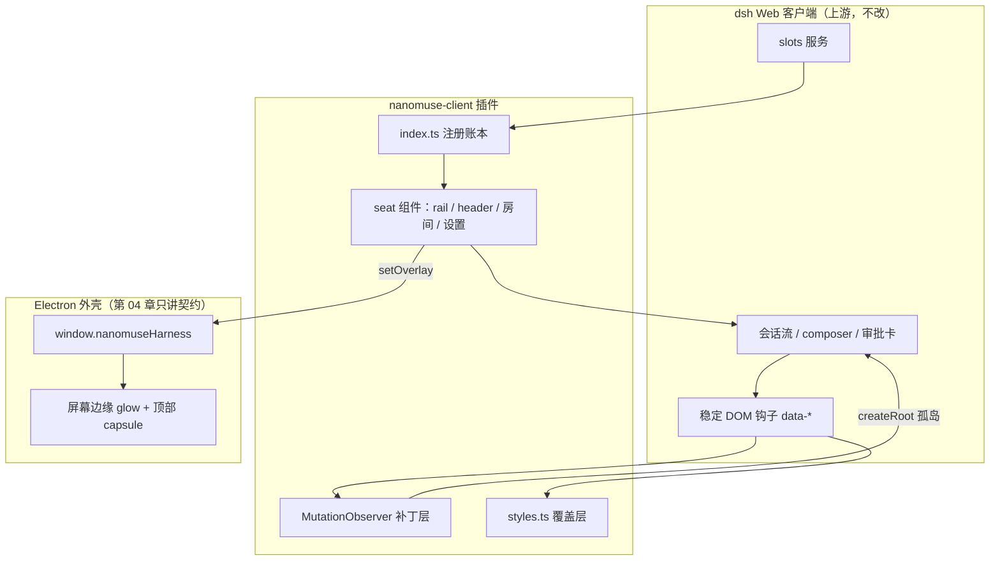
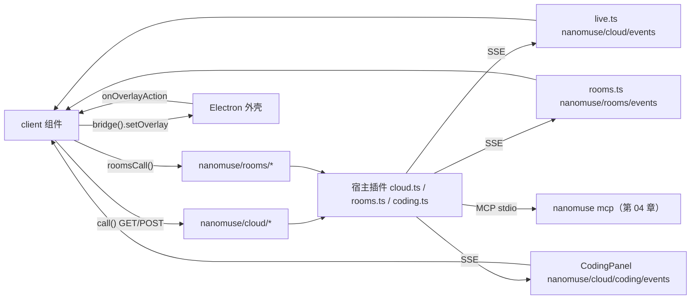
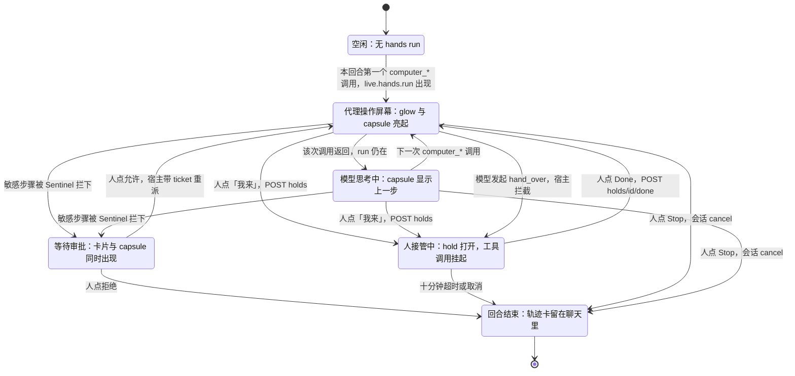
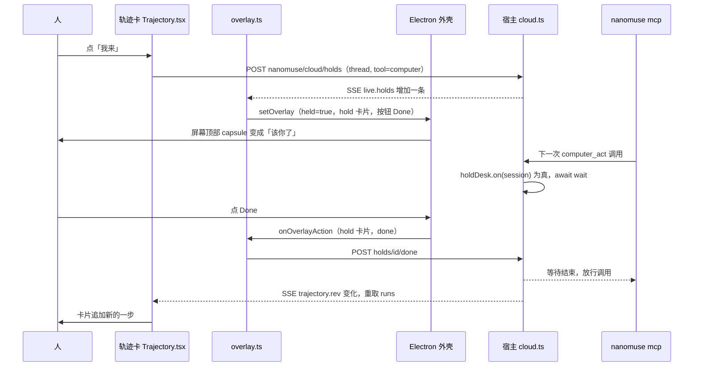
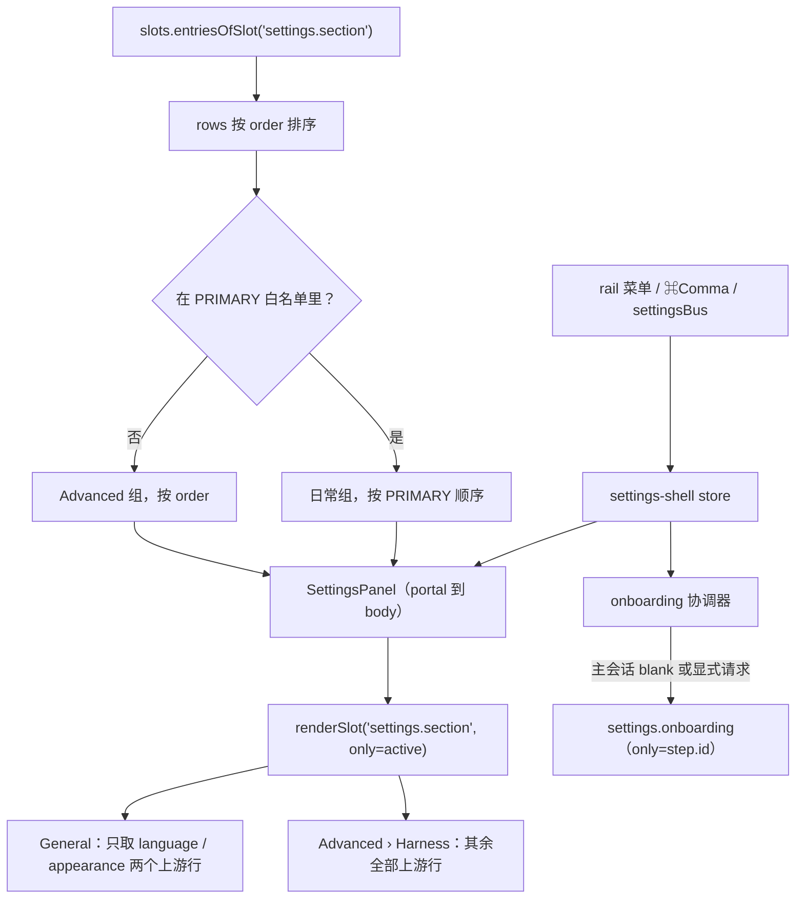
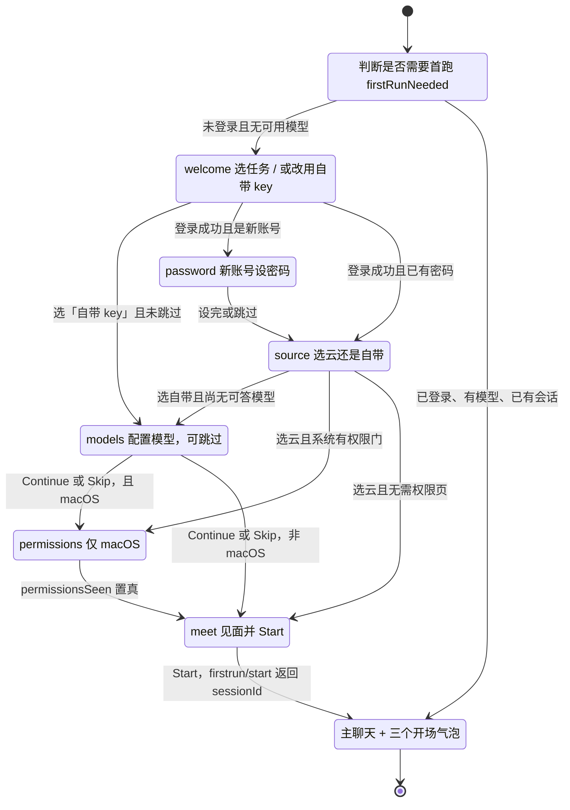

# 03 · 浏览器侧 UI 插件与 seat 机制拆解

> 基线：仓库 `/data/repo`，commit `067384b7e5b3c47a7eeca217895be71493396518`（2026-11-13），`harness/dsh-nanomuse` versionName 1.0.9。
> 本章范围：`harness/dsh-nanomuse/src/client/**`（76 个文件，19942 行）。所有行号均为该 commit 下仓库根相对路径。
> 纪律：文档与源码冲突时以源码为准，冲突本身作为结论写出。未经实测的推断一律标注「推断」。

## 本章回答什么问题

1. nanoMuse Desktop 的窗口到底是谁画的？哪些是 dsh 的、哪些是这个插件的、哪些是 Electron 外壳的？
2. 这个插件占了 dsh 的哪些 seat（插槽），每个 seat 上挂的是什么组件，order/priority 怎么排的？哪些 seat 只是「声明」而没有占用？
3. 浏览器侧和外界通信一共几条通道？SSE 有几条？loopback HTTP 的 URL 前缀是什么？Electron 桥叫什么名字？
4. 窗口骨架（图标 rail + 会话列 + 固定头像与状态条 + 单药丸输入框 + 代理面板）分别由哪个文件负责，怎么和 dsh 的稳定 DOM 钩子共存？
5. **live stage（画中画受控屏幕）已经不存在了**——那么 0.1.40 之后「接管（take-over）」的数据流究竟走哪条路？状态机是什么？
6. 四个房间面板（Feed / Ideas / Goals / Library）与 Devices 面板挂在哪里，为什么 Devices 有三个入口？
7. 设置对话框的页面结构、分组规则、搜索规则、onboarding 协调器是怎么工作的？19 个 settings.section 的 order 各是多少？
8. 首次运行到底有几套实现？`FirstRun.tsx` 和 `Onboarding.tsx` 是什么关系？
9. 76 个文件各自负责什么、挂在哪里？（完整组件清单表）
10. 文档（`docs/desktop-muse.md`、`harness/README.md`）与代码有哪些冲突？有哪些休眠代码？

不在本章范围：`harness/desktop/**`（Electron 外壳）、`harness/dsh-nanomuse/src/*.ts`（宿主侧插件，仅在必须说明接口契约时引用一行）、`windows-pwsh-sandbox.ts`、iOS/Android。Hands 运行时与 Python 工具链见第 04 章。

---

## 1. 先把三个「web」分清楚（本章的坐标系）

仓库里有三处都能叫「web」，混起来读会得出完全错误的架构结论。判别证据在第 04 章展开，这里只给结论与本章的边界：

| 名字 | 路径 | 是什么 | 与本章的关系 |
| --- | --- | --- | --- |
| dsh 自带的 Web 客户端 | 上游 npm 包 `@deepseek-ai/dsh-client-*` | 真正的桌面 UI 骨架：会话流、composer、审批卡、设置壳、slots 宿主 | **本章的宿主**。插件只注册 seat，不改它一行 |
| nanoMuse 客户端插件 | `harness/dsh-nanomuse/src/client/**` | 把 dsh 的 Web 客户端「化妆」成 Muse 桌面：rail、头像、房间、设置页、轨迹卡 | **本章的对象** |
| Python 运行时的移动网页控制台 | `web/` | `nanomuse serve` 提供的 React 应用，构建产物直接写进 `nanomuse/server/static` | **不是桌面 UI**，第 04 章定位 |

决定性证据之一（`web/vite.config.ts:13-17`）：

```ts
  build: {
    outDir: "../nanomuse/server/static",
    emptyOutDir: true,
    sourcemap: false,
  },
```

而本章的插件从头到尾没有出现 `/api/`，它打的是 `nanomuse/cloud/*`（`client/api.ts:44`）。两套 URL 空间不相交，这就足够把两者分开。

---

## 2. 插件怎么接进 dsh：inject、apply、以及「一个 seat 挂了不影响别人」

插件是一个 Cordis 客户端插件，导出 `name`、`inject`、`apply`：

```ts
export const name = 'nanomuse-client'
/** Required services: slots, the locale table, the frame, the workspace UI's session actions, shortcuts. */
export const inject = ['slots', 'locale', 'layout', 'uiWorkspace', 'shortcuts']
```
（`harness/dsh-nanomuse/src/client/index.ts:68-70`）

`apply(ctx)` 里第一件事是把 `slots` 包一层，给每个 seat 的注册体加 try/catch：

```ts
    inject: (name, body) => raw.inject(name, () => {
      try {
        return body()
      } catch (error) {
        console.error(`[nanomuse] seat "${name}" did not register:`, error)
        return () => undefined
      }
    }),
```
（`client/index.ts:152-159`）

这是一个务实的设计：seat 是与上游私有 DOM/服务契约耦合最紧的地方，上游改一个 prop 名字就可能抛异常。包了这层之后，头像挂不上不会连带让设置页消失。代价是**故障静默**——只有 console.error，UI 上没有任何提示，用户看到的是「某个功能凭空没了」。这一点在排查现场问题时要注意：先看控制台有没有 `[nanomuse] seat "..." did not register`。

`apply` 用到的服务面是手写 interface 声明的（`SlotRegistrar` / `LocaleTable` / `LayoutService` / `WorkspaceNavigation` / `WorkspacesService` / `ShortcutsService` / `SessionFace` / `SessionsService`，`client/index.ts:73-116`），而不是 import 上游类型。也就是说：**插件与上游之间是「鸭子类型 + 字符串 seat 名」的软契约**，编译期不会替你发现上游改名。`sessions`、`workspaces` 甚至是运行时 `ctx.get('sessions')` 取的（`client/index.ts:270`、`379`、`424`、`568`），连 `inject` 都没声明——拿不到就静默 return。这是本章第一个「半成品」痕迹：`inject` 列表与服务实际用量不一致。

非 seat 的副作用（`ctx.effect`）一共 13 处，它们是插件真正「动手改页面」的部分：

| 作用 | 行号 | 说明 |
| --- | --- | --- |
| 注册词典 `nanomuse` | `index.ts:168` | en/zh 两张表，来自 `locales.ts`（3283 行） |
| 注入样式表 | `index.ts:170` | `styles.ts`，1555 行，全部 scoped 在 `html[data-nanomuse]` |
| Muse 模式开关 | `index.ts:172-176` | `setMuseMode(!prefs.showHarness, …)`，Developer 开关一开就退回 dsh 原样 |
| 窗口底色跟随主题 | `index.ts:178-186` | MutationObserver 盯 `body[data-ds-dark-theme]`，调 `bridge().setTheme` |
| 防止焦点把 frame 横向滚动 | `index.ts:188-194` | 捕获 `focusin`，把 `[class*="_frame"]` 的 scrollLeft 归零 |
| 记录审批卡上人的选择 | `index.ts:196-224` | 捕获 click/keydown，按 `_primary` 类名或「最后一个按钮」判定 Allow |
| 头像口令拦截 | `index.ts:408` | `interceptComposer()`，"把头像换成红狐狸" 不进模型 |
| ⌘K 改开自己的搜索 | `index.ts:456-467` | Muse 模式下抢在 dsh 的 `session.search` 之前 |
| ⌥Space 快速聊天 | `index.ts:649-654` | 外壳 IPC → 新会话 + 200ms 后聚焦 contenteditable |
| 外壳 overlay 同步 | `index.ts:656` | `syncOverlay`，本章第 7 节 |
| 审批范围条 | `index.ts:657` | `renderApprovalScopes` |
| 应用围栏卡片 | `index.ts:659` | `renderFenceCards` |
| 其他设备的对话气泡 | `index.ts:661` | `renderRemoteBubbles` |
| 轨迹卡 | `index.ts:669` | `renderTrajectory` |

注意 `index.ts:196-224` 那段「记录审批」的实现：它靠 `/_primary/.test(button.className)` 和「DOM 里最后一个按钮」两个启发式来判断人点的是 Allow 还是 Deny（`index.ts:207-209`），并且写进 prefs 的记录 `toolName` 恒为空字符串（`index.ts:199`）。也就是说代理面板 Approvals 页里的历史，工具名是空的、结论是猜的。这不是致命 bug，但它是「靠 DOM 猜语义」这条路线的必然代价，值得在评审里点名。

---

## 3. seat 占用清单（强制项之一）

### 3.1 本插件实际注册的 seat

下表是 `client/index.ts` 里每一次 `slots.register` 的完整账本。「行号」是 `slots.inject(...)` 那一行。

| seat | id / key | order / priority | 组件 | 行号 |
| --- | --- | --- | --- | --- |
| `sidebar.brand.mark` | — | — | `Avatar`（并顺带 `setAccent` + `keepAwake`） | 233 |
| `sidebar.brand.name` | — | — | `BrandName` | 243 |
| `conversation.hero.brand.mark` | — | — | `Avatar` | 250 |
| `sidebar` | — | — | `MuseSidebar`（声明 7 个子 seat） | 309 |
| `shell.leading` | — | — | 两个图标按钮（展开列 / 新聊天） | 325 |
| `main` | `nanomuse-feed` | — | `makeFeedPanel` | 355 |
| `main` | `nanomuse-ideas` | — | `makeIdeasPanel` | 355 |
| `main` | `nanomuse-goals` | — | `makeGoalsPanel` | 355 |
| `main` | `nanomuse-library` | — | `makeLibraryPanel` | 355 |
| `main` | `nanomuse-devices` | — | `makeDevicesPanel` | 357 |
| `shell.overlay` | `nanomuse.split` | — | 右侧分屏 aside（房间 beside chat） | 360 |
| `conversation.header.leading` | — | — | `MuseHeader`（固定头像 + 状态条） | 386 |
| `conversation.session.header.utilities` | `nanomuse-invite` | order −20 | `makeInviteButton` | 392 |
| `shell.overlay` | `nanomuse.profile` | — | `makeProfileDrawer` | 395 |
| `shell.overlay` | `nanomuse.about` | — | `makeAboutSheet` | 399 |
| `shell.overlay` | `nanomuse.firstrun` | — | `makeFirstRunIntro`（三个气泡） | 403 |
| `shell.overlay` | `nanomuse.avatar-chat` | — | `makeAvatarChat` | 406 |
| `conversation.input.right` | `nanomuse.mic` | order 10 | `makeMicButton` | 411 |
| `conversation.chat.assistant-actions` | `nanomuse.quote` | order −10 | `makeQuoteAction` | 414 |
| `conversation.chat.assistant-actions` | `nanomuse.thumbs` | order −9 | `makeThumbs` | 418 |
| `conversation.chat.node` | key `turn-error` | priority −1 | `makeTurnError`（盖住 dsh 的同名节点） | 433 |
| `conversation.input.dock` | `nanomuse.headsup` | order −10 | `AllowanceHeadsUp` | 436 |
| `conversation.input.dock` | `nanomuse.wait` | order −9 | `WaitLine` | 439 |
| `conversation.input.dock` | `nanomuse.stopask` | order −8 | `StopAsk` | 443 |
| `shell.overlay` | `nanomuse.docs` | — | `makeDocEditor` | 448 |
| `shell.overlay` | `nanomuse.search` | — | `SearchModal` | 450 |
| `sidebar.settings` | — | — | `MuseSettings`（声明 7 个 settings 子 seat） | 510 / 529 |
| `settings.trigger` | — | — | 文案 `menuSettings` | 545 |
| `settings.header` | — | — | 文案 `menuSettings` | 546 |
| `settings.close` | — | — | 文案 `close` | 547 |
| `settings.section` | `general` | 0 | `makeGeneralSection`（声明 `settings.general.item`） | 549 |
| `settings.section` | `nanomuse-models` | 5 | `makeModelsSection` | 600 |
| `settings.section` | `nanomuse-connectors` | 21 | `makeConnectorsSection` | 610 |
| `settings.section` | `nanomuse-skills` | 21.5 | `makeSkillsSection` | 613 |
| `settings.section` | `nanomuse-computer` | 22 | `makeComputerSection` | 596 |
| `settings.section` | `nanomuse-files` | 23 | `makeFilesSection` | 616 |
| `settings.section` | `nanomuse-dictation` | 24 | `makeDictationSection` | 619 |
| `settings.section` | `nanomuse-devices` | 25 | `makeDevicesPanel`（同一组件第二次注册） | 557 |
| `settings.section` | `nanomuse-coding` | 25.5 | `makeCodingPanel` | 561 |
| `settings.section` | `nanomuse-wallet` | 26 | `makeWalletSection` | 632 |
| `settings.section` | `nanomuse-storage` | 27 | `makeStorageSection` | 635 |
| `settings.section` | `nanomuse-channels` | 28 | `makeChannelsSection` | 638 |
| `settings.section` | `nanomuse-media` | 29 | `makeMediaSection` | 604 |
| `settings.section` | `nanomuse-cloud` | 30 | `makeCloudSection` | 593 |
| `settings.section` | `nanomuse-permissions` | 31 | `makePermissionsSection` | 622 |
| `settings.section` | `nanomuse-data` | 32 | `makeCloudSection(t, 'data')` | 607 |
| `settings.section` | `nanomuse-help` | 40 | `makeHelpSection` | 625 |
| `settings.section` | `nanomuse-legal` | 41 | `makeLegalSection` | 628 |
| `settings.section` | `nanomuse-harness` | 60 | `makeHarnessSection` | 641 |
| `settings.onboarding` | `deepseek-official` | order 0 / priority −1 | `makeOnboarding` | 571 |
| `settings.onboarding` | `welcome-notice` | order −100 / priority −1 | `PassThrough`（空组件，立刻 complete） | 588 |
| `shell.overlay` | `nanomuse.capsule` | — | `makeCapsule`（其实是 toast + 远程询问 + 黑屏提示） | 646 |
| `shell.overlay` | `nanomuse.studio` | — | `makeAvatarStudio` | 665 |

合计：**9 个 `shell.overlay` 占用者**、**5 个 `main` 面板**、**19 个 `settings.section`**、**2 个 `settings.onboarding`**、**3 个 `conversation.input.dock`**、**2 个 `assistant-actions`**，加上若干单例 seat。

三点值得注意：

- **`shell.overlay` 是这个插件的「万能挂载点」**。它不是用来画受控屏幕的（那是历史用法），而是用来挂 9 个互不相干的全局层：分屏、代理面板、关于、首跑气泡、头像流程、文档编辑器、搜索、toast、头像工作室。`harness/README.md:24` 仍把这个 seat 描述成 live stage 的所在，是过期文档（见第 13 节）。
- **`conversation.chat.node` 用 priority −1 抢同名 key**（`index.ts:433-434`），`settings.onboarding` 用 priority −1 抢 shipped id `deepseek-official`（`index.ts:571-572`）。这是「不改上游、用优先级顶掉上游」的两个典型手法。注释说得很直白：「below its priority so ours renders whichever registers first」。
- **`welcome-notice` 被一个空组件吞掉**（`index.ts:576-589`）。原因是 dsh 的预览版提示把「已读」存在 stock General 插件的设置里，而 bundle 把这个插件关掉了，于是那一步会永远卡住。这里的处理是渲染 null 并立刻 `complete()`，还用 `useRef` 防重复调用（因为协调器每次 render 都换新的 `complete` 闭包）。这是一个**绕过上游缺陷的补丁**，不是设计的一部分，读代码时要认出来。

### 3.2 声明了但本插件不占用的 seat

`sidebar` 注册时声明 7 个子 seat：

```ts
    children: {
      'sidebar.brand.mark': { kind: 'single', scope: 'root' },
      'sidebar.brand.name': { kind: 'single', scope: 'root' },
      'sidebar.toggle.badge': { kind: 'single', scope: 'root' },
      'sidebar.panellist': { kind: 'list', scope: 'root' },
      'sidebar.workspaces': { kind: 'single', scope: 'root' },
      'sidebar.settings': { kind: 'single', scope: 'root' },
      'sidebar.footer.action': { kind: 'list', scope: 'root' },
    },
```
（`client/index.ts:312-320`）

其中 `sidebar.toggle.badge`、`sidebar.workspaces`、`sidebar.footer.action` 本插件**不注册任何占用者**；`sidebar.panellist` 只被「读」（`entriesOfSlot` + `subscribe`，`index.ts:260-268`）用来镜像面板列表。同理 `sidebar.settings` 声明的 `settings.launcher`、`settings.action`、`settings.general.item`（`index.ts:532-540`、`555`）也是留给别的插件的。

这就是接管 sidebar 的关键代价与关键收益：**它必须把 stock sidebar 声明过的子 seat 一字不差地再声明一遍**，否则其他插件的贡献会静默丢失。文件头注释把这件事说清楚了（`index.ts:7-11`）。这是一个正确但脆弱的做法——上游新增一个子 seat，这里不会报错，只会少一块 UI。

### 3.3 seat 与 DOM 钩子的关系图



---

## 4. 通信面：三条 SSE、一个 HTTP 前缀、一座 IPC 桥

### 4.1 loopback HTTP：`nanomuse/cloud/*`

```ts
const API = 'nanomuse/cloud'
```
（`client/api.ts:44`）

`call()` 的规则很简单：没有 body 就 GET，有 body 就 POST，统一带一个 `x-nanomuse: '1'` 头（`client/api.ts:47-57`）。相对 URL，因此实际打到承载页面的那个 origin——在桌面里就是 Electron 加载的 dsh Host loopback 端口。

`failureText()`（`client/api.ts:72-113`）把约 30 个 relay/host 错误码映射成人话。这是「错误文案不下放给模型/上游」这一产品原则的落点：`RefusalCard.tsx` 的卡片、`AllowanceWays.tsx` 的「续路」都建立在这张表上。

### 4.2 SSE 之一：账号与 hands 的 live 流

```ts
const EVENTS_URL = 'nanomuse/cloud/events'
```
（`client/live.ts:234`）

`live.ts`（302 行）是整个插件的状态中枢：一个 `EventSource`，镜像成快照，React 用 `useSyncExternalStore` 读（`useLive` / `peekLive` / `subscribeLive`）。`Live` 里与本章最相关的字段：

- `hands: { calls, steps, run }`——`run` 是「hands 占着这块屏幕」的宿主口径，从本回合第一个 `computer_*` 调用一直到回合结束（`live.ts:46-50`）。
- `stage: LiveStage`——最近一帧截图的元信息（seq / width / height / title / action）。**注意：live stage 的 UI 没了，但这份状态还在，而且仍在被消费**（见第 7 节）。
- `approvals` / `holds` / `grants`——审批、接管、常驻授权。
- `trajectory?: { rev, sessions }`——0.1.40 新增，轨迹卡的刷新信号。

重连策略：`readyState === 2`（CLOSED）时，3 秒后重建，且**只在还有订阅者时**才重连（`live.ts:258-268`）。

`LiveStageAction`（`live.ts:93-106`）里 `x2/y2`（拖拽终点）与 `dy`（滚动像素，负为上）都标着 0.1.40——这两个字段就是轨迹卡能画箭头和 chevron 的前提。

### 4.3 SSE 之二：房间流

`rooms.ts`（355 行）另开一条 `EventSource`，URL 是 `/nanomuse/rooms/events`（文件头注释 `rooms.ts:1-6`），形状与 `live.ts` 一致，类型镜像宿主 `src/rooms.ts`。Feed / Ideas / Goals / Library / 代理面板的 Activity 都读它。

### 4.4 SSE 之三：编码代理流

`CodingPanel.tsx` 第三条：

```ts
const EVENTS_URL = 'nanomuse/cloud/coding/events'
```
（`client/CodingPanel.tsx:111`，`EventSource` 在 143 行创建）

也就是说浏览器侧同时最多开着 **3 条 SSE**。三条流各自维护 store、各自重连，没有共享的连接层。这是可以合并的技术债（推断：合并需要一个带频道的多路复用协议，宿主侧改动更大，所以没做）。

### 4.5 IPC：`window.nanomuseHarness`

```ts
export function bridge(): HarnessBridge | null {
  return (globalThis as { nanomuseHarness?: HarnessBridge }).nanomuseHarness ?? null
}
```
（`client/bridge.ts:106-109`）

`HarnessBridge` 接口（`bridge.ts:74-104`）里与 UI 强相关的成员：`setOverlay` / `onOverlayAction`（外壳 glow 与 capsule）、`setContentProtection`（hands 工作时禁止截屏本窗口）、`setTheme`、`keepAwake`、`permissions` / `guidePermissions`、`restartHost` / `relaunch`、`updates`（Windows 更新）、`onQuickChat`、`platform`、`loginItem`。

两个小结论：
- `gatedPermissions()` 只在 darwin 返回真（`bridge.ts:112-114`），所以 Linux/Windows 上权限页一律显示「已授予/无需」。
- `openLink()` 只允许 http(s)（`bridge.ts:117-122`）。这是一个正确的边界校验，防止把任意 scheme 交给外壳。

**桥的名字是判别「哪个 web」的第二个硬证据**：`web/src/desktop.ts:20` 用的是 `window.nanomuseDesktop`，而且注释指向 `desktop/app/src/preload/index.ts`——那个目录在本 commit 下**根本不存在**（仓库根没有 `desktop/`）。详见第 04 章。

### 4.6 进程内总线与合成按键

- `bus.ts`（25 行）：`settingsBus`（opener 由设置壳挂载时写入，见 `MuseSettings.tsx:269-273`）+ `profileBus`（observable）。`index.ts:229` 的 `openSettings()` 就是「有壳就用壳，没壳返回 false」，rail 的兜底是去点 stock 壳的 trigger。
- `keys.ts`（56 行）：`press()` 合成 keydown 去触发 dsh 的命令（快捷键参考、设置和弦），`composing()` 处理 IME（含 `keyCode === 229`）。这是「不改上游命令注册表，用键盘事件借道」的做法。
- `prefs.ts`（81 行）：localStorage `nanomuse.prefs`，默认 `showHarness:false, keepAwake:true, showSteps:true, approvals:[], feedIntroSeen:false`，审批历史上限 50。**第 47 行注释明确写着 0.1.40 前的 `stage` 位置字段已不再读取、下次写入时丢弃**——这是 live stage 被移除的第三处证据。
- `win.ts`（100 行）：窗口级 store——split / editor / search / recent（最多 4 条，localStorage `nanomuse.recentDocs`）/ 当前会话。



---

## 5. 窗口骨架：rail、会话列、固定头像、状态条

### 5.1 `MuseSidebar.tsx`（362 行）：一根 66px 的 rail + dsh 的会话列

常量：`RAIL = 66`、`COLLAPSE_SETTLE_MS = 150`（`MuseSidebar.tsx:47-48`）。rail 上的按钮顺序（`MuseSidebar.tsx:274-302`）：头像（条件显示）、Chats、Search、Feed、Ideas、Goals、Library、最近文档、弹簧、`+`、汉堡菜单，末尾还有一个隐藏的 settings seat 容器。

两个关键判断：

```ts
  const faceOnRail = collapsed || active !== null
```
（`MuseSidebar.tsx:269`）

即：**列展开且没有房间打开时，头像不在 rail 上**（它在会话列顶部）；列收起或进了房间，头像才回到 rail。`docs/desktop-muse.md:26-28` 说的「No face on the rail」只描述了前一种情况。

```ts
  // keep-awake effects it carries. Devices moved to Settings → Devices.
```
（`MuseSidebar.tsx:267`）

**rail 上没有 Devices 图标**。而 `harness/README.md:24` 与 `docs/desktop-muse.md:26-28` 都还把 Devices 列在 rail 上。这是本章第一个高价值文档冲突。

房间模式会往根元素写标记：`document.documentElement.dataset['nmRoom']`（`MuseSidebar.tsx:307-312`），样式层据此重排。角落菜单（CornerMenu，`MuseSidebar.tsx:235-256`）条目：快捷键、报告问题、设置、更新、关于、分隔、日程、插件、其他、折叠。

`+` 不是直接开新会话，而是 `requestNewChatPicker`（`MuseSidebar.tsx:35-40` 的监听器集合，`index.ts:298` 把它作为 `startSession` 注入），弹出 `DeviceChatStartDialog`（`MuseSidebar.tsx:331-342`）让人选「在这台电脑上」还是「在某台设备上」。

### 5.2 `MuseChats.tsx`（393 行）：主聊天 / 侧聊天

- `MAIN_KEY = 'nanomuse.mainChat'`（localStorage）。
- `useSyncList()` 在 `live.sync.rev` 变化时读 `sync/state`，并过滤掉子代理会话、已清空会话、别的账号的会话、房间批量会话（`MuseChats.tsx:246`）。
- 主聊天的解析顺序：`sync.mainSession` → localStorage → 最旧的一条 → 当前会话（`MuseChats.tsx:253-258`）。
- 认定主聊天后 POST `sync/main`（`MuseChats.tsx:265-270`）。
- 远端删除 → 本地归档（`MuseChats.tsx:272-281`）。
- 行菜单：置顶 / 重命名 / 归档 / 设为主聊天（`MuseChats.tsx:200-205`），行内重命名用 `composing()` 防 IME 误提交。

「主聊天」是 nanoMuse 强加给 dsh 的概念——dsh 只有平铺的会话列表。这套解析顺序 + localStorage + 远端 sync 的三方合并，是典型的「把一个手机端的单线程对话模型套在多会话桌面上」的产物。它能工作，但四方优先级意味着「主聊天到底是哪个」在离线/换设备场景下不易预测（推断，未实测多设备场景）。

### 5.3 `MuseHeader.tsx`（159 行）：固定头像 + 状态条 + 一个**没接上的 Stop**

状态优先级（`MuseHeader.tsx:98-118`）：waiting → running → done → signed-out → hub offline → motion。常量 `DONE_MS 2600`、`TOAST_MS 3200`、`PLANNING_MS 4000`、`STAR_MS 25000`。拖拽条 `data-window-drag`（141 行），返回主聊天/会话列的按钮（142-144 行），Esc 回第一个会话 tab（122-132 行）。

**发现（休眠 prop）**：

```ts
export interface MuseHeaderProps {
  t: Translate
  stop(sessionId: string): Promise<void>
  openProfile(): void
  useSessionStatus?: UseSessionStatus | undefined
}

export function MuseHeader({ t, openProfile, useSessionStatus }: MuseHeaderProps): ReactNode {
```
（`client/MuseHeader.tsx:37-44`）

`stop` 在 props 类型里声明、由 `index.ts:388` 真实传入，但**函数签名里没有解构它，全文件只出现这一次**。也就是说 `docs/desktop-muse.md:51-58` 描述的「头像旁边的 Stop 按钮」在这个组件里不存在。Stop 现在在别处：`WaitLine`（`index.ts:441`）、轨迹卡（`Trajectory.tsx:231`）、外壳 capsule（`overlay.ts:74`）。这是文档冲突 + 休眠代码的双重证据。

### 5.4 `Capsule.tsx`（159 行）：名字叫 capsule，其实是 toast

`harness/README.md:211` 把它称作「the toasts」，这次是对的；容易误读的是文件名。它固定在窗口顶部居中（`Capsule.tsx:69`），负责三件事：

1. 其他设备在这里干了什么的通知（`describeCall` 把 `mcp__nanomuse__computer_screen|act` 和 `device_*` 翻成人话，`Capsule.tsx:18-39`）。
2. `AskCard`：其他设备的提问，答 once / always / deny → `devices/answer`（`Capsule.tsx:126-140`）。
3. `BlackScreenCard`：读 `live.blackScreenAt` 与 `bridge().permissions().helper`，提示 macOS 屏幕录制权限。

真正画在屏幕顶部的 capsule 是 **Electron 外壳**画的，浏览器侧只喂数据（第 7 节）。同一产品里两个东西叫 capsule，是这个代码库最容易踩的命名坑。

---

## 6. 单药丸 composer：不改上游，靠样式 + 借道

`styles.ts`（1555 行）分三层（文件头注释 `styles.ts:1-14`）：

1. 把 dsh 的 `--dsw-*` 设计令牌重绑到 Muse 调色板——于是上游所有菜单、对话框、卡片自动跟着变，不用碰它们；
2. 通过稳定 DOM 钩子重塑会话区：`data-composer-card`、`data-chat-flow-kind`、`data-approval-key`…，变成 Muse 的药丸输入框、着色用户气泡、灰色代理气泡，**仅在 Developer 开关关闭时生效**（`html[data-nm-muse]`）；
3. 自己画的部分用 `nm-*` 类。

全部 scoped 在 `html[data-nanomuse]` 下，插件一撤，dsh 立刻恢复原样。这是本插件最值得肯定的工程决策：**外观侵入是可逆的、可一键关闭的**。

`composer.ts`（59 行）是「往上游输入框里塞字」的唯一入口：

- `composerEditable()` 查 `[data-composer-card] [contenteditable="true"]`；
- `prefillComposer()` 用 `document.execCommand('insertText')`，最多重试 30 次 × 150ms；
- `prefillEmptyComposer()` 绝不覆盖已有草稿。

用 `execCommand` 而不是直接改 DOM/React state，是为了让上游的编辑器把这次输入当成真实用户输入（从而更新它自己的状态）。这是一个已被废弃的 Web API，但在这里是**唯一不改上游就能正确注入文本的办法**（推断：上游编辑器基于 contenteditable + 自己的事件管线）。风险明确：浏览器一旦移除 `execCommand`，所有「Send to chat」「引用」「首跑开场白」全线失效。

`ComposerExtras.tsx`（108 行）：
- 麦克风走 Web Speech API：`SpeechRecognition ?? webkitSpeechRecognition`（`ComposerExtras.tsx:28-31`），拿不到就跳 Dictation 设置页。**这与 `docs/desktop-muse.md:77-78` 说的「麦克风 tied to dsh voice plugin」不一致**：这里用的是浏览器自带的语音识别，不是 dsh 的语音插件。
- `makeQuoteAction` 沿 `data-chat-flow-kind` 兄弟节点走出被引用的文本，上限 280 字，塞成 `> ` 引用块。

`AvatarChat.tsx` 的 `interceptComposer()`（`index.ts:408`）在文本离开 composer 的路上截「换头像」的口令，让它不进模型。这是第四处「借道 DOM」的实现。

---

## 7. live stage 已死，接管（take-over）现在走两条路

这是本章最重要的一节，也是文档与代码冲突最集中的地方。

### 7.1 三处独立证据证明画中画受控屏幕已被移除

1. 注册账本末尾的注释：

```ts
  // The trajectory of a hands run, as a card in the chat (0.1.40; the picture-in-picture Live stage is gone).
  ctx.effect(() => renderTrajectory(t, stop), 'nanomuse: trajectory')
```
（`client/index.ts:668-669`）

2. 偏好迁移注释：

```ts
      // a `stage` place written before 0.1.40 (the picture-in-picture) is read no more and dropped on the next write
```
（`client/prefs.ts:47`）

3. `shell.overlay` 的 9 个占用者里**没有任何 stage / PiP 组件**（第 3.1 节表格），而 `harness/README.md:24` 仍然写着：

> the live stage (the screen the agent works on, picture-in-picture, caption, take-over) as a `shell.overlay`

`docs/desktop-muse.md:222-225` 反而是对的，它明确写了 0.1.34–0.1.39 有窗内暗化 live stage、0.1.40 换成了轨迹。**结论：`harness/README.md:24` 是过期文档，`docs/desktop-muse.md` 与源码一致。**

但要精确：**消失的是窗内那块画中画 UI，不是 `live.stage` 这份状态**。`live.ts:108-120` 的 `LiveStage` 仍在推送，`overlay.ts:57-72` 仍在读它算 glow 的指针位置，`steps.ts:10` 的 `frameUrl(seq)` 仍是 `nanomuse/cloud/stage/frame?seq=`，轨迹卡的每一步图片都从这个 URL 取。也就是说 **stage 从「一个窗口内的组件」降级成了「一份共享的帧源 + 指针状态」**。这是理解 0.1.40 架构的关键。

### 7.2 路径 A：外壳 glow + capsule（`overlay.ts`，107 行）

`syncOverlay({t, stop})` 只做两件事：把 live 状态压成外壳需要的最小数据推过去；把外壳回传的按钮动作翻成 HTTP 调用。

「hands 占着屏幕」的判定：

```ts
    const run = live.hands.run ?? null
    const onScreen = Boolean(run) || calls.some((c) => c.name.startsWith('mcp__nanomuse__computer_'))
```
（`client/overlay.ts:55-56`）

即优先用宿主的 `run`（整回合口径），老宿主没有 `run` 时退回「有 `computer_*` 调用在飞」。文件头注释解释了为什么要整回合口径：两步之间模型要思考几秒，1.0.0 时 glow 和 capsule 会在每个间隙熄灭（`overlay.ts:11-14`）。

指针位置以**屏幕分数**给出，并 clamp 到 0–1：

```ts
          x: pointed ? Math.min(1, Math.max(0, action.x / stage.width)) : -1,
          y: pointed ? Math.min(1, Math.max(0, action.y / stage.height)) : -1,
```
（`client/overlay.ts:66-67`）

`pointed` 的判定包含 `POINTED` 集合与 `type`（`overlay.ts:60`）。注意 `steps.ts:59` 的 `POINTED` **把 drag 和 scroll 也算进去了**：

```ts
export const POINTED = new Set(['click', 'double_click', 'right_click', 'middle_click', 'move', 'drag', 'scroll'])
```

这与 Python 侧 `nanomuse/computer/link.py:66` 的 `POINTED`（只有 5 个点击/移动动作）**不是同一个集合**。两边同名不同义，是跨语言常量漂移的典型案例：UI 侧的 POINTED 意思是「有坐标可画」，Python 侧的意思是「需要 label 的指向性动作」。读代码时不能互相套用。

卡片与去重：

```ts
    const key = JSON.stringify({ hands, cards })
    if (key === lastKey) return
    lastKey = key
    b.setOverlay?.({ hands, cards })
    const wantProtected = Boolean(hands?.active)
```
（`client/overlay.ts:83-87`）

用 JSON 序列化做幂等，避免每次 SSE 心跳都 IPC 一次；内容保护（禁止截屏本窗口）跟随 `hands.active`（`overlay.ts:87-91`），卸载时关掉（`overlay.ts:104-105`）。

外壳按钮的回传：

```ts
    if (card.startsWith('hold:') && action === 'done') void call(`holds/${encodeURIComponent(card.slice(5))}/done`, {}).catch(() => undefined)
    else if (card.startsWith('ap:')) void call(`approvals/${encodeURIComponent(card.slice(3))}`, { approved: action !== 'deny', scope: SCOPES[action] ?? 'once', reason: '' }).catch(() => undefined)
    else if (card === 'hands' && action === 'stop' && sessionId) void stop(sessionId).catch(() => undefined)
    // "I'll take it": a hold (C1) — the hands wait for Done rather than stop
    else if (card === 'hands' && action === 'take' && sessionId) void call('holds', { thread: sessionId, tool: 'computer', reason: '' }).catch(() => undefined)
```
（`client/overlay.ts:95-99`）

`SCOPES` 映射（`overlay.ts:30`）：`allow→once`、`task→schedule`、`chat→conversation`、`app→always`。审批按钮由 `approvalActions()` 生成，最多 4 个（`overlay.ts:37-43`），有 scheduleId 时「本任务内一直允许」替换「本聊天内一直允许」。

**注意这里的错误处理：四个分支全部 `.catch(() => undefined)`。** 接管请求失败、审批提交失败、停止失败，用户界面上不会有任何反馈——外壳 capsule 会停在原状态直到下一次 SSE 推送。这是一个真实的可用性缺口（不是推断，代码就长这样）。

### 7.3 路径 B：聊天里的轨迹卡（`Trajectory.tsx`，393 行）

数据来源与刷新：

```ts
    call<{ runs?: TrajectoryRun[] }>(`trajectory?session=${encodeURIComponent(sessionId)}`)
```
（`client/Trajectory.tsx:294`）

刷新信号是 `live.trajectory.rev`，一变就清缓存重取（`Trajectory.tsx:376-383`）。

挂载方式是 **MutationObserver 扫描 + 每卡一个 `createRoot` 孤岛**，不动 React 树：

- 扫描节流 100ms（`SWEEP_DELAY_MS`，`Trajectory.tsx:51`），且过滤掉自己造成的 mutation（`ours()`，`Trajectory.tsx:364-369`）；
- 锚点：优先找该 run 最后一次/第一次工具调用的行 `9:tool-call<callId>`（`toolRowKey`，`Trajectory.tsx:56-58`；`anchorFor`，`263-270`），找不到就把最新那个 run 放到线程末尾；
- 插入时还要考虑 dsh 把行包在 `data-chat-group-key` 组里（`flowItem`，`Trajectory.tsx:256-260`）；
- 卸载延迟到下一个宏任务，避免在 React 渲染中卸载（`Trajectory.tsx:285-287`）。

卡片内容：`StepPicture`（`Trajectory.tsx:93-134`）在截图上叠一层 SVG——点击画环、双击画双环、拖拽画渐变虚线 + 箭头（`arrowHead`，137-142）、滚动画 chevron（145-148）、无坐标动作用 chip 文字（`chipText`，69-85）。胶片条、←/→/Home/End、放大 Sheet、复制步骤文字。

运行中的三个按钮：

```ts
  const hold = live.holds.find((x) => x.thread === run.sessionId)
  const takeOver = () => void call('holds', { thread: run.sessionId, tool: 'computer', reason: '' }).catch(() => undefined)
```
（`client/Trajectory.tsx:189-190`）

- 已有 hold → 显示「Done」，POST `holds/<id>/done`（`Trajectory.tsx:227`）；
- 没有 hold 且 `run.source === 'computer'` → 显示「I'll take it」（`Trajectory.tsx:229`）；
- 始终显示 Stop（`Trajectory.tsx:231`），调 `stop(run.sessionId)`。

**设备来源的 run 不给「我来」按钮**（`Trajectory.tsx:228`）——只有本机屏幕能接管。这个约束在文档里没有明说，是源码给出的事实。

一处小的注释/代码不一致：`newest()` 的注释说「the newest with a frame」，实现却是 `Math.max(0, run.steps.length - 1)`，并不检查有没有帧（`Trajectory.tsx:87-90`）。

### 7.4 路径 C（补位）：审批卡上的范围条（`ApprovalScopes.ts`，108 行）

dsh 自己画审批卡（`[data-approval-key]`），只有 Allow/Deny。本插件在每张卡**前面**插一条 `.nm-ap-scope`（`ApprovalScopes.ts:36`、`65-77`），提供「本任务内一直允许 / 本聊天内一直允许 / 本应用内一直允许」，POST `approvals/<id>` 带 scope。扫描节流 60ms（`ApprovalScopes.ts:18`），按 `data-conversation-session` 把卡片匹配到对应的 pending approval。

所以「审批」这件事在 UI 上有**两处入口**：dsh 的卡（once/deny）+ 插件补的范围条（三种常驻）+ 外壳 capsule（四个按钮）。三处共用同一个后端 endpoint，但三处的按钮集合不完全一致——这是「不改上游」路线的必然结果。

### 7.5 谁真正让工具调用停住：宿主，不是 Python

必须点明一个容易搞错的事实：**`hand_over` 的等待逻辑不在 Python 里生效**。宿主插件在 `tools/execute` 瀑布上直接拦截：

```ts
        if (exec.name === 'mcp__nanomuse__computer_act' && handOverOf(exec.arguments)) {
          const reason = handOverOf(exec.arguments) ?? ''
          this.began(exec.callId, exec.name, exec.arguments, sessionId)
```
（`harness/dsh-nanomuse/src/cloud.ts:1127-1129`，仅作接口契约引用）

随后 `holdDesk.begin(sessionId,'computer','agent',reason)` → `await holdDesk.wait(sessionId)`，返回一句文本（"The person finished and handed the screen back." / 十分钟无人 / 取消），**根本不调用 MCP 工具**（`cloud.ts:1133-1139`）。并且只要该会话有 hold 在，其他 hands 调用也一律先等（`cloud.ts:1144`）。

Python 侧为什么必须这样，见第 04 章：`hands_tools()` 构造工具时不传 `holds`，所以 `hand_over` 在 MCP 路径上会直接失败。两边合起来才是完整的 C1 契约。

### 7.6 接管状态机



对应的行号：`Idle→Running` 判定 `overlay.ts:55-56`；`Running/Thinking` 的文案切换 `overlay.ts:70-75`；`Approval` 卡片生成 `overlay.ts:81` 与 `ApprovalScopes.ts:65-77`；`Held` 进入 `overlay.ts:99` / `Trajectory.tsx:190` / `cloud.ts:1133`；`Held→Running` 退出 `overlay.ts:95` / `Trajectory.tsx:227`；超时文案 `cloud.ts:1137`；Stop `overlay.ts:97` / `Trajectory.tsx:191-195` / `index.ts:378-385`。

### 7.7 一次接管的完整时序



注意时序里一个真实的竞态：人在 capsule 上点 Done 与在轨迹卡上点 Done 是两个独立入口，都打同一个 endpoint，都没有本地乐观更新，都 `.catch(() => undefined)`。谁先到取决于网络，UI 一致性完全依赖下一次 SSE（推断：重复 POST 由宿主幂等处理，未实测）。

---

## 8. 四个房间面板与 Devices 的三个入口

### 8.1 房间：`main` seat 的四个 key + 一个分屏

`index.ts:349-355` 把四个房间工厂放进数组，逐个注册到 `main`：

```ts
  const rooms: [string, () => ReactNode][] = [
    [FEED_PANEL, makeFeedPanel(t)],
    [IDEAS_PANEL, makeIdeasPanel(t)],
    [GOALS_PANEL, makeGoalsPanel(t)],
    [LIBRARY_PANEL, makeLibraryPanel(t)],
  ]
```

panel id 常量集中在 `panels.ts:4-7`（`nanomuse-feed|ideas|goals|library`）。

房间有两种打开方式，由 `rooms.ts` 的 `nav` 决定：
- **占满主区**：`selectPanel(id)`，先 `win.split(null)` 再 `layout.selectPanel(id)`（`index.ts:293-296`）——即「进房间就结束分屏」；
- **分屏**：`nav.split(panel)` 反过来，先 `layout.selectPanel(null)` 再 `win.split(panel)`（`index.ts:340-347`），由 `shell.overlay` 的 `nanomuse.split` 占用者渲染成右侧 `aside.nm-split`（`index.ts:360-375`），并在根元素打 `data-nm-split` 标记。

这个「互斥」设计是清晰的：同一个房间组件实例化两次（一次在主区、一次在分屏），靠 `activePanel` 变量镜像保证 `nav.activePanel()` 正确（`index.ts:363`）。副作用是同一房间的两份组件各自订阅 rooms store，不共享局部状态（推断：搜索框内容、滚动位置在切换布局时会丢）。

四个房间的内容（各自文件头注释即为权威描述）：
- `FeedPanel.tsx`（132 行）：代理写的动态，倒序；心 + Discuss 开聊天；右上方 sliders 管「读什么」的指令与「现在写一批」。
- `IdeasPanel.tsx`（132 行）：`assets/ideas.<lang>.json` 的策展清单，分 6 个区；一行打开 sheet，三种落地方式（塞进 composer / 建每日 routine / 开目标会话）。
- `GoalsPanel.tsx`（201 行）：勾选行 + 目标卡（描述、自动化、按天时间线）+ Check in / 打开聊天 / 完成 / 删除；按类别创建。
- `LibraryPanel.tsx`（286 行）：第二列分类（Artifacts / Media / System files）+ 卡片网格；Create 开聊天让代理产出文件；菜单可新建空白 Markdown 或从磁盘导入；卡片打开查看器（Markdown 可就地编辑、图片/视频/音频播放、网页 iframe）+ Open / Reveal。

### 8.2 Devices：一个组件，三处入口

`DevicesPanel.tsx`（194 行）的文件头第一句就写着「The Devices page in the harness's `main` seat (the rail's fourth icon) and under Settings → Devices」——**注释里的「rail 第四个图标」已经不成立**（`MuseSidebar.tsx:267` 明说搬走了）。这是同一文件内部的注释过期。

实际入口：
1. `main` seat，key `nanomuse-devices`（`index.ts:357`）——仍注册着，但 rail 上没有按钮触发它；能到达它的路径是 `layout.selectPanel('nanomuse-devices')`（例如 Channels 页的跳转，`index.ts:637` 把 `DEVICES_PANEL` 传给了 `makeChannelsSection`）。
2. `settings.section`，id `nanomuse-devices`，order 25（`index.ts:557-558`）——**这是用户实际走的路**。
3. `CloudSection.tsx` 里通过 `DEVICES_PANEL` 常量跳转（`CloudSection.tsx:135` import）。

所以 `main` 上那份注册是**半休眠**的：组件还在 seat 上，但常规导航到不了。它不是完全死代码（Channels 页仍能跳），但属于「重构没做完」的痕迹——搬走了入口，没清理旧挂载。

面板内容：本机一张卡（图标、就地改名、hub 状态与 OS 行、能力 chips、远程控制开关、免询问设备），其他设备一个网格（在线状态 / 最后在线时间、`@name` 提示、Forget），仅本机时多一张「怎么加设备」的卡。Computer-use 的权限行留在 Settings → Computer use，不在这页。

`DeviceConversationPanel.tsx`（156 行）是设备会话的收发面板，带一个模块级的「待打开会话 id」队列（`DeviceConversationPanel.tsx:190-196`），用于「新建会话后等 Devices 面板挂载再打开」——又一处用模块变量跨组件传信的做法。

---

## 9. 设置页结构：19 个 section、两组导航、一套搜索、一个协调器

### 9.1 壳与 store

`settings-shell.ts`（29 行）提供 `createShellStore()`：`open/close/select/openSection/back/toggle`，并记住 `from`（从哪一页跳来的），用于返回链接。`MuseSettings.tsx:262` 用 `useSyncExternalStore` 读它。

`MuseSettings` 占 `sidebar.settings`，并**重新声明 stock 壳声明过的 7 个 settings 子 seat**（`index.ts:532-540`），这样其他插件的 section / header action / onboarding step 照旧落地。同时注册 `settings.open` 命令（`index.ts:511-528`），默认键位：桌面三平台 ⌘/Ctrl+Comma，web 端 ⌘/Ctrl+Alt+Comma；`resolve` 里对「已开着别的 modal」返回 blocked。

### 9.2 分组规则：PRIMARY 白名单，其余全进 Advanced

```ts
const PRIMARY: readonly string[] = ['general', MODELS_SECTION, 'nanomuse-connectors', SKILLS_SECTION, COMPUTER_SECTION, MEDIA_SECTION, 'nanomuse-files', 'nanomuse-dictation', WALLET_SECTION, STORAGE_SECTION, 'nanomuse-permissions', CHANNELS_SECTION, 'nanomuse-devices', DATA_SECTION, HELP_SECTION, LEGAL_SECTION]
```
（`client/MuseSettings.tsx:44`）

```ts
  const primary = PRIMARY.map((id) => rows.find((r) => r.id === id)).filter((r): r is SectionRow => r !== undefined)
  const advanced = rows.filter((r) => !PRIMARY.includes(r.id))
```
（`client/MuseSettings.tsx:125-126`）

**关键结论：导航里的顺序由 PRIMARY 数组决定，不是由 order 决定。** order 只决定 `rows` 的排序（`index.ts:485-487`），而 PRIMARY 是另一套硬编码顺序。两者已经不一致：

| 现象 | 证据 | 后果 |
| --- | --- | --- |
| `nanomuse-cloud`（账号页，order 30）不在 PRIMARY | `MuseSettings.tsx:44` vs `index.ts:593-594` | **账号页落在 Advanced 组**，而 `MuseSettings.tsx:2-4` 的注释说「日常组先是 General、Account、Models、Agents、Devices」 |
| `nanomuse-coding`（order 25.5）不在 PRIMARY | `MuseSettings.tsx:44` vs `index.ts:561-562` | 编码代理页也在 Advanced，尽管 order 排在 Devices 与 Wallet 之间 |
| `nanomuse-harness`（order 60）不在 PRIMARY | 同上 | 这是有意的（Advanced › Harness） |
| PRIMARY 里写死 `'nanomuse-connectors'`、`'nanomuse-files'` 等字符串 | `MuseSettings.tsx:44` | 与 `Connectors.tsx:32`、`Pages.tsx:22-24` 的常量重复，改一处不会同步 |
| `MODELS_SECTION` 在 `MuseSettings.tsx:43` 又本地定义一次 | 权威定义在 `OwnKey.tsx:473`，`ModelsSection.tsx:21` 再 re-export | **同一个字符串三处定义**，典型的常量漂移风险 |

也就是说：order 25.5 这种「插缝」值给人「精心排过序」的印象，但实际导航根本不看它。这是本章第二个高价值发现——**一个看起来生效、实际被架空的排序机制**。

### 9.3 搜索：页标题 + 当前页文字

`settings-search.ts`（102 行）是纯函数层（`queryWords` / `filterPages` / `markMatches` / `hitLabel` / `clearMarks`），刻意与 React 分离以便测试（文件头注释 `settings-search.ts:1-8`）。

壳里的用法（`MuseSettings.tsx:135-156`）：对当前页 DOM 做 `markMatches`，把命中按父元素归组（「一行标题和它下面那行算一个命中」），第一个命中 `scrollIntoView({block:'center'})`，并把 nav 滚回顶部；卸载/换页时 `clearMarks`。Enter 优先跳第一个标题命中的页，否则滚到第一个文字命中（`MuseSettings.tsx:181-189`）。Esc 先清空搜索框，空框时才让 Esc 关对话框（`MuseSettings.tsx:174-180`）。

这是「在别人的 DOM 上做高亮」的又一例：它直接改上游渲染出来的文本节点。风险是上游重渲染会抹掉标记——所以 effect 依赖 `[query, active]`，靠重新执行来补（推断：上游在同一页内局部重渲染时高亮会短暂消失，未实测）。

### 9.4 General 页与 Harness 页：把上游的行分流

`makeGeneralSection`（`MuseSettings.tsx:350-435`）自己画账号卡、用量条、语言、外观、会话行、应用行为、快捷键、关于，并且**只挑上游 General 行里的两个**：

```ts
      h('div', { className: 'nm-card nm-harness-rows' }, renderSlot('settings.general.item', {}, { only: 'language' })),
      h('div', { className: 'nm-card nm-harness-rows' }, renderSlot('settings.general.item', {}, { only: 'appearance' })),
```
（`client/MuseSettings.tsx:406-408`）

其余全部落到 Advanced › Harness：

```ts
      h('div', { className: 'nm-card nm-harness-rows' }, renderSlot('settings.general.item', {})))
```
（`client/MuseSettings.tsx:442`）

这是一个干净的分流方案：**不丢任何上游设置项，但把「日常」和「harness 内部」分开**。用量条对 relay 0.14+ 的「元额度池」与老口径 token 数做了双分支（`MuseSettings.tsx:361-367`），80% 与用尽分别给出不同入口（395-403）。

### 9.5 onboarding 协调器

`MuseSettings` 同时是 onboarding 协调器（`MuseSettings.tsx:275-341`）：

- `sessionsBlank`：`state.phase === 'ready'` 且主视图保持的会话为空或 blank（`277-282`）；没有 `useSessions` 时退化为 true（即 boot 时跑一次）。
- `hasSessions`：任何非子代理会话已有消息（`285-287`），传给首跑判断。
- 选步：显式 `requested` 优先，否则在 blank 时取第一个未完成的 step（`288-290`）。
- **登出会把窗口打回首跑**（`297-305`）：关对话框、清 completed、请求 `deepseek-official`。
- step 出现时若设置对话框开着就关掉它（`307-311`）。
- Help 页的「再看一次首跑」通过 `settingsBus.openOnboarding` 触发（`317-320`）。



---

## 10. 首次运行：两套实现，职责完全不同

### 10.1 `Onboarding.tsx`（572 行）才是全窗首跑

`harness/README.md:208` 把首跑归给 `Onboarding.tsx`，这是对的。它占 `settings.onboarding` 的 shipped id `deepseek-official`（`index.ts:571-572`），由上面的协调器在主会话空白时挂载。

页面由 `stageOf()` 决定（`harness/dsh-nanomuse/src/firstrun.ts:131-138`，共享纯函数）：

```ts
export function stageOf(s: StageInput): Stage {
  if (!s.signedIn && !s.hasModel) return s.sourceChosen === 'own' && !s.modelsSkipped ? 'models' : 'welcome'
  if (s.signedIn && s.freshAccount && !s.passwordSeen) return 'password'
  if (s.sourceChosen === null) return 'source'
  if (s.sourceChosen === 'own' && !s.hasModel && !s.modelsSkipped) return 'models'
  if (s.gated && !s.permissionsSeen) return 'permissions'
  return 'meet'
}
```

六个 stage：`welcome | password | source | models | permissions | meet`（`firstrun.ts:105`）。`firstRunNeeded()` 是 `!signedIn || !hasModel || (!hasSessions && !done)`（`firstrun.ts:101-103`）。

各页要点：
- **welcome**：不是纯欢迎页，而是「选一个任务」页——4 张 showcase 卡（换头像 / 操作屏幕 / 两个应用之间 / 记忆），`frTaskTitle`/`frTaskGo`，以及第二道门「用我自己的 API key」（`choose('own')`）（`Onboarding.tsx:295-300`、`346-377`）。
- **sign-in**：`SignInView`（手机号/邮箱 → 6 位码，或密码）。`CodeBoxes` 用一个 input 撑起六个格子，满 6 位自动校验（`Onboarding.tsx:85-104`、`323`）。
- **password**：仅新账号（relay 的 `created`）且未设置过密码时出现。
- **source**：cloud 还是 own。
- **models**：`ModelChannelsStep` + 底部 Continue / Skip，状态行显示「模型就绪 ✓」（`Onboarding.tsx:397-420`）。注释明确：**存了 key 不会自动翻页，必须点 Continue 或 Skip**（`Onboarding.tsx:186`）。
- **permissions**：仅 macOS（`gated`），`PermissionsPage`，完成时 POST `firstrun/set {permissionsSeen:true}`（`Onboarding.tsx:288`、`421`）。
- **meet**：`Avatar size 104 mood happy` + Start（`Onboarding.tsx:424-431`）。

Start 的实现值得逐行看：

```ts
      const timer = window.setTimeout(settle, START_MS)
      roomsCall<{ sessionId: string }>('firstrun/start', {})
        .then((result) => {
          setMainChatId(result.sessionId)
          nav.openSession(result.sessionId)
          if (chosenPrompt) {
            prefillEmptyComposer(chosenPrompt, () => peekWin().current === result.sessionId)
          }
        })
        .catch(() => roomsCall('firstrun/finish', {}).catch(() => undefined))
        .finally(() => { window.clearTimeout(timer); settle() })
```
（`client/Onboarding.tsx:198-208`，`START_MS = 12_000` 在 63 行）

即：宿主开主聊天并绑定首跑会话 → 本地设为主聊天 → 打开会话 → 把选中的任务提示词塞进空 composer；失败则退回 `firstrun/finish`；无论如何 12 秒兜底关闭遮罩。**12 秒兜底意味着慢网络下用户可能看到遮罩已消失但会话还没打开**（推断，未实测）。

### 10.2 `FirstRun.tsx`（96 行）只是聊天里的三个气泡

它**不是**全窗流程，而是 `shell.overlay` 上的一个 portal：把三段开场白插到绑定会话的 `[data-conversation-scroll]` 最前面。

```ts
      if (scroll.firstElementChild === node) return
      scroll.insertBefore(node, scroll.firstChild)
```
（`client/FirstRun.tsx:46-47`）

宿主节点由 `useIntroHost` 创建并用 MutationObserver + rAF 维持位置（`FirstRun.tsx:28-67`），会话重挂载时自动重插。这三段话**不花 token、不进模型历史**——模型是通过系统提示里的 `firstRunAddendum` 被告知的（文件头注释 `FirstRun.tsx:5-7`）。

另外它在等名字时改 composer 的 placeholder：

```ts
      root.style.setProperty('--nm-placeholder', JSON.stringify(t('frNamingPlaceholder')))
```
（`client/FirstRun.tsx:82`，条件是 `phase === 'ask_agent_name' && chosen === null`，77 行）

用 CSS 变量改上游输入框的 placeholder——第五处「借道」。

### 10.3 首跑的休眠代码（三处）

```ts
function Dots({ count, index }: { count: number; index: number }): ReactNode {
```
（`client/Onboarding.tsx:475`）

```ts
function FeatureRow({ icon, title, sub }: { icon: ReactNode; title: string; sub: string }): ReactNode {
```
（`client/Onboarding.tsx:506`）

两个函数**全文件只有定义、没有任何调用**（grep 确认）。实际用的是 `StepBar`（`Onboarding.tsx:459-473`，三个编号步骤）。而文件头注释第 3 行还写着「three dots at the top and a gear to Settings」——**注释描述的是被替换掉的旧 UI**。

第三处：`dotOf` 从 `../firstrun.ts` import 进来（`Onboarding.tsx:23`）但**从未使用**；`firstrun.ts:141-143` 的 `dotOf` 现在只被 `tests/firstrun.test.mjs:222` 使用。也就是说「三个点」这条线在源码里只剩一个测试在守着它。



行号：`Decide` → `firstrun.ts:101-103`；各转移 → `firstrun.ts:131-138`；`Models` 的 Continue/Skip → `Onboarding.tsx:415-420`；`Perms` 完成 → `Onboarding.tsx:288`；`Meet→Chat` → `Onboarding.tsx:194-209`；`Chat` 的气泡 → `FirstRun.tsx:69-95`。

---

## 11. 头像、品牌、i18n：两种「标记」严格分开

### 11.1 `Avatar.tsx`（165 行）：脸 = 代理

五种 mood：

```ts
export type Mood = 'idle' | 'working' | 'waiting' | 'happy' | 'error'
```
（`client/Avatar.tsx:30`）

mood 由会话状态推导，`useMood` 的规则是「waiting 胜过 working 胜过 idle」（`index.ts:130-140`）：任一会话有 `pendingInteraction` 立刻 waiting。

脸的三种来源（`LiveProfile.avatar`：`dragon | emoji | face`，`live.ts:16`）：默认龙、彩色底 emoji、手机上画的脸。动态 clip 走 `nanomuse/avatar/motion/<mood>.mp4?v=`（`Avatar.tsx:67`），`motionStatus()`（76 行）给 Media 页汇报生成进度。`stillUrl()`（42 行）是静帧 URL 的唯一出口，外壳 capsule 的脸也用它（`overlay.ts:73`，注意那里用 `new URL(..., document.baseURI).href` 转成绝对地址，因为外壳不在同一 document 里）。

顺带一提，`sidebar.brand.mark` 这个 seat 被赋予了两项副作用：`setAccent(live.profile.color)` 与 `keepAwake(prefs.keepAwake && mood==='working')`（`index.ts:238-240`）。注释解释了原因——「mark 总是挂载，所以顺便保持强调色最新」。**把全局副作用挂在一个 UI seat 上**是典型的耦合妥协：如果哪天这个 seat 被别的插件顶掉，强调色和防休眠会一起失效。

### 11.2 `BrandMark.tsx`（32 行）：标记 = 应用

文件头注释把规矩写得很清楚（`BrandMark.tsx:1-7`）：N 字白色 squircle 是**应用**的标记，只出现在登录页、权限页这类「应用代表自己说话」的地方，**绝不进聊天**；脸才是代理。暗色主题下 tile 仍保持白色（品牌规定）。路径内联自 `assets/brand/nanomuse-icon.svg`，不发起任何请求；每个实例一个独立 gradient id（`BrandMark.tsx:120` 注释）。

`brand-marks.ts`（47 行）是另一回事：连接器目录里第三方服务的图标路径，来自 simple-icons 16.33.0（CC0），由 `scripts/brand-marks.mjs` 生成，缺图标就退化成品牌色字母标记。

### 11.3 i18n：`locales.ts` 3283 行，占全插件 16.5%

两张平表 `en` / `zh`，通过 `locale.register('nanomuse', {en, zh})`（`index.ts:168`）注册，`locale.bind('nanomuse')` 得到 `t`。`langTag` 字段让需要双语内容的页面自己判断（`locales.ts:5`），`overlay.ts:78` 就是靠 `t('langTag') === 'zh'` 决定审批摘要用中文还是英文。

所有 seat 注册都带 `locale: 'nanomuse'`——这是让上游知道「这些标签属于哪张词典」，从而语言切换时重新解析（`resolveSlotLabel`，`index.ts:261`、`486`）。面板列表与设置行都缓存了「ledger version + locale revision」两个键（`index.ts:264`、`482`），语言切换会正确失效缓存。这一处做得规范。

---

## 12. 三个「内容」组件：CodingPanel、DocEditor、markdown-io

### 12.1 `CodingPanel.tsx`（598 行，插件里第 4 大的组件）

Settings → Coding agents：本机与账号其他电脑上的 Cursor / Codex / Claude Code / DeepSeek Harness 会话。它自带一个 API 小层与第三条 SSE：

```ts
  sessions: (device: string, agent: string, limit: number) => call<{ sessions: CodingSession[] }>(`coding/sessions${q({ device, agent, limit })}`),
  session: (device: string, agent: string, id: string) => call<CodingSession>(`coding/sessions/${agent}/${encodeURIComponent(id)}${q({ device })}`),
  send: (body: { agent: string; text: string; session_id?: string; workspace?: string; device?: string }) => call<CodingRun>('coding/send', body),
  stop: (runId: string, device: string) => call<{ stopped: boolean }>('coding/stop', { run_id: runId, device }),
```
（`client/CodingPanel.tsx:103-106`）

注意 `stop` 的 body 用 `run_id`（蛇形），而 `send` 用 `session_id`/`workspace`——**同一个文件里混用蛇形与驼峰参数名**，因为后端一半是 Python 运行时转发。这是跨语言边界的常见磨损。

### 12.2 `DocEditor.tsx`（156 行）：一个 contenteditable + 900ms 防抖保存

它占 `shell.overlay` 的 `nanomuse.docs`，但实际渲染成整个主列（`section.nm-doc`，`DocEditor.tsx:140`）。三类文档：

```ts
const OWN_NAMES: Record<DocName, string> = { identity: 'IDENTITY.md', soul: 'SOUL.md', memory: 'MEMORY.md' }
```
（`client/DocEditor.tsx:26`）

- own 文档读 `roomsCall('docs')`、写 `docs/write`（`DocEditor.tsx:54`、`73`）；
- Library 文件读 `fileUrl(id,false)`、写 `library/write`（55-59、74）；
- 可编辑判定：own 一律可编，Library 只有 `.md|.markdown|.txt`（48 行）。

保存策略：输入即 `htmlToMd` → 标 dirty → 900ms 防抖 persist（`SAVE_AFTER_MS`，19 行；82-87 行）；blur 立刻保存（155 行）；卸载时若有 pending timer 也保存（89-94 行）。

渲染注入用的是 `innerHTML`：

```ts
    body.current.innerHTML = mdToHtml(latest.current)
```
（`client/DocEditor.tsx:67`）

**这是一处需要审计的 XSS 面**：内容来自代理写的 Markdown 或磁盘文件，`markdown-io.ts` 的 `escapeHtml` 会转义 `& < > "`（`markdown-io.ts:11-13`），但链接 href 是否校验协议需要单独确认（见未确认清单）。相比之下 `bridge.ts:117-122` 的 `openLink` 明确只允许 http(s)，说明作者有这个意识，但两条路径不是同一套校验。

工具栏用 `document.execCommand`（bold/italic/formatBlock/insert*List，`DocEditor.tsx:103-116`）——与 composer 一样依赖已废弃 API。导出 PDF 的做法是给根元素打 `data-nm-print="doc"` 然后 `window.print()`（133 行），靠打印样式表实现，没有引入任何 PDF 库。

### 12.3 `markdown-io.ts`（279 行）：双向转换

`mdToHtml` / `htmlToMd` 一对，方言限定为代理会写的那些：标题、段落、强调、代码、任务列表、引用、分隔线、链接、表格；文件顶部的 HTML 注释渲染成斜体前言、保存时还原成注释（文件头注释 `markdown-io.ts:1-8`）。

自己写一套 Markdown 双向转换而不复用上游渲染器，原因写在 `ui.tsx:5-7`：「harness 的渲染器在它自己的模块表后面，不是我们能 import 的」。这是「插件边界」带来的重复实现——`ui.tsx` 里还有一个只读的小 Markdown 渲染器给房间用。**同一个插件里两套 Markdown 实现**，是明确的技术债。

### 12.4 两个 DOM 补丁层的共性风险

`FenceCards.ts`（186 行）与 `RemoteBubbles.ts`（312 行）与 `Trajectory.tsx` / `ApprovalScopes.ts` 一样，都是「MutationObserver 扫 → 隐藏上游节点 → 旁边插自己的 React 孤岛」。

`FenceCards` 的识别方式尤其值得警惕：**dsh 会把未知语言的 fence 标签从 DOM 里丢掉**，所以它只能靠 JSON 形状猜：

```ts
  if (typeof o.title === 'string' && typeof o.body === 'string' && ('emoji' in o || 'type' in o || 'source' in o)) return { kind: 'feed', title: str(o.title), emoji: str(o.emoji) || '📝', body: str(o.body) }
```
（`client/FenceCards.ts:57`）

命中后直接 `block.style.display = 'none'`（`FenceCards.ts:166`）。也就是说：**用户让代理输出一段恰好含 `title`+`body`+`emoji` 的 JSON，这段代码块会被静默隐藏并替换成一张「已发到动态」的卡片。** 这不是推断，是 `readFence` 的判定条件直接导致的。识别条件收紧（例如要求同时存在某个 nanoMuse 专有字段）是低成本的修法。

`RemoteBubbles` 则是把 `source === 'nanomuse-sync'` 的折叠上下文行换成左右气泡 + 「From Pixel 8」，并在其他设备仍在工作时显示一行 presence，十分钟后自动消失（`RemoteBubbles.ts:4-13`、`241`）。

---

## 13. 文档冲突与休眠代码汇总

### 13.1 文档 vs 源码（源码为准）

| # | 文档说法 | 源码事实 | 证据 |
| --- | --- | --- | --- |
| 1 | `harness/README.md:24`：live stage（画中画、字幕、接管）作为一个 `shell.overlay` | 0.1.40 已删除，改成聊天里的轨迹卡；`shell.overlay` 上是 9 个别的层 | `client/index.ts:668`、`prefs.ts:47`、`docs/desktop-muse.md:222-225` |
| 2 | `harness/README.md:24` 与 `docs/desktop-muse.md:26-28`：Devices 在 rail 上 | rail 上没有 Devices，已搬到 Settings → Devices | `MuseSidebar.tsx:267`、`index.ts:557-558` |
| 3 | `docs/desktop-muse.md:51-58`：固定头像旁有 Stop 按钮 | `MuseHeader` 声明了 `stop` prop 但完全没用；Stop 在 WaitLine / 轨迹卡 / 外壳 capsule | `MuseHeader.tsx:39` vs `44`；`Trajectory.tsx:231` |
| 4 | `docs/desktop-muse.md:77-78`：麦克风接 dsh 的语音插件 | 用的是浏览器 Web Speech API，拿不到就跳 Dictation 页 | `ComposerExtras.tsx:28-31` |
| 5 | `docs/desktop-muse.md:26-28`：rail 上没有脸 | 只有「列展开且无房间」时成立；收起或进房间时脸回到 rail | `MuseSidebar.tsx:269` |
| 6 | `MuseSettings.tsx:2-4` 注释：日常组含 Account、Agents | PRIMARY 白名单里没有 `nanomuse-cloud`，账号页实际在 Advanced | `MuseSettings.tsx:44`、`125-126` |
| 7 | `DevicesPanel.tsx:2` 注释：rail 的第四个图标 | 同 #2，注释自身过期 | `DevicesPanel.tsx:2` vs `MuseSidebar.tsx:267` |
| 8 | `Onboarding.tsx:3` 注释：顶部三个点 | 实际是 `StepBar` 三个编号步骤 | `Onboarding.tsx:459-473` |
| 9 | `Trajectory.tsx:87` 注释：newest with a frame | 实现只取最后一个下标，不看有没有帧 | `Trajectory.tsx:88-90` |

`harness/README.md:28-29` 那句「其他一切——agent loop、tools、skills、goals、plan mode、compaction、sub-agents、MCP、web UI——都是 dsh 的，没改」需要打个折扣：**goals 有 nanoMuse 自己的房间面板与围栏卡（`GoalsPanel.tsx`、`FenceCards.ts`），web UI 更是被 1555 行样式 + 5 处 DOM 补丁重塑过**。准确的说法是「引擎是 dsh 的，外观与产品语义是 nanoMuse 的」。

### 13.2 休眠 / 半成品清单

| # | 对象 | 位置 | 状态 |
| --- | --- | --- | --- |
| 1 | `MuseHeader` 的 `stop` prop | `MuseHeader.tsx:39` | 类型声明 + 真实传入，但从未解构使用 |
| 2 | `Dots()` | `Onboarding.tsx:475-478` | 定义无调用 |
| 3 | `FeatureRow()` | `Onboarding.tsx:506-512` | 定义无调用 |
| 4 | `dotOf` import | `Onboarding.tsx:23` | import 未使用；函数本体只被测试引用（`tests/firstrun.test.mjs:222`） |
| 5 | `main` seat 上的 Devices 注册 | `index.ts:357` | rail 入口已删，只剩 Channels 页跳转能到达 |
| 6 | `sidebar.toggle.badge` / `sidebar.workspaces` / `sidebar.footer.action` | `index.ts:315`、`317`、`319` | 只声明不占用（这是有意的，留给其他插件） |
| 7 | `MODELS_SECTION` 三处定义 | `OwnKey.tsx:473`、`ModelsSection.tsx:21`、`MuseSettings.tsx:43` | 常量重复，漂移风险 |
| 8 | `POINTED` 两套语义 | `steps.ts:59` vs `nanomuse/computer/link.py:66` | 同名不同集合，跨语言误读风险 |
| 9 | 两套 Markdown 实现 | `markdown-io.ts` 与 `ui.tsx` 内的 `Markdown` | 因插件边界无法复用上游而重复 |

---

## 14. 组件清单表（76 个文件，19942 行）

「挂载点」列里 `effect` 指 `ctx.effect` 副作用（无 seat），`DOM 补丁` 指 MutationObserver + createRoot 孤岛，`内部` 指被别的组件引用而不直接占 seat。

| 文件 | 行数 | 职责 | seat / 挂载点 |
| --- | --- | --- | --- |
| `index.ts` | 670 | 插件入口：seat 注册账本、13 处副作用、服务面声明 | 插件 `apply` |
| `styles.ts` | 1555 | Muse 外观三层：令牌重绑 / DOM 钩子重塑 / `nm-*` | effect（`index.ts:170`） |
| `locales.ts` | 3283 | en/zh 词典，`langTag` 供双语页判断 | effect（`index.ts:168`） |
| `api.ts` | 118 | `nanomuse/cloud` 调用 + 约 30 个错误码的人话映射 | 内部 |
| `live.ts` | 302 | 主 SSE（`nanomuse/cloud/events`）+ `useLive/peekLive/subscribeLive` | 内部 |
| `rooms.ts` | 355 | 房间 SSE（`nanomuse/rooms/events`）+ `roomsCall` + `nav` | 内部 |
| `bridge.ts` | 147 | `window.nanomuseHarness` 桥、权限门判定、`openLink` 协议白名单 | 内部 |
| `bus.ts` | 25 | `settingsBus` / `profileBus` | 内部 |
| `keys.ts` | 56 | 合成 keydown 触发 dsh 命令、IME `composing()` | 内部 |
| `prefs.ts` | 81 | localStorage 偏好，审批历史上限 50，丢弃旧 `stage` 字段 | 内部 |
| `win.ts` | 100 | 窗口 store：split / editor / search / recent / current | 内部 |
| `settings-shell.ts` | 29 | 设置壳 store（open/close/select/openSection/back） | 内部 |
| `settings-search.ts` | 102 | 设置搜索纯函数：分词、页命中、DOM 高亮 | 内部 |
| `panels.ts` | 20 | panel/section id 常量与 REPO/ISSUES/DOCS URL | 内部 |
| `steps.ts` | 64 | `frameUrl(seq)`、`describeStep`、`keyWords`、UI 侧 `POINTED` | 内部 |
| `composer.ts` | 59 | 往上游 contenteditable 注入文本（execCommand + 重试） | 内部 |
| `permissions.ts` | 154 | 系统权限统一读数 hook（定时/聚焦/可见时重读） | 内部 |
| `model-list.ts` | 99 | 模型 picker 的折叠/搜索纯函数（COLLAPSE_AT 8） | 内部 |
| `markdown-io.ts` | 279 | Markdown ↔ HTML 双向转换（编辑器方言） | 内部 |
| `brand-marks.ts` | 47 | 连接器品牌图标路径（simple-icons 生成物） | 内部 |
| `icons.tsx` | 124 | 内联线性图标（24 格、1.75 描边） | 内部 |
| `ui.tsx` | 288 | 共享件：MoreButton / Sheet / Empty / ago / 小 Markdown | 内部 |
| `windows-updates.ts` | 64 | Windows 更新状态 store（每窗一次订阅） | 内部 |
| `MuseSidebar.tsx` | 362 | 66px rail + 会话列 + 角落菜单 + 房间模式标记 | `sidebar`（`index.ts:309`） |
| `MuseChats.tsx` | 393 | 主聊天/侧聊天、sync 合并、行菜单、行内改名 | `sidebar` 内部 |
| `MuseHeader.tsx` | 159 | 固定头像 + 状态条 + 拖拽条 + 返回；`stop` prop 未使用 | `conversation.header.leading`（386） |
| `MuseSettings.tsx` | 444 | 设置壳 + PRIMARY/Advanced 分组 + 搜索 + onboarding 协调 + General/Harness 页 | `sidebar.settings`（510）、`settings.section` general/harness |
| `Avatar.tsx` | 165 | 脸（龙/emoji/画的脸）+ 5 mood + 动态 clip + `stillUrl` | `sidebar.brand.mark`（233）、hero（250）、header/capsule |
| `BrandMark.tsx` | 32 | 应用自己的 N 标记（不进聊天） | 登录页 / 权限页内部 |
| `Capsule.tsx` | 159 | toast + 其他设备提问卡 + 黑屏提示（不是屏幕顶部 capsule） | `shell.overlay` `nanomuse.capsule`（646） |
| `overlay.ts` | 107 | 喂 Electron glow/capsule 数据，回传按钮 → holds/approvals/stop | effect（656） |
| `Trajectory.tsx` | 393 | 轨迹卡：帧 + 动作 SVG + 胶片条 + 我来/Done/Stop | DOM 补丁（669） |
| `ApprovalScopes.ts` | 108 | 审批卡前插「一直允许」范围条 | DOM 补丁（657） |
| `FenceCards.ts` | 186 | 围栏 JSON → 目标/进度/动态/新脸/起名卡 | DOM 补丁（659） |
| `RemoteBubbles.ts` | 312 | 其他设备回合气泡 + presence 行（十分钟自动消失） | DOM 补丁（661） |
| `NamingCard.tsx` | 68 | 起名卡（建议名 + 自己写） | 由 `FenceCards` 挂载 |
| `FirstRun.tsx` | 96 | 首跑三段开场白 portal 进聊天 + placeholder 变量 | `shell.overlay` `nanomuse.firstrun`（403） |
| `Onboarding.tsx` | 572 | 全窗首跑六页 + Start；含 3 处休眠代码 | `settings.onboarding` `deepseek-official`（571） |
| `SignIn.tsx` | 127 | 账号登录表单（码/密码） | CloudSection / Onboarding 内部 |
| `AccountPage.tsx` | 367 | 账号页：额度、邀请、用量、密码、设备、时间线、登出 | CloudSection 内部 |
| `AllowanceWays.tsx` | 209 | 额度将尽/已尽的「续路」卡（自带 key / 订阅 / 邀请 / star） | RefusalCard + CloudSection + `input.dock` headsup（436） |
| `CloudSection.tsx` | 289 | nanoMuse Cloud 页；同组件第二实例做 Data controls | `settings.section` ×2（593、607） |
| `ModelsSection.tsx` | 224 | 四个模型槽（chat/hands/image/video）+ 能力门 | `settings.section` `nanomuse-models`（600） |
| `ModelPicker.tsx` | 163 | 折叠式模型选择器（固定行 + 搜索 + 分组） | Models / Media 内部 |
| `OwnKey.tsx` | 651 | 自带 key 与能力目录（C11），三处复用；`MODELS_SECTION` 权威定义 | Account / Onboarding 内部 |
| `MediaSection.tsx` | 246 | 画图/切片模型 + 自动动画开关 + clip 生成进度与体积 | `settings.section` `nanomuse-media`（604） |
| `Connectors.tsx` | 638 | 连接器页：内置能力 + 远程 MCP 服务 + 自定义 URL | `settings.section`（610） |
| `Skills.tsx` | 191 | 技能页（global/workspace 作用域、搜索、刷新） | `settings.section`（613） |
| `Pages.tsx` | 192 | Permissions / Files / Dictation 三页 | `settings.section` ×3（616、619、622） |
| `Sections.tsx` | 373 | Computer use / Help / Legal / Wallet / Storage / Channels + General 的行组 | `settings.section` ×6 + General 内部 |
| `Network.tsx` | 94 | 模型供应商代理行（外壳保存，下次启动注入环境） | CloudSection 内部 |
| `HandsCheck.tsx` | 226 | 截图自检 / 鼠标微动自检 / 运行时二进制行 / 黑屏提示 | Computer 页 + 首跑 + Capsule |
| `RelaunchButton.tsx` | 45 | 重启 hands 运行时并清黑屏标记 | Computer 页 / 提示内部 |
| `DevicesPanel.tsx` | 194 | 设备页：本机卡 + 其他设备网格 + 添加引导 | `main`（357）+ `settings.section`（557） |
| `DeviceConversationPanel.tsx` | 156 | 设备会话收发面板 + 草稿 + 待打开队列 | DevicesPanel 内部 |
| `DeviceChatStartDialog.tsx` | 34 | 新聊天「本机还是某设备」对话框 | MuseSidebar 内部 |
| `FeedPanel.tsx` | 132 | 动态：帖子、心、Discuss、指令 sliders | `main` `nanomuse-feed`（355） |
| `IdeasPanel.tsx` | 132 | 点子：策展清单 + 三种落地方式 | `main` `nanomuse-ideas`（355） |
| `GoalsPanel.tsx` | 201 | 目标：勾选行 + 目标卡 + 自动化 + 时间线 | `main` `nanomuse-goals`（355） |
| `LibraryPanel.tsx` | 286 | 构件库：分类列 + 卡片网格 + 查看器 + 导入 | `main` `nanomuse-library`（355） |
| `DocEditor.tsx` | 156 | 文档编辑器：格式栏 + 900ms 防抖保存 + 打印导出 | `shell.overlay` `nanomuse.docs`（448） |
| `SearchModal.tsx` | 94 | ⌘K 搜索：最近访问 + 标题/末句过滤 | `shell.overlay` `nanomuse.search`（450） |
| `ProfileDrawer.tsx` | 393 | 代理面板四页：Activity / Approvals / Daily / Soul & memory | `shell.overlay` `nanomuse.profile`（395） |
| `TaskDetail.tsx` | 103 | 单个任务的步骤详情（左步骤右详情） | ProfileDrawer Activity 内部 |
| `Memory.tsx` | 122 | 记忆列表 + 从别的助手导入 | ProfileDrawer / Data 页内部 |
| `AvatarStudio.tsx` | 338 | 头像工作室：描述 → 4 候选 → 姿势 → 上账号 | `shell.overlay` `nanomuse.studio`（665） |
| `AvatarChat.tsx` | 343 | 聊天里换头像流程 + composer 口令拦截 | `shell.overlay` `nanomuse.avatar-chat`（406）+ effect（408） |
| `AvatarShare.tsx` | 145 | 分享头像：canvas 两张卡 → PNG / 剪贴板 | ProfileDrawer Sheet 内部 |
| `OwnClipChooser.tsx` | 175 | 自选 clip 作脸：文件 dialog + 校验 + 预览 + 首帧当静帧 | ProfileDrawer / Studio 内部 |
| `About.tsx` | 151 | 关于与版本双行、更新检测与安装入口 | `shell.overlay` `nanomuse.about`（399）+ General 内部 |
| `Invite.tsx` | 86 | 邀请按钮 + 邀请码/链接卡（未登录不显示） | `conversation.session.header.utilities`（392） |
| `ComposerExtras.tsx` | 108 | 麦克风（Web Speech API）+ 引用回复 | `input.right`（411）+ `assistant-actions`（414） |
| `Feedback.tsx` | 126 | 赞/踩 + 踩后一句原因 + Stop 后五选一问卷 | `assistant-actions`（418）+ `input.dock`（443） |
| `WaitLine.tsx` | 43 | 首 token 前的等待行（10 秒后出现）+ Cancel | `conversation.input.dock`（439） |
| `RefusalCard.tsx` | 214 | 失败回合卡：额度/过大/被拒/登录过期，各带出口 | `conversation.chat.node` key `turn-error`（433） |
| `CodingPanel.tsx` | 598 | 编码代理页 + 第三条 SSE（`coding/events`） | `settings.section` `nanomuse-coding`（561） |

（76 行，与 `wc -l` 一致：合计 19942 行。）

---

## 15. 实测与未实测

**未实测：`harness/dsh-nanomuse/tests/` 的 node:test 套件。** 原因：该目录下的测试需要 `esbuild` 等 devDependencies，而 `harness/dsh-nanomuse/` 下**没有 `node_modules`**，本次任务禁止 `npm install`/`pnpm install` 等联网安装操作。因此本章所有关于组件行为的结论均来自源码阅读与 grep 交叉验证，**没有运行过任何前端测试，也没有启动过 Electron 或 dsh Host**。

已做的静态验证（可复现）：
- `wc -l harness/dsh-nanomuse/src/client/*` → 76 个文件、19942 行，与清单表逐行核对一致。
- grep 确认 `Dots`、`FeatureRow` 在 `Onboarding.tsx` 内只有定义行；`dotOf` 只有 import 行；`stop` 在 `MuseHeader.tsx` 内只出现 1 次（类型声明行）。
- grep 确认 `MODELS_SECTION` 的三处定义位置与 `PRIMARY` 数组内容。
- 逐行读取 `index.ts` 全文（670 行）核对 seat 账本，未遗漏 `slots.register` 调用。

Python 侧的两个纯逻辑驱动实测记录在第 04 章第 15 节（30/30 与 37/37 通过）。

---

## 16. 证据索引表

| 序号 | 结论 | 证据路径:行号 |
| --- | --- | --- |
| 1 | 插件必需服务为 slots/locale/layout/uiWorkspace/shortcuts | `harness/dsh-nanomuse/src/client/index.ts:70` |
| 2 | 每个 seat 注册体被 try/catch 包裹，失败仅 console.error | `harness/dsh-nanomuse/src/client/index.ts:152-159` |
| 3 | `sessions`/`workspaces` 未声明 inject，运行时 `ctx.get` 取用 | `harness/dsh-nanomuse/src/client/index.ts:270,379,424,568` |
| 4 | 审批历史靠类名/末位按钮启发式判定，toolName 恒空 | `harness/dsh-nanomuse/src/client/index.ts:199,207-209` |
| 5 | sidebar 接管并重新声明 7 个子 seat | `harness/dsh-nanomuse/src/client/index.ts:309-322` |
| 6 | `shell.overlay` 共 9 个占用者 | `index.ts:360,395,399,403,406,448,450,646,665` |
| 7 | 19 个 settings.section 及其 order | `index.ts:549,557,561,593,596,600,604,607,610,613,616,619,622,625,628,632,635,638,641` |
| 8 | 首跑占 shipped id 并用 priority −1 顶掉上游 | `harness/dsh-nanomuse/src/client/index.ts:571-572` |
| 9 | `welcome-notice` 被空组件立刻 complete（绕过上游缺陷） | `harness/dsh-nanomuse/src/client/index.ts:576-589` |
| 10 | live stage 已于 0.1.40 移除，改为轨迹卡 | `harness/dsh-nanomuse/src/client/index.ts:668-669` |
| 11 | 旧 `stage` 偏好字段不再读取 | `harness/dsh-nanomuse/src/client/prefs.ts:47` |
| 12 | loopback 前缀 `nanomuse/cloud`，带 `x-nanomuse` 头 | `harness/dsh-nanomuse/src/client/api.ts:44,47-57` |
| 13 | 主 SSE URL 与重连策略 | `harness/dsh-nanomuse/src/client/live.ts:234,258-268` |
| 14 | 第三条 SSE：`nanomuse/cloud/coding/events` | `harness/dsh-nanomuse/src/client/CodingPanel.tsx:111,143` |
| 15 | Electron 桥名 `nanomuseHarness` | `harness/dsh-nanomuse/src/client/bridge.ts:106-109` |
| 16 | 权限门仅 macOS；`openLink` 只允许 http(s) | `harness/dsh-nanomuse/src/client/bridge.ts:112-114,117-122` |
| 17 | rail 上没有 Devices | `harness/dsh-nanomuse/src/client/MuseSidebar.tsx:267` |
| 18 | 脸是否在 rail 上取决于折叠与房间状态 | `harness/dsh-nanomuse/src/client/MuseSidebar.tsx:269` |
| 19 | `MuseHeader.stop` 声明但未使用 | `harness/dsh-nanomuse/src/client/MuseHeader.tsx:39,44` |
| 20 | 主聊天四级解析顺序 | `harness/dsh-nanomuse/src/client/MuseChats.tsx:253-258` |
| 21 | 麦克风用 Web Speech API，非 dsh 语音插件 | `harness/dsh-nanomuse/src/client/ComposerExtras.tsx:28-31` |
| 22 | 注入文本依赖已废弃的 `execCommand` | `harness/dsh-nanomuse/src/client/composer.ts`（`prefillComposer`）、`DocEditor.tsx:105` |
| 23 | hands 占屏判定优先用 `live.hands.run` | `harness/dsh-nanomuse/src/client/overlay.ts:55-56` |
| 24 | glow 指针用 clamp 后的屏幕分数 | `harness/dsh-nanomuse/src/client/overlay.ts:66-67` |
| 25 | 外壳按钮 → holds/approvals/stop 的四个分支，全部静默 catch | `harness/dsh-nanomuse/src/client/overlay.ts:95-99` |
| 26 | 内容保护跟随 hands.active | `harness/dsh-nanomuse/src/client/overlay.ts:87-91,104-105` |
| 27 | UI 侧 POINTED 含 drag/scroll，与 Python 侧不同 | `harness/dsh-nanomuse/src/client/steps.ts:59` vs `nanomuse/computer/link.py:66` |
| 28 | 轨迹卡取 `trajectory?session=`，按 `trajectory.rev` 刷新 | `harness/dsh-nanomuse/src/client/Trajectory.tsx:294,376-383` |
| 29 | 轨迹卡锚点 `9:tool-call<id>` 与末尾兜底 | `harness/dsh-nanomuse/src/client/Trajectory.tsx:56-58,263-270` |
| 30 | 只有本机 run 给「我来」按钮 | `harness/dsh-nanomuse/src/client/Trajectory.tsx:189-190,228-229` |
| 31 | 审批范围条插在卡片之前，60ms 扫描 | `harness/dsh-nanomuse/src/client/ApprovalScopes.ts:18,36,65-77` |
| 32 | `hand_over` 由宿主拦截，不调用 MCP 工具 | `harness/dsh-nanomuse/src/cloud.ts:1127-1139,1144` |
| 33 | 设置导航顺序由 PRIMARY 白名单决定，order 被架空 | `harness/dsh-nanomuse/src/client/MuseSettings.tsx:44,125-126` |
| 34 | 账号页与编码页落在 Advanced | `MuseSettings.tsx:44` vs `index.ts:561,593` |
| 35 | General 只取 language/appearance，其余归 Harness 页 | `harness/dsh-nanomuse/src/client/MuseSettings.tsx:406-408,442` |
| 36 | 登出把窗口打回首跑 | `harness/dsh-nanomuse/src/client/MuseSettings.tsx:297-305` |
| 37 | 首跑六 stage 的判定函数 | `harness/dsh-nanomuse/src/firstrun.ts:105,131-138` |
| 38 | Start 的 12 秒兜底与失败退路 | `harness/dsh-nanomuse/src/client/Onboarding.tsx:63,198-208` |
| 39 | `FirstRun.tsx` 只是聊天内 portal 气泡 | `harness/dsh-nanomuse/src/client/FirstRun.tsx:46-47,69-95` |
| 40 | 首跑三处休眠代码 | `Onboarding.tsx:23,475,506`；`tests/firstrun.test.mjs:222` |
| 41 | 围栏靠 JSON 形状识别并隐藏原代码块 | `harness/dsh-nanomuse/src/client/FenceCards.ts:57,166` |
| 42 | 文档编辑器 `innerHTML` 注入渲染结果 | `harness/dsh-nanomuse/src/client/DocEditor.tsx:67` |
| 43 | `MODELS_SECTION` 三处定义 | `OwnKey.tsx:473`、`ModelsSection.tsx:21`、`MuseSettings.tsx:43` |
| 44 | `web/` 构建产物写进 Python 包，非桌面 UI | `web/vite.config.ts:13-17` |
| 45 | 文档仍宣称 live stage 与 rail Devices | `harness/README.md:24`、`docs/desktop-muse.md:26-28,51-58,77-78` |
| 46 | 文档正确记载 0.1.40 用轨迹替换 live stage | `docs/desktop-muse.md:222-225` |

## 17. 未确认问题清单

| # | 问题 | 缺什么证据 | 怎么补 |
| --- | --- | --- | --- |
| 1 | `markdown-io.ts` 生成的链接 href 是否过滤 `javascript:` 等协议 | 只读了 `escapeHtml`（11-13 行），未逐行读 `inlineHtml` 的链接分支与 `href` 拼装 | 读 `markdown-io.ts` 全文并在 node 里对恶意 Markdown 跑一遍 `mdToHtml` |
| 2 | 上游 `renderSlot` 的 `only` / `priority` 语义是否与此处用法完全一致 | 上游 `@deepseek-ai/dsh-client-ui-slots` 未在本仓库内，无源码 | 取上游包源码或 d.ts，核对 `only`、`priority`、`children` 的解析规则 |
| 3 | 重复 POST `holds/<id>/done` 是否幂等 | 宿主 `holdDesk` 实现未读（超出本章范围） | 读 `src/desk.ts` 的 holdDesk，或在测试里连点两次 |
| 4 | 三条 SSE 在 Electron 下是否共享连接/受 HTTP1 连接数限制 | 未启动过外壳，无网络面板证据 | 启动外壳后看 devtools Network 的 EventSource 连接数 |
| 5 | 设置搜索高亮在上游局部重渲染后是否消失 | 需要真实 DOM 与上游渲染时序 | 装好 node_modules 后跑 vitest/集成测试或手动观察 |
| 6 | `main` seat 上的 Devices 注册是否真的只有 Channels 页能到达 | 只查了 `index.ts:637` 一处传入，未穷举 `selectPanel('nanomuse-devices')` 的调用点 | 全仓 grep `DEVICES_PANEL` 与字符串 `nanomuse-devices` 的所有使用 |
| 7 | 分屏与主区两份房间组件是否共享局部状态 | 未运行 UI | 运行后在分屏/主区间切换，观察搜索词与滚动位置 |
| 8 | `useSessions` 缺失时 onboarding 是否会在每次 boot 重跑 | `MuseSettings.tsx:277-282` 的退化分支已读，但宿主是否总传 `useSessions` 未确认 | 读上游 settings 壳注入的 props，或运行时打印 |
| 9 | 前端测试套件的实际通过情况 | 无 `node_modules`，禁止联网安装 | 在允许安装的环境里 `npm ci` 后跑 `node --test` |
| 10 | `FenceCards` 误吞用户 JSON 的实际触发概率 | 判定条件已确认，但未构造真实聊天验证 | 在测试里渲染一段含 title/body/emoji 的 JSON 代码块，看是否被隐藏 |