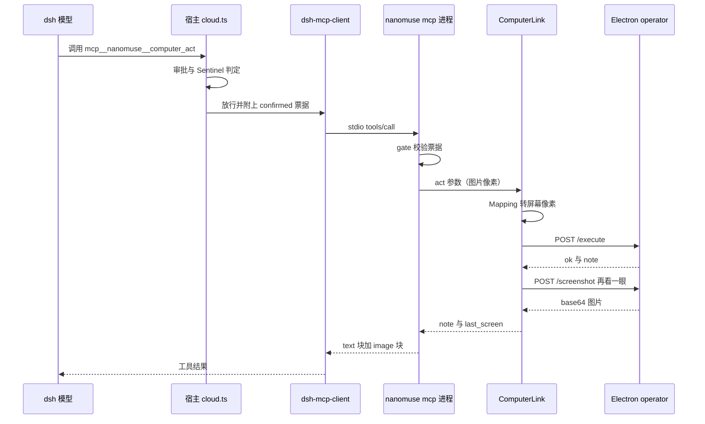
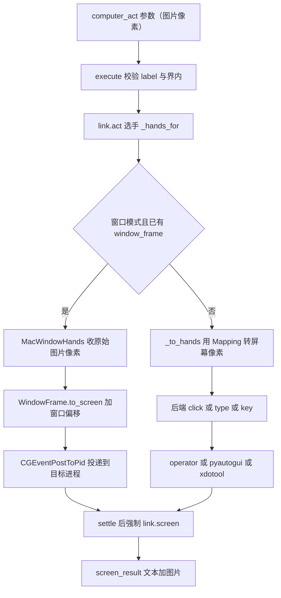
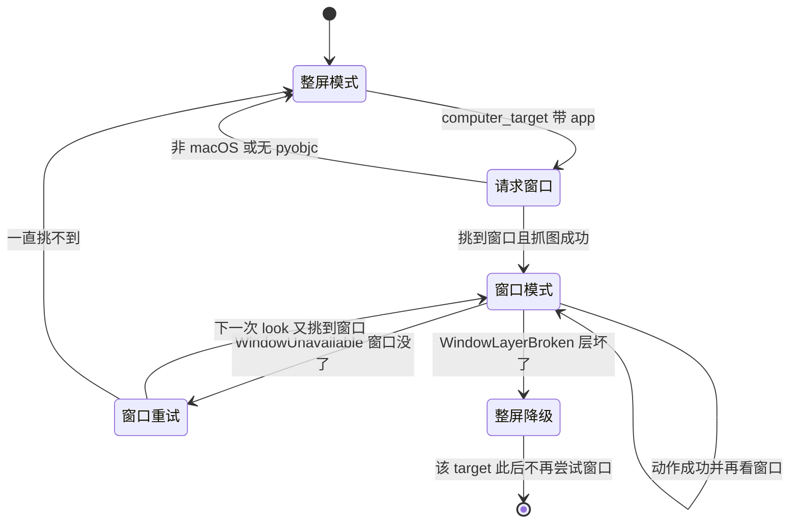
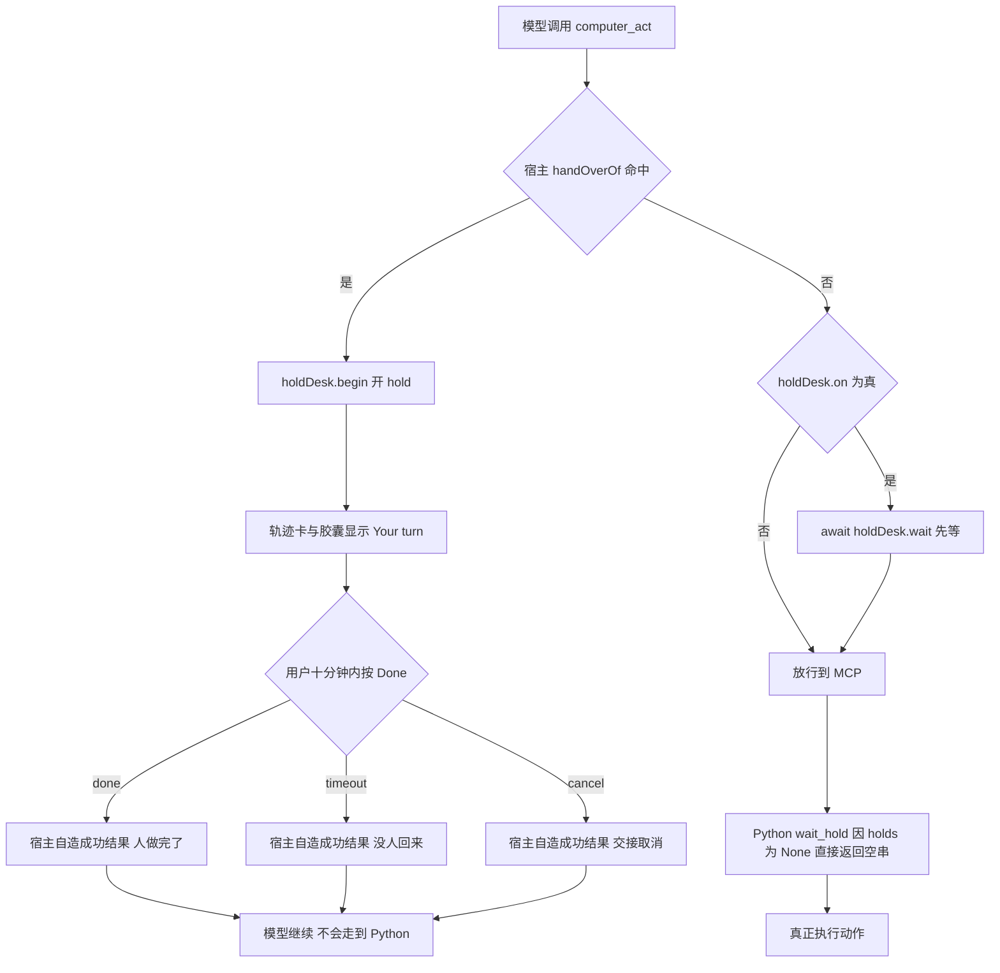

# 04 · Hands 运行时与 computer-use 工具链拆解

> 基线：仓库 `/data/repo`，commit `067384b7e5b3c47a7eeca217895be71493396518`（2026-11-13）。
> 本章范围：`nanomuse/computer/`（7 个 `.py`，2665 行）+ 其直接上层 `nanomuse/tools/computer.py`、`nanomuse/tools/surface.py`、`nanomuse/bridge/mcp_server.py`、`nanomuse/cli.py` 的 `mcp` 命令；`web/` 只做定位与能力总览。
> 纪律：文档与源码冲突时以源码为准，冲突本身作为结论写出。未经实测的推断一律标注「推断」。所有行号为该 commit 下仓库根相对路径。

## 本章回答什么问题

1. 仓库里三个「web」到底谁是谁？凭什么证据断定 `web/` **不是**桌面 UI？
2. `computer_screen` / `computer_act` 的**真实**参数 schema 和返回形状是什么？暴露给模型的和工具自己定义的是同一份吗？
3. 这两个工具怎么经 **MCP stdio** 接进 dsh？入口在哪一行？谁负责起进程、谁负责重启？
4. `confirmed` 票据是怎么算的？**为什么同一个工具在两种启动方式下信任级别不同？** 0.1.38 之前「人点了同意，手还是不动」是怎么回事？
5. `computer_task` 为什么不在 MCP 暴露列表里——是遗漏还是边界？
6. 模型给的坐标是「图片像素」，手移动的是「屏幕像素」——转换发生在哪一行？HiDPI、多屏、窗口模式各怎么处理？
7. 三个后端（Electron operator / pyautogui / xdotool）怎么选？为什么 macOS 下**没有回退**？Wayland 为什么直接拒绝？
8. macOS 窗口模式（`mac_window.py`，743 行）怎么挑窗口、怎么把事件投递到别人的进程、权限归属谁？
9. `hand_over`（契约 C1）在 Python 侧到底实现了没有？桌面路径上真正等待用户的是谁？
10. 与 Electron operator 的接口契约是什么（只讲契约，不拆 `harness/desktop`）？
11. 文档与源码有哪些冲突？有哪些死代码与半成品？

不在本章范围：`harness/desktop/**`（Electron 外壳的实现）、`harness/dsh-nanomuse/src/*.ts` 宿主插件（仅在说明接口契约时引用具体行）、`windows-pwsh-sandbox.ts`、iOS/Android、`nanomuse/phone/**`。浏览器侧 UI 与 seat 机制见第 03 章。

---

## 1. 三个「web」的判别：决定性证据

第 03 章给了结论，这里给证据。三处「web」是三个完全不同的东西：

| # | 名字 | 路径 | 通信面 | 产物落在哪 | 是不是桌面 UI |
| --- | --- | --- | --- | --- | --- |
| 1 | dsh 自带 Web 客户端 | 上游 npm 包 `@deepseek-ai/dsh-client-*` | dsh 自己的服务与 slots | dsh 的 bundle | 是骨架，但不是 nanoMuse 写的 |
| 2 | nanoMuse 客户端插件 | `harness/dsh-nanomuse/src/client/**` | `nanomuse/cloud/*` loopback + 3 条 SSE + `window.nanomuseHarness` | dsh 客户端 bundle | **是**（第 03 章的对象） |
| 3 | Python 运行时的网页控制台 | `web/`（120 个源文件，30030 行） | `/api/*` + `/ws`，Bearer token | `nanomuse/server/static/` | **不是** |

**证据一：构建产物直接写进 Python 包。** `web/vite.config.ts` 全文只有 25 行：

```ts
const api = process.env.NANOMUSE_API ?? "127.0.0.1:8787";
```
（`web/vite.config.ts:7`）

```ts
  build: {
    outDir: "../nanomuse/server/static",
    emptyOutDir: true,
    sourcemap: false,
  },
```
（`web/vite.config.ts:13-17`）

dev 代理只有两条：`/api` 与 `/ws`（`web/vite.config.ts:21-22`）。一个把产物编译进 `nanomuse/server/static` 的前端，服务方只能是 Python 的 `nanomuse serve`，不可能是 Electron 窗口里的 dsh 客户端。仓库里 `nanomuse/server/static/` 确实存在（含 `assets/`、`avatars/`、`fonts/`），即这份产物已经提交进仓库。

**证据二：URL 空间不相交。** `web/src/api.ts` 的每一个端点都在 `/api/` 下，统一走一个带 Bearer 的 `request()`：

```ts
export async function request<T>(path: string, init: RequestInit = {}): Promise<T> {
  const headers: Record<string, string> = { ...(init.headers as Record<string, string>) };
  const token = getToken();
  if (token) headers["Authorization"] = `Bearer ${token}`;
```
（`web/src/api.ts:130-133`）

而第 03 章的客户端插件全程没有 `/api/`，它打的是 `nanomuse/cloud/*` 并带 `x-nanomuse: 1`（`harness/dsh-nanomuse/src/client/api.ts:44`）。两套鉴权、两套前缀、两个服务进程。

**证据三（最有价值的一条）：`web/` 里的「桌面桥」是死的。** `web/src/desktop.ts` 43 行，开头就写着它服务的那个目录：

```ts
/**
 * The desktop app (desktop/) shows this web app in an Electron window and exposes a little of
 * itself as `window.nanomuseDesktop` (desktop/app/src/preload/index.ts). Knowing it is in that
 * shell, the app lays itself out like a desktop program at any window width — the sidebar
 * always, the content across the window — and on a Mac leaves the traffic lights room.
 */
```
（`web/src/desktop.ts:1-6`）

```ts
export function isDesktopApp(): boolean {
  return !!window.nanomuseDesktop;
}
```
（`web/src/desktop.ts:28-30`）

实测两条：

- 仓库根**没有** `desktop/` 目录（`ls -d desktop` → `No such file or directory`）。注释指向的 `desktop/app/src/preload/index.ts` 不存在。
- 全仓库 `*.ts` / `*.tsx` 里出现 `nanomuseDesktop` 的文件**只有** `web/src/desktop.ts` 一个。没有任何 preload 注入这个名字。

结论：`web/` 曾经被一个旧的 `desktop/` Electron 外壳套过，那个外壳已经被 `harness/desktop` 取代（新桥叫 `window.nanomuseHarness`，见第 03 章 §4），但 `web/src/desktop.ts` 连同 `isDesktopApp()` / `hasInsetTitleBar()` / `markDesktopShell()` 一起留在原地，**永远返回 false / 永远早退**。这是历史包袱，不是设计。读代码时若从这里入手，会得出「桌面 UI 就是 web/」的错误结论——这正是本章要先把它钉死的原因。

**第三个桥**：`web/src/android.ts:1-78` 的 `window.NanoMuseAndroid`（通知、无障碍、`takeOverBrowser`、`keepRunning`、`exportLogs`）是 Android WebView 的桥，与桌面无关，本章不展开。

---

## 2. MCP 接入点：从 dsh 到 Python 的完整链路

这是本章四个必答项之一。链路一共四段，每段都有确定的行号：

| 段 | 位置 | 行号 | 干什么 |
| --- | --- | --- | --- |
| ① dsh 侧挂载 | `harness/dsh-nanomuse/src/hands-tools.ts` | `35-47` | 生成 `dsh-mcp-client` 的 stdio 配置 |
| ② 起进程 / 重挂 | 同上 | `77`、`95-115` | `ctx.plugin(mcpClient, clientConfig(hands))`；环境变了就 dispose 再挂 |
| ③ Python CLI 入口 | `nanomuse/cli.py` | `1594-1615` | `@app.command() def mcp(...)` |
| ④ MCP 服务端 | `nanomuse/bridge/mcp_server.py` | `49-52`、`222-281` | 造工具、跑 stdio server |

**① 配置（这是真正的「注册点」）**：

```ts
  return {
    transport: 'stdio',
    serverName: 'nanomuse',
    command: env.NANOMUSE_PY || 'nanomuse',
    args: ['mcp'],
    env: { ...inherited, ...hands },
    cwd: env.HOME || env.USERPROFILE || homedir(),
    toolCallTimeoutMs: 120_000,
    failOnStartupError: false,
  }
```
（`harness/dsh-nanomuse/src/hands-tools.ts:37-46`）

工具名因此变成 `mcp__nanomuse__computer_screen` / `mcp__nanomuse__computer_act`（`hands-tools.ts:4-5` 的注释，宿主拦截处也用的是这两个全名，`harness/dsh-nanomuse/src/cloud.ts:1120`、`1162`）。

四个环境变量按名字显式透传，因为 harness 会把「长得像凭据」的变量从子进程环境里摘掉：

```ts
const INHERITED = ['DISPLAY', 'NANOMUSE_MCP_CONFIRM', 'NANOMUSE_OPERATOR_URL', 'NANOMUSE_OPERATOR_TOKEN'] as const
```
（`hands-tools.ts:28`）

这一行把整章的三条线索串起来了：`NANOMUSE_MCP_CONFIRM` 是确认票据的密钥（§4），两个 `OPERATOR_*` 是 Electron 手的地址与令牌（§10），`DISPLAY` 是 X11 的命门（§7）。

`failOnStartupError: false`（`:45`）意味着**运行时缺失不会让 preset 崩，只是没有手**；失败原因经 `mountError()`（`:54-59`）剥掉 `mcp-client(nanomuse): ` 前缀后交给 `cloud.handsMounted({ok:false, reason})`（`:71`），显示在 Settings → Computer use 与 Connectors 行上。

**② 热重挂**：`sync()`（`:95-115`）拿 `cloud.handsEnv()` 的 JSON 当 key，key 变了就 dispose 旧 fiber 再 mount。原因是 MCP 客户端无法改一个已运行 server 的环境（`:9-12` 注释）。有一个务实的 guard：

```ts
    if (mounted && cloud.handsBusy()) return
```
（`hands-tools.ts:107`）

即「有 hands 调用在飞就等新模型」。配合 `:123-129` 的 300ms 去抖，避免服务广播（每步都播）把运行时反复重启。**代价**：模型切换的生效时机取决于调用边界，UI 上说的「立刻生效」实际是「下一步生效」。

**③ CLI 入口**：

```python
@app.command()
def mcp(config: ConfigOpt = None) -> None:
    """Serve this computer's screen and hands over MCP on stdio (for the desktop app).
```
（`nanomuse/cli.py:1594-1596`）

结尾一行就是全部装配：

```python
    _run_async(serve(hands_tools(settings) + connector_tools(settings)))
```
（`nanomuse/cli.py:1615`）

注意 `config.toml` 不存在时用 `Settings()` 默认值（`:1606-1607`），坏了才退出 1（`:1608-1610`）；workspace 目录创建失败被静默吞掉（`:1611-1614`）——截图目录不存在时会在后面才炸。

**④ 工具装配（本章最重要的一行）**：

```python
def hands_tools(settings: Settings, link: ComputerLink | None = None) -> list[BaseTool]:
    """The screen and the hands of this computer, as the runtime builds them."""
    link = link or ComputerLink(settings.hands, shots_dir=settings.agent.workspace / "screenshots")
    return [ComputerScreen(link=link), ComputerAct(link=link, gui=settings.gui)]
```
（`nanomuse/bridge/mcp_server.py:49-52`）

**没有传 `holds`，也没有传 `app_gate`。** 这几个字段的默认值都是 `None`（`ComputerScreen.holds` 在 `nanomuse/tools/computer.py:92`；`ComputerAct.holds` 在 `:177`，`app_gate` 在 `:180`，注释写着「None = no per-app asks (tests)」），后果在 §11 展开：桌面路径上 Python 的 `hand_over` 是个空壳，C1 的真等待在宿主。这是「文档读起来像 Python 在等，源码里 Python 根本没在等」的典型冲突。



---

## 3. 两个工具的真实 schema

### 3.1 `computer_screen`

```python
    parameters: dict[str, Any] = {
        "type": "object",
        "properties": {
            "app": {
                "type": "string",
                "description": "macOS: look at this application's window only (window mode)",
            }
        },
    }
    risk: RiskLevel = RiskLevel.SAFE
    reads_private_data: bool = True
    link: ComputerLink
    holds: Any = None
```
（`nanomuse/tools/computer.py:80-92`）

只有一个可选参数 `app`，没有 `required`。`risk=SAFE` 意味着它**永远不需要确认**（`mcp_server.py:169`），但 `reads_private_data=True`——看屏幕本身被当作读隐私，用于审计与 Sentinel 的数据流判断，而不是用于拦。

执行体只有 12 行（`:94-105`）：`wait_hold` → 有 `app` 就 `set_target` → `link.screen()` → `screen_result`。`DeviceStopped` 的失败文本会被追加 `STOP_MARKER`（`:102`），宿主靠这个标记识别「用户按了 Stop」。

返回形状由 `screen_result` 决定，末尾那句坐标声明是硬编码的：

```python
    elif surface.say_size and screen.width and screen.height:
        # the picture is the unit: nothing here speaks of the display's own size
        text += (
            f"\nCoordinates: pixels of this {screen.width}×{screen.height} picture, (0,0) top-left."
        )
    return ToolResult(output=text, images=[screen.image_path] if screen.image_path else None)
```
（`nanomuse/tools/surface.py:109-114`）

`COMPUTER` 这个 Surface 的 `say_size=True`（`surface.py:43-48`），所以这句话在桌面路径上总会出现；没有截图时换成 `(no screenshot came back; the display may be locked)`（`surface.py:107-108` + `:45`）。

图片不走文本，走 MCP 的 image 块（§4.3）。

### 3.2 `computer_act`

完整 schema（`nanomuse/tools/computer.py:131-173`，原文照抄）：

```python
    parameters: dict[str, Any] = {
        "type": "object",
        "properties": {
            "action": {"type": "string", "enum": [*ACTIONS, *_TOOL_ONLY]},
            "reason": {
                "type": "string",
                "description": "for hand_over: what the user should do, in their language",
            },
            "x": {"type": "number", "description": "pixels of the last screenshot, from its left"},
            "y": {"type": "number", "description": "pixels of the last screenshot, from its top"},
            "x2": {"type": "number"},
            "y2": {"type": "number"},
            "box": {
                "type": "array",
                "items": {"type": "number"},
                "description": "instead of x/y: [x1, y1, x2, y2] around the target; its centre is used",
            },
            "box2": {
                "type": "array",
                "items": {"type": "number"},
                "description": "for drag, instead of x2/y2: the box the drag ends in",
            },
            "dy": {"type": "number", "description": "scroll amount in pixels; negative = up"},
            "label": {
                "type": "string",
                "description": "the words of what is under the cursor, as shown on the screen",
            },
            "text": {"type": "string"},
            "clear": {"type": "boolean", "description": "select all before typing"},
            "submit": {"type": "boolean", "description": "press Enter after typing"},
            "keys": {"type": "array", "items": {"type": "string"}},
            "app": {
                "type": "string",
                "description": (
                    "for open_app: the application to start; for computer_target (or with any "
                    "action, macOS): the application whose window the hands work in; empty "
                    "with computer_target = the whole screen again"
                ),
            },
            "seconds": {"type": "number"},
        },
        "required": ["action"],
    }
```

`enum` 是两个元组拼出来的，共 13 个动词：

```python
ACTIONS = (
    "click",
    "double_click",
    "right_click",
    "middle_click",
    "move",
    "drag",
    "scroll",
    "type",
    "key",
    "open_app",
    "wait",
)
POINTED = ("click", "double_click", "right_click", "middle_click", "move")
```
（`nanomuse/computer/link.py:53-66`）

```python
_TOOL_ONLY = ("hand_over", "computer_target")
```
（`nanomuse/tools/computer.py:50`）

即 **11 个真动作 + 2 个工具层动作**。`risk: RiskLevel = RiskLevel.MODERATE`（`computer.py:174`），所以它会被 `exposed_schema` 加上 `confirmed` 字段。

### 3.3 参数的真实约束（schema 里看不到的那部分）

schema 只声明了 `required: ["action"]`，其余约束全在 `execute()` 里，模型只能靠失败文本学习：

| 约束 | 行号 | 内容 |
| --- | --- | --- |
| 点击必须带 `label` | `computer.py:340-344` | `POINTED` 除 `move` 外，无 `label` 直接 fail，理由写着「Sentinel 和审计日志靠它」 |
| 点必须落在图片内 | `computer.py:335-338` | `inside()` 判界，越界 fail 并回报图片尺寸 |
| `label` 截断 | `computer.py:323` | `label[:120]` |
| `text` 截断 | `computer.py:368` | `str(text)[:4000]` |
| `keys` 截断 | `computer.py:378` | 每个键 `[:20]`，最多 5 个 |
| `keys` 容错 | `computer.py:374-375` | 传字符串时按 `+` 与空格拆 |
| `app` 截断 | `computer.py:383` | `app[:80]` |
| `wait` 夹取 | `computer.py:385` | `number_arg(seconds, 1.0, 0.2, 10.0)` |
| `scroll` 默认 | `computer.py:360` | `dy` 缺省 300.0 |
| 动作超时 | `computer.py:388` | `gui.device_timeout_s + seconds` |

**这是设计上的一个真实缺陷**：`label` 是硬必填，但 JSON Schema 里没有 `required: ["action","label"]`，也没有 `anyOf` 分动作约束。模型第一次点击必然吃一次 fail。把约束写进 schema（哪怕用 `oneOf`）能省掉每个会话一次往返。

### 3.4 暴露层还要再加工一次

模型看到的**不是**上面那份 dict：

```python
    schema: dict[str, Any] = json.loads(json.dumps(with_step(tool.parameters)))
    if tool.risk != RiskLevel.SAFE:
        props = schema.setdefault("properties", {})
        if confirm_secret():
            props[CONFIRMED] = {
                "type": "string",
```
（`nanomuse/bridge/mcp_server.py:125-130`，后面紧跟 description 字符串；无密钥分支在 `:137-139` 把 `type` 写成 `"boolean"`）

`with_step` 加一个共享的 `step` 字段（`nanomuse/tools/base.py:50-55`）。所以桌面路径上 `computer_act` 的暴露 schema 是 **17 个属性**（15 + `step` + `confirmed`），`computer_screen` 是 **2 个**（`app` + `step`，SAFE 不加 `confirmed`）。

`confirmed` 的类型随环境变：有密钥是 `string`（票据），没密钥是 `boolean`（模型自己写 true）。描述也随环境变（`exposed_description`，`:149-161`）：SAFE 工具原样返回（`:150-151`）；非 SAFE 且有密钥时追加「被拒的步骤会给理由，宿主随后在权限卡片上问人，同意了就跑」（`:152-157`）；非 SAFE 且无密钥时追加「去问，然后带 `confirmed: true` 再调一次」（`:158-161`）。

**对模型隐藏了什么、改写了什么**，说清楚三点：

1. **没有隐藏任何参数**——`with_step` 与 `confirmed` 都是**加**上去的，工具自己的 `parameters` 一个不少。
2. **隐藏了整层风险评估机制**：`risk` / `reads_private_data` / `egress` / `holds` / `app_gate` 这些字段都不在 schema 里（它们是 pydantic 字段，不是 `parameters` 的键）。模型看不到自己是 MODERATE 还是 SENSITIVE，只能从被拒的文本里反推。
3. **改写了确认的「主体」**：同一个字段名，A 档告诉模型「这不是你该写的东西」（`:132-134`），B 档告诉模型「人同意了你就写 true」（`:140-144`）。**这是把信任级别的差异直接写进模型可见文本**——设计上很诚实，但也意味着模型的行为会随启动方式变化。

**同一个工具名在不同宿主下 schema 与描述都不同**——这是有意设计，但对缓存 schema 的宿主是个坑。

### 3.5 `computer_task` 不暴露：有意的设计边界，外加一处悬空推荐

先把边界说清楚：**MCP 只暴露两个工具，这是有意的，不是遗漏。** 模块 docstring 给了理由：

```python
knows one host knows the other; ``computer_task`` stays home, because the host's model
runs the loop itself.
```
（`nanomuse/bridge/mcp_server.py:7-8`）

`computer_task` 是**自带循环**的工具，看它的自我描述就知道：「it opens the application, looks at the screen, clicks, types and scrolls step by step until the job is done, then reports」（`nanomuse/tools/computer.py:472-483`）。它的必需依赖不是 `link` 而是一个 operator：

```python
    link: ComputerLink
    operator: Any  # PhoneOperator with the computer dialect
```
（`nanomuse/tools/computer.py:499-500`）

也就是说它内部跑的是**另一个 agent 循环、另一个模型**（`nanomuse/agent/core.py:236` 取的正是这个工具）。dsh 宿主自己有循环，再暴露一个自带循环的工具就是**循环套循环**：两层各自审批、各自记轨迹、各自决定何时停，用户看到的权限卡片会来自两个不同的判断者。所以 `hands_tools()` 只返回两个原子工具（`mcp_server.py:49-52`），把「多步编排」这件事完整留给宿主。这条边界是对的，应当写进契约。

注意区分两个位置：**工具定义在 `nanomuse/tools/computer.py`（566 行），不在 `nanomuse/computer/`**；后者是运行时（手、眼、坐标、窗口），前者是工具层（schema、assess、execute）。`hands_tools()` 在 `mcp_server.py:49`，`connector_tools()` 在 `:55`（邮箱/日历/通讯录，按 `config.toml` 开关，`:68-69` 三个都关就返回空列表）。

**文档口径差异**：`docs/every-device.md:41-44` 把桌面侧的手说成三个工具——

> `computer_screen`, `computer_act`, `computer_task`, the phone operator's loop with a computer under it.

这句在 `nanomuse` 自己跑的时候是对的——运行时的装配确实三个一起装，而且**每个都传了 `holds`**：

```python
        return [
            ComputerScreen(link=self.computer, holds=self.holds),
            act,
            ComputerTask(link=self.computer, operator=operator, holds=self.holds),
        ]
```
（`nanomuse/app.py:518-521`）

`computer_task` 的 operator 是一个带**自己的模型**的 `PhoneOperator`（`make_llm=self.make_gui_llm`，`nanomuse/app.py:511`），这就是「循环套循环」的具体形态。在 **nanoMuse Desktop 上第三个工具不存在**。文档没有区分「运行时自带循环」与「宿主跑循环」两种形态。

**真正的缺陷只剩一处**：两个原子工具的 description 仍在劝模型用那个不存在的工具——

- `computer.py:78`：`"screen changed. For a whole job on the screen, prefer computer_task."`
- `computer.py:129`：`"computer_task for anything longer than a few steps."`

后果是真实的无效调用（`run_tool` 回 `no tool named 'computer_task'`，`mcp_server.py:241`）。暴露层既然已经在改写 description（`:149-161`），顺手摘掉这两句是零成本的。**边界是对的，共享工具类跨宿主复用时忘了改口径**——这才是半成品的部分。

---

## 4. 确认票据与 gate：两档信任级别，取决于启动方式

这是本章安全相关最重要的结论：**同一个 `computer_act`，在两种启动方式下信任级别不同。** 判定只由一个环境变量决定——`NANOMUSE_MCP_CONFIRM` 是否存在。

| | A 档：设了 `NANOMUSE_MCP_CONFIRM` | B 档：没设 |
| --- | --- | --- |
| 谁会产生这种情形 | nanoMuse Desktop（Electron 外壳每次启动生成一个随机 secret，同时给插件和运行时） | 有人手工把 `nanomuse mcp` 加进别的宿主 |
| `confirmed` 的 schema 类型 | `string`（票据） | `boolean` |
| 谁能确认 | **只有宿主**。模型自己写的 `confirmed: true` 被拒（`_confirmed` 要求 `isinstance(given, str)`，`:116-117`） | **模型自己**。`given is True` 即采信（`:114-115`） |
| 校验方式 | HMAC-SHA256 票据比对，两种覆盖范围都收（`:118-120`） | 无校验 |
| 拒绝后的话术 | 「人必须先在权限卡片上同意这一步；宿主会去问」（`:176-179`） | 「去问人，同意了再带 `confirmed: true` 调一次」（`:180-183`） |
| 实际闸门 | 权限卡片 + 票据（密码学绑定到这一组参数） | **退化为宿主自己的 approval policy** |

依据是模块 docstring 自己写明的（原文）：

```python
carries ``confirmed``. With ``NANOMUSE_MCP_CONFIRM`` in the server's environment (the
nanoMuse desktop sets it: one random secret per launch, shared with its plugin), only the
host can confirm: ``confirmed`` must be the ticket :func:`ticket` computes over the call's
arguments with that secret, which the plugin produces after the person said yes on the
permission card — a ``true`` the model wrote on its own is refused. Without the variable
(``nanomuse mcp`` added to some other host by hand) ``confirmed: true`` is taken at the
model's word, as before, and the host's own approval policy is the gate.
```
（`nanomuse/bridge/mcp_server.py:14-20`）

**这条必须写进任何复用者的契约**：把 `nanomuse mcp` 挂到自己的宿主上而不设这个变量，等于把「Enter / 提交 / 重快捷键 / 点敏感词」的最后一道闸门交给模型的自述。B 档不是漏洞，是兼容旧行为的有意默认（`:19-20` 的 "as before"），但它的存在意味着**安全性不可从工具名推断，只能从启动环境推断**。

### 4.1 票据算法与覆盖范围

```python
    skip = (CONFIRMED,) if signed_step else (CONFIRMED, STEP_KEY)
    clean = {k: v for k, v in args.items() if k not in skip}
    body = json.dumps(clean, sort_keys=True, separators=(",", ":"), ensure_ascii=False)
    return hmac.new(secret.encode(), body.encode(), hashlib.sha256).hexdigest()[:32]
```
（`nanomuse/bridge/mcp_server.py:100-103`）

四个要素必须两端完全一致：**排序键、紧凑分隔符、`ensure_ascii=False`、hex 前 32 字符**。TS 侧对应 `cloud.ts:569` 的 `confirmTicket`（注释直接写明「over the compact, key-sorted arguments without `confirmed`」）。

`signed_step` 这个参数就是「覆盖范围」开关，docstring 说得很清楚：

```python
    arguments the plugin signs; ``signed_step=False`` is the ticket without them (the
    arguments the tool itself runs on), which :func:`_confirmed` accepts as well.
```
（`mcp_server.py:97-98`）

- `signed_step=True`（默认）：只剔 `confirmed`，**`step` 参与签名** —— 这是插件签的那一份（宿主看到的参数）。
- `signed_step=False`：剔 `confirmed` 与 `step` —— 这是工具真正执行的那一份（`call()` 在 `:190` 剥掉这两个字段）。

**secret 怎么到 Python 进程**（只讲 Python 侧读取与契约，生成与注入属 Electron 侧）：

1. Python 侧只认环境变量，读一次、strip、空串视为未设：`os.environ.get(CONFIRM_SECRET_ENV, "").strip()`（`mcp_server.py:86-88`，常量名在 `:44`）。**没有配置文件路径、没有握手协商、没有轮换机制**——进程起来时是什么就是什么。
2. 传递靠 spawn 环境。dsh 侧显式按名字透传：`INHERITED = ['DISPLAY', 'NANOMUSE_MCP_CONFIRM', 'NANOMUSE_OPERATOR_URL', 'NANOMUSE_OPERATOR_TOKEN']`（`hands-tools.ts:28`），因为 harness 会把「长得像凭据」的变量从子进程环境里摘掉。**这一行是契约的一部分**：任何复用者若不透传这个变量，就会静默掉到 B 档。
3. 因此「换 secret」= 重启进程。`hands-tools.ts:95-115` 的热重挂正好提供了这个能力（环境 JSON 变了就 dispose 再 mount）。
4. 校验用 `hmac.compare_digest`（`:118-119`），是常数时间比较，不是 `==`。这一点做对了。

### 4.2 0.1.38 的事故被写进了 docstring

```python
    """Whether this call carries a confirmation the server accepts: the host's ticket over
    the arguments as the host saw them (``step`` included — what the plugin signs) or over
    the arguments the tool runs on (``step`` left out). Before 0.1.38 only the second was
    accepted, and the plugin signs the first, so every step the person agreed to on the
    permission card came back "Not done" when the model had written a ``step``."""
```
（`nanomuse/bridge/mcp_server.py:107-111`）

修法是**两种签名都收**：

```python
    return hmac.compare_digest(given, ticket(secret, args)) or hmac.compare_digest(
        given, ticket(secret, args, signed_step=False)
    )
```
（`:118-120`）

这是正确的兼容修法，但它把「签名覆盖的字节集」这件事永久地留成了两个可能。第 03 章提到的 `step` 语义漂移在这里有了具体的安全后果：**`step` 是给模型写自然语言说明用的字段，它被签进票据，但 `call()` 执行前会把它剥掉**（`:190`）。也就是说人同意的那句话和真正执行的参数之间，隔着一个不参与执行的字段。签名覆盖它是好事（防篡改），但票据校验接受「不覆盖它」的旧变体，等于给了一条绕过 `step` 绑定的路径——只要攻击者能拿到密钥。密钥在本机进程环境里，威胁模型上可接受；作为设计洁癖问题记一笔。

### 4.3 gate 与结果封装

`gate()`（`:167-183`）的判定顺序值得注意：

1. `tool.risk == SAFE` 或 `_confirmed(args)` → 放行；
2. 否则跑 `tool.assess(args)`；
3. **`assessment.risk` 是 SAFE 或 MODERATE 也放行**；
4. 只有 SENSITIVE 才拒，拒词前缀 `REFUSED = "Not done: "`（`:164`）。

所以「需要确认」的实际门槛是 **assess 判成 SENSITIVE**，而不是工具级 `risk`。`ComputerAct.assess`（`computer.py:183-273`）里升到 SENSITIVE 的五条路：

| 触发 | 行号 |
| --- | --- |
| `type` 且 `submit` | `computer.py:250-251`（并置 `egress=True`） |
| 单独按 `enter` / `return` | `computer.py:254-255`（并置 `egress=True`） |
| 重快捷键（`_HEAVY_COMBOS`，8 条） | `computer.py:256-258`，表在 `:56-65` |
| `label` 或光标下元素文字命中敏感词 | `computer.py:259-261` |
| `open_app` 的名字不像应用名 | `computer.py:263-265` |

敏感词证据有两个来源：模型写的 `label`，以及屏幕自带元素框里光标下的文字（`trusted_node_words`，`surface.py:73-100`）。注释坦白了现实：

```python
        # screen's. A screen without elements (the computer's screenshot, a WebView, a
        # game) is the common case and changes nothing here.
```
（`computer.py:239-240`）

即**桌面截图通常没有元素信息，敏感词判定实际上只能靠模型自己写的 `label`**。模型不写敏感词就绕过了这一层。这不是实现 bug，是这条防线的能力上限，必须说清楚：桌面侧的 Sentinel 词表是「自愿申报制」。第 03 章 §7 提到的 `POINTED` 成员在 TS 与 Python 两侧不一致，也会让「哪些动作算 pointed」在两端产生偏差。

`call()`（`:186-198`）剥掉 `confirmed` 与 `step` 再执行，异常统一转成失败文本，并把 URL query 的值掩码后截断 2000 字符：

```python
        return ToolResult.fail(_QUERY_VALUE.sub(r"\1\2=***", f"{type(exc).__name__}: {exc}")[:2000])
```
（`:198`）

图片以 base64 image 块随文本一起回（`content_blocks`，`:201-212`），MIME 由后缀查表（`:46`），文件不存在就静默跳过（`:207-208`）。

### 4.4 mcp 1.x 分支丢了 isError

```python
        @server.call_tool()
        async def _call(name: str, arguments: dict[str, Any] | None) -> list[Any]:
            blocks, _ = await run_tool(name, arguments)
            return blocks
```
（`nanomuse/bridge/mcp_server.py:275-278`）

2.x 分支明确回 `isError`（`:259-260`），1.x 分支把它丢进 `_`。`run_tool` 明明算出来了（`:250` `return blocks, not result.ok`）。后果：在 mcp 1.x 下，**被 gate 拒绝的调用在协议层是「成功」**，宿主只能靠文本前缀识别。而宿主真的就是靠文本前缀识别的——`cloud.ts:586` 的注释写着「`nanomuse mcp` said "Not done — " until 1.0 and has said …」。两条证据合起来说明：这套拒绝识别是**字符串协议**，`isError` 只是锦上添花。1.x 的丢弃因此不算致命，但它是一个明确的不一致，且注定了拒绝识别永远脆弱（改一个字就断）。

---

## 5. ComputerLink：一次 look 与一次 act 的数据流

`link.py`（624 行）是整个运行时的枢纽：它上面接工具，下面接三种手与两种截图路径。

**看（`screen()`，`link.py:278-305`）**的分支：

```python
        if self.in_window_mode():
            raw = await asyncio.to_thread(self._capture_window)
            if raw is not None:
                screen = Screen.from_device(raw, device=self._device, shots_dir=self.shots_dir)
                self.last_screen = screen
                return screen
            note = self._window_error
```
（`link.py:281-287`）

窗口模式优先；窗口拿不到就退回整屏，并把原因**只说一次**（`:289`、`:292` 的 `self._window_error = ""`）。这个「说一次」的设计是为了不污染每一轮观察，但代价是：如果模型漏读了那一条 note，它后面会一直以为自己在窗口里。

**`_place()`（`link.py:353-378`）是两个像素空间的结算点**：

```python
        screen_w, screen_h = space or (image_w, image_h)
        if screen_w and screen_h:
            self._device.width, self._device.height = screen_w, screen_h
        self.mapping = Mapping(image_w, image_h, screen_w, screen_h)
        raw.pop("screen_w", None)
        raw.pop("screen_h", None)
```
（`link.py:373-378`）

优先级：后端自报的空间（`hands_space`）> 截图里带的 `screen_w/h` > 图片本身（1:1）。`raw.pop` 两行很关键——**屏幕真实尺寸被从交给模型的 dict 里删掉了**，模型只可能知道图片尺寸。这就是「the picture is the unit」在代码里的落实方式。

**动（`act()`，`link.py:381-429`）**：先 `_check_stopped()`，校动词，选手（`_hands_for`），发 `act` 事件（带 `_where` 的坐标），然后 `asyncio.wait_for(to_thread(self._do), 60.0)`。异常分类是这一段的重点：

| 异常 | 行号 | 处理 |
| --- | --- | --- |
| `TimeoutError` | `396-397` | 「the hands did not finish '…' in time」 |
| `WindowLayerBroken` | `400-404` | 触发降级，此后整屏 |
| `WindowUnavailable` | `405-409` | 清 `window_frame`，下一次 look 重试窗口 |
| 名字含 `FailSafe` | `412-414` | 转 `DeviceStopped("the mouse was thrown into a corner")` |
| 窗口手里的其他异常 | `415-419` | 也降级到整屏 |

`FailSafe` 用**类名字符串匹配**而不是 `isinstance`（`:412`），因为 pyautogui 是可选依赖，不能 import 它的异常类。务实，但脆：pyautogui 改类名就失效。

动作后 `settle`（`:421-423`，`wait` 动作不 settle），然后强制再看一眼（`:425`）。返回 `{"note": …, "looked": bool}`；工具据此决定回「Screen now:」还是「The screen could not be read afterwards.」（`computer.py:397-399`）。



**唯一的转换点**（这是坐标正确性的核心，值得原文引用）：

```python
    def _to_hands(self, hands: hands_mod.HandsBackend, p: dict[str, Any]) -> dict[str, Any]:
        """The action's points in the hands' screen space. The model's numbers are pixels
        of the picture; window hands take those as they are (their frame maps them), the
        screen hands get them mapped here — the one place that happens before acting."""
        if isinstance(hands, mac_window.MacWindowHands) or self.mapping is None:
            return p
        q = dict(p)
        for kx, ky in (("x", "y"), ("x2", "y2")):
            if q.get(kx) is not None and q.get(ky) is not None:
                q[kx], q[ky] = self.mapping.to_screen(float(q[kx]), float(q[ky]))
        if q.get("dy") is not None:
            q["dy"] = round(float(q["dy"]) * self.mapping.scale[1], 2)
        return q
```
（`link.py:492-504`）

注意 `dy` 只按 **y 轴比例**缩放（`:503`），这是对的（滚动是纵向量），但它意味着横滚不在模型能力内。

`_do()`（`:506-549`）是动词到后端方法的直译，两个细节：`clear` 用 ⌘A / Ctrl+A（`:526`），`submit` 用 Enter（`:529`）——**这两个动作在 `assess` 里被合并成 `type+submit` 判 SENSITIVE，但在 `_do` 里它们是三次独立调用**，中间没有原子性保证。

`_where()`（`:551-592`）给 UI 发的是 x/y（round 1）+ fx/fy（round 4）+ 模式 + 窗口，这就是第 03 章说的「glow 的点位来自 operator 自己的分数」的 Python 侧对应物。

---

## 6. 坐标：两个像素空间与 HiDPI

`coords.py` 172 行，是本章唯一有完整上游归属声明的模块（docstring `:17-20` 声明 `smart_resize` 来自 UI-TARS-desktop，Apache-2.0）。常量：

```python
IMAGE_FACTOR = 28
MIN_PIXELS = 100 * IMAGE_FACTOR * IMAGE_FACTOR
MAX_PIXELS = 16384 * IMAGE_FACTOR * IMAGE_FACTOR
MAX_RATIO = 200
NORM = 1000  # the 0–1000 grid UI-TARS and Qwen3-VL answer in by default
PICTURE_MAX_PIXELS = 2_000_000
```
（`nanomuse/computer/coords.py:29-38`，`PICTURE_MAX_PIXELS` 上方的注释解释了 2 Mpx 的来由：几张 4K JPEG 把 relay 的 body cap 打成 413）

`picture_size()`（`:85-103`）三步：按 `max_width` 缩 → 按 `max_pixels` 缩 → `smart_resize` 对齐 28 网格。**目的是让模型自己的 resize 变成恒等变换**，于是「它说的像素就是它看到的像素」。`smart_resize` 抛异常时退回未对齐的四舍五入尺寸（`:102-103`）——一个静默降级，会让坐标精度悄悄变差。

`Mapping`（`:125-158`）是 frozen dataclass，三个方法：

```python
    def to_screen(self, x: float, y: float) -> tuple[float, float]:
        """Picture pixels → screen pixels, clamped to the picture first (a model that
        answers one pixel past the edge means the edge)."""
        sx, sy = self.scale
        if self.image_w:
            x = min(max(x, 0.0), float(self.image_w))
        if self.image_h:
            y = min(max(y, 0.0), float(self.image_h))
        return round(x * sx, 2), round(y * sy, 2)
```
（`coords.py:141-149`）

**先夹取再缩放**，所以模型说「图片外一像素」等于「边缘」，而不是点到屏幕外。`scale` 在尺寸未知时回 1.0（`:137-138`），`fractions` 在尺寸未知时回 (0,0)（`:154-155`）——两个不同的「未知」语义，前者乐观后者悲观，混用时要小心。

`from_norm()`（`:117-122`）与 `box_centre()`（`:106-114`）支持另外两种模型输出习惯：0–1000 归一化网格（`[hands] coords = "norm1000"`，工具侧开关在 `computer.py:325`）与框中心。

**HiDPI 与多屏的真实结论**（区分实测与推断）：

- HiDPI 靠「两个空间分离」解决，而不是靠 `scaleFactor` 参与计算。`Mapping` 里**没有** `scaleFactor` 字段；operator 的 `/screenshot` 回了 `scaleFactor`（`operator.py:17` 契约），但 `operator_capture` 只取 `width/height` 与 `screen`（`operator.py:272-283`），**`scaleFactor` 被丢弃**。正确性依赖于 operator 自报的 `display` 就是它自己移动的坐标系（`operator.py:14-15`：Linux X11 根像素、macOS points、Windows 物理像素）。这是一个干净的契约选择，代价是 Python 侧无法自查坐标系是否搞错。
- 多屏：Python 自己的截图**只取主屏**——`sct.monitors[1]`（`screen.py:131`）；operator 契约也写明「the primary display」（`operator.py:18`）。`/screenshot` 回的 `display: {id, bounds}` 同样被 `operator_capture` 丢弃。**结论：整屏模式下副屏既看不到也点不到**（点的坐标被夹取到主屏图片范围内）。窗口模式是唯一的例外——窗口可以在副屏上，`WindowFrame.to_screen` 加的是窗口的全局偏移（`mac_window.py:159-160`），因此跨屏可用。这一点文档没有明说，属于源码读出来的能力边界。

---

## 7. 后端选择：为什么 macOS 没有回退

`hands.py` 505 行，三个后端加一个选择器。协议是 7 个动词加一个 `name`（`HandsBackend` Protocol，`:96-105`）：`click / move / drag / scroll / type / key / open_app`。`size()` **不在协议里**——能不能自报屏幕空间由 `hands_space()`（`:108-117`）鸭子类型探测，不能就退回截图自报的尺寸。

```python
BACKENDS = ("auto", "desktop", "pyautogui", "xdotool")
```
（`hands.py:403`）

`pick_backend()`（`:437-481`）的顺序与三条硬规则：

```python
    if operator_reason and operator_owns_the_screen():
        # macOS under the desktop app: the operator or nothing. pyautogui here would ask
        # TCC a second time, for the runtime, and the fix is the one the operator named.
        raise HandsUnavailable(operator_reason)
    if wayland_session():
        # Linux under Wayland: xdotool and pyautogui would start (XWayland is an X server)
        # and then move nothing the person can see — said plainly instead, once.
        raise HandsUnavailable(operator_reason or WAYLAND_TEXT)
```
（`hands.py:458-465`）

这两条是本章里**最值得肯定的设计**：拒绝「能启动但没用」的假成功。Wayland 下 XWayland 是个真 X server，pyautogui 会初始化成功、会报告点击成功，而人什么都没看到——这种失败比崩溃贵得多。macOS 同理，回退会让 TCC 对一个用户看不见的项目（bundled runtime）再弹一次授权。

`operator_owns_the_screen()` 的判定只有两个条件：

```python
    return _platform() == "darwin" and operator_env(env) is not None
```
（`operator.py:88`）

即 **darwin + 两个环境变量都在**。Linux/Windows 保留回退（`operator.py:86-87` 明说 no such gate there）。

其余细节：`_import_pyautogui`（`hands.py:127-141`）塞了一个 `mouseinfo` 假模块，因为 pyautogui 无条件 import 它而它在无头环境会炸；`PyAutoGUIHands` 显式 `FAILSAFE = True`、`PAUSE = 0.05`（`:144-207`），滚动量除以 40 并夹到 30（同区间），非 ASCII 走 xdotool 或 pyperclip；`XdotoolHands`（`:210-266`）是纯 subprocess。`NOT_APPLICATIONS`（`:276-309`）是一张「这些不是应用名」的黑名单，配合 `looks_like_an_application`（`:312-320`）把 `open_app("rm -rf …")` 之类的命令注入挡在 SENSITIVE 之外——注意这是**黑名单**，不是白名单，`assess` 命中它只是升级风险等级而不是禁止（`computer.py:263-265`）。

---

## 8. screen.py：截图与「全黑」

314 行。主路径 `take_screenshot()`（`:122-166`）：mss 抓主屏 → Pillow 转 RGB → 黑屏检测 → `_fit(picture_size(...))` → JPEG q80；失败则退到平台工具（`_platform_screenshot`，`:178-211`）。

黑屏检测是这里最有价值的一段：

```python
def _is_black(img: Any) -> bool:
    """True when nothing but black came back (every channel's maximum below 8)."""
    try:
        extrema = img.getextrema()
    except Exception:  # noqa: BLE001 — not a Pillow image we can read
        return False
    if isinstance(extrema[0], tuple):
        return all(hi < 8 for _lo, hi in extrema)
    return bool(extrema[1] < 8)
```
（`screen.py:111-119`）

配套的 `BLACK_SCREEN_HINT`（`:103-108`）把 macOS 的坑写清楚了：授权只对新启动的进程生效，必须退出重开。**把黑图当屏幕交给模型是最贵的失败**（模型会对着黑图编造点击坐标），这里选择抛 `BlackScreen`（`:96-100`）而不是返回，是对的。

阈值 8 是硬编码的魔法数：一张真实的纯黑壁纸/锁屏会被误判成权限问题。这是**已知代价换确定的诊断**，注释里也承认 Linux 无合成器时会黑。`active_window()`（`:224-266`）取前台窗口名，失败时被上层吞掉（`link.py:335-336`：「the picture matters, the name is a caption」）——这个降级是合理的。

---

## 9. macOS 窗口模式：mac_window.py

743 行，本章最大的单文件。它做的事是：**不动用户的鼠标，把键鼠事件直接投递到目标应用的进程**。

两个异常先分清（`:101-108`）：`WindowUnavailable`（窗口没了，下次 look 重试）与 `WindowLayerBroken`（Quartz 层本身坏了，此后降级整屏）。这个区分贯穿 `link.py:400-409`。

**挑窗口**：

```python
    candidates = [
        (matches(w), w)
        for w in windows
        if w.on_screen and w.layer == 0 and w.alpha > 0.05 and w.width >= 40 and w.height >= 40
    ]
```
（`mac_window.py:233-237`）

四个硬过滤：在屏上、layer 0（普通窗口，排除菜单栏 layer 24 之类）、几乎不透明、至少 40×40。匹配打分 3/2/1（`:223-231`）：名字或 bundle id 全等 3，bundle 后缀/包含 2，owner 互相包含 1。同分池里先按标题过滤，再 `sort(key=(bool(title), area), reverse=True)`（`:248`）——**有标题的胜过无标题的辅助窗口，然后选最大的**。这套启发式没有可配置项，对「一个应用多个同尺寸窗口」只能靠 `title` 参数。

**坐标映射**：

```python
    def to_screen(self, x: float, y: float) -> tuple[float, float]:
        """Window-picture pixels → screen points (what CGEvents take)."""
        sx = self.window.width / self.image_width if self.image_width else 1.0
        sy = self.window.height / self.image_height if self.image_height else 1.0
        px = self.window.x + min(max(x, 0.0), float(self.image_width)) * sx
        py = self.window.y + min(max(y, 0.0), float(self.image_height)) * sy
        return round(px, 2), round(py, 2)
```
（`mac_window.py:155-161`）

与 `Mapping.to_screen` 同构，但多了窗口原点偏移，且目标是 **points**（不是物理像素）——Retina 下窗口截图会被降采样到 `max_width`（`link.py:431-480`），比例由 `window.width / image_width` 吸收。这就是为什么 `link._to_hands` 对窗口手**不做**映射（`link.py:496-497`）：映射在这里做，做两次就错了。

**权限归属**（这是文档与源码都强调、且容易搞错的一点）：`WindowInfo.app_id` 用 bundle id 优先（`:131-134`），用于「常驻授权」绑定；而事件是从**运行时进程**用 `CGEventPostToPid` 发出的（`MacWindowHands`，`:325-464`），所以 Accessibility 面板里需要的是 **nanoMuse 那一行**，helper 的 Screen Recording 是另一件事。两个适配器：`QuartzAdapter`（`:489-642`，运行时自己抓图/投事件）与 `OperatorWindowAdapter`（`:645-719`，经 helper 抓图），选择在 `link._window_hands`（`:200-216`）——helper 在就用 operator 的，否则用 Quartz。`OperatorWindowAdapter` 把 403/404 翻成 `WindowUnavailable`（`:645-719` 区间），语义与 §5 的降级表对齐。

`MacWindowHands` 的两个实现细节值得记：按钮优先走 `AXPress`（无障碍按下，比合成点击更可靠），滚动投 `-dy`（方向与屏幕手相反）；文本按 `UNICODE_CHUNK = 16` 分块（`unicode_chunks`，`:252-...`），**不切断代理对、不把换行单拆**，实测覆盖到 emoji。



（降级闩锁在 `link.py:92-94` 的 `self._window_broken`，注释明说「once the Quartz layer itself breaks … the hands stay on the screen for this target」。）

---

## 10. 与 Electron operator 的接口契约（只讲契约）

`operator.py` 295 行，其中 docstring `:1-33` 就是完整契约。五个端点，JSON 双向，Bearer token：

| 端点 | 请求 | 响应关键字段 | 语义 |
| --- | --- | --- | --- |
| `GET /info` | — | `available, reason, platform, display{width,height,scaleFactor}, helper{present}` | `display` 是**手移动的空间**：Linux X11 根像素 / macOS points / Windows 物理像素（`:13-15`） |
| `POST /screenshot` | `width?, height?, format?, quality?, max_pixels?` | `base64, mime, width, height, screen{width,height}, scaleFactor, display{id,bounds}` | 主屏；Wayland 503（`:16-20`） |
| `POST /execute` | `action, x, y, x2, y2, dy, text, submit, clear, keys, seconds` | `ok, note` | 坐标是**手的空间**；错误 4xx/5xx 带 `{error}`（`:21-22`） |
| `GET /windows` | — | `windows[{id,pid,app,bundle_id,title,bounds[x,y,w,h],layer,on_screen}]` | 仅 macOS 且有 helper（`:23-25`） |
| `POST /window` | `id, max_pixels?, format?, quality?` | `base64, mime, width, height, window{id,x,y,width,height}, scale` | 窗口自己的像素 + points 框架（`:25-29`） |

状态码语义被写进异常类：

```python
    """The operator refused or failed an action (its own words). ``status`` is the HTTP
    status it answered with (0 when it did not answer at all): 403 is a permission the
    person has to switch on, 404 a window that is gone, 503 the operator or its helper
    not being there."""
```
（`operator.py:56-59`）

实现只用 stdlib（`urllib` + `local_open`），因为冻结的运行时里没有 httpx（`:92` 注释）；body 上限 32MB（`:52`）。`OperatorHands`（`:186-253`）把六个动词直译成 `/execute`，**唯独 `open_app` 不走 operator**：

```python
    def open_app(self, name: str) -> str:
        # starting a program is the runtime's job on every platform (a .desktop lookup,
        # `open -a`, `start`); the operator only moves and types
        return open_application(name)
```
（`operator.py:250-253`）

分工线很清楚：**外壳只管手和眼，启动程序归 Python**。这也解释了为什么 `link._hands_for` 把 `open_app` 排除在窗口手之外（`link.py:485`）。

`operator_capture()`（`:256-283`）负责把 operator 的响应整形成 Python 截图层的 `screen` 形状：`width/height` 是图片的，`screen_w/screen_h` 是手的空间。前面 §6 说的「`scaleFactor` 与 `display.bounds` 被丢弃」就发生在 `:272-283`。

**边界声明**：`harness/desktop/src/operator-server.ts` 的实现不在本章范围。上面的契约全部来自 Python 侧的声明与调用点，未与 TS 实现逐字段核对——列入 §17 未确认清单。

---

## 11. hand_over 与契约 C1：Python 侧是空壳

这是本章的第二个高价值结论。工具层的 `hand_over` 实现是完整的（`surface.py:127-147`），但它依赖 `holds`：

```python
    if holds is None:
        return ToolResult.fail(
            "hand_over is not available here; ask the user with `ask_user` to do it and tell "
            "you when it is done"
        )
```
（`nanomuse/tools/surface.py:136-140`）

`wait_hold` 同样在 `holds is None` 时直接返回空串：

```python
    if holds is None:
        return ""
```
（`surface.py:120-121`）

而桌面路径的装配**没有传 holds**（`mcp_server.py:52`，§2 已引）。对照运行时自己的装配，差别一目了然：

```python
        act = ComputerAct(link=self.computer, gui=gui, holds=self.holds, app_gate=app_gate)
```
（`nanomuse/app.py:499`）

`app_gate` 在运行时里是真东西——一个走 Sentinel 的按应用询问（`return await self.sentinel.allow_app(app_id, label, muse)`，`nanomuse/app.py:494-497`）。MCP 路径两个都不传。所以：**在 nanoMuse Desktop 上，Python 的 `hand_over` 永远返回「这里没有 hand_over」，`wait_hold` 永远不等待，Python 层的按应用询问也不存在。** 这三件事在桌面上全部由宿主承担。

真正生效的是宿主拦截：

```ts
    if (exec.name === 'mcp__nanomuse__computer_act' && handOverOf(exec.arguments)) {
```
（`harness/dsh-nanomuse/src/cloud.ts:1120`）

宿主在工具调用**到达 MCP 之前**就把它截下来，开 hold、等用户、然后自己造一个成功的工具结果返回给模型（`cloud.ts:1127-1139`），三种结局的文本分别是「人做完交还了屏幕」「十分钟没人回来，屏幕又是你的」「交接被取消」。后续普通 hands 调用则被这句挡住：

```ts
    // While the person has the screen, the hands wait rather than fail.
    if (this.holdDesk.on(sessionId)) await this.holdDesk.wait(sessionId)
```
（`cloud.ts:1144` 附近）

hold 的 HTTP 面在 `cloud.ts:4578`（GET `/holds`）、`4579`（POST `/holds`）、`4586`（POST `/holds/<id>/done`），挂在 `nanomuse/cloud` 前缀下——与 `docs/desktop-muse.md:263` 写的 `POST /nanomuse/cloud/holds` 一致。

**结论与冲突**：`docs/desktop-muse.md:258-262` 说「it calls `computer_act` with `action: "hand_over"` … the tool call waits (up to ten minutes)」。读者会以为 Python 工具在等。源码里 Python 在这条路上根本不会被调用。这是**文档描述的抽象层次与实现层次错位**，不是功能缺失——功能是好的，但「同一份工具代码在两个宿主下行为完全不同」这件事没有任何文档说明。`surface.py` 里那段完整的 C1 实现服务的是 `nanomuse` 自己的 agent loop（`nanomuse/app.py` 装配时传 holds），在桌面路径上是**死路径**。



---

## 12. web/ 能力总览（只定位，不拆 UI）

`web/src` 120 个文件、30030 行，其中 30 个 `*.test.ts(x)`；`components/` 42 个条目。它的能力面完全由 `web/src/api.ts`（561 行）的端点清单刻画：

| 能力域 | 端点（`web/src/api.ts` 行号） | 说明 |
| --- | --- | --- |
| 全局状态 | `/api/state`（170） | 一次拿全量快照 |
| 账号（nanoMuse Cloud） | `/api/cloud`、`code`、`verify`、`sign-out`、`models`、`login`、`password`、`sessions`（172-192） | 含会话撤销与「用云端模型」开关；`409 chat_on_cloud` 是业务冲突码 |
| 同步 | `/api/sync/*`（194-201） | 多设备同步 |
| 头像 | `/api/avatar/*`（203-211） | 与桌面共用同一套头像资产 |
| 编码代理 | `/api/coding*`（213-226） | 与第 03 章 CodingPanel 对应的服务端 |
| 设备枢纽 | `/api/hub*`（227-234） | 其他设备 |
| **Hands** | `/api/hands`（236）、`/api/connections/hands`（238）、`/api/hands/stop`（239） | **网页也能看/停这台机器的手** |
| **Holds（C1）** | `/api/holds*`（241-244） | 与桌面同一套契约，不同前缀 |
| 健康 | `/api/health`（245） | |
| 会话 | `/api/threads*`（246-264） | |
| 文件 | `/api/files/upload`（267）、签名 URL `/api/files/`（105-108） | |
| 审批 | `/api/approvals*`（273-276） | |
| 目标 | `/api/goals*`（277-281） | |
| 浏览器帧 | `/api/browser/<thread>/frames/`（114-115） | 签名 URL |

**定位结论**：`web/` 是 `nanomuse serve` 的**移动/浏览器控制台**，与桌面插件在功能上高度重叠（hands、holds、approvals、goals、coding、avatar 都有两套 UI），但在协议上完全独立（`/api/*` + Bearer vs `nanomuse/cloud/*` + `x-nanomuse`）。**这是两套并行维护的前端**，不是一套代码的两种打包。重叠的功能面意味着每个新能力要写两遍 UI；`web/src/desktop.ts` 的死桥（§1）说明曾经试图统一过，放弃了。

---

## 13. 文档与源码冲突 / 死代码与半成品

| # | 文档说法 | 源码事实 | 证据 |
| --- | --- | --- | --- |
| 1 | `hand_over` 时「the tool call waits (up to ten minutes)」 | Python 工具在桌面路径上不被调用；等待在宿主 | `docs/desktop-muse.md:258-262` vs `mcp_server.py:52` + `surface.py:136-140` + `cloud.ts:1120-1139` |
| 2 | `docs/every-device.md:41-44` 说桌面侧的手是三个工具（含 `computer_task`） | MCP 只暴露两个，且这是**有意边界**（宿主自己跑循环，避免循环套循环）；文档没区分两种形态 | `mcp_server.py:7-8,49-52` + `computer.py:499-500` vs `docs/every-device.md:43` |
| 3 | 两个工具 description 劝模型用 `computer_task` | 该工具在桌面路径上不存在，是跨宿主复用留下的口径未改 | `computer.py:78,129` vs `mcp_server.py:52` |
| 4 | 文档未说明「信任级别随启动方式变」 | 设 `NANOMUSE_MCP_CONFIRM` 只有宿主能确认；不设则模型自己写 true 即采信 | `mcp_server.py:14-20`、`114-120`、`128-145` |
| 5 | `docs/harness.md:265` 把 hands 标为 done（bridge） | 桥确实通；但 `isError` 在 mcp 1.x 分支被丢弃 | `mcp_server.py:277` |
| 6 | `docs/gui.md:247` 「the picture is the unit … converts once」 | 整屏模式确实一次；窗口模式在 `WindowFrame` 里另一次（设计如此，但「once」的表述会误导） | `link.py:496-497` + `mac_window.py:155-161` |
| 7 | 文档未提副屏能力边界 | 整屏模式只取主屏，副屏看不到也点不到 | `screen.py:131`、`operator.py:18`、`operator.py:272-283` |
| 8 | `web/src/desktop.ts:2-3` 指向 `desktop/app/src/preload/index.ts` | 该目录与该文件都不存在 | `ls -d desktop` 失败；全仓库仅此一文件提 `nanomuseDesktop` |
| 9 | `docs/desktop-muse.md:277` 「mapped once to the operator's screen pixels」 | `scaleFactor` 与 `display.bounds` 被丢弃，正确性完全依赖 operator 自报空间 | `operator.py:272-283` |

死代码 / 半成品清单：

| # | 位置 | 性质 |
| --- | --- | --- |
| 1 | `web/src/desktop.ts` 全 43 行 | 死桥：`isDesktopApp()` 恒 false，`markDesktopShell()` 恒早退 |
| 2 | `surface.py:127-147` 的 C1 实现 | 在桌面 MCP 路径上不可达（`holds=None`） |
| 3 | `surface.py:117-124` 的 `wait_hold` | 同上，恒返回 `""` |
| 4 | `computer.py:78,129` 的 `computer_task` 推荐 | 悬空引用（**不暴露本身是有意边界，不是死代码**） |
| 5 | `mcp_server.py:277` 的 `blocks, _` | 算出来的 `isError` 被丢弃 |
| 6 | `computer.py` 的 `app_gate` 字段（默认 None，注释「None = no per-app asks (tests)」） | MCP 路径不传，等于**桌面侧没有 Python 层的按应用询问**（该职责在宿主 grant） |
| 7 | `operator.py` 丢弃 `scaleFactor` / `display{id,bounds}` | 契约里有、实现里不用 |
| 8 | `coords.py:102-103` 的 `smart_resize` 异常回退 | 静默降级，会让「28 网格恒等」的前提悄悄失效 |

---

## 14. 七个模块清单表

| 文件 | 行数 | 职责 | 关键出口 |
| --- | --- | --- | --- |
| `nanomuse/computer/__init__.py` | 12 | 重导出 `active_window, capture, take_screenshot` | 包门面 |
| `nanomuse/computer/coords.py` | 172 | 两个像素空间：`smart_resize` / `picture_size` / `Mapping` / `from_norm` / `box_centre` | `Mapping.to_screen`（141） |
| `nanomuse/computer/hands.py` | 505 | 三后端 + 选择器 + 应用启动 + Wayland 判定 | `pick_backend`（437） |
| `nanomuse/computer/link.py` | 624 | 枢纽：look / act / 窗口模式 / 坐标转换 / 事件外发 | `_to_hands`（492）、`_place`（353） |
| `nanomuse/computer/mac_window.py` | 743 | macOS 窗口模式：挑窗口、CGEvent 投递、两个适配器 | `choose_window`（214）、`WindowFrame.to_screen`（155） |
| `nanomuse/computer/operator.py` | 295 | Electron operator 的 HTTP 客户端与契约声明 | `operator_capture`（256）、`operator_owns_the_screen`（80） |
| `nanomuse/computer/screen.py` | 314 | Python 截图：mss/Pillow、平台工具、黑屏检测、前台窗口 | `take_screenshot`（122）、`_is_black`（111） |

合计 2665 行，与 `wc -l` 一致。上层三文件：`nanomuse/tools/computer.py` 566 行、`nanomuse/tools/surface.py` 160 行、`nanomuse/bridge/mcp_server.py` 295 行。

---

## 15. 实测记录

**能跑的部分真跑了，跑不了的部分明确说明原因。**

环境限制：仓库无 `pytest`，`web/` 与 `harness/dsh-nanomuse/` 均无 `node_modules`，本任务禁止 `npm install` / `pnpm install` 等联网操作。因此**仓库自带的测试套件没有被执行**，也没有启动过 Electron、dsh Host 或 `nanomuse mcp` 真实进程。

替代做法：在 `/tmp` 下写独立驱动脚本，直接 import 仓库源码中的**纯逻辑函数**，复刻仓库测试的断言。`mac_window` 在 Linux 上会 import `loguru`，用一个 no-op stub 顶替（不修改仓库任何文件）。

**① 坐标模块：30/30 通过**（复刻 `tests/test_computer_coords.py` 的断言）

运行：`cd /data/repo && PYTHONPATH=/tmp/nmverify/stub:/data/repo python3 /tmp/nmverify/drive_coords.py`

真实输出尾部：

```
PASS 1:1 mapping: (100.0, 200.0)
PASS unknown sizes: (12.5, 7.0)
PASS unknown fractions: (0.0, 0.0)

== 30 passed, 0 failed ==
```

其中几个有代表性的真实值：`smart_resize(1080,1920) = (1932,1092)`；`picture_size(3840,2160,1600) = (1596,896)`（4K 降到文档里说的那个数）；`picture_size(1920,1080,0) = (1876,1064)`（1080p 被 2 Mpx 预算削了一点）；`from_norm(131,250,2560,1440) = (335.36,360.0)`；`Mapping(1596,896,3840,2160).to_screen(798,448) = (1920.0,1080.0)`（图片正中 → 屏幕正中）；越界夹取 `(1700,-5) → (3840.0,0.0)`；Retina 情形 `Mapping(1596,996,1440,900).to_screen(798,498) → (720,450)`。

**② macOS 窗口模块：37/37 通过**（复刻 `tests/test_mac_window.py` 的纯逻辑断言，用 FakeMac 适配器，不触碰真实 Quartz）

运行：`cd /data/repo && PYTHONPATH=/tmp/nmverify/stub:/data/repo python3 /tmp/nmverify/drive_macwindow.py`

真实输出尾部：

```
[png_size]
  ok   crc_png(7,3) -> (7, 3)
  ok   garbage -> (0, 0)

37 passed, 0 failed
```

覆盖到的真实行为：`available()` 在 Linux 上返回 `(False, 'window mode is macOS only; the hands use the shared screen here')`；`QuartzAdapter` 抛 `WindowUnavailable`；`choose_window` 七个用例（含菜单栏 layer 24 被排除、小窗被排除、标题优先）；`WindowFrame.to_screen(0,0) = (100.0,50.0)`、`(1600,1200) = (900.0,650.0)`、夹取 `(-50,5000) = (100.0,650.0)`；点击事件序列 `['move','down','up']`；双击 `[(move,1),(down,1),(up,1),(down,2),(up,2)]`；拖拽 `[(move,0,0),(down,0,0),(drag,50.0,25.0),(drag,100,50),(up,100,50)]`；⌘⇧S 的键序列 `[(55,T),(56,T),(1,T),(1,F),(56,F),(55,F)]`，按下时 flags `1179648`、释放时 `0`；未知键 `hyper` 抛 `ValueError`；`unicode_chunks` 对 `'a😀b'` 不切断代理对；未 look 就 click 会抛错。

**未实测的部分及原因**：

| 未实测项 | 原因 |
| --- | --- |
| `nanomuse mcp` 真实 stdio 往返 | 无 `mcp` 包，禁止联网安装 |
| `gate` / `ticket` 的端到端票据校验 | 依赖 `nanomuse.schema` 全链与 Settings，未安装依赖；算法已逐行核对但未运行 |
| operator 五个端点的真实响应 | 需要 Electron 外壳与 macOS/Linux 桌面会话，本环境无显示会话且禁止装 Electron |
| pyautogui / xdotool / mss 实际动作 | 无显示会话，且这些是可选依赖未安装 |
| 真实 Quartz / ScreenCaptureKit 路径 | 本平台是 Linux |
| 仓库 `tests/` 套件本身 | 无 `pytest` |

---

## 16. 证据索引表

| 序号 | 结论 | 证据路径:行号 |
| --- | --- | --- |
| 1 | `web/` 产物写进 Python 包，不是桌面 UI | `web/vite.config.ts:13-17` |
| 2 | `web/` dev 代理只有 `/api` 与 `/ws` | `web/vite.config.ts:21-22` |
| 3 | `web/` 走 Bearer + `/api/*` | `web/src/api.ts:130-133`、`169-281` |
| 4 | `web/src/desktop.ts` 是死桥，`desktop/` 不存在 | `web/src/desktop.ts:1-6`、`28-30` |
| 5 | Android 桥独立存在 | `web/src/android.ts:1-78` |
| 6 | MCP 客户端配置（注册点） | `harness/dsh-nanomuse/src/hands-tools.ts:35-47` |
| 7 | 四个环境变量显式透传 | `hands-tools.ts:28` |
| 8 | 挂载失败不崩 preset | `hands-tools.ts:45`、`54-59`、`71` |
| 9 | 有调用在飞就不重挂 | `hands-tools.ts:107` |
| 10 | 300ms 去抖跟随模型变化 | `hands-tools.ts:123-129` |
| 11 | CLI `mcp` 命令入口 | `nanomuse/cli.py:1594-1596` |
| 12 | 装配 = hands + connectors | `nanomuse/cli.py:1615` |
| 13 | 工具装配不传 holds / app_gate | `nanomuse/bridge/mcp_server.py:49-52` |
| 14 | `computer_task` 明确不暴露，理由是宿主自己跑循环 | `mcp_server.py:7-8` |
| 15 | `computer_screen` 真实 schema | `nanomuse/tools/computer.py:80-92` |
| 16 | `computer_screen` 执行体 | `computer.py:94-105` |
| 17 | `computer_act` 真实 schema（15 属性） | `computer.py:131-173` |
| 18 | 11 个动作 + POINTED 5 个 | `nanomuse/computer/link.py:53-66` |
| 19 | 2 个工具层动作 | `computer.py:50` |
| 20 | 点击硬必填 label | `computer.py:340-344` |
| 21 | 参数截断与夹取 | `computer.py:323,368,378,383,385` |
| 22 | 暴露层加 step 与 confirmed | `mcp_server.py:123-146`、`nanomuse/tools/base.py:50-55` |
| 23 | 描述随环境改写 | `mcp_server.py:149-161` |
| 24 | 票据 HMAC 算法 | `mcp_server.py:100-103` |
| 25 | TS 侧同算法 | `harness/dsh-nanomuse/src/cloud.ts:569` |
| 26 | 0.1.38 事故与双签名兼容 | `mcp_server.py:107-120` |
| 27 | gate 只在 SENSITIVE 拒 | `mcp_server.py:167-183` |
| 28 | 五条升 SENSITIVE 的路 | `computer.py:250-265` |
| 29 | 重快捷键表 8 条 | `computer.py:56-65` |
| 30 | 桌面截图通常无元素，词表靠模型自报 | `computer.py:236-247` |
| 31 | 执行前剥 confirmed 与 step | `mcp_server.py:190` |
| 32 | 异常掩码 URL query 并截断 2000 | `mcp_server.py:196-198` |
| 33 | 图片走 base64 image 块 | `mcp_server.py:201-212` |
| 34 | mcp 1.x 丢 isError | `mcp_server.py:275-278` vs `259-260` |
| 35 | 宿主靠文本前缀识别拒绝 | `cloud.ts:586` |
| 36 | 窗口优先、失败退整屏且只说一次 | `link.py:278-295` |
| 37 | 两个像素空间结算，屏幕尺寸被 pop | `link.py:353-378` |
| 38 | act 的异常分类与 60s 超时 | `link.py:381-420` |
| 39 | FailSafe 靠类名字符串匹配 | `link.py:412-414` |
| 40 | 唯一坐标转换点，窗口手不转换 | `link.py:492-504` |
| 41 | clear/submit 是三次独立调用 | `link.py:523-529` |
| 42 | 坐标常量与 2 Mpx 预算来由 | `nanomuse/computer/coords.py:29-38` |
| 43 | smart_resize 与异常静默回退 | `coords.py:53-82`、`100-103` |
| 44 | Mapping 先夹取再缩放 | `coords.py:141-149` |
| 45 | 后端优先级与两条硬拒绝 | `nanomuse/computer/hands.py:437-481` |
| 46 | macOS 归属判定 | `nanomuse/computer/operator.py:80-88` |
| 47 | pyautogui 的 mouseinfo stub 与 FAILSAFE | `hands.py:127-141`、`144-207` |
| 48 | 应用名黑名单 | `hands.py:276-320` |
| 49 | 只取主屏 | `nanomuse/computer/screen.py:131` |
| 50 | 黑屏检测与提示 | `screen.py:96-119` |
| 51 | 窗口四个硬过滤与打分 | `nanomuse/computer/mac_window.py:223-248` |
| 52 | 窗口坐标映射到 points | `mac_window.py:155-161` |
| 53 | 授权绑定 bundle id 优先 | `mac_window.py:131-134` |
| 54 | 两个窗口适配器 | `mac_window.py:489-642`、`645-719` |
| 55 | 降级闩锁 | `link.py:92-94`、`238-248` |
| 56 | operator 五端点契约 | `operator.py:11-29` |
| 57 | 403/404/503 语义 | `operator.py:56-59` |
| 58 | open_app 不走 operator | `operator.py:250-253` |
| 59 | scaleFactor 与 display.bounds 被丢弃 | `operator.py:272-283` |
| 60 | hand_over 在 holds 为 None 时失败 | `nanomuse/tools/surface.py:136-140` |
| 61 | wait_hold 在 holds 为 None 时空转 | `surface.py:117-124` |
| 62 | 宿主拦截 hand_over 并自造结果 | `cloud.ts:1120`、`1127-1139` |
| 63 | hold 期间 hands 等待而非失败 | `cloud.ts:1144` 附近 |
| 64 | holds 的 HTTP 路由 | `cloud.ts:4578-4586` |
| 65 | 文档称工具在等十分钟 | `docs/desktop-muse.md:258-262` |
| 66 | 文档称坐标只转换一次 | `docs/gui.md:247`、`docs/desktop-muse.md:277` |
| 67 | 坐标与窗口模式实测 30/30 与 37/37 | 本章 §15 |
| 68 | `computer_task` 自带 operator（另一个循环），装配无法提供 | `nanomuse/tools/computer.py:472-483`、`499-500`；`nanomuse/agent/core.py:236` |
| 69 | 文档称桌面侧三个工具；运行时侧确实三个一起装且都传 holds | `docs/every-device.md:41-44`；`nanomuse/app.py:518-521` |
| 70 | 运行时的 `ComputerAct` 传 holds 与走 Sentinel 的 app_gate | `nanomuse/app.py:499`、`494-497` |
| 71 | `computer_task` 的 operator 自带模型 | `nanomuse/app.py:505-516`（`make_llm` 在 `:511`） |
| 72 | connectors 按 config 开关，三个都关返回空列表 | `mcp_server.py:55`、`68-69` |
| 73 | 两档信任级别的官方依据 | `mcp_server.py:14-20` |
| 74 | A 档拒模型自写的 true；B 档采信 true | `mcp_server.py:112-117` |
| 75 | `signed_step` 的两种覆盖范围 | `mcp_server.py:96-101`、`118-120` |
| 76 | secret 只从环境变量读，无协商无轮换 | `mcp_server.py:44`、`86-88` |
| 77 | 常数时间比较 | `mcp_server.py:118-119` |
| 78 | 描述与 schema 随信任级别改写 | `mcp_server.py:128-145`、`149-161` |
| 79 | 风险评估字段不进 schema（模型看不到） | `computer.py:89-92`、`174-180` vs `mcp_server.py:123-146` |

---

## 17. 未确认问题清单

| # | 问题 | 缺什么证据 |
| --- | --- | --- |
| 1 | operator 五个端点的响应字段是否与 Python 侧声明逐字段一致 | 未读 `harness/desktop/src/operator-server.ts`（本章范围外），未做真实往返 |
| 2 | `NANOMUSE_GUI_*` 环境如何影响 hands 模型选择与 `assess` | 未拆 `cloud.ts:1812` 附近的 `handsEnv()` 实现 |
| 3 | 宿主的 `computer_app:<app>` grant 与 Python `app_gate` 是否有重叠或空隙 | Python 侧 MCP 路径不传 `app_gate`，宿主 grant 逻辑未拆 |
| 4 | TS 与 Python 的 `POINTED` 成员差异具体造成哪些判定偏差 | 需并列 `steps.ts` 与 `link.py:66` 做逐动作对照（第 03 章已记差异存在） |
| 5 | mcp 1.x 下宿主是否真的完全不依赖 `isError` | 需读 dsh-mcp-client 的结果处理；本章只有 `cloud.ts:586` 的注释 |
| 6 | `_is_black` 阈值 8 在真实深色壁纸下的误报率 | 需真实桌面会话与截图样本 |
| 7 | 窗口模式在副屏上的实际可用性 | 代码上 `WindowFrame` 加全局偏移应当可用（**推断**），未实测多屏 |
| 8 | `smart_resize` 异常回退在什么真实尺寸下触发 | 未构造出触发 `MAX_RATIO`/非正尺寸的实际屏幕配置 |
| 9 | `web/` 与桌面插件的功能重叠是否有同步机制 | 未拆 `nanomuse/server/webui.py` 与 `/api/sync/*` 的服务端 |
| 10 | `holds` 在 `nanomuse` 自有 agent loop 中的装配点与桌面路径的差异全貌 | 未读 `nanomuse/app.py` 的完整装配（本章范围外） |
| 11 | `step` 字段被签进票据却不参与执行，是否构成实际可利用的绕过 | 需威胁模型定义与宿主侧签名代码逐行核对 |
| 12 | shipped 桌面端是否**总是**设 `NANOMUSE_MCP_CONFIRM`（即 B 档在正式产品里是否可达） | 生成与注入在 Electron 侧，属另一执行者范围；Python 侧只能确认「不设就退化为 B 档」 |
| 13 | 宿主的权限卡片是否覆盖了 Python 侧失去的 `app_gate`（按应用询问）全部语义 | 已确认运行时侧走 `sentinel.allow_app`（`nanomuse/app.py:494-497`），宿主 grant 的等价性未核对 |